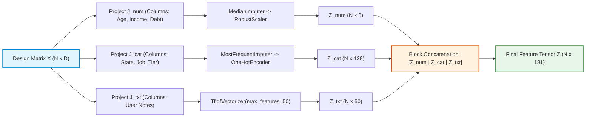
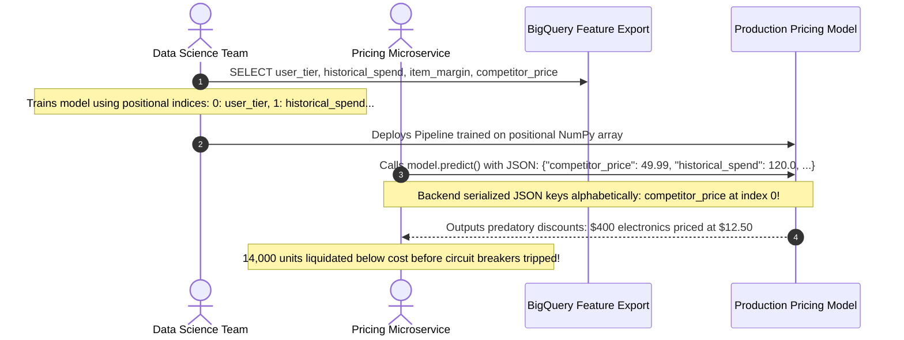

# Module 05: Composable Feature Pipelines with ColumnTransformer & Scikit-Learn

> **Prerequisites**: Solid foundation in Python, NumPy vectorization, Pandas DataFrames, and basic Scikit-learn estimators (`fit`, `predict`). [Track 05 Overview](../README.md).  
> **Estimated Reading Time**: 35 minutes  
> **Target Audience**: Senior Backend Engineers, Machine Learning Engineers, and MLOps Architects building production inference pipelines.

> [!TIP]
> **The Golden Rule of Feature Pipelines**: Never transform features outside an estimator pipeline. A model artifact is not merely the learned weights of a neural network or the split thresholds of a gradient boosted tree; **the model artifact is the end-to-end directed acyclic graph (DAG)** spanning raw client payloads to final predictions. If your preprocessing logic lives in raw Pandas scripts, SQL transformation queries, or separate serving microservices, you will inevitably suffer training-serving skew and silent production degradation.

---

## Why This Matters

In academic tutorials, machine learning workflows often look deceptively simple:
```python
# The Academic Anti-Pattern: DO NOT DO THIS IN PRODUCTION
X_train_scaled = scaler.fit_transform(X_train)
X_test_scaled = scaler.transform(X_test)
model.fit(X_train_scaled, y_train)
```

In enterprise production systems, this fragmented approach collapses immediately under operational realities:
1. **Target and Distribution Leakage**: Computing scaling statistics (mean, variance, quantiles) or imputation medians across the entire dataset prior to cross-validation folds leaks future distribution parameters into the training set, yielding optimistically biased offline validation metrics that crater when deployed live.
2. **Schema Drift and Ordering Mismatches**: When a microservice receives an incoming JSON payload, dictionary keys are unordered or missing optional fields. If preprocessing relies on positional NumPy arrays or implicit column indexing, features are silently mapped to wrong dimensions, leading to catastrophic mispredictions without throwing an exception.
3. **Dual-Codebase Divergence**: When data scientists write feature extraction in Python/Pandas and backend engineers reimplement it in Java, Go, or C++ for low-latency serving, semantic divergence occurs (e.g., standard deviation calculated with $N-1$ degrees of freedom in NumPy vs $N$ in standard C++, or differing regular expression implementations for tokenization).
4. **Serialization Fragmentation**: Storing model weights as one file (`model.pt` or `xgb.json`) while saving encoders in separate pickle blobs or configuration files creates synchronization nightmares during zero-downtime rolling canary deployments.

The Scikit-learn `Pipeline`, `ColumnTransformer`, and `FeatureUnion` abstractions provide the foundational architectural framework for building production-grade, leak-free, mathematically verifiable, and hermetically serializable feature DAGs.

---

## 1. Architectural Mental Model & Theoretical Foundations

### 1.1 The Mathematical Formulation of Composite Feature Transformations

Let a raw tabular dataset $\mathcal{D} = \{\mathbf{x}_i\}_{i=1}^N$ be represented as a design matrix $\mathbf{X} \in \mathcal{X}_1 \times \mathcal{X}_2 \times \dots \times \mathcal{X}_D$, where each feature column $j \in \{1, \dots, D\}$ may belong to a distinct mathematical domain (continuous real numbers $\mathbb{R}$, discrete counts $\mathbb{N}_0$, categorical symbols $\mathcal{C}_j$, or unstructured strings $\mathcal{S}$).

A **Transformer** is an operator $\mathcal{T}: \mathcal{X} \to \mathcal{Z}$ parameterized by learned state $\boldsymbol{\theta}^* \in \Theta$:
$$\mathcal{T}(\mathbf{X}; \boldsymbol{\theta}^*) = \mathbf{Z} \in \mathbb{R}^{N \times K}$$

The state $\boldsymbol{\theta}^*$ is computed strictly during the fitting phase using only training data $\mathbf{X}_{\text{train}}$:
$$\boldsymbol{\theta}^* = \operatorname{Fit}(\mathbf{X}_{\text{train}})$$

For instance:
- **Standardization (Z-score)**: $\boldsymbol{\theta}^* = (\boldsymbol{\mu}, \boldsymbol{\sigma})$, where $\mu_j = \frac{1}{N}\sum_{i=1}^N x_{ij}$ and $\sigma_j = \sqrt{\frac{1}{N-1}\sum_{i=1}^N (x_{ij} - \mu_j)^2}$.
  $$\mathcal{T}_{\text{std}}(\mathbf{x}; \boldsymbol{\mu}, \boldsymbol{\sigma}) = \frac{\mathbf{x} - \boldsymbol{\mu}}{\boldsymbol{\sigma}}$$
- **Min-Max Scaling**: $\boldsymbol{\theta}^* = (\mathbf{x}_{\min}, \mathbf{x}_{\max})$.
  $$\mathcal{T}_{\text{minmax}}(\mathbf{x}; \mathbf{x}_{\min}, \mathbf{x}_{\max}) = \frac{\mathbf{x} - \mathbf{x}_{\min}}{\mathbf{x}_{\max} - \mathbf{x}_{\min}}$$

```mermaid
flowchart TD
    subgraph OfflineTraining["Offline Training (Fit + Transform)"]
        RawTrain["Raw Training Data X_train"] --> CT["ColumnTransformer.fit_transform()"]
        CT --> P1["Numerical Pipeline: Impute -> RobustScale"]
        CT --> P2["Categorical Pipeline: Impute -> OneHotEncode"]
        CT --> P3["Text/Domain Pipeline: Custom Feature Extraction"]
        P1 --> ConcatTrain["Feature Block Concatenation (Sparse/Dense)"]
        P2 --> ConcatTrain
        P3 --> ConcatTrain
        ConcatTrain --> EstimatorFit["Estimator (e.g. LightGBM / Ridge / MLP).fit()"]
        EstimatorFit --> Serialized["Single Frozen Pipeline Artifact (.joblib)"]
    end

    subgraph OnlineServing["Online Inference (Pure Transform - Zero State Mutation)"]
        RawPayload["Live JSON Request / DataFrame"] --> DeSer["Frozen Pipeline Artifact"]
        DeSer --> FrozenTransform["ColumnTransformer.transform() (Read-Only)"]
        FrozenTransform --> FrozenPredict["Estimator.predict() / predict_proba()"]
        FrozenPredict --> Response["Real-time Low-Latency Prediction"]
    end

    style OfflineTraining fill:#f3e5f5,stroke:#7b1fa2,stroke-width:2px
    style OnlineServing fill:#e8f5e9,stroke:#2e7d32,stroke-width:2px
```



### 1.2 Sequential Composition: Pipeline ($\circ$)

A `Pipeline` represents sequential function composition:
$$\mathcal{H} = \mathcal{E} \circ \mathcal{T}_M \circ \dots \circ \mathcal{T}_2 \circ \mathcal{T}_1$$
Where:
- Each intermediate step $\mathcal{T}_m$ must implement the Transformer interface:
  $$\mathbf{Z}_m = \mathcal{T}_m(\mathbf{Z}_{m-1})$$
- The terminal step $\mathcal{E}$ is an Estimator implementing `fit` and `predict` (or `predict_proba`, `decision_function`, or `transform`).

During `fit(X, y)`:
$$\mathbf{Z}_1 = \mathcal{T}_1.\text{fit\_transform}(\mathbf{X}, \mathbf{y})$$
$$\mathbf{Z}_2 = \mathcal{T}_2.\text{fit\_transform}(\mathbf{Z}_1, \mathbf{y})$$
$$\dots$$
$$\mathcal{E}.\text{fit}(\mathbf{Z}_{M-1}, \mathbf{y})$$

During `predict(X)`:
$$\mathbf{Z}_1 = \mathcal{T}_1.\text{transform}(\mathbf{X})$$
$$\mathbf{Z}_2 = \mathcal{T}_2.\text{transform}(\mathbf{Z}_1)$$
$$\dots$$
$$\hat{\mathbf{y}} = \mathcal{E}.\text{predict}(\mathbf{Z}_{M-1})$$

Crucially, **`fit` is never invoked during inference**. The state learned during training remains completely immutable.

### 1.3 Column Partitioning & Block Concatenation: ColumnTransformer ($\oplus$)

In heterogeneous tabular datasets, columns require completely distinct transformation pathways. Let the column index set be $\mathcal{J} = \{1, \dots, D\}$. We partition $\mathcal{J}$ into disjoint subsets:
$$\mathcal{J} = \mathcal{J}_1 \cup \mathcal{J}_2 \cup \dots \cup \mathcal{J}_K, \quad \mathcal{J}_p \cap \mathcal{J}_q = \emptyset \quad \forall p \neq q$$

`ColumnTransformer` applies transformer $\mathcal{T}_k$ specifically to the column projection $\mathbf{X}_{[:, \mathcal{J}_k]}$ and concatenates the output feature spaces horizontally:
$$\mathcal{T}_{\text{composite}}(\mathbf{X}) = \bigoplus_{k=1}^K \mathcal{T}_k\left(\mathbf{X}_{[:, \mathcal{J}_k]}\right) = \left[ \mathcal{T}_1(\mathbf{X}_{[:, \mathcal{J}_1]}) \;\Big|\; \mathcal{T}_2(\mathbf{X}_{[:, \mathcal{J}_2]}) \;\Big|\; \dots \;\Big|\; \mathcal{T}_K(\mathbf{X}_{[:, \mathcal{J}_K]}) \right]$$

If $\mathcal{T}_k$ outputs dimension $d_k$, the resulting matrix dimension is:
$$\mathbf{Z} \in \mathbb{R}^{N \times \sum_{k=1}^K d_k}$$



### 1.4 FeatureUnion vs ColumnTransformer

A frequent point of confusion among engineers is the distinction between `FeatureUnion` and `ColumnTransformer`:
- **`ColumnTransformer`** applies *different* transformers to *disjoint subsets* of columns. It performs column-slicing followed by parallel transformation and concatenation.
- **`FeatureUnion`** applies *multiple different* transformers to the *exact same* input matrix in parallel, concatenating their representations horizontally:
  $$\mathcal{T}_{\text{union}}(\mathbf{X}) = \left[ \mathcal{T}_A(\mathbf{X}) \;\Big|\; \mathcal{T}_B(\mathbf{X}) \right]$$
  For example, extracting both character $n$-grams and word $n$-grams from the same text string, or combining PCA projections with original scaled features.

---

## 2. Systematic Reference & Structural Comparison Grids

### 2.1 Preprocessing Primitives Comparison

| Primitive | Primary Purpose | Input Requirements | Output Shape | Memory Layout | Key Production Hazards |
| :--- | :--- | :--- | :--- | :--- | :--- |
| **`Pipeline`** | Chaining sequential transformation stages and terminal estimator | 2D Array or DataFrame | Matches terminal step | Inherited from final step | Fails if intermediate step does not implement `transform` |
| **`ColumnTransformer`** | Applying targeted pipelines to designated column subsets | Heterogeneous DataFrame or 2D Array | $(N, \sum d_k)$ | Sparse CSR or Dense NumPy array depending on `sparse_threshold` | Silent failure if column order changes when using positional integers |
| **`FeatureUnion`** | Applying multiple extractors to identical features concurrently | 2D Array or DataFrame | $(N, d_A + d_B)$ | Concatenated sparse or dense matrix | Redundant feature computation if transformers share sub-steps |
| **`FunctionTransformer`** | Wrapping stateless functions (e.g. $\log(x+1)$, math operations) | Any array-like | Configurable | Preserved | Fails silently on negative inputs without custom validation; no learned state |
| **Custom Class** (`BaseEstimator`, `TransformerMixin`) | Stateful domain-specific business logic & aggregations | Pandas DataFrame / NumPy | Explicitly engineered feature dimensions | Controlled by implementer | Memory leaks if mutable default parameters or large training sets cached |

### 2.2 Sparse vs. Dense Concatenation Dynamics in ColumnTransformer

`ColumnTransformer(transformers, sparse_threshold=0.3)` controls the output memory format:
- When One-Hot Encoding categorical features with high cardinality, the categorical output is naturally a `scipy.sparse.csr_matrix`.
- If the overall ratio of non-zero elements across all combined feature blocks falls below `sparse_threshold`, the entire composite matrix is cast to a sparse CSR matrix.
- **The Production Trap**: If downstream estimators (e.g., standard neural network layers or certain LightGBM configurations) require dense memory contiguous arrays (`np.ascontiguousarray`), passing a sparse matrix triggers an unexpected runtime error or an implicit high-memory densification copy (`.toarray()`).

---

## 3. Real Production Incident Post-Mortem

### The \$2.4M E-Commerce Dynamic Pricing Silent Shift

| Incident Attribute | Details |
| :--- | :--- |
| **Severity** | SEV-1 (Loss of \$2.4 Million in gross margin within 18 hours) |
| **System** | Real-time Dynamic Pricing Engine (Pricing microservice serving 12,000 req/sec) |
| **Root Cause** | Positional column mismatch between training CSV exports and live serving JSON deserialization |
| **Detection Time** | 18 hours after deployment (caught via sudden margin drop alerting) |

#### Chronology of the Disaster



#### Detailed Technical Root Cause
The data science team wrote their preprocessing pipeline using column indices:
```python
# The Defective Pipeline: Positional Indexing
preprocessor = ColumnTransformer(
    transformers=[
        ('num', StandardScaler(), [1, 2, 3]),
        ('cat', OneHotEncoder(), [0])
    ]
)
```
In offline training, the BigQuery SQL query returned:
`[user_tier (str), historical_spend (float), item_margin (float), competitor_price (float)]`.

During online inference, the Go backend service parsed incoming client JSON into a Go struct, which was marshaled into a generic Python payload. Because JSON dictionaries are unordered key-value maps, Python's `json.loads` or DataFrame creation sorted the columns alphabetically:
`[competitor_price, historical_spend, item_margin, user_tier]`.

The `StandardScaler` received `historical_spend`, `item_margin`, and `user_tier` as numeric indices `[1, 2, 3]`, while `competitor_price` (index 0) was routed to `OneHotEncoder`. Because `competitor_price` was a continuous float (e.g., 49.99, 120.50), the `OneHotEncoder` either encountered unseen categories or blew up the memory, while `historical_spend` was scaled using the mean and standard deviation of `item_margin`. 

Because no schema validation or named column mapping existed, **no exception was raised**. The pipeline evaluated smoothly, outputted corrupted feature representations, and the model priced high-end consumer laptops at 95% discounts.

#### The Remediation
1. **Mandatory Named Column References**: Prohibit integer positional indexing in `ColumnTransformer`. Always use explicit string column names.
2. **Schema Enforcement Wrapper**: Wrap all production pipelines in a validating transformer that verifies input schema, dtypes, and explicit column presence before any mathematical transformation occurs.
3. **End-to-End Pipeline Serialization**: Serialize the entire pipeline including feature names via Scikit-learn's `get_feature_names_out()` and `set_output(transform="pandas")`.

---

## 4. Production Implementation: The Industrial Preprocessing Pipeline

Below is the complete, self-contained, enterprise-grade preprocessing pipeline implementing:
- Robust missing value imputation tailored to distribution characteristics.
- Outlier-resistant numerical scaling.
- Frequency-capped One-Hot Encoding for categorical features with unseen category handling.
- Cyclical sine/cosine transformation for temporal datetime features.
- Custom stateful domain transformer inheriting from `BaseEstimator` and `TransformerMixin` with full `get_feature_names_out` compliance.
- Complete serialization, schema validation, and inference simulation.

```python
"""
production_pipeline.py
================================================================================
Enterprise-grade, leak-free, composable feature engineering pipeline using
Scikit-learn BaseEstimator, TransformerMixin, ColumnTransformer, and Joblib.
"""

import numpy as np
import pandas as pd
from typing import List, Optional, Union
import joblib
import json

from sklearn.base import BaseEstimator, TransformerMixin
from sklearn.compose import ColumnTransformer
from sklearn.pipeline import Pipeline
from sklearn.impute import SimpleImputer
from sklearn.preprocessing import (
    RobustScaler,
    OneHotEncoder,
    FunctionTransformer
)
from sklearn.ensemble import HistGradientBoostingRegressor
from sklearn.metrics import mean_squared_error, r2_score
from sklearn.model_selection import train_test_split


# =====================================================================
# 1. Custom Stateful Transformer: Interaction & Domain Features
# =====================================================================
class DomainCreditFeatureEngineer(BaseEstimator, TransformerMixin):
    """
    Computes domain-specific financial health metrics and interaction ratios.
    Strictly follows Scikit-Learn API conventions:
    - __init__ has NO *args or **kwargs, only explicit parameters.
    - fit() computes and stores state with trailing underscore (e.g., epsilon_).
    - transform() applies immutable transformations.
    - get_feature_names_out() enables seamless downstream tracking.
    """
    def __init__(self, debt_to_income_clip: float = 10.0, epsilon: float = 1e-6):
        self.debt_to_income_clip = debt_to_income_clip
        self.epsilon = epsilon

    def fit(self, X: pd.DataFrame, y: Optional[pd.Series] = None):
        # Validate input schema
        if not isinstance(X, pd.DataFrame):
            raise TypeError("DomainCreditFeatureEngineer expects a pandas DataFrame.")
        
        required_cols = {"total_debt", "annual_income", "credit_lines", "late_payments_last_2yr"}
        missing = required_cols - set(X.columns)
        if missing:
            raise ValueError(f"Missing required columns for domain engineering: {missing}")

        # Store learned state (even if small or constant) with trailing underscore
        self.epsilon_ = float(self.epsilon)
        self.debt_to_income_clip_ = float(self.debt_to_income_clip)
        self.n_features_in_ = X.shape[1]
        self.feature_names_in_ = np.array(X.columns, dtype=object)
        
        return self

    def transform(self, X: pd.DataFrame) -> pd.DataFrame:
        if not isinstance(X, pd.DataFrame):
            raise TypeError("DomainCreditFeatureEngineer expects a pandas DataFrame.")

        X_out = pd.DataFrame(index=X.index)

        # 1. Debt-to-Income Ratio
        dti = X["total_debt"] / (X["annual_income"] + self.epsilon_)
        X_out["debt_to_income_ratio"] = dti.clip(upper=self.debt_to_income_clip_)

        # 2. Delinquency Severity Index
        # Interaction between late payments and total number of credit lines
        X_out["delinquency_per_line"] = (
            X["late_payments_last_2yr"] / (X["credit_lines"] + 1.0)
        )

        return X_out

    def get_feature_names_out(self, input_features: Optional[List[str]] = None) -> np.ndarray:
        return np.array(["debt_to_income_ratio", "delinquency_per_line"], dtype=object)


# =====================================================================
# 2. Custom Stateless Transformer: Cyclical Datetime Encoding
# =====================================================================
def encode_cyclical_month(df: pd.DataFrame) -> pd.DataFrame:
    """Encodes transaction_month (1-12) into continuous sin/cos components."""
    month = df["transaction_month"].astype(float)
    sin_month = np.sin(2 * np.pi * (month - 1) / 12.0)
    cos_month = np.cos(2 * np.pi * (month - 1) / 12.0)
    return pd.DataFrame({"month_sin": sin_month, "month_cos": cos_month}, index=df.index)

def get_cyclical_month_feature_names(transformer, input_features: List[str]) -> np.ndarray:
    return np.array(["month_sin", "month_cos"], dtype=object)


# =====================================================================
# 3. Input Schema Validation Transformer (Production Guardrail)
# =====================================================================
class SchemaValidator(BaseEstimator, TransformerMixin):
    """
    Validates that incoming inference payloads conform strictly to expected
    column names and datatypes, guarding against silent positional shifts.
    """
    def __init__(self, expected_columns: List[str]):
        self.expected_columns = expected_columns

    def fit(self, X: pd.DataFrame, y: Optional[pd.Series] = None):
        self.expected_columns_ = list(self.expected_columns)
        return self

    def transform(self, X: pd.DataFrame) -> pd.DataFrame:
        if not isinstance(X, pd.DataFrame):
            raise TypeError(f"Expected pandas DataFrame, received {type(X)}")
        
        missing_cols = set(self.expected_columns_) - set(X.columns)
        if missing_cols:
            raise ValueError(f"Schema Validation Failed: Missing columns {missing_cols}")
        
        # Return dataframe strictly reindexed to match training column order
        return X[self.expected_columns_]

    def get_feature_names_out(self, input_features: Optional[List[str]] = None) -> np.ndarray:
        return np.array(self.expected_columns_, dtype=object)


# =====================================================================
# 4. Pipeline Factory & Assembly
# =====================================================================
def build_production_pipeline(all_feature_columns: List[str]) -> Pipeline:
    """
    Constructs the end-to-end composite feature DAG and estimator.
    """
    # Define Column Subsets
    num_cols = ["annual_income", "total_debt", "credit_lines", "late_payments_last_2yr"]
    cat_cols = ["employment_status", "home_ownership_status"]
    temporal_cols = ["transaction_month"]
    domain_cols = ["total_debt", "annual_income", "credit_lines", "late_payments_last_2yr"]

    # Numerical Sub-pipeline
    num_pipeline = Pipeline([
        ("imputer", SimpleImputer(strategy="median")),
        ("scaler", RobustScaler(with_centering=True, with_scaling=True))
    ])

    # Categorical Sub-pipeline
    cat_pipeline = Pipeline([
        ("imputer", SimpleImputer(strategy="constant", fill_value="UNKNOWN")),
        ("onehot", OneHotEncoder(
            handle_unknown="ignore", 
            sparse_output=False, 
            min_frequency=5  # Groups rare long-tail categories into infrequents
        ))
    ])

    # Temporal Cyclical Sub-pipeline
    temporal_pipeline = Pipeline([
        ("cyclical_encoding", FunctionTransformer(
            func=encode_cyclical_month,
            feature_names_out=get_cyclical_month_feature_names
        ))
    ])

    # Domain Engineering Sub-pipeline
    domain_pipeline = Pipeline([
        ("domain_math", DomainCreditFeatureEngineer())
    ])

    # Composite ColumnTransformer
    preprocessor = ColumnTransformer(
        transformers=[
            ("num", num_pipeline, num_cols),
            ("cat", cat_pipeline, cat_cols),
            ("temporal", temporal_pipeline, temporal_cols),
            ("domain", domain_pipeline, domain_cols),
        ],
        remainder="drop",
        sparse_threshold=0.0  # Force dense NumPy representation for tabular boosting
    )

    # Master End-to-End Pipeline
    master_pipeline = Pipeline([
        ("validator", SchemaValidator(expected_columns=all_feature_columns)),
        ("preprocessor", preprocessor),
        ("regressor", HistGradientBoostingRegressor(
            max_iter=150, 
            learning_rate=0.05, 
            random_state=42
        ))
    ])

    return master_pipeline


# =====================================================================
# 5. Pipeline Verification & Simulation Run
# =====================================================================
def generate_synthetic_credit_data(n_samples: int = 2000, seed: int = 42) -> pd.DataFrame:
    rng = np.random.default_rng(seed)
    
    annual_income = rng.lognormal(mean=10.8, sigma=0.6, size=n_samples)
    total_debt = annual_income * rng.uniform(0.1, 1.2, size=n_samples)
    credit_lines = rng.integers(1, 20, size=n_samples)
    late_payments = rng.poisson(lam=0.7, size=n_samples)
    
    employment = rng.choice(["FULL_TIME", "PART_TIME", "SELF_EMPLOYED", "UNEMPLOYED", None], 
                            p=[0.65, 0.15, 0.10, 0.05, 0.05], size=n_samples)
    home_ownership = rng.choice(["RENT", "MORTGAGE", "OWN", "OTHER"], 
                                p=[0.45, 0.40, 0.14, 0.01], size=n_samples)
    month = rng.integers(1, 13, size=n_samples)

    # Generate synthetic target: credit risk score (lower is safer, higher is risky)
    # y = f(debt/income, late_payments) + noise
    dti = total_debt / (annual_income + 1e-5)
    risk_score = (
        300.0 
        + 120.0 * dti 
        + 45.0 * late_payments 
        - 15.0 * (employment == "FULL_TIME") 
        + rng.normal(0, 15, size=n_samples)
    )

    df = pd.DataFrame({
        "annual_income": annual_income,
        "total_debt": total_debt,
        "credit_lines": credit_lines,
        "late_payments_last_2yr": late_payments,
        "employment_status": employment,
        "home_ownership_status": home_ownership,
        "transaction_month": month,
        "risk_score": risk_score
    })
    return df


if __name__ == "__main__":
    print("[*] Generating synthetic credit risk dataset...")
    raw_df = generate_synthetic_credit_data(n_samples=3000, seed=42)
    
    feature_columns = [col for col in raw_df.columns if col != "risk_score"]
    X = raw_df[feature_columns]
    y = raw_df["risk_score"]

    X_train, X_test, y_train, y_test = train_test_split(
        X, y, test_size=0.2, random_state=42
    )

    print(f"[*] Training dataset shape: {X_train.shape}")
    print(f"[*] Test dataset shape:     {X_test.shape}")

    # Build and fit pipeline
    pipeline = build_production_pipeline(all_feature_columns=feature_columns)
    
    print("[*] Fitting master composite pipeline...")
    pipeline.fit(X_train, y_train)

    # Inspect learned feature names
    preprocessor = pipeline.named_steps["preprocessor"]
    feature_names = preprocessor.get_feature_names_out()
    print(f"[✓] Feature Engineering Complete. Generated {len(feature_names)} features:")
    for idx, fname in enumerate(feature_names):
        print(f"    {idx+1:02d}. {fname}")

    # Offline Evaluation
    y_pred = pipeline.predict(X_test)
    rmse = np.sqrt(mean_squared_error(y_test, y_pred))
    r2 = r2_score(y_test, y_pred)
    print(f"\n[+] Offline Evaluation Results:")
    print(f"    RMSE: {rmse:.4f}")
    print(f"    R² Score: {r2:.4f}")

    # Save artifact to disk
    model_artifact_path = "credit_risk_pipeline.joblib"
    print(f"[*] Serializing pipeline artifact to {model_artifact_path}...")
    joblib.dump(pipeline, model_artifact_path, compress=3)
    print("[✓] Model artifact saved successfully.")

    # =================================================================
    # Online Low-Latency Inference Simulation
    # =================================================================
    print("\n" + "="*70)
    print("ONLINE SERVING SIMULATION (Unordered JSON Payload)")
    print("="*70)

    # Load frozen artifact
    loaded_pipeline: Pipeline = joblib.load(model_artifact_path)

    # Incoming raw JSON payload from HTTP POST request with SHUFFLED keys & missing optional values
    raw_json_request = """
    {
        "transaction_month": 11,
        "home_ownership_status": "RENT",
        "late_payments_last_2yr": 1,
        "annual_income": 85000.0,
        "total_debt": 24000.0,
        "credit_lines": 5,
        "employment_status": "FULL_TIME"
    }
    """
    parsed_payload = json.loads(raw_json_request)
    live_df = pd.DataFrame([parsed_payload])

    # Run inference directly through the frozen graph
    prediction = loaded_pipeline.predict(live_df)
    print(f"[✓] Successfully executed inference on raw JSON payload.")
    print(f"    Predicted Credit Risk Score: {prediction[0]:.2f}")

    # Simulate Invalid Payload: Missing required column
    try:
        invalid_payload = parsed_payload.copy()
        del invalid_payload["annual_income"]
        loaded_pipeline.predict(pd.DataFrame([invalid_payload]))
    except ValueError as err:
        print(f"[✓] Successfully intercepted corrupted payload via SchemaValidator:")
        print(f"    {err}")
```

---

## 5. Common Pitfalls, Failure Modes & Antipatterns

### 5.1 Antipattern 1: Applying Transformations Before Cross-Validation Split

```python
# ❌ THE FATAL LEAKAGE ANTIPATTERN
# Computing statistics across the entire design matrix X
scaler = StandardScaler()
X_scaled = scaler.fit_transform(X)

# Cross-validation evaluated on pre-scaled data
scores = cross_val_score(model, X_scaled, y, cv=5)
# Validation metric is artificially inflated because each fold's test set
# was used to compute the global mean and standard deviation!
```

```python
# ✅ THE LEAK-FREE PRODUCTION PATTERN
# Encapsulate the scaler inside the pipeline
pipeline = Pipeline([
    ('scaler', StandardScaler()),
    ('model', LogisticRegression())
])
# cross_val_score automatically calls fit_transform ONLY on training folds
scores = cross_val_score(pipeline, X, y, cv=5)
```

### 5.2 Antipattern 2: Mutable Default Arguments & State Leaks in Custom Transformers

When writing custom classes inheriting from `BaseEstimator`, never mutate input parameters or pass mutable default arguments in `__init__`.

```python
# ❌ ANTIPATTERN: Mutable default and mutating input data
class BadTransformer(BaseEstimator, TransformerMixin):
    def __init__(self, drop_cols=[]):  # MUTABLE DEFAULT!
        self.drop_cols = drop_cols

    def fit(self, X, y=None):
        return self

    def transform(self, X):
        # Mutates caller's original DataFrame in memory!
        X.drop(columns=self.drop_cols, inplace=True)
        return X
```

```python
# ✅ PRODUCTION PATTERN: Immutable, explicit, deep-copied operations
class GoodTransformer(BaseEstimator, TransformerMixin):
    def __init__(self, drop_cols: Optional[List[str]] = None):
        self.drop_cols = drop_cols  # Unmodified attribute

    def fit(self, X: pd.DataFrame, y: Optional[pd.Series] = None):
        # Store validated attributes with trailing underscore
        self.drop_cols_ = list(self.drop_cols) if self.drop_cols is not None else []
        return self

    def transform(self, X: pd.DataFrame) -> pd.DataFrame:
        # Never mutate X directly; return a copy or new projection
        return X.drop(columns=self.drop_cols_, errors="ignore").copy()
```

### 5.3 Antipattern 3: The Broken `get_feature_names_out` Chain

In Scikit-learn $\ge 1.2$, downstream feature selection, SHAP model interpretability, and monitoring pipelines require `get_feature_names_out()`. If any intermediate custom transformer in a `ColumnTransformer` fails to implement `get_feature_names_out()`, the entire pipeline's `get_feature_names_out()` raises an `AttributeError`, crippling production model explainability dashboards.

---

## 6. Pipeline Serialization: Joblib, Skops, and Versioning

### 6.1 The Mechanics and Security Risks of Joblib / Pickle
Scikit-learn models are typically serialized using `joblib.dump()`. It is crucial to understand what `pickle` / `joblib` actually serializes:
1. It does **not** serialize the Python bytecode or method implementation.
2. It serializes the **class module path** (e.g., `mymodule.submodule.DomainCreditFeatureEngineer`) and the instance's **`__dict__` state attributes** (`epsilon_`, `debt_to_income_clip_`).
3. **Arbitrary Code Execution**: Deserializing an untrusted `.pkl` or `.joblib` file can execute arbitrary OS system calls via Python's `__reduce__` hook. Never unpickle models from unauthenticated S3 buckets or public HTTP endpoints.

### 6.2 Version Pinning and Architecture Safeguards
If a model is trained using `scikit-learn==1.4.0` and loaded in a serving pod running `scikit-learn==1.5.0`, internal structure differences (e.g., private attribute renames like `_n_features` $\to$ `n_features_in_`) will cause silent bugs or immediate deserialization crashes.

#### Best Practices for Production Artifact Packaging
1. **Containerized Environment**: Pin `scikit-learn`, `numpy`, `scipy`, and `joblib` down to patch versions in your Docker image.
2. **Metadata Sidecar File**: Save a `metadata.json` sidecar alongside `pipeline.joblib`:
```json
{
  "artifact_hash": "e3b0c44298fc1c149afbf4c8996fb92427ae41e4649b934ca495991b7852b855",
  "python_version": "3.11.8",
  "dependencies": {
    "scikit-learn": "1.4.1.post1",
    "numpy": "1.26.4",
    "pandas": "2.2.1",
    "joblib": "1.3.2"
  },
  "training_timestamp_utc": "2026-11-19T10:14:00Z",
  "input_schema": {
    "annual_income": "float64",
    "total_debt": "float64",
    "employment_status": "object"
  }
}
```
3. **Safe Serialization with `skops`**: For zero-code-execution environments, use the `skops.io` library (`skops.io.dump`), which serializes Scikit-learn pipelines without arbitrary Python code execution vulnerabilities.

---

## 7. Hyperparameter Tuning Across Composite Pipelines

When optimizing hyperparameters across a `Pipeline` containing a `ColumnTransformer`, parameter names must be addressed using double-underscore (`__`) notation indicating the nested path through the DAG:

```python
from sklearn.model_selection import RandomizedSearchCV

param_distributions = {
    # 1. Parameter inside a transformer in ColumnTransformer:
    # <step_name>__<transformer_name>__<substep_name>__<parameter>
    "preprocessor__num__imputer__strategy": ["median", "mean"],
    "preprocessor__cat__onehot__min_frequency": [2, 5, 10, 20],
    
    # 2. Parameter inside custom transformer:
    "preprocessor__domain__domain_math__debt_to_income_clip": [5.0, 10.0, 15.0],
    
    # 3. Estimator hyperparameters:
    "regressor__learning_rate": [0.01, 0.05, 0.1],
    "regressor__max_iter": [100, 200, 300],
    "regressor__l2_regularization": [0.0, 1e-3, 1e-1]
}

search = RandomizedSearchCV(
    estimator=pipeline,
    param_distributions=param_distributions,
    n_iter=25,
    cv=5,
    scoring="neg_root_mean_squared_error",
    n_jobs=-1,
    random_state=42
)
search.fit(X_train, y_train)

print(f"Optimal Hyperparameters: {search.best_params_}")
```

During cross-validation, Scikit-learn clones the entire pipeline DAG for each fold. For each candidate hyperparameter combination, the imputer recalculates medians and the OneHotEncoder re-indexes categories strictly on the $K-1$ training folds, completely preventing data leakage across hyperparameter selection.

---

## 8. Senior Technical Interview Scenarios & Worked Solutions

### Question 1: Memory Layout and Sparse Concatenation in ColumnTransformer
**Scenario:** *"You are building an advertising click-through rate (CTR) prediction pipeline. You have 10 continuous numerical features and 5 categorical features. One of the categorical features has a cardinality of 50,000 unique campaign IDs. When you run `ColumnTransformer` followed by an XGBoost model, your inference pod runs out of memory (OOM) under moderate load. What is happening internally, and how do you re-architect the pipeline?"*

**Model Answer:**
1. **Diagnosis**: When applying `OneHotEncoder` to a feature with 50,000 levels, the output is a high-dimensional sparse matrix ($N \times 50,000$). By default, `ColumnTransformer` evaluates `sparse_threshold=0.3`. If the overall density of non-zero elements across all combined columns is less than 0.3, `ColumnTransformer` outputs a `scipy.sparse.csr_matrix`. However, if downstream operations or user transformations call `.toarray()` or pass the matrix to an estimator that does not natively support CSR format efficiently, the matrix is expanded into dense 64-bit floating-point format:
   $$\text{RAM per row} = 50,000 \times 8 \text{ bytes} \approx 400 \text{ KB per sample}$$
   For a micro-batch of 1,000 inference requests, this expands to $\approx 400 \text{ MB}$ of instantaneous memory allocation per worker thread, causing immediate container OOM.
2. **Architectural Remediation**:
   - **Eliminate High-Cardinality One-Hot Encoding**: Replace `OneHotEncoder` with out-of-fold target encoding, CatBoost native categorical encoding, or Feature Hashing (`HashingVectorizer` / `FeatureHasher` with $2^{12} = 4096$ bins).
   - **Frequency Pruning**: Set `OneHotEncoder(min_frequency=100, max_categories=100, handle_unknown='infrequent_if_exist')` to limit expansion strictly to the top frequent categories.
   - **Embedding Lookup**: In production CTR systems, categorical IDs should be routed to low-dimensional dense entity embeddings (e.g., 32-dimensional embedding vectors) rather than high-dimensional sparse indicator vectors.

---

### Question 2: Implementing a Leak-Free Out-of-Fold Target Encoder Inside Pipeline
**Scenario:** *"Target encoding replaces categorical levels with the expected value of the target $y$. If implemented naively inside a custom TransformerMixin, target encoding severely overfits and leaks target information into training folds. How do you design an out-of-fold target encoding transformer that safely integrates into a Scikit-learn Pipeline?"*

**Model Answer:**
1. **The Leakage Mechanism**: If a category $c$ appears only once in the dataset with $y=1$, a naive target encoder computes $\bar{y}_c = 1.0$. The downstream estimator learns that any sample with encoded value $1.0$ is guaranteed positive, creating an extreme shortcut that fails to generalize.
2. **Architectural Solution**:
   - In `fit(X, y)`: Calculate the **global prior** $\mu = \mathbb{E}[y]$ and the per-category smoothed statistics using empirical Bayes shrinkage:
     $$S_c = \frac{n_c \cdot \bar{y}_c + m \cdot \mu}{n_c + m}$$
     where $m$ is a smoothing weight. Store these mappings in `self.encoding_map_`.
   - In `fit_transform(X, y)`: **Do not** simply call `fit(X, y).transform(X)`. You must use **$K$-Fold cross-fitting internally**. Divide $X$ into $K$ internal splits (e.g., $K=5$). For each fold $k$, compute category encodings using only the remaining $K-1$ folds, and transform the held-out $k$-th fold. This guarantees that each training row's encoded target feature was computed without ever seeing that row's own target value.
   - In `transform(X)`: Use the global smoothed mappings `self.encoding_map_` computed across the entire training set.
   *(Note: Scikit-learn $\ge 1.3$ natively provides `TargetEncoder(cv=5, smooth="auto")` implementing this exact out-of-fold cross-fitting protocol).*

---

### Question 3: Handling Missing Features and Unseen Categories in Live Microservices
**Scenario:** *"During a black swan retail event, mobile clients running an older iOS version send requests where the `user_device_os` field is omitted completely, and a newly launched marketing campaign passes `campaign_code='SUMMER_BLOWOUT_2026'`, which did not exist during model training. How does a production Scikit-learn pipeline handle these without crashing or generating silent corruptions?"*

**Model Answer:**
1. **Missing Column Handling via Schema Pre-Transformation**:
   A raw `ColumnTransformer` crashes if a declared column name is completely missing from the input DataFrame. To solve this, the very first step in the Pipeline must be a custom `SchemaValidator` or `MissingColumnFiller`:
   ```python
   class ColumnReconciler(BaseEstimator, TransformerMixin):
       def __init__(self, expected_schema: dict):
           self.expected_schema = expected_schema
       def fit(self, X, y=None):
           return self
       def transform(self, X: pd.DataFrame) -> pd.DataFrame:
           X_out = X.copy()
           for col, default_val in self.expected_schema.items():
               if col not in X_out.columns:
                   X_out[col] = default_val
           return X_out[list(self.expected_schema.keys())]
   ```
2. **Unseen Categorical Handling**:
   Configure `OneHotEncoder` with:
   - `handle_unknown="ignore"`: Emits a row of all zeros for unseen categories instead of raising a `ValueError: Found unknown categories`.
   - Alternatively, `handle_unknown="infrequent_if_exist"` combined with `min_frequency`: Groups rare categories during training into an `infrequent_sklearn` bin and maps all unseen production categories directly into this infrequent bin.
3. **Missing Value Imputation**:
   Downstream categorical pipelines must include `SimpleImputer(strategy="constant", fill_value="MISSING")` prior to one-hot encoding so null or missing fields become an explicit categorical signal rather than an unhandled `NaN`.

---

### Question 4: Stateful vs Stateless Transformers and Memory Leaks
**Scenario:** *"An ML engineer wraps a PyTorch embedding model inside a Scikit-learn `TransformerMixin` to generate text embeddings inside a Pipeline. During cross-validation with 10 folds and a grid search of 20 iterations (200 fits), the training cluster runs out of memory and crashes. Profiling shows memory never garbage-collects between iterations. What is the cause and how do you resolve it?"*

**Model Answer:**
1. **The Culprit: Circular References and PyTorch Autograd Graph Retention**:
   When `TransformerMixin` is cloned by `GridSearchCV` or `cross_val_score`, `sklearn.base.clone` performs a deep copy of estimator parameters. If the custom transformer creates PyTorch tensors during `transform()` without detaching them from the computational graph (`x.detach()`), the entire computational graph—including backward gradients, activations, and GPU memory allocations—remains referenced by the tensor objects stored inside the transformer instance.
2. **Scikit-learn Cloning Mechanics**:
   `GridSearchCV` retains all fitted estimator instances across all 200 iterations in `cv_results_['estimators']` until search completion. If each transformer instance holds megabytes or gigabytes of uncollected graph memory, an OOM crash is inevitable.
3. **Resolution**:
   - Wrap all neural inference blocks in `with torch.no_grad():`.
   - Explicitly convert all tensor outputs back to NumPy arrays: `tensor.detach().cpu().numpy()`.
   - Never store intermediate activations or input DataFrames as instance attributes (`self.X = X`) inside `fit()` or `transform()`. Only store lightweight summary statistics and parameter weights.
   - Implement explicit garbage collection triggers or clear CUDA caches (`torch.cuda.empty_cache()`) inside the transformer's lifecycle if native memory fragmentation occurs.
