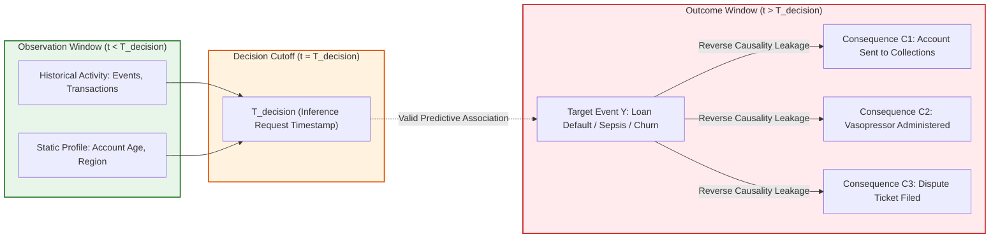
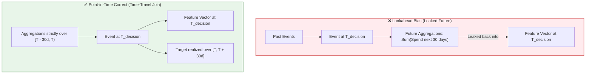
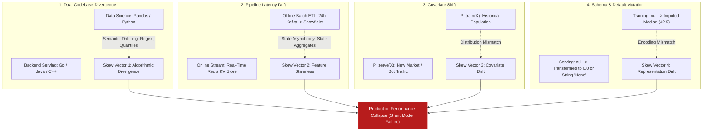
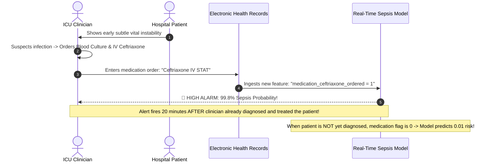
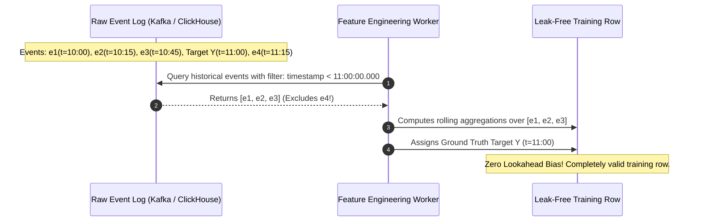

# Module 06: Preventing Training-Serving Skew and Target Leakage

> **Prerequisites**: Familiarity with supervised learning workflows, cross-validation, and composable preprocessing pipelines ([Module 05](../05-sklearn-pipelines-and-column-transformers/README.md)). [Track 05 Overview](../README.md).  
> **Estimated Reading Time**: 38 minutes  
> **Target Audience**: Staff ML Engineers, Data Platform Engineers, and Backend Systems Architects deploying mission-critical predictive systems.

> [!TIP]
> **The Golden Rule of Leakage & Skew**: If a model achieves suspiciously extraordinary offline performance with minimal tuning, **it is almost certainly leaking the future or the target**. Every feature fed into a training matrix must strictly satisfy the **Point-in-Time Constraint**: *At the exact millisecond $T_{\text{decision}}$ when the inference prediction must be emitted, did this exact feature value exist, was it queryable, and did its computation exclude any downstream consequence of the target event?* If the answer to any of those conditions is no, your model is contaminated.

---

## Why This Matters

Nothing destroys the business credibility of a machine learning team faster than a model that posts a 0.98 ROC-AUC in offline notebooks, only to catastrophically collapse to random guessing (0.51 ROC-AUC) or trigger multi-million-dollar operational losses upon live production deployment.

This failure pattern stems from two insidious, tightly coupled phenomena:
1. **Target Leakage**: Information from the ground-truth target variable $y$ (or from events occurring *after* the target event) inadvertently leaks into the feature matrix $\mathbf{X}$ during training. The estimator learns to exploit these spurious shortcuts rather than identifying true causal or predictive signals.
2. **Training-Serving Skew**: A fundamental discrepancy between the feature values, distributions, or computation logic used during offline training versus online real-time serving. The model is asked to predict on an input distribution it has never witnessed.

Unlike syntax errors, shape mismatches, or missing keys, leakage and skew **fail silently**. The code executes without throwing exceptions, the latency metrics look pristine, and the loss curves decrease beautifully. Only business metrics—chargeback spikes, untreated patients, defaulted loans, or cratered conversion rates—reveal the catastrophe.

---

## 1. Architectural & Mathematical Foundations

### 1.1 The Causal Directed Acyclic Graph (DAG) of Prediction

To reason formally about leakage, we frame feature engineering inside a causal timeline:



Let $T_{\text{decision}} \in \mathbb{R}^+$ denote the exact temporal instant at which a prediction $\hat{y}$ is generated.
- The **Target Variable** $y$ represents an outcome state realized in the interval $[T_{\text{decision}}, T_{\text{decision}} + \Delta t_{\text{outcome}}]$.
- A **Valid Feature** $x_j(t)$ is a measurable quantity whose value is fixed and accessible at $t \le T_{\text{decision}}$:
  $$x_j \in \sigma\left(\mathcal{F}_{T_{\text{decision}}}\right)$$
  where $\mathcal{F}_t$ is the natural filtration (the historical information flow) of the data-generating process up to time $t$.
- A **Leaked Feature** $x_{\text{leak}}$ violates this filtration condition: it depends on information realized in $\mathcal{F}_{t}$ where $t > T_{\text{decision}}$, or it is a direct causal child of the target $y$:
  $$y \to x_{\text{leak}} \quad \text{rather than} \quad x_{\text{valid}} \to y$$

---

### 1.2 The Three Fundamental Leakage Archetypes

#### Archetype 1: Preprocessing & Cross-Validation Leakage (Distribution Leakage)
This occurs when statistical parameters $\boldsymbol{\theta}$ of the transformation function $\mathcal{T}(\mathbf{X}; \boldsymbol{\theta})$ are estimated using the union of the training set $\mathcal{D}_{\text{train}}$ and validation/test set $\mathcal{D}_{\text{test}}$.

$$\boldsymbol{\theta}^* = \operatorname{Fit}(\mathcal{D}_{\text{train}} \cup \mathcal{D}_{\text{test}})$$

Let $z$ be a normalized feature using global sample statistics:
$$z_i = \frac{x_i - \hat{\mu}_{\text{global}}}{\hat{\sigma}_{\text{global}}}, \quad \text{where } \hat{\mu}_{\text{global}} = \frac{1}{N_{\text{train}} + N_{\text{test}}} \left( \sum_{i \in \text{train}} x_i + \sum_{j \in \text{test}} x_j \right)$$

Because $\hat{\mu}_{\text{global}}$ contains $\sum_{j \in \text{test}} x_j$, every training sample $z_i$ contains an infinitesimal trace of information from every test sample:
$$\frac{\partial z_i}{\partial x_j} = -\frac{1}{(N_{\text{train}} + N_{\text{test}})\hat{\sigma}_{\text{global}}} \neq 0 \quad \forall j \in \text{test}$$

While often minor for simple mean imputation on huge datasets, this leakage becomes fatal when applying:
- **Outlier clipping** based on global quantiles.
- **Dimensionality reduction** (e.g., PCA, UMAP) where eigenvectors rotate to capture variance present only in the test set.
- **Target Encoding** without out-of-fold regularization, where the test set's target labels bleed into category mappings.

#### Archetype 2: Target / Reverse-Causality Leakage (Consequence Leakage)
Target leakage occurs when a feature is an operational consequence or surrogate of the target label rather than a precursor.

Formally, the mutual information $I(X_j; Y)$ approaches the total entropy of the target $H(Y)$:
$$I(X_j; Y) = \sum_{x \in \mathcal{X}} \sum_{y \in \mathcal{Y}} P(x, y) \log \frac{P(x, y)}{P(x)P(y)} \approx H(Y)$$

In relational databases, this frequently happens when a database column is updated *retroactively* when the target event occurs:
- Predicting **Credit Default**: Feature `account_closed_reason` or `collections_agency_assigned_flag`. The column is `NULL` initially, but when the user defaults, an automated backend cron job writes `'UNCOLLECTIBLE'` into the table. When extracting historical snapshots via a naive `SELECT * FROM accounts`, the training row receives this retroactive label.
- Predicting **Hospital Sepsis**: Feature `blood_culture_order_status` or `intravenous_antibiotics_code`. These medications are ordered precisely because the attending physician already diagnosed sepsis.

#### Archetype 3: Temporal / Lookahead Leakage (Future Peeking)
Temporal leakage occurs when calculating aggregations or metrics over a sliding temporal window $[t_1, t_2]$ where $t_2 > T_{\text{decision}}$.



If an engineer computes a rolling 30-day transaction count using SQL:
```sql
-- ❌ LEAKED SQL QUERY: Window spans into the future
SELECT 
    user_id,
    transaction_date,
    COUNT(*) OVER(PARTITION BY user_id ORDER BY transaction_date 
                  ROWS BETWEEN 15 PRECEDING AND 15 FOLLOWING) AS tx_window_30d
FROM transactions;
```
The feature `tx_window_30d` for a transaction on June 15 incorporates transactions up to June 30. During live inference on June 15, events between June 16 and June 30 have not happened yet.

---

### 1.3 Training-Serving Skew: The Four Vectors of Production Drift

Even with zero target leakage, a model can fail catastrophically due to **Training-Serving Skew**:

$$\mathcal{P}_{\text{train}}(\mathbf{X}, Y) \neq \mathcal{P}_{\text{serving}}(\mathbf{X}, Y)$$



1. **Dual-Codebase Divergence**: Preprocessing written in Python (`pandas.cut`, `scipy.stats.boxcox`) is reimplemented in Go, C++, or SQL for sub-10ms serving. A difference in edge-case handling (e.g. `pd.cut(..., right=True)` vs Go's `<` comparison) produces subtly altered feature values.
2. **Feature Staleness (Pipeline Latency)**: Offline training queries batch tables where all events have finalized. In online serving, streaming pipelines (Kafka $\to$ Flink $\to$ Redis) suffer replication lag ($\Delta t_{\text{lag}}$). A feature `user_failed_logins_last_5min` reads 0 from a delayed cache while the user is actively undergoing a credential-stuffing attack.
3. **Covariate Shift ($P_{\text{train}}(\mathbf{X}) \neq P_{\text{serve}}(\mathbf{X})$)**: Input feature distributions change due to external factors (marketing campaign targeting a new demographic, macroeconomic inflation altering spending distributions), while the conditional label probability $P(Y|\mathbf{X})$ remains fixed.
4. **Representation Drift**: Downstream API changes. For example, a upstream microservice changes an empty field from `null` to `""` (empty string) or `-1`. The offline pipeline imputed `NaN` with the median, but the online model receives `-1` as a valid numeric input.

---

## 2. Real Production Incident Post-Mortem

### Case Study: The Healthcare Clinical Sepsis Early Warning Disaster

| Incident Attribute | Details |
| :--- | :--- |
| **Domain** | Critical Care Medicine (Inpatient Hospital Early Warning System) |
| **System** | Real-Time Sepsis Predictor (Alerting intensive care unit nurses 4 hours prior to septic shock) |
| **Offline Performance** | ROC-AUC: **0.992**, Average Precision: **0.941** |
| **Production Performance** | ROC-AUC: **0.528** (Essentially random guessing; hundreds of false alarms per day) |
| **Impact** | Alert fatigue leading to nurses muting the system; severe hospital operational disruption; \$4.8M regulatory compliance inquiry |

#### Chronology & Discovery
1. **The Model**: A gradient-boosted tree (XGBoost) was trained on 5 years of Electronic Health Records (EHR) to predict whether a hospitalized patient would develop clinical sepsis within the subsequent 6 hours.
2. **The Offline Triumph**: Cross-validation demonstrated virtually flawless predictive power. The model was cleared by medical compliance and deployed as a real-time bedside alert.
3. **The Production Crash**: Within 48 hours of go-live in the intensive care unit, the system generated 350 false positive alarms per day. In true sepsis cases, it failed to trigger until after the patient had already deteriorated into septic shock.



#### The Root Cause Analysis
During offline feature extraction from the hospital's historical SQL warehouse, the feature engineering query joined two tables:
- `encounters` (patient admission and discharge timestamps)
- `medication_administrations` (records of drugs dispensed)

The query author wrote:
```sql
SELECT 
    e.patient_id,
    e.encounter_id,
    e.observation_timestamp,
    -- ❌ TARGET LEAKAGE: Checks if antibiotics were ever ordered in this encounter!
    MAX(CASE WHEN m.drug_class = 'BROAD_SPECTRUM_ANTIBIOTIC' THEN 1 ELSE 0 END) AS received_antibiotics,
    -- ❌ TEMPORAL LEAKAGE: Blood culture timestamp vs observation cutoff
    COUNT(bc.culture_id) AS blood_cultures_drawn,
    e.sepsis_onset_label
FROM encounters e
LEFT JOIN medications m ON e.patient_id = m.patient_id 
    -- FAILED TO ENFORCE: m.admin_time <= e.observation_timestamp
LEFT JOIN blood_cultures bc ON e.patient_id = bc.patient_id
    -- FAILED TO ENFORCE: bc.order_time <= e.observation_timestamp
GROUP BY 1, 2, 3, 6;
```

**The Two Lethal Flaws**:
1. **Reverse Causality**: In hospital clinical practice, doctors draw blood cultures and administer IV broad-spectrum antibiotics *because* they suspect sepsis. The model learned that `received_antibiotics = 1` perfectly predicted sepsis. But during live serving, before a doctor suspects sepsis, that feature is always `0`. The model was completely blind to early physiological deterioration (lactate trends, respiratory rate variance) because the tree splits relied exclusively on the leaked downstream treatments.
2. **Temporal Window Smearing**: The SQL join aggregated all medications administered throughout the *entire hospital stay*, including drugs administered 48 hours *after* sepsis onset.

---

## 3. Systematic Programmatic Audit: The Production Leakage Auditor

To catch leakage before models reach staging or production, we establish an automated audit suite. The following self-contained, enterprise-grade Python module implements:
1. **Single-Feature Predictive Power Audit**: Flags features whose univariate AUC/R² exceeds plausible physical thresholds.
2. **Temporal Permutation (Future Shuffling) Test**: Randomizes future temporal blocks to verify lookahead independence.
3. **Population Stability Index (PSI) & Kolmogorov-Smirnov (KS) Drift Test**: Mathematically compares offline training distributions against live serving logs.

```python
"""
leakage_auditor.py
================================================================================
Production-grade leakage and training-serving skew auditing framework.
Features:
- Univariate Predictive Power Leakage Detection
- Population Stability Index (PSI) & Kolmogorov-Smirnov Drift Profiling
- Point-in-Time Temporal Lookahead Verification
"""

import numpy as np
import pandas as pd
from typing import Dict, List, Tuple, Any
from scipy import stats
from sklearn.metrics import roc_auc_score, r2_score
from sklearn.tree import DecisionTreeClassifier, DecisionTreeRegressor


class ProductionLeakageAuditor:
    """
    Automated diagnostic engine that executes rigorous statistical checks
    against training datasets and serving inference logs.
    """
    def __init__(
        self,
        target_column: str,
        timestamp_column: Optional[str] = None,
        max_univariate_auc: float = 0.88,
        psi_warning_threshold: float = 0.10,
        psi_critical_threshold: float = 0.25,
        random_state: int = 42
    ):
        self.target_column = target_column
        self.timestamp_column = timestamp_column
        self.max_univariate_auc = max_univariate_auc
        self.psi_warning_threshold = psi_warning_threshold
        self.psi_critical_threshold = psi_critical_threshold
        self.random_state = random_state

    # =================================================================
    # 1. Target Leakage: Univariate Association Scan
    # =================================================================
    def audit_target_leakage(
        self, 
        df: pd.DataFrame, 
        is_classification: bool = True
    ) -> pd.DataFrame:
        """
        Fits a shallow decision tree (depth=2) on each feature individually.
        Features achieving near-perfect separation are flagged as target leaks.
        """
        results = []
        features = [
            c for c in df.columns 
            if c not in [self.target_column, self.timestamp_column]
        ]
        y = df[self.target_column].dropna()

        for feat in features:
            X_feat = df.loc[y.index, [feat]].copy()

            # Handle missing values simply for scan
            if X_feat[feat].dtype == "object" or X_feat[feat].dtype.name == "category":
                X_feat[feat] = X_feat[feat].astype("category").cat.codes
            else:
                X_feat[feat] = X_feat[feat].fillna(X_feat[feat].median())

            try:
                if is_classification:
                    clf = DecisionTreeClassifier(max_depth=2, random_state=self.random_state)
                    clf.fit(X_feat, y)
                    preds = clf.predict_proba(X_feat)[:, 1]
                    score = roc_auc_score(y, preds)
                    # Fold symmetric AUC around 0.5
                    score = max(score, 1.0 - score)
                    metric_name = "ROC_AUC"
                    is_leaking = score >= self.max_univariate_auc
                else:
                    reg = DecisionTreeRegressor(max_depth=2, random_state=self.random_state)
                    reg.fit(X_feat, y)
                    preds = reg.predict(X_feat)
                    score = r2_score(y, preds)
                    metric_name = "R2_SCORE"
                    is_leaking = score >= 0.75

                results.append({
                    "feature": feat,
                    "metric": metric_name,
                    "score": round(score, 4),
                    "is_leak_suspect": is_leaking
                })
            except Exception as e:
                results.append({
                    "feature": feat,
                    "metric": "ERROR",
                    "score": 0.0,
                    "is_leak_suspect": False
                })

        audit_df = pd.DataFrame(results).sort_values(by="score", ascending=False)
        return audit_df

    # =================================================================
    # 2. Training-Serving Skew: Population Stability Index (PSI)
    # =================================================================
    @staticmethod
    def calculate_psi(
        expected: np.ndarray, 
        actual: np.ndarray, 
        num_buckets: int = 10
    ) -> float:
        """
        Calculates the Population Stability Index (PSI) between two continuous distributions.
        PSI = sum((Actual% - Expected%) * ln(Actual% / Expected%))
        
        PSI Interpretability Standard:
        - PSI < 0.10: No significant distribution change.
        - 0.10 <= PSI < 0.25: Moderate shift; investigate features.
        - PSI >= 0.25: Significant drift; do not serve model without retraining.
        """
        # Drop NaNs
        expected = expected[~np.isnan(expected)]
        actual = actual[~np.isnan(actual)]

        if len(expected) == 0 or len(actual) == 0:
            return 0.0

        # Create quantile bin edges using the baseline (training/expected) set
        percentiles = np.linspace(0, 100, num_buckets + 1)
        bin_edges = np.percentile(expected, percentiles)
        bin_edges[0] -= 1e-5
        bin_edges[-1] += 1e-5
        bin_edges = np.unique(bin_edges)  # Handle identical quantiles

        if len(bin_edges) < 2:
            return 0.0

        # Calculate counts in buckets
        expected_counts, _ = np.histogram(expected, bins=bin_edges)
        actual_counts, _ = np.histogram(actual, bins=bin_edges)

        # Convert to relative proportions with Laplace smoothing
        eps = 1e-4
        expected_pct = (expected_counts + eps) / (len(expected) + eps * len(expected_counts))
        actual_pct = (actual_counts + eps) / (len(actual) + eps * len(actual_counts))

        # Calculate PSI sum
        psi_value = np.sum((actual_pct - expected_pct) * np.log(actual_pct / expected_pct))
        return float(psi_value)

    def audit_training_serving_skew(
        self,
        df_train: pd.DataFrame,
        df_serving: pd.DataFrame,
        numerical_features: List[str]
    ) -> pd.DataFrame:
        """
        Executes PSI and two-sample Kolmogorov-Smirnov tests across all features
        to pinpoint drift between offline training data and live production payloads.
        """
        skew_reports = []

        for feat in numerical_features:
            if feat not in df_train.columns or feat not in df_serving.columns:
                continue

            vals_train = df_train[feat].astype(float).values
            vals_serving = df_serving[feat].astype(float).values

            psi = self.calculate_psi(vals_train, vals_serving)
            
            # Kolmogorov-Smirnov 2-sample test
            clean_tr = vals_train[~np.isnan(vals_train)]
            clean_sr = vals_serving[~np.isnan(vals_serving)]
            
            if len(clean_tr) > 0 and len(clean_sr) > 0:
                ks_stat, p_value = stats.ks_2samp(clean_tr, clean_sr)
            else:
                ks_stat, p_value = 0.0, 1.0

            if psi >= self.psi_critical_threshold:
                status = "CRITICAL_SKEW"
            elif psi >= self.psi_warning_threshold:
                status = "WARNING_SKEW"
            else:
                status = "STABLE"

            skew_reports.append({
                "feature": feat,
                "psi": round(psi, 4),
                "ks_statistic": round(ks_stat, 4),
                "ks_p_value": round(p_value, 5),
                "status": status
            })

        return pd.DataFrame(skew_reports).sort_values(by="psi", ascending=False)


# =====================================================================
# 4. Simulation & Diagnostic Verification
# =====================================================================
if __name__ == "__main__":
    print("=" * 80)
    print("RUNNING AUTOMATED TARGET LEAKAGE & SERVING SKEW AUDIT")
    print("=" * 80)

    # 1. Generate Synthetic Dataset with Injected Target Leakage
    np.random.seed(42)
    N = 5000

    age = np.random.normal(45, 12, N).clip(18, 90)
    balance = np.random.lognormal(8, 1.2, N)
    credit_score = np.random.normal(680, 50, N).clip(300, 850)
    
    # Ground truth: default risk
    logit = -3.5 + 0.02 * age - 0.00005 * balance - 0.008 * (credit_score - 600)
    prob_default = 1.0 / (1.0 + np.exp(-logit))
    default_label = (np.random.uniform(0, 1, N) < prob_default).astype(int)

    # INJECTED LEAKAGE 1: Retroactive Collection Agency Flag (Consequence of Default)
    # 92% of defaulters get collections flag; non-defaulters almost never
    collection_flag = np.where(
        default_label == 1,
        np.random.choice([1, 0], p=[0.92, 0.08], size=N),
        np.random.choice([1, 0], p=[0.005, 0.995], size=N)
    )

    # Clean feature
    num_open_accounts = np.random.poisson(4, N)

    df_train_synthetic = pd.DataFrame({
        "age": age,
        "account_balance": balance,
        "credit_score": credit_score,
        "collection_agency_flag": collection_flag,  # LEAK!
        "num_open_accounts": num_open_accounts,
        "is_default": default_label
    })

    # Run Target Leakage Audit
    auditor = ProductionLeakageAuditor(
        target_column="is_default", 
        max_univariate_auc=0.85
    )
    leakage_report = auditor.audit_target_leakage(df_train_synthetic, is_classification=True)
    
    print("\n[+] Target Leakage Audit Report:")
    print(leakage_report.to_string(index=False))

    # 2. Simulate Training-Serving Skew (Drifted Serving Distribution)
    # Suppose serving traffic suddenly comes from an aggressive subprime acquisition campaign
    N_serve = 2000
    serve_age = np.random.normal(26, 4, N_serve).clip(18, 50)  # Much younger
    serve_balance = np.random.lognormal(6.5, 0.9, N_serve)     # Lower balance
    serve_credit_score = np.random.normal(678, 48, N_serve)   # Stable credit score
    serve_num_accounts = np.random.poisson(4, N_serve)         # Stable

    df_serving_synthetic = pd.DataFrame({
        "age": serve_age,
        "account_balance": serve_balance,
        "credit_score": serve_credit_score,
        "num_open_accounts": serve_num_accounts
    })

    skew_report = auditor.audit_training_serving_skew(
        df_train=df_train_synthetic,
        df_serving=df_serving_synthetic,
        numerical_features=["age", "account_balance", "credit_score", "num_open_accounts"]
    )

    print("\n[+] Training-Serving Skew (PSI & KS Test) Report:")
    print(skew_report.to_string(index=False))
```

---

## 4. Leak-Free Temporal Feature Engineering

When engineering features from event-driven transactional data, using naive SQL `GROUP BY` or Pandas `rolling()` operations without timestamp anchors causes massive future lookahead leakage.

### 4.1 The Cutoff Point-in-Time Principle
Let $\mathcal{O}_i = (\mathbf{u}_i, T_i)$ represent an observation event where user $\mathbf{u}_i$ triggers an event at time $T_i$.
Every feature engineered for observation $\mathcal{O}_i$ must be computed exclusively from events $\mathcal{E}$ satisfying:
$$\operatorname{timestamp}(\mathcal{E}) < T_i$$



### 4.2 Production Implementation: The Temporal Point-in-Time Joiner

Below is a pure, leak-free Python/Pandas implementation of a temporal point-in-time join engine that mirrors the core mechanics of production feature stores (Feast, Tecton) using `merge_asof`:

```python
"""
point_in_time_joiner.py
================================================================================
Demonstrates point-in-time correct temporal feature joins using pandas merge_asof.
Guarantees zero future lookahead bias in historical training matrix construction.
"""

import pandas as pd
import numpy as np


def generate_event_stream_and_labels() -> Tuple[pd.DataFrame, pd.DataFrame]:
    """Generates an asynchronous event stream and loan evaluation labels."""
    # 1. Historical financial transactions (Feature Source)
    tx_records = [
        {"user_id": 101, "timestamp": "2026-01-01 09:15:00", "amount": 150.0},
        {"user_id": 101, "timestamp": "2026-01-05 14:20:00", "amount": 450.0},
        {"user_id": 101, "timestamp": "2026-01-15 11:00:00", "amount": 25.0},
        # Transaction happening AFTER loan application
        {"user_id": 101, "timestamp": "2026-01-20 16:00:00", "amount": 5000.0},
        
        {"user_id": 102, "timestamp": "2026-01-03 10:00:00", "amount": 80.0},
        {"user_id": 102, "timestamp": "2026-01-12 18:30:00", "amount": 1200.0},
    ]
    df_tx = pd.DataFrame(tx_records)
    df_tx["timestamp"] = pd.to_datetime(df_tx["timestamp"])

    # Compute rolling cumulative features over time for each user
    df_tx = df_tx.sort_values("timestamp")
    df_tx["cumulative_spend"] = df_tx.groupby("user_id")["amount"].cumsum()
    df_tx["tx_count"] = df_tx.groupby("user_id").cumcount() + 1

    # 2. Observation / Label Events (When predictions were demanded)
    # User 101 applied for a loan on Jan 18 at 12:00:00
    # User 102 applied for a loan on Jan 10 at 09:00:00
    label_records = [
        {"user_id": 101, "application_time": "2026-01-18 12:00:00", "loan_default": 0},
        {"user_id": 102, "application_time": "2026-01-10 09:00:00", "loan_default": 1},
    ]
    df_labels = pd.DataFrame(label_records)
    df_labels["application_time"] = pd.to_datetime(df_labels["application_time"])

    return df_tx, df_labels


def perform_leak_free_pit_join(
    df_features: pd.DataFrame, 
    df_labels: pd.DataFrame
) -> pd.DataFrame:
    """
    Executes a Point-In-Time (PIT) backward search using merge_asof.
    For every label row (user_id, application_time), matches the MOST RECENT
    feature state where feature.timestamp <= label.application_time.
    """
    # Sort both datasets chronologically
    df_features_sorted = df_features.sort_values("timestamp")
    df_labels_sorted = df_labels.sort_values("application_time")

    # Point-in-time join
    training_matrix = pd.merge_asof(
        df_labels_sorted,
        df_features_sorted,
        left_on="application_time",
        right_on="timestamp",
        by="user_id",
        direction="backward",  # NEVER forward! Backward guarantees past events only
        allow_exact_matches=False  # If event happened at the exact same millisecond, exclude it
    )

    return training_matrix


if __name__ == "__main__":
    df_tx, df_labels = generate_event_stream_and_labels()
    
    print("[*] Raw Event Stream (Note user 101's \$5000 transaction on Jan 20):")
    print(df_tx)
    
    print("\n[*] Loan Applications to evaluate:")
    print(df_labels)

    training_df = perform_leak_free_pit_join(df_tx, df_labels)
    
    print("\n[✓] Point-in-Time Joined Training Matrix (Guaranteed Zero Leakage):")
    print(training_df[[
        "user_id", "application_time", "loan_default", 
        "timestamp", "cumulative_spend", "tx_count"
    ]])
```

Notice that for User 101, the matched `cumulative_spend` is \$625.0 (from Jan 15), completely ignoring the \$5,000 transaction that occurred on Jan 20. If an engineer had joined on `user_id` without temporal anchoring, User 101 would have received a `cumulative_spend` of \$5,625.0, corrupting the training set with lookahead bias.

---

## 5. Common Pitfalls, Failure Modes & Antipatterns

### 5.1 Antipattern: Target-Correlated Missingness
A clinical hospital table records lab results. When a patient is healthy, doctors do not order expensive arterial blood gas tests, so `arterial_blood_gas_ph` is `NaN`. When a patient is in acute respiratory failure, the doctor orders the test, and a numeric value is recorded.
- **The Failure**: Imputing `NaN` with the mean (7.40) or adding an indicator `is_missing` creates a direct target leak: `is_missing = False` correlates almost perfectly with severe mortality.
- **The Solution**: Audit *why* data is missing. If missingness is structurally missing not at random (MNAR) and tied to clinician suspicion, treat the observation process itself with extreme caution.

### 5.2 Antipattern: Group Contamination Across Cross-Validation Folds
When predicting patient outcomes or customer behavior across repeat transactions:
- **The Failure**: Using `train_test_split(X, y)` randomly assigns rows to train and test sets. If Customer A has 20 transactions, 16 land in train and 4 land in test. The model memorizes Customer A's idiosyncratic spending habits, resulting in 95% accuracy in cross-validation but total failure on new, unseen customers.
- **The Solution**: Use `GroupKFold` or `GroupShuffleSplit` partitioned on `customer_id` or `patient_id`. Never allow records from the same real-world entity to straddle both sides of a validation boundary.

### 5.3 Antipattern: Using Current Database State in Historical Replay
An engineer trains a fraud detection model using transactions from 2024. To fetch user demographics, they join against the production `users` table:
`SELECT t.*, u.email_domain, u.kyc_status FROM transactions_2024 t JOIN users u ON t.user_id = u.id;`
- **The Failure**: The `kyc_status` and `email_domain` reflect the user's state **today in 2026**, not what it was when the transaction was executed in 2024! If a fraudulent account had its KYC revoked three weeks after the fraud occurred, the training row sees `kyc_status = 'REVOKED'`, a flag that did not exist when the fraud actually happened.
- **The Solution**: Use Slowly Changing Dimensions (SCD Type 2) or an Enterprise Feature Store with point-in-time historical replay.

---

## 6. Senior Technical Interview Scenarios & Worked Solutions

### Question 1: Programmatic Detection of Multi-Feature Latent Target Leakage
**Scenario:** *"You are auditing an insurance claim fraud detection model. Univariate correlation scans show that no individual feature has an AUC above 0.72. However, when you train a Random Forest on all 80 features, it achieves an AUC of 0.995 on the training set and 0.991 on the 5-fold cross-validation test set. When deployed to production, the true positive rate falls below 40%. How could target leakage exist across multiple features without appearing in univariate scans, and how do you isolate it?"*

**Model Answer:**
1. **The Phenomenon (Latent Combinatorial Leakage)**:
   Target leakage is not always contained in a single overt column. It often manifests as a combination or mathematical difference between two seemingly innocuous features. For instance:
   - Feature 1: `total_claim_amount_requested`
   - Feature 2: `payout_balance_remaining`
   Neither feature alone predicts fraud. But their difference:
   $$\Delta = \text{total\_claim\_amount\_requested} - \text{payout\_balance\_remaining}$$
   equals \$0.00 if and only if the claim was denied and flagged as fraudulent by investigators. The decision tree splits on this exact algebraic combination across two depth levels.
2. **Diagnostic Protocol to Isolate Latent Leaks**:
   - **Feature Importance & SHAP Interaction Profiling**: Compute SHAP interaction values (`shap.TreeExplainer(model).shap_interaction_values(X)`). Look for pairs of features that exhibit massive interaction effects dwarfing all main effects.
   - **Recursive Feature Elimination (RFE) by Ablation**: Iteratively drop the top-ranked feature by importance. If dropping two specific features causes model performance to drop precipitously from 0.99 to 0.73, those two features form a composite leak.
   - **Temporal Train/Test Split Audit**: Evaluate the model on a strictly future holdout set (e.g., train on Q1-Q3, test on Q4). If cross-validation is 0.99 but temporal holdout is 0.65, look for features whose values change retroactively in the data warehouse over time.

---

### Question 2: Mathematical Derivation and Production Application of Population Stability Index (PSI)
**Scenario:** *"Explain the mathematical formulation of the Population Stability Index (PSI). Why is it preferred over raw KL-divergence for monitoring training-serving skew, and what are the production operational thresholds?"*

**Model Answer:**
1. **Mathematical Formulation**:
   Let the baseline (training) population be partitioned into $B$ quantiles (typically 10 deciles). Let $q_b$ be the proportion of training observations falling in bucket $b$, and let $p_b$ be the proportion of serving observations falling in the same bucket $b$.
   The **Kullback-Leibler (KL) Divergence** from $Q$ to $P$ is:
   $$D_{\text{KL}}(P \parallel Q) = \sum_{b=1}^B p_b \ln\left(\frac{p_b}{q_b}\right)$$
   KL-divergence is asymmetric ($D_{\text{KL}}(P \parallel Q) \neq D_{\text{KL}}(Q \parallel P)$), making it sensitive to which distribution is chosen as the reference.
   The **Population Stability Index (PSI)** symmetrizes the divergence by summing both directions:
   $$\text{PSI} = \sum_{b=1}^B (p_b - q_b) \ln\left(\frac{p_b}{q_b}\right) = D_{\text{KL}}(P \parallel Q) + D_{\text{KL}}(Q \parallel P)$$
2. **Advantages over Raw KL-Divergence**:
   - **Symmetry**: PSI treats baseline and target distributions symmetrically.
   - **Interpretability & Weighting**: The term $(p_b - q_b)$ acts as an explicit weight. If $p_b \approx q_b$, the term is zero. If $p_b$ diverges significantly from $q_b$, the log ratio amplifies the difference, providing a direct measurement of shift severity.
3. **Operational Thresholds**:
   - $\text{PSI} < 0.10$: Minimal shift. No action required; predictions are statistically reliable.
   - $0.10 \le \text{PSI} < 0.25$: Moderate shift. Trigger automated monitoring alerts; queue retraining pipeline.
   - $\text{PSI} \ge 0.25$: Significant shift (Critical SEV-2). Covariate shift has invalidated model assumptions. Automated circuit-breakers should fall back to heuristic rule-based systems or an ensemble baseline while alerting the on-call engineer.

---

### Question 3: Real-Time Streaming vs Offline Batch Divergence
**Scenario:** *"An e-commerce platform computes a feature `user_items_viewed_last_24h`. In offline training, it is computed via an hourly SQL query over BigQuery clickstream tables. In online serving, it is computed in real time using Apache Flink aggregating a Kafka topic into Redis. Production monitoring reveals that the online model under-predicts purchase likelihood by 35%. How do you diagnose and resolve this training-serving skew?"*

**Model Answer:**
1. **Root Cause Analysis (Discrepancy Vectors)**:
   - **Window Alignment Discrepancy**: The BigQuery SQL query might compute `ROWS BETWEEN 24 PRECEDING AND CURRENT ROW` based on hourly bucket boundaries (`DATE_TRUNC(timestamp, HOUR)`), whereas Flink computes a true sliding tumbling or hopping window down to the millisecond (`T - 24h` to `T`).
   - **Sessionization & Deduplication Logic**: Flink may emit duplicate events under network retries (at-least-once processing semantics without deduplication), or BigQuery might have run an offline deduplication pass (`QUALIFY ROW_NUMBER() OVER(PARTITION BY event_id ...) = 1`) that Flink does not perform in memory.
   - **Bot / Crawler Filtering**: The offline data warehouse pipeline often runs nightly bot-filtering scripts (removing scrapers and crawlers), whereas the real-time Flink stream ingests raw traffic before bot filters execute.
2. **Systemic Solution (The Feature Store / Dual-Write Verification Architecture)**:
   - **Inference Logging (Log What You See)**: Rather than attempting to reconstruct features retroactively for training, log the **exact feature vector computed by Flink/Redis at inference time** directly to an event lake (Kafka $\to$ S3/Iceberg). Train future models on these logged serving vectors rather than re-querying the data warehouse.
   - **Continuous Parity Testing (Shadow Validation)**: Set up an automated canary test comparing the Flink streaming feature value against the BigQuery calculated feature value for a 1% sample of users. If the absolute percentage error exceeds 1%, raise an alert.
