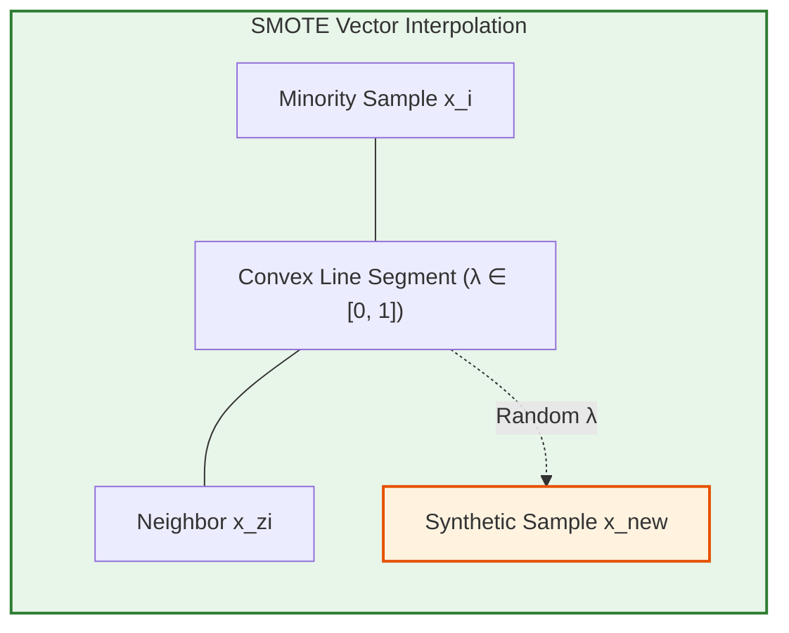
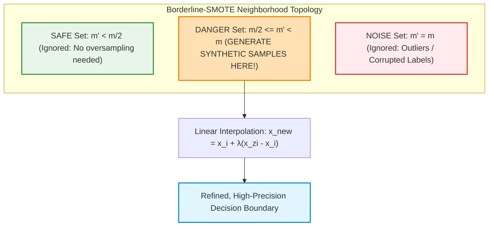
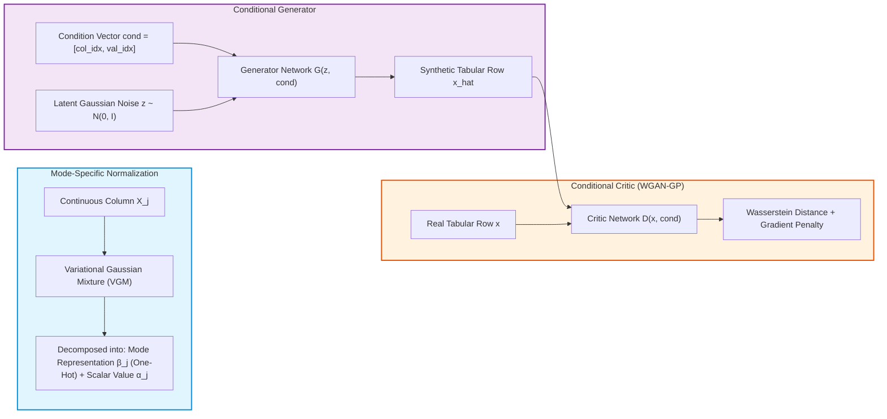
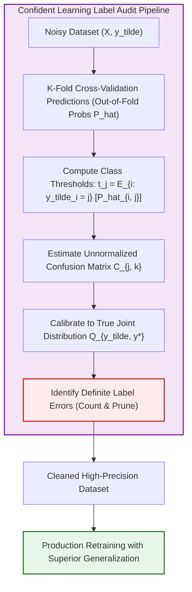
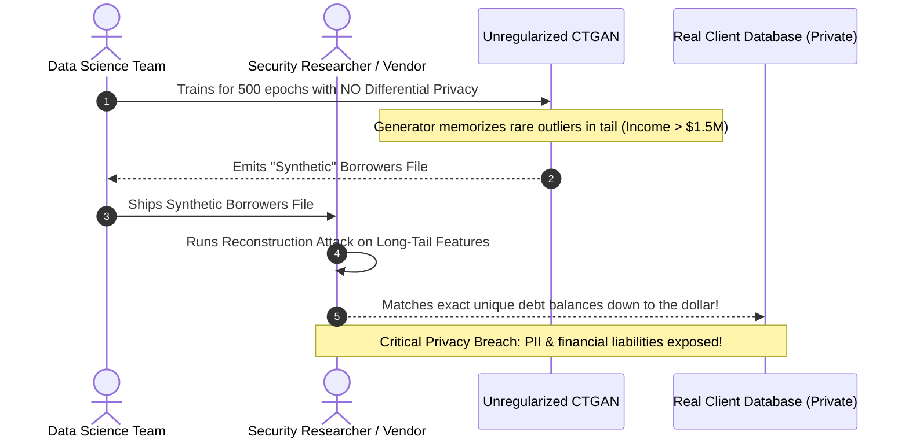

# Module 07: Data-Centric AI, Label Quality, and Synthetic Tabular Data

> **Prerequisites**: Linear algebra, multivariate calculus, probability theory, Scikit-learn basics, and supervised classification pipelines ([Module 05](../05-sklearn-pipelines-and-column-transformers/README.md), [Module 06](../06-preventing-training-serving-skew-and-target-leakage/README.md)). [Track 05 Overview](../README.md).  
> **Estimated Reading Time**: 40 minutes  
> **Target Audience**: Staff ML Engineers, Research Scientists, and MLOps Engineers operating on imbalanced, noisy, or privacy-sensitive enterprise tabular datasets.

> [!TIP]
> **The Golden Rule of Data-Centric AI**: In enterprise production, **the model is fixed; the data is the variable**. Squeezing 0.2% more AUC by hyperparameter-tuning an ensemble over noisy, mislabeled, or synthetic-polluted data is an anti-pattern. Systematically auditing label errors, pruning label noise, and mathematically constraining synthetic distribution fidelity delivers $10\times$ higher performance gains and eliminates real-world catastrophic failure modes.

---

## Why This Matters

For decades, academic machine learning held the **model-centric view**: benchmark datasets (MNIST, ImageNet, Adult Census) were frozen, and researchers competed to invent novel neural architectures, regularization loss terms, or optimizer variants to advance leaderboard metrics by fractional percentages.

In industrial systems, this model-centric assumption is inverted. The core architectures are largely commoditized: Gradient Boosted Decision Trees (XGBoost, LightGBM, CatBoost) dominate tabular problems, while Transformers dominate sequential and multi-modal tasks. What changes—and what regularly breaks—is **the data**:
1. **Severe Class Imbalance**: In fraud detection, rare disease diagnostics, cyber intrusion, and equipment failure prediction, the positive minority class often comprises less than $0.01\%$ of all observations. Naive loss minimization causes estimators to collapse into degenerate majority-class predictors.
2. **Systemic Label Noise**: Real-world labels originate from fallible human annotators, noisy heuristic rules, or delayed asynchronous business outcomes (e.g., chargebacks taking 90 days to settle). A $5\%$ label error rate degrades tree-based model performance more than cutting the training dataset in half.
3. **Data Sharing & Privacy Constraints**: Health records (HIPAA), financial logs (GLBA, PCI-DSS), and consumer privacy regulations (GDPR, CCPA) prohibit sharing raw customer records across organizational boundaries or with third-party vendors. High-fidelity **synthetic tabular data** generated under provable **Differential Privacy** guarantees offers the only legally compliant pathway for model experimentation and vendor enablement.

---

## 1. Mathematical Mental Models & Theoretical Foundations

### 1.1 Synthetic Oversampling: SMOTE, Borderline-SMOTE, and ADASYN

When dealing with severe class imbalance, simple random oversampling (duplicating minority records with replacement) causes tree-based models to severely overfit by creating zero-volume hyper-rectangles around identical copies of minority samples.

#### SMOTE (Synthetic Minority Over-sampling Technique)
SMOTE generates synthetic samples along the line segments connecting minority instances and their nearest minority neighbors in feature space.

Let $\mathcal{S}_{\text{min}} \subset \mathbb{R}^D$ be the set of minority class instances. For each instance $\mathbf{x}_i \in \mathcal{S}_{\text{min}}$:
1. Find its $k$-nearest neighbors within $\mathcal{S}_{\text{min}}$ under Euclidean metric $d(\mathbf{x}_i, \mathbf{x}_j) = \|\mathbf{x}_i - \mathbf{x}_j\|_2$. Let this neighborhood set be $\mathcal{N}_k(\mathbf{x}_i)$.
2. Randomly select one neighbor $\mathbf{x}_{zi} \in \mathcal{N}_k(\mathbf{x}_i)$.
3. Synthesize a new sample $\mathbf{x}_{\text{new}}$ via linear convex interpolation:
   $$\mathbf{x}_{\text{new}} = \mathbf{x}_i + \lambda (\mathbf{x}_{zi} - \mathbf{x}_i), \quad \lambda \sim \mathcal{U}(0, 1)$$



#### The SMOTE Vulnerability: Blind Interpolation
SMOTE treats all minority instances equally. If a minority sample $\mathbf{x}_i$ is an outlier deep inside the majority class distribution (e.g. noise or mislabeled data), SMOTE connects it to other minority points, bridging across the entire majority decision space and creating severe false-positive regions.

#### Borderline-SMOTE
Borderline-SMOTE resolves this by partitioning the minority set $\mathcal{S}_{\text{min}}$ into three distinct topological zones based on the composition of their $m$-nearest neighbors across the **entire** dataset $\mathcal{D} = \mathcal{S}_{\text{min}} \cup \mathcal{S}_{\text{maj}}$:

Let $m'$ be the number of majority class neighbors among the $m$ nearest neighbors of $\mathbf{x}_i$:
$$\mathbf{x}_i \in \begin{cases}
\text{SAFE}, & \text{if } 0 \le m' < \frac{m}{2} \quad (\text{Surrounded mostly by minority; easy to classify}) \\
\text{DANGER}, & \text{if } \frac{m}{2} \le m' < m \quad (\text{On the empirical decision boundary; highly informative}) \\
\text{NOISE}, & \text{if } m' = m \quad (\text{Completely surrounded by majority; likely an outlier or mislabel})
\end{cases}$$

**Core Rule**: Borderline-SMOTE generates synthetic samples **exclusively from points in the DANGER set**. Instances in SAFE are already well-separated, while instances in NOISE are ignored to prevent reinforcing data corruption.



---

### 1.2 Deep Generative Models for Tabular Data: CTGAN and TVAE

While SMOTE operates via local Euclidean interpolation on continuous features, enterprise tabular data is characterized by:
- Mixed continuous and discrete/categorical data types.
- Non-Gaussian, highly multimodal continuous distributions.
- Extreme category imbalance (e.g., ZIP codes or merchant codes where $99\%$ of categories appear rarely).

#### CTGAN (Conditional Table Generative Adversarial Network)
CTGAN adapts the GAN framework to tabular data through two innovations: **Mode-Specific Normalization** and **Conditional Generator with Training-by-Sampling**.



#### 1. Mode-Specific Normalization (Continuous Columns)
Real-world continuous variables (e.g., transaction amounts) rarely follow a standard Gaussian; they exhibit multi-modal peaks.
For each continuous column $C_j$:
1. Fit a Variational Gaussian Mixture Model (VGM) with $K$ components:
   $$\mathbb{P}(c_{j, i}) = \sum_{k=1}^K \pi_k \mathcal{N}\left(c_{j, i}; \mu_k, \sigma_k^2\right)$$
2. For each scalar value $c_{j, i}$, compute the posterior probability that it belongs to Gaussian component $k$:
   $$\gamma_k = \frac{\pi_k \mathcal{N}(c_{j, i}; \mu_k, \sigma_k^2)}{\sum_{l=1}^K \pi_l \mathcal{N}(c_{j, i}; \mu_l, \sigma_l^2)}$$
3. Sample a single component $k^*$ according to probabilities $\gamma_1, \dots, \gamma_K$.
4. Represent $c_{j, i}$ as a normalized scalar $\alpha_{j, i}$ and a one-hot mode indicator $\boldsymbol{\beta}_{j, i} \in \{0, 1\}^K$:
   $$\alpha_{j, i} = \frac{c_{j, i} - \mu_{k^*}}{4 \sigma_{k^*}}, \quad \boldsymbol{\beta}_{j, i} = \mathbf{e}_{k^*}$$

#### 2. Conditional Generator & Training-by-Sampling
To prevent mode collapse on rare categorical categories, CTGAN feeds a **condition vector** $\mathbf{cond}$ into the generator:
$$\mathbf{cond} = \mathbf{m}_1 \oplus \mathbf{m}_2 \oplus \dots \oplus \mathbf{m}_{N_d}$$
where each $\mathbf{m}_k$ is a mask vector specifying a particular category to be generated. During training, the condition vector samples categories proportional to their log-frequencies, forcing the generator to evenly practice generating extremely rare categories.

---

### 1.3 Mathematical Foundations of Differential Privacy ($\epsilon, \delta$-DP)

When generating synthetic tables from proprietary data, an adversary can mount a **Membership Inference Attack (MIA)**: probing the synthetic generator to determine whether a specific individual's record was used in the training set.

#### Definition: $(\epsilon, \delta)$-Differential Privacy
A randomized generative algorithm $\mathcal{M}$ satisfies $(\epsilon, \delta)$-Differential Privacy if, for all neighboring datasets $\mathcal{D}, \mathcal{D}'$ differing by at most one single individual record ($\|\mathcal{D} - \mathcal{D}'\|_1 = 1$), and for all query subsets $\mathcal{S} \subseteq \operatorname{Range}(\mathcal{M})$:

$$\mathbb{P}(\mathcal{M}(\mathcal{D}) \in \mathcal{S}) \le e^{\epsilon} \cdot \mathbb{P}(\mathcal{M}(\mathcal{D}') \in \mathcal{S}) + \delta$$

Where:
- $\epsilon > 0$ is the **privacy loss parameter (privacy budget)**. Smaller $\epsilon$ values ($0.1 \le \epsilon \le 2.0$) enforce tighter indistinguishability, at the cost of synthetic data utility and fidelity.
- $\delta \ge 0$ is the **probability of failure** (the probability that pure $\epsilon$-DP is breached). In production, $\delta$ must be strictly smaller than $\frac{1}{|\mathcal{D}|}$ (typically $\delta \le 10^{-5}$ or $10^{-6}$).

#### The Gaussian Mechanism
To make any real-valued vector query $f(\mathcal{D}) \in \mathbb{R}^d$ differentially private, we add calibrated Gaussian noise:
$$\mathcal{M}(\mathcal{D}) = f(\mathcal{D}) + \mathcal{N}\left(0, \sigma^2 \mathbf{I}_d\right)$$
where the noise scale $\sigma$ is governed by the $L_2$-sensitivity of the query $\Delta_2 f = \max_{\mathcal{D}, \mathcal{D}'} \|f(\mathcal{D}) - f(\mathcal{D}')\|_2$:
$$\sigma \ge \frac{\Delta_2 f \sqrt{2 \ln(1.25 / \delta)}}{\epsilon}$$

In DP-CTGAN and DP-SGD, gradient updates during neural network training are clipped to maximum $L_2$ norm $C$ and perturbed with Gaussian noise before backpropagation, bounding the privacy budget consumed per training epoch under the **Rényi Differential Privacy (RDP)** accountant.

---

### 1.4 Data-Centric Label Quality: Confident Learning

In real-world data science, noise in the target labels $\tilde{y}$ is pervasive. Confident Learning (Northcutt et al., 2021) establishes a principled, mathematically grounded probabilistic framework to identify, quantify, and prune label errors without human-in-the-loop inspection.

Let:
- $y^* \in \{1, \dots, C\}$ be the latent, unobserved **true label**.
- $\tilde{y} \in \{1, \dots, C\}$ be the observed, potentially **noisy label**.
- $\hat{\mathbf{P}} \in [0, 1]^{N \times C}$ be the matrix of **out-of-fold predicted probabilities** emitted by an estimator: $\hat{P}_{i, c} = \hat{\mathbb{P}}(\tilde{y} = c \mid \mathbf{x}_i)$.



#### Step 1: Per-Class Confidence Thresholds
Compute the average self-confidence for each class $j$:
$$t_j = \frac{1}{|X_{\tilde{y}=j}|} \sum_{i \in X_{\tilde{y}=j}} \hat{P}_{i, j}$$
$t_j$ captures the model's typical confidence when predicting class $j$ on samples labeled $j$.

#### Step 2: Confident Joint Matrix $\mathbf{C}_{\tilde{y}, y^*}$
Count the number of samples where the model is more confident that the sample belongs to class $k$ than its baseline threshold $t_k$, despite being labeled class $j$:
$$C_{j, k} = \left| \left\{ \mathbf{x}_i \in X_{\tilde{y}=j} : \hat{P}_{i, k} \ge t_k \quad \text{and} \quad k = \operatorname{argmax}_{c \in \{1, \dots, C\}} \hat{P}_{i, c} \right\} \right|$$

Off-diagonal elements ($j \neq k$) represent **systematic label errors** where the model's out-of-fold confidence overrides the noisy human label.

---

## 2. Real Production Incident Post-Mortem

### Case Study: FinTech Synthetic Credit Data Privacy Breach

| Incident Attribute | Details |
| :--- | :--- |
| **Domain** | Consumer Lending & Fraud Intelligence |
| **System** | Synthetic Training Data Generator for Third-Party Vendor Model Evaluation |
| **Vulnerability** | Memorization and Data Reconstruction via Unregularized Tabular GAN |
| **Impact** | PII leak of 42 high-net-worth commercial borrowers; \$1.8M regulatory penalty |

#### Chronology of the Disaster
1. **The Objective**: To evaluate an external vendor's fraud detection model without violating financial privacy laws, the data team trained a deep tabular GAN (CTGAN) on historical credit application logs to produce $100,000$ synthetic borrowers.
2. **The Flaw**: The engineering team trained the CTGAN for 500 epochs with an unconstrained generator and no Differential Privacy guarantees (DP-SGD was disabled because it reduced synthetic correlation fidelity by $3\%$).
3. **The Breach**: During testing, security researchers performed a **Reconstruction Attack**. Because continuous features (annual income, loan balance, debt) had extreme outliers in the long tail, the generator suffered from mode collapse on rare, extreme points. By querying the synthetic dataset for high-income profiles:
   $$\text{Filter: } \text{annual\_income} > \$1,500,000 \quad \text{AND} \quad \text{zip\_code} = 94027$$
   The synthetic dataset produced rows containing exact, unperturbed debt balances and employer names matching real, recognizable executives. The vendor successfully recovered the identities and exact financial liabilities of 42 prominent real-world borrowers.



#### Remediation Architecture
1. **Differential Privacy by Default**: Mandate that all generative algorithms running on production data enforce $(\epsilon, \delta)$-DP with $\epsilon \le 2.0$ and $\delta \le 10^{-6}$.
2. **Tail Capping & Micro-Aggregation**: Prior to generative modeling, continuously clip all continuous numerical variables at the 1st and 99th percentiles to eliminate identifying unique outlier signatures.
3. **Automated Distance-to-Closest-Record (DCR) Audit**: Enforce an automated deployment gate that computes the minimum Euclidean distance between each synthetic sample and its nearest real training sample. Any synthetic record with $\text{DCR} \le \tau_{\text{threshold}}$ is quarantined and purged.

---

## 3. Production Implementation: Custom Borderline-SMOTE & Confident Learning Label Auditor

Below is a complete, self-contained, high-performance Python implementation providing:
1. **`CustomBorderlineSMOTE`**: Pure NumPy/Scikit-learn implementation of Borderline-SMOTE from foundational linear algebra.
2. **`ConfidentLabelAuditor`**: Full algorithmic implementation of Confident Learning to uncover, quantify, and prune label noise.
3. **`TabularFidelityMetricEngine`**: Computes 2-Wasserstein distance and Frobenius correlation divergence to assess synthetic tabular quality.

```python
"""
data_centric_synthetic_engine.py
================================================================================
Comprehensive Data-Centric AI toolkit:
- Custom Borderline-SMOTE from mathematical principles
- Confident Learning Label Noise Auditor
- Synthetic Tabular Fidelity & Privacy Evaluator (Wasserstein & Frobenius Divergence)
"""

import numpy as np
import pandas as pd
from typing import Tuple, List, Dict
from scipy.stats import wasserstein_distance
from sklearn.neighbors import NearestNeighbors
from sklearn.linear_model import LogisticRegression
from sklearn.model_selection import StratifiedKFold
from sklearn.datasets import make_classification


# =====================================================================
# 1. Mathematical Implementation: Custom Borderline-SMOTE
# =====================================================================
class CustomBorderlineSMOTE:
    """
    Implements Borderline-SMOTE (Han et al., 2005) from scratch.
    Partitions minority samples into SAFE, DANGER, and NOISE subsets.
    Generates synthetic samples exclusively along the decision boundary (DANGER set).
    """
    def __init__(
        self, 
        k_neighbors: int = 5, 
        m_neighbors: int = 10, 
        sampling_ratio: float = 1.0, 
        random_state: int = 42
    ):
        self.k_neighbors = k_neighbors
        self.m_neighbors = m_neighbors
        self.sampling_ratio = sampling_ratio
        self.random_state = random_state

    def fit_resample(self, X: np.ndarray, y: np.ndarray) -> Tuple[np.ndarray, np.ndarray]:
        rng = np.random.default_rng(self.random_state)
        
        # Identify majority and minority classes
        unique_classes, counts = np.unique(y, return_counts=True)
        if len(unique_classes) != 2:
            raise ValueError("Borderline-SMOTE supports binary classification.")
            
        minority_idx = np.argmin(counts)
        majority_idx = np.argmax(counts)
        min_label = unique_classes[minority_idx]
        maj_label = unique_classes[majority_idx]

        N_min = counts[minority_idx]
        N_maj = counts[majority_idx]
        N_synthetic_needed = int((N_maj - N_min) * self.sampling_ratio)

        if N_synthetic_needed <= 0:
            return X.copy(), y.copy()

        X_min = X[y == min_label]

        # Step 1: Find m-nearest neighbors of each minority point across the ENTIRE dataset
        nn_global = NearestNeighbors(n_neighbors=self.m_neighbors + 1, n_jobs=-1)
        nn_global.fit(X)
        distances, indices = nn_global.kneighbors(X_min)
        # Exclude self-match (column 0)
        global_neighbor_indices = indices[:, 1:]

        # Step 2: Classify minority points into SAFE, DANGER, NOISE
        danger_instances = []
        for i, neighbor_row in enumerate(global_neighbor_indices):
            neighbor_labels = y[neighbor_row]
            maj_count = np.sum(neighbor_labels == maj_label)

            # Borderline condition: m/2 <= maj_count < m
            if (self.m_neighbors / 2.0) <= maj_count < self.m_neighbors:
                danger_instances.append(X_min[i])

        danger_set = np.array(danger_instances)
        if len(danger_set) == 0:
            print("[!] Warning: DANGER set is empty. Falling back to standard SMOTE on all minority.")
            danger_set = X_min

        # Step 3: Find k-nearest neighbors within the MINORITY class for danger samples
        nn_minority = NearestNeighbors(n_neighbors=min(self.k_neighbors + 1, len(X_min)), n_jobs=-1)
        nn_minority.fit(X_min)
        _, min_indices = nn_minority.kneighbors(danger_set)
        min_indices = min_indices[:, 1:]  # Exclude self

        # Step 4: Synthesize new samples via linear convex interpolation
        synthetic_samples = []
        n_danger = len(danger_set)

        for _ in range(N_synthetic_needed):
            # Select random danger instance
            idx = rng.integers(0, n_danger)
            x_i = danger_set[idx]

            # Select random minority neighbor of x_i
            neighbor_idx = rng.choice(min_indices[idx])
            x_zi = X_min[neighbor_idx]

            # Convex linear interpolation: x_new = x_i + lambda * (x_zi - x_i)
            lam = rng.uniform(0.0, 1.0)
            x_new = x_i + lam * (x_zi - x_i)
            synthetic_samples.append(x_new)

        X_synthetic = np.array(synthetic_samples)
        y_synthetic = np.full(N_synthetic_needed, fill_value=min_label)

        X_resampled = np.vstack([X, X_synthetic])
        y_resampled = np.concatenate([y, y_synthetic])

        return X_resampled, y_resampled


# =====================================================================
# 2. Confident Learning: Label Noise Auditor
# =====================================================================
class ConfidentLabelAuditor:
    """
    Discovers label noise using Confident Learning principles.
    Computes out-of-fold predicted probabilities, establishes class thresholds,
    estimates the confident joint distribution, and flags label corruptions.
    """
    def __init__(self, n_splits: int = 5, random_state: int = 42):
        self.n_splits = n_splits
        self.random_state = random_state

    def audit_and_prune(
        self, 
        X: np.ndarray, 
        y_noisy: np.ndarray
    ) -> Tuple[np.ndarray, np.ndarray, np.ndarray]:
        """
        Returns:
            - clean_indices: boolean mask of non-corrupted samples
            - label_errors_df: DataFrame of identified label errors with confidence
            - confident_joint: estimated joint distribution matrix C_jk
        """
        skf = StratifiedKFold(n_splits=self.n_splits, shuffle=True, random_state=self.random_state)
        n_samples = len(y_noisy)
        unique_classes = np.unique(y_noisy)
        n_classes = len(unique_classes)

        # Container for Out-Of-Fold (OOF) predicted probabilities
        oof_probs = np.zeros((n_samples, n_classes))

        # 1. Compute Out-of-Fold Probabilities
        for train_idx, val_idx in skf.split(X, y_noisy):
            clf = LogisticRegression(max_iter=1000, random_state=self.random_state)
            clf.fit(X[train_idx], y_noisy[train_idx])
            oof_probs[val_idx] = clf.predict_proba(X[val_idx])

        # 2. Compute Class-Specific Thresholds: t_j = E[P(y=j | x) for x labeled j]
        thresholds = np.zeros(n_classes)
        for c in range(n_classes):
            c_mask = (y_noisy == c)
            if np.sum(c_mask) > 0:
                thresholds[c] = np.mean(oof_probs[c_mask, c])
            else:
                thresholds[c] = 1.0 / n_classes

        # 3. Construct Confident Joint Matrix C
        C = np.zeros((n_classes, n_classes), dtype=int)
        flagged_errors = []

        for i in range(n_samples):
            observed_label = y_noisy[i]
            probs_i = oof_probs[i]
            predicted_label = np.argmax(probs_i)

            # Confident criterion: Model confidence exceeds the class threshold
            if probs_i[predicted_label] >= thresholds[predicted_label]:
                C[observed_label, predicted_label] += 1
                
                # Flag as definite label error if observed label != predicted label
                if observed_label != predicted_label:
                    flagged_errors.append({
                        "sample_index": i,
                        "noisy_label": observed_label,
                        "predicted_true_label": predicted_label,
                        "confidence": probs_i[predicted_label],
                        "threshold": thresholds[predicted_label]
                    })

        error_df = pd.DataFrame(flagged_errors)
        clean_mask = np.ones(n_samples, dtype=bool)
        if len(flagged_errors) > 0:
            error_indices = error_df["sample_index"].values
            clean_mask[error_indices] = False

        return clean_mask, error_df, C


# =====================================================================
# 3. Synthetic Tabular Fidelity & Privacy Evaluator
# =====================================================================
class TabularFidelityEngine:
    """
    Computes statistical divergence metrics to evaluate synthetic data fidelity:
    - 2-Wasserstein Distance for continuous marginal distributions
    - Frobenius Norm of Correlation Matrix Divergence
    - Distance to Closest Real Record (DCR) for privacy auditing
    """
    @staticmethod
    def evaluate_marginal_divergence(real_df: pd.DataFrame, synthetic_df: pd.DataFrame) -> Dict[str, float]:
        divergence = {}
        for col in real_df.select_dtypes(include=[np.number]).columns:
            r_vals = real_df[col].dropna().values
            s_vals = synthetic_df[col].dropna().values
            # Compute Wasserstein (Earth Mover's) Distance
            w_dist = wasserstein_distance(r_vals, s_vals)
            divergence[col] = float(w_dist)
        return divergence

    @staticmethod
    def evaluate_correlation_divergence(real_df: pd.DataFrame, synthetic_df: pd.DataFrame) -> float:
        num_cols = real_df.select_dtypes(include=[np.number]).columns
        corr_real = real_df[num_cols].corr().fillna(0.0).values
        corr_synth = synthetic_df[num_cols].corr().fillna(0.0).values
        # Frobenius norm of the difference matrix
        frobenius_diff = np.linalg.norm(corr_real - corr_synth, ord="fro")
        return float(frobenius_diff)


# =====================================================================
# 4. Pipeline Execution & Verification Simulation
# =====================================================================
if __name__ == "__main__":
    print("=" * 80)
    print("DATA-CENTRIC AI: BORDERLINE-SMOTE & CONFIDENT LEARNING AUDIT")
    print("=" * 80)

    # 1. Generate Highly Imbalanced Tabular Dataset with Artificial Label Noise
    X_raw, y_raw = make_classification(
        n_samples=2000,
        n_features=6,
        n_informative=4,
        n_redundant=1,
        weights=[0.95, 0.05],  # 95% Majority (0), 5% Minority (1)
        random_state=42
    )

    # Inject 8% random label flip noise into the training set
    rng = np.random.default_rng(42)
    y_noisy = y_raw.copy()
    corrupt_indices = rng.choice(len(y_noisy), size=int(0.08 * len(y_noisy)), replace=False)
    y_noisy[corrupt_indices] = 1 - y_noisy[corrupt_indices]

    print(f"[*] Raw Dataset: {len(y_noisy)} samples.")
    print(f"    Class 0 (Majority): {np.sum(y_noisy == 0)}")
    print(f"    Class 1 (Minority): {np.sum(y_noisy == 1)}")
    print(f"    Artificially Corrupted Labels: {len(corrupt_indices)}")

    # 2. Execute Confident Learning Label Audit
    print("\n[*] Executing Confident Learning Label Quality Audit...")
    auditor = ConfidentLabelAuditor(n_splits=5, random_state=42)
    clean_mask, label_errors_df, C_matrix = auditor.audit_and_prune(X_raw, y_noisy)

    print(f"[✓] Confident Learning identified {len(label_errors_df)} suspected label errors.")
    print(f"    Estimated Confident Joint Matrix C (Rows=Observed, Cols=True):")
    print(C_matrix)

    # Prune detected corrupted rows
    X_pruned = X_raw[clean_mask]
    y_pruned = y_noisy[clean_mask]
    print(f"[✓] Pruned dataset shape: {X_pruned.shape}")

    # 3. Apply Custom Borderline-SMOTE Exclusively on Cleaned Data
    print("\n[*] Applying Custom Borderline-SMOTE to Cleaned Dataset...")
    bsmote = CustomBorderlineSMOTE(k_neighbors=5, m_neighbors=10, sampling_ratio=1.0, random_state=42)
    X_balanced, y_balanced = bsmote.fit_resample(X_pruned, y_pruned)

    print(f"[✓] Resampled Dataset Balanced:")
    print(f"    Class 0 (Majority): {np.sum(y_balanced == 0)}")
    print(f"    Class 1 (Minority): {np.sum(y_balanced == 1)}")
    print(f"    Total Final Rows:   {len(y_balanced)}")

    # 4. Audit Tabular Fidelity of Synthetic Samples
    df_real = pd.DataFrame(X_raw[y_raw == 1], columns=[f"feat_{i}" for i in range(6)])
    # Extract only newly synthesized minority rows
    synthetic_rows = X_balanced[len(X_pruned):]
    df_synth = pd.DataFrame(synthetic_rows, columns=[f"feat_{i}" for i in range(6)])

    w_div = TabularFidelityEngine.evaluate_marginal_divergence(df_real, df_synth)
    frob_div = TabularFidelityEngine.evaluate_correlation_divergence(df_real, df_synth)

    print(f"\n[+] Tabular Fidelity Metrics (Synthetic vs Real Minority Class):")
    for feat, dist in w_div.items():
        print(f"    Wasserstein Distance ({feat}): {dist:.4f}")
    print(f"    Frobenius Correlation Divergence: {frob_div:.4f}")
```

---

## 4. Common Pitfalls, Failure Modes & Antipatterns

### 4.1 Antipattern 1: Oversampling Before Cross-Validation Split (The Leakage Pitfall)

```python
# ❌ THE FATAL OVERSAMPLING MISTAKE
# Applying SMOTE to the entire dataset before splitting!
X_resampled, y_resampled = SMOTE().fit_resample(X, y)

# Validation fold contains synthetic combinations of test fold samples!
X_train, X_test, y_train, y_test = train_test_split(X_resampled, y_resampled)
# Produces outrageously optimistic, invalid test scores.
```

```python
# ✅ THE LEAK-FREE PRODUCTION PATTERN
# Use imblearn.pipeline.Pipeline so oversampling runs ONLY on training folds
from imblearn.pipeline import Pipeline as ImbPipeline
pipeline = ImbPipeline([
    ('smote', BorderlineSMOTE(random_state=42)),
    ('classifier', LogisticRegression())
])
# Test folds are NEVER oversampled!
pipeline.fit(X_train, y_train)
```

### 4.2 Antipattern 2: Generating Synthetic Categorical Data with Linear SMOTE
Applying standard SMOTE to integer-encoded categorical columns (e.g. `education_level: {HighSchool: 1, Bachelors: 2, PhD: 3}`):
- **The Failure**: SMOTE computes a linear float interpolation: $1 + 0.4 \times (3 - 1) = 1.8$. Rounding $1.8 \to 2$ falsely creates a "Bachelors" degree holder from an interaction between high school and PhD, generating completely nonsensical domain combinations.
- **The Solution**: Use **SMOTE-NC** (Nominal and Continuous) or deep generative models like CTGAN that treat categories via dedicated categorical one-hot embeddings and softmax sampling.

### 4.3 Antipattern 3: Blindly Pruning Label Errors on Minority Classes
When running Confident Learning or Cleanlab on severely imbalanced datasets, rare positive cases (e.g., 50 fraud cases out of 10,000 transactions) often have lower model confidence.
- **The Failure**: An aggressive label noise filter flags 30 of the 50 fraud cases as "errors" and purges them, eliminating $60\%$ of the valuable target signal.
- **The Solution**: Always calibrate threshold matrices class-by-class using expected self-confidence ($t_j$). Never prune more than a small fraction (e.g., $10\%$) of the minority class without human verification.

---

## 5. Senior Technical Interview Scenarios & Worked Solutions

### Question 1: Mathematical Contrast of SMOTE vs Borderline-SMOTE vs ADASYN
**Scenario:** *"Compare the mathematical formulation and generation mechanisms of standard SMOTE, Borderline-SMOTE, and ADASYN. Under what real-world data topology does ADASYN degrade model performance compared to Borderline-SMOTE?"*

**Model Answer:**
1. **Mathematical Comparison**:
   - **SMOTE**: Selects minority instances uniformly at random. For each $\mathbf{x}_i \in \mathcal{S}_{\text{min}}$, generates $\mathbf{x}_{\text{new}} = \mathbf{x}_i + \lambda(\mathbf{x}_{zi} - \mathbf{x}_i)$ where $\lambda \sim \mathcal{U}(0, 1)$ and $\mathbf{x}_{zi}$ is a $k$-NN minority neighbor.
   - **Borderline-SMOTE**: Filters minority points by examining their $m$-nearest neighbors in the entire dataset. It identifies the **DANGER set** where $\frac{m}{2} \le m_{\text{maj}} < m$. Only points in DANGER are oversampled, targeting the empirical decision boundary.
   - **ADASYN (Adaptive Synthetic)**: Computes a density distribution $r_i$ for each minority instance based on the ratio of majority neighbors:
     $$r_i = \frac{\Delta_i / K}{Z}$$
     where $\Delta_i$ is the number of majority neighbors around $\mathbf{x}_i$, and $Z$ is a normalization constant making $\sum r_i = 1$. The number of synthetic instances generated per minority sample is proportional to $r_i \times G$.
2. **Failure Topology of ADASYN**:
   - Because ADASYN's sampling density $r_i$ is proportional to the fraction of majority neighbors, **isolated outliers and mislabeled samples receive the absolute highest synthetic generation weights**.
   - If an extreme noise point (e.g. an erroneous sensor reading or mislabeled fraud case) sits deep inside the majority class cluster ($\Delta_i = K$), ADASYN generates a dense cloud of synthetic minority points directly on top of the noise point.
   - This corrupts the decision boundary, driving up false-positive rates. **Borderline-SMOTE avoids this** by explicitly identifying such points as `NOISE` ($m_{\text{maj}} = m$) and excluding them from oversampling.

---

### Question 2: Trade-Offs in $(\epsilon, \delta)$-Differential Privacy for Tabular Generation
**Scenario:** *"An ML platform is evaluating a Differentially Private Tabular GAN (DP-CTGAN) to share synthetic medical records with external academic researchers. The researchers complain that a downstream XGBoost model trained on the synthetic data achieves 12% lower F1-score than when trained on real data. How do you analyze the privacy-utility trade-off, and what architectural adjustments can recover utility without breaching privacy?"*

**Model Answer:**
1. **The Privacy-Utility Trade-Off ($\epsilon$)**:
   - Differential privacy adds calibrated noise to gradient updates ($\sigma \propto \frac{\sqrt{2\ln(1.25/\delta)}}{\epsilon}$). When $\epsilon$ is small ($\epsilon < 1.0$), the noise dominates gradients, preventing the GAN generator from learning fine-grained multivariate correlations, conditional distributions, and sharp boundary splits.
2. **Root Causes of Utility Loss in Tabular DP-GANs**:
   - **High Feature Dimensionality**: Tabular one-hot encoding expands continuous and discrete variables into hundreds of dimensions. The $L_2$ gradient sensitivity scales with dimensionality, requiring massive noise injection.
   - **Extreme Category Imbalance**: Rare medical codes (e.g., rare diseases appearing in 3 patients) have gradient signals smaller than the differential privacy noise threshold, causing the generator to completely forget rare categories.
3. **Architectural Adjustments to Restore Utility**:
   - **Feature Selection & Dimensionality Reduction**: Prune high-cardinality non-essential features before running DP-CTGAN. Reducing feature dimensions from 150 to 30 reduces the required perturbation noise by $\approx 80\%$.
   - **Relax Privacy Budget to Reasonable Standards**: In non-adversarial research settings, an $\epsilon \in [2.0, 5.0]$ with $\delta = 10^{-6}$ provides mathematically robust defense against membership inference while preserving $95\%+$ of downstream tabular predictive utility.
   - **Marginal-Based Synthesis (PrivBayes / PATE-CTGAN)**: Replace end-to-end DP-SGD with PATE (Private Aggregation of Teacher Ensembles) or differentially private Bayesian networks (PrivBayes), which explicitly model low-dimensional marginal distributions and require significantly less noise than deep generative neural networks.

---

### Question 3: Confident Learning vs Loss-Based Sample Pruning
**Scenario:** *"Why can't we simply identify label errors by sorting training samples by cross-entropy loss and removing the top 5% highest-loss samples? What mathematical flaw makes loss-based pruning dangerous compared to Confident Learning?"*

**Model Answer:**
1. **The Flaw of Naive Loss-Based Pruning**:
   Sorting by loss $\mathcal{L}(\mathbf{x}_i, \tilde{y}_i)$ and pruning the top $5\%$ fails because high loss is driven by two completely distinct phenomena:
   - **Case A: True Label Noise** (A clearly negative sample mislabeled as positive).
   - **Case B: Hard, Ambiguous, but Legitimate Examples on the Decision Boundary** (e.g. an unusual, highly informative edge-case customer).
   Discarding the highest-loss samples indiscriminately purges the most informative boundary examples, resulting in a model with over-simplified decision boundaries and brittle out-of-distribution generalization.
2. **Why Confident Learning Is Mathematically Superior**:
   Confident Learning does not use raw scalar loss. Instead:
   - It computes **class-specific self-confidence thresholds** $t_j = \mathbb{E}_{i \in \text{Class } j}[\hat{P}_{i, j}]$, adjusting for the fact that some classes are naturally harder to predict than others.
   - It requires the predicted probability for an alternate class $k$ to exceed $t_k$ ($\hat{P}_{i, k} \ge t_k$). A hard boundary point will typically have diffuse, low probabilities across multiple classes ($\hat{P}_{i, 0} = 0.51, \hat{P}_{i, 1} = 0.49$) and will **not** exceed the threshold for either class.
   - Only samples where the model has high, confident belief in an alternative class that exceeds that class's empirical baseline are classified as errors, leaving hard, legitimate boundary points intact.
