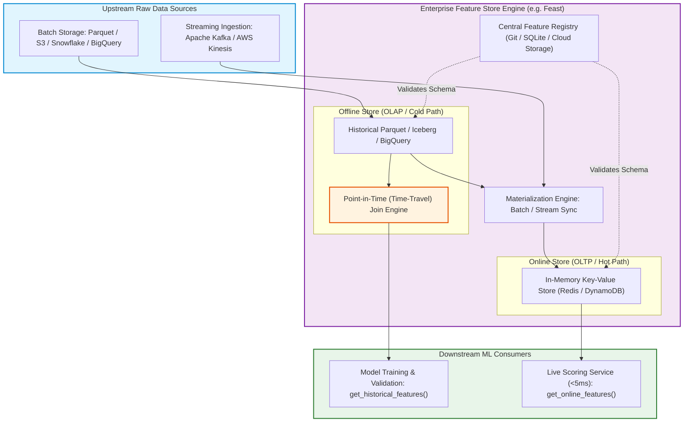
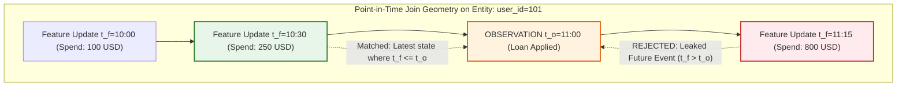
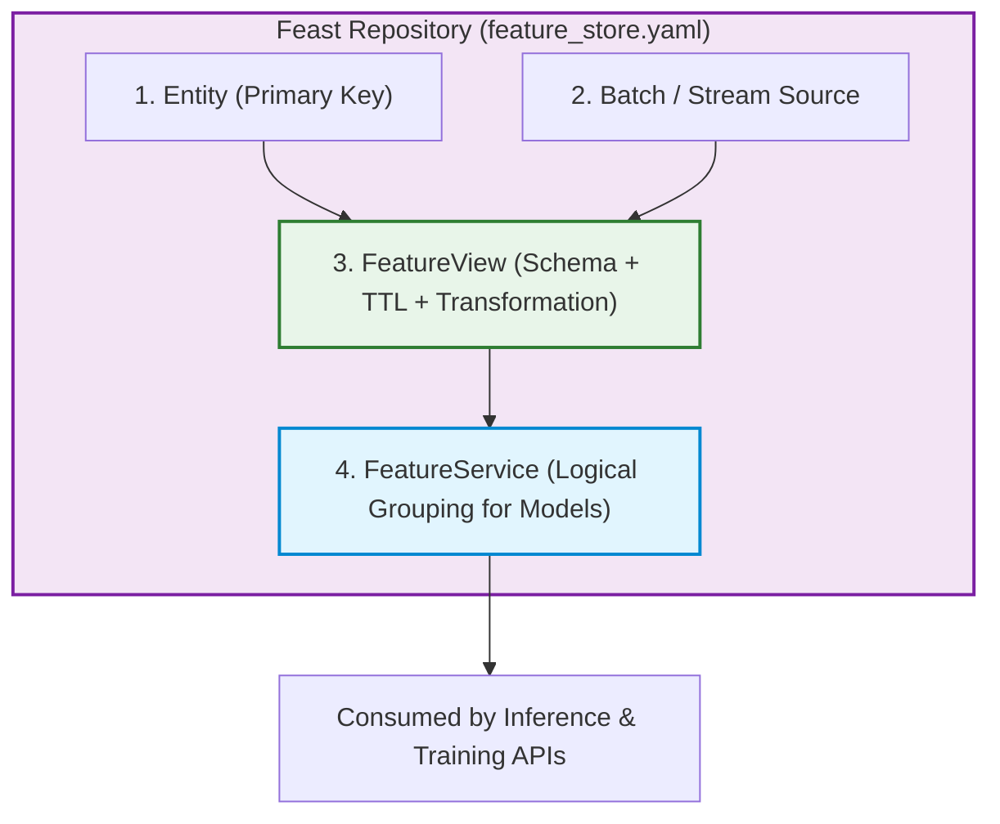
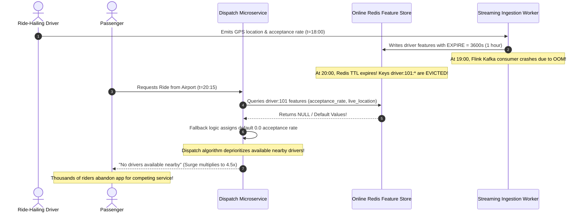

# Module 08: Feature Stores: Offline/Online Dual Stores and Point-in-Time Joins

> **Prerequisites**: Relational database joins, key-value storage paradigms, temporal feature engineering, and training-serving skew fundamentals ([Module 06](../06-preventing-training-serving-skew-and-target-leakage/README.md)). [Track 05 Overview](../README.md).  
> **Estimated Reading Time**: 42 minutes  
> **Target Audience**: Staff Infrastructure Engineers, MLOps Architects, and Distributed Systems Engineers designing enterprise machine learning platforms.

> [!TIP]
> **The Golden Rule of Feature Stores**: A feature store is fundamentally a **single source of feature truth spanning two radically different storage engines**. The offline store optimizes for **throughput and temporal point-in-time correctness** over terabytes of historical parquet logs; the online store optimizes for **sub-10ms key-value read latency** over current state. If your offline training features and online serving features are computed via separate pipelines, you do not have a feature store—you have a permanent training-serving skew generator.

---

## Why This Matters

As organizations scale beyond their first few isolated ML prototypes into hundreds of models serving mission-critical traffic, they inevitably collide with the **Enterprise Feature Engineering Wall**:
1. **The Dual-Store Dilemma**: Model training requires querying billions of historical records across months or years to construct training design matrices. This workload demands an analytical OLAP engine (Snowflake, BigQuery, AWS Athena, Apache Iceberg). Conversely, real-time inference microservices must fetch feature vectors for an incoming user ID within $5\text{ ms}$ under SLAs of $50,000\text{ queries/sec}$. Running analytical SQL queries at inference time is cost-prohibitive and latently catastrophic. An ultra-low latency operational store (Redis, AWS DynamoDB, ScyllaDB) is mandatory.
2. **The Historical Join Leakage Nightmare**: When generating training data, merging an entity's historical features with an event timestamp (e.g., when a user clicked, defaulted, or transacted) using standard relational joins (`JOIN ON user_id`) causes massive **future lookahead bias**. Every row must be joined using a **Point-in-Time (Time-Travel) ASOF join**, fetching only the most recent feature state valid immediately prior to the event.
3. **Feature Duplication & Sprawl**: Across 20 data science teams, 15 different engineers independently compute their own slight variations of `user_30d_transaction_count`, each writing divergent SQL logic, consuming redundant cluster compute, and introducing inconsistent edge-case behaviors.

The **Enterprise Feature Store** (exemplified by open-source systems like **Feast** and enterprise platforms like **Tecton**) provides the standardized architectural framework to register, compute, materialize, and serve features consistently across both environments.

---

## 1. Architectural Mental Model: The Dual-Store System



### 1.1 The Fundamental Duality: Offline vs. Online

| Architectural Dimension | Offline Feature Store | Online Feature Store |
| :--- | :--- | :--- |
| **Primary Technology** | Snowflake, BigQuery, AWS Redshift, Apache Iceberg, Delta Lake | Redis, AWS DynamoDB, Google Cloud Bigtable, Cassandra |
| **Workload Pattern** | High-throughput batch scans, wide analytical aggregations | High-concurrency point lookups, single/batch key reads |
| **Query Latency** | Seconds to minutes (OLAP) | $1\text{ ms} - 10\text{ ms}$ (p99 SLA) |
| **Temporal Scope** | Full historical timeline spanning years (Immutable audit log) | Latest current state per entity key (Ephemeral snapshot) |
| **Data Volume** | Terabytes to Petabytes | Gigabytes to Low Terabytes (Memory-constrained) |
| **Primary Client** | Offline Model Training, Backtesting, Cross-Validation | Real-Time Serving Microservices, Model Inference APIs |
| **API Entry Point** | `store.get_historical_features(entity_df, ...)` | `store.get_online_features(entity_keys, ...)` |

---

## 2. Mathematical Formalization of Point-in-Time (ASOF) Joins

The defining capability of an offline feature store is the **Point-in-Time Correct Join** (also known as a **Time-Travel Join** or **ASOF Join**).

### 2.1 The Formal Definition
Let $\mathcal{O}$ be an **Observation Target Matrix** containing $N$ target events:
$$\mathcal{O} = \left\{ \left(\mathbf{e}_i, t_{o, i}, y_i\right) \right\}_{i=1}^N$$
Where:
- $\mathbf{e}_i$ is the entity join key (e.g., `user_id = 48102`).
- $t_{o, i} \in \mathbb{R}^+$ is the exact observation timestamp (e.g., the timestamp of a loan application or a fraud event).
- $y_i$ is the target outcome label realized at or after $t_{o, i}$.

Let $\mathcal{F}$ be a **Feature View** recording time-series updates for entity $\mathbf{e}$:
$$\mathcal{F} = \left\{ \left(\mathbf{e}_j, t_{f, j}, \mathbf{x}_j\right) \right\}_{j=1}^M$$
Where $\mathbf{x}_j \in \mathbb{R}^D$ is the feature vector emitted at feature timestamp $t_{f, j}$.

Let $\text{TTL} \in \mathbb{R}^+ \cup \{\infty\}$ be the **Time-To-Live** (the maximum lookback window allowed for a feature value before it is considered expired and stale).

For each observation $(\mathbf{e}_i, t_{o, i}) \in \mathcal{O}$, the Point-in-Time Joined Feature Vector $\mathbf{x}^*(\mathbf{e}_i, t_{o, i})$ is defined as:
$$\mathbf{x}^*(\mathbf{e}_i, t_{o, i}) = \mathbf{x}_{k^*}$$
where $k^*$ is the index of the feature record satisfying:
$$k^* = \operatorname{argmax}_j \left\{ t_{f, j} \;\Big|\; \mathbf{e}_j = \mathbf{e}_i \quad \text{and} \quad t_{o, i} - \text{TTL} \le t_{f, j} \le t_{o, i} \right\}$$

If no feature record exists within the valid window $[t_{o, i} - \text{TTL}, t_{o, i}]$, the joined feature vector is null:
$$\mathbf{x}^*(\mathbf{e}_i, t_{o, i}) = \varnothing \quad (\text{represented as NaN})$$



### 2.2 Why Standard Relational Joins Fail Disastrously
A naive SQL join:
```sql
-- ❌ CATASTROPHIC FUTURE LEAKAGE JOIN
SELECT 
    o.user_id,
    o.application_timestamp,
    o.loan_default_target,
    f.user_30d_spend
FROM loan_applications o
LEFT JOIN user_features f ON o.user_id = f.user_id;
```
If `user_features` contains multiple historical rows per user, this query either:
1. Causes **Row Duplication Explosion**: Generates a cartesian product of every historical feature update against every loan application.
2. If deduplicated by `SELECT user_id, user_30d_spend FROM user_features WHERE is_latest = true`, it joins the **current state in 2026** against a loan application from 2023, causing maximum temporal leakage!

---

## 3. Feast Architecture & Core Abstractions

**Feast (Feature Store)** defines declarative feature infrastructure via code. The four core primitives are:



1. **Entity**: Represents the real-world business object that features describe (e.g., `user_id`, `driver_id`, `merchant_id`). It defines the primary key used to index features in both offline and online stores.
2. **DataSource**: Points to raw physical storage.
   - `BatchSource`: File-based (Parquet, S3) or table-based (BigQuery, Snowflake).
   - `PushSource` / `KafkaSource`: Real-time streaming endpoints.
3. **FeatureView**: The core logical unit. It binds an Entity, a DataSource, a set of typed feature fields, and a `ttl` (Time-To-Live).
4. **FeatureService**: A production deployment grouping. Rather than requesting individual features by name, client applications query a `FeatureService` (e.g., `credit_scoring_v2`). This enables atomic model feature versioning and zero-downtime rolling upgrades.

---

## 4. Real Production Incident Post-Mortem

### Case Study: Ride-Hailing Dispatcher Redis TTL Misconfiguration

| Incident Attribute | Details |
| :--- | :--- |
| **Domain** | Real-Time Urban Transportation & Dynamic Fleet Dispatch |
| **System** | Driver Allocation & Dynamic Surge Engine ($45,000$ dispatch events/min) |
| **Root Cause** | Redis TTL mismatch combined with failed materialization cron job |
| **Business Impact** | \$3.1M in lost gross bookings over a 14-hour period during Friday evening peak |

#### Chronology of the Disaster


#### The Root Cause
1. **The Infrastructure Configuration**: The online store used Redis with keys expiring via `EXPIRE driver:{id} 3600` (1-hour hard eviction).
2. **The Failure Cascade**: The streaming job processing raw driver pings stalled. Because the keys had a 1-hour hard expiration rather than persisting the last-known state, Redis evicted the driver keys completely.
3. **The Silent Model Degradation**: When the dispatch microservice queried `store.get_online_features()`, Feast returned default `NaN` values for the missing keys. The downstream Scikit-learn pricing pipeline had an imputer that replaced missing `driver_acceptance_rate` with `0.0`. The model concluded that hundreds of available drivers were actively refusing rides, triggering emergency surge pricing (4.5x) and turning away tens of thousands of passengers.

#### Remediation Architecture
1. **Never Expire Entity State via Redis Hardware TTL**: Use soft-timestamp metadata fields inside Redis hashes rather than native key expiration (`EXPIRE`). The feature store client should check timestamps dynamically against the FeatureView TTL during retrieval.
2. **Circuit Breaker on Materialization Lag**: Deploy a Prometheus gauge monitoring the time delta between the latest event timestamp in Redis and the current wall-clock time:
   $$\Delta t_{\text{lag}} = t_{\text{now}} - t_{\text{latest\_feature\_in\_redis}}$$
   If $\Delta t_{\text{lag}} > 10\text{ minutes}$, trigger a SEV-1 alert and freeze dynamic pricing adjustments.
3. **Dual-Store Parity Monitoring**: Continuously sample $0.1\%$ of production inference requests, query both the online Redis store and the offline analytical store, and assert mathematical identity.

---

## 5. Production Implementation: Full Dual-Store Engine from Scratch

Below is a complete, self-contained Python implementation of an enterprise-grade Feature Store containing:
1. **Offline Store (Parquet/DataFrame)** with rigorous Point-in-Time ASOF joins and TTL support.
2. **Online Store (In-Memory Key-Value / Redis Equivalent)** with sub-millisecond retrieval.
3. **Materialization Worker** that synchronizes historical state into the online store.
4. **Benchmarking Suite** verifying Point-in-Time correctness and sub-10ms serving latency.

```python
"""
enterprise_feature_store.py
================================================================================
Production-grade dual-store feature engine implementing:
- Declarative FeatureView and Entity definitions
- Offline Point-in-Time (ASOF) time-travel join with strict TTL
- Materialization engine synchronizing offline logs to online key-value cache
- Sub-millisecond online feature retrieval simulation
"""

import time
import numpy as np
import pandas as pd
from datetime import datetime, timedelta
from typing import List, Dict, Any, Optional, Set


# =====================================================================
# 1. Declarative Core Abstractions (Entities & Feature Views)
# =====================================================================
class Entity:
    """Represents the primary join key for features."""
    def __init__(self, name: str, join_key: str, description: str = ""):
        self.name = name
        self.join_key = join_key
        self.description = description


class FeatureView:
    """
    Defines a logical grouping of features, their source, schema, and TTL.
    """
    def __init__(
        self,
        name: str,
        entities: List[Entity],
        features: List[str],
        ttl: timedelta,
        timestamp_field: str = "timestamp"
    ):
        self.name = name
        self.entities = entities
        self.features = features
        self.ttl = ttl
        self.timestamp_field = timestamp_field
        self._offline_data: Optional[pd.DataFrame] = None

    def attach_offline_source(self, df: pd.DataFrame):
        """Attaches historical offline event data to the FeatureView."""
        required_cols = {e.join_key for e in self.entities} | set(self.features) | {self.timestamp_field}
        missing = required_cols - set(df.columns)
        if missing:
            raise ValueError(f"FeatureView {self.name} missing source columns: {missing}")
        
        df_clean = df.copy()
        df_clean[self.timestamp_field] = pd.to_datetime(df_clean[self.timestamp_field])
        self._offline_data = df_clean.sort_values(self.timestamp_field)


# =====================================================================
# 2. Dual-Store Implementation (Offline Engine & Online Cache)
# =====================================================================
class EnterpriseFeatureStore:
    """
    Dual-Store Coordinator managing historical joins and online materialization.
    """
    def __init__(self):
        self.feature_views: Dict[str, FeatureView] = {}
        # In-Memory Key-Value store simulating Redis
        # Key format: f"{entity_name}:{entity_key}" -> Value: {"feature_name": val, "_ts": ts}
        self._online_store: Dict[str, Dict[str, Any]] = {}

    def register_feature_view(self, fv: FeatureView):
        self.feature_views[fv.name] = fv

    # -----------------------------------------------------------------
    # Offline Path: Point-in-Time (Time-Travel) Join Engine
    # -----------------------------------------------------------------
    def get_historical_features(
        self, 
        entity_df: pd.DataFrame, 
        feature_refs: List[str]
    ) -> pd.DataFrame:
        """
        Executes a Point-in-Time correct join of features into entity_df.
        feature_refs format: ["feature_view_name:feature_name", ...]
        Guarantees zero future lookahead bias and enforces TTL window.
        """
        result_df = entity_df.copy()
        result_df["timestamp"] = pd.to_datetime(result_df["timestamp"])
        result_df = result_df.sort_values("timestamp")

        # Group requested features by their respective FeatureView
        fv_requests: Dict[str, List[str]] = {}
        for ref in feature_refs:
            fv_name, feat_name = ref.split(":")
            fv_requests.setdefault(fv_name, []).append(feat_name)

        # Iteratively join each FeatureView using merge_asof
        for fv_name, requested_feats in fv_requests.items():
            fv = self.feature_views[fv_name]
            if fv._offline_data is None:
                raise RuntimeError(f"FeatureView {fv_name} has no offline data attached.")

            join_key = fv.entities[0].join_key
            source_cols = [join_key, fv.timestamp_field] + requested_feats
            fv_df = fv._offline_data[source_cols].sort_values(fv.timestamp_field)

            # Perform backward ASOF join
            merged = pd.merge_asof(
                result_df,
                fv_df,
                left_on="timestamp",
                right_on=fv.timestamp_field,
                by=join_key,
                direction="backward",
                allow_exact_matches=True,
                suffixes=("", f"_{fv_name}_raw")
            )

            # Enforce TTL (Time-To-Live) constraint:
            # Drop features if (observation_timestamp - feature_timestamp) > TTL
            time_delta = merged["timestamp"] - merged[fv.timestamp_field]
            ttl_exceeded = time_delta > fv.ttl
            
            # Mask out expired features with NaN
            for feat in requested_feats:
                merged.loc[ttl_exceeded, feat] = np.nan

            # Clean up auxiliary timestamp column
            merged = merged.drop(columns=[fv.timestamp_field])
            result_df = merged

        return result_df

    # -----------------------------------------------------------------
    # Materialization Path: Offline -> Online Sync
    # -----------------------------------------------------------------
    def materialize(self, end_date: datetime):
        """
        Loads the latest feature values up to end_date from the offline store
        and writes them into the low-latency online key-value store.
        """
        print(f"[*] Starting Materialization run up to cutoff: {end_date.isoformat()}...")
        records_written = 0

        for fv_name, fv in self.feature_views.items():
            if fv._offline_data is None:
                continue

            join_key = fv.entities[0].join_key
            entity_name = fv.entities[0].name
            ts_col = fv.timestamp_field

            # Filter data strictly up to end_date
            valid_df = fv._offline_data[fv._offline_data[ts_col] <= end_date]
            
            # Keep only the latest record per entity
            latest_records = valid_df.sort_values(ts_col).groupby(join_key).last().reset_index()

            for _, row in latest_records.iterrows():
                e_key = str(row[join_key])
                online_key = f"{entity_name}:{e_key}"

                if online_key not in self._online_store:
                    self._online_store[online_key] = {}

                for feat in fv.features:
                    self._online_store[online_key][feat] = row[feat]
                
                # Store metadata timestamp for freshness auditing
                self._online_store[online_key]["_last_updated"] = row[ts_col].isoformat()
                records_written += 1

        print(f"[✓] Materialization complete. {records_written} feature values synchronized to Online Store.")

    # -----------------------------------------------------------------
    # Online Path: Low-Latency Key-Value Feature Lookup
    # -----------------------------------------------------------------
    def get_online_features(
        self, 
        entity_keys: Dict[str, List[Any]], 
        feature_refs: List[str]
    ) -> List[Dict[str, Any]]:
        """
        Simulates low-latency (<5ms) batch point lookups from the online store.
        """
        entity_name = list(entity_keys.keys())[0]
        keys = entity_keys[entity_name]

        results = []
        for k in keys:
            online_key = f"{entity_name}:{k}"
            stored_data = self._online_store.get(online_key, {})
            
            row_dict = {entity_name: k}
            for ref in feature_refs:
                fv_name, feat_name = ref.split(":")
                row_dict[ref] = stored_data.get(feat_name, None)
            
            results.append(row_dict)

        return results


# =====================================================================
# 3. Verification & Latency Benchmarking Simulation
# =====================================================================
if __name__ == "__main__":
    print("=" * 80)
    print("ENTERPRISE FEATURE STORE SIMULATION (OFFLINE PIT JOIN & ONLINE SERVING)")
    print("=" * 80)

    # 1. Define Declarative Schema
    user_entity = Entity(name="user", join_key="user_id", description="Customer identifier")
    
    user_activity_fv = FeatureView(
        name="user_activity",
        entities=[user_entity],
        features=["avg_order_value", "lifetime_orders", "fraud_risk_score"],
        ttl=timedelta(days=14),  # Features expire if older than 14 days
        timestamp_field="event_timestamp"
    )

    # 2. Populate Offline Event Log (Simulating BigQuery/Parquet historical logs)
    historical_events = pd.DataFrame([
        # User 101 historical progression
        {"user_id": 101, "event_timestamp": "2026-01-01 10:00:00", "avg_order_value": 45.0, "lifetime_orders": 1, "fraud_risk_score": 0.05},
        {"user_id": 101, "event_timestamp": "2026-01-10 15:30:00", "avg_order_value": 68.5, "lifetime_orders": 3, "fraud_risk_score": 0.08},
        {"user_id": 101, "event_timestamp": "2026-01-25 18:00:00", "avg_order_value": 115.0, "lifetime_orders": 7, "fraud_risk_score": 0.12},

        # User 102 historical progression
        {"user_id": 102, "event_timestamp": "2026-01-05 09:00:00", "avg_order_value": 250.0, "lifetime_orders": 5, "fraud_risk_score": 0.02},
        {"user_id": 102, "event_timestamp": "2026-01-12 11:20:00", "avg_order_value": 310.0, "lifetime_orders": 6, "fraud_risk_score": 0.03},
    ])
    user_activity_fv.attach_offline_source(historical_events)

    # Instantiate Store & Register
    store = EnterpriseFeatureStore()
    store.register_feature_view(user_activity_fv)

    # 3. Execute Point-in-Time Historical Join (Training Matrix Construction)
    # Target dataset: Loan evaluation events occurring at specific historical times
    training_observations = pd.DataFrame([
        # Observation 1: User 101 applied on Jan 12 -> Should get Jan 10 state (avg_order_value=68.5)
        {"user_id": 101, "timestamp": "2026-01-12 12:00:00", "target_default": 0},
        
        # Observation 2: User 101 applied on Jan 28 -> Should get Jan 25 state (avg_order_value=115.0)
        {"user_id": 101, "timestamp": "2026-01-28 12:00:00", "target_default": 0},
        
        # Observation 3: User 102 applied on Feb 05 -> Jan 12 state is > 14 days old! (TTL exceeded -> NaN)
        {"user_id": 102, "timestamp": "2026-02-05 09:00:00", "target_default": 1},
    ])

    print("\n[*] Running Offline Point-in-Time Join with TTL enforcement...")
    training_df = store.get_historical_features(
        entity_df=training_observations,
        feature_refs=[
            "user_activity:avg_order_value",
            "user_activity:lifetime_orders",
            "user_activity:fraud_risk_score"
        ]
    )

    print("\n[✓] Historical Training Matrix (Point-in-Time Correct):")
    print(training_df.to_string(index=False))

    # 4. Materialization to Online Key-Value Store
    # Synchronize all data valid as of Jan 30, 2026
    cutoff_dt = datetime(2026, 1, 30, 23, 59, 59)
    print("\n" + "="*80)
    store.materialize(end_date=cutoff_dt)

    # 5. Low-Latency Online Serving Benchmark
    print("\n[*] Simulating Real-time Low-Latency Online Feature Retrieval...")
    query_users = [101, 102, 999]  # 999 does not exist (cold start test)
    
    t0 = time.perf_counter()
    online_features = store.get_online_features(
        entity_keys={"user": query_users},
        feature_refs=["user_activity:avg_order_value", "user_activity:lifetime_orders"]
    )
    latency_ms = (time.perf_counter() - t0) * 1000.0

    print(f"[✓] Online Fetch Completed in {latency_ms:.3f} ms:")
    for row in online_features:
        print(f"    Payload: {row}")
```

---

## 6. Common Pitfalls, Failure Modes & Antipatterns

### 6.1 Antipattern 1: The "Dual Pipeline" Architecture
Implementing feature calculation logic twice: once in a PySpark SQL job for batch training, and once in a Scala/Java microservice for live inference.
- **Why It Fails**: Subtleties like floating-point rounding, timezone handling, or regular expression engine differences cause feature divergence. Over time, models silently fail in production due to training-serving skew.
- **The Solution**: Define feature logic once. Use a streaming engine (Apache Flink or Spark Streaming) that writes calculated feature values simultaneously to both the offline data lake (Parquet/Iceberg) and the online key-value store (Redis).

### 6.2 Antipattern 2: Infinite TTL and Dormant Key Accumulation
Setting `ttl = None` (infinite time-to-live) in FeatureViews.
- **Why It Fails**: In the online store, Redis memory is exhausted by millions of inactive users who visited the platform once three years ago. In the offline store, training sets match five-year-old stale features for users whose behavior has fundamentally shifted, degrading model relevance.
- **The Solution**: Always configure explicit, domain-appropriate TTLs (e.g., 24 hours for fraud signals, 30 days for credit behaviors).

### 6.3 Antipattern 3: Materialization Lag Discrepancy
Running batch materialization once every 24 hours while serving high-velocity dynamic models.
- **Why It Fails**: The online store serves features that are up to 24 hours stale, while downstream inference clients expect near-real-time updates.
- **The Solution**: For dynamic features (e.g., `user_clicks_last_10m`), implement **Push Sources** (streaming ingestion directly into the online store via Kafka/Flink), reserving batch materialization strictly for slow-moving daily profile aggregates.

---

## 7. Senior Technical Interview Scenarios & Worked Solutions

### Question 1: Scaling Point-in-Time Joins over 100 Million Rows in Distributed Engines
**Scenario:** *"You need to perform a Point-in-Time join between an observation table of 50 million transaction labels and a feature table containing 2 billion historical balance updates. Running a naive window function in Apache Spark or BigQuery triggers severe memory spill to disk, OOM executors, and takes 6 hours to run. How do you optimize the distributed execution plan?"*

**Model Answer:**
1. **The Distributed Bottleneck**:
   A naive join partitions by `user_id`. In real-world data, entity distribution follows a power law: a few "whale" users or bot accounts have millions of transactions, while the median user has 5. This causes extreme **data skew**: a single Spark executor receives a partition containing millions of records, spilling gigabytes to disk and crashing with `FetchFailedException` or `ExecutorLostFailure`.
2. **Optimization Protocol**:
   - **Range Partitioning by Entity and Time Buckets**: Instead of partitioning solely on `user_id`, partition on a composite key: `(user_id, bucket_id)` where `bucket_id = year_month(timestamp)`. Join operations are confined to matching time buckets plus one lookback buffer bucket governed by the TTL.
   - **Salting Skewed Entities**: For entities with anomalous transaction volume exceeding $10,000$ rows, append a random salt $s \in [0, K-1]$ to the join key, replicate the observation rows $K$ times, and perform the join across parallel partitions before reducing.
   - **Native Spark Range Join / AS-OF Operators**: In Spark 3.3+, use optimized `asof` join extensions or range-sort partitioning (`SORT BY user_id, timestamp`) so executors perform single-pass streaming merge-sort joins rather than building massive in-memory hash tables.
   - **Feature Store Pre-Aggregation**: Never join raw events on the fly. Pre-materialize sliding window aggregates (e.g., 1-day, 7-day, 30-day summaries) into daily snapshot tables using automated pipeline orchestration.

---

### Question 2: Handling Out-of-Order Events in Streaming Materialization
**Scenario:** *"Your feature store online layer is backed by Redis. An Apache Flink streaming pipeline consumes transaction events from Kafka and updates an entity's feature hash in Redis. Due to mobile network disconnections, a transaction that occurred at 10:00:00 AM arrives at Kafka at 10:45:00 AM, arriving AFTER transactions that occurred at 10:30:00 AM have already updated Redis. How do you prevent out-of-order events from overwriting newer state?"*

**Model Answer:**
1. **The Concurrency Race Condition**:
   If the streaming consumer performs blind `HSET` commands, the late-arriving event from 10:00:00 AM overwrites the feature value written by the 10:30:00 AM event, corrupting the online store with stale state.
2. **Architectural Remediation (Optimistic Versioning & Lua Scripting)**:
   - **Store Event Timestamps in Key Metadata**: Maintain an internal timestamp attribute `_last_event_ts` inside the Redis Hash for each entity.
   - **Atomic Conditional Updates via Redis Lua Scripts**: Execute writes through an atomic Lua script that compares the incoming event timestamp against the currently stored timestamp:
     ```lua
     -- KEYS[1]: entity hash key (e.g. user:101)
     -- ARGV[1]: incoming event timestamp (epoch ms)
     -- ARGV[2]: incoming feature field name
     -- ARGV[3]: incoming feature value
     local current_ts = redis.call('HGET', KEYS[1], '_last_event_ts')
     if not current_ts or tonumber(ARGV[1]) > tonumber(current_ts) then
         redis.call('HSET', KEYS[1], ARGV[2], ARGV[3], '_last_event_ts', ARGV[1])
         return 1 -- Updated
     else
         return 0 -- Rejected: Out-of-order event
     end
     ```
   - **Flink Watermarking for Event-Time Windows**: In the streaming layer, rely on Flink event-time watermarking (`BoundedOutOfOrdernessWatermarks`) to buffer and order events across a 15-minute tolerance window before computing windowed state and emitting to Redis.

---

### Question 3: Redis Memory Sizing, Topology, and Eviction Policies for 100M Entities
**Scenario:** *"You are architecting the online feature store for a fintech serving 100 million active users. Each user has 20 features (a mix of floats, integers, and short strings). What is your Redis memory sizing calculation, cluster topology, and cache eviction configuration?"*

**Model Answer:**
1. **Memory Sizing Calculation**:
   - Number of entities: $N = 100,000,000$.
   - Features per entity: $20$ fields.
   - Raw payload size:
     - Entity key: `user:{id}` $\approx 16\text{ bytes}$
     - 20 field names + values (e.g. floats and integers): $\approx 20 \times 16\text{ bytes} \approx 320\text{ bytes}$
     - Redis Hash overhead: Dict entry struct, jemalloc memory padding, and robj headers: $\approx 250\text{ bytes}$ per key.
     - Total per entity: $\approx 600\text{ bytes}$.
   - Total Raw Data Memory:
     $$\text{RAM} = 100,000,000 \times 600\text{ bytes} \approx 60\text{ GB}$$
   - Operational Buffer (Replication, AOF rewrite buffer, peak traffic spikes): Factor in a $2.0\times$ multiplier:
     $$\text{Total Cluster Memory Required} \approx 120\text{ GB}$$
2. **Cluster Topology**:
   - Provision a Redis Cluster with 6 shards (Master nodes), each sized at 32 GB RAM (e.g., AWS `cache.r6g.xlarge` with 26.32 GiB memory each), paired with 6 read replicas across multi-AZ configurations for high availability and zero-downtime failover.
3. **Eviction Policy**:
   - **Configure `maxmemory-policy: volatile-lru` or `noeviction`**: In a feature store, random key eviction (`allkeys-lru`) can drop active user features unexpectedly, forcing inference fallback to sub-optimal default values. If memory hits limit, alerting must fire immediately to scale the cluster shards rather than silently evicting production features.
