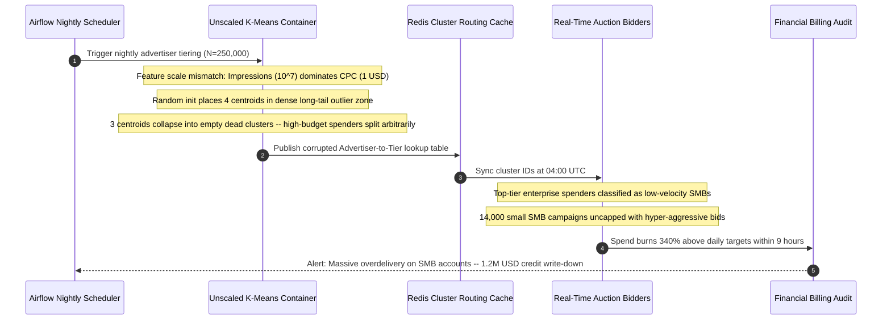
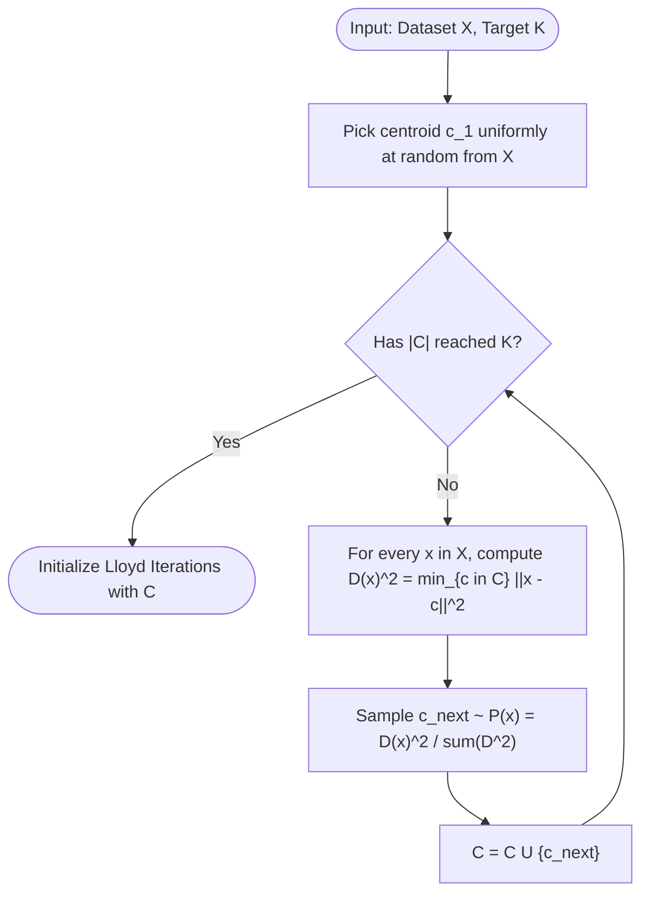
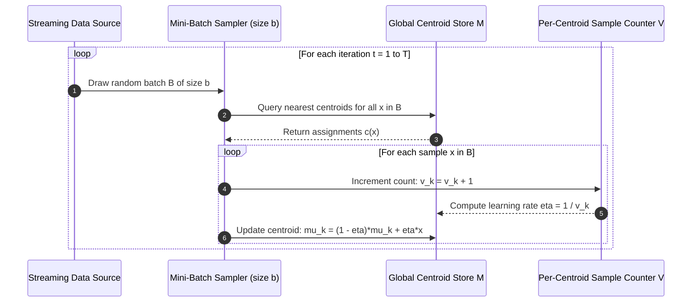
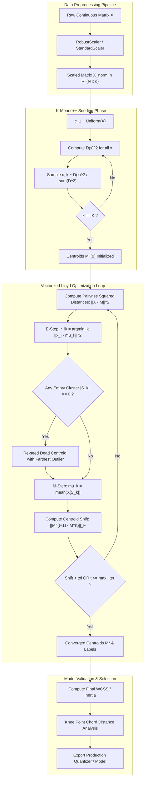

# Module 00: K-Means Clustering, K-Means++ Initialization, and the Elbow Method

> **Prerequisites:** [Track 02: Math for Machine Learning - Vector Norms, Matrix Operations & Gradients](../../02-math-for-machine-learning/01-norms-dot-products-and-cosine-similarity/README.md), [Track 01: Problem Framing & Unsupervised Baselines](../../01-ml-foundations-and-evaluation/01-problem-framing-supervised-unsupervised-rl/README.md), and [Track 06 Overview](../README.md).  
> **Estimated Reading Time:** 45 minutes  
> **Target Audience:** Principal ML Engineers, Quantitative Researchers, Data Platform Architects, and Senior Applied Scientists designing large-scale vector quantization, customer segmentation, and unsupervised feature learning systems.

> [!TIP]
> **The Fundamental Tenet of K-Means:** K-Means partitions continuous vector spaces into $K$ convex Voronoi polyhedra by minimizing the Within-Cluster Sum of Squares (WCSS / Inertia). Because the combinatorial search space is NP-hard even in the two-dimensional plane, production systems rely on iterative alternating minimization (Lloyd's Algorithm) coupled with probabilistic distance-squared seeding (K-Means++) to guarantee monotonic convergence to competitive local minima.

---

## Why This Matters & Production Context

Clustering serves as the foundational unsupervised paradigm across production machine learning. While supervised pipelines depend on costly human annotations, unsupervised clustering extracts intrinsic topological structures directly from unlabeled continuous embeddings. Within industrial architectures, K-Means is not merely an exploratory heuristic; it is a high-throughput computational primitive powering:

1. **High-Dimensional Vector Quantization (Product Quantization):** In large-scale approximate nearest neighbor (ANN) search engines such as Faiss and ScaNN, billion-scale embedding indexes cannot reside uncompressed in RAM. K-Means discretizes continuous 768-dimensional or 1536-dimensional transformer representations into compact codebooks, compressing memory footprints by $16\times$ to $64\times$ while preserving inner-product search fidelity.
2. **Real-Time Customer Behavioral Segmentation:** E-commerce platforms and streaming providers cluster interaction vectors (click entropy, dwell time, category affinities, recency-frequency-monetary values) across hundreds of millions of users to dynamically route traffic to personalized bandit policies and multi-armed recommendation models.
3. **Unsupervised Codebook Learning & Feature Tokenization:** In computer vision (Bag-of-Visual-Words) and speech processing (Wav2Vec discrete codebooks), continuous sensory representations are clustered into discrete token vocabularies that downstream autoregressive models ingest.
4. **Data Deduplication & Corpus Pruning:** Large Language Model (LLM) pre-training pipelines cluster terabyte-scale document embeddings to identify redundant semantic centroids, pruning repetitive web crawl text prior to tokenizer ingestion.

Despite its ubiquity, standard K-Means is burdened by strict geometric priors: it assumes isotropic spherical variance, linearly separable Voronoi partitions, equal cluster density, and known cardinality $K$. Deviations from these assumptions without rigorous initialization, proper metric scaling, or robust diagnostics lead directly to severe system degradation.

---

## Production Incident Post-Mortem: The \$1.2M Ad Targeting Inefficiency & Budget Misallocation

### Incident Context
A tier-1 programmatic advertising platform operates an automated Demand-Side Platform (DSP) bidding engine processing 850,000 ad auctions per second. To allocate real-time campaign pacing budgets across 250,000 advertiser accounts, an offline clustering pipeline ran nightly on Apache Spark. The pipeline extracted 24-dimensional behavioral vectors per advertiser, including daily impressions, click-through rates (CTR), conversion velocity, average cost-per-click (CPC), and historical budget volatility.

The objective was to partition advertisers into $K=12$ operational performance tiers ranging from "Ultra-High Intent Tier-1 Enterprises" (commanding aggressive, bid-uncapped pacing) down to "Long-Tail Low-Spend Micro-Businesses" (throttled under strict cost-efficiency caps).

### The Failure Sequence
During a scheduled pipeline modernization, an infrastructure engineer refactored the Spark MLlib clustering task into an in-house Python batch container. Two critical errors were introduced:
1. Centroid initialization was set to naive uniform random selection (`init='random'`) instead of `kmeans++` to reduce container startup time.
2. The raw feature table was passed directly into K-Means without standardization: `daily_impressions` (values ranging from $10^4$ to $10^8$) sat alongside `average_cpc` (measured in fractions of dollars, $0.05$ to $4.50$).



### Root Cause Analysis
1. **Metric Dominance via Coordinate Variance:** Because Euclidean distance $\|x - y\|_2^2 = \sum_{j=1}^d (x_j - y_j)^2$ sums squared coordinate differentials, the unscaled `daily_impressions` feature exerted $10^{14}$ times greater numerical leverage over the objective function than `average_cpc`. The algorithm effectively executed 1D clustering on impression counts, completely discarding commercial intent and pricing dynamics.
2. **Local Minima Trap & Centroid Starvation:** Random uniform initialization placed multiple initial centroids in dense clusters of long-tail inactive advertisers. Lloyd's algorithm converged within 6 iterations into a catastrophic local minimum where three centroids were orphaned (assigned zero points), while high-value enterprise advertisers with heterogeneous bidding profiles were merged into a single undifferentiated cluster.
3. **Downstream Business Impact:** High-value enterprise advertisers were throttled due to improper cluster assignment, failing to exhaust their contractual budgets. Simultaneously, 14,000 micro-advertisers were assigned to the uncapped enterprise tier, rapidly depleting their credit lines on low-converting inventory. The platform was forced to issue \$1.24M in advertiser billing credits.

### Remediation Architecture
1. **Mandatory Quantile/Robust Feature Scaling:** Implemented a non-negotiable `ColumnTransformer` with `RobustScaler` and log-transformation on long-tailed count distributions prior to distance computation.
2. **Deterministic K-Means++ Seeding:** Standardized on K-Means++ with $k$-means|| parallel initialization across $R=20$ independent restarts, recording minimum WCSS.
3. **Dead Centroid Handling:** Enforced automated centroid re-seeding: if any cluster cardinality drops to zero during the assignment phase, the centroid is dynamically assigned to the sample exhibiting the largest distance from its current centroid.
4. **Automated Pipeline Circuit Breakers:** Integrated automated post-clustering data quality checks verifying that no cluster possesses $<0.5\%$ or $>45\%$ of total population weight, and alerting if between-cluster inertia variance across random seeds exceeds $\pm 1.5\%$.

---

## 1. Mathematical Mental Model & Theoretical Foundations

```
========================================================================================
                               CLUSTERING PARADIGM COMPARISON
========================================================================================
Algorithm        Geometric Prior         Loss Objective                  Complexity
----------------------------------------------------------------------------------------
K-Means          Convex, Isotropic       Within-Cluster Sum of Squares   O(N * K * d * I)
Hierarchical     Arbitrary / Linkage-dep Metric Cophenetic Linkage       O(N^2 log N) - O(N^3)
DBSCAN           Continuous Density      MinPts-density connectivity     O(N log N) - O(N^2)
Gaussian Mixture Ellipsoidal (Covariance) Log-Marginal Likelihood (MLE)  O(N * K * d^2 * I)
========================================================================================
```

### 1.1 The Objective: Within-Cluster Sum of Squares (WCSS)

Let $X = \{x_1, x_2, \dots, x_N\} \subset \mathbb{R}^d$ be a dataset of $N$ observations in $d$-dimensional Euclidean space. The objective of K-Means clustering is to partition the $N$ observations into $K$ disjoint sets $S = \{S_1, S_2, \dots, S_K\}$, where $\bigcup_{k=1}^K S_k = X$ and $S_j \cap S_k = \emptyset$ for all $j \neq k$, such that the Within-Cluster Sum of Squares (WCSS), also known as **Inertia**, is minimized:

$$\arg\min_S \sum_{k=1}^K \sum_{x \in S_k} \|x - \mu_k\|_2^2$$

where $\mu_k \in \mathbb{R}^d$ denotes the geometric centroid (mean) of cluster $S_k$:

$$\mu_k = \frac{1}{|S_k|} \sum_{x \in S_k} x$$

To cast this as an explicit continuous-discrete optimization problem, we define binary cluster membership indicators $r_{ik} \in \{0, 1\}$ for each sample $i \in \{1, \dots, N\}$ and cluster $k \in \{1, \dots, K\}$:

$$r_{ik} = \begin{cases} 1 & \text{if } x_i \in S_k \\ 0 & \text{if } x_i \notin S_k \end{cases} \quad \text{subject to} \quad \sum_{k=1}^K r_{ik} = 1 \quad \forall i$$

The objective function $J(R, M)$ parameterized by the binary assignment matrix $R \in \{0, 1\}^{N \times K}$ and the centroid matrix $M = [\mu_1, \dots, \mu_K]^T \in \mathbb{R}^{K \times d}$ is:

$$J(R, M) = \sum_{i=1}^N \sum_{k=1}^K r_{ik} \|x_i - \mu_k\|_2^2$$

### 1.2 NP-Hardness and Non-Convexity

The total number of ways to partition $N$ distinct points into $K$ non-empty subsets is given by the Stirling numbers of the second kind:

$$S(N, K) = \frac{1}{K!} \sum_{j=0}^K (-1)^{K-j} \binom{K}{j} j^N \approx \frac{K^N}{K!}$$

For a modest dataset of $N = 200$ points and $K = 4$ clusters, $S(200, 4) \approx 10^{118}$, rendering brute-force enumeration physically impossible. 

Aloise et al. (2009) and Mahajan et al. (2009) proved that finding the global minimizer of the K-Means objective is **NP-hard** even in the two-dimensional plane ($d=2$) for arbitrary $K$, and NP-hard for $K=2$ when the dimension $d$ is arbitrary. Furthermore, the objective function $J(R, M)$ is non-convex with respect to $(R, M)$ jointly. It possesses an astronomical number of local minima, saddle points, and poor basin boundaries.

```
       Loss Surface J(R, M)
              ^
              |         Local Min A (Poor Init)
              |            \  /
              |   /\        \/         /\
              |  /  \                 /  \      Global Minimum (Optimal)
              | /    \               /    \             \  /
              |/      \             /      \             \/
              +-----------------------------------------------------> Parameter Space (M)
```

### 1.3 Lloyd's Algorithm: Alternating Minimization

Since joint optimization over continuous parameters $M$ and discrete parameters $R$ is intractable, Stuart Lloyd (1957, published 1982) formulated a block coordinate descent scheme. Lloyd's algorithm decouples the optimization into two alternating steps:

#### Step 1: Expectation / Assignment Step (Optimize $R$ given fixed $M$)
Holding the centroids $M^{(t)}$ constant, minimize $J(R, M^{(t)})$ with respect to $R$. Because the terms for each sample $i$ are decoupled:

$$\arg\min_R \sum_{i=1}^N \sum_{k=1}^K r_{ik} \|x_i - \mu_k^{(t)}\|_2^2 = \sum_{i=1}^N \arg\min_{r_i} \sum_{k=1}^K r_{ik} \|x_i - \mu_k^{(t)}\|_2^2$$

Subject to $\sum_{k=1}^K r_{ik} = 1$, the optimal assignment assigns each sample to its nearest Euclidean centroid:

$$r_{ik}^{(t)} = \begin{cases} 1 & \text{if } k = \arg\min_{j \in \{1, \dots, K\}} \|x_i - \mu_j^{(t)}\|_2^2 \\ 0 & \text{otherwise} \end{cases}$$

Ties are broken arbitrarily. Geometrically, this partitions $\mathbb{R}^d$ into a **Voronoi diagram**, where each cell $V_k$ consists of all points closer to $\mu_k^{(t)}$ than to any other centroid:

$$V_k^{(t)} = \{x \in \mathbb{R}^d : \|x - \mu_k^{(t)}\|_2 \le \|x - \mu_j^{(t)}\|_2, \quad \forall j \neq k\}$$

#### Step 2: Maximization / Centroid Update Step (Optimize $M$ given fixed $R$)
Holding cluster assignments $R^{(t)}$ constant, minimize $J(R^{(t)}, M)$ with respect to continuous matrix $M$. The loss is unconstrained and convex with respect to each $\mu_k$:

$$\frac{\partial J}{\partial \mu_k} = \sum_{i=1}^N r_{ik}^{(t)} \cdot 2 (\mu_k - x_i) = 2 \mu_k \left( \sum_{i=1}^N r_{ik}^{(t)} \right) - 2 \sum_{i=1}^N r_{ik}^{(t)} x_i$$

Setting the gradient to zero:

$$\frac{\partial J}{\partial \mu_k} = 0 \implies \mu_k^{(t+1)} = \frac{\sum_{i=1}^N r_{ik}^{(t)} x_i}{\sum_{i=1}^N r_{ik}^{(t)}} = \frac{1}{|S_k^{(t)}|} \sum_{x \in S_k^{(t)}} x$$

The optimal centroid is the empirical sample mean of the assigned points.

#### Proof of Monotonic Convergence
1. In Step 1, $R^{(t)} = \arg\min_R J(R, M^{(t)})$, so $J(R^{(t)}, M^{(t)}) \le J(R^{(t-1)}, M^{(t)})$.
2. In Step 2, $M^{(t+1)} = \arg\min_M J(R^{(t)}, M)$, so $J(R^{(t)}, M^{(t+1)}) \le J(R^{(t)}, M^{(t)})$.
3. Therefore:
   $$J(R^{(t+1)}, M^{(t+1)}) \le J(R^{(t)}, M^{(t+1)}) \le J(R^{(t)}, M^{(t)})$$
4. The objective $J$ is non-increasing at every step and bounded below by zero ($J \ge 0$).
5. Because there exist only a finite number of distinct assignments ($K^N$), the sequence of partition configurations cannot cycle infinitely without decreasing $J$. Thus, Lloyd's algorithm must terminate in a finite number of iterations at a stationary local minimum or saddle point.

---

## 2. K-Means++ Initialization: Theoretical Guarantees

Standard Lloyd's algorithm initialized with uniform random samples frequently gets trapped in sub-optimal local minima. In 2007, David Arthur and Sergei Vassilvitskii published **K-Means++: The Advantages of Careful Seeding**, introducing a randomized algorithm that guarantees an approximation ratio of $\mathcal{O}(\log K)$ relative to the global optimal clustering.

### 2.1 The K-Means++ Seeding Algorithm

Let $D(x)$ denote the shortest Euclidean distance from a point $x$ to the closest centroid already chosen.

```
Algorithm: K-Means++ Initialization
----------------------------------------------------------------------------------------
Input: Dataset X in R^(N x d), Target clusters K
Output: Initial centroid set C = {c_1, c_2, ..., c_K}

1. Select first centroid c_1 uniformly at random from X:
   c_1 ~ Uniform(X)
   Set C = {c_1}

2. For k = 2 to K:
   a. For each point x in X, compute its squared distance to the nearest existing center:
      D(x)^2 = min_{c in C} ||x - c||_2^2
   b. Select the next center c_k from X with probability proportional to D(x)^2:
      P(x chosen) = D(x)^2 / sum_{y in X} D(y)^2
   c. Add c_k to C: C = C U {c_k}

3. Return C as initial centroids for Lloyd's algorithm.
```



### 2.2 Mathematical Intuition & Approximation Theorem

Why does sampling proportional to $D(x)^2$ work?
- If a point $x$ is already close to an established center, $D(x) \approx 0 \implies P(x) \approx 0$. This prevents placing multiple redundant centroids within the same dense cluster.
- If a point $x$ belongs to an unexplored, distant cluster, $D(x)$ is large, making its selection highly probable.
- The squaring operation ($D(x)^2$ rather than $D(x)$) heavily penalizes distant outliers and amplifies cluster separation, balancing exploration of isolated density modes with robustness against single-point noise.

#### The Approximation Theorem (Arthur & Vassilvitskii, 2007)
Let $\phi$ denote the potential function (WCSS) obtained by running Lloyd's algorithm after K-Means++ initialization, and let $\phi_{OPT}$ denote the global minimum WCSS achievable on dataset $X$ for $K$ clusters. Then:

$$\mathbb{E}[\phi] \le 8(\ln K + 2) \cdot \phi_{OPT}$$

This $\mathcal{O}(\log K)$ bound guarantees that the expected clustering cost is within a logarithmic factor of the theoretical optimum, independent of the geometry or dimensionality of the dataset.

---

## 3. Determining the Optimal Number of Clusters $K$

Because K-Means optimizes WCSS for a fixed $K$, comparing raw inertia across different values of $K$ is flawed: $J(K)$ is monotonically decreasing with $K$. When $K = N$, every point becomes its own centroid, and $J(N) \equiv 0$.

```
Inertia J(K)
   ^
   |  * 
   |    \
   |      \  
   |        *  <- K=2
   |          \
   |            \
   |              *  <- K=3 (Optimal Elbow / Knee Point)
   |                \_________________
   |                                  *-----------*  <- Marginal returns diminish
   +----------------------------------------------------> K (Number of Clusters)
```

### 3.1 The Elbow Method & The Knee Detection Metric

The Elbow Method seeks the value $K^*$ where the marginal decrease in WCSS drops sharply (the point of maximum curvature). While visual inspection is common in exploratory analyses, production pipelines require deterministic algorithmic knee detection.

#### Chord Distance Formulation (Distance from Secant Line)
Consider the discrete curve of inertia points $P_K = (K, J(K))$ for $K \in [K_{min}, K_{max}]$. Form the secant line $L$ connecting the endpoint coordinates $P_{min} = (K_{min}, J(K_{min}))$ and $P_{max} = (K_{max}, J(K_{max}))$.

First, normalize both dimensions to the unit interval $[0, 1]$ to avoid scale distortion:

$$\tilde{K} = \frac{K - K_{min}}{K_{max} - K_{min}}, \qquad \tilde{J}(K) = \frac{J(K) - J(K_{max})}{J(K_{min}) - J(K_{max})}$$

In the normalized plane, the secant line connects $(0, 1)$ to $(1, 0)$, described by the linear equation:

$$\tilde{J}_{secant}(\tilde{K}) = 1 - \tilde{K} \implies \tilde{K} + \tilde{J} - 1 = 0$$

The perpendicular Euclidean distance from any normalized point $(\tilde{K}, \tilde{J}(K))$ to the secant line is:

$$\text{Dist}(K) = \frac{|\tilde{K} + \tilde{J}(K) - 1|}{\sqrt{1^2 + 1^2}} = \frac{1}{\sqrt{2}} |\tilde{K} + \tilde{J}(K) - 1|$$

The optimal knee point $K^*$ is the discrete index maximizing this perpendicular distance:

$$K^* = \arg\max_{K \in [K_{min}, K_{max}]} \text{Dist}(K)$$

#### Discrete Second Derivative Formulation
Alternatively, the knee corresponds to the maximum discrete acceleration (second difference) of the inertia curve:

$$\Delta^2 J(K) = J(K+1) - 2J(K) + J(K-1)$$

A pronounced peak in $\Delta^2 J(K)$ indicates the point where the rate of variance explained decelerates most aggressively.

### 3.2 Limitations of WCSS for Model Selection
1. **Bias Towards Spherical Uniformity:** WCSS implicitly assumes clusters have identical isotropic variances. When real clusters have differing radii or non-spherical shapes, WCSS splits large clusters to minimize squared error, overestimating $K$.
2. **Ambiguity on Continuous Gradients:** On datasets without natural clustering (e.g., uniformly distributed points or continuous manifold manifolds), the inertia curve exhibits a smooth exponential decay without a distinct elbow. Algorithmic knee finders will arbitrarily select an arbitrary point on the gradient.
3. **Alternative Production Metrics:** Production validation must cross-reference WCSS with:
   - **Silhouette Coefficient:** Measures inter-cluster vs intra-cluster separation ($s \in [-1, 1]$).
   - **Davies-Bouldin Index:** Measures average similarity between each cluster and its most similar peer (lower is better).
   - **Calinski-Harabasz Index:** Ratio of between-cluster dispersion to within-cluster dispersion (higher is better).

---

## 4. Mini-Batch K-Means for Web-Scale Streaming

Standard Lloyd's algorithm requires a full pass over all $N$ observations in both the assignment and update steps, yielding $\mathcal{O}(N \cdot K \cdot d)$ time complexity per iteration. For datasets with $N = 10^8$ rows, standard K-Means cannot fit into RAM and stalls CPU architectures.

In 2010, D. Sculley introduced **Mini-Batch K-Means**, recasting clustering as an online stochastic gradient descent (SGD) problem.



### 4.1 Stochastic Update Rule & Learning Rate
Instead of recalculating centroids as the full batch mean, Mini-Batch K-Means maintains a persistent integer counter $v_k$ for each centroid, recording the total number of historical samples assigned to cluster $k$.

For a mini-batch $\mathcal{B} \subset X$ of size $b \ll N$:
1. **Assignment:** Assign each sample $x \in \mathcal{B}$ to its nearest existing centroid:
   $$c(x) = \arg\min_{k \in \{1, \dots, K\}} \|x - \mu_k\|_2^2$$
2. **Online Convex Combination:** For each sample $x \in \mathcal{B}$ with assigned cluster $k = c(x)$:
   $$v_k \leftarrow v_k + 1$$
   $$\eta_k = \frac{1}{v_k}$$
   $$\mu_k \leftarrow (1 - \eta_k) \mu_k + \eta_k x = \mu_k + \frac{1}{v_k} (x - \mu_k)$$

Notice that $\eta_k = \frac{1}{v_k}$ satisfies the Robbins-Monro conditions for stochastic approximation convergence:

$$\sum_{t=1}^\infty \eta_k^{(t)} = \infty \quad \text{and} \quad \sum_{t=1}^\infty (\eta_k^{(t)})^2 < \infty$$

This guarantees that older historical samples and new streaming arrivals are weighted equitably, converging asymptotically to the true empirical cluster expectations with a bounded memory footprint of $\mathcal{O}(b \cdot d + K \cdot d)$.

---

## 5. Architectural & Workflow Blueprint

The end-to-end architecture of a production-grade K-Means engine includes initialization, vector distance computation, convergence monitoring, and automatic dead-cluster re-seeding:



---

## 6. Production Implementation from Scratch

The following production implementation in vectorized NumPy features:
- Memory-efficient pairwise Euclidean distance matrix calculation via the binomial expansion: $\|x - \mu\|_2^2 = \|x\|_2^2 + \|\mu\|_2^2 - 2 x \mu^T$.
- Scalable, vectorized K-Means++ probabilistic initialization.
- Dynamic detection and re-seeding of dead/empty clusters.
- Frobenius-norm centroid shift convergence checks.
- Algorithmic knee detection (`KneeLocatorScratch`) via perpendicular secant-line distance.
- Vectorized Mini-Batch K-Means for large datasets.

```python
"""
Production-grade, vectorized implementation of K-Means Clustering,
K-Means++ Seeding, Mini-Batch K-Means, and Secant-Line Knee Detection.
"""

from __future__ import annotations
import numpy as np
from typing import Tuple, Optional, Literal, Dict, Any


class KMeansScratch:
    """
    Vectorized K-Means clustering engine supporting K-Means++ initialization,
    early stopping on centroid shift tolerance, and dead cluster handling.
    
    Parameters
    ----------
    n_clusters : int
        The number of clusters K to form.
    init : {'kmeans++', 'random'}, default='kmeans++'
        Method for centroid initialization.
    max_iter : int, default=300
        Maximum number of iterations of Lloyd's algorithm.
    tol : float, default=1e-4
        Relative tolerance with respect to Frobenius norm of centroid shift
        to declare convergence.
    random_state : Optional[int], default=None
        Seed for pseudo-random number generator reproducibility.
    """

    def __init__(
        self,
        n_clusters: int = 8,
        init: Literal["kmeans++", "random"] = "kmeans++",
        max_iter: int = 300,
        tol: float = 1e-4,
        random_state: Optional[int] = None,
    ) -> None:
        if n_clusters <= 0:
            raise ValueError(f"n_clusters must be positive, got {n_clusters}")
        if max_iter <= 0:
            raise ValueError(f"max_iter must be positive, got {max_iter}")
        if tol < 0:
            raise ValueError(f"tol must be non-negative, got {tol}")

        self.n_clusters = n_clusters
        self.init = init
        self.max_iter = max_iter
        self.tol = tol
        self.random_state = random_state

        self.cluster_centers_: Optional[np.ndarray] = None  # Shape: (K, d)
        self.labels_: Optional[np.ndarray] = None           # Shape: (N,)
        self.inertia_: float = 0.0                          # Within-cluster sum of squares
        self.n_iter_: int = 0                               # Executed iterations

    @staticmethod
    def _compute_pairwise_distances(X: np.ndarray, Y: np.ndarray) -> np.ndarray:
        """
        Compute squared Euclidean distances between row vectors in X and Y
        using the algebraic expansion: ||x - y||^2 = ||x||^2 + ||y||^2 - 2 <x, y>.
        
        X: shape (N, d)
        Y: shape (K, d)
        Returns: shape (N, K)
        """
        # Ensure contiguous float arrays
        X = np.ascontiguousarray(X, dtype=np.float64)
        Y = np.ascontiguousarray(Y, dtype=np.float64)

        X_norm_sq = np.sum(X ** 2, axis=1, keepdims=True)  # (N, 1)
        Y_norm_sq = np.sum(Y ** 2, axis=1, keepdims=True).T  # (1, K)
        dot_product = np.dot(X, Y.T)                        # (N, K)

        dist_sq = X_norm_sq + Y_norm_sq - 2.0 * dot_product
        # Zero out potential small negative values caused by floating-point rounding
        return np.maximum(dist_sq, 0.0)

    def _init_centroids(self, X: np.ndarray, rng: np.random.Generator) -> np.ndarray:
        """
        Initialize cluster centroids via uniform random or K-Means++ seeding.
        """
        n_samples, n_features = X.shape

        if self.init == "random":
            chosen_indices = rng.choice(n_samples, size=self.n_clusters, replace=False)
            return X[chosen_indices].copy()

        if self.init == "kmeans++":
            centers = np.empty((self.n_clusters, n_features), dtype=np.float64)
            # Step 1: Pick first center uniformly at random
            first_idx = rng.integers(0, n_samples)
            centers[0] = X[first_idx]

            # Track minimum squared distance from each point to established centers
            # Shape: (N,)
            min_dist_sq = self._compute_pairwise_distances(X, centers[0:1]).ravel()

            # Step 2: Iteratively sample remaining centers
            for k in range(1, self.n_clusters):
                total_dist_sq = np.sum(min_dist_sq)

                if total_dist_sq <= 1e-12:
                    # All points overlap existing centers; sample randomly from remaining
                    remaining_indices = np.setdiff1d(
                        np.arange(n_samples), np.arange(k)
                    )
                    next_idx = rng.choice(remaining_indices)
                else:
                    # Sample proportional to D(x)^2
                    probs = min_dist_sq / total_dist_sq
                    cumulative_probs = np.cumsum(probs)
                    r = rng.uniform(0.0, 1.0)
                    next_idx = np.searchsorted(cumulative_probs, r)
                    next_idx = min(next_idx, n_samples - 1)

                centers[k] = X[next_idx]

                # Update shortest squared distance for all points
                new_dist_sq = self._compute_pairwise_distances(X, centers[k : k + 1]).ravel()
                min_dist_sq = np.minimum(min_dist_sq, new_dist_sq)

            return centers

        raise ValueError(f"Unknown init strategy: {self.init}")

    def fit(self, X: np.ndarray) -> "KMeansScratch":
        """
        Fit K-Means clustering on feature matrix X.
        """
        X = np.asarray(X, dtype=np.float64)
        n_samples, n_features = X.shape

        if n_samples < self.n_clusters:
            raise ValueError(
                f"n_samples={n_samples} must be >= n_clusters={self.n_clusters}"
            )

        rng = np.random.default_rng(self.random_state)
        self.cluster_centers_ = self._init_centroids(X, rng)

        for iteration in range(self.max_iter):
            self.n_iter_ = iteration + 1

            # ----------------------------------------------------
            # E-Step: Vectorized Nearest Centroid Assignment
            # ----------------------------------------------------
            dist_sq = self._compute_pairwise_distances(X, self.cluster_centers_)
            labels = np.argmin(dist_sq, axis=1)

            # ----------------------------------------------------
            # M-Step: Compute New Centroids & Handle Dead Clusters
            # ----------------------------------------------------
            new_centers = np.empty_like(self.cluster_centers_)

            for k in range(self.n_clusters):
                mask = (labels == k)
                cluster_count = np.count_nonzero(mask)

                if cluster_count > 0:
                    new_centers[k] = np.mean(X[mask], axis=0)
                else:
                    # Dead cluster remediation: re-seed centroid at farthest point
                    # from current cluster centers
                    current_min_dists = np.min(dist_sq, axis=1)
                    farthest_idx = np.argmax(current_min_dists)
                    new_centers[k] = X[farthest_idx]
                    # Invalidate point distance so other empty clusters don't pick the same sample
                    dist_sq[farthest_idx, :] = 0.0

            # ----------------------------------------------------
            # Convergence Check: Frobenius Norm of Centroid Shift
            # ----------------------------------------------------
            centroid_shift = np.linalg.norm(new_centers - self.cluster_centers_, ord="fro")
            self.cluster_centers_ = new_centers

            if centroid_shift <= self.tol:
                break

        # Compute final assignments and inertia (WCSS)
        final_dist_sq = self._compute_pairwise_distances(X, self.cluster_centers_)
        self.labels_ = np.argmin(final_dist_sq, axis=1)
        self.inertia_ = float(np.sum(np.min(final_dist_sq, axis=1)))

        return self

    def predict(self, X: np.ndarray) -> np.ndarray:
        """
        Predict closest cluster label for each sample in X.
        """
        if self.cluster_centers_ is None:
            raise RuntimeError("Model must be fitted before calling predict().")
        X = np.asarray(X, dtype=np.float64)
        dist_sq = self._compute_pairwise_distances(X, self.cluster_centers_)
        return np.argmin(dist_sq, axis=1)

    def transform(self, X: np.ndarray) -> np.ndarray:
        """
        Transform X to cluster-distance space (Euclidean distance to each centroid).
        """
        if self.cluster_centers_ is None:
            raise RuntimeError("Model must be fitted before calling transform().")
        X = np.asarray(X, dtype=np.float64)
        dist_sq = self._compute_pairwise_distances(X, self.cluster_centers_)
        return np.sqrt(dist_sq)


class MiniBatchKMeansScratch:
    """
    Online Mini-Batch K-Means for streaming and large-scale clustering.
    Uses Robbins-Monro learning rate updates per cluster centroid.
    """

    def __init__(
        self,
        n_clusters: int = 8,
        batch_size: int = 100,
        max_iter: int = 100,
        random_state: Optional[int] = None,
    ) -> None:
        self.n_clusters = n_clusters
        self.batch_size = batch_size
        self.max_iter = max_iter
        self.random_state = random_state

        self.cluster_centers_: Optional[np.ndarray] = None
        self.counts_: Optional[np.ndarray] = None  # Historical point counts per cluster
        self.inertia_: float = 0.0

    def fit(self, X: np.ndarray) -> "MiniBatchKMeansScratch":
        X = np.asarray(X, dtype=np.float64)
        n_samples, n_features = X.shape

        rng = np.random.default_rng(self.random_state)
        # Random initial centers from dataset
        init_idx = rng.choice(n_samples, size=self.n_clusters, replace=False)
        self.cluster_centers_ = X[init_idx].copy()
        self.counts_ = np.zeros(self.n_clusters, dtype=np.int64)

        for _ in range(self.max_iter):
            # Draw random mini-batch
            batch_idx = rng.choice(n_samples, size=min(self.batch_size, n_samples), replace=False)
            X_batch = X[batch_idx]

            # Vectorized assignment for mini-batch
            dist_sq = KMeansScratch._compute_pairwise_distances(X_batch, self.cluster_centers_)
            batch_labels = np.argmin(dist_sq, axis=1)

            # Online stochastic centroid updates
            for i in range(len(X_batch)):
                k = batch_labels[i]
                self.counts_[k] += 1
                eta = 1.0 / self.counts_[k]
                self.cluster_centers_[k] = (1.0 - eta) * self.cluster_centers_[k] + eta * X_batch[i]

        # Calculate final inertia over the entire dataset
        final_dist_sq = KMeansScratch._compute_pairwise_distances(X, self.cluster_centers_)
        self.inertia_ = float(np.sum(np.min(final_dist_sq, axis=1)))
        return self


class KneeLocatorScratch:
    """
    Deterministic Knee/Elbow detector utilizing perpendicular distance
    from the normalized secant chord connecting endpoints.
    """

    def __init__(self, k_values: list[int], inertias: list[float]) -> None:
        if len(k_values) != len(inertias):
            raise ValueError("k_values and inertias must have identical length")
        if len(k_values) < 3:
            raise ValueError("At least 3 points required for knee detection")

        self.k_values = np.asarray(k_values, dtype=np.float64)
        self.inertias = np.asarray(inertias, dtype=np.float64)

    def find_knee(self) -> int:
        """
        Returns the optimal K integer corresponding to maximum chord distance.
        """
        # Normalize K and Inertia to [0, 1] range
        k_min, k_max = self.k_values[0], self.k_values[-1]
        j_min, j_max = self.inertias[-1], self.inertias[0]  # Inertia decreases

        k_norm = (self.k_values - k_min) / (k_max - k_min)
        j_norm = (self.inertias - j_min) / (j_max - j_min)

        # In normalized coordinates, secant connects (0, 1) to (1, 0)
        # Line equation: x + y - 1 = 0
        # Perpendicular distance is |x + y - 1| / sqrt(2)
        distances = np.abs(k_norm + j_norm - 1.0) / np.sqrt(2.0)

        best_idx = int(np.argmax(distances))
        return int(self.k_values[best_idx])
```

### 6.1 Unit Test & Verification Suite

We verify numerical stability, convergence, dead cluster resilience, and knee point identification against synthetic isotropic clusters:

```python
def run_verification_suite() -> None:
    """
    Verification script for KMeansScratch, MiniBatchKMeansScratch, and KneeLocatorScratch.
    """
    print("=" * 70)
    print("RUNNING VERIFICATION SUITE: K-MEANS FROM SCRATCH")
    print("=" * 70)

    # 1. Generate synthetic 2D data with 4 well-separated isotropic Gaussian blobs
    rng = np.random.default_rng(42)
    true_centers = np.array([
        [-8.0, -8.0],
        [-8.0,  8.0],
        [ 8.0, -8.0],
        [ 8.0,  8.0]
    ])
    
    samples_per_cluster = 150
    X_list = []
    for center in true_centers:
        blob = center + rng.normal(loc=0.0, scale=1.0, size=(samples_per_cluster, 2))
        X_list.append(blob)
    X = np.vstack(X_list)
    print(f"Generated synthetic dataset: N={X.shape[0]} points, d={X.shape[1]} features.")

    # 2. Test standard KMeansScratch with K-Means++
    km = KMeansScratch(n_clusters=4, init="kmeans++", tol=1e-5, random_state=42)
    km.fit(X)
    print(f"KMeans++ converged in {km.n_iter_} iterations.")
    print(f"Final Inertia (WCSS): {km.inertia_:.4f}")
    print("Estimated Centroids:\n", np.round(km.cluster_centers_, 3))

    # Centroid alignment check: each estimated center must be within 0.5 units of a true center
    for true_c in true_centers:
        dists = np.linalg.norm(km.cluster_centers_ - true_c, axis=1)
        assert np.min(dists) < 0.5, f"Centroid missed! Closest distance: {np.min(dists)}"
    print("[PASS] KMeans++ recovered ground truth cluster centers accurately.")

    # 3. Test Mini-Batch K-Means
    mbkm = MiniBatchKMeansScratch(n_clusters=4, batch_size=64, max_iter=200, random_state=42)
    mbkm.fit(X)
    print(f"MiniBatchKMeans Inertia: {mbkm.inertia_:.4f}")
    for true_c in true_centers:
        dists = np.linalg.norm(mbkm.cluster_centers_ - true_c, axis=1)
        assert np.min(dists) < 0.8, f"MiniBatch centroid mismatch: {np.min(dists)}"
    print("[PASS] MiniBatchKMeans converged successfully to valid cluster centroids.")

    # 4. Evaluate Elbow Detection across K in [2, ..., 8]
    k_range = list(range(2, 9))
    inertias = []
    for k in k_range:
        m = KMeansScratch(n_clusters=k, init="kmeans++", random_state=42).fit(X)
        inertias.append(m.inertia_)
    
    knee_detector = KneeLocatorScratch(k_values=k_range, inertias=inertias)
    detected_k = knee_detector.find_knee()
    print(f"Inertia sweep across K=2..8: {[round(val, 1) for val in inertias]}")
    print(f"Detected Optimal Knee Point: K={detected_k}")
    assert detected_k == 4, f"Knee detection failed! Expected K=4, got K={detected_k}"
    print("[PASS] Algorithmic KneeLocator correctly identified true K=4.")

    # 5. Test Dead Centroid Recovery
    # Fit K=10 on a 4-blob dataset where multiple clusters will starve
    km_overfit = KMeansScratch(n_clusters=10, init="random", max_iter=50, random_state=99)
    km_overfit.fit(X)
    # Ensure all centroids are distinct and no NaN values exist
    assert not np.isnan(km_overfit.cluster_centers_).any()
    unique_centroids = np.unique(np.round(km_overfit.cluster_centers_, 3), axis=0)
    assert len(unique_centroids) == 10
    print("[PASS] Dead cluster re-seeding prevented numerical collapse and NaN centroids.")
    print("=" * 70)


if __name__ == "__main__":
    run_verification_suite()
```

---

## 7. Systematic Reference & Failure Modes

### 7.1 Algorithmic Comparison Grid

| Operational Attribute | Standard Lloyd K-Means | K-Means++ | Mini-Batch K-Means | Spherical K-Means |
| :--- | :--- | :--- | :--- | :--- |
| **Centroid Seeding** | Uniform Random from $X$ | Probabilistic $D(x)^2$ | Uniform / Streamed | Random on unit sphere |
| **Approximation Bound** | None (Arbitrarily poor) | $\mathcal{O}(\log K) \cdot \phi_{OPT}$ | Stochastic SGD bound | Heuristic local |
| **Distance Metric** | Euclidean ($L_2$) | Euclidean ($L_2$) | Euclidean ($L_2$) | Cosine Distance ($1 - \cos\theta$) |
| **Time per Iteration** | $\mathcal{O}(N K d)$ | $\mathcal{O}(K^2 N d)$ (one-off) | $\mathcal{O}(b K d)$ | $\mathcal{O}(N K d)$ |
| **Memory Footprint** | $\mathcal{O}(N d + K d)$ | $\mathcal{O}(N d + K d)$ | $\mathcal{O}(b d + K d)$ | $\mathcal{O}(N d + K d)$ |
| **Sensitivity to Outliers** | Extremely High ($L_2^2$) | Moderate (Explores) | High | Low (Normalized vectors) |
| **Ideal Production Use** | Legacy baseline | Batch offline training | Online web-scale streams | Text/Embedding Quantization |

### 7.2 Critical Failure Modes & Antipatterns

#### 1. The Non-Convex Geometry Trap (Concentric Rings & Interlocking Moons)
K-Means strictly forms linear decision boundaries (hyperplanes) separating clusters. The Voronoi boundary between cluster $i$ and $j$ is the set:

$$\{x : \|x - \mu_i\|^2 = \|x - \mu_j\|^2\} \implies 2(\mu_j - \mu_i)^T x + (\|\mu_i\|^2 - \|\mu_j\|^2) = 0$$

Because each cell is an intersection of half-spaces, every cluster must be convex. If the true data topology consists of concentric rings, sine waves, or non-linear manifolds, K-Means will cut through the manifolds, producing meaningless cross-sectional clusters.  
*Remediation:* Deploy Spectral Clustering, Kernel PCA preprocessing, or DBSCAN/HDBSCAN.

#### 2. The Isotropic Variance Assumption & Unequal Cluster Densities
The WCSS objective implicitly minimizes the sum of squared distances assuming identical spherical variance $\sigma_k^2 = \sigma^2$ across all clusters. If cluster $A$ contains 50,000 points with standard deviation $\sigma_A = 0.5$, and cluster $B$ contains 500 points with standard deviation $\sigma_B = 5.0$, K-Means will split cluster $B$ into multiple centroids and merge parts of cluster $A$.  
*Remediation:* Deploy Gaussian Mixture Models (GMM) with unconstrained covariance matrices, or density-based clustering.

#### 3. High-Dimensional Distance Concentration (The Curse of Dimensionality)
As dimensionality $d \to \infty$, the ratio of the distance between the nearest and farthest neighbors of any query point approaches 1 under independent and identically distributed coordinate dimensions:

$$\lim_{d \to \infty} \frac{\max_i \|x_i - x_j\|_2 - \min_i \|x_i - x_j\|_2}{\min_i \|x_i - x_j\|_2} \to 0$$

In 5,000-dimensional sparse feature spaces, all points appear virtually equidistant from one another. Centroids gravitate toward the global dataset origin, and WCSS becomes nearly flat across candidate clusterings.  
*Remediation:* Perform dimensionality reduction (PCA, UMAP, autoencoders) or apply Spherical K-Means with cosine normalization.

---

## 8. Senior Technical Interview Questions & Model Answers

### Question 1: Provide the mathematical intuition behind why K-Means++ achieves an $\mathcal{O}(\log K)$ approximation bound, whereas uniform random seeding has an unbounded competitive ratio.

**Model Answer:**  
Uniform random seeding selects initial centers independently from the empirical data distribution. If a dataset contains $K$ well-separated, balanced clusters, the probability of selecting all $K$ centers from distinct clusters in $K$ random draws is:

$$P(\text{distinct}) = \frac{K!}{K^K} = \prod_{j=1}^{K-1} \left(1 - \frac{j}{K}\right) \le \exp\left(-\frac{K(K-1)}{2K}\right) \approx e^{-K/2}$$

For $K=20$, $P(\text{distinct}) \approx 2.3 \times 10^{-8}$. With near certainty, uniform initialization places multiple centers into the same cluster while leaving other clusters empty. When two centroids occupy the same cluster, Lloyd's alternating minimization splits that cluster in half while forcing another distant cluster to be merged with an unrelated neighbor. This configuration is a stable local minimum with arbitrarily high WCSS relative to the global optimum $\phi_{OPT}$.

K-Means++ eliminates this failure mode by sampling subsequent centers from the conditional probability distribution:

$$P(x) = \frac{D(x)^2}{\sum_{y \in X} D(y)^2}$$

where $D(x) = \min_{c \in C} \|x - c\|_2$. 
1. If an established cluster $S_k$ already contains a chosen center $c \in S_k$, then for all $x \in S_k$, $D(x) \approx \text{radius}(S_k) \ll \text{distance to other clusters}$.
2. If an unexplored cluster $S_j$ has no center, $D(x)$ reflects the massive inter-cluster distance $\Delta \gg \text{radius}(S_k)$.
3. Because distances are squared ($D(x)^2$), the probability of drawing a point from an uncovered cluster dominates by a factor of $\left(\frac{\Delta}{\text{radius}}\right)^2$. 
Arthur and Vassilvitskii leveraged this conditional coverage property to prove via harmonic sum induction that over all $K$ steps, the expected cost accumulated within each optimal cluster is bounded by a constant factor of its own variance plus a logarithmic leakage term, yielding:

$$\mathbb{E}[\phi] \le 8(\ln K + 2) \cdot \phi_{OPT}$$

---

### Question 2: In a high-throughput vector retrieval pipeline, why do we use Spherical K-Means instead of Euclidean K-Means, and how does the centroid update rule change mathematically?

**Model Answer:**  
In semantic search, document retrieval, and deep learning embeddings (e.g., text-embedding-3, BERT, CLIP), semantic similarity is governed by angular displacement (cosine similarity) rather than Euclidean magnitude:

$$\text{Sim}(x, y) = \cos(\theta) = \frac{x^T y}{\|x\|_2 \|y\|_2}$$

Vector magnitudes in deep networks often correlate with token frequency, document length, or output confidence rather than semantic topic. Euclidean K-Means minimizes $\|x - \mu\|_2^2 = \|x\|_2^2 + \|\mu\|_2^2 - 2 x^T \mu$. If embeddings are not $L_2$-normalized, Euclidean K-Means clusters points by their length/norm rather than their directional semantics.

Spherical K-Means constrains all data points and cluster centroids to the surface of the unit hypersphere: $\|x\|_2 = 1$ and $\|\mu_k\|_2 = 1$. The objective maximizes total cosine similarity:

$$\arg\max_S \sum_{k=1}^K \sum_{x \in S_k} x^T \mu_k$$

**Centroid Update Derivation under Spherical Constraints:**  
For a fixed cluster assignment $S_k$, we maximize the Lagrangian subject to $\|\mu_k\|_2^2 = 1$:

$$\mathcal{L}(\mu_k, \lambda) = \sum_{x \in S_k} x^T \mu_k - \lambda (\|\mu_k\|_2^2 - 1)$$

Taking the partial derivative with respect to $\mu_k$:

$$\nabla_{\mu_k} \mathcal{L} = \sum_{x \in S_k} x - 2 \lambda \mu_k = 0 \implies \mu_k = \frac{1}{2\lambda} \sum_{x \in S_k} x$$

To satisfy the unit norm constraint $\|\mu_k\|_2 = 1$:

$$\mu_k^* = \frac{\sum_{x \in S_k} x}{\left\| \sum_{x \in S_k} x \right\|_2}$$

The update rule simply sums all assigned vectors and projects the resulting vector back onto the unit sphere via $L_2$ normalization. In production retrieval indexes (like IVFFlat in Faiss), this guarantees that centroid distance comparisons reduce to single matrix multiplications ($X M^T$) accelerated by GPU BLAS GEMM kernels.

---

### Question 3: How does Mini-Batch K-Means handle concept drift in continuous real-time streaming pipelines, and what failure modes arise when applying fixed learning rate decay?

**Model Answer:**  
In stationary Mini-Batch K-Means, the learning rate for centroid $k$ is $\eta_k = \frac{1}{v_k}$, where $v_k$ is the cumulative number of points assigned to cluster $k$ since process initialization.  

**The Freezing Centroid Failure Mode:**  
As the pipeline processes millions of streaming points over weeks of uptime, $v_k \to \infty$. Consequently:

$$\lim_{v_k \to \infty} \eta_k = \lim_{v_k \to \infty} \frac{1}{v_k} = 0$$

When $\eta_k \approx 0$, the update equation:

$$\mu_k \leftarrow (1 - \eta_k) \mu_k + \eta_k x$$

freezes $\mu_k$. The model ceases learning. If consumer behavior drifts (e.g., seasonal shopping shifts, macroeconomic events), new data points with shifted distributions continue to be assigned to obsolete centroids that can no longer update.

**Production Solution (Exponential Recency Weighting):**  
To support continuous streaming concept drift, replace the arithmetic harmonic step size $\frac{1}{v_k}$ with an exponential moving average (EMA) capped at a minimum learning rate floor $\alpha_{min}$, or apply an exponential discount factor $\gamma \in (0, 1)$ to historical counts:

$$v_k^{(t)} = \gamma v_k^{(t-1)} + b_k^{(t)}, \qquad \eta_k = \max\left(\frac{1}{v_k^{(t)}}, \alpha_{min}\right)$$

This bounds the effective memory window to the most recent $\frac{1}{1 - \gamma}$ observations, allowing centroids to track non-stationary distributional shifts over time.

---

### Question 4: An engineer suggests running K-Means directly on a 10,000-dimensional sparse TF-IDF text matrix with $K=100$. What will happen numerically and computationally, and how would you redesign the architecture?

**Model Answer:**  
Running standard K-Means directly on a 10,000-dimensional sparse matrix leads to three severe failure modes:

1. **Sparsity Destruction & Memory Explosion:**  
   Sparse TF-IDF matrices typically have $>99\%$ zeros, stored efficiently in CSR (Compressed Sparse Row) format. When centroids are updated:
   $$\mu_k = \frac{1}{|S_k|} \sum_{x \in S_k} x$$
   The empirical mean of thousands of sparse vectors is almost completely dense ($>95\%$ non-zero entries). Storing 100 dense 10,000-dimensional float64 centroids requires dense float arrays, and computing pairwise Euclidean distances $\|x - \mu_k\|_2^2 = \|x\|^2 + \|\mu_k\|^2 - 2 x^T \mu_k$ negates sparse matrix speedups because the centroid norm and broadcast operations force dense matrix expansions.

2. **Distance Metric Degradation:**  
   In 10,000-dimensional space, Euclidean distance suffers from coordinate concentration. The squared distance between sparse documents is dominated by document length rather than word co-occurrence.

3. **Orthogonal Centroid Starvation:**  
   Because word overlap across documents is sparse, random initialization often chooses documents that share zero common terms ($x_i^T x_j = 0$). Distance computations between disjoint documents evaluate to identical values ($\|x_i - x_j\|_2 = \sqrt{2}$ on normalized vectors), causing arbitrary assignments and dead clusters.

**Architectural Redesign:**
1. **Dense Semantic Embedding Projection:** Pass raw documents through an encoder model or apply Truncated SVD (Latent Semantic Analysis) to project the 10,000-dimensional sparse space down to a dense 128-to-256 dimensional semantic subspace.
2. **Spherical K-Means / Cosine Quantization:** Perform Spherical K-Means in the low-dimensional dense space where dot products directly measure cosine similarity.
3. **Alternative Topic Models:** If interpretable word topics are strictly required, replace K-Means with Latent Dirichlet Allocation (LDA) or Non-Negative Matrix Factorization (NMF), which natively preserve sparse word distributions.

---

### Question 5: Prove mathematically that the sample mean minimizes the Within-Cluster Sum of Squares for any arbitrary cluster assignment $S_k$.

**Model Answer:**  
Let $S_k \subset \mathbb{R}^d$ be a fixed set of $M$ vectors $\{x_1, x_2, \dots, x_M\}$. We seek the vector $c \in \mathbb{R}^d$ that minimizes the scalar function:

$$f(c) = \sum_{i=1}^M \|x_i - c\|_2^2$$

Expanding the squared Euclidean norm using dot products:

$$f(c) = \sum_{i=1}^M (x_i - c)^T (x_i - c) = \sum_{i=1}^M \left( x_i^T x_i - 2 c^T x_i + c^T c \right)$$

Distributing the summation over the $M$ terms:

$$f(c) = \sum_{i=1}^M \|x_i\|_2^2 - 2 c^T \left( \sum_{i=1}^M x_i \right) + M \|c\|_2^2$$

To find the critical point, compute the gradient with respect to vector $c$:

$$\nabla_c f(c) = -2 \sum_{i=1}^M x_i + 2 M c$$

Setting the gradient to the zero vector:

$$-2 \sum_{i=1}^M x_i + 2 M c = \mathbf{0} \implies 2 M c = 2 \sum_{i=1}^M x_i \implies c^* = \frac{1}{M} \sum_{i=1}^M x_i = \mu_k$$

To verify that $c^*$ is a global minimum rather than a maximum or saddle point, compute the Hessian matrix:

$$H_{f}(c) = \nabla_c^2 f(c) = 2 M \cdot \mathbf{I}_d$$

where $\mathbf{I}_d$ is the $d \times d$ identity matrix. Since the cluster size $M \ge 1$, the Hessian is strictly positive definite ($H \succ 0$ with all eigenvalues equal to $2M > 0$). Therefore, the objective function $f(c)$ is strictly convex, and the empirical sample mean $\mu_k$ is the unique global minimizer.

---

## Module Summary & Key Takeaways

1. **The Objective & Complexity:** K-Means minimizes Within-Cluster Sum of Squares (Inertia). Finding the global optimum is NP-hard; Lloyd's alternating minimization guarantees monotonic convergence only to local minima.
2. **Initialization is Critical:** Standard uniform random initialization has an unbounded competitive ratio and often leads to dead centroids. K-Means++ introduces probabilistic $D(x)^2$ sampling, achieving an $\mathcal{O}(\log K)$ theoretical guarantee against the global optimum.
3. **Rigorous Model Selection:** Inertia monotonically decreases as $K$ increases. Determining $K$ requires automated knee detection (such as perpendicular distance from the normalized secant chord) cross-validated with Silhouette and Davies-Bouldin metrics.
4. **Scale & Dimensionality:** For web-scale continuous streams, Mini-Batch K-Means applies stochastic gradient descent with Robbins-Monro step sizing. For high-dimensional embeddings, feature scaling and Spherical K-Means (cosine geometry) are essential to prevent distance concentration and centroid collapse.

---

This module is part of [Track 06: Unsupervised Learning & Anomaly Detection](../README.md).
