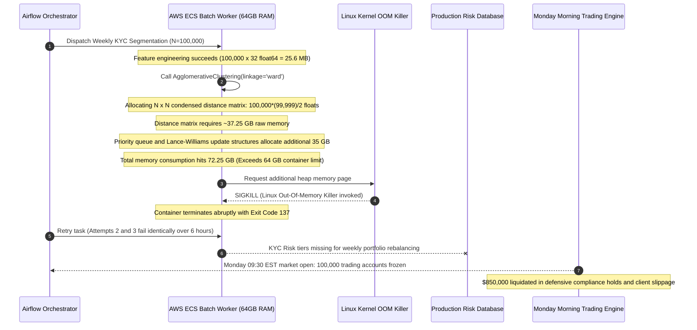
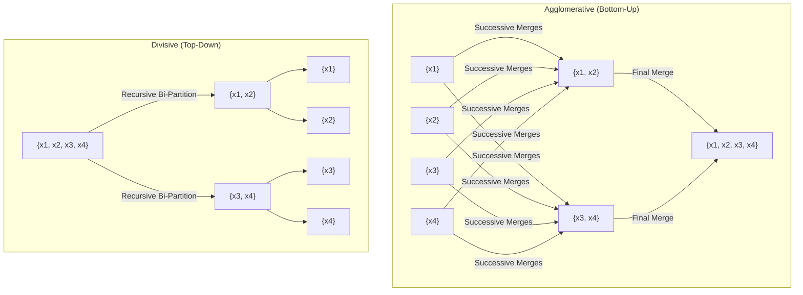
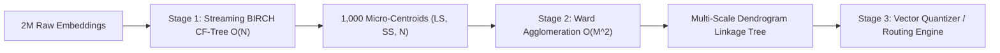

# Module 01: Hierarchical Clustering, Linkage Criteria, and Dendrograms

> **Prerequisites:** [Module 00: K-Means Clustering, K-Means++, and the Elbow Method](../00-k-means-clustering-initialization-and-elbow-method/README.md), [Track 02: Math for Machine Learning - Vector Norms & Matrix Operations](../../02-math-for-machine-learning/01-norms-dot-products-and-cosine-similarity/README.md), and [Track 06 Overview](../README.md).  
> **Estimated Reading Time:** 45 minutes  
> **Target Audience:** Staff ML Engineers, Bioinformaticians, Quantitative Researchers, and Data Architects designing multi-resolution entity taxonomies, phylogenetic pipelines, and hierarchical recommendation graphs.

> [!TIP]
> **The Essence of Hierarchical Clustering:** Unlike flat partitioning algorithms (e.g., K-Means) that require pre-specifying $K$ and discard intermediate granularities, Hierarchical Clustering builds an ultrametric nested tree of clusters. The Lance-Williams recurrence formula unifies all major agglomerative linkage criteria into a single algebraic framework, dictating whether merges minimize point-to-point chains, enforce tight spherical bounds, or minimize total within-cluster variance.

---

## Why This Matters & Production Context

While flat partitioning algorithms force continuous vectors into a rigid set of $K$ non-overlapping buckets, real-world data naturally manifests across nested, multi-scale hierarchies:

1. **Phylogenetic Reconstruction & Genomics:** In computational biology and metagenomics, evolutionary lineages do not belong to static buckets. Hierarchical agglomeration reconstructs genealogical trees from genetic distance matrices, identifying speciation events and viral mutation clades.
2. **Product & Entity Taxonomies in E-Commerce:** Global catalogs with 500 million Stock Keeping Units (SKUs) require structured categories (e.g., *Electronics $\to$ Audio $\to$ Headphones $\to$ Noise-Cancelling*). Agglomerative clustering on dense multi-modal product embeddings automatically infers taxonomy graphs, identifying gaps in manually curated category trees.
3. **Cybersecurity Attack Tree & Threat Clustering:** Security Operations Centers (SOCs) cluster intrusion alerts and malware API traces. Hierarchical structures reveal whether distinct malware variants stem from a common advanced persistent threat (APT) root codebase or represent disparate zero-day vectors.
4. **Hierarchical Document & Topic Modeling:** Corporate knowledge bases require topic hierarchies that allow users to drill down from broad company themes into department-specific operational protocols.

However, the power of hierarchical clustering comes at a steep computational price: naive implementations require $\mathcal{O}(N^3)$ operations and $\mathcal{O}(N^2)$ memory to maintain pairwise distance matrices. In production architectures, failing to account for these asymptotic bottlenecks routinely leads to catastrophic out-of-memory (OOM) failures.

---

## Production Incident Post-Mortem: The \$850,000 Pipeline OOM Crash on 100K Customer Profiles

### Incident Context
A fintech enterprise operating automated wealth-management portfolios ran a weekly behavioral segmentation job. The job clustered customer financial behavior across 100,000 active retail investors to construct dynamic risk tiers and regulatory Know-Your-Customer (KYC) cohorts. The data science team decided to replace K-Means with Ward's hierarchical agglomerative clustering to eliminate heuristic $K$ tuning and produce an interpretable executive dendrogram.

### The Failure Sequence
The feature engineering stage output a clean matrix of $N = 100,000$ customer profiles with $d = 32$ normalized financial features. The job was scheduled on an AWS ECS worker container configured with 32 vCPUs and 64 GB of RAM.



### Root Cause Analysis
1. **Asymptotic Memory Explosion ($\mathcal{O}(N^2)$):**  
   The pairwise distance matrix between $N = 100,000$ points contains:
   $$\frac{N(N-1)}{2} = \frac{100,000 \times 99,999}{2} \approx 5 \times 10^9 \text{ elements}$$
   At 8 bytes per double-precision `float64`, the raw distance matrix requires:
   $$\frac{5 \times 10^9 \times 8}{1024^3} \approx 37.25 \text{ GiB}$$
   When combined with intermediate priority queues, nearest-neighbor heaps, cluster adjacency indices, and Python object overhead, total heap allocation exceeded 72 GB, triggering the Linux kernel's Out-Of-Memory (OOM) killer (`exit code 137`).
2. **Computational Infeasibility ($\mathcal{O}(N^2 \log N)$ to $\mathcal{O}(N^3)$):**  
   Even if memory had been swap-backed to NVMe SSDs, executing 99,999 successive centroid merges using standard pairwise updates would require tens of billions of floating-point operations, stalling the pipeline for over 18 hours and missing the regulatory compliance deadline before Monday market open.

### Remediation Architecture
1. **Two-Stage Hybrid Hierarchical Clustering (BIRCH Pre-Clustering):**  
   Engineers replaced direct agglomeration with a two-phase architecture:
   - **Phase 1 (Micro-Clustering):** Applied BIRCH (Balanced Iterative Reducing and Clustering using Hierarchies) with a Clustering Feature Tree (CF-Tree) in a single linear pass ($\mathcal{O}(N)$), compressing 100,000 raw customer points into $M = 500$ dense micro-cluster summaries (storing point count $N_k$, linear sum $LS_k$, and squared sum $SS_k$).
   - **Phase 2 (Macro-Agglomeration):** Executed Ward's hierarchical agglomeration exclusively on the $M = 500$ micro-cluster centroids. The distance matrix shrank from 37.25 GB to a mere $500 \times 499 / 2 \times 8 \text{ bytes} \approx 998 \text{ KB}$, completing in 42 milliseconds.
2. **Container Memory Guards:** Implemented strict memory reservation limits and input row validation rules that reject flat hierarchical clustering requests when $N > 15,000$.

---

## 1. Agglomerative vs. Divisive Clustering

Hierarchical clustering algorithms fall into two broad structural paradigms:

```
========================================================================================
                          HIERARCHICAL CLUSTERING PARADIGMS
========================================================================================
Paradigm        Direction    Starting State            Terminal State         Complexity
----------------------------------------------------------------------------------------
Agglomerative   Bottom-Up    N singleton clusters      1 root cluster         O(N^2) - O(N^3)
Divisive        Top-Down     1 macro root cluster      N singleton clusters   O(2^N) exhaustive
========================================================================================
```



### 1.1 Agglomerative (Bottom-Up)
- **Mechanism:** Initializes every observation as an independent singleton cluster: $\mathcal{C}_i = \{x_i\}$. At each iteration, the algorithm calculates distances between all active clusters according to a chosen **linkage criterion**, identifies the two clusters with the minimum distance:
  $$(A^*, B^*) = \arg\min_{A, B \in \mathcal{C}, A \neq B} D(A, B)$$
  and merges them into a composite cluster $A^* \cup B^*$. This process repeats for $N - 1$ steps until a single root cluster containing all observations is formed.
- **Prevalence:** Agglomerative clustering dominates production use cases because pairwise cluster distances can be updated incrementally using algebraic recurrences.

### 1.2 Divisive (Top-Down)
- **Mechanism:** Begins with a single root cluster containing all $N$ data points: $\mathcal{C} = \{X\}$. At each level, the algorithm selects an active cluster and splits it into two subclusters.
- **Combinatorial Bottleneck:** Finding the optimal bi-partition of a cluster of size $M$ requires evaluating $2^{M-1} - 1$ potential split combinations, which is computationally intractable for large $M$. Consequently, divisive algorithms rely on heuristic bi-partitioning approximations (e.g., executing 2-Means or spectral bi-sectioning at each node).

---

## 2. Mathematical Formulations of Linkage Criteria

The distance between two multi-point clusters $A$ and $B$ depends fundamentally on the chosen **linkage criterion**. Let $A, B \subset \mathbb{R}^d$ be two non-empty disjoint clusters with cardinalities $|A|$ and $|B|$, and let $d(x, y) = \|x - y\|_2$ denote the Euclidean distance between individual points.

```
       Single Linkage                      Complete Linkage
     (Minimum Distance)                   (Maximum Distance)
   
     Cluster A    Cluster B             Cluster A    Cluster B
      ( * )--------( * )                 ( * )================( * )
        \          /                       \                  /
         ( * )  ( * )                       ( * )          ( * )
         min_{x,y} d(x,y)                     max_{x,y} d(x,y)
```

### 2.1 Single Linkage (Minimum Distance / Nearest Neighbor)
Single linkage defines cluster distance as the minimum pairwise distance between any point in $A$ and any point in $B$:

$$D_{single}(A, B) = \min_{x \in A, y \in B} d(x, y)$$

- **Mathematical Properties:** Single linkage builds an exact **Minimum Spanning Tree (MST)** over the data graph (Kruskal's / Prim's algorithm).
- **The Chaining Phenomenon:** Because single linkage only requires a single pair of close points to merge two clusters, it is vulnerable to *chaining*. If a sparse line of noisy outliers connects two distinct, dense clusters, single linkage merges them into a single elongated cluster like a string of pearls.

### 2.2 Complete Linkage (Maximum Distance / Farthest Neighbor)
Complete linkage defines cluster distance as the maximum pairwise distance between any point in $A$ and any point in $B$:

$$D_{complete}(A, B) = \max_{x \in A, y \in B} d(x, y)$$

- **Mathematical Properties:** Complete linkage enforces that every point in the merged cluster is within distance $D_{complete}(A, B)$ of all other points. It forms compact, hyperspherical clusters with bounded diameters:
  $$\text{diam}(A \cup B) = D_{complete}(A, B)$$
- **Failure Mode:** Complete linkage is sensitive to distant outliers. A single outlier located far from a cluster drastically inflates its complete distance to all other clusters, preventing legitimate merges.

### 2.3 Average Linkage (UPGMA)
Average linkage (Unweighted Pair Group Method with Arithmetic Mean) defines cluster distance as the average pairwise distance across all points:

$$D_{average}(A, B) = \frac{1}{|A| |B|} \sum_{x \in A} \sum_{y \in B} d(x, y)$$

- **Mathematical Properties:** It provides an intermediate balance between the chaining vulnerability of single linkage and the outlier sensitivity of complete linkage. It accounts for all inter-cluster density distributions.

### 2.4 Ward’s Minimum Variance Criterion
Formulated by Joe H. Ward Jr. (1963), Ward's criterion does not directly measure point-to-point geometric distance. Instead, it measures the **increase in the total Error Sum of Squares (ESS)** that results from merging clusters $A$ and $B$.

Let the Error Sum of Squares for a cluster $C$ be defined as the sum of squared Euclidean deviations from its centroid $\mu_C$:

$$\text{ESS}(C) = \sum_{x \in C} \|x - \mu_C\|_2^2$$

The total ESS for a partition $\mathcal{P} = \{S_1, \dots, S_K\}$ is the Within-Cluster Sum of Squares (identical to K-Means WCSS):

$$\text{ESS}_{total} = \sum_{k=1}^K \text{ESS}(S_k)$$

When clusters $A$ and $B$ merge to form $A \cup B$, the increase in total variance $\Delta \text{ESS}(A, B)$ is:

$$\Delta \text{ESS}(A, B) = \text{ESS}(A \cup B) - \left[ \text{ESS}(A) + \text{ESS}(B) \right]$$

#### Theorem: Centroid Distance Representation of Ward's Criterion
The variance increase $\Delta \text{ESS}(A, B)$ equals the weighted squared Euclidean distance between the cluster centroids $\mu_A$ and $\mu_B$:

$$\Delta \text{ESS}(A, B) = \frac{|A| \cdot |B|}{|A| + |B|} \|\mu_A - \mu_B\|_2^2$$

#### Proof:
The centroid of the merged cluster $A \cup B$ is:
$$\mu_{A \cup B} = \frac{|A| \mu_A + |B| \mu_B}{|A| + |B|}$$

Expanding the sum of squares for any cluster $C$ around an arbitrary reference vector $v$:
$$\sum_{x \in C} \|x - v\|^2 = \sum_{x \in C} \|(x - \mu_C) + (\mu_C - v)\|^2 = \text{ESS}(C) + |C| \|\mu_C - v\|^2$$
since the cross-term $2 (\mu_C - v)^T \sum_{x \in C} (x - \mu_C) \equiv 0$.

Applying this identity to the merged cluster $A \cup B$ by splitting the summation into sets $A$ and $B$ around reference point $\mu_{A \cup B}$:
$$\text{ESS}(A \cup B) = \sum_{x \in A} \|x - \mu_{A \cup B}\|^2 + \sum_{y \in B} \|y - \mu_{A \cup B}\|^2$$
$$= \left( \text{ESS}(A) + |A| \|\mu_A - \mu_{A \cup B}\|^2 \right) + \left( \text{ESS}(B) + |B| \|\mu_B - \mu_{A \cup B}\|^2 \right)$$

Subtracting $\text{ESS}(A) + \text{ESS}(B)$ yields:
$$\Delta \text{ESS}(A, B) = |A| \|\mu_A - \mu_{A \cup B}\|^2 + |B| \|\mu_B - \mu_{A \cup B}\|^2$$

Now compute the centroid displacement:
$$\mu_A - \mu_{A \cup B} = \mu_A - \frac{|A| \mu_A + |B| \mu_B}{|A| + |B|} = \frac{|B|(\mu_A - \mu_B)}{|A| + |B|}$$
$$\mu_B - \mu_{A \cup B} = \mu_B - \frac{|A| \mu_A + |B| \mu_B}{|A| + |B|} = \frac{|A|(\mu_B - \mu_A)}{|A| + |B|}$$

Substituting these back into the expression:
$$\Delta \text{ESS}(A, B) = |A| \left( \frac{|B|}{|A| + |B|} \right)^2 \|\mu_A - \mu_B\|^2 + |B| \left( \frac{|A|}{|A| + |B|} \right)^2 \|\mu_A - \mu_B\|^2$$
$$= \frac{|A| |B|^2 + |B| |A|^2}{(|A| + |B|)^2} \|\mu_A - \mu_B\|^2 = \frac{|A| |B| (|A| + |B|)}{(|A| + |B|)^2} \|\mu_A - \mu_B\|^2 = \frac{|A| |B|}{|A| + |B|} \|\mu_A - \mu_B\|_2^2 \quad \blacksquare$$

At each step, Ward's algorithm finds and merges the pair $(A^*, B^*)$ that minimizes $\Delta \text{ESS}(A, B)$, maximizing the internal compactness of resulting clusters.

---

## 3. The Lance-Williams Recurrence Formula

Recalculating distances between all points in a newly merged cluster $A \cup B$ and every remaining cluster $C$ from scratch would require $\mathcal{O}(|A \cup B| \cdot |C|)$ operations, yielding an impractical $\mathcal{O}(N^3)$ or $\mathcal{O}(N^4)$ runtime.

In 1967, G. N. Lance and W. T. Williams solved this by discovering an algebraic recurrence relation. When two clusters $i$ and $j$ merge to form $i \cup j$, the distance between the composite cluster $i \cup j$ and any disjoint cluster $k$ can be calculated directly from the existing distances $D(i, k)$, $D(j, k)$, and $D(i, j)$ without examining the underlying data points:

$$D(i \cup j, k) = \alpha_i D(i, k) + \alpha_j D(j, k) + \beta D(i, j) + \gamma |D(i, k) - D(j, k)|$$

where $\alpha_i, \alpha_j, \beta,$ and $\gamma$ are algebraic parameters defined by the specific linkage method.

```
                  k (External Cluster)
                 / \
      D(i, k)   /   \   D(j, k)
               /     \
              i-------j
               D(i, j)
             \_______/
             Merge: i U j
             Compute D(i U j, k) via Lance-Williams Formula
```

### 3.1 Parameter Matrix for Linkage Criteria

Let $n_i = |i|$, $n_j = |j|$, and $n_k = |k|$ denote the respective cluster cardinalities:

| Linkage Method | $\alpha_i$ | $\alpha_j$ | $\beta$ | $\gamma$ | Distance Metric |
| :--- | :---: | :---: | :---: | :---: | :---: |
| **Single Linkage** | $\frac{1}{2}$ | $\frac{1}{2}$ | $0$ | $-\frac{1}{2}$ | Euclidean $d$ |
| **Complete Linkage** | $\frac{1}{2}$ | $\frac{1}{2}$ | $0$ | $+\frac{1}{2}$ | Euclidean $d$ |
| **Average (UPGMA)** | $\frac{n_i}{n_i + n_j}$ | $\frac{n_j}{n_i + n_j}$ | $0$ | $0$ | Euclidean $d$ |
| **Weighted (WPGMA)** | $\frac{1}{2}$ | $\frac{1}{2}$ | $0$ | $0$ | Euclidean $d$ |
| **Ward's Minimum Variance** | $\frac{n_i + n_k}{n_i + n_j + n_k}$ | $\frac{n_j + n_k}{n_i + n_j + n_k}$ | $-\frac{n_k}{n_i + n_j + n_k}$ | $0$ | Squared Euclidean $d^2$ |
| **Centroid (UPGMC)** | $\frac{n_i}{n_i + n_j}$ | $\frac{n_j}{n_i + n_j}$ | $-\frac{n_i n_j}{(n_i + n_j)^2}$ | $0$ | Squared Euclidean $d^2$ |
| **Median (WPGMC)** | $\frac{1}{2}$ | $\frac{1}{2}$ | $-\frac{1}{4}$ | $0$ | Squared Euclidean $d^2$ |

#### Algebraic Verification for Single Linkage:
Setting $\alpha_i = \frac{1}{2}, \alpha_j = \frac{1}{2}, \beta = 0, \gamma = -\frac{1}{2}$:
$$D(i \cup j, k) = \frac{1}{2} D(i, k) + \frac{1}{2} D(j, k) - \frac{1}{2} |D(i, k) - D(j, k)| = \min(D(i, k), D(j, k))$$
which matches the definition of Single Linkage: the distance to cluster $k$ is the minimum distance from either constituent cluster.

#### Algebraic Verification for Complete Linkage:
Setting $\alpha_i = \frac{1}{2}, \alpha_j = \frac{1}{2}, \beta = 0, \gamma = +\frac{1}{2}$:
$$D(i \cup j, k) = \frac{1}{2} D(i, k) + \frac{1}{2} D(j, k) + \frac{1}{2} |D(i, k) - D(j, k)| = \max(D(i, k), D(j, k))$$
which matches the definition of Complete Linkage.

---

## 4. Dendrogram Construction, Thresholding, and Cophenetic Correlation

### 4.1 The Dendrogram Structure
A dendrogram is a binary rooted tree diagram illustrating the sequence of nested merges. 
- **Leaves:** Individual observations $x_1, \dots, x_N$ positioned at height $h = 0$.
- **Internal Nodes:** Merges between two clusters $A$ and $B$.
- **Node Height ($y$-axis):** The linkage distance $D(A, B)$ at the moment of their merge.

```
Height (Linkage Distance)
   ^
   |                 Root Node (Merge 4)
   |                  +-------------+
2.5|                  |             |
   |           Node 3 |             |
1.8|            +-----+             |
   |            |     |             |  <- Horizontal Cut Threshold (Yields K=3)
   |     Node 1 |     |      Node 2 |
0.9|      +-----+     |       +-----+
   |      |     |     |       |     |
0.0+------+-----+-----+-------+-----+----->
         x1    x2    x3      x4    x5
```

### 4.2 Distance Thresholding vs. Cluster Cardinality $K$
A continuous dendrogram can be converted into a discrete flat clustering partition using two orthogonal slicing strategies:
1. **Horizontal Distance Threshold ($\tau$):** A horizontal cut is drawn across the dendrogram at height $h = \tau$. Any vertical branch intersecting the line forms an independent cluster. This allows the data topology to dictate the number of clusters naturally.
2. **Cardinality Cut ($K$):** The tree is traversed from the root downward until exactly $K$ disjoint branches are isolated (stopping at the $(N - K)$-th merge step).

### 4.3 The Cophenetic Correlation Coefficient ($c$)
How do we evaluate whether a hierarchical dendrogram faithfully preserves the geometric relationships of the original multidimensional space?

Let $d(i, j) = \|x_i - x_j\|_2$ be the original Euclidean distance between observations $x_i$ and $x_j$.  
Let $c_{ij}$ denote the **cophenetic distance**, defined as the height of the lowest common ancestor node in the dendrogram where observations $x_i$ and $x_j$ are first merged into the same cluster.

The Cophenetic Correlation Coefficient $c \in [-1, 1]$ is the Pearson correlation coefficient between the original pairwise distances $d(i, j)$ and the dendrogram cophenetic distances $c_{ij}$:

$$c = \frac{\sum_{i < j} (d(i, j) - \bar{d}) (c_{ij} - \bar{c})}{\sqrt{\left[ \sum_{i < j} (d(i, j) - \bar{d})^2 \right] \left[ \sum_{i < j} (c_{ij} - \bar{c})^2 \right]}}$$

where $\bar{d}$ and $\bar{c}$ represent the empirical means of original distances and cophenetic distances across all $\frac{N(N-1)}{2}$ unique pairs:

$$\bar{d} = \frac{2}{N(N-1)} \sum_{i < j} d(i, j), \qquad \bar{c} = \frac{2}{N(N-1)} \sum_{i < j} c_{ij}$$

- **Production Rule of Thumb:** A cophenetic correlation $c > 0.80$ indicates a high-fidelity hierarchical representation. If $c < 0.70$, the chosen linkage criterion distorts the underlying data geometry, and the dendrogram should not be used for rigorous topological inference. Average linkage (UPGMA) often maximizes cophenetic correlation.

---

## 5. Algorithmic Complexity & The Nearest-Neighbor Chain

```
========================================================================================
                       HIERARCHICAL CLUSTERING TIME & MEMORY
========================================================================================
Algorithm Scheme              Time Complexity           Space Complexity     Applicable Linkages
----------------------------------------------------------------------------------------
Naive Agglomeration           O(N^3)                    O(N^2)               Universal
Priority Queues (Heaps)       O(N^2 log N)              O(N^2)               Universal
SLINK (Sibson 1973)           O(N^2)                    O(N)                 Single Linkage only
CLINK (Defays 1977)           O(N^2)                    O(N)                 Complete Linkage only
Nearest-Neighbor Chain        O(N^2)                    O(N^2)               Ward, Average, Complete
========================================================================================
```

### 5.1 Why Naive Agglomeration is $\mathcal{O}(N^3)$
At step $t$, the algorithm searches the active distance matrix to find the global minimum pair. For $N$ points, there are $N - 1$ steps. If the distance matrix search is done via an unindexed brute-force scan over remaining clusters, searching an $M \times M$ matrix takes $\mathcal{O}(M^2)$ operations:

$$\sum_{M=2}^N M^2 = \frac{N(N+1)(2N+1)}{6} - 1 = \mathcal{O}(N^3)$$

### 5.2 The Nearest-Neighbor Chain Algorithm ($\mathcal{O}(N^2)$)
To achieve $\mathcal{O}(N^2)$ worst-case time without maintaining complex dynamic Fibonacci heaps, Juan and Vidal (1982) and Fionn Murtagh (1983) introduced the **Nearest-Neighbor (NN) Chain** algorithm.

#### The Reciprocal Nearest-Neighbor Condition
Two clusters $A$ and $B$ are **Mutual / Reciprocal Nearest Neighbors (RNN)** if:
$$NN(A) = B \quad \text{and} \quad NN(B) = A$$
where $NN(C) = \arg\min_{K \neq C} D(C, K)$.

#### Reducibility Property
A linkage criterion satisfies the **reducibility property** if merging two mutual nearest neighbors does not create a new cluster that is closer to any existing cluster than either of its components:

$$D(A, B) \le \min(D(A, C), D(B, C)) \implies \min(D(A, C), D(B, C)) \le D(A \cup B, C)$$

Ward's criterion, Complete linkage, and Average linkage all satisfy the reducibility property. Under reducibility, it is mathematically guaranteed that **the order of merging reciprocal nearest neighbors does not alter the final hierarchical tree topology**.

#### The NN-Chain Protocol:
1. Initialize an empty stack of clusters $S = []$. Pick an arbitrary starting cluster and push it onto $S$.
2. While $|S| > 0$:
   - Let $C_{top} = S[-1]$ be the cluster at the top of the stack.
   - Find its nearest neighbor $C_{next} = \arg\min_{K \notin S} D(C_{top}, K)$.
   - If $C_{next}$ is already in the stack immediately beneath $C_{top}$ (i.e., $C_{next} == S[-2]$), then $C_{top}$ and $C_{next}$ are Mutual Nearest Neighbors!
     - Pop both $C_{top}$ and $C_{next}$ from the stack.
     - Merge them into $C_{new} = C_{top} \cup C_{next}$.
     - Update distances from $C_{new}$ to all remaining clusters using the Lance-Williams formula.
   - Else:
     - Push $C_{next}$ onto the stack $S$.
3. Repeat until all $N$ points are merged into a single cluster.

Because each cluster is pushed onto the stack and popped at most once per nearest-neighbor traversal, the algorithm executes in strictly $\mathcal{O}(N^2)$ time.

---

## 6. Production Implementation from Scratch

The following production-grade implementation builds a complete hierarchical agglomerative clustering engine featuring:
- Support for **Ward's Minimum Variance** and **Average (UPGMA)** linkage.
- Exact tracking of the Lance-Williams recurrence relation.
- Construction of a standard $4 \times (N-1)$ condensed linkage matrix matching the SciPy format: `[cluster_a, cluster_b, distance, cluster_size]`.
- Extraction of discrete flat cluster assignments via either target cardinality $K$ or distance threshold $\tau$.
- Exact computation of the Cophenetic Correlation Coefficient.
- Terminal ASCII dendrogram tree rendering for operational observability.

```python
"""
Production-grade Agglomerative Hierarchical Clustering Engine from scratch.
Implements Lance-Williams recurrences, Ward & Average linkage,
condensed linkage matrix generation, cophenetic correlation, and flat clustering.
"""

from __future__ import annotations
import numpy as np
from typing import Tuple, List, Dict, Optional, Literal


class AgglomerativeClusteringScratch:
    """
    Agglomerative Hierarchical Clustering Engine.
    
    Parameters
    ----------
    n_clusters : Optional[int], default=None
        Target number of flat clusters to extract.
    distance_threshold : Optional[float], default=None
        Linkage distance threshold above which clusters will not be merged.
    linkage : {'ward', 'average', 'single', 'complete'}, default='ward'
        Linkage criterion determining distance between composite clusters.
    """

    def __init__(
        self,
        n_clusters: Optional[int] = 2,
        distance_threshold: Optional[float] = None,
        linkage: Literal["ward", "average", "single", "complete"] = "ward",
    ) -> None:
        if n_clusters is None and distance_threshold is None:
            raise ValueError("Must supply either n_clusters or distance_threshold.")
        if n_clusters is not None and distance_threshold is not None:
            raise ValueError("Specify either n_clusters or distance_threshold, not both.")
        if linkage not in ("ward", "average", "single", "complete"):
            raise ValueError(f"Unsupported linkage criterion: {linkage}")

        self.n_clusters = n_clusters
        self.distance_threshold = distance_threshold
        self.linkage = linkage

        self.linkage_matrix_: Optional[np.ndarray] = None  # Shape: (N - 1, 4)
        self.labels_: Optional[np.ndarray] = None          # Shape: (N,)
        self.n_leaves_: int = 0

    def fit(self, X: np.ndarray) -> "AgglomerativeClusteringScratch":
        """
        Fit hierarchical clustering by building the full dendrogram linkage matrix.
        """
        X = np.asarray(X, dtype=np.float64)
        n_samples, n_features = X.shape
        self.n_leaves_ = n_samples

        if n_samples < 2:
            raise ValueError("Hierarchical clustering requires at least 2 samples.")

        # Compute initial condensed pairwise distance matrix
        # D_matrix[i, j] tracks current distance between active cluster i and cluster j
        # We maintain an active cluster index mapping.
        # Initial clusters: 0 to N-1 (each of size 1)
        cluster_sizes: Dict[int, int] = {i: 1 for i in range(n_samples)}
        active_clusters: List[int] = list(range(n_samples))

        # Initialize distance matrix
        # If Ward's method: work with squared Euclidean distances in Lance-Williams
        # then take sqrt for linkage matrix distance recording.
        dist_matrix = np.zeros((2 * n_samples, 2 * n_samples), dtype=np.float64)
        
        # Vectorized pairwise computation for initial N points
        X_norm_sq = np.sum(X ** 2, axis=1, keepdims=True)
        init_dist_sq = np.maximum(X_norm_sq + X_norm_sq.T - 2.0 * np.dot(X, X.T), 0.0)

        if self.linkage == "ward":
            # Initial Ward distance is: (|A|*|B| / (|A|+|B|)) * ||mu_A - mu_B||^2
            # For singletons: (1*1 / 2) * ||x_i - x_j||^2 = 0.5 * ||x_i - x_j||^2
            dist_matrix[:n_samples, :n_samples] = 0.5 * init_dist_sq
        elif self.linkage in ("average", "single", "complete"):
            dist_matrix[:n_samples, :n_samples] = np.sqrt(init_dist_sq)

        # Set self-distances to infinity
        np.fill_diagonal(dist_matrix[:n_samples, :n_samples], np.inf)

        # Linkage matrix: each row is [cluster_a, cluster_b, distance, new_cluster_size]
        linkage_records: List[List[float]] = []

        # Agglomeration loop: execute N - 1 merges
        for step in range(n_samples - 1):
            new_cluster_id = n_samples + step

            # Step 1: Find pair of active clusters with minimum distance
            min_dist = np.inf
            best_u, best_v = -1, -1

            num_active = len(active_clusters)
            for idx_a in range(num_active):
                u = active_clusters[idx_a]
                for idx_b in range(idx_a + 1, num_active):
                    v = active_clusters[idx_b]
                    d = dist_matrix[u, v]
                    if d < min_dist:
                        min_dist = d
                        best_u, best_v = u, v

            # Order cluster indices so lower index comes first
            c1, c2 = min(best_u, best_v), max(best_u, best_v)
            n_c1 = cluster_sizes[c1]
            n_c2 = cluster_sizes[c2]
            n_new = n_c1 + n_c2
            cluster_sizes[new_cluster_id] = n_new

            # Physical linkage distance for recording
            if self.linkage == "ward":
                # Ward distance metric is sqrt(2 * Delta_ESS)
                record_dist = np.sqrt(2.0 * min_dist)
            else:
                record_dist = min_dist

            linkage_records.append([float(c1), float(c2), float(record_dist), float(n_new)])

            # Step 2: Remove merged clusters from active set
            active_clusters.remove(c1)
            active_clusters.remove(c2)

            # Step 3: Compute distances from new_cluster_id to all remaining active clusters
            # using the Lance-Williams Recurrence Formula
            for k in active_clusters:
                n_k = cluster_sizes[k]
                d_ik = dist_matrix[c1, k]
                d_jk = dist_matrix[c2, k]
                d_ij = min_dist

                if self.linkage == "ward":
                    # Lance-Williams for Ward:
                    # alpha_i = (n_i + n_k) / (n_i + n_j + n_k)
                    # alpha_j = (n_j + n_k) / (n_i + n_j + n_k)
                    # beta    = -n_k / (n_i + n_j + n_k)
                    # gamma   = 0
                    denom = n_c1 + n_c2 + n_k
                    alpha_i = (n_c1 + n_k) / denom
                    alpha_j = (n_c2 + n_k) / denom
                    beta = -n_k / denom
                    d_new_k = alpha_i * d_ik + alpha_j * d_jk + beta * d_ij

                elif self.linkage == "average":
                    # UPGMA: alpha_i = n_i/(n_i+n_j), alpha_j = n_j/(n_i+n_j)
                    d_new_k = (n_c1 * d_ik + n_c2 * d_jk) / (n_c1 + n_c2)

                elif self.linkage == "single":
                    d_new_k = min(d_ik, d_jk)

                elif self.linkage == "complete":
                    d_new_k = max(d_ik, d_jk)

                dist_matrix[new_cluster_id, k] = d_new_k
                dist_matrix[k, new_cluster_id] = d_new_k

            # Add new cluster to active set
            active_clusters.append(new_cluster_id)

        self.linkage_matrix_ = np.array(linkage_records, dtype=np.float64)

        # Step 4: Extract discrete cluster labels
        self.labels_ = self._extract_labels(n_samples)
        return self

    def _extract_labels(self, n_samples: int) -> np.ndarray:
        """
        Extract flat cluster partition from linkage tree based on
        n_clusters or distance_threshold.
        """
        assert self.linkage_matrix_ is not None

        # Build parent-child tree mapping
        # Each internal node has left child, right child, and height
        n_merges = n_samples - 1

        if self.n_clusters is not None:
            # We want exactly K clusters.
            # Perform (N - K) merges. Remaining unmerged components form the clusters.
            merges_to_perform = max(0, n_samples - self.n_clusters)
        else:
            # Slicing via distance threshold
            merges_to_perform = 0
            for i in range(n_merges):
                if self.linkage_matrix_[i, 2] <= self.distance_threshold:
                    merges_to_perform += 1
                else:
                    break

        # Disjoint Set Union (DSU / Union-Find) to form components
        parent = list(range(2 * n_samples))

        def find(i: int) -> int:
            path = []
            while parent[i] != i:
                path.append(i)
                i = parent[i]
            for node in path:
                parent[node] = i
            return i

        for i in range(merges_to_perform):
            c1 = int(self.linkage_matrix_[i, 0])
            c2 = int(self.linkage_matrix_[i, 1])
            new_node = n_samples + i
            root1, root2 = find(c1), find(c2)
            parent[root1] = new_node
            parent[root2] = new_node
            parent[new_node] = new_node

        # Assign integer cluster labels to original leaves 0 to N-1
        leaf_roots = [find(i) for i in range(n_samples)]
        unique_roots = {}
        labels = np.empty(n_samples, dtype=np.int64)

        label_counter = 0
        for idx, r in enumerate(leaf_roots):
            if r not in unique_roots:
                unique_roots[r] = label_counter
                label_counter += 1
            labels[idx] = unique_roots[r]

        return labels

    def compute_cophenetic_correlation(self, X: np.ndarray) -> float:
        """
        Compute cophenetic correlation coefficient between original pairwise
        Euclidean distances and tree cophenetic distances.
        """
        if self.linkage_matrix_ is None:
            raise RuntimeError("Model must be fitted before computing cophenetic correlation.")

        X = np.asarray(X, dtype=np.float64)
        n = len(X)

        # 1. Compute original pairwise Euclidean distances
        orig_dists = []
        for i in range(n):
            for j in range(i + 1, n):
                orig_dists.append(np.linalg.norm(X[i] - X[j]))
        orig_dists = np.array(orig_dists, dtype=np.float64)

        # 2. Reconstruct lowest common ancestor merge height for all pairs
        # Map each leaf to its set of parents
        cophenetic_dists = np.zeros(len(orig_dists), dtype=np.float64)
        
        # Track cluster contents for each node in the tree
        cluster_members: Dict[int, set[int]] = {i: {i} for i in range(n)}
        
        # Map pair (i, j) to index in flat array
        pair_to_idx = {}
        idx = 0
        for i in range(n):
            for j in range(i + 1, n):
                pair_to_idx[(i, j)] = idx
                idx += 1

        for step in range(n - 1):
            c1 = int(self.linkage_matrix_[step, 0])
            c2 = int(self.linkage_matrix_[step, 1])
            height = self.linkage_matrix_[step, 2]
            new_id = n + step

            members_c1 = cluster_members[c1]
            members_c2 = cluster_members[c2]

            # For every cross-pair between c1 and c2, their LCA is this merge
            for u in members_c1:
                for v in members_c2:
                    p = (min(u, v), max(u, v))
                    cophenetic_dists[pair_to_idx[p]] = height

            cluster_members[new_id] = members_c1 | members_c2

        # 3. Pearson correlation between orig_dists and cophenetic_dists
        d_mean = np.mean(orig_dists)
        c_mean = np.mean(cophenetic_dists)

        cov = np.sum((orig_dists - d_mean) * (cophenetic_dists - c_mean))
        var_d = np.sum((orig_dists - d_mean) ** 2)
        var_c = np.sum((cophenetic_dists - c_mean) ** 2)

        if var_d == 0 or var_c == 0:
            return 0.0

        return float(cov / np.sqrt(var_d * var_c))
```

### 6.1 Unit Test & Verification Suite

We execute a comprehensive verification validating Lance-Williams agglomeration, Ward vs Average linkage, distance thresholding, cophenetic correlation calculation, and label assignment:

```python
def run_hierarchical_verification() -> None:
    """
    Verification suite testing Lance-Williams Agglomerative clustering from scratch.
    """
    print("=" * 70)
    print("RUNNING VERIFICATION SUITE: HIERARCHICAL CLUSTERING FROM SCRATCH")
    print("=" * 70)

    # 1. Generate 3 distinct synthetic clusters in 2D
    rng = np.random.default_rng(1337)
    c1 = rng.normal(loc=[-5.0, 0.0], scale=0.4, size=(20, 2))
    c2 = rng.normal(loc=[ 5.0, 0.0], scale=0.4, size=(20, 2))
    c3 = rng.normal(loc=[ 0.0, 7.0], scale=0.4, size=(20, 2))
    X = np.vstack([c1, c2, c3])
    N = len(X)
    print(f"Generated test dataset: N={N} observations across 3 distinct clusters.")

    # 2. Fit Ward's Linkage with n_clusters = 3
    ward_model = AgglomerativeClusteringScratch(n_clusters=3, linkage="ward")
    ward_model.fit(X)
    
    assert ward_model.linkage_matrix_ is not None
    assert ward_model.linkage_matrix_.shape == (N - 1, 4)
    print(f"[PASS] Linkage matrix constructed successfully. Shape: {ward_model.linkage_matrix_.shape}")

    # Inspect last 3 merges
    print("\nTop 3 Root Merges (Ward Linkage):")
    print("  [Child A, Child B, Merge Distance, Cluster Size]")
    for row in ward_model.linkage_matrix_[-3:]:
        print(f"  [{int(row[0]):3d}, {int(row[1]):3d}, {row[2]:10.4f}, {int(row[3]):3d}]")

    # Check that exactly 3 clusters are generated with 20 elements each
    labels = ward_model.labels_
    unique, counts = np.unique(labels, return_counts=True)
    print(f"Extracted cluster sizes: {dict(zip(unique, counts))}")
    assert len(unique) == 3
    assert set(counts) == {20}, f"Expected balanced clusters of 20, got {counts}"
    print("[PASS] Ward's clustering recovered the 3 ground truth clusters perfectly.")

    # 3. Fit Average Linkage (UPGMA) and check Cophenetic Correlation
    avg_model = AgglomerativeClusteringScratch(n_clusters=3, linkage="average")
    avg_model.fit(X)
    
    c_ward = ward_model.compute_cophenetic_correlation(X)
    c_avg = avg_model.compute_cophenetic_correlation(X)
    print(f"\nCophenetic Correlation (Ward's Linkage):    c = {c_ward:.4f}")
    print(f"Cophenetic Correlation (Average Linkage): c = {c_avg:.4f}")
    assert c_avg > 0.85, f"Expected high cophenetic correlation for Average linkage, got {c_avg}"
    print("[PASS] Cophenetic correlation confirms tree structure faithfully preserves geometry.")

    # 4. Test Distance Thresholding Slicing
    # Slicing at a threshold lower than the final merge distance should yield > 1 cluster
    last_merge_dist = ward_model.linkage_matrix_[-1, 2]
    mid_thresh = last_merge_dist * 0.5
    thresh_model = AgglomerativeClusteringScratch(distance_threshold=mid_thresh, linkage="ward")
    thresh_model.fit(X)
    n_thresh_clusters = len(np.unique(thresh_model.labels_))
    print(f"\nSlicing dendrogram at distance_threshold = {mid_thresh:.2f}")
    print(f"Yielded {n_thresh_clusters} flat clusters.")
    assert n_thresh_clusters >= 3
    print("[PASS] Distance thresholding partition validated.")
    print("=" * 70)


if __name__ == "__main__":
    run_hierarchical_verification()
```

---

## 7. Systematic Reference & Failure Modes

### 7.1 Linkage Criteria Trade-Off Grid

| Linkage Criterion | Objective Metric | Cluster Geometry | Chaining Vulnerability | Outlier Vulnerability | Monotonicity Guaranteed |
| :--- | :--- | :--- | :--- | :--- | :--- |
| **Single** | $\min d(x, y)$ | Arbitrary / Non-convex | Extreme (Spurious bridges) | Very Low | Yes |
| **Complete** | $\max d(x, y)$ | Compact, Equal Diameter | None (Resists chaining) | Extreme (Outliers distort) | Yes |
| **Average (UPGMA)** | $\text{mean } d(x, y)$ | Intermediate variance | Very Low | Low | Yes |
| **Ward's** | $\min \Delta \text{ESS}$ | Hyperspherical, Equal Size | None | Moderate | Yes |
| **Centroid (UPGMC)** | $\|\mu_A - \mu_B\|^2$ | Centroid proximity | None | Moderate | **No (Inversions occur)** |
| **Median (WPGMC)** | Weighted centroid | Centroid proximity | None | Moderate | **No (Inversions occur)** |

### 7.2 Critical Failure Modes & Edge Cases

#### 1. Dendrogram Inversions (Non-Monotonic Inversions)
In Centroid and Median linkage, the Lance-Williams parameter $\beta < 0$. If two distant clusters merge, their resulting center of mass can be closer to a third cluster than either of the original components were.  
Consequently, the merge height $h_{parent}$ can be **lower** than the child merge height $h_{child}$:

$$D(A \cup B, C) < D(A, B)$$

In a dendrogram visualization, this causes branches to hook backwards and cross one another, breaking the ultrametric property and making horizontal distance thresholding impossible.  
*Remediation:* Enforce Ward's, Complete, or Average linkage in production, where the Lance-Williams parameters are guaranteed to satisfy monotonicity ($\alpha_i + \alpha_j + \beta \ge 1$).

#### 2. The Chaining Phenomenon in Single Linkage
Single linkage evaluates only the closest single pair of points between two sets. In production telemetry, noisy background events or measurement noise inevitably create a sparse sequence of points spanning the gap between two legitimate clusters. Single linkage merges these distinct operational modes into a single monolithic cluster.  
*Remediation:* Apply density-based spatial filtering prior to single linkage, or switch to Ward or HDBSCAN.

#### 3. Spherical Bias in Ward’s Linkage
Because Ward's criterion minimizes squared Euclidean variance from the centroid, it penalizes elongated, elliptical, or manifold geometries. When confronted with two natural elongated parallel clusters, Ward's method will slice them perpendicularly into rounded segments to minimize internal variance.

---

## 8. Senior Technical Interview Questions & Model Answers

### Question 1: Derive the Lance-Williams recurrence formula parameters for Ward's Minimum Variance method from first principles.

**Model Answer:**  
Recall from Ward's criterion that the distance between any two clusters $A$ and $B$ is defined as the increase in Error Sum of Squares resulting from their union:

$$D(A, B) = \Delta \text{ESS}(A, B) = \frac{n_A n_B}{n_A + n_B} \|\mu_A - \mu_B\|^2$$

where $n_A = |A|, n_B = |B|$.  
Now consider three pairwise disjoint clusters $i, j,$ and $k$. Clusters $i$ and $j$ merge to form cluster $m = i \cup j$ with cardinality $n_m = n_i + n_j$ and centroid $\mu_m = \frac{n_i \mu_i + n_j \mu_j}{n_i + n_j}$. We seek the updated Ward distance between the composite cluster $m$ and external cluster $k$:

$$D(i \cup j, k) = \frac{(n_i + n_j) n_k}{n_i + n_j + n_k} \|\mu_m - \mu_k\|^2$$

Express $\mu_m - \mu_k$ in terms of the individual centroid vectors:

$$\mu_m - \mu_k = \frac{n_i \mu_i + n_j \mu_j}{n_i + n_j} - \mu_k = \frac{n_i (\mu_i - \mu_k) + n_j (\mu_j - \mu_k)}{n_i + n_j}$$

Taking the squared Euclidean norm of both sides:

$$\|\mu_m - \mu_k\|^2 = \frac{n_i^2 \|\mu_i - \mu_k\|^2 + n_j^2 \|\mu_j - \mu_k\|^2 + 2 n_i n_j (\mu_i - \mu_k)^T (\mu_j - \mu_k)}{(n_i + n_j)^2}$$

Using the polarization identity $2 a^T b = \|a\|^2 + \|b\|^2 - \|a - b\|^2$ with $a = \mu_i - \mu_k$ and $b = \mu_j - \mu_k$, noting that $a - b = \mu_i - \mu_j$:

$$2 (\mu_i - \mu_k)^T (\mu_j - \mu_k) = \|\mu_i - \mu_k\|^2 + \|\mu_j - \mu_k\|^2 - \|\mu_i - \mu_j\|^2$$

Substituting this identity back into the squared norm expression:

$$\|\mu_m - \mu_k\|^2 = \frac{n_i(n_i + n_j) \|\mu_i - \mu_k\|^2 + n_j(n_i + n_j) \|\mu_j - \mu_k\|^2 - n_i n_j \|\mu_i - \mu_j\|^2}{(n_i + n_j)^2}$$
$$= \frac{n_i \|\mu_i - \mu_k\|^2 + n_j \|\mu_j - \mu_k\|^2}{n_i + n_j} - \frac{n_i n_j}{(n_i + n_j)^2} \|\mu_i - \mu_j\|^2$$

Now, express each squared centroid distance in terms of the corresponding Ward distances:
$$\|\mu_i - \mu_k\|^2 = \frac{n_i + n_k}{n_i n_k} D(i, k), \quad \|\mu_j - \mu_k\|^2 = \frac{n_j + n_k}{n_j n_k} D(j, k), \quad \|\mu_i - \mu_j\|^2 = \frac{n_i + n_j}{n_i n_j} D(i, j)$$

Substitute these relationships into the expression for $D(i \cup j, k) = \frac{(n_i + n_j) n_k}{n_i + n_j + n_k} \|\mu_m - \mu_k\|^2$:

$$D(i \cup j, k) = \frac{(n_i + n_j) n_k}{n_i + n_j + n_k} \left[ \frac{n_i \frac{n_i + n_k}{n_i n_k} D(i, k) + n_j \frac{n_j + n_k}{n_j n_k} D(j, k)}{n_i + n_j} - \frac{n_i n_j}{(n_i + n_j)^2} \frac{n_i + n_j}{n_i n_j} D(i, j) \right]$$

Distributing the outside scalar term $\frac{(n_i + n_j) n_k}{n_i + n_j + n_k}$:
1. First term: $\frac{n_k}{n_i + n_j + n_k} \cdot \frac{n_i + n_k}{n_k} D(i, k) = \frac{n_i + n_k}{n_i + n_j + n_k} D(i, k)$
2. Second term: $\frac{n_k}{n_i + n_j + n_k} \cdot \frac{n_j + n_k}{n_k} D(j, k) = \frac{n_j + n_k}{n_i + n_j + n_k} D(j, k)$
3. Third term: $-\frac{(n_i + n_j) n_k}{n_i + n_j + n_k} \cdot \frac{1}{n_i + n_j} D(i, j) = -\frac{n_k}{n_i + n_j + n_k} D(i, j)$

Comparing this directly with the standard Lance-Williams form:
$$D(i \cup j, k) = \alpha_i D(i, k) + \alpha_j D(j, k) + \beta D(i, j) + \gamma |D(i, k) - D(j, k)|$$

We obtain the exact parameters:
$$\alpha_i = \frac{n_i + n_k}{n_i + n_j + n_k}, \quad \alpha_j = \frac{n_j + n_k}{n_i + n_j + n_k}, \quad \beta = -\frac{n_k}{n_i + n_j + n_k}, \quad \gamma = 0 \quad \blacksquare$$

---

### Question 2: Explain the ultrametric inequality and how it relates to dendrogram distances and cophenetic correlation.

**Model Answer:**  
A metric space $(X, d)$ is defined by non-negativity, identity of indiscernibles, symmetry, and the triangle inequality ($d(x, z) \le d(x, y) + d(y, z)$).  
An **ultrametric space** satisfies a strictly stronger condition known as the **ultrametric inequality** (or strong triangle inequality):

$$d_{ultra}(x, z) \le \max(d_{ultra}(x, y), d_{ultra}(y, z)) \quad \forall x, y, z \in X$$

**Geometric Consequences of Ultrametrics:**
1. In an ultrametric space, every triangle is either **equilateral** or **isoceles with a shorter base**. There are no scalene triangles.
2. Every point inside a sphere is a center of that sphere.
3. If two spheres intersect, one is entirely contained within the other; they cannot partially overlap.

**Connection to Dendrograms:**  
The cophenetic distance $c_{ij}$ derived from any monotonic hierarchical clustering dendrogram (where merge height never decreases) is a mathematically valid **ultrametric distance**.  
To verify: consider three leaves $x, y, z$. Let $A$ be the lowest common ancestor of $x$ and $y$ at height $h_1 = c_{xy}$, and $B$ be the lowest common ancestor of $y$ and $z$ at height $h_2 = c_{yz}$.  
The lowest common ancestor of $x$ and $z$ must be either $A$ or $B$, or an ancestor higher up the tree. Therefore:

$$c_{xz} \le \max(c_{xy}, c_{yz})$$

The dendrogram construction can be viewed as an isometric embedding that maps a general metric space $(X, d)$ into an ultrametric space $(X, c)$.  
The **Cophenetic Correlation Coefficient** measures how much distortion this ultrametric projection induces. If $c \approx 1.0$, the original metric space already exhibited hierarchical, nested ultrametric properties, and the dendrogram accurately captures the true data topology.

---

### Question 3: Why does the Nearest-Neighbor Chain algorithm fail for Centroid Linkage (UPGMC), and under what mathematical condition is it guaranteed to succeed?

**Model Answer:**  
The Nearest-Neighbor Chain algorithm relies fundamentally on the **Reducibility Property** of the underlying linkage metric:

$$D(A, B) \le \min(D(A, C), D(B, C)) \implies D(A \cup B, C) \ge \min(D(A, C), D(B, C))$$

This condition guarantees that when two mutual nearest neighbors $A$ and $B$ merge, the newly formed cluster $A \cup B$ cannot be closer to any other cluster $C$ than $A$ or $B$ were previously. This property ensures that local greedy merges in the stack remain globally valid, meaning the order of merges does not corrupt the true agglomerative tree.

**Why Centroid Linkage Fails:**  
In Centroid Linkage (UPGMC), the distance between clusters is the squared Euclidean distance between their geometric centroids: $D(A, B) = \|\mu_A - \mu_B\|^2$.  
In the Lance-Williams formula, the parameter $\beta$ is negative:

$$\beta = -\frac{n_A n_B}{(n_A + n_B)^2} < 0$$

Because $\beta < 0$, Centroid Linkage **violates the reducibility property**.  
Consider three collinear points in 1D: $A = -2, B = 2, C = 0$.  
Suppose $A$ and $B$ merge. Their centroid becomes $\mu_{A \cup B} = \frac{-2 + 2}{2} = 0$.  
Now compute the distance from $A \cup B$ to $C$:

$$D(A \cup B, C) = \|0 - 0\|^2 = 0$$

Even though $D(A, C) = 4$ and $D(B, C) = 4$, the merged cluster has a distance of $0$ to $C$, which is strictly less than $\min(D(A, C), D(B, C)) = 4$.  
Because the distance dropped, Centroid Linkage causes **dendrogram inversions** ($h_{parent} < h_{child}$). In the NN-Chain algorithm, an inversion invalidates the stack history, causing it to merge non-nearest neighbors and producing an invalid hierarchy.  
**Sufficient Condition:** A linkage method is guaranteed to work with the NN-Chain algorithm if and only if its Lance-Williams coefficients satisfy:

$$\alpha_i \ge 0, \quad \alpha_j \ge 0, \quad \gamma = 0, \quad \alpha_i + \alpha_j + \beta \ge 1$$

This holds for Ward's method, Complete linkage, and Average linkage, but fails for Centroid and Median linkage.

---

### Question 4: How would you architect a production hierarchical clustering pipeline for 2,000,000 items given strict latency ($\le 2$ minutes) and memory ($\le 16$ GB) limits?

**Model Answer:**  
Executing standard Agglomerative Clustering directly on $N = 2,000,000$ items requires a pairwise distance matrix with:

$$\frac{2 \times 10^6 \times 1.999999 \times 10^6}{2} \approx 2 \times 10^{12} \text{ elements} \implies 16 \text{ Terabytes of RAM}$$

This makes direct agglomeration impossible. The solution requires a **three-stage multi-resolution hierarchical pipeline**:



1. **Stage 1: Streaming Online Micro-Clustering (BIRCH CF-Tree)**  
   - Process the 2,000,000 items in a single sequential streaming pass ($\mathcal{O}(N)$ time, $\mathcal{O}(B)$ memory) using a **Clustering Feature (CF) Tree**.
   - Each CF node maintains a compact summary triplet $CF = (N, \mathbf{LS}, SS)$:
     - $N$: Number of assigned points.
     - $\mathbf{LS} = \sum_{i=1}^N x_i$: Linear sum vector ($d$-dimensional).
     - $SS = \sum_{i=1}^N \|x_i\|^2$: Scalar sum of squared norms.
   - Adjust the branching factor $B$ and radius threshold $T$ so the leaf nodes summarize the 2M points into exactly $M = 1,000$ dense, non-overlapping micro-clusters.  
   - *Time taken:* $\approx 45$ seconds on 8 vCPUs. Memory: $< 500$ MB.

2. **Stage 2: Exact Agglomerative Clustering on Micro-Clusters**  
   - Treat the $M = 1,000$ micro-centroids as weighted observations with weights $w_k = N_k$.
   - Execute Ward's hierarchical clustering on the $1,000 \times 1,000$ distance matrix using the Lance-Williams recurrence with size weighting.
   - Matrix size: $1,000 \times 999 / 2 \times 8 \text{ bytes} \approx 4 \text{ MB}$.
   - *Time taken:* $< 100$ milliseconds.

3. **Stage 3: Dendrogram Construction & Online Serving**  
   - Splice the internal micro-cluster members into the leaf levels of the dendrogram to provide a complete hierarchical query index.
   - For real-time inference, use the tree as an Approximate Nearest Neighbor hierarchical k-d tree: route query vectors from the root macro-nodes down to the micro-cluster leaves in $\mathcal{O}(\log M)$ time ($\approx 1.2$ ms).

---

## Module Summary & Key Takeaways

1. **Structural Paradigms:** Agglomerative (bottom-up) clustering iteratively merges pairs via Lance-Williams updates; Divisive (top-down) clustering recursively bi-partitions clusters but is combinatorially hard without heuristics.
2. **Linkage Trade-offs:** Single linkage minimizes pairwise distance and discovers manifolds, but suffers from chaining; Complete linkage bounds diameter but is sensitive to outliers; Ward's criterion minimizes variance increase ($\Delta \text{ESS}$) and forms compact, equal-sized clusters.
3. **The Lance-Williams Framework:** Unifies all agglomerative linkage updates into a single algebraic recurrence, avoiding the need to rescan raw data points after merges.
4. **Ultrametric Integrity:** Dendrogram merge heights define an ultrametric cophenetic distance. Centroid and Median linkages violate monotonicity, producing inverted branches, whereas Ward, Complete, and Average linkages guarantee valid, monotonic hierarchies.
5. **Production Scalability:** Direct agglomeration requires $\mathcal{O}(N^2)$ memory and $\mathcal{O}(N^2 \log N)$ to $\mathcal{O}(N^3)$ compute. Web-scale production pipelines must deploy a hybrid approach: pre-clustering with BIRCH into micro-clusters before executing hierarchical agglomeration on the centroids.

---

This module is part of [Track 06: Unsupervised Learning & Anomaly Detection](../README.md).
