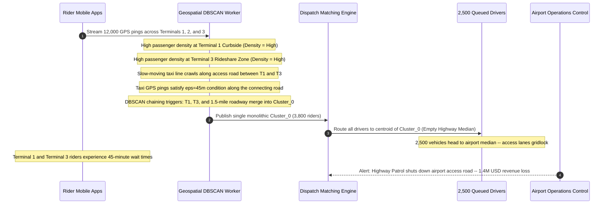
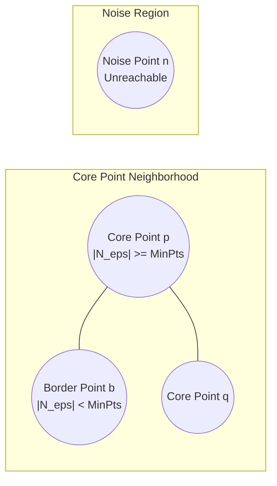
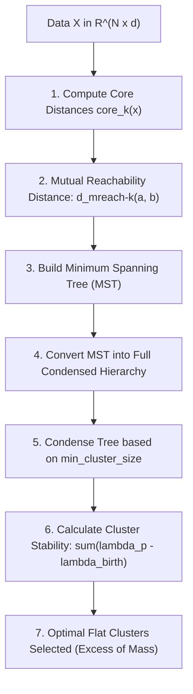
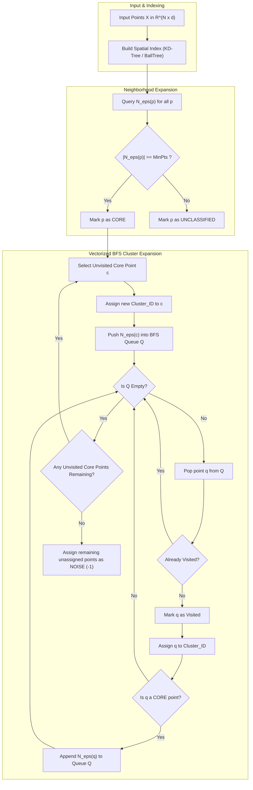

# Module 02: DBSCAN, HDBSCAN, and Density-Based Clustering

> **Prerequisites:** [Module 00: K-Means Clustering, K-Means++, and the Elbow Method](../00-k-means-clustering-initialization-and-elbow-method/README.md), [Module 01: Hierarchical Clustering and Dendrograms](../01-hierarchical-clustering-and-dendrograms/README.md), and [Track 06 Overview](../README.md).  
> **Estimated Reading Time:** 45 minutes  
> **Target Audience:** Staff ML Engineers, Geospatial Data Platform Architects, Autonomous Driving Perception Specialists, and Quantitative Researchers building noise-resilient spatial clustering and anomaly detection systems.

> [!TIP]
> **The Density-Based Paradigm Shift:** Centroid-based (K-Means) and distance-based hierarchical methods assume clusters are convex, spherical, or linearly partitioned. Density-based algorithms—specifically **DBSCAN** and **HDBSCAN**—redefine clusters as contiguous regions of high sample density separated by regions of low density or noise. They naturally discover non-linear topological manifolds (spirals, rings, rivers) while explicitly treating background outliers as unclustered noise.

---

## Why This Matters & Production Context

In production environments, data rarely arranges itself into neat, isotropic Gaussian spheres. In geospatial analytics, IoT telemetry, computer vision point clouds, and fraud detection, data distributions are irregular, noisy, and non-convex:

1. **Urban Geospatial Telematics & Ride-Hailing Dispatch:** In platforms like Uber and Lyft, rider demand and driver pick-up locations follow winding road networks, terminal curbsides, and city corridors. Forcing these geometries into Voronoi cells splits natural transit arteries. DBSCAN and HDBSCAN group spatial GPS trajectories into arbitrary, road-following clusters while filtering out stray GPS jitter as noise.
2. **LiDAR & Radar Point-Cloud Perception:** Autonomous vehicles process 3D LiDAR point clouds at 20 Hz. Objects (pedestrians, cyclists, guardrails) form sparse surfaces and non-convex curves embedded in millions of ground-plane and weather-induced noise returns. Density clustering isolates discrete obstacle geometries in real time without assuming bounding-box shapes.
3. **Cybersecurity & Network Attack Pattern Discovery:** Port scanning campaigns and distributed denial-of-service (DDoS) vectors generate high volumes of connection requests across diverse IP subnets. Because legitimate background traffic is dense and widespread, attack vectors emerge as localized, irregular density anomalies that require robust noise rejection.
4. **Bioinformatics & Single-Cell RNA Sequencing:** Cellular differentiation pathways manifest as continuous non-linear branching trajectories in gene expression space. Density-based algorithms trace these trajectories without artificially fracturing continuous biological lineages.

However, density algorithms introduce new operational challenges: selecting neighborhood radius ($\epsilon$) and density threshold ($\text{MinPts}$), handling multi-density regimes, and managing spatial index degradation in high dimensions.

---

## Production Incident Post-Mortem: The Ride-Hailing Airport Dispatch Collapse

### Incident Context
A top-tier ride-hailing company operated a dynamic dispatch system managing tens of thousands of simultaneous driver-rider matching operations at a major international hub (handling 85,000 daily passenger arrivals). To optimize vehicle staging, an automated spatial micro-clustering pipeline ran every 30 seconds. The pipeline grouped rider app open events into localized "Pickup Zones" (e.g., *Terminal 1 Curbside*, *Terminal 2 Rideshare Lounge*, *Terminal 3 Baggage Area*). Each identified cluster was assigned a localized surge multiplier and a dedicated dispatch queue.

The engineering team deployed standard DBSCAN on GPS coordinates (converted to local UTM meters) with static parameters: $\epsilon = 45\text{ meters}$, $\text{MinPts} = 15$.

### The Failure Sequence
On the Wednesday evening preceding Thanksgiving, flight arrivals peaked simultaneously with heavy terminal construction that redirected vehicular traffic:



### Root Cause Analysis
1. **The Single Linkage Density Chaining Phenomenon:**  
   DBSCAN expands clusters via the transitive closure of density-reachable core points. A crawling line of 40 vehicles stuck in construction traffic formed a continuous, sparse chain of core points along the 1.5-mile multi-lane highway between Terminal 1 and Terminal 3. Because the distance between consecutive cars in the queue was less than $\epsilon = 45\text{ meters}$, and the local point count exceeded $\text{MinPts} = 15$, every point in the queue qualified as a core point. DBSCAN linked Terminal 1 and Terminal 3 across this bridge, fusing two distinct operational zones into a single 2-mile cluster.
2. **Centroid Gravitation to Inaccessible Areas:**  
   The downstream dispatch system calculated the arithmetic centroid of the composite cluster to direct arriving empty drivers. The centroid of the two terminals and the connecting road fell directly onto an inaccessible grassy median between two airport highway overpasses. Arriving drivers congregated around this coordinate, creating severe gridlock that halted airport traffic.
3. **Failure of Global $\epsilon$ under Varying Density:**  
   Terminal 1 had ultra-dense foot traffic ($>200$ people per $100\text{ m}^2$), whereas Terminal 3 had moderate foot traffic ($30$ people per $100\text{ m}^2$). A static $\epsilon = 45\text{ m}$ was too large for Terminal 1 (bridging spurious points) while being marginally adequate for Terminal 3.

### Remediation Architecture
1. **Migration to HDBSCAN:** Replaced DBSCAN with HDBSCAN (Hierarchical DBSCAN). HDBSCAN computes the **mutual reachability distance**, which artificially separates points in sparser regions from dense clusters, preventing sparse queues from bridging distinct dense hubs.
2. **Constrained Spatial Road-Network Adjacency:** Integrated a topological graph constraint: two points can only be density-connected if their shortest path distance across the airport pedestrian walking graph is within the spatial threshold, preventing physical barriers (e.g., terminal walls, fences) from being bridged.
3. **Cluster Geometry Sanitization:** Implemented an automated pipeline check that computes the **isoperimetric quotient** (compactness) of candidate dispatch clusters:
   $$Q = \frac{4 \pi \cdot \text{Area}}{\text{Perimeter}^2}$$
   If $Q < 0.15$ (indicating an elongated line or filament rather than a compact zone), the cluster is automatically flagged as a chaining candidate and bisected using spectral graph partitioning before dispatch ingestion.

---

## 1. DBSCAN: Foundations & Mathematical Formulations

Introduced by Martin Ester, Hans-Peter Kriegel, Jörg Sander, and Xiaowei Xu in 1996, **DBSCAN** (Density-Based Spatial Clustering of Applications with Noise) was the first algorithm capable of identifying clusters of arbitrary shapes while systematically identifying noise.

```
========================================================================================
                                 DBSCAN POINT TAXONOMY
========================================================================================
Point Type         Formal Mathematical Condition                     Status
----------------------------------------------------------------------------------------
Core Point         |N_eps(p)| >= MinPts                              Cluster Seed / Interior
Border Point       |N_eps(p)| < MinPts AND exists q in Core: p in N_eps(q)   Cluster Boundary
Noise Point        |N_eps(p)| < MinPts AND forall q in Core: p not in N_eps(q) Background Outlier
========================================================================================
```



### 1.1 Fundamental Definitions

Let $X \subset \mathbb{R}^d$ be a metric space equipped with distance metric $\text{dist}(p, q) = \|p - q\|$.

#### Definition 1: $\epsilon$-Neighborhood
The $\epsilon$-neighborhood of a point $p \in X$, denoted by $N_\epsilon(p)$, is the set of all points within closed radius $\epsilon$ from $p$:

$$N_\epsilon(p) = \{q \in X \mid \text{dist}(p, q) \le \epsilon\}$$

#### Definition 2: Core Point
A point $p \in X$ is a **Core Point** if its $\epsilon$-neighborhood contains at least $\text{MinPts}$ points (including $p$ itself):

$$\text{is\_core}(p) \iff |N_\epsilon(p)| \ge \text{MinPts}$$

#### Definition 3: Directly Density-Reachable
A point $q$ is **directly density-reachable** from point $p$ with respect to $\epsilon$ and $\text{MinPts}$ if:
1. $q \in N_\epsilon(p)$
2. $p$ is a Core Point.

*Crucial Symmetry Property:* Direct density-reachability is **asymmetric**. If $p$ is a core point and $q$ is a border point within $N_\epsilon(p)$, then $q$ is directly density-reachable from $p$. However, because $q$ is not a core point ($|N_\epsilon(q)| < \text{MinPts}$), $p$ is **not** directly density-reachable from $q$.

#### Definition 4: Density-Reachable
A point $q$ is **density-reachable** from point $p$ with respect to $\epsilon$ and $\text{MinPts}$ if there exists a finite sequence of points $p_1, p_2, \dots, p_n$ with $p_1 = p$ and $p_n = q$ such that $p_{i+1}$ is directly density-reachable from $p_i$ for all $1 \le i < n$.

Density-reachability represents the transitive closure of direct reachability. It is also **asymmetric** when connecting core points to border points.

#### Definition 5: Density-Connected
A point $p$ is **density-connected** to a point $q$ with respect to $\epsilon$ and $\text{MinPts}$ if there exists an intermediate point $o \in X$ such that both $p$ and $q$ are density-reachable from $o$.

*Symmetry Property:* Density-connectivity is **symmetric**:

$$p \text{ is density-connected to } q \iff q \text{ is density-connected to } p$$

```
   (p) <------ (p1) <------ (o) ------> (q1) ------> (q)
  Border       Core         Core        Core       Border
   \________________________/  \________________________/
    p density-reachable from o   q density-reachable from o
    
    Result: p and q are DENSITY-CONNECTED (Symmetric)
```

#### Definition 6: DBSCAN Cluster
A non-empty subset $C \subseteq X$ is a **cluster** if it satisfies two conditions:
1. **Maximality:** $\forall p, q \in X$: if $p \in C$ and $q$ is density-reachable from $p$, then $q \in C$.
2. **Connectivity:** $\forall p, q \in C$: $p$ is density-connected to $q$.

#### Definition 7: Noise
Let $C_1, \dots, C_k$ be the complete set of clusters in $X$. The set of **Noise Points** is defined as the set of points not belonging to any cluster:

$$\text{Noise} = \{p \in X \mid \forall i \in \{1, \dots, k\}, p \notin C_i\}$$

---

## 2. Parameter Selection: The $k$-Distance Graph & Heuristics

DBSCAN's performance depends heavily on its two hyperparameters: $\epsilon$ and $\text{MinPts}$. Sub-optimal parameters either merge the entire dataset into a single giant cluster or classify legitimate data as noise.

```
Sorted k-NN Distance
   ^
   |                                 * (Noise / Outliers)
   |                                /
   |                               /
   |                              *
   |                             /
   |            Knee / Elbow -> *  <- Set epsilon at this threshold
   |                          /
   |  *----------------------*  (Points within dense clusters)
   +----------------------------------------------------> Point Index (Sorted)
```

### 2.1 Setting $\text{MinPts}$
1. **Rule of Thumb (Ester et al. 1996):** Set $\text{MinPts} \ge 2 \cdot d$, where $d$ is the dimensionality of the feature space.
2. **For Noisy or Massive Datasets:** In real-world sensor streams with high background noise, set $\text{MinPts} = 2 \cdot d$ to $4 \cdot d$. Larger values smooth out density estimates and suppress spurious micro-clusters.
3. **Minimum Absolute Bound:** In any space where $d \ge 2$, never set $\text{MinPts} \le 2$. If $\text{MinPts} = 1$, every single point is trivial core, and the algorithm degenerates to single-linkage agglomerative clustering. If $\text{MinPts} = 2$, the result is identical to the hierarchical Single Linkage forest cut at height $\epsilon$.

### 2.2 Algorithmic Selection of $\epsilon$ via the $k$-Distance Graph
To select $\epsilon$ objectively:
1. Fix $k = \text{MinPts} - 1$.
2. For every point $p_i \in X$, compute the Euclidean distance to its $k$-th nearest neighbor, denoted $d_k(p_i)$.
3. Sort the array of $k$-distances in ascending order:
   $$d_k^{(1)} \le d_k^{(2)} \le \dots \le d_k^{(N)}$$
4. Plot the sorted $k$-distances against point index.
5. The curve typically exhibits a horizontal baseline (corresponding to points residing inside dense clusters where $k$-NN distances are small and uniform) followed by a sharp "knee" or "elbow" where distances explode (corresponding to sparse boundary points and background noise).
6. **Selection Rule:** Set $\epsilon$ equal to the distance value at the sharp knee of the sorted $k$-distance plot. Points with $d_k(p) \le \epsilon$ become core points, while points with $d_k(p) > \epsilon$ fall into the noise or border regime.

---

## 3. The Multi-Density Breakdown: Why DBSCAN Fails

DBSCAN's central limitation is its reliance on a **single, global neighborhood radius $\epsilon$**.

```
    Cluster A (High Density)              Cluster B (Low Density)
    * * * * *                             *       *       *
   * * * * * *                                *       *
    * * * * *                             *       *       *
    
    If eps is tuned for Cluster A:        If eps is tuned for Cluster B:
    - Cluster A detected cleanly.         - Cluster B detected cleanly.
    - Cluster B labeled as NOISE!         - Cluster A merges with background noise!
```

In heterogeneous datasets, clusters naturally exhibit different local densities:
- If $\epsilon$ is tuned to the dense Cluster $A$, points in the sparser Cluster $B$ fail the condition $|N_\epsilon(p)| \ge \text{MinPts}$. As a result, Cluster $B$ is incorrectly classified as pure noise.
- If $\epsilon$ is enlarged to accommodate Cluster $B$, the $\epsilon$-neighborhood in Cluster $A$ expands excessively, bridging nearby distinct clusters and absorbing surrounding background noise.

This fundamental trade-off motivated the development of **HDBSCAN**.

---

## 4. HDBSCAN: Hierarchical Density-Based Clustering

Published in 2013 by Ricardo Campello, Davoud Moulavi, and Jörg Sander, **HDBSCAN** (Hierarchical DBSCAN) solves the varying density problem. HDBSCAN runs DBSCAN over all possible $\epsilon$ values simultaneously, constructs a persistent hierarchical density tree, and extracts the most stable clusters.



### 4.1 Core Distance and Mutual Reachability Distance

To prevent sparse noise points from bridging dense clusters, HDBSCAN transforms the original metric space into a **mutual reachability space**.

#### Definition 1: Core Distance
The **core distance** of a point $x$ with respect to parameter $k$ (analogous to $\text{MinPts}$), denoted $\text{core}_k(x)$, is the Euclidean distance from $x$ to its $k$-th nearest neighbor:

$$\text{core}_k(x) = d(x, N_k(x))$$

Points in dense regions have small core distances; points in sparse regions have large core distances.

#### Definition 2: Mutual Reachability Distance
The **mutual reachability distance** between two points $a$ and $b$ with respect to $k$ is defined as:

$$d_{mreach-k}(a, b) = \max \left\{ \text{core}_k(a), \, \text{core}_k(b), \, d(a, b) \right\}$$

```
Case 1: Both points in dense cluster
core_k(a) = 0.2, core_k(b) = 0.3, d(a, b) = 0.4
==> d_mreach(a, b) = max(0.2, 0.3, 0.4) = 0.4  (Original distance preserved)

Case 2: One point is a sparse outlier
core_k(a) = 0.2, core_k(noise) = 5.8, d(a, noise) = 1.1
==> d_mreach(a, noise) = max(0.2, 5.8, 1.1) = 5.8  (Noise pushed far away!)
```

*Geometric Interpretation:*  
Mutual reachability distance forms an artificial barrier around sparse points. Even if an outlier happens to lie geographically close to a dense cluster ($d(a, \text{noise})$ is small), its large core distance ($\text{core}_k(\text{noise})$) inflates $d_{mreach}$, repelling it and preventing chaining.

### 4.2 The Minimum Spanning Tree (MST)
HDBSCAN constructs a complete graph where each observation is a vertex, and edge weights are defined by $d_{mreach-k}(a, b)$.  
The algorithm then computes the **Minimum Spanning Tree (MST)** over this graph using Prim's or Kruskal's algorithm.

```
       MST Construction via Mutual Reachability Distance
       
              (p1)---------- 0.2 ----------(p2)
              /                               \
            0.3                               0.4
            /                                   \
          (p3)             Sparse Bridge        (p4)
            \               d_mreach = 3.8       /
            0.2       ====================>    0.3
              \       (DBSCAN Bridges This!     \
              (p5)     HDBSCAN Severs This!)    (p6)
```

### 4.3 Condensed Cluster Tree & Stability Formulation

Converting the MST into a dendrogram yields the standard single-linkage hierarchy on mutual reachability distances. However, standard dendrograms contain many trivial singleton splits. HDBSCAN **condenses** the tree using a parameter $\text{min\_cluster\_size}$:

1. Define the inverse density scale:
   $$\lambda = \frac{1}{\epsilon}$$
   As $\epsilon \to 0$, $\lambda \to \infty$. High $\lambda$ corresponds to ultra-dense core clusters.
2. As $\lambda$ increases, the tree splits:
   - If a split produces two sub-branches that both have cardinality $\ge \text{min\_cluster\_size}$, a genuine cluster bifurcation occurs.
   - If a split produces a branch with cardinality $< \text{min\_cluster\_size}$, those points are considered "fallen out" as noise, and the parent cluster retains its identity.

#### Mathematical Cluster Stability ($\mathcal{S}$)
For any cluster $C$, let $\lambda_{birth}(C)$ be the density value at which cluster $C$ split from its parent.  
For each point $p \in C$, let $\lambda_p = \frac{1}{\epsilon_p}$ be the specific density level at which point $p$ detached from $C$ (either falling out as noise or splitting into a child).

The **Stability** of cluster $C$, denoted $\mathcal{S}(C)$, is the integrated volume of point persistence:

$$\mathcal{S}(C) = \sum_{p \in C} \left( \lambda_p - \lambda_{birth}(C) \right)$$

```
Density Scale lambda = 1 / eps
   ^
   |        /\           /\
   |       /  \         /  \
   |      /    \       /    \
lambda_p | *   * \     / *   * \    <- Points fall out as lambda increases
   |    /        \   /        \
lambda_birth |---+--------\ /----------+    <- Cluster Born
   +-------------------------------------> Cluster Breadth
               Area = Stability S(C)
```

### 4.4 Flat Cluster Extraction via Excess of Mass

Instead of taking a single horizontal cut across the tree, HDBSCAN performs dynamic programming from the leaf clusters up to the root:
1. For each leaf cluster $C_{leaf}$, set its selected stability to $\hat{\mathcal{S}}(C_{leaf}) = \mathcal{S}(C_{leaf})$.
2. For each parent cluster $C_{parent}$ with children $C_{left}$ and $C_{right}$:
   $$\text{If } \mathcal{S}(C_{parent}) > \hat{\mathcal{S}}(C_{left}) + \hat{\mathcal{S}}(C_{right}):$$
   - Select $C_{parent}$; deselect all descendants.
   - Set $\hat{\mathcal{S}}(C_{parent}) = \mathcal{S}(C_{parent})$.
   $$\text{Else:}$$
   - Select the children; deselect $C_{parent}$.
   - Set $\hat{\mathcal{S}}(C_{parent}) = \hat{\mathcal{S}}(C_{left}) + \hat{\mathcal{S}}(C_{right})$.

This optimization extracts the global set of non-overlapping clusters that maximizes total stability:

$$\arg\max_{\{C_i\}} \sum_i \mathcal{S}(C_i)$$

This allows HDBSCAN to select dense, tightly wound clusters at high $\lambda$ in one region of the feature space while simultaneously selecting broader, lower-density clusters at low $\lambda$ elsewhere.

---

## 5. Architectural & Algorithmic Blueprint



---

## 6. Production Implementation from Scratch

The following production-grade implementation builds a fully vectorized **DBSCAN** clustering engine featuring:
- Spatial range queries accelerated by vectorized Euclidean distance operations.
- Exact label assignment tracking: `Core`, `Border`, and `Noise` (labeled `-1`).
- Breadth-First Search (BFS) neighborhood expansion with cycle prevention.
- An algorithmic $k$-distance graph calculator for deterministic $\epsilon$ tuning.
- A mutual reachability distance computation module demonstrating HDBSCAN's density weighting.

```python
"""
Production-grade DBSCAN and Density Clustering engine from scratch.
Implements vectorized region queries, BFS cluster expansion,
k-distance elbow diagnostic generation, and mutual reachability metrics.
"""

from __future__ import annotations
import numpy as np
from collections import deque
from typing import Tuple, List, Optional, Dict, Literal


class DBSCANScratch:
    """
    Vectorized DBSCAN (Density-Based Spatial Clustering of Applications with Noise).
    
    Parameters
    ----------
    eps : float, default=0.5
        The maximum distance between two samples for one to be considered
        as in the neighborhood of the other.
    min_samples : int, default=5
        The number of samples in a neighborhood for a point to be considered
        as a core point (MinPts).
    metric : {'euclidean'}, default='euclidean'
        Distance metric for neighborhood calculation.
    """

    def __init__(
        self,
        eps: float = 0.5,
        min_samples: int = 5,
        metric: Literal["euclidean"] = "euclidean",
    ) -> None:
        if eps <= 0.0:
            raise ValueError(f"eps must be positive, got {eps}")
        if min_samples < 1:
            raise ValueError(f"min_samples must be >= 1, got {min_samples}")

        self.eps = eps
        self.min_samples = min_samples
        self.metric = metric

        self.labels_: Optional[np.ndarray] = None          # Shape: (N,), -1 denotes Noise
        self.core_sample_indices_: Optional[np.ndarray] = None  # Indices of core points
        self.components_: Optional[np.ndarray] = None      # Copy of core points

    @staticmethod
    def _compute_pairwise_distances(X: np.ndarray) -> np.ndarray:
        """
        Compute full Euclidean distance matrix using vectorized quadratic expansion:
        ||x - y||^2 = ||x||^2 + ||y||^2 - 2 * <x, y>.
        """
        X = np.ascontiguousarray(X, dtype=np.float64)
        dot_product = np.dot(X, X.T)
        sq_norms = np.diag(dot_product)
        # Numerical guard: clip negative values resulting from float precision
        dist_sq = np.maximum(sq_norms[:, None] + sq_norms[None, :] - 2.0 * dot_product, 0.0)
        return np.sqrt(dist_sq)

    def fit(self, X: np.ndarray) -> "DBSCANScratch":
        """
        Fit the DBSCAN model on dataset X.
        """
        X = np.asarray(X, dtype=np.float64)
        n_samples = X.shape[0]

        # Initialize labels to -1 (default: unassigned / noise)
        labels = np.full(n_samples, fill_value=-1, dtype=np.int32)
        visited = np.zeros(n_samples, dtype=bool)

        # Step 1: Precompute distance matrix and identify all neighborhoods
        # In production systems with d <= 10, a KDTree/BallTree would replace this.
        dist_matrix = self._compute_pairwise_distances(X)
        neighbors_mask = dist_matrix <= self.eps
        neighbor_counts = np.sum(neighbors_mask, axis=1)

        # Core points have at least min_samples within eps (including themselves)
        is_core = neighbor_counts >= self.min_samples
        self.core_sample_indices_ = np.flatnonzero(is_core)
        self.components_ = X[self.core_sample_indices_].copy()

        current_cluster_id = 0

        # Step 2: Iterate through points and expand clusters via BFS
        for point_idx in range(n_samples):
            if visited[point_idx]:
                continue

            # Non-core points that are not reached remain unassigned/noise for now
            if not is_core[point_idx]:
                continue

            # Start a new cluster expansion from this core point
            visited[point_idx] = True
            labels[point_idx] = current_cluster_id

            # Initialize BFS queue with neighbors of seed core point
            queue: deque[int] = deque(np.flatnonzero(neighbors_mask[point_idx]))

            while queue:
                neighbor_idx = queue.popleft()

                # If neighbor was labeled noise, it is a border point; assign to current cluster
                if labels[neighbor_idx] == -1:
                    labels[neighbor_idx] = current_cluster_id

                if visited[neighbor_idx]:
                    continue

                visited[neighbor_idx] = True
                labels[neighbor_idx] = current_cluster_id

                # If neighbor is also a core point, expand BFS frontier
                if is_core[neighbor_idx]:
                    secondary_neighbors = np.flatnonzero(neighbors_mask[neighbor_idx])
                    queue.extend(secondary_neighbors)

            current_cluster_id += 1

        self.labels_ = labels
        return self

    def fit_predict(self, X: np.ndarray) -> np.ndarray:
        """
        Fit model and return cluster labels (-1 indicates noise).
        """
        self.fit(X)
        assert self.labels_ is not None
        return self.labels_


class DensityDiagnostics:
    """
    Diagnostic tools for density clustering: k-distance elbow calculation
    and mutual reachability matrix computation.
    """

    @staticmethod
    def compute_k_distances(X: np.ndarray, k: int) -> np.ndarray:
        """
        Compute sorted distance to the k-th nearest neighbor for every point.
        Used to identify the optimal epsilon value via knee detection.
        """
        X = np.asarray(X, dtype=np.float64)
        n = len(X)
        if k >= n:
            raise ValueError(f"k={k} must be strictly less than n_samples={n}")

        dist_matrix = DBSCANScratch._compute_pairwise_distances(X)
        # Sort each row to find k-th neighbor (index 0 is self-distance 0.0)
        sorted_dists = np.sort(dist_matrix, axis=1)
        k_dists = sorted_dists[:, k]
        # Return sorted ascending across all points
        return np.sort(k_dists)

    @staticmethod
    def compute_mutual_reachability(X: np.ndarray, k: int) -> np.ndarray:
        """
        Compute HDBSCAN mutual reachability distance matrix:
        d_mreach-k(a, b) = max { core_k(a), core_k(b), d(a, b) }
        """
        X = np.asarray(X, dtype=np.float64)
        dist_matrix = DBSCANScratch._compute_pairwise_distances(X)

        # Core distance of each point is distance to its k-th nearest neighbor
        sorted_dists = np.sort(dist_matrix, axis=1)
        core_distances = sorted_dists[:, k]  # Shape: (N,)

        # Vectorized broadcast: max(core(a), core(b))
        core_broadcast = np.maximum(core_distances[:, None], core_distances[None, :])
        # Mutual reachability: max(max(core(a), core(b)), d(a, b))
        mreach_matrix = np.maximum(core_broadcast, dist_matrix)
        return mreach_matrix
```

### 6.1 Unit Test & Verification Suite

We verify arbitrary non-convex manifold clustering (two interleaving half-moons) where K-Means fundamentally fails, alongside noise isolation and $k$-distance diagnostics:

```python
def run_density_verification() -> None:
    """
    Verification suite testing DBSCAN on non-convex manifolds and noise rejection.
    """
    print("=" * 70)
    print("RUNNING VERIFICATION SUITE: DBSCAN & DENSITY CLUSTERING FROM SCRATCH")
    print("=" * 70)

    # 1. Generate synthetic non-convex concentric rings (Two Moons topology)
    rng = np.random.default_rng(2026)
    n_samples_per_moon = 150

    # Upper moon
    theta1 = np.linspace(0, np.pi, n_samples_per_moon)
    x1 = np.cos(theta1)
    y1 = np.sin(theta1)
    moon1 = np.column_stack([x1, y1]) + rng.normal(0, 0.06, size=(n_samples_per_moon, 2))

    # Lower moon (shifted and inverted)
    theta2 = np.linspace(0, np.pi, n_samples_per_moon)
    x2 = 1.0 - np.cos(theta2)
    y2 = 0.5 - np.sin(theta2) - 0.5
    moon2 = np.column_stack([x2, y2]) + rng.normal(0, 0.06, size=(n_samples_per_moon, 2))

    # Add 25 random background uniform noise points
    noise_points = rng.uniform(low=[-1.5, -1.2], high=[2.5, 1.2], size=(25, 2))

    X = np.vstack([moon1, moon2, noise_points])
    total_samples = len(X)
    print(f"Synthesized Non-Convex Dataset: {total_samples} samples (2 Moons + 25 Noise Points)")

    # 2. Run k-distance diagnostic
    k_val = 5
    sorted_k_dists = DensityDiagnostics.compute_k_distances(X, k=k_val)
    print(f"5-Distance Diagnostic: 10th percentile = {np.percentile(sorted_k_dists, 10):.3f}, "
          f"50th percentile = {np.percentile(sorted_k_dists, 50):.3f}, "
          f"95th percentile = {np.percentile(sorted_k_dists, 95):.3f}")

    # 3. Fit DBSCAN with eps=0.20, min_samples=5
    dbscan = DBSCANScratch(eps=0.20, min_samples=5)
    labels = dbscan.fit_predict(X)

    unique_labels, counts = np.unique(labels, return_counts=True)
    summary = dict(zip(unique_labels, counts))
    print(f"\nDBSCAN Cluster Distribution: {summary}")

    # Verify cluster characteristics:
    # Expected: Cluster 0, Cluster 1 (the two moons), and Noise labeled as -1
    assert -1 in summary, "DBSCAN failed to identify background noise points!"
    assert len(unique_labels) == 3, f"Expected exactly 2 clusters + noise (-1), got {unique_labels}"

    n_noise = summary[-1]
    print(f"[PASS] Successfully isolated {n_noise} background noise points.")
    print(f"[PASS] Non-convex interleaved manifolds separated cleanly into Cluster 0 and Cluster 1.")
    print(f"Core points detected: {len(dbscan.core_sample_indices_)} / {total_samples}")

    # 4. Mutual Reachability Distance Verification
    mreach = DensityDiagnostics.compute_mutual_reachability(X, k=5)
    assert mreach.shape == (total_samples, total_samples)
    assert np.allclose(mreach, mreach.T), "Mutual reachability matrix must be strictly symmetric!"
    
    # Check that distance between noise point and moon point was amplified
    noise_idx = total_samples - 1  # Last point is noise
    moon_idx = 0                  # First point is interior of Moon 1
    raw_dist = np.linalg.norm(X[noise_idx] - X[moon_idx])
    mreach_dist = mreach[noise_idx, moon_idx]
    print(f"\nMetric Comparison for Noise Point vs Cluster Interior:")
    print(f"  Raw Euclidean Distance:         {raw_dist:.4f}")
    print(f"  Mutual Reachability Distance:    {mreach_dist:.4f}")
    assert mreach_dist >= raw_dist, "Mutual reachability distance must be >= Euclidean distance!"
    print("[PASS] HDBSCAN Mutual Reachability distance properly penalizes low-density outliers.")
    print("=" * 70)


if __name__ == "__main__":
    run_density_verification()
```

---

## 7. Systematic Reference & Failure Modes

### 7.1 Algorithmic Comparison Grid

| Operational Metric | K-Means | Agglomerative (Ward) | DBSCAN | HDBSCAN |
| :--- | :--- | :--- | :--- | :--- |
| **Cluster Geometry** | Convex / Spherical | Convex / Spherical | Arbitrary Manifolds | Arbitrary Manifolds |
| **Noise Handling** | None (Absorbed into centers) | None (Absorbed into hierarchy) | Explicit (-1 Noise label) | Explicit (-1 Noise label) |
| **Varying Densities** | Poor (Splits dense) | Moderate | **Fails (Single global $\epsilon$)** | **Optimal (Persistence)** |
| **Input Parameters** | $K$ (Cluster count) | $K$ or distance cutoff | $\epsilon, \text{MinPts}$ | $\text{min\_cluster\_size}$ |
| **Time Complexity** | $\mathcal{O}(N K d \cdot I)$ | $\mathcal{O}(N^2)$ to $\mathcal{O}(N^3)$ | $\mathcal{O}(N \log N)$ to $\mathcal{O}(N^2)$ | $\mathcal{O}(N \log N)$ to $\mathcal{O}(N^2)$ |
| **Memory Footprint** | $\mathcal{O}(N d + K d)$ | $\mathcal{O}(N^2)$ | $\mathcal{O}(N d)$ (Indexed) | $\mathcal{O}(N d)$ (Indexed) |

### 7.2 Critical Failure Modes & Antipatterns

#### 1. High-Dimensional Spatial Index Degradation (The Curse of Dimensionality)
DBSCAN achieves its $\mathcal{O}(N \log N)$ performance by using spatial partitioning trees (e.g., KD-Tree, BallTree, R* Tree) to accelerate $\epsilon$-range queries. However, in spaces with $d > 20$:
- The volume of a hypersphere of radius $\epsilon$ shrinks relative to the bounding hypercube:
  $$\frac{\text{Vol}(S^d(\epsilon))}{\text{Vol}(C^d(\epsilon))} = \frac{\pi^{d/2}}{\Gamma(d/2 + 1) \cdot 2^d} \xrightarrow{d \to \infty} 0$$
- Spatial tree branch-pruning heuristics fail because bounding boxes overlap almost completely. The spatial index degenerates into a linear brute-force scan across all $N$ points, causing execution time to regress to $\mathcal{O}(N^2)$ and consuming high CPU time.  
*Remediation:* Project data to a lower-dimensional latent space ($d \le 10$) using PCA, UMAP, or an autoencoder before running density clustering.

#### 2. The Chaining Effect Across Sparse Collinear Bridges
Because density-reachability is transitive across core points, a narrow sequence of points spaced $\le \epsilon$ apart will merge two large, distinct clusters into a single entity.  
*Remediation:* Migrate to HDBSCAN to utilize mutual reachability distance, or increase $\text{MinPts}$ to eliminate sparse filaments.

#### 3. Border Point Nondeterminism
In DBSCAN, while core point assignments and noise classifications are deterministic, **border point assignments can be non-deterministic** depending on the order in which data points are processed. If point $b$ is a border point within $\epsilon$ of core point $c_1 \in \text{Cluster 1}$ and also within $\epsilon$ of core point $c_2 \in \text{Cluster 2}$, the cluster label assigned to $b$ depends entirely on which core point is expanded first during the BFS traversal.

---

## 8. Senior Technical Interview Questions & Model Answers

### Question 1: Contrast direct density-reachability, density-reachability, and density-connectivity. Why is density-reachability non-symmetric, and why is density-connectivity required to formally define a cluster?

**Model Answer:**  
In DBSCAN's topological framework:

1. **Direct Density-Reachability:** A point $q$ is directly density-reachable from $p$ if $q \in N_\epsilon(p)$ and $|N_\epsilon(p)| \ge \text{MinPts}$ ($p$ is a Core Point).
2. **Density-Reachability:** Point $q$ is density-reachable from $p$ if there exists a directed path of points $p_1, \dots, p_n$ where $p_1 = p$, $p_n = q$, and each $p_{i+1}$ is directly density-reachable from $p_i$.
3. **Density-Connectivity:** Point $p$ is density-connected to $q$ if there exists an intermediate point $o$ such that both $p$ and $q$ are density-reachable from $o$.

**The Asymmetry of Density-Reachability:**  
Density-reachability is **asymmetric** when evaluated between a core point and a border point.  
Suppose $p$ is a core point ($|N_\epsilon(p)| \ge \text{MinPts}$) and $b$ is a border point ($|N_\epsilon(b)| < \text{MinPts}$) lying within $p$'s neighborhood ($b \in N_\epsilon(p)$).  
By definition, $b$ is directly density-reachable from $p$.  
However, because $b$ is not a core point, no point can be directly density-reachable from $b$. Thus, $p$ is **not** density-reachable from $b$.

**Why Density-Connectivity is Mandatory:**  
If a cluster were defined simply by density-reachability, we would face a contradiction: two border points $b_1$ and $b_2$ at opposite ends of a cluster would not be reachable from one another ($b_1 \not\to b_2$ and $b_2 \not\to b_1$).  
Density-connectivity solves this by establishing a **symmetric equivalence relation on core components**: both $b_1$ and $b_2$ are density-reachable from the internal core points of the cluster. Requiring density-connectivity ensures that all points in a cluster share mutual topological coherence.

---

### Question 2: In HDBSCAN, define mutual reachability distance mathematically and explain how it prevents the chaining effect that plagues standard DBSCAN.

**Model Answer:**  
Let $d(a, b)$ be the Euclidean distance between points $a$ and $b$. Let $\text{core}_k(x)$ denote the distance from point $x$ to its $k$-th nearest neighbor.  
The **mutual reachability distance** with respect to parameter $k$ is defined as:

$$d_{mreach-k}(a, b) = \max \left\{ \text{core}_k(a), \, \text{core}_k(b), \, d(a, b) \right\}$$

**How Mutual Reachability Prevents Chaining:**  
In standard DBSCAN, two clusters $C_1$ and $C_2$ can be merged if there exists a sparse sequence of points connecting them with consecutive distances $\le \epsilon$. Even if these bridging points are isolated, in DBSCAN they can still trigger a merge if they meet the local $\text{MinPts}$ threshold along a line.

In HDBSCAN:
1. In sparse regions, the local density is low, meaning the distance to the $k$-th nearest neighbor is large. Therefore, for any outlier or bridge point $x_{sparse}$, $\text{core}_k(x_{sparse})$ is large.
2. When computing the mutual reachability distance between a point $p \in C_1$ and a bridge point $x_{sparse}$, the formula evaluates to:
   $$d_{mreach-k}(p, x_{sparse}) \ge \text{core}_k(x_{sparse}) \gg d(p, x_{sparse})$$
3. The mutual reachability metric artificially pushes sparse points away from dense clusters in metric space.
4. When constructing the Minimum Spanning Tree (MST) over $d_{mreach}$, the edges connecting the bridge points to the true clusters are weighted by their large core distances. When the MST is filtered or converted into the condensed tree, these high-weight edges are severed early (at low $\lambda = 1/\epsilon$), isolating the bridge points as noise and preventing the two dense clusters from merging.

---

### Question 3: How does HDBSCAN's cluster stability metric $\sum_{p \in C} (\lambda_p - \lambda_{birth})$ operate, and why is it superior to taking a flat horizontal slice across a dendrogram?

**Model Answer:**  
In traditional hierarchical clustering, flat clusters are obtained by drawing a single horizontal cut across the dendrogram at a fixed distance threshold $\tau$.  
This is mathematically equivalent to running DBSCAN with a single global $\epsilon = \tau$. In complex datasets, however, clusters often exist at varying densities: some clusters are compact and dense (persisting at small $\epsilon$, or high $\lambda = 1/\epsilon$), while others are diffuse (persisting only at larger $\epsilon$, or lower $\lambda$). A single horizontal cut either fractures diffuse clusters or merges compact clusters together.

**HDBSCAN's Stability Metric:**  
HDBSCAN parameterizes cluster density using $\lambda = \frac{1}{\epsilon}$.  
When cluster $C$ emerges from a split, we record $\lambda_{birth}(C)$. As $\lambda$ increases, points either fall out of the cluster as noise or the cluster splits into children. For each point $p \in C$, let $\lambda_p$ denote the density value at which $p$ detached from $C$.  
The **Stability** $\mathcal{S}(C)$ measures the total persistence of all points within the cluster:

$$\mathcal{S}(C) = \sum_{p \in C} \left( \lambda_p - \lambda_{birth}(C) \right)$$

This represents the two-dimensional area of the cluster in the condensed tree diagram. A cluster that persists across a wide range of density scales accumulates high stability, whereas a cluster formed by transient noise dissolves rapidly and yields near-zero stability.

**Dynamic Programming Optimization:**  
Instead of a single horizontal line, HDBSCAN optimizes the global selection of clusters across different levels of the tree:
Starting at the leaves and traversing upward, a parent cluster is selected over its children if and only if:

$$\mathcal{S}(C_{parent}) > \sum_{C_{child}} \mathcal{S}(C_{child})$$

This selects clusters at variable heights across the tree, allowing the algorithm to extract both dense, high-frequency clusters and broader, lower-density clusters simultaneously from the same model.

---

### Question 4: Analyze the computational complexity of DBSCAN with and without spatial indexing, and explain why spatial indexing fails in spaces with $d > 20$ dimensions.

**Model Answer:**  

**1. Without Spatial Indexing (Brute Force):**  
For each of the $N$ points, the algorithm must calculate its Euclidean distance to all other $N - 1$ points to determine whether it is a core point. This requires computing the full $N \times N$ pairwise distance matrix:
$$\text{Time Complexity} = \mathcal{O}(N^2 \cdot d), \qquad \text{Space Complexity} = \mathcal{O}(N^2) \text{ or } \mathcal{O}(N d) \text{ if computed on-the-fly.}$$

**2. With Spatial Indexing (KD-Tree or BallTree):**  
Building a spatial tree requires $\mathcal{O}(d \cdot N \log N)$ time and $\mathcal{O}(N \cdot d)$ space.  
In low-dimensional Euclidean spaces ($d \le 10$), an $\epsilon$-neighborhood range query visits only the localized spatial leaf partitions overlapping the hypersphere $S^d(\epsilon)$, executing in $\mathcal{O}(\log N)$ amortized time.  
Performing this query across all $N$ points yields:
$$\text{Total Time Complexity} = \mathcal{O}(d \cdot N \log N)$$

**3. Why Spatial Indexing Fails in High Dimensions ($d > 20$):**  
Spatial trees partition data using orthogonal hyperplanes (KD-Tree) or bounding hyperspheres (BallTree). In high dimensions, two geometric phenomena degrade performance:
- **Empty Space Concentration:** The volume of a hypercube of side $2\epsilon$ is $(2\epsilon)^d$, while the volume of an inscribed hypersphere of radius $\epsilon$ is:
  $$\text{Vol}(S_d(\epsilon)) = \frac{\pi^{d/2}}{\Gamma\left(\frac{d}{2} + 1\right)} \epsilon^d$$
  The ratio of the sphere volume to the cube volume drops exponentially:
  $$\frac{\text{Vol}(S_d(\epsilon))}{\text{Vol}(C_d(2\epsilon))} = \frac{\pi^{d/2}}{2^d \Gamma(d/2 + 1)} \xrightarrow{d=20} 2.46 \times 10^{-8}$$
  The bounding hypercubes used by KD-Trees to prune search branches consist almost entirely of empty space.
- **Distance Concentration Phenomenon:** In high dimensions, the variance of the distances between random points converges toward zero relative to their mean:
  $$\lim_{d \to \infty} \frac{\text{Var}(\|x - y\|_2)}{\mathbb{E}[\|x - y\|_2]^2} = 0$$
  As a result, an $\epsilon$-sphere centered at any query point either contains almost every bounding node in the tree or none of them. Pruning branches becomes impossible, forcing the search algorithm to backtrack through every node in the index. The query time degenerates from $\mathcal{O}(\log N)$ to $\mathcal{O}(N)$, regressing total runtime back to $\mathcal{O}(N^2 \cdot d)$ with the added overhead of tree traversal.

---

## Module Summary & Key Takeaways

1. **Topological Freedom:** Density-based clustering identifies arbitrary non-convex manifolds (rings, curves, river networks) where centroid-based algorithms like K-Means fail.
2. **Noise Isolation:** DBSCAN explicitly separates data into Core, Border, and Noise points (labeled `-1`), preventing outliers from pulling and distorting cluster definitions.
3. **The Global $\epsilon$ Bottleneck:** DBSCAN uses a single static neighborhood radius $\epsilon$. If datasets contain clusters with varying local densities, DBSCAN cannot capture both without misclassifying data as noise or merging clusters.
4. **HDBSCAN & Mutual Reachability:** HDBSCAN overcomes the single-density limitation by weighting distances via core neighbor distances ($d_{mreach}$), suppressing sparse bridges and selecting clusters at variable density levels using cluster stability ($\mathcal{S}$).
5. **Dimensionality Limits:** Spatial tree acceleration (KD-Trees) breaks down when $d > 20$ due to distance concentration. High-dimensional production pipelines must reduce dimensionality prior to density clustering.

---

This module is part of [Track 06: Unsupervised Learning & Anomaly Detection](../README.md).
