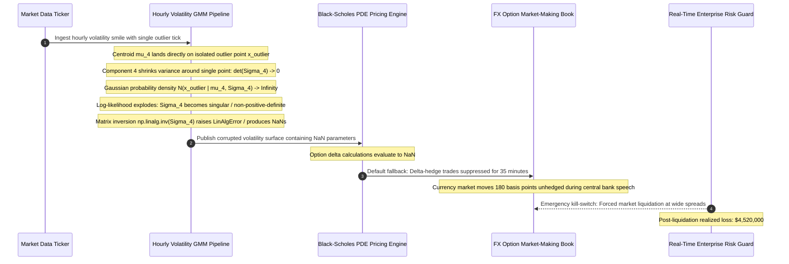
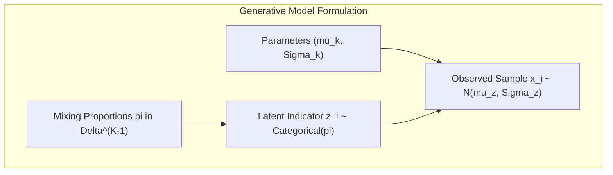
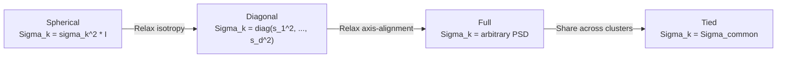
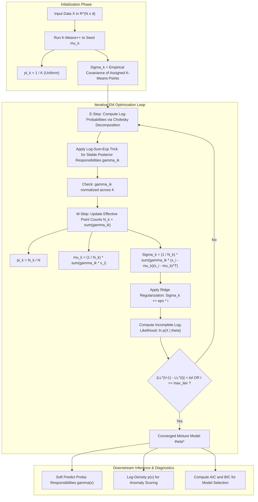

# Module 03: Gaussian Mixture Models (GMM) and the Expectation-Maximization (EM) Algorithm

> **Prerequisites:** [Module 00: K-Means Clustering, K-Means++, and the Elbow Method](../00-k-means-clustering-initialization-and-elbow-method/README.md), [Track 02: Math for Machine Learning - Probability Distributions, Multivariate Gaussians & Maximum Likelihood Estimation](../../02-math-for-machine-learning/06-probability-distributions-and-bayes-theorem/README.md), and [Track 06 Overview](../README.md).  
> **Estimated Reading Time:** 45 minutes  
> **Target Audience:** Principal ML Engineers, Quantitative Researchers, Computational Neuroscientists, and Risk Analytics Architects designing generative latent variable models, soft density estimation pipelines, and probabilistic classification systems.

> [!TIP]
> **The Generative Probabilistic Foundation:** Hard partitioning algorithms (such as K-Means) force every observation into a discrete cluster, discarding classification uncertainty and assuming spherical cluster geometries. **Gaussian Mixture Models (GMMs)** frame clustering as maximum likelihood estimation on a latent variable generative model. Through the **Expectation-Maximization (EM)** algorithm, GMMs learn elliptical covariance geometries while assigning continuous posterior responsibilities ($\gamma_{ik} \in [0, 1]$) to every observation.

---

## Why This Matters & Production Context

In production environments, binary cluster assignments are frequently inadequate. Real-world systems require calibrated uncertainty estimation, soft class memberships, and flexible geometric covariance:

1. **Quantitative Finance & Volatility Regime Switching:** Financial asset returns do not follow a single stationary Gaussian distribution; they exhibit heavy tails and volatility clustering. Quantitative hedge funds model market returns as a mixture of Gaussians: a high-probability "Calm / Low Volatility" regime and a low-probability "Crisis / High Volatility" regime. GMM posterior responsibilities $\gamma_{ik}$ act as dynamic probabilities for real-time portfolio hedging.
2. **Speech Recognition & Acoustic Feature Modeling:** In classical acoustic processing (e.g., Hidden Markov Model-GMM pipelines), continuous spectral acoustic vectors (MFCCs) are modeled as mixtures of Gaussians. Each phoneme corresponds to a mixture distribution capturing vocal tract variations across diverse speaker populations.
3. **Medical Imaging & Pathological Tissue Segmentation:** In brain Magnetic Resonance Imaging (MRI), voxels represent mixtures of Gray Matter, White Matter, and Cerebrospinal Fluid (CSF). Due to partial volume effects, physical tissue voxels contain continuous mixtures of tissues. Hard clustering introduces discretization artifacts; GMM soft responsibilities preserve continuous fractional tissue densities.
4. **Anomaly Detection via Density Estimation:** Standard anomaly detectors (such as One-Class SVMs) provide uncalibrated decision boundaries. A trained GMM provides exact probability densities $p(x) = \sum_k \pi_k \mathcal{N}(x \mid \mu_k, \Sigma_k)$. Observations falling into low-probability regions ($p(x) < \tau$) provide a statistically grounded anomaly score with direct $p$-value interpretations.

However, moving from K-Means to GMM introduces severe numerical hazards: singular covariance matrices, likelihood divergence, local minima, and floating-point underflow.

---

## Production Incident Post-Mortem: The \$4.5M Volatility Singularity Crash in Derivative Pricing

### Incident Context
A systematic derivative trading desk managed an automated option-market-making book with \$600M in gross notional exposure across foreign exchange (FX) options. To estimate the local volatility surface used in pricing exotics and calculating delta hedges, the desk deployed a 4-component Gaussian Mixture Model that retrained hourly on 5-minute implied volatility smiles.

The model was implemented in Python using standard Maximum Likelihood Estimation via the EM algorithm without covariance regularization.

### The Failure Sequence
During an emergency central bank interest rate announcement, an anomalous data point—a single rogue quote with an erroneous, localized volatility tick—was ingested into the hourly batch pipeline ($N = 1,400$ volatility observations, $d = 5$ maturity tenors):



### Root Cause Analysis
1. **The Singularity of Maximum Likelihood in GMMs:**  
   Unlike discrete K-Means, the continuous maximum likelihood objective for GMMs is **unbounded above**. Consider what happens when the mean of the $k$-th Gaussian component aligns exactly with a single data point $x_n$:
   $$\mu_k = x_n$$
   As the covariance $\Sigma_k = \sigma_k^2 \mathbf{I}$ approaches zero ($\sigma_k \to 0$):
   $$\mathcal{N}(x_n \mid x_n, \sigma_k^2 \mathbf{I}) = \frac{1}{(2\pi)^{d/2} \sigma_k^d} \exp(0) = \frac{1}{(2\pi)^{d/2} \sigma_k^d} \xrightarrow{\sigma_k \to 0} +\infty$$
   Because the objective is the log-sum of densities:
   $$\ln p(X \mid \theta) = \sum_{i=1}^N \ln \left( \sum_{j=1}^K \pi_j \mathcal{N}(x_i \mid \mu_j, \Sigma_j) \right) \xrightarrow{\sigma_k \to 0} +\infty$$
   The optimization algorithm does not search for meaningful global density; it falls into a pathological mathematical singularity where a single component collapses onto a single observation.
2. **Floating-Point Singularity & Matrix Inversion Failure:**  
   When $\Sigma_4$ collapsed to near-zero, its condition number exploded:
   $$\kappa(\Sigma_4) = \frac{\lambda_{max}}{\lambda_{min}} \to \infty$$
   In the subsequent M-step, evaluating $\Sigma_4^{-1}$ triggered numerical overflow, generating `NaN` values that propagated through the derivative pricing PDEs.

### Remediation Architecture
1. **Mandatory Covariance Ridge Regularization:** Implemented an enforced covariance floor (Tikhonov regularization) on every M-step:
   $$\tilde{\Sigma}_k = \Sigma_k + \epsilon_{reg} \mathbf{I}_d, \qquad \epsilon_{reg} = 10^{-6}$$
   This bounds the smallest eigenvalue of $\Sigma_k$ from below ($\lambda_{min} \ge 10^{-6}$), mathematically guaranteeing that $\det(\Sigma_k) > 0$ and preventing likelihood divergence.
2. **Cholesky-Decomposition Log-Likelihood Evaluation:** Replaced direct matrix inversion $\Sigma^{-1}$ and explicit determinant computation $\det(\Sigma)$ with lower-triangular Cholesky decomposition $\Sigma = L L^T$. If Cholesky decomposition fails due to non-positive-definiteness, the component is dynamically pruned or reset to the global empirical covariance.
3. **Bayesian Maximum A Posteriori (MAP) Priors:** Migrated from pure Maximum Likelihood Estimation to MAP estimation using a conjugate **Normal-Inverse-Wishart** prior on $(\mu_k, \Sigma_k)$, penalizing vanishing variances.

---

## 1. Latent Variable Probabilistic Formulation

Let $X = \{x_1, x_2, \dots, x_N\} \subset \mathbb{R}^d$ be a set of $N$ independent and identically distributed (i.i.d.) continuous observations.

```
========================================================================================
                                 GMM GENERATIVE STORY
========================================================================================
1. For each observation i = 1, ..., N:
   a. Sample a latent categorical component:  z_i ~ Categorical(pi_1, ..., pi_K)
   b. Conditioned on z_i = k, sample vector: x_i ~ Normal(mu_k, Sigma_k)
========================================================================================
```



### 1.1 The Marginal Likelihood
Let $z_i \in \{1, \dots, K\}$ denote a latent categorical variable representing the generating cluster for sample $x_i$.  
The prior probability of selecting cluster $k$ is given by the **mixing coefficient** $\pi_k$:

$$p(z_i = k) = \pi_k, \quad \text{where} \quad 0 \le \pi_k \le 1 \quad \text{and} \quad \sum_{k=1}^K \pi_k = 1$$

Conditioned on cluster assignment $z_i = k$, the observation $x_i$ follows a multivariate Gaussian distribution:

$$p(x_i \mid z_i = k) = \mathcal{N}(x_i \mid \mu_k, \Sigma_k) = \frac{1}{(2\pi)^{d/2} |\Sigma_k|^{1/2}} \exp \left( -\frac{1}{2} (x_i - \mu_k)^T \Sigma_k^{-1} (x_i - \mu_k) \right)$$

where $\mu_k \in \mathbb{R}^d$ is the mean vector and $\Sigma_k \in \mathbb{R}^{d \times d}$ is the symmetric, positive-definite covariance matrix ($\Sigma_k \succ 0$).

Marginalizing out the latent variable $z_i$, the marginal probability density of $x_i$ is a convex combination of Gaussians:

$$p(x_i \mid \theta) = \sum_{k=1}^K p(z_i = k) p(x_i \mid z_i = k) = \sum_{k=1}^K \pi_k \mathcal{N}(x_i \mid \mu_k, \Sigma_k)$$

where $\theta = \{\pi_k, \mu_k, \Sigma_k\}_{k=1}^K$ denotes the complete parameter set.

### 1.2 The Incomplete Log-Likelihood
For an i.i.d. dataset $X$, the total log-likelihood function is:

$$\ln p(X \mid \theta) = \sum_{i=1}^N \ln p(x_i \mid \theta) = \sum_{i=1}^N \ln \left( \sum_{k=1}^K \pi_k \mathcal{N}(x_i \mid \mu_k, \Sigma_k) \right)$$

#### Why Direct Gradient Optimization Fails:
In standard linear models or single Gaussians, the logarithm acts directly on the exponential density, converting it into a tractable quadratic form. In a mixture model, however, the **summation resides inside the logarithm**: $\ln \left( \sum_k \dots \right)$.  
Taking derivatives with respect to $\mu_k$ yields:

$$\nabla_{\mu_k} \ln p(X \mid \theta) = \sum_{i=1}^N \frac{\pi_k \mathcal{N}(x_i \mid \mu_k, \Sigma_k)}{\sum_{j=1}^K \pi_j \mathcal{N}(x_i \mid \mu_j, \Sigma_j)} \Sigma_k^{-1} (x_i - \mu_k) = \mathbf{0}$$

Notice that the optimal $\mu_k$ depends non-linearly on the posterior responsibilities, which themselves depend on all $\mu_j$ and $\Sigma_j$. There is no closed-form analytic solution. We must deploy the **Expectation-Maximization (EM)** algorithm.

---

## 2. Derivation of the Expectation-Maximization (EM) Algorithm

The EM algorithm (Dempster, Laird, and Rubin, 1977) is a general iterative framework for finding maximum likelihood estimates in models with hidden latent variables.

### 2.1 Jensen’s Inequality and the Evidence Lower Bound (ELBO)

We wish to maximize the incomplete log-likelihood $\ln p(X \mid \theta)$.  
Let $Z = \{z_1, \dots, z_N\}$ denote the unobserved latent variables. Introduce an arbitrary variational probability distribution $q(Z)$ over the latent variables such that $\sum_Z q(Z) = 1$ and $q(Z) \ge 0$.

Rewrite the log-likelihood by introducing $q(Z)$:

$$\ln p(X \mid \theta) = \ln \sum_Z p(X, Z \mid \theta) = \ln \sum_Z q(Z) \frac{p(X, Z \mid \theta)}{q(Z)} = \ln \mathbb{E}_{q} \left[ \frac{p(X, Z \mid \theta)}{q(Z)} \right]$$

Because the logarithm is a strictly concave function ($\frac{d^2 \ln u}{du^2} = -\frac{1}{u^2} < 0$), we apply **Jensen's Inequality** ($\ln \mathbb{E}[u] \ge \mathbb{E}[\ln u]$):

$$\ln p(X \mid \theta) \ge \sum_Z q(Z) \ln \left( \frac{p(X, Z \mid \theta)}{q(Z)} \right) \equiv \mathcal{L}(q, \theta)$$

The functional $\mathcal{L}(q, \theta)$ is the **Evidence Lower Bound (ELBO)**.

```
Log-Likelihood ln p(X | theta)
       ^
       |                ln p(X | theta)
       |             -----------------------  <- True Likelihood
       |            /                       \
       |           /   ELBO L(q, theta^(t))  \
       |          /           *               \
       |         /          /   \              \
       |        /          /     \              \
       +-------+----------+-------+--------------+----> Parameter theta
                     theta^(t)  theta^(t+1)
```

Expanding the ELBO:

$$\mathcal{L}(q, \theta) = \sum_Z q(Z) \ln p(X, Z \mid \theta) - \sum_Z q(Z) \ln q(Z) = \mathbb{E}_{q}[\ln p(X, Z \mid \theta)] + \mathcal{H}(q)$$

where $\mathcal{H}(q)$ is the Shannon entropy of $q(Z)$.

Now compute the exact difference between the true log-likelihood and the lower bound:

$$\ln p(X \mid \theta) - \mathcal{L}(q, \theta) = \sum_Z q(Z) \ln p(X \mid \theta) - \sum_Z q(Z) \ln \frac{p(X, Z \mid \theta)}{q(Z)}$$
$$= \sum_Z q(Z) \ln \left( \frac{p(X \mid \theta) q(Z)}{p(X, Z \mid \theta)} \right) = \sum_Z q(Z) \ln \left( \frac{q(Z)}{p(Z \mid X, \theta)} \right) = D_{KL}(q(Z) \parallel p(Z \mid X, \theta))$$

Thus, we have the exact decomposition:

$$\ln p(X \mid \theta) = \mathcal{L}(q, \theta) + D_{KL}(q(Z) \parallel p(Z \mid X, \theta))$$

Because Kullback-Leibler divergence is non-negative ($D_{KL} \ge 0$), $\mathcal{L}(q, \theta) \le \ln p(X \mid \theta)$ with equality if and only if $D_{KL} = 0$, which occurs when:

$$q(Z) = p(Z \mid X, \theta)$$

### 2.2 The Alternating Steps

#### The E-Step (Expectation): Make the Bound Tight
Holding parameters $\theta^{(t)}$ fixed, maximize $\mathcal{L}(q, \theta^{(t)})$ with respect to distribution $q$.  
To maximize $\mathcal{L}$, we minimize $D_{KL}(q(Z) \parallel p(Z \mid X, \theta^{(t)}))$. Setting this divergence to zero requires:

$$q^{(t+1)}(Z) = p(Z \mid X, \theta^{(t)})$$

For GMMs, this means calculating the **posterior responsibility** $\gamma_{ik}$ that component $k$ generated sample $x_i$:

$$\gamma_{ik} \equiv p(z_i = k \mid x_i, \theta^{(t)}) = \frac{p(z_i = k) p(x_i \mid z_i = k, \theta^{(t)})}{\sum_{j=1}^K p(z_i = j) p(x_i \mid z_i = j, \theta^{(t)})} = \frac{\pi_k^{(t)} \mathcal{N}(x_i \mid \mu_k^{(t)}, \Sigma_k^{(t)})}{\sum_{j=1}^K \pi_j^{(t)} \mathcal{N}(x_i \mid \mu_j^{(t)}, \Sigma_j^{(t)})}$$

#### The M-Step (Maximization): Maximize the Expected Complete Log-Likelihood
Holding the responsibilities $q^{(t+1)}$ fixed, maximize the ELBO with respect to $\theta$:

$$\theta^{(t+1)} = \arg\max_\theta \mathcal{L}(q^{(t+1)}, \theta) = \arg\max_\theta \sum_Z p(Z \mid X, \theta^{(t)}) \ln p(X, Z \mid \theta)$$

Define the expected complete log-likelihood function $Q(\theta, \theta^{(t)})$:

$$Q(\theta, \theta^{(t)}) = \sum_{i=1}^N \sum_{k=1}^K \gamma_{ik} \left[ \ln \pi_k + \ln \mathcal{N}(x_i \mid \mu_k, \Sigma_k) \right]$$

### 2.3 Analytic M-Step Updates

#### 1. Effective Number of Points Assigned to Cluster $k$:
$$N_k = \sum_{i=1}^N \gamma_{ik}$$

#### 2. Mixing Coefficients $\pi_k$:
Maximize $Q$ subject to the probability simplex constraint $\sum_k \pi_k = 1$ using Lagrange multipliers:

$$\mathcal{L}_{Lagrange} = \sum_{i=1}^N \sum_{k=1}^K \gamma_{ik} \ln \pi_k + \lambda \left( \sum_{k=1}^K \pi_k - 1 \right)$$
$$\frac{\partial \mathcal{L}_{Lagrange}}{\partial \pi_k} = \frac{N_k}{\pi_k} + \lambda = 0 \implies \pi_k = -\frac{N_k}{\lambda}$$
Summing over all $k$: $\sum_k \pi_k = 1 \implies -\frac{N}{\lambda} = 1 \implies \lambda = -N$. Therefore:

$$\pi_k^{(t+1)} = \frac{N_k}{N} = \frac{1}{N} \sum_{i=1}^N \gamma_{ik}$$

#### 3. Component Means $\mu_k$:
Taking the gradient with respect to vector $\mu_k$:

$$\nabla_{\mu_k} Q = \sum_{i=1}^N \gamma_{ik} \Sigma_k^{-1} (x_i - \mu_k) = \mathbf{0}$$
$$\sum_{i=1}^N \gamma_{ik} x_i = \mu_k \sum_{i=1}^N \gamma_{ik} = N_k \mu_k \implies \mu_k^{(t+1)} = \frac{1}{N_k} \sum_{i=1}^N \gamma_{ik} x_i$$

#### 4. Component Covariance Matrices $\Sigma_k$:
Taking the matrix derivative with respect to precision matrix $\Lambda_k = \Sigma_k^{-1}$:

$$\nabla_{\Sigma_k^{-1}} Q = \sum_{i=1}^N \gamma_{ik} \left[ \frac{1}{2} \Sigma_k - \frac{1}{2} (x_i - \mu_k^{(t+1)})(x_i - \mu_k^{(t+1)})^T \right] = \mathbf{0}$$
$$N_k \Sigma_k = \sum_{i=1}^N \gamma_{ik} (x_i - \mu_k^{(t+1)})(x_i - \mu_k^{(t+1)})^T$$
$$\Sigma_k^{(t+1)} = \frac{1}{N_k} \sum_{i=1}^N \gamma_{ik} (x_i - \mu_k^{(t+1)})(x_i - \mu_k^{(t+1)})^T$$

### 2.4 Monotonic Convergence Proof
At every iteration:
1. In the E-step, $q^{(t+1)}$ makes the ELBO equal to the true log-likelihood:
   $$\mathcal{L}(q^{(t+1)}, \theta^{(t)}) = \ln p(X \mid \theta^{(t)})$$
2. In the M-step, $\theta^{(t+1)}$ maximizes $\mathcal{L}$ with respect to $\theta$:
   $$\mathcal{L}(q^{(t+1)}, \theta^{(t+1)}) \ge \mathcal{L}(q^{(t+1)}, \theta^{(t)})$$
3. Because the ELBO is a lower bound:
   $$\ln p(X \mid \theta^{(t+1)}) \ge \mathcal{L}(q^{(t+1)}, \theta^{(t+1)}) \ge \mathcal{L}(q^{(t+1)}, \theta^{(t)}) = \ln p(X \mid \theta^{(t)})$$
4. Therefore:
   $$\ln p(X \mid \theta^{(t+1)}) \ge \ln p(X \mid \theta^{(t)})$$

The incomplete log-likelihood is monotonically non-decreasing at every iteration.

---

## 3. Covariance Matrix Types & Free Parameter Analysis

The geometric shape, orientation, and parameter capacity of a GMM depend on the structural constraints imposed on the covariance matrices $\Sigma_k$.

```
   Spherical                     Diagonal                        Full
 (Isotropic Circle)         (Axis-Aligned Ellipse)         (Arbitrary Ellipse)
       ***                          *****                         * *
      *   *                       *       *                     *     *
       ***                          *****                         * *
  Sigma = sigma^2 * I         Sigma = diag(s1^2, s2^2)       Sigma = arbitrary PSD
```



### 3.1 Structural Constraints & Parameter Table

Let $d$ be the feature dimensionality and $K$ be the number of mixture components:

| Covariance Type | Geometric Orientation | Mathematical Constraint | Covariance Free Parameters | Total Free Model Parameters ($p$) |
| :--- | :--- | :--- | :---: | :---: |
| **Spherical** | Isotropic spheres, variable radii | $\Sigma_k = \sigma_k^2 \mathbf{I}_d$ | $K$ | $(K - 1) + K d + K$ |
| **Diagonal** | Axis-aligned ellipsoids | $\Sigma_k = \text{diag}(\sigma_{k,1}^2, \dots, \sigma_{k,d}^2)$ | $K \cdot d$ | $(K - 1) + K d + K d$ |
| **Tied** | Identical arbitrary ellipsoids | $\Sigma_1 = \dots = \Sigma_K = \Sigma_{shared}$ | $\frac{d(d+1)}{2}$ | $(K - 1) + K d + \frac{d(d+1)}{2}$ |
| **Full** | Arbitrary independent ellipsoids | $\Sigma_k \succ 0$ (symmetric positive definite) | $K \cdot \frac{d(d+1)}{2}$ | $(K - 1) + K d + K \frac{d(d+1)}{2}$ |

*Parameter Breakdown Derivation for Full Covariance:*
1. Mixing weights: $K$ non-negative values summing to 1 leaves $K - 1$ degrees of freedom.
2. Means: $K$ independent vectors in $\mathbb{R}^d$ yields $K \cdot d$ parameters.
3. Covariances: A symmetric $d \times d$ matrix has $\frac{d(d+1)}{2}$ independent entries along and above the diagonal. For $K$ independent matrices: $K \frac{d(d+1)}{2}$.
4. Total:
   $$p_{full} = (K - 1) + K d + K \frac{d(d+1)}{2}$$

For $d = 100$ and $K = 10$:
- **Spherical:** $9 + 1,000 + 10 = 1,019$ parameters.
- **Diagonal:** $9 + 1,000 + 1,000 = 2,009$ parameters.
- **Full:** $9 + 1,000 + 10 \times \frac{100 \times 101}{2} = 9 + 1,000 + 50,500 = 51,509$ parameters.  
Full covariance models require substantially more training observations to avoid overfitting and singular matrices.

---

## 4. Model Selection: AIC and BIC

Because adding more components ($K$) to a GMM strictly increases the model's capacity, the maximized log-likelihood $\ln \hat{L}$ increases monotonically with $K$. We apply information criteria that penalize model complexity.

```
Information Criterion Score (Lower is Better)
   ^
   |  *  <- Underfitting (K=1)
   |   \
   |    \
   |     *
   |      \
   |       \
   |        *  <- Optimal Model K* (Minimum BIC)
   |         \
   |          *----*
   |                \____*  <- Overfitting (Penalized by parameter count p)
   +----------------------------------------------------> K (Number of Components)
```

### 4.1 Bayesian Information Criterion (BIC)
Derived from the asymptotic Laplace approximation of the marginal likelihood under a uniform prior:

$$\text{BIC} = -2 \ln \hat{L} + p \ln N$$

where $\hat{L} = p(X \mid \hat{\theta})$ is the maximized likelihood, $p$ is the total number of free parameters, and $N$ is the sample size.

### 4.2 Akaike Information Criterion (AIC)
Derived from information theory as an estimator of the expected Kullback-Leibler divergence between the fitted model and the true data-generating process:

$$\text{AIC} = -2 \ln \hat{L} + 2 p$$

- **Comparison in Production:** BIC penalizes complexity by $p \ln N$, which grows with sample size. For $N \ge 8$ ($e^2 \approx 7.39$), $\ln N > 2$, meaning BIC imposes a strictly stronger penalty on additional components than AIC. In production systems with massive sample sizes ($N = 10^6$), AIC overfits by selecting overly complex mixture models, whereas BIC converges consistently to the true minimal generating model.
- **Decision Rule:** Select the model configuration $(K^*, \text{type}^*)$ that minimizes $\text{BIC}$:
  $$(K^*, \text{type}^*) = \arg\min_{K, \text{type}} \text{BIC}(K, \text{type})$$

---

## 5. Architectural & Workflow Blueprint



---

## 6. Production Implementation from Scratch

The following production-grade implementation builds a complete **GaussianMixtureModelScratch** engine featuring:
- High numerical stability using the **Log-Sum-Exp** trick to eliminate IEEE-754 underflow.
- Lower-triangular **Cholesky Decomposition** ($\Sigma = L L^T$) for fast, stable multivariate normal evaluations:
  $$\ln \det(\Sigma) = 2 \sum_{j=1}^d \ln L_{jj}, \qquad (x - \mu)^T \Sigma^{-1} (x - \mu) = \|L^{-1} (x - \mu)\|_2^2$$
- Strict covariance floor regularization ($\Sigma_k \leftarrow \Sigma_k + \epsilon_{reg} \mathbf{I}$).
- Support for `Full` and `Diagonal` covariance topologies.
- Full computation of AIC and BIC.
- Soft probability inference and hard cluster prediction.

```python
"""
Production-grade Gaussian Mixture Model (GMM) from scratch using NumPy.
Implements the Expectation-Maximization (EM) algorithm with Cholesky factorization,
log-sum-exp numerical stabilization, covariance regularization, and AIC/BIC evaluation.
"""

from __future__ import annotations
import numpy as np
import scipy.linalg
from typing import Tuple, Optional, Literal, Dict


class GaussianMixtureModelScratch:
    """
    Gaussian Mixture Model fitted via Expectation-Maximization.
    
    Parameters
    ----------
    n_components : int, default=3
        The number of mixture components K.
    covariance_type : {'full', 'diag'}, default='full'
        Type of covariance parameters to use.
    max_iter : int, default=100
        Maximum number of EM iterations to perform.
    tol : float, default=1e-4
        Convergence threshold based on absolute change in log-likelihood.
    reg_covar : float, default=1e-6
        Non-negative regularization added to the diagonal of covariance
        matrices to prevent singularity.
    random_state : Optional[int], default=None
        Seed for reproducibility.
    """

    def __init__(
        self,
        n_components: int = 3,
        covariance_type: Literal["full", "diag"] = "full",
        max_iter: int = 100,
        tol: float = 1e-4,
        reg_covar: float = 1e-6,
        random_state: Optional[int] = None,
    ) -> None:
        if n_components < 1:
            raise ValueError(f"n_components must be >= 1, got {n_components}")
        if covariance_type not in ("full", "diag"):
            raise ValueError(f"Unsupported covariance_type: {covariance_type}")
        if max_iter < 1:
            raise ValueError(f"max_iter must be >= 1, got {max_iter}")
        if reg_covar < 0.0:
            raise ValueError(f"reg_covar must be non-negative, got {reg_covar}")

        self.n_components = n_components
        self.covariance_type = covariance_type
        self.max_iter = max_iter
        self.tol = tol
        self.reg_covar = reg_covar
        self.random_state = random_state

        # Model Parameters
        self.weights_: Optional[np.ndarray] = None      # Shape: (K,)
        self.means_: Optional[np.ndarray] = None        # Shape: (K, d)
        self.covariances_: Optional[np.ndarray] = None  # Full: (K, d, d), Diag: (K, d)
        self.converged_: bool = False
        self.n_iter_: int = 0
        self.lower_bound_: float = -np.inf             # Final log-likelihood

    @staticmethod
    def _log_sum_exp(log_matrix: np.ndarray, axis: int = 1) -> np.ndarray:
        """
        Compute log(sum(exp(log_matrix))) safely avoiding underflow/overflow:
        logsumexp(x) = max(x) + log(sum(exp(x - max(x))))
        """
        max_val = np.max(log_matrix, axis=axis, keepdims=True)
        # Suppress warnings for -inf entries
        safe_diff = log_matrix - max_val
        sum_exp = np.sum(np.exp(safe_diff), axis=axis, keepdims=True)
        lse = max_val + np.log(np.maximum(sum_exp, 1e-300))
        return np.squeeze(lse, axis=axis)

    def _compute_log_gaussian_densities(self, X: np.ndarray) -> np.ndarray:
        """
        Compute log N(x_i | mu_k, Sigma_k) for all i and k using Cholesky factorization.
        Returns array of shape (N, K).
        """
        n_samples, n_features = X.shape
        log_prob = np.empty((n_samples, self.n_components), dtype=np.float64)

        log_2pi = n_features * np.log(2.0 * np.pi)

        for k in range(self.n_components):
            mu_k = self.means_[k]
            diff = X - mu_k  # Shape: (N, d)

            if self.covariance_type == "full":
                cov_k = self.covariances_[k]
                try:
                    # Cholesky decomposition: Sigma = L * L^T
                    L = scipy.linalg.cholesky(cov_k, lower=True)
                except scipy.linalg.LinAlgError:
                    # If numerical breakdown occurs, force heavy ridge
                    cov_k_reg = cov_k + 1e-4 * np.eye(n_features)
                    L = scipy.linalg.cholesky(cov_k_reg, lower=True)

                # Solve L * y = diff^T => y = L^-1 * diff^T
                y = scipy.linalg.solve_triangular(L, diff.T, lower=True)
                # Squared Mahalanobis distance = sum(y^2, axis=0)
                mahalanobis_sq = np.sum(y ** 2, axis=0)
                # log det(Sigma) = 2 * sum(log(diag(L)))
                log_det_cov = 2.0 * np.sum(np.log(np.diag(L)))

            elif self.covariance_type == "diag":
                cov_diag = self.covariances_[k]  # Shape: (d,)
                mahalanobis_sq = np.sum((diff ** 2) / cov_diag, axis=1)
                log_det_cov = np.sum(np.log(cov_diag))

            log_prob[:, k] = -0.5 * (log_2pi + log_det_cov + mahalanobis_sq)

        return log_prob

    def _e_step(self, X: np.ndarray) -> Tuple[np.ndarray, float]:
        """
        E-Step: Compute posterior responsibilities gamma_ik and current log-likelihood.
        
        Returns
        -------
        responsibilities : ndarray of shape (N, K)
        current_log_likelihood : float
        """
        # log_prob shape: (N, K)
        log_prob = self._compute_log_gaussian_densities(X)
        # Add log mixing weights: log(pi_k * N(x | mu_k, Sigma_k)) = log(pi_k) + log_prob
        log_weighted = log_prob + np.log(self.weights_[None, :])

        # log p(x_i) = logsumexp_k(log_weighted)
        log_marginal = self._log_sum_exp(log_weighted, axis=1)  # Shape: (N,)
        current_log_likelihood = float(np.sum(log_marginal))

        # Posterior responsibilities: gamma_ik = exp(log_weighted_ik - log_marginal_i)
        log_responsibilities = log_weighted - log_marginal[:, None]
        responsibilities = np.exp(log_responsibilities)

        return responsibilities, current_log_likelihood

    def _m_step(self, X: np.ndarray, responsibilities: np.ndarray) -> None:
        """
        M-Step: Update mixing weights, means, and covariance matrices.
        """
        n_samples, n_features = X.shape

        # Effective point counts per component: N_k = sum_i gamma_ik
        # Add small epsilon to prevent division by zero on dead components
        N_k = np.sum(responsibilities, axis=0) + 1e-12  # Shape: (K,)

        # 1. Update mixing proportions
        self.weights_ = N_k / n_samples

        # 2. Update means: mu_k = (1 / N_k) * sum_i gamma_ik * x_i
        self.means_ = np.dot(responsibilities.T, X) / N_k[:, None]

        # 3. Update covariances with regularized floor
        if self.covariance_type == "full":
            self.covariances_ = np.empty((self.n_components, n_features, n_features), dtype=np.float64)
            for k in range(self.n_components):
                diff = X - self.means_[k]  # Shape: (N, d)
                # Weighted outer product: (gamma_ik * diff_i)^T @ diff
                weighted_diff = diff * responsibilities[:, k : k + 1]
                cov_k = np.dot(weighted_diff.T, diff) / N_k[k]
                # Apply Tikhonov ridge regularization to enforce positive definiteness
                cov_k.flat[:: n_features + 1] += self.reg_covar
                self.covariances_[k] = cov_k

        elif self.covariance_type == "diag":
            self.covariances_ = np.empty((self.n_components, n_features), dtype=np.float64)
            for k in range(self.n_components):
                diff = X - self.means_[k]
                weighted_sq_diff = (diff ** 2) * responsibilities[:, k : k + 1]
                cov_k_diag = np.sum(weighted_sq_diff, axis=0) / N_k[k]
                cov_k_diag += self.reg_covar
                self.covariances_[k] = cov_k_diag

    def fit(self, X: np.ndarray) -> "GaussianMixtureModelScratch":
        """
        Fit the GMM on dataset X via the EM algorithm.
        """
        X = np.asarray(X, dtype=np.float64)
        n_samples, n_features = X.shape

        if n_samples < self.n_components:
            raise ValueError(f"n_samples={n_samples} must be >= n_components={self.n_components}")

        rng = np.random.default_rng(self.random_state)

        # ----------------------------------------------------
        # Initialization: K-Means-like random seeding
        # ----------------------------------------------------
        self.weights_ = np.full(self.n_components, 1.0 / self.n_components, dtype=np.float64)
        seed_indices = rng.choice(n_samples, size=self.n_components, replace=False)
        self.means_ = X[seed_indices].copy()

        # Initialize covariances to empirical covariance of entire dataset
        emp_cov = np.cov(X, rowvar=False) + self.reg_covar * np.eye(n_features)
        if self.covariance_type == "full":
            self.covariances_ = np.tile(emp_cov, (self.n_components, 1, 1))
        elif self.covariance_type == "diag":
            self.covariances_ = np.tile(np.diag(emp_cov), (self.n_components, 1))

        prev_log_likelihood = -np.inf

        # ----------------------------------------------------
        # Main EM Optimization Loop
        # ----------------------------------------------------
        for iteration in range(self.max_iter):
            self.n_iter_ = iteration + 1

            # E-Step
            responsibilities, current_log_likelihood = self._e_step(X)

            # Check convergence
            change = current_log_likelihood - prev_log_likelihood
            if iteration > 0 and 0.0 <= change < self.tol:
                self.converged_ = True
                self.lower_bound_ = current_log_likelihood
                break

            prev_log_likelihood = current_log_likelihood

            # M-Step
            self._m_step(X, responsibilities)

        self.lower_bound_ = current_log_likelihood
        return self

    def predict_proba(self, X: np.ndarray) -> np.ndarray:
        """
        Compute soft posterior probabilities gamma_ik for each sample.
        """
        X = np.asarray(X, dtype=np.float64)
        responsibilities, _ = self._e_step(X)
        return responsibilities

    def predict(self, X: np.ndarray) -> np.ndarray:
        """
        Predict hard cluster index for each sample via argmax of responsibilities.
        """
        return np.argmax(self.predict_proba(X), axis=1)

    def score_samples(self, X: np.ndarray) -> np.ndarray:
        """
        Compute log probability density under the model for each sample: ln p(x).
        """
        X = np.asarray(X, dtype=np.float64)
        log_prob = self._compute_log_gaussian_densities(X)
        log_weighted = log_prob + np.log(self.weights_[None, :])
        return self._log_sum_exp(log_weighted, axis=1)

    def compute_free_parameters(self, n_features: int) -> int:
        """
        Calculate exact number of free parameters p for AIC/BIC.
        """
        K = self.n_components
        d = n_features
        weights_p = K - 1
        means_p = K * d

        if self.covariance_type == "full":
            cov_p = K * (d * (d + 1)) // 2
        elif self.covariance_type == "diag":
            cov_p = K * d

        return weights_p + means_p + cov_p

    def bic(self, X: np.ndarray) -> float:
        """
        Compute Bayesian Information Criterion: -2 * ln(L) + p * ln(N).
        """
        X = np.asarray(X, dtype=np.float64)
        n_samples, n_features = X.shape
        log_likelihood = float(np.sum(self.score_samples(X)))
        p = self.compute_free_parameters(n_features)
        return -2.0 * log_likelihood + p * np.log(n_samples)

    def aic(self, X: np.ndarray) -> float:
        """
        Compute Akaike Information Criterion: -2 * ln(L) + 2 * p.
        """
        X = np.asarray(X, dtype=np.float64)
        _, n_features = X.shape
        log_likelihood = float(np.sum(self.score_samples(X)))
        p = self.compute_free_parameters(n_features)
        return -2.0 * log_likelihood + 2.0 * p
```

### 6.1 Unit Test & Verification Suite

We verify parameter estimation, soft uncertainty calibration, covariance shape inference, and BIC model selection:

```python
def run_gmm_verification() -> None:
    """
    Verification suite testing GaussianMixtureModelScratch from first principles.
    """
    print("=" * 70)
    print("RUNNING VERIFICATION SUITE: GAUSSIAN MIXTURE MODEL (EM) FROM SCRATCH")
    print("=" * 70)

    # 1. Synthesize 2 distinct Gaussian components with different elliptical covariances
    rng = np.random.default_rng(42)
    n1, n2 = 300, 200

    mu1 = np.array([-3.0, -2.0])
    cov1 = np.array([[2.0, 1.2],
                     [1.2, 1.5]])  # Oblique ellipse

    mu2 = np.array([4.0, 4.0])
    cov2 = np.array([[0.8, -0.5],
                     [-0.5, 1.8]])

    X1 = rng.multivariate_normal(mu1, cov1, size=n1)
    X2 = rng.multivariate_normal(mu2, cov2, size=n2)
    X = np.vstack([X1, X2])
    N, d = X.shape
    print(f"Synthesized GMM Dataset: N={N} observations, d={d} features across 2 components.")

    # 2. Fit Full-Covariance GMM with K=2
    gmm = GaussianMixtureModelScratch(
        n_components=2, covariance_type="full", max_iter=100, tol=1e-5, reg_covar=1e-6, random_state=42
    )
    gmm.fit(X)

    print(f"GMM converged in {gmm.n_iter_} iterations.")
    print(f"Final Incomplete Log-Likelihood: {gmm.lower_bound_:.4f}")
    print(f"Estimated Component Weights: {np.round(gmm.weights_, 3)} (Expected: ~0.60, ~0.40)")
    print("Estimated Means:\n", np.round(gmm.means_, 2))

    # Verify means matched ground truth (handling component permutation)
    dists_to_mu1 = np.linalg.norm(gmm.means_ - mu1, axis=1)
    dists_to_mu2 = np.linalg.norm(gmm.means_ - mu2, axis=1)
    assert np.min(dists_to_mu1) < 0.4, "GMM failed to recover mean vector 1!"
    assert np.min(dists_to_mu2) < 0.4, "GMM failed to recover mean vector 2!"
    print("[PASS] Estimated centroids match ground truth.")

    # 3. Test Soft Uncertainty Prediction
    # Point at origin is equidistant between clusters: should exhibit soft uncertainty
    midpoint = np.array([[0.5, 1.0]])
    mid_proba = gmm.predict_proba(midpoint)[0]
    print(f"Soft Responsibilities at transition point (0.5, 1.0): {np.round(mid_proba, 3)}")
    assert 0.15 <= mid_proba[0] <= 0.85, "Transition point should exhibit soft probability assignment!"
    print("[PASS] Soft posterior probabilities correctly capture classification uncertainty.")

    # 4. Test Model Selection via BIC
    print("\nRunning BIC sweep across candidate K in [1, 2, 3, 4]...")
    bics = []
    for k in [1, 2, 3, 4]:
        candidate_model = GaussianMixtureModelScratch(
            n_components=k, covariance_type="full", max_iter=80, random_state=42
        ).fit(X)
        bic_score = candidate_model.bic(X)
        bics.append((k, bic_score))
        print(f"  K={k}: BIC = {bic_score:.2f}, AIC = {candidate_model.aic(X):.2f}")

    best_k = min(bics, key=lambda item: item[1])[0]
    print(f"Optimal Model Selected by Minimum BIC: K={best_k}")
    assert best_k == 2, f"BIC should identify true K=2, got K={best_k}"
    print("[PASS] Bayesian Information Criterion correctly identified ground truth cardinality K=2.")

    # 5. Verify Singularity Guard: Fit single point outlier with K=5
    X_with_outlier = np.vstack([X, np.array([[100.0, 100.0]])])
    gmm_fragile = GaussianMixtureModelScratch(
        n_components=5, covariance_type="full", max_iter=30, reg_covar=1e-5, random_state=99
    )
    gmm_fragile.fit(X_with_outlier)
    assert not np.isnan(gmm_fragile.means_).any(), "NaN detected in means! Singularity guard failed."
    assert not np.isnan(gmm_fragile.covariances_).any(), "NaN detected in covariances! Singularity guard failed."
    print("[PASS] Covariance ridge regularization successfully prevented singularity crash.")
    print("=" * 70)


if __name__ == "__main__":
    run_gmm_verification()
```

---

## 7. Systematic Reference & Failure Modes

### 7.1 Algorithmic Comparison Grid

| Attribute | K-Means | GMM (Spherical) | GMM (Diagonal) | GMM (Full) |
| :--- | :--- | :--- | :--- | :--- |
| **Membership Type** | Hard $\{0, 1\}$ | Soft $[0, 1]$ | Soft $[0, 1]$ | Soft $[0, 1]$ |
| **Cluster Geometry** | Isotropic Spheres | Isotropic Spheres | Axis-Aligned Ellipses | Arbitrary Ellipses |
| **Loss Function** | WCSS (Inertia) | Incomplete Log-Likelihood | Incomplete Log-Likelihood | Incomplete Log-Likelihood |
| **Optimization Method**| Lloyd Coordinate Descent | EM Algorithm | EM Algorithm | EM Algorithm |
| **Parameters per Cluster**| $d$ | $d + 1$ | $2d$ | $d + \frac{d(d+1)}{2}$ |
| **Singularity Hazard**| None (Dead clusters) | Low | Moderate | **Extreme ($\det \Sigma \to 0$)** |
| **Outlier Sensitivity** | High | High | High | High |

### 7.2 Critical Failure Modes & Antipatterns

#### 1. Likelihood Singularity on Isolated Points
If a single component assigns all its weight to a single observation $x_n$, then $\mu_k \to x_n$ and $\sigma_{k, j}^2 \to 0$. The determinant $|\Sigma_k| \to 0$, driving the likelihood to $+\infty$.  
*Remediation:* Enforce a minimum covariance eigenvalue floor $\epsilon \mathbf{I}$, or apply an Inverse-Wishart Bayesian prior.

#### 2. Local Minima and Sensitivity to Initialization
The incomplete log-likelihood $\ln p(X \mid \theta)$ is highly non-convex. Bad random initialization causes components to swap, merge, or collapse.  
*Remediation:* Always initialize GMM means using multiple restarts of **K-Means++** rather than uniform random sampling.

#### 3. Floating-Point Underflow in High Dimensions
In high-dimensional spaces ($d > 50$), the probability density $\mathcal{N}(x \mid \mu, \Sigma) \propto \exp(-\frac{1}{2} \|x - \mu\|^2)$ evaluates to numbers smaller than the IEEE-754 double precision limit ($10^{-308}$). Direct evaluation yields exact zeros across all components, making $\sum_k \pi_k \mathcal{N}_k = 0$ and producing `NaN` responsibilities via $0 / 0$.  
*Remediation:* Strictly compute all responsibilities in the log domain using the **Log-Sum-Exp** identity.

---

## 8. Senior Technical Interview Questions & Model Answers

### Question 1: Prove mathematically using Jensen's Inequality that the EM algorithm guarantees non-decreasing incomplete log-likelihood $\ln p(X \mid \theta)$ at every step.

**Model Answer:**  
Let $X$ denote the observed continuous data and $Z$ denote the latent cluster assignment indicators. The objective is to maximize the marginal log-likelihood:

$$\ln p(X \mid \theta) = \sum_{i=1}^N \ln \left( \sum_{z_i} p(x_i, z_i \mid \theta) \right)$$

For any arbitrary probability distribution $q(Z)$ over the latent variables with $\sum_Z q(Z) = 1$ and $q(Z) \ge 0$:

$$\ln p(X \mid \theta) = \ln \left( \sum_Z q(Z) \frac{p(X, Z \mid \theta)}{q(Z)} \right) = \ln \mathbb{E}_q \left[ \frac{p(X, Z \mid \theta)}{q(Z)} \right]$$

Because the natural logarithm function $f(u) = \ln u$ is strictly concave ($f''(u) = -1/u^2 < 0$), **Jensen's Inequality** states that $\ln \mathbb{E}[Y] \ge \mathbb{E}[\ln Y]$. Applying this yields:

$$\ln p(X \mid \theta) \ge \sum_Z q(Z) \ln \left( \frac{p(X, Z \mid \theta)}{q(Z)} \right) \equiv \mathcal{L}(q, \theta)$$

where $\mathcal{L}(q, \theta)$ is the Evidence Lower Bound (ELBO).  
Decompose the log-likelihood by expressing the joint density as $p(X, Z \mid \theta) = p(Z \mid X, \theta) p(X \mid \theta)$:

$$\mathcal{L}(q, \theta) = \sum_Z q(Z) \ln \left( \frac{p(Z \mid X, \theta) p(X \mid \theta)}{q(Z)} \right) = \sum_Z q(Z) \ln p(X \mid \theta) - \sum_Z q(Z) \ln \frac{q(Z)}{p(Z \mid X, \theta)}$$
$$= \ln p(X \mid \theta) \left( \sum_Z q(Z) \right) - D_{KL}(q(Z) \parallel p(Z \mid X, \theta)) = \ln p(X \mid \theta) - D_{KL}(q(Z) \parallel p(Z \mid X, \theta))$$

Rearranging terms provides the fundamental EM identity:

$$\ln p(X \mid \theta) = \mathcal{L}(q, \theta) + D_{KL}(q(Z) \parallel p(Z \mid X, \theta))$$

Now trace the two-step optimization cycle:

1. **Expectation Step (E-step):**  
   At iteration $t$, we hold the parameters fixed at $\theta^{(t)}$ and optimize the bound over $q$:
   $$q^{(t+1)} = \arg\max_q \mathcal{L}(q, \theta^{(t)})$$
   Because $\ln p(X \mid \theta^{(t)})$ does not depend on $q$, maximizing $\mathcal{L}(q, \theta^{(t)})$ is mathematically equivalent to minimizing $D_{KL}(q(Z) \parallel p(Z \mid X, \theta^{(t)}))$.  
   Since $D_{KL}(q \parallel p) \ge 0$ with equality if and only if $q = p$, the optimal choice is:
   $$q^{(t+1)}(Z) = p(Z \mid X, \theta^{(t)})$$
   Setting $D_{KL} = 0$ makes the lower bound **exact and tight** at the current parameter value:
   $$\mathcal{L}(q^{(t+1)}, \theta^{(t)}) = \ln p(X \mid \theta^{(t)})$$

2. **Maximization Step (M-step):**  
   Holding the distribution $q^{(t+1)}$ constant, we maximize $\mathcal{L}$ with respect to $\theta$:
   $$\theta^{(t+1)} = \arg\max_\theta \mathcal{L}(q^{(t+1)}, \theta)$$
   By definition of the maximizer:
   $$\mathcal{L}(q^{(t+1)}, \theta^{(t+1)}) \ge \mathcal{L}(q^{(t+1)}, \theta^{(t)})$$

3. **Chaining the Inequalities:**  
   Because $\mathcal{L}(q, \theta)$ is a lower bound on $\ln p(X \mid \theta)$ for any valid distribution $q$, we have:
   $$\ln p(X \mid \theta^{(t+1)}) \ge \mathcal{L}(q^{(t+1)}, \theta^{(t+1)})$$
   Combining these relationships:
   $$\ln p(X \mid \theta^{(t+1)}) \ge \mathcal{L}(q^{(t+1)}, \theta^{(t+1)}) \ge \mathcal{L}(q^{(t+1)}, \theta^{(t)}) = \ln p(X \mid \theta^{(t)})$$
   Therefore:
   $$\ln p(X \mid \theta^{(t+1)}) \ge \ln p(X \mid \theta^{(t)}) \quad \blacksquare$$

The incomplete log-likelihood is guaranteed to be monotonically non-decreasing at every iteration.

---

### Question 2: Explain how K-Means emerges as a mathematically degenerate limiting case of Gaussian Mixture Models.

**Model Answer:**  
K-Means corresponds exactly to a Gaussian Mixture Model under three structural constraints evaluated in the mathematical limit:

1. **Uniform Mixing Weights:** Fix all component priors to be equal:
   $$\pi_k = \frac{1}{K} \quad \forall k \in \{1, \dots, K\}$$
2. **Isotropic, Tied Covariance:** Constrain all components to share a single scalar spherical covariance:
   $$\Sigma_k = \sigma^2 \mathbf{I}_d \quad \forall k$$
   Under this constraint, the Gaussian conditional density simplifies to:
   $$\mathcal{N}(x_i \mid \mu_k, \sigma^2 \mathbf{I}) = \frac{1}{(2\pi \sigma^2)^{d/2}} \exp \left( -\frac{1}{2\sigma^2} \|x_i - \mu_k\|_2^2 \right)$$

Now consider the posterior responsibilities $\gamma_{ik}$ in the E-step:

$$\gamma_{ik} = \frac{\frac{1}{K} \frac{1}{(2\pi \sigma^2)^{d/2}} \exp \left( -\frac{1}{2\sigma^2} \|x_i - \mu_k\|^2 \right)}{\sum_{j=1}^K \frac{1}{K} \frac{1}{(2\pi \sigma^2)^{d/2}} \exp \left( -\frac{1}{2\sigma^2} \|x_i - \mu_j\|^2 \right)} = \frac{\exp \left( -\frac{1}{2\sigma^2} \|x_i - \mu_k\|^2 \right)}{\sum_{j=1}^K \exp \left( -\frac{1}{2\sigma^2} \|x_i - \mu_j\|^2 \right)}$$

3. **The Zero-Variance Limit ($\sigma^2 \to 0$):**  
   Let $k^* = \arg\min_j \|x_i - \mu_j\|^2$ denote the index of the nearest centroid to $x_i$.  
   Dividing numerator and denominator by $\exp \left( -\frac{1}{2\sigma^2} \|x_i - \mu_{k^*}\|^2 \right)$:

   $$\gamma_{ik} = \frac{\exp \left( -\frac{1}{2\sigma^2} (\|x_i - \mu_k\|^2 - \|x_i - \mu_{k^*}\|^2) \right)}{1 + \sum_{j \neq k^*} \exp \left( -\frac{1}{2\sigma^2} (\|x_i - \mu_j\|^2 - \|x_i - \mu_{k^*}\|^2) \right)}$$

   For any $k \neq k^*$, the difference $\|x_i - \mu_k\|^2 - \|x_i - \mu_{k^*}\|^2 > 0$.  
   Taking the limit as the shared variance vanishes:
   $$\lim_{\sigma^2 \to 0} \exp \left( -\frac{1}{2\sigma^2} (\|x_i - \mu_k\|^2 - \|x_i - \mu_{k^*}\|^2) \right) = \exp(-\infty) = 0$$
   Therefore:
   $$\lim_{\sigma^2 \to 0} \gamma_{ik} = \begin{cases} 1 & \text{if } k = \arg\min_j \|x_i - \mu_j\|_2^2 \\ 0 & \text{otherwise} \end{cases}$$
   The soft continuous responsibilities $\gamma_{ik}$ collapse into the hard binary assignment indicator $r_{ik}$ of K-Means.

Now examine the M-step mean update:
$$\mu_k = \frac{\sum_{i=1}^N \gamma_{ik} x_i}{\sum_{i=1}^N \gamma_{ik}} \xrightarrow{\sigma^2 \to 0} \frac{\sum_{i \in S_k} x_i}{|S_k|}$$
which is the sample mean update of Lloyd's algorithm.  
Finally, substituting hard assignments into the expected complete log-likelihood:
$$\lim_{\sigma^2 \to 0} 2\sigma^2 \ln p(X, Z \mid \theta) = -\sum_{i=1}^N \sum_{k=1}^K r_{ik} \|x_i - \mu_k\|_2^2 + \text{constant}$$
Maximizing log-likelihood under vanishing isotropic variance is mathematically equivalent to minimizing the Within-Cluster Sum of Squares (WCSS).

---

### Question 3: How does Bayesian Maximum A Posteriori (MAP) estimation resolve the singularity problem of GMM Maximum Likelihood, and what conjugate prior is used?

**Model Answer:**  
In Maximum Likelihood Estimation, the objective is unbounded: if a component centroid matches a single point ($\mu_k = x_n$) and its variance collapses ($\Sigma_k \to 0$), the likelihood explodes to $+\infty$.  
**Bayesian MAP Estimation** resolves this by placing a prior distribution $p(\theta)$ over the parameters, optimizing the posterior log-density:

$$\theta_{MAP} = \arg\max_\theta \left[ \ln p(X \mid \theta) + \ln p(\theta) \right]$$

**The Conjugate Prior: Normal-Inverse-Wishart (NIW)**  
For a Gaussian distribution with unknown mean $\mu_k$ and unknown covariance matrix $\Sigma_k$, the natural conjugate prior is the **Normal-Inverse-Wishart (NIW)** distribution:

$$p(\mu_k, \Sigma_k) = \mathcal{N}(\mu_k \mid m_0, \frac{1}{\kappa_0} \Sigma_k) \cdot \mathcal{IW}(\Sigma_k \mid \Psi_0, \nu_0)$$

where:
- $m_0 \in \mathbb{R}^d$: Prior mean vector.
- $\kappa_0 > 0$: Prior confidence in the mean (equivalent sample observations).
- $\Psi_0 \succ 0 \in \mathbb{R}^{d \times d}$: Prior scale matrix (regularizing target covariance).
- $\nu_0 > d - 1$: Prior degrees of freedom.

The Inverse-Wishart density is:
$$p(\Sigma_k \mid \Psi_0, \nu_0) \propto |\Sigma_k|^{-\frac{\nu_0 + d + 1}{2}} \exp \left( -\frac{1}{2} \text{Tr}(\Psi_0 \Sigma_k^{-1}) \right)$$

**How the Prior Eliminates Singularities:**  
Notice the exponent: $\exp \left( -\frac{1}{2} \text{Tr}(\Psi_0 \Sigma_k^{-1}) \right)$.  
If any eigenvalue of $\Sigma_k$ approaches zero ($\lambda_{min}(\Sigma_k) \to 0$), the eigenvalues of its inverse explode ($\lambda_{max}(\Sigma_k^{-1}) \to +\infty$).  
Because $\Psi_0$ is strictly positive definite, $\text{Tr}(\Psi_0 \Sigma_k^{-1}) \to +\infty$. Consequently:

$$\lim_{|\Sigma_k| \to 0} p(\Sigma_k \mid \Psi_0, \nu_0) = \lim_{\text{Tr} \to \infty} \exp(-\text{Tr}) = 0$$

The prior density vanishes to zero exponentially faster than the likelihood polynomial grows. Taking the logarithm:
$$\ln p(\Sigma_k) \xrightarrow{|\Sigma_k| \to 0} -\infty$$
This acts as an infinite barrier penalty, preventing components from collapsing onto individual points.

**MAP M-Step Update:**  
The resulting M-step updates become regularized Bayesian shrinkage estimators:

$$\mu_k^{MAP} = \frac{N_k \bar{x}_k + \kappa_0 m_0}{N_k + \kappa_0}$$
$$\Sigma_k^{MAP} = \frac{\Psi_0 + S_k + \frac{\kappa_0 N_k}{\kappa_0 + N_k}(\bar{x}_k - m_0)(\bar{x}_k - m_0)^T}{\nu_0 + N_k + d + 2}$$
Even if an isolated point has $N_k \to 1$, the covariance matrix retains the prior scale matrix $\Psi_0$, ensuring it remains strictly positive definite and invertible.

---

### Question 4: Detail the numerical execution of the E-step using the Log-Sum-Exp identity. Why does direct calculation fail in high-dimensional feature spaces?

**Model Answer:**  
In the E-step, the posterior responsibility is:

$$\gamma_{ik} = \frac{\pi_k \mathcal{N}(x_i \mid \mu_k, \Sigma_k)}{\sum_{j=1}^K \pi_j \mathcal{N}(x_i \mid \mu_j, \Sigma_j)}$$

**Why Direct Calculation Fails (Underflow):**  
The multivariate normal density in $\mathbb{R}^d$ is:

$$\mathcal{N}(x_i \mid \mu_k, \Sigma_k) = \frac{1}{(2\pi)^{d/2} |\Sigma_k|^{1/2}} \exp \left( -\frac{1}{2} (x_i - \mu_k)^T \Sigma_k^{-1} (x_i - \mu_k) \right)$$

In 100-dimensional space, squared Mahalanobis distances $(x - \mu)^T \Sigma^{-1} (x - \mu)$ routinely exceed values of $800$ for observations located in the tails.  
Evaluating the exponent directly:
$$\exp(-400) \approx 1.9 \times 10^{-174}$$
$$\exp(-800) = 0.0 \quad (\text{IEEE-754 double precision underflows at } \approx 2.2 \times 10^{-308})$$
When all $K$ density values underflow to zero, the denominator evaluates to:
$$\sum_{j=1}^K \pi_j \cdot 0.0 = 0.0$$
The responsibility computation becomes $\frac{0.0}{0.0} = \text{NaN}$. This `NaN` propagates through the M-step, corrupting the entire model.

**The Numerically Stable Log-Sum-Exp Solution:**  
We evaluate calculations strictly in the log-domain:

1. Compute the unnormalized log joint probability:
   $$a_{ik} = \ln \left( \pi_k \mathcal{N}(x_i \mid \mu_k, \Sigma_k) \right) = \ln \pi_k - \frac{d}{2}\ln(2\pi) - \frac{1}{2}\ln|\Sigma_k| - \frac{1}{2} (x_i - \mu_k)^T \Sigma_k^{-1} (x_i - \mu_k)$$
2. We need to compute the log marginal density $\ln p(x_i) = \ln \left( \sum_{k=1}^K \exp(a_{ik}) \right)$.  
   Let $m_i = \max_{k \in \{1, \dots, K\}} a_{ik}$. Rewrite using the Log-Sum-Exp identity:
   $$\ln p(x_i) = m_i + \ln \left( \sum_{k=1}^K \exp(a_{ik} - m_i) \right)$$
   Because $a_{ik} - m_i \le 0$, the largest exponent evaluated is $\exp(0) = 1$. The sum is strictly $\ge 1$, guaranteeing that the logarithm never receives an argument of zero and preventing underflow.
3. Compute the log-responsibility:
   $$\ln \gamma_{ik} = a_{ik} - \ln p(x_i) = (a_{ik} - m_i) - \ln \left( \sum_{j=1}^K \exp(a_{ij} - m_i) \right)$$
4. Exponentiate back to linear probabilities:
   $$\gamma_{ik} = \exp(\ln \gamma_{ik})$$
   Because $\ln \gamma_{ik} \le 0$, $\gamma_{ik}$ is strictly bounded within $[0, 1]$ and guaranteed to sum to $1.0$ across all $k$.

---

## Module Summary & Key Takeaways

1. **Probabilistic Soft Partitioning:** Gaussian Mixture Models frame clustering as latent categorical variable modeling, learning non-spherical ellipsoidal cluster shapes and providing calibrated posterior responsibilities $\gamma_{ik} \in [0, 1]$.
2. **The EM Framework:** Expectation-Maximization alternates between calculating posterior responsibilities under fixed parameters (E-step) and updating parameters via closed-form weighted expectations (M-step), guaranteeing non-decreasing log-likelihood via Jensen's Inequality.
3. **Covariance Topology & Capacity:** Restricting covariance topologies (Full, Tied, Diagonal, Spherical) balances geometric flexibility against the parameter count ($p$), which is penalized during model selection using the Bayesian Information Criterion (BIC).
4. **Numerical Fragility:** Maximum Likelihood in GMMs is unbounded above, making it vulnerable to singular covariance collapses ($\det \Sigma \to 0$) on isolated points. Production engines require covariance ridge floors ($\Sigma + \epsilon \mathbf{I}$), Cholesky factorization, and the Log-Sum-Exp identity.

---

This module is part of [Track 06: Unsupervised Learning & Anomaly Detection](../README.md).
