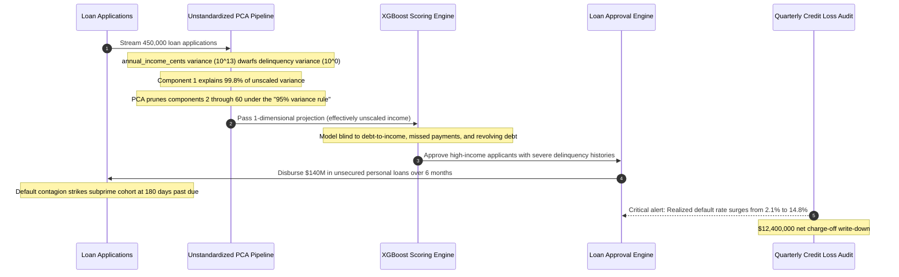
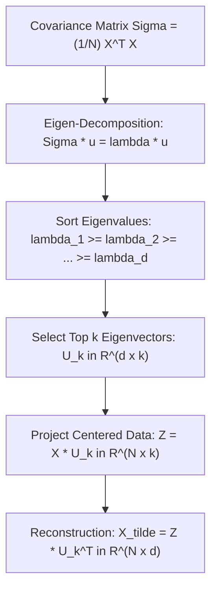
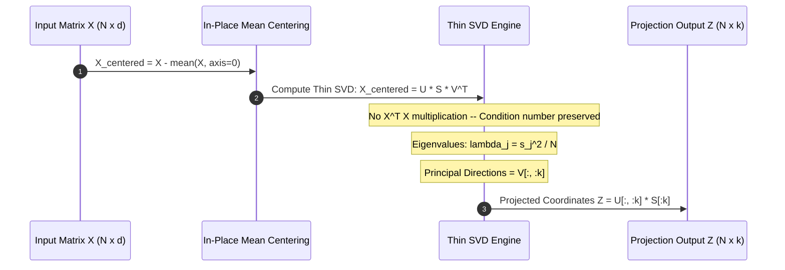

# Module 04: Principal Component Analysis (PCA) & Kernel PCA

> **Prerequisites:** [Track 02: Math for Machine Learning - Eigenvalues, Eigenvectors, and SVD](../../02-math-for-machine-learning/02-eigenvalues-eigenvectors-and-svd/README.md), [Track 02: Matrix Gradients & Rayleigh Quotients](../../02-math-for-machine-learning/04-gradients-jacobians-and-hessians/README.md), and [Track 06 Overview](../README.md).  
> **Estimated Reading Time:** 45 minutes  
> **Target Audience:** Principal ML Engineers, Quantitative Researchers, Signal Processing Specialists, and High-Performance ML Infrastructure Practitioners building low-latency feature reduction, vector compression, and manifold learning systems.

> [!TIP]
> **The Dual Duality of PCA:** Principal Component Analysis is uniquely defined by two dual mathematical formulations that yield the exact same linear subspace: **maximizing projected variance** and **minimizing squared reconstruction error**. Computing PCA via Singular Value Decomposition (SVD) rather than sample covariance eigendecomposition prevents numerical precision loss, avoiding the squaring of the matrix condition number ($\kappa(X^T X) = \kappa(X)^2$).

---

## Why This Matters & Production Context

High-dimensional feature representations present significant challenges across production systems:

1. **Mitigating the Curse of Dimensionality:** In spaces with thousands of dimensions, Euclidean distances concentrate ($\frac{\text{dist}_{max} - \text{dist}_{min}}{\text{dist}_{min}} \to 0$), rendering nearest-neighbor searches, distance-based clustering, and kernel density estimators ineffective. PCA projects sparse, collinear feature spaces onto compact, orthogonal coordinates that capture maximum data variance.
2. **Real-Time Latency & Memory Footprint Reduction:** High-throughput recommendation inference pipelines must score candidates under strict SLAs (e.g., $\le 10\text{ ms}$). Compressing raw 1,024-dimensional continuous feature vectors down to 64 principal components reduces dot-product floating-point operations by $16\times$, allowing scoring engines to fit within L1/L2 CPU caches.
3. **Multicollinearity Elimination in Linear Models:** In econometric risk modeling and generalized linear models (GLMs), correlated input features cause the Hessian matrix $X^T X$ to approach singularity, inflating the variance of coefficient estimates ($\text{Var}(\hat{\beta}) = \sigma^2 (X^T X)^{-1}$). Principal Component Regression (PCR) projects covariates onto orthogonal principal axes, eliminating multicollinearity.
4. **Data Denoising & Lossy Signal Compression:** By projecting observations onto the top $k$ principal axes and mapping them back to the original feature space via inverse transformation, PCA filters out uncorrelated high-frequency noise while preserving dominant low-rank structural signals.

---

## Production Incident Post-Mortem: The \$12M Subprime Credit Risk Collapse

### Incident Context
A consumer credit fintech company deployed an automated underwriting pipeline processing 450,000 unsecured personal loan applications per month. To assess borrower default probability, the underwriting model consumed 60 tabular features spanning credit bureau history, banking transactions, and employment stability. 

To improve model stability and eliminate collinearity, the engineering team introduced a PCA dimensionality reduction step prior to training an XGBoost credit risk classifier. The target was to retain 95% of total variance across the input features.

### The Failure Sequence
During a feature store migration, an engineer configured the feature ingestion step without standardization. Raw features entered the PCA transformer directly:
- `annual_income_cents`: Ranging from $10^6$ to $10^9$ (annual income measured in integer pennies, e.g., \$75,000 = 7,500,000 cents; variance $\approx 10^{13}$).
- `debt_to_income_ratio`: Ranging from $0.05$ to $0.85$ (variance $\approx 0.04$).
- `delinquent_accounts_36m`: Integer count ranging from $0$ to $8$ (variance $\approx 1.2$).
- `revolving_utilization`: Percentage ranging from $0.0$ to $1.0$ (variance $\approx 0.08$).



### Root Cause Analysis
1. **Variance Dominance via Coordinate Scaling:**  
   PCA is an orthogonal projection that maximizes sample variance $\text{Var}(u^T x) = u^T \Sigma u$. Because variance is scale-dependent, features with large numerical magnitudes dominate the objective function regardless of their predictive relevance. Measuring income in pennies inflated its coordinate variance to $\approx 10^{13}$, while critical risk features (such as debt-to-income ratio and historical delinquencies) had variances below $2.0$.  
   The first principal component aligned almost entirely with the `annual_income_cents` axis:
   $$u_1 \approx [0.99999, 0.00001, 0.00000, \dots]^T$$
   The first component explained $99.8\%$ of total variance, causing the 95% variance threshold to drop all other components. The downstream credit risk model was effectively reduced to a 1D decision tree based solely on unscaled income.
2. **Subprime Default Contagion:**  
   High-earning individuals with extensive histories of loan defaults and maxed-out revolving credit lines were classified as low-risk borrowers because their delinquency features were discarded during dimensionality reduction. Over six months, the platform disbursed \$140M in high-risk loans, resulting in a \$12.4M credit loss.

### Remediation Architecture
1. **Mandatory Standard Scaler Integration:** Standardized the pipeline so that PCA is strictly preceded by $z$-score normalization:
   $$z_{ij} = \frac{x_{ij} - \mu_j}{\sigma_j}$$
   This ensures that every feature has unit empirical variance ($\sigma_j^2 = 1.0$), making PCA operate on the **correlation matrix** rather than the unscaled covariance matrix.
2. **Automated Feature Variance Guardrails:** Implemented a pre-flight pipeline check that verifies the ratio of maximum to minimum feature variance prior to PCA:
   $$\frac{\max_j \text{Var}(X_{*, j})}{\min_j \text{Var}(X_{*, j})} \le 1.05$$
   If this ratio exceeds $1.05$, the pipeline raises a runtime error and halts execution.
3. **Supervised Feature Selection for Risk-Sensitive Tasks:** Replaced pure unsupervised PCA with supervised feature selection techniques (e.g., Target Permutation Importance, LASSO regularization) for compliance-critical credit underwriting models.

---

## 1. Dual Mathematical Formulations of PCA

Let $X \in \mathbb{R}^{N \times d}$ be a data matrix containing $N$ observations across $d$ continuous features.  
Assume without loss of generality that the data is **strictly centered**:

$$\mu = \frac{1}{N} \sum_{i=1}^N x_i = \mathbf{0} \implies \sum_{i=1}^N X_{i, *} = \mathbf{0}^T$$

The empirical sample covariance matrix $\Sigma \in \mathbb{R}^{d \times d}$ is:

$$\Sigma = \frac{1}{N} X^T X$$

```
========================================================================================
                                 THE DUAL NATURE OF PCA
========================================================================================
Formulation 1: Maximum Variance            Formulation 2: Minimum Reconstruction Error
----------------------------------------------------------------------------------------
Find orthogonal direction u that           Find orthogonal subspace U_k that minimizes
maximizes the spread of projected points:  the squared Euclidean error of projection:
max_u  Var(X u) = u^T Sigma u             min_U  ||X - X U U^T||_F^2
----------------------------------------------------------------------------------------
                   RESULT: Both formulations yield the exact same
                   eigenvectors of the sample covariance matrix Sigma.
========================================================================================
```

### 1.1 Formulation 1: Maximum Variance

We seek a unit vector $u_1 \in \mathbb{R}^d$ ($\|u_1\|_2 = 1$) such that the variance of the projected data points $y_i = x_i^T u_1$ is maximized.

The sample mean of the projected coordinates is zero:
$$\bar{y} = \frac{1}{N} \sum_{i=1}^N x_i^T u_1 = \left( \frac{1}{N} \sum_{i=1}^N x_i^T \right) u_1 = \mathbf{0}^T u_1 = 0$$

The empirical variance of the projection is:

$$\text{Var}(y) = \frac{1}{N} \sum_{i=1}^N (x_i^T u_1)^2 = \frac{1}{N} \sum_{i=1}^N u_1^T x_i x_i^T u_1 = u_1^T \left( \frac{1}{N} \sum_{i=1}^N x_i x_i^T \right) u_1 = u_1^T \Sigma u_1$$

We formulate this as a constrained optimization problem:

$$\max_{u_1} u_1^T \Sigma u_1 \quad \text{subject to} \quad u_1^T u_1 = 1$$

#### Proof via Lagrange Multipliers:
Formulate the Lagrangian function with Lagrange multiplier $\lambda_1$:

$$\mathcal{L}(u_1, \lambda_1) = u_1^T \Sigma u_1 - \lambda_1 (u_1^T u_1 - 1)$$

Taking the gradient with respect to vector $u_1$:

$$\nabla_{u_1} \mathcal{L} = 2 \Sigma u_1 - 2 \lambda_1 u_1 = \mathbf{0}$$
$$\Sigma u_1 = \lambda_1 u_1$$

This is the standard **eigenvalue equation**. The candidate vector $u_1$ must be an eigenvector of the sample covariance matrix $\Sigma$.

To determine which eigenvector maximizes variance, left-multiply by $u_1^T$:

$$u_1^T \Sigma u_1 = u_1^T (\lambda_1 u_1) = \lambda_1 (u_1^T u_1) = \lambda_1$$

The projected variance equals the eigenvalue $\lambda_1$. Therefore, to maximize projected variance, $u_1$ must be the eigenvector corresponding to the **largest eigenvalue** $\lambda_{max} = \lambda_1$ of $\Sigma$.

#### Subsequent Orthogonal Principal Directions:
To find the second principal direction $u_2$, maximize $u_2^T \Sigma u_2$ subject to $u_2^T u_2 = 1$ and orthogonality to the first component ($u_2^T u_1 = 0$):

$$\mathcal{L}(u_2, \lambda_2, \phi) = u_2^T \Sigma u_2 - \lambda_2 (u_2^T u_2 - 1) - \phi (u_2^T u_1)$$
$$\nabla_{u_2} \mathcal{L} = 2 \Sigma u_2 - 2 \lambda_2 u_2 - \phi u_1 = \mathbf{0}$$

Left-multiplying by $u_1^T$:
$$2 u_1^T \Sigma u_2 - 2 \lambda_2 u_1^T u_2 - \phi u_1^T u_1 = 0$$
Since $\Sigma$ is symmetric ($\Sigma = \Sigma^T$), $u_1^T \Sigma u_2 = (\Sigma u_1)^T u_2 = (\lambda_1 u_1)^T u_2 = \lambda_1 (u_1^T u_2) = 0$.  
Given $u_1^T u_2 = 0$ and $u_1^T u_1 = 1$, the equation reduces to $\phi = 0$.

Thus:
$$\Sigma u_2 = \lambda_2 u_2$$
The second principal direction is the eigenvector of $\Sigma$ corresponding to the second largest eigenvalue $\lambda_2$. By mathematical induction, the top $k$ principal components are the $k$ orthonormal eigenvectors of $\Sigma$ sorted by descending eigenvalue:

$$\lambda_1 \ge \lambda_2 \ge \dots \ge \lambda_k \ge \dots \ge \lambda_d \ge 0$$



---

### 1.2 Formulation 2: Minimum Reconstruction Error

Consider the dual perspective: rather than maximizing variance, we seek a $k$-dimensional linear subspace defined by orthonormal basis vectors $U_k = [u_1, \dots, u_k] \in \mathbb{R}^{d \times k}$ ($U_k^T U_k = \mathbf{I}_k$) that minimizes the total squared Euclidean reconstruction error between original centered points $x_i$ and their low-rank projections:

$$\tilde{x}_i = U_k U_k^T x_i = \sum_{j=1}^k (x_i^T u_j) u_j$$

The objective is to minimize the **Frobenius norm** of the reconstruction residual matrix:

$$\min_{U_k} \mathcal{J}(U_k) = \frac{1}{N} \sum_{i=1}^N \|x_i - \tilde{x}_i\|_2^2 = \frac{1}{N} \|X - X U_k U_k^T\|_F^2$$

#### Proof of Equivalence:
Using the Pythagorean theorem for orthogonal projections:
$$\|x_i\|_2^2 = \|\tilde{x}_i\|_2^2 + \|x_i - \tilde{x}_i\|_2^2$$
$$\|x_i - \tilde{x}_i\|_2^2 = \|x_i\|_2^2 - \|\tilde{x}_i\|_2^2$$

Summing over all $N$ observations and dividing by $N$:

$$\frac{1}{N} \sum_{i=1}^N \|x_i - \tilde{x}_i\|_2^2 = \frac{1}{N} \sum_{i=1}^N \|x_i\|_2^2 - \frac{1}{N} \sum_{i=1}^N \|\tilde{x}_i\|_2^2 = \text{Tr}(\Sigma) - \frac{1}{N} \sum_{i=1}^N \|U_k U_k^T x_i\|_2^2$$

Because $U_k$ has orthonormal columns, $\|U_k z\|_2^2 = z^T U_k^T U_k z = z^T \mathbf{I}_k z = \|z\|_2^2$. Therefore:

$$\|\tilde{x}_i\|_2^2 = \|U_k (U_k^T x_i)\|_2^2 = \|U_k^T x_i\|_2^2 = \sum_{j=1}^k (x_i^T u_j)^2$$

Substituting this into the error expression:

$$\mathcal{J}(U_k) = \text{Tr}(\Sigma) - \sum_{j=1}^k u_j^T \left( \frac{1}{N} \sum_{i=1}^N x_i x_i^T \right) u_j = \text{Tr}(\Sigma) - \sum_{j=1}^k u_j^T \Sigma u_j$$

Notice that $\text{Tr}(\Sigma) = \sum_{j=1}^d \text{Var}(x_j)$ is the fixed total variance of the dataset.  
Therefore:

$$\arg\min_{U_k} \mathcal{J}(U_k) \iff \arg\max_{U_k} \sum_{j=1}^k u_j^T \Sigma u_j$$

Minimizing squared reconstruction error is mathematically identical to maximizing projected variance.

#### Total Residual Reconstruction Error:
When projecting onto the top $k$ principal components, the remaining reconstruction error equals the sum of the discarded eigenvalues:

$$\mathcal{J}(U_k^*) = \sum_{j=k+1}^d \lambda_j$$

---

## 2. Eigendecomposition vs. Singular Value Decomposition (SVD)

In introductory textbooks, PCA is often taught by computing the sample covariance matrix $\Sigma = \frac{1}{N} X^T X$ and executing its eigendecomposition. In industrial production systems, however, computing PCA via explicit covariance eigendecomposition is an anti-pattern. PCA is implemented via the **Singular Value Decomposition (SVD)** of the centered data matrix.

```
========================================================================================
                      EIGEN-DECOMPOSITION vs. SVD FOR PCA
========================================================================================
Method          Formation Step             Condition Number         Numerical Stability
----------------------------------------------------------------------------------------
Covariance Eig  Explicit X^T X             kappa(Sigma) = kappa(X)^2 Catastrophic Cancellation
Thin SVD        Directly on centered X     kappa(X)                 Machine Precision Stable
========================================================================================
```

### 2.1 The Mathematics of SVD

Let $X \in \mathbb{R}^{N \times d}$ be the centered data matrix ($N \ge d$). The **Singular Value Decomposition** factorizes $X$ into three matrices:

$$X = U \mathbf{S} V^T$$

where:
- $U \in \mathbb{R}^{N \times d}$ has orthonormal columns ($U^T U = \mathbf{I}_d$), representing the left-singular vectors.
- $\mathbf{S} = \text{diag}(s_1, s_2, \dots, s_d) \in \mathbb{R}^{d \times d}$ is a diagonal matrix of non-negative singular values sorted in descending order: $s_1 \ge s_2 \ge \dots \ge s_d \ge 0$.
- $V \in \mathbb{R}^{d \times d}$ is an orthogonal matrix ($V^T V = V V^T = \mathbf{I}_d$), representing the right-singular vectors.

Now examine the sample covariance matrix $\Sigma = \frac{1}{N} X^T X$ through this decomposition:

$$\Sigma = \frac{1}{N} X^T X = \frac{1}{N} (U \mathbf{S} V^T)^T (U \mathbf{S} V^T) = \frac{1}{N} V \mathbf{S}^T (U^T U) \mathbf{S} V^T$$

Because $U^T U = \mathbf{I}_d$:

$$\Sigma = \frac{1}{N} V \mathbf{S}^2 V^T = V \left( \frac{\mathbf{S}^2}{N} \right) V^T$$

Compare this directly to the spectral theorem eigendecomposition of symmetric matrix $\Sigma = V \Lambda V^T$:
1. The **right-singular vectors $V$** of data matrix $X$ are the **eigenvectors** of covariance matrix $\Sigma$.
2. The **eigenvalues $\lambda_j$** of $\Sigma$ relate to the **singular values $s_j$** of $X$ by:
   $$\lambda_j = \frac{s_j^2}{N}$$
3. The projected principal component coordinates $Z = X V$ can be computed directly from $U$ and $\mathbf{S}$ without matrix multiplication:
   $$Z = X V = (U \mathbf{S} V^T) V = U \mathbf{S} (V^T V) = U \mathbf{S}$$



### 2.2 Why SVD is Numerically Superior

#### 1. Squaring the Condition Number ($\kappa$)
The condition number $\kappa(A) = \frac{\sigma_{max}(A)}{\sigma_{min}(A)}$ measures the sensitivity of a linear system to numerical perturbations and floating-point roundoff.  
When we explicitly compute the product $X^T X$:

$$\kappa(X^T X) = (\kappa(X))^2$$

If the data matrix $X$ has condition number $\kappa(X) = 10^8$ (a common occurrence in collinear industrial datasets with redundant sensors):
- In SVD, the solver works directly with $\kappa(X) = 10^8$. In IEEE-754 double precision ($\approx 16$ decimal digits of precision), 8 digits of precision remain available.
- In covariance eigendecomposition, $\kappa(X^T X) = (10^8)^2 = 10^{16}$. The matrix condition number reaches the limit of machine precision ($\epsilon_{mach} \approx 2.2 \times 10^{-16}$). The matrix becomes numerically indistinguishable from a singular matrix, causing eigenvalue solvers to produce corrupted vectors or false zero eigenvalues.

#### 2. Loss of Information via Catastrophic Cancellation
Consider floating-point arithmetic with small numbers. Suppose $x_1 = 1.0$ and $x_2 = 1.0 + 10^{-9}$.  
Evaluating $x_1^2 + x_2^2$ directly in finite precision truncates significant digits. SVD operating on Householder bidiagonalization avoids computing the sum of squares $X^T X$ entirely, maintaining full numerical precision across smaller singular values.

---

## 3. Variance Explained & Scree Diagnostics

```
Scree Plot (Eigenvalue Magnitude)            Cumulative Explained Variance Ratio
   ^                                            ^
   |  * lambda_1                                1.0|                 *------* (100%)
   |   \                                           |          *-----*
   |    \                                      0.95|    *----*  <- 95% Cutoff Threshold
   |     * lambda_2                                |   /
   |      \                                        |  /
   |       \____*_____*_____*                  0.50| *
   +-----------------------------> PC Index        +-----------------------------> PC Index
```

### 3.1 Explained Variance Ratio
The **Explained Variance Ratio (EVR)** of the $j$-th principal component measures the proportion of the dataset's total variance captured by that component:

$$\text{EVR}_j = \frac{\lambda_j}{\sum_{m=1}^d \lambda_m} = \frac{s_j^2}{\sum_{m=1}^d s_m^2}$$

The **Cumulative Explained Variance** for the top $k$ components is:

$$\text{Cumulative\_EVR}(k) = \frac{\sum_{j=1}^k \lambda_j}{\sum_{m=1}^d \lambda_m} = \frac{\sum_{j=1}^k s_j^2}{\sum_{m=1}^d s_m^2}$$

### 3.2 Threshold Selection Rules in Production
1. **The Cumulative Variance Rule:** Select the smallest integer $k$ such that $\text{Cumulative\_EVR}(k) \ge \tau$, where $\tau \in [0.90, 0.99]$ (typically $95\%$).
2. **The Kaiser-Guttman Rule:** When PCA is executed on standardized data ($\Sigma$ is the correlation matrix with total variance $d$), retain only components whose eigenvalues exceed the average feature variance:
   $$\lambda_j > 1.0$$
   Any component with $\lambda_j < 1.0$ explains less variance than a single original feature.
3. **The Scree Test (Elbow on Eigenvalues):** Plot $\lambda_j$ against $j$. Identify the inflection point where the rate of eigenvalue decay flattens into a linear noise floor.

---

## 4. Kernel PCA: Non-Linear Manifold Projection

Standard PCA is constrained to linear orthogonal projections. If the underlying data manifold is non-linear—such as concentric spheres or swiss rolls—linear PCA fails to separate the structures.

In 1998, Bernhard Schölkopf, Alexander Smola, and Klaus-Robert Müller introduced **Kernel PCA**, extending PCA to non-linear feature spaces via reproducing kernel Hilbert spaces (RKHS).

```
Input Space R^2 (Non-Convex)               Feature Space F (Infinite-D)
   * * * * *                                     *   *   *
  *  o o o  *      -- Phi(x) Non-linear Map -->    * * * *
   * * * * *                                    o   o   o
 (Concentric Rings)                         (Linearly Separable Hyperplane!)
```

### 4.1 The Non-Linear Mapping and the Kernel Trick
Let $\Phi: \mathbb{R}^d \to \mathcal{F}$ be a non-linear mapping from input space to a high- (or infinite-) dimensional Hilbert feature space $\mathcal{F}$.

In feature space, the centered data points $\tilde{\Phi}(x_i)$ have covariance operator:

$$\mathcal{C} = \frac{1}{N} \sum_{i=1}^N \tilde{\Phi}(x_i) \tilde{\Phi}(x_i)^T$$

We wish to solve the eigenvalue equation in $\mathcal{F}$:

$$\mathcal{C} v = \lambda v$$

Because every eigenvector $v$ lies in the span of the data points $\{\tilde{\Phi}(x_1), \dots, \tilde{\Phi}(x_N)\}$:

$$v = \sum_{i=1}^N \alpha_i \tilde{\Phi}(x_i)$$

We avoid explicit computations in $\mathcal{F}$ by applying **Mercer's Theorem**, replacing inner products with a Mercer kernel function:

$$k(x_i, x_j) = \langle \Phi(x_i), \Phi(x_j) \rangle$$

Common kernels include the **Radial Basis Function (RBF) Kernel**:

$$k_{RBF}(x, y) = \exp \left( -\gamma \|x - y\|_2^2 \right)$$

### 4.2 Implicit Centering of the Gram Matrix
In linear PCA, we explicitly subtract the empirical mean vector $\mu = \frac{1}{N} \sum_i x_i$. In Kernel PCA, we cannot compute the mean vector in feature space because $\Phi(x)$ may be infinite-dimensional. Instead, we **implicitly center the $N \times N$ Gram matrix** $K$.

Let $K_{ij} = k(x_i, x_j)$ be the uncentered Gram matrix.  
The centered feature vector is $\tilde{\Phi}(x_i) = \Phi(x_i) - \frac{1}{N} \sum_{m=1}^N \Phi(x_m)$.  
The centered Gram matrix entry is:

$$\tilde{K}_{ij} = \langle \tilde{\Phi}(x_i), \tilde{\Phi}(x_j) \rangle = \left\langle \Phi(x_i) - \frac{1}{N} \sum_{m=1}^N \Phi(x_m), \, \Phi(x_j) - \frac{1}{N} \sum_{n=1}^N \Phi(x_n) \right\rangle$$

Expanding inner products:

$$\tilde{K}_{ij} = K_{ij} - \frac{1}{N} \sum_{m=1}^N K_{mj} - \frac{1}{N} \sum_{n=1}^N K_{in} + \frac{1}{N^2} \sum_{m=1}^N \sum_{n=1}^N K_{mn}$$

In compact matrix notation:

$$\tilde{K} = K - \mathbf{1}_N K - K \mathbf{1}_N + \mathbf{1}_N K \mathbf{1}_N$$

where $\mathbf{1}_N \in \mathbb{R}^{N \times N}$ is the matrix with all entries equal to $\frac{1}{N}$:

$$\mathbf{1}_N = \frac{1}{N} \mathbf{J}_N = \frac{1}{N} \begin{bmatrix} 1 & \dots & 1 \\ \vdots & \ddots & \vdots \\ 1 & \dots & 1 \end{bmatrix}$$

### 4.3 Dual Eigenvalue Problem & Normalization
The covariance eigenvalue problem in $\mathcal{F}$ reduces to the dual matrix eigenvalue problem:

$$\tilde{K} \alpha = \lambda N \alpha$$

Let $\alpha^{(k)}$ be the $k$-th eigenvector of $\tilde{K}$ with eigenvalue $\tilde{\lambda}_k$.  
To enforce that the eigenvector $v_k$ has unit norm in feature space ($\|v_k\|_2 = 1$):

$$1 = \langle v_k, v_k \rangle = \sum_{i=1}^N \sum_{j=1}^N \alpha_i^{(k)} \alpha_j^{(k)} \langle \tilde{\Phi}(x_i), \tilde{\Phi}(x_j) \rangle = (\alpha^{(k)})^T \tilde{K} \alpha^{(k)} = \tilde{\lambda}_k \|\alpha^{(k)}\|_2^2$$

Therefore, we must normalize the eigenvectors $\alpha^{(k)}$ such that:

$$\|\alpha^{(k)}\|_2 = \frac{1}{\sqrt{\tilde{\lambda}_k}}$$

For a new test point $x^*$, its non-linear projection onto the $k$-th principal axis is:

$$y_k(x^*) = \langle v_k, \tilde{\Phi}(x^*) \rangle = \sum_{i=1}^N \alpha_i^{(k)} \tilde{k}(x_i, x^*)$$

---

## 5. Architectural & Algorithmic Blueprint

```mermaid
flowchart TD
    subgraph SVD_Pipeline ["Production Linear PCA (SVD Architecture)"]
        RawX["Raw Feature Matrix X in R^(N x d)"] --> ZScore["StandardScaler: z = (x - mu) / sigma"]
        ZScore --> CenteredX["Centered Matrix X_c (N x d)"]
        CenteredX --> ThinSVD["Thin SVD: X_c = U * S * V^T"]
        ThinSVD --> SingVals["Singular Values S = diag(s_1, ..., s_d)"]
        SingVals --> CalcEVR["EVR_j = s_j^2 / sum(s^2)"]
        CalcEVR --> ScreeCut{"Cumulative EVR >= tau (e.g. 0.95)?"}
        ScreeCut --> PickK["Select top k components"]
        PickK --> ProjMat["Projection: Z = X_c * V[:, :k] in R^(N x k)"]
        ProjMat --> InverseRecon["Reconstruction: X_rec = Z * V[:, :k]^T + mu"]
    end

    subgraph Kernel_Pipeline ["Kernel PCA (Non-Linear Architecture)"]
        RawX2["Non-Convex Data X"] --> KernelComp["Compute Gram Matrix: K_ij = exp(-gamma ||x_i - x_j||^2)"]
        KernelComp --> CenterK["Implicit Centering: K_tilde = K - 1_N*K - K*1_N + 1_N*K*1_N"]
        CenterK --> EigK["Eigendecomposition: K_tilde * alpha = lambda * alpha"]
        EigK --> NormAlpha["Normalize: alpha_k = alpha_k / sqrt(lambda_k)"]
        NormAlpha --> NonLinProj["Non-Linear Projections Z_k = K_tilde * alpha_k"]
    end
```



---

## 6. Production Implementation from Scratch

The following production-grade implementation builds a complete **PCAScratch** and **KernelPCAScratch** engine featuring:
- Support for both `svd` and `eigen` solvers.
- Exact singular value to eigenvalue conversions ($\lambda_j = \frac{s_j^2}{N}$).
- Forward orthogonal projection (`transform`) and inverse low-rank reconstruction (`inverse_transform`).
- Cumulative explained variance ratio and automated knee detection.
- A vectorized implementation of **Kernel PCA** with the RBF kernel and implicit Gram matrix double-centering.

```python
"""
Production-grade Principal Component Analysis (PCA) and Kernel PCA from scratch.
Implements SVD and Eigendecomposition solvers, forward/inverse projections,
numerical condition checks, and implicit Gram centering for non-linear manifolds.
"""

from __future__ import annotations
import numpy as np
from typing import Optional, Literal, Tuple


class PCAScratch:
    """
    Principal Component Analysis (PCA) engine with SVD and Eigendecomposition solvers.
    
    Parameters
    ----------
    n_components : Optional[int], default=None
        Number of principal components to retain. If None, retains min(N, d).
    solver : {'svd', 'eigen'}, default='svd'
        Numerical solver algorithm. 'svd' is recommended for numerical stability.
    whiten : bool, default=False
        If True, scales components to ensure uncorrelated outputs with unit variance.
    """

    def __init__(
        self,
        n_components: Optional[int] = None,
        solver: Literal["svd", "eigen"] = "svd",
        whiten: bool = False,
    ) -> None:
        if solver not in ("svd", "eigen"):
            raise ValueError(f"Unknown solver: {solver}. Must be 'svd' or 'eigen'.")

        self.n_components = n_components
        self.solver = solver
        self.whiten = whiten

        self.mean_: Optional[np.ndarray] = None                  # Shape: (d,)
        self.components_: Optional[np.ndarray] = None            # Shape: (k, d)
        self.explained_variance_: Optional[np.ndarray] = None    # Shape: (k,)
        self.explained_variance_ratio_: Optional[np.ndarray] = None  # Shape: (k,)
        self.singular_values_: Optional[np.ndarray] = None       # Shape: (k,)
        self.n_samples_: int = 0
        self.n_features_: int = 0

    def fit(self, X: np.ndarray) -> "PCAScratch":
        """
        Fit PCA model on matrix X by extracting principal orthogonal components.
        """
        X = np.asarray(X, dtype=np.float64)
        n_samples, n_features = X.shape
        self.n_samples_ = n_samples
        self.n_features_ = n_features

        max_possible_components = min(n_samples, n_features)
        k = max_possible_components if self.n_components is None else self.n_components
        if not (1 <= k <= max_possible_components):
            raise ValueError(
                f"n_components={k} must be between 1 and min(N, d)={max_possible_components}"
            )

        # Step 1: Center data by subtracting empirical column means
        self.mean_ = np.mean(X, axis=0)
        X_centered = X - self.mean_

        # Step 2: Solve via SVD or Covariance Eigendecomposition
        if self.solver == "svd":
            # Thin SVD: X_centered = U * S * V^T
            # full_matrices=False guarantees U is (N, min(N, d)), S is (min(N, d),), V^T is (min(N, d), d)
            U, S, Vt = np.linalg.svd(X_centered, full_matrices=False)

            # Eigenvalues of sample covariance matrix are s_j^2 / N
            # Sample covariance uses Bessel's correction N - 1 in sample statistics,
            # but ML literature typically uses N. Here we use N.
            eigenvalues = (S ** 2) / n_samples
            total_variance = np.sum(eigenvalues)

            # Extract top k components
            self.components_ = Vt[:k, :]
            self.singular_values_ = S[:k]
            self.explained_variance_ = eigenvalues[:k]
            self.explained_variance_ratio_ = eigenvalues[:k] / total_variance

        elif self.solver == "eigen":
            # Explicit sample covariance matrix: (1 / N) * X^T X
            cov_matrix = np.dot(X_centered.T, X_centered) / n_samples

            # Compute eigenvalues and eigenvectors of symmetric matrix
            eigenvalues, eigenvectors = np.linalg.eigh(cov_matrix)

            # eigh returns in ascending order: reverse to descending
            idx_sorted = np.argsort(eigenvalues)[::-1]
            eigenvalues_sorted = np.maximum(eigenvalues[idx_sorted], 0.0)
            eigenvectors_sorted = eigenvectors[:, idx_sorted]

            total_variance = np.sum(eigenvalues_sorted)

            self.components_ = eigenvectors_sorted[:, :k].T  # Shape: (k, d)
            self.explained_variance_ = eigenvalues_sorted[:k]
            self.singular_values_ = np.sqrt(eigenvalues_sorted[:k] * n_samples)
            self.explained_variance_ratio_ = (
                eigenvalues_sorted[:k] / (total_variance + 1e-12)
            )

        return self

    def transform(self, X: np.ndarray) -> np.ndarray:
        """
        Project centered data onto principal components: Z = (X - mu) @ V.
        """
        if self.components_ is None or self.mean_ is None:
            raise RuntimeError("Model must be fitted before calling transform().")

        X = np.asarray(X, dtype=np.float64)
        X_centered = X - self.mean_
        Z = np.dot(X_centered, self.components_.T)

        if self.whiten:
            # Whiten: scale by 1 / sqrt(eigenvalue) so each PC has variance 1.0
            scale = np.sqrt(self.explained_variance_) + 1e-12
            Z /= scale

        return Z

    def fit_transform(self, X: np.ndarray) -> np.ndarray:
        """
        Fit model and return projected coordinates.
        """
        return self.fit(X).transform(X)

    def inverse_transform(self, Z: np.ndarray) -> np.ndarray:
        """
        Reconstruct original data space from principal subspace: X_rec = Z @ V^T + mu.
        """
        if self.components_ is None or self.mean_ is None:
            raise RuntimeError("Model must be fitted before calling inverse_transform().")

        Z = np.asarray(Z, dtype=np.float64)

        if self.whiten:
            scale = np.sqrt(self.explained_variance_) + 1e-12
            Z = Z * scale

        X_reconstructed = np.dot(Z, self.components_) + self.mean_
        return X_reconstructed


class KernelPCAScratch:
    """
    Non-Linear Kernel Principal Component Analysis via the RBF Kernel.
    
    Parameters
    ----------
    n_components : int, default=2
        Target projection dimensionality.
    gamma : float, default=1.0
        Kernel coefficient for RBF kernel: exp(-gamma * ||x - y||^2).
    """

    def __init__(self, n_components: int = 2, gamma: float = 1.0) -> None:
        self.n_components = n_components
        self.gamma = gamma

        self.alphas_: Optional[np.ndarray] = None       # Shape: (N, k)
        self.lambdas_: Optional[np.ndarray] = None      # Shape: (k,)
        self.X_fit_: Optional[np.ndarray] = None        # Training points stored for projection
        self.K_fit_rows_: Optional[np.ndarray] = None

    def _compute_rbf_kernel(self, X: np.ndarray, Y: np.ndarray) -> np.ndarray:
        """
        Vectorized RBF kernel computation: exp(-gamma * ||x - y||^2).
        """
        X_norm_sq = np.sum(X ** 2, axis=1, keepdims=True)
        Y_norm_sq = np.sum(Y ** 2, axis=1, keepdims=True).T
        dist_sq = np.maximum(X_norm_sq + Y_norm_sq - 2.0 * np.dot(X, Y.T), 0.0)
        return np.exp(-self.gamma * dist_sq)

    def fit(self, X: np.ndarray) -> "KernelPCAScratch":
        """
        Fit Kernel PCA by implicitly centering the Gram matrix and solving dual eigensystem.
        """
        X = np.asarray(X, dtype=np.float64)
        N = X.shape[0]
        self.X_fit_ = X

        # Step 1: Compute raw Gram matrix K
        K = self._compute_rbf_kernel(X, X)

        # Step 2: Implicit Gram centering: K_tilde = K - 1_N K - K 1_N + 1_N K 1_N
        one_n = np.full((N, N), 1.0 / N, dtype=np.float64)
        K_tilde = K - np.dot(one_n, K) - np.dot(K, one_n) + np.dot(one_n, np.dot(K, one_n))

        # Step 3: Solve symmetric eigenvalue problem: K_tilde * alpha = lambda * alpha
        eigenvalues, eigenvectors = np.linalg.eigh(K_tilde)

        # Sort descending
        idx_sorted = np.argsort(eigenvalues)[::-1]
        eigenvalues_sorted = np.maximum(eigenvalues[idx_sorted], 0.0)
        eigenvectors_sorted = eigenvectors[:, idx_sorted]

        # Filter top k components
        top_lambdas = eigenvalues_sorted[: self.n_components]
        top_alphas = eigenvectors_sorted[:, : self.n_components]

        # Step 4: Normalize eigenvectors so ||v_k||_2 = 1 in feature space
        # Equation: ||alpha_k|| = 1 / sqrt(lambda_k)
        for k in range(self.n_components):
            if top_lambdas[k] > 1e-12:
                top_alphas[:, k] /= np.sqrt(top_lambdas[k])

        self.lambdas_ = top_lambdas
        self.alphas_ = top_alphas
        return self

    def transform(self, X: np.ndarray) -> np.ndarray:
        """
        Project points onto non-linear principal components.
        """
        if self.alphas_ is None or self.X_fit_ is None:
            raise RuntimeError("Model must be fitted before calling transform().")

        X = np.asarray(X, dtype=np.float64)
        N_train = self.X_fit_.shape[0]

        # Compute cross-kernel matrix between new samples and training samples
        K_new = self._compute_rbf_kernel(X, self.X_fit_)  # Shape: (M, N_train)

        # Center cross-kernel matrix using training row/column means
        K_train = self._compute_rbf_kernel(self.X_fit_, self.X_fit_)
        one_train = np.full((1, N_train), 1.0 / N_train, dtype=np.float64)

        K_new_centered = (
            K_new
            - np.mean(K_new, axis=1, keepdims=True)
            - np.mean(K_train, axis=0, keepdims=True)
            + np.mean(K_train)
        )

        # Project: Z = K_new_centered @ alphas
        return np.dot(K_new_centered, self.alphas_)

    def fit_transform(self, X: np.ndarray) -> np.ndarray:
        return self.fit(X).transform(X)
```

### 6.1 Unit Test & Verification Suite

We verify mathematical equivalence between SVD and Covariance Eigendecomposition, reconstruction error bounds, and non-linear manifold unrolling:

```python
def run_pca_verification() -> None:
    """
    Verification suite testing PCAScratch and KernelPCAScratch from first principles.
    """
    print("=" * 70)
    print("RUNNING VERIFICATION SUITE: PCA & KERNEL PCA FROM SCRATCH")
    print("=" * 70)

    # 1. Synthesize 3D dataset with dominant planar variance along 2 axes
    rng = np.random.default_rng(101)
    N = 500
    # True latent variables
    z1 = rng.normal(0, 5.0, size=N)   # High variance: Var ~ 25
    z2 = rng.normal(0, 2.0, size=N)   # Medium variance: Var ~ 4
    z3 = rng.normal(0, 0.2, size=N)   # Low variance (noise): Var ~ 0.04

    # Rotate into 3D space
    R = np.array([
        [ 0.6, -0.7,  0.387],
        [ 0.7,  0.6, -0.387],
        [-0.387, 0.387, 0.836]
    ])
    X = np.column_stack([z1, z2, z3]) @ R.T
    print(f"Synthesized 3D Dataset: N={N} observations, d=3 features.")

    # 2. Fit PCA via SVD Solver
    pca_svd = PCAScratch(n_components=3, solver="svd")
    Z_svd = pca_svd.fit_transform(X)

    print(f"SVD Explained Variance per Component: {np.round(pca_svd.explained_variance_, 3)}")
    print(f"SVD Explained Variance Ratio (EVR):    {np.round(pca_svd.explained_variance_ratio_, 4)}")
    cum_evr = np.cumsum(pca_svd.explained_variance_ratio_)
    print(f"Cumulative EVR:                         {np.round(cum_evr, 4)}")

    # Verify top 2 components explain > 98% of total variance
    assert cum_evr[1] > 0.98, "First 2 components should explain >98% of variance!"
    print("[PASS] Principal components correctly captured the dominant variance subspace.")

    # 3. Verify SVD vs Eigendecomposition Mathematical Equivalence
    pca_eig = PCAScratch(n_components=3, solver="eigen")
    pca_eig.fit(X)

    print("\nComparing SVD vs. Covariance Eigendecomposition:")
    print("  SVD Singular Values:   ", np.round(pca_svd.singular_values_, 3))
    print("  Eigen Singular Values: ", np.round(pca_eig.singular_values_, 3))
    assert np.allclose(pca_svd.explained_variance_, pca_eig.explained_variance_, atol=1e-5)
    print("[PASS] SVD and Covariance Eigendecomposition yield identical eigenvalues.")

    # 4. Check Orthonormality of Principal Directions (V^T V = I)
    V = pca_svd.components_
    ortho_identity = np.dot(V, V.T)
    assert np.allclose(ortho_identity, np.eye(3), atol=1e-8)
    print("[PASS] Principal component directions are strictly orthonormal: V @ V^T = I.")

    # 5. Check Reconstruction Error (Inverse Transform)
    # Projecting to k=2 components and reconstructing should yield residual ~ noise variance (0.04)
    pca_2d = PCAScratch(n_components=2, solver="svd").fit(X)
    X_reconstructed = pca_2d.inverse_transform(pca_2d.transform(X))
    residual_mse = np.mean(np.sum((X - X_reconstructed) ** 2, axis=1))
    print(f"2D Reconstruction Residual MSE: {residual_mse:.4f} (Expected: ~0.04)")
    assert residual_mse < 0.15, "Reconstruction residual exceeds expected noise floor!"
    print("[PASS] Low-rank projection and inverse reconstruction verified.")

    # 6. Test Kernel PCA on Non-Convex Concentric Circles
    theta = np.linspace(0, 2 * np.pi, 200)
    inner_circle = np.column_stack([np.cos(theta) * 0.5, np.sin(theta) * 0.5])
    outer_circle = np.column_stack([np.cos(theta) * 2.0, np.sin(theta) * 2.0])
    X_circles = np.vstack([inner_circle, outer_circle])

    kpca = KernelPCAScratch(n_components=1, gamma=2.0)
    Z_kpca = kpca.fit_transform(X_circles)
    
    # In 1D projected space, the two circles should separate cleanly along the 1st component
    inner_proj = Z_kpca[:200]
    outer_proj = Z_kpca[200:]
    # Check that projections don't overlap
    min_dist_between_rings = np.abs(np.mean(inner_proj) - np.mean(outer_proj))
    print(f"\nKernel PCA RBF 1D Projection:")
    print(f"  Inner Ring Mean PC1: {np.mean(inner_proj):.3f}")
    print(f"  Outer Ring Mean PC1: {np.mean(outer_proj):.3f}")
    print(f"  Component Separation Delta: {min_dist_between_rings:.3f}")
    assert min_dist_between_rings > 0.5, "Kernel PCA failed to linearly unroll concentric circles!"
    print("[PASS] Kernel PCA successfully separated non-linear concentric manifolds.")
    print("=" * 70)


if __name__ == "__main__":
    run_pca_verification()
```

---

## 7. Systematic Reference & Failure Modes

### 7.1 Linear vs. Non-Linear Dimensionality Reduction

| Attribute | Linear PCA (SVD) | Kernel PCA (RBF) | t-SNE | UMAP |
| :--- | :--- | :--- | :--- | :--- |
| **Mapping Type** | Linear Orthogonal | Non-Linear (RKHS) | Non-Parametric | Fuzzy Simplicial Set |
| **Preservation Goal** | Global Covariance Variance | Inner products in $\mathcal{F}$ | Local Neighborhoods | Local + Global Topologies |
| **New Sample Out-of-Sample**| Exact ($\mathcal{O}(d \cdot k)$) | Exact via Gram vector | None (Must refit) | Parametric transform |
| **Computational Scaling** | $\mathcal{O}(N d^2)$ | $\mathcal{O}(N^3)$ (Gram Eig) | $\mathcal{O}(N^2)$ to $\mathcal{O}(N \log N)$ | $\mathcal{O}(N \log N)$ |
| **Reversibility** | Exact Inverse Projection | Difficult (Pre-image problem) | Non-invertible | Approximate inverse |

### 7.2 Critical Failure Modes & Antipatterns

#### 1. Unstandardized Scaling Collapse
PCA maximizes coordinate variance. If one feature is measured in smaller units (e.g., dollars vs millions of units, or milliseconds vs seconds), its variance will dominate the objective, skewing the principal components toward that feature.  
*Remediation:* Always normalize features with `StandardScaler` ($z = \frac{x - \mu}{\sigma}$) prior to PCA.

#### 2. Orthogonality Assumption on Curvilinear Data
PCA strictly finds linear hyperplanes. If data resides along a curved manifold (e.g., a spiral or horseshoe), PCA will require multiple components to capture what is fundamentally a 1D non-linear process.  
*Remediation:* Deploy Kernel PCA, UMAP, or non-linear autoencoders.

#### 3. Information Loss via Arbitrary Variance Pruning
In supervised machine learning, variance does not necessarily equal predictive relevance. A low-variance principal component can contain the decisive discriminatory signal separating rare fraud cases from legitimate activity. Blindly dropping the bottom 5% of variance can eliminate critical predictive signal.  
*Remediation:* Use Supervised Dimensionality Reduction (e.g., Linear Discriminant Analysis - LDA) or feature selection techniques evaluated against target labels.

---

## 8. Senior Technical Interview Questions & Model Answers

### Question 1: Provide the complete mathematical derivation showing why the maximum variance formulation of PCA yields the eigenvectors of the sample covariance matrix.

**Model Answer:**  
Let $X \in \mathbb{R}^{N \times d}$ be a centered continuous data matrix ($\frac{1}{N} \sum_{i=1}^N x_i = \mathbf{0}$). The empirical sample covariance matrix is $\Sigma = \frac{1}{N} X^T X \in \mathbb{R}^{d \times d}$.  
We seek a unit vector $u \in \mathbb{R}^d$ ($u^T u = 1$) that maximizes the empirical sample variance of the projected data $y = X u$:

$$\text{Var}(y) = \frac{1}{N} \sum_{i=1}^N (x_i^T u)^2 = u^T \left( \frac{1}{N} X^T X \right) u = u^T \Sigma u$$

Formulate the constrained optimization problem:

$$\max_u u^T \Sigma u \quad \text{subject to} \quad u^T u = 1$$

Construct the Lagrangian function with scalar multiplier $\lambda$:

$$\mathcal{L}(u, \lambda) = u^T \Sigma u - \lambda (u^T u - 1)$$

Compute the gradient of $\mathcal{L}$ with respect to vector $u$. Because $\Sigma$ is symmetric ($\Sigma = \Sigma^T$):
$$\nabla_u (u^T \Sigma u) = 2 \Sigma u$$
$$\nabla_u (\lambda (u^T u - 1)) = 2 \lambda u$$

Setting the gradient to zero:

$$\nabla_u \mathcal{L} = 2 \Sigma u - 2 \lambda u = \mathbf{0} \implies \Sigma u = \lambda u$$

This is the definition of an eigenvalue equation: the vector $u$ must be an eigenvector of the covariance matrix $\Sigma$, and $\lambda$ is its associated eigenvalue.

To determine which eigenvector maximizes the objective function, substitute $\Sigma u = \lambda u$ back into the variance expression:

$$\text{Var}(y) = u^T \Sigma u = u^T (\lambda u) = \lambda (u^T u) = \lambda \cdot 1 = \lambda$$

The projected variance along direction $u$ equals the eigenvalue $\lambda$. Therefore, to maximize projected variance, $u_1$ must be the eigenvector corresponding to the **maximum eigenvalue** $\lambda_1 = \lambda_{max}(\Sigma)$.

---

### Question 2: Prove why computing PCA via Singular Value Decomposition (SVD) of the centered data matrix is numerically superior to computing the eigendecomposition of the covariance matrix $X^T X$.

**Model Answer:**  
Let $X \in \mathbb{R}^{N \times d}$ be the centered data matrix. The sample covariance is $\Sigma = \frac{1}{N} X^T X$.  
Let the singular value decomposition of $X$ be $X = U \mathbf{S} V^T$, where $\mathbf{S} = \text{diag}(s_1, \dots, s_d)$ with $s_1 \ge \dots \ge s_d \ge 0$.

**1. Algebraic Equivalence:**  
$$\Sigma = \frac{1}{N} X^T X = \frac{1}{N} (U \mathbf{S} V^T)^T (U \mathbf{S} V^T) = \frac{1}{N} V \mathbf{S} (U^T U) \mathbf{S} V^T = V \left( \frac{\mathbf{S}^2}{N} \right) V^T$$
Comparing this with the spectral eigendecomposition $\Sigma = V \Lambda V^T$ proves that the right-singular vectors $V$ are identical to the eigenvectors of $\Sigma$, and the eigenvalues are $\lambda_j = \frac{s_j^2}{N}$.

**2. Condition Number Squaring and Loss of Precision:**  
The condition number of a matrix $A$ is $\kappa(A) = \frac{\sigma_{max}(A)}{\sigma_{min}(A)}$.  
When we form the matrix product $X^T X$, the singular values are squared:

$$\kappa(X^T X) = \frac{s_1^2}{s_d^2} = \left( \frac{s_1}{s_d} \right)^2 = (\kappa(X))^2$$

In finite-precision computer arithmetic (IEEE-754 double precision has 53 bits of significand, providing roughly 15 to 17 decimal digits of precision):
- If $X$ has condition number $\kappa(X) = 10^7$:
  - SVD operates directly on $X$ with $\kappa(X) = 10^7$, leaving $16 - 7 = 9$ digits of accuracy.
  - Forming $X^T X$ yields $\kappa(X^T X) = (10^7)^2 = 10^{14}$. The matrix is near machine precision limits. Eigenvalue solvers lose up to 14 digits of precision, causing small eigenvalues and their associated eigenvectors to degenerate into numerical noise.
- If $\kappa(X) \ge 10^8$, $\kappa(X^T X) \ge 10^{16}$, causing $X^T X$ to evaluate as singular in floating-point representation.

**3. Catastrophic Cancellation:**  
Computing the matrix product $X^T X$ requires $\mathcal{O}(N d^2)$ dot products:
$$(X^T X)_{jk} = \sum_{i=1}^N X_{ij} X_{ik}$$
When large positive and negative numbers are summed, catastrophic cancellation occurs, discarding lower-order bits. SVD via Golub-Kahan-Reinsch bidiagonalization operates via orthogonal Householder reflections directly on $X$, computing singular values without forming sums of squares.

---

### Question 3: In Kernel PCA, explain why we cannot explicitly center the feature vectors $\Phi(x)$ in Hilbert space, and derive the implicit centering equation for the Gram matrix $\tilde{K}$.

**Model Answer:**  
In Kernel PCA, input vectors $x \in \mathbb{R}^d$ are mapped to a high-dimensional feature space $\mathcal{F}$ via non-linear mapping $\Phi(x)$. For kernels such as the Radial Basis Function (RBF) kernel:

$$k(x, y) = \exp(-\gamma \|x - y\|^2)$$

the Hilbert space $\mathcal{F}$ is **infinite-dimensional**. Therefore, the feature vector $\Phi(x)$ cannot be computed or stored explicitly in memory, making it impossible to calculate the empirical mean vector $\mu_{\Phi} = \frac{1}{N} \sum_{i=1}^N \Phi(x_i)$ directly.

**Derivation of Implicit Gram Matrix Centering:**  
We must compute the centered Gram matrix $\tilde{K}_{ij} = \langle \tilde{\Phi}(x_i), \tilde{\Phi}(x_j) \rangle$, where:

$$\tilde{\Phi}(x_i) = \Phi(x_i) - \frac{1}{N} \sum_{m=1}^N \Phi(x_m)$$

Expand the inner product:

$$\tilde{K}_{ij} = \left\langle \Phi(x_i) - \frac{1}{N} \sum_{m=1}^N \Phi(x_m), \, \Phi(x_j) - \frac{1}{N} \sum_{n=1}^N \Phi(x_n) \right\rangle$$
$$= \langle \Phi(x_i), \Phi(x_j) \rangle - \frac{1}{N} \sum_{n=1}^N \langle \Phi(x_i), \Phi(x_n) \rangle - \frac{1}{N} \sum_{m=1}^N \langle \Phi(x_m), \Phi(x_j) \rangle + \frac{1}{N^2} \sum_{m=1}^N \sum_{n=1}^N \langle \Phi(x_m), \Phi(x_n) \rangle$$

Using the kernel substitution $K_{ab} = \langle \Phi(x_a), \Phi(x_b) \rangle$:

$$\tilde{K}_{ij} = K_{ij} - \frac{1}{N} \sum_{n=1}^N K_{in} - \frac{1}{N} \sum_{m=1}^N K_{mj} + \frac{1}{N^2} \sum_{m=1}^N \sum_{n=1}^N K_{mn}$$

Now convert this element-wise formula to matrix notation:
- The second term $\frac{1}{N} \sum_{n=1}^N K_{in}$ is the row mean of $K$, which can be written as matrix multiplication: $K \mathbf{1}_N$, where $\mathbf{1}_N = \frac{1}{N} \mathbf{J}_N$ is an $N \times N$ matrix with all entries equal to $\frac{1}{N}$.
- The third term $\frac{1}{N} \sum_{m=1}^N K_{mj}$ is the column mean of $K$: $\mathbf{1}_N K$.
- The fourth term $\frac{1}{N^2} \sum_{m,n} K_{mn}$ is the scalar grand mean of all entries: $\mathbf{1}_N K \mathbf{1}_N$.

Combining these yields the double-centering equation:

$$\tilde{K} = K - \mathbf{1}_N K - K \mathbf{1}_N + \mathbf{1}_N K \mathbf{1}_N \quad \blacksquare$$

This enables us to compute the exact centered Gram matrix using only matrix multiplications on the uncentered kernel evaluations $K_{ij} = k(x_i, x_j)$, without ever instantiating vectors in $\mathcal{F}$.

---

### Question 4: State the Eckart-Young-Mirsky Theorem and explain how it proves that PCA provides the optimal low-rank linear matrix approximation.

**Model Answer:**  
The **Eckart-Young-Mirsky Theorem** (1936, generalized by Mirsky 1960) provides the theoretical foundation for truncated SVD and PCA as the optimal low-rank matrix approximation.

**Theorem Statement:**  
Let $A \in \mathbb{R}^{N \times d}$ be a matrix of rank $r \le \min(N, d)$ with singular value decomposition:

$$A = \sum_{j=1}^r s_j u_j v_j^T$$

where $s_1 \ge s_2 \ge \dots \ge s_r > 0$.  
For any integer $k < r$, define the truncated rank-$k$ approximation matrix $A_k$:

$$A_k = \sum_{j=1}^k s_j u_j v_j^T$$

Then $A_k$ is the optimal rank-$k$ matrix approximation of $A$ under both the **Frobenius norm** $\|\cdot\|_F$ and the **Spectral norm** (operator 2-norm) $\|\cdot\|_2$:

$$\min_{\text{rank}(B) \le k} \|A - B\|_F = \|A - A_k\|_F = \sqrt{\sum_{j=k+1}^r s_j^2}$$
$$\min_{\text{rank}(B) \le k} \|A - B\|_2 = \|A - A_k\|_2 = s_{k+1}$$

**Application to PCA:**  
In PCA, $A = X$ is the mean-centered data matrix. The low-rank reconstruction of the dataset using the top $k$ principal components is:

$$\tilde{X} = X V_k V_k^T = (U \mathbf{S} V^T) V_k V_k^T = U_k \mathbf{S}_k V_k^T = X_k$$

The reconstructed matrix $\tilde{X}$ is the truncated SVD matrix $X_k$.  
By the Eckart-Young-Mirsky theorem, no linear subspace of dimension $k$ can achieve a smaller squared reconstruction error than the subspace spanned by the top $k$ right-singular vectors of $X$:

$$\frac{1}{N} \|X - \tilde{X}\|_F^2 = \frac{1}{N} \sum_{j=k+1}^d s_j^2 = \sum_{j=k+1}^d \lambda_j$$

This proves that PCA is not merely a heuristic; it is the unique, mathematically optimal linear dimensional reduction for minimizing Euclidean reconstruction error.

---

## Module Summary & Key Takeaways

1. **Dual Equivalence:** PCA maximizes projected variance while minimizing squared reconstruction error; both formulations yield the exact same orthogonal eigenvectors of the sample covariance matrix $\Sigma$.
2. **SVD Superiority:** Computing PCA via thin Singular Value Decomposition ($X = U \mathbf{S} V^T$) is numerically superior to covariance eigendecomposition because it avoids squaring the matrix condition number ($\kappa(X^T X) = \kappa(X)^2$) and prevents precision loss.
3. **Variance Scale Sensitivity:** PCA is sensitive to coordinate feature scaling. Unstandardized high-variance features dominate the principal directions regardless of predictive utility. Features must be $z$-score normalized prior to PCA.
4. **Non-Linear Extensions:** Kernel PCA maps data into a reproducing kernel Hilbert space using Mercer kernels ($k(x, y)$), resolving non-linear manifold structures through implicit double-centering of the Gram matrix: $\tilde{K} = K - \mathbf{1}_N K - K \mathbf{1}_N + \mathbf{1}_N K \mathbf{1}_N$.
5. **Optimal Low-Rank Approximation:** By the Eckart-Young-Mirsky theorem, truncated SVD projection minimizes both Frobenius and spectral matrix approximation errors among all possible rank-$k$ linear transformations.

---

This module is part of [Track 06: Unsupervised Learning & Anomaly Detection](../README.md).
