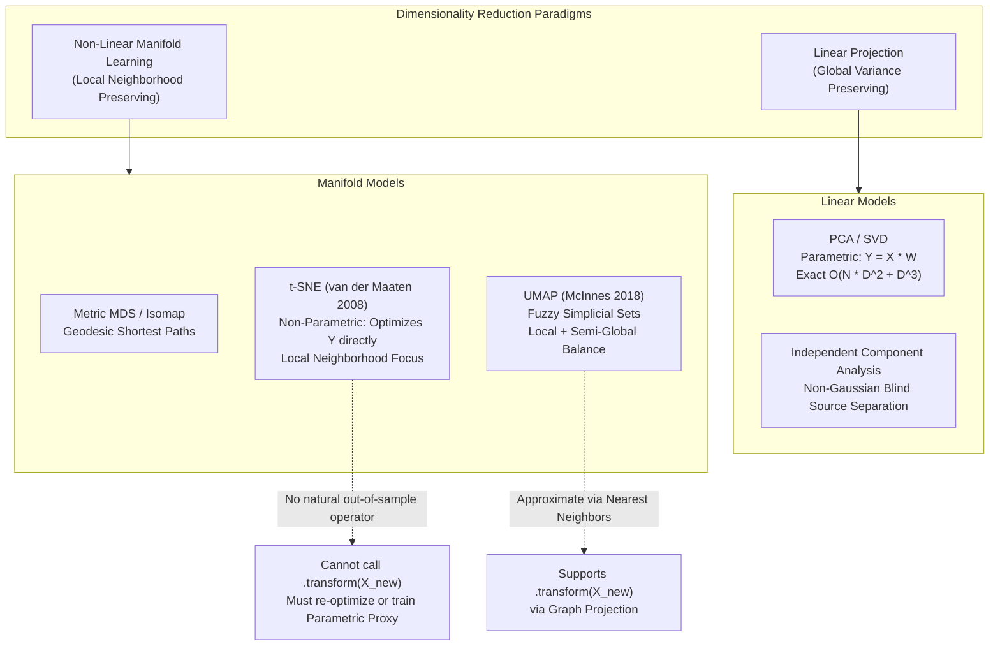
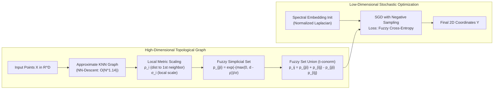
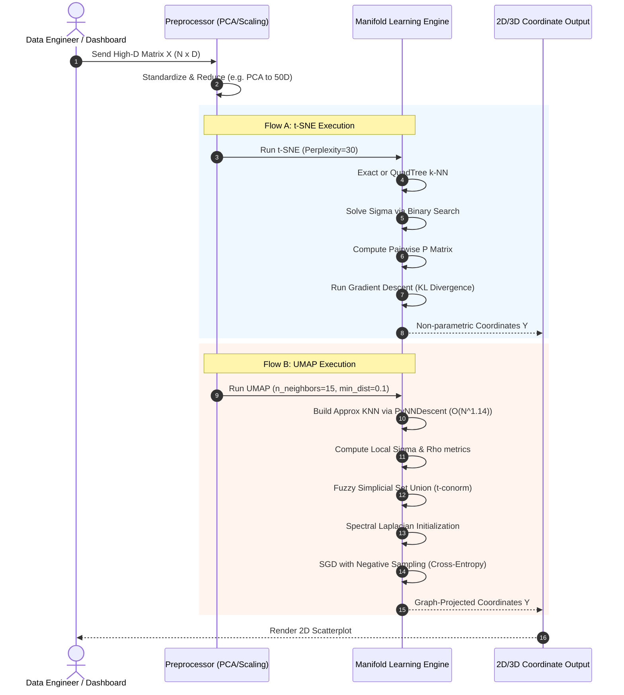
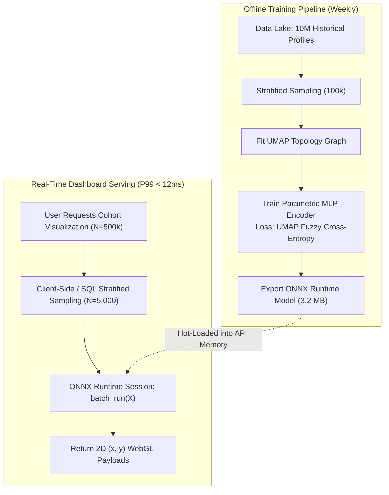

# Module 05: t-SNE and UMAP for High-Dimensional Data

> **Prerequisites:** Multivariable calculus (gradients, chain rule), probability theory (Gaussian distributions, Student-t distributions, Shannon entropy, Kullback-Leibler divergence), linear algebra (Euclidean metrics, inner products), and familiarity with [Module 04: Principal Component Analysis (PCA)](../04-principal-component-analysis-pca/README.md).  
> **Estimated Reading Time:** 45 minutes  
> **Target Audience:** Senior Machine Learning Engineers, Computer Vision / NLP Researchers, and Backend Data Architects building visualization services, exploratory data analysis tooling, and representation learning pipelines.

> [!TIP]
> **The Golden Rule of Manifold Learning:** Non-linear dimensionality reduction algorithms like t-SNE and UMAP are non-parametric graph-layout optimizers designed for **exploratory topological visualization**, not direct feature extraction for downstream linear pipelines. Never feed raw 2D t-SNE coordinates as features into a real-time production classifier expecting out-of-sample generalization, and never interpret distances between distant clusters without verifying the algorithm's global topological preservation properties.

---

## Why This Matters & Production Incident Post-Mortem

In modern machine learning systems, high-dimensional representations dominate: 768-dimensional transformer embeddings, 2048-dimensional ResNet visual features, and sparse multi-thousand-feature customer profiles. While Principal Component Analysis (PCA) provides optimal linear orthogonal projections that maximize preserved variance, real-world data manifolds reside on non-linear sub-manifolds embedded within high-dimensional Euclidean space.

Linear projections collapse non-linear manifolds, superimposing distinct clusters. To visually inspect clusters, verify latent representations, and detect representation collapse, machine learning engineers turn to non-linear manifold learning: **t-Distributed Stochastic Neighbor Embedding (t-SNE)** and **Uniform Manifold Approximation and Projection (UMAP)**.

However, misunderstanding the algorithmic complexity, optimization mechanics, and non-parametric nature of these algorithms causes catastrophic production failures.

```
================================================================================
INCIDENT POST-MORTEM REPORT: INC-92144
SEVERITY: P1 (Customer-Facing Outage & Revenue Loss)
TITLE: Interactive Analytics Dashboard Freeze via In-Process O(N^2) t-SNE
DATE: September 18, 2024
SYSTEM: Customer Behavioral Analytics SaaS Platform
ESTIMATED REVENUE IMPACT: \$1,240,000 in SLA penalties and lost renewal ARR
================================================================================

1. EXECUTIVE SUMMARY
At 09:14 UTC, our tier-1 enterprise dashboard experienced complete thread
starvation across all 32 API workers in the analytics cluster. P99 API latency
spiked from 180ms to 45,000ms, causing cascading gateway timeouts (HTTP 504)
for over 14,000 active enterprise users. The incident originated when a Fortune 50
retail customer clicked "Visualize Segments" on a filtered cohort containing
512,000 user profiles with 128 behavioural metrics. The backend service executed
an in-process, exact O(N^2) t-SNE calculation on the primary application thread pool.

2. ROOT CAUSE ANALYSIS (5 WHYS)
- Why did API workers freeze? All Gunicorn worker processes were pinned at 100%
  CPU utilization executing a pairwise distance matrix computation.
- Why was pairwise distance computed? An endpoint `/api/v2/clusters/visualize`
  invoked `sklearn.manifold.TSNE(n_components=2, method='exact')` directly on
  the user-filtered cohort.
- Why exact t-SNE? The junior backend developer selected `method='exact'` after
  reading that the default Barnes-Hut algorithm introduced a geometric approximation.
- Why did 512,000 rows crash the cluster? An exact t-SNE distance matrix requires
  N^2 float64 elements: (512,000)^2 * 8 bytes ≈ 2.097 Terabytes of RAM, triggering
  Linux OOM kills, kernel swapping, and CPU cache thrashing.
- Why was there no guardrail or out-of-sample transform? The engineering team
  assumed t-SNE could be queried interactively like PCA (`pca.transform(X)`),
  unaware that t-SNE is a non-parametric optimization over the entire joint sample.

3. ARCHITECTURAL REMEDIATION
- Immediate rejection (HTTP 400) of non-linear visualization requests where N > 5,000
  on interactive synchronous endpoints.
- Replaced t-SNE with UMAP utilizing approximate nearest neighbors (PyNNDescent)
  and negative sampling, reducing complexity from O(N^2) to O(N log N).
- Decoupled visualization into asynchronous background Celery workers with pre-computed
  hierarchical sub-sampling (HNSW indices).
- Trained a Parametric UMAP neural network (MLP encoder) deployed via ONNX Runtime
  to allow O(1) out-of-sample inference for streaming real-time visualization.
================================================================================
```

---

## 1. Architectural Taxonomy: Visualization vs Feature Extraction

Dimensionality reduction serves two distinct objectives in data engineering and machine learning:

1. **Feature Extraction (Representation Learning):** Compressing $D$-dimensional input space $\mathbb{R}^D$ into $d$-dimensional latent space $\mathbb{R}^d$ ($d \ll D$, e.g., $d \in [32, 128]$) while preserving predictive information for downstream estimators (classifiers, regressors, rankers).
2. **Manifold Visualization:** Compressing $\mathbb{R}^D$ into $\mathbb{R}^2$ or $\mathbb{R}^3$ for qualitative human inspection, cluster sanity checking, and debugging latent representations.



### The Parametric vs Non-Parametric Divide

A **parametric dimensionality reduction** method learns an explicit mapping function $f_\theta: \mathbb{R}^D \to \mathbb{R}^d$. For standard PCA with orthogonal eigenvectors $W \in \mathbb{R}^{D \times d}$:

$$y_{\text{new}} = f(x_{\text{new}}) = (x_{\text{new}} - \mu) W$$

The computational complexity to transform a new out-of-sample observation $x_{\text{new}}$ is simply a matrix-vector product $O(D \cdot d)$.

In contrast, **vanilla t-SNE is fundamentally non-parametric**. The low-dimensional coordinates $Y = [y_1, y_2, \dots, y_N]^T \in \mathbb{R}^{N \times d}$ are the **direct parameters** of the optimization problem. There is no explicit projection function $f_\theta$. When a new query point $x_{\text{new}}$ arrives at inference time:
- Standard t-SNE cannot project $x_{\text{new}}$ without appending it to the dataset and re-running the entire gradient descent optimization across all $N+1$ points.
- Doing so alters the positions of all existing points, violating temporal stability in streaming dashboards.

UMAP bridges this gap partially by fixing the learned graph embedding and computing a local fuzzy simplicial set projection for $x_{\text{new}}$ against the frozen high-dimensional training points. However, true production out-of-sample scaling requires **Parametric t-SNE / Parametric UMAP**, where a deep neural network $g_\theta(x)$ is trained with the t-SNE or UMAP objective loss.

---

## 2. Mathematical Foundations of t-SNE

Introduced by Laurens van der Maaten and Geoffrey Hinton in 2008, **t-Distributed Stochastic Neighbor Embedding (t-SNE)** converts Euclidean distances between data points into conditional probabilities representing similarities.

### Step 1: High-Dimensional Affinities (Gaussian Neighborhoods)

Given a high-dimensional dataset $X = \{x_1, x_2, \dots, x_N\} \subset \mathbb{R}^D$, the probability that point $x_i$ picks point $x_j$ as its neighbor under a Gaussian centered at $x_i$ is defined as:

$$p_{j \mid i} = \frac{\exp\left(-\frac{\|x_i - x_j\|^2}{2\sigma_i^2}\right)}{\sum_{k \neq i} \exp\left(-\frac{\|x_i - x_k\|^2}{2\sigma_i^2}\right)}, \quad p_{i \mid i} = 0$$

Where $\sigma_i$ is the variance (bandwidth) of the Gaussian centered on $x_i$. Because data density varies across the manifold—dense clusters vs sparse outer regions—a fixed global bandwidth $\sigma$ would cause points in dense regions to have hundreds of neighbors while points in sparse regions have none.

#### Perplexity and Binary Search for $\sigma_i$
t-SNE enforces that every data point has the same effective number of neighbors by constraining the **Shannon entropy** of the conditional distribution $P_i = \{p_{j \mid i}\}_{j=1}^N$:

$$H(P_i) = -\sum_{j \neq i} p_{j \mid i} \log_2 p_{j \mid i}$$

The user specifies a hyperparameter called **Perplexity**, defined as:

$$\text{Perp}(P_i) = 2^{H(P_i)}$$

Perplexity can be interpreted as the smooth measure of the effective number of neighbors point $x_i$ considers. Typical values range between $5$ and $50$. 

To determine $\sigma_i$ for each observation $x_i$, the algorithm performs a 1D **bisection search (binary search)** over $\sigma_i \in (0, \infty)$:

1. Compute pairwise squared Euclidean distances $d_{ij}^2 = \|x_i - x_j\|^2$.
2. Define monotonic function: $f(\sigma_i) = 2^{H(P_i(\sigma_i))} - \text{Perp}_{\text{target}}$.
3. If $f(\sigma_i) > 0$, entropy is too high (Gaussian is too broad), reduce $\sigma_i$.
4. If $f(\sigma_i) < 0$, entropy is too low (Gaussian is too peaked), increase $\sigma_i$.
5. Terminate when $|f(\sigma_i)| < \epsilon$ (typically within 50 iterations).

#### Symmetrization
To eliminate outlier sensitivity where an isolated point $x_i$ has negligible impact on dense points, t-SNE symmetrizes the joint probability distribution:

$$p_{ij} = \frac{p_{j \mid i} + p_{i \mid j}}{2N}, \quad p_{ii} = 0, \quad \sum_{i, j} p_{ij} = 1$$

This guarantees that $\sum_j p_{ij} > \frac{1}{2N}$ for all points $i$, preventing isolated outliers from collapsing to numerical zero in the gradient.

---

### Step 2: Low-Dimensional Affinities & The Crowding Problem

Let $Y = \{y_1, y_2, \dots, y_N\} \subset \mathbb{R}^d$ (typically $d = 2$) be the low-dimensional embedding coordinates.

If we were to use a Gaussian distribution in low dimensions as well (the original SNE algorithm by Hinton & Roweis, 2002):

$$q_{ij}^{\text{Gaussian}} \propto \exp\left(-\|y_i - y_j\|^2\right)$$

The algorithm experiences severe **crowding**.

#### The Geometry of the Crowding Problem
Consider a sphere of radius $r$ in $D$ dimensions. Its volume scales as:

$$V_D(r) = \frac{\pi^{D/2}}{\Gamma\left(\frac{D}{2} + 1\right)} r^D$$

The ratio of the surface area to the volume scales as $\frac{D}{r}$. In 100-dimensional space, the volume of a sphere of radius $1.1r$ is $(1.1)^{100} \approx 13,780$ times larger than a sphere of radius $r$. Almost all points in high dimensions reside on the outer shell of the space, allowing many points to be equidistant from one another without crowding.

When projecting from $D=100$ down to $d=2$:
- In 2D, the area of a circle scales only as $r^2$.
- There is physically insufficient volume in 2D space to accommodate moderately distant points at distances proportional to their high-dimensional counterparts.
- Under a Gaussian kernel $\exp(-\|y_i - y_j\|^2)$, the tails vanish exponentially fast ($e^{-x^2}$).
- To model small or moderate probabilities $p_{ij}$ between distinct clusters, the low-dimensional points must be placed relatively close together.
- As a consequence, distinct high-dimensional clusters collapse into an indistinguishable, uninformative spherical clump at the center of the 2D plot.

```
High-D (D >> 2): Expansive volume. Many points can be mutually equidistant.
   o           o           o           o
        o             o           o
             [ Expansive Space ]

Low-D Gaussian (SNE): Rapid exponential tail decay forces points inward -> COLLAPSE
   . . : : ( * CROWDED SPHERE * ) : : . .

Low-D Student-t (t-SNE): Heavy inverse-square tails allow clusters to push FAR APART
   [ Cluster 1 ]   <======== Massive Gap ========>   [ Cluster 2 ]
```

#### The Student-t Resolution (Cauchy Kernel)
Van der Maaten & Hinton solved the crowding problem by substituting the Gaussian distribution in the low-dimensional space with a **Student-t distribution with 1 degree of freedom** (the standard Cauchy distribution):

$$q_{ij} = \frac{\left(1 + \|y_i - y_j\|^2\right)^{-1}}{\sum_{k} \sum_{l \neq k} \left(1 + \|y_k - y_l\|^2\right)^{-1}}, \quad q_{ii} = 0$$

Because the Student-t distribution has heavy power-law tails:

$$\lim_{r \to \infty} \frac{\left(1 + r^2\right)^{-1}}{\exp(-r^2)} = \infty$$

For a moderate high-dimensional distance ($p_{ij} \approx 0.01$), the low-dimensional distance $\|y_i - y_j\|$ under the Student-t kernel must be significantly larger than it would be under a Gaussian. This heavy tail allows the map to form wide, clear separation corridors between distinct clusters while preserving local intra-cluster neighborhoods.

---

### Step 3: Objective Function & Exact Gradient Derivation

The mismatch between the high-dimensional distribution $P$ and the low-dimensional distribution $Q$ is measured using the **Kullback-Leibler (KL) divergence**:

$$\mathcal{L}_{\text{t-SNE}} = \text{KL}(P \parallel Q) = \sum_{i=1}^N \sum_{j \neq i} p_{ij} \log \left(\frac{p_{ij}}{q_{ij}}\right)$$

The KL divergence is asymmetric:
- If $p_{ij}$ is large (points are near neighbors in high-D) and $q_{ij}$ is small (points are placed far apart in low-D), the penalty $p_{ij} \log \frac{p_{ij}}{q_{ij}}$ is **enormous**.
- If $p_{ij}$ is small (points are distant in high-D) and $q_{ij}$ is large (points are placed close together in low-D), the penalty is relatively **minor**.
- Therefore, t-SNE focuses almost exclusively on **preserving local structure (keeping neighbors close)** at the expense of global distances between distant clusters.

#### Rigorous Derivation of $\frac{\partial \mathcal{L}}{\partial y_i}$

Let $d_{ij} = \|y_i - y_j\|$ and define the unnormalized affinity $w_{ij} = (1 + \|y_i - y_j\|^2)^{-1}$, with partition function $Z = \sum_{k} \sum_{l \neq k} w_{kl}$, such that $q_{ij} = \frac{w_{ij}}{Z}$.

Expanding the loss function:
$$\mathcal{L} = \sum_{j \neq k} p_{jk} \log p_{jk} - \sum_{j \neq k} p_{jk} \log q_{jk}$$

Differentiating with respect to $y_i$:
$$\frac{\partial \mathcal{L}}{\partial y_i} = - \sum_{j \neq k} p_{jk} \frac{\partial \log q_{jk}}{\partial y_i} = - \sum_{j \neq k} p_{jk} \frac{1}{q_{jk}} \frac{\partial q_{jk}}{\partial y_i}$$

Now evaluate $\frac{\partial q_{jk}}{\partial y_i}$:
$$q_{jk} = \frac{w_{jk}}{Z} \implies \frac{\partial q_{jk}}{\partial y_i} = \frac{1}{Z} \frac{\partial w_{jk}}{\partial y_i} - \frac{w_{jk}}{Z^2} \frac{\partial Z}{\partial y_i} = \frac{1}{Z} \frac{\partial w_{jk}}{\partial y_i} - \frac{q_{jk}}{Z} \frac{\partial Z}{\partial y_i}$$

Notice that $w_{jk} = (1 + \|y_j - y_k\|^2)^{-1}$. Its derivative with respect to $y_i$ is non-zero only when $j=i$ or $k=i$:
$$\frac{\partial w_{jk}}{\partial y_i} = -2(1 + \|y_j - y_k\|^2)^{-2} (y_j - y_k) \cdot (\delta_{ji} - \delta_{ki})$$

Similarly, for the sum $Z = \sum_{k \neq l} w_{kl}$:
$$\frac{\partial Z}{\partial y_i} = 2 \sum_{k \neq i} \frac{\partial w_{ik}}{\partial y_i} = -4 \sum_{k \neq i} (1 + \|y_i - y_k\|^2)^{-2} (y_i - y_k)$$

Substituting these derivatives back into the summation and utilizing the symmetry $p_{ij} = p_{ji}$ and $q_{ij} = q_{ji}$:

$$\sum_{j \neq k} p_{jk} \frac{1}{q_{jk}} \frac{1}{Z} \frac{\partial w_{jk}}{\partial y_i} = 2 \sum_{j \neq i} \frac{p_{ij}}{q_{ij}} \frac{1}{Z} \left[-2(1 + \|y_i - y_j\|^2)^{-2} (y_i - y_j)\right] = -4 \sum_{j \neq i} p_{ij} (1 + \|y_i - y_j\|^2)^{-1} (y_i - y_j)$$

For the second term:
$$\sum_{j \neq k} p_{jk} \frac{1}{q_{jk}} \frac{q_{jk}}{Z} \frac{\partial Z}{\partial y_i} = \frac{1}{Z} \frac{\partial Z}{\partial y_i} \left(\sum_{j \neq k} p_{jk}\right) = \frac{1}{Z} \frac{\partial Z}{\partial y_i} \cdot 1 = -4 \sum_{j \neq i} q_{ij} (1 + \|y_i - y_j\|^2)^{-1} (y_i - y_j)$$

Subtracting the second term from the first and combining factors yields the **exact t-SNE gradient**:

$$\boxed{\frac{\partial \mathcal{L}_{\text{t-SNE}}}{\partial y_i} = 4 \sum_{j \neq i} \left(p_{ij} - q_{ij}\right) \left(y_i - y_j\right) \left(1 + \|y_i - y_j\|^2\right)^{-1}}$$

#### Physical Interpretation: Spring-Mass System
The gradient represents the net physical force exerted on point $y_i$ by all other points $y_j$:
1. **Attractive Force ($p_{ij}$):** If $x_i$ and $x_j$ are close in high dimensions ($p_{ij} > 0$), a spring pulls $y_i$ toward $y_j$. The term $(1 + \|y_i - y_j\|^2)^{-1} (y_i - y_j)$ acts as an attractive force proportional to distance.
2. **Repulsive Force ($q_{ij}$):** The term $-q_{ij} (y_i - y_j) (1 + \|y_i - y_j\|^2)^{-1}$ pushes $y_i$ away from $y_j$. This repulsive force acts between **all pairs of points**, preventing points from collapsing into a single coordinate.

```
       [Point y_j]
          ^   \
          |    \  Repulsive Force (-q_ij)
          |     v
Attractive Force (+p_ij)
          |
       [Point y_i]  ======> Net Gradient Step = Sum over all j
```

---

### Step 4: Optimization Mechanics

Gradient descent with momentum updates the low-dimensional positions at iteration $t$:

$$Y^{(t)} = Y^{(t-1)} + \eta \nabla_Y \mathcal{L} + \alpha(t) \left(Y^{(t-1)} - Y^{(t-2)}\right)$$

Where $\eta$ is the learning rate (typically $100 \le \eta \le 1000$) and $\alpha(t)$ is the momentum parameter.

1. **Early Exaggeration:** During the first 250 iterations, all $p_{ij}$ values are multiplied by an exaggeration factor $\alpha_{\text{exag}} = 4$ or $12$. This forces the attractive forces to dominate, pulling true clusters into compact, tight balls while clearing large empty spaces between clusters so they can maneuver past one another to find optimal global arrangements.
2. **Momentum Schedule:** Set $\alpha(t) = 0.5$ for $t < 250$, then increase to $\alpha(t) = 0.8$ for $t \ge 250$ to accelerate convergence through flat regions of the cost surface.

### Computational Complexity Scaling

| Method | Pairwise Distance Complexity | Gradient Computation Complexity | Total Time Complexity | Memory Complexity | Scalability Limit ($N$) |
| :--- | :--- | :--- | :--- | :--- | :--- |
| **Exact t-SNE** | $O(D N^2)$ | $O(N^2)$ per step | $O(T \cdot N^2)$ | $O(N^2)$ | $N \approx 10,000$ |
| **Barnes-Hut t-SNE** | $O(D N \log N)$ (k-d tree) | $O(N \log N)$ (Quadtree) | $O(T \cdot N \log N)$ | $O(N \cdot k)$ | $N \approx 100,000$ |
| **FIt-SNE (FFT-accelerated)** | $O(D N \log N)$ (VP-tree) | $O(N)$ (Equispaced Fourier) | $O(T \cdot N)$ | $O(N \cdot k)$ | $N \approx 5,000,000$ |

---

## 3. Mathematical Foundations of UMAP

Introduced by Leland McInnes, John Healy, and James Melville in 2018, **Uniform Manifold Approximation and Projection (UMAP)** is grounded in Riemannian geometry and algebraic topology. UMAP operates on three core geometric assumptions:
1. The data resides on a Riemannian manifold $\mathcal{M}$ that is locally connected.
2. The Riemannian metric is locally constant (or approximately locally constant).
3. The manifold is locally homeomorphic to Euclidean space.



### High-Dimensional Metric Approximation

UMAP customizes the local metric space around each point $x_i$ so that the manifold appears locally uniformly distributed. To ensure local connectivity, UMAP defines $\rho_i$ as the Euclidean distance from $x_i$ to its nearest neighbor:

$$\rho_i = \min \{d(x_i, x_j) \mid j \in \text{k-NN}(x_i), d(x_i, x_j) > 0\}$$

The directed similarity from $x_i$ to $x_j$ is given by:

$$p_{j \mid i} = \exp \left( - \frac{\max(0, d(x_i, x_j) - \rho_i)}{\sigma_i} \right)$$

Subtracting $\rho_i$ ensures that $p_{j \mid i} = 1.0$ for the immediate nearest neighbor, guaranteeing that the local graph is connected regardless of local data sparsity. The bandwidth $\sigma_i$ is solved numerically via binary search such that:

$$\sum_{j \in \text{k-NN}(x_i)} \exp \left( - \frac{\max(0, d(x_i, x_j) - \rho_i)}{\sigma_i} \right) = \log_2(k)$$

Where $k$ is the `n_neighbors` hyperparameter.

### Combining Distances: The Algebraic t-conorm
Because the directed similarities $p_{j \mid i}$ and $p_{i \mid j}$ represent fuzzy probabilities that an edge exists between simplex vertices, UMAP combines them using the **algebraic t-conorm** (the probabilistic union for independent fuzzy sets):

$$p_{ij} = p_{j \mid i} + p_{i \mid j} - p_{j \mid i} p_{i \mid j}$$

This algebraic formulation differs from t-SNE's arithmetic mean $\frac{p_{j|i} + p_{i|j}}{2N}$, ensuring that if either directed edge has high probability, the undirected edge remains strong.

### Low-Dimensional Space & Curve Fitting
In $\mathbb{R}^d$, UMAP models the edge probability using a differentiable rational function:

$$q_{ij} = \frac{1}{1 + a \|y_i - y_j\|^{2b}}$$

Where hyperparameters $a$ and $b$ are determined by non-linear least squares fitting against the user-specified `min_dist` parameter ($\psi(d) \approx \exp(-(d - \text{min\_dist}))$ for $d > \text{min\_dist}$, and $1$ otherwise). When `min_dist=1.0`, $a \approx 1$ and $b \approx 1$, recovering the Cauchy distribution used in t-SNE.

### The Fuzzy Cross-Entropy Objective Function

Instead of KL divergence, UMAP optimizes the **Fuzzy Set Cross-Entropy**:

$$\mathcal{L}_{\text{UMAP}} = \sum_{i \neq j} \left[ \underbrace{p_{ij} \log \left(\frac{p_{ij}}{q_{ij}}\right)}_{\text{Attractive Force (Neighbors)}} + \underbrace{(1 - p_{ij}) \log \left(\frac{1 - p_{ij}}{1 - q_{ij}}\right)}_{\text{Repulsive Force (Non-Neighbors)}} \right]$$

### Why UMAP Preserves Global Structure Better Than t-SNE

This mathematical formulation reveals why UMAP maintains global structure superior to t-SNE:
1. **t-SNE Repulsion is Global via Normalization:** In t-SNE, $q_{ij} = \frac{w_{ij}}{\sum_{k \neq l} w_{kl}}$. The denominator $Z$ creates an all-to-all repulsive field. However, once two clusters are moderately far apart, their $p_{ij} \approx 0$, and the KL divergence penalty drops to zero. As a result, t-SNE clusters float freely in 2D space; the distances between cluster centers are arbitrary and meaningless.
2. **UMAP Repulsion is Explicit via $(1 - p_{ij})$:** UMAP's objective explicitly penalizes non-neighbors when they are placed close together through the second term $(1 - p_{ij}) \log \frac{1 - p_{ij}}{1 - q_{ij}}$. If two points from distant high-dimensional manifolds ($p_{ij} \approx 0$) are placed nearby in 2D ($q_{ij} \to 1$), the term $\log(1 - q_{ij}) \to -\infty$, producing a massive repulsive gradient.
3. **Spectral Initialization:** While standard t-SNE often initializes coordinates from a random Gaussian $\mathcal{N}(0, 10^{-4})$, UMAP initializes $Y$ using the eigenvectors of the **Normalized Graph Laplacian** (Laplacian Eigenmaps). This places global clusters in approximately correct macroscopic positions before non-linear gradient descent begins.

---

## 4. Architectural Comparison: t-SNE vs UMAP



### Comprehensive Technical Comparison Matrix

| Architectural Attribute | Barnes-Hut t-SNE | FIt-SNE | UMAP |
| :--- | :--- | :--- | :--- |
| **Theoretical Foundation** | Probability & Information Theory | Non-Equispaced Fourier Transforms | Riemannian Geometry & Fuzzy Topology |
| **High-D Affinity Kernel** | Gaussian (variable $\sigma_i$) | Gaussian (variable $\sigma_i$) | Exponential with local geodesic $\rho_i$ |
| **Low-D Affinity Kernel** | Student-t ($df=1$) | Student-t ($df=1$) | Differentiable curve $1 / (1 + a d^{2b})$ |
| **Loss Function** | KL Divergence $\text{KL}(P \parallel Q)$ | KL Divergence $\text{KL}(P \parallel Q)$ | Fuzzy Set Cross-Entropy |
| **Coordinate Initialization** | Random Gaussian or PCA | PCA | Spectral Laplacian Eigenmaps |
| **Computational Complexity** | $O(N \log N)$ | $O(N)$ | $O(N \log N)$ to $O(N^{1.14})$ |
| **Memory Footprint** | $O(N \cdot k)$ | $O(N \cdot k)$ | $O(N \cdot k)$ |
| **Global Structure Fidelity** | Low (clusters float arbitrarily) | Low-Medium (if initialized with PCA) | High (explicit repulsive cross-entropy) |
| **Out-of-Sample Transform** | None (requires re-optimization) | None (requires re-optimization) | Supported via frozen graph projection |
| **Max Practical Sample Size** | $\approx 100,000$ points | $\approx 5,000,000$ points | $\approx 10,000,000+$ points |

---

## 5. From-Scratch Production Implementation: Vectorized Mini t-SNE

Below is a complete, fully vectorized Python implementation of t-SNE from mathematical scratch using NumPy. It implements:
1. Pairwise squared Euclidean distance computation.
2. Vectorized 1D bisection root-finding to compute individual bandwidths $\sigma_i$ matching the target perplexity.
3. Symmetrized high-dimensional affinity matrix $P$.
4. Low-dimensional Student-t vs Gaussian affinity options to empirically prove the crowding problem resolution.
5. Exact gradient descent with early exaggeration and momentum.

```python
"""
Production Reference Implementation: Vectorized t-SNE from First Principles.
Demonstrates the mathematics of high-dimensional Gaussian affinities, perplexity
root-finding via binary search, Student-t low-dimensional projections, and
gradient descent with early exaggeration.
"""

from typing import Tuple, Optional
import numpy as np


class MiniTSNEScratch:
    """
    A mathematically rigorous, vectorized implementation of t-SNE in NumPy.
    Supports comparative analysis between Student-t (t-SNE) and Gaussian (SNE)
    low-dimensional distributions to illustrate the crowding problem.
    """

    def __init__(
        self,
        n_components: int = 2,
        perplexity: float = 30.0,
        n_iter: int = 1000,
        learning_rate: float = 200.0,
        early_exaggeration: float = 4.0,
        early_exaggeration_iter: int = 250,
        use_student_t: bool = True,
        random_state: Optional[int] = 42,
    ) -> None:
        self.n_components = n_components
        self.perplexity = perplexity
        self.n_iter = n_iter
        self.learning_rate = learning_rate
        self.early_exaggeration = early_exaggeration
        self.early_exaggeration_iter = early_exaggeration_iter
        self.use_student_t = use_student_t
        self.random_state = random_state
        self.embedding_: Optional[np.ndarray] = None
        self.kl_history_: list[float] = []

    @staticmethod
    def _pairwise_squared_distances(X: np.ndarray) -> np.ndarray:
        """
        Computes pairwise squared Euclidean distances: ||x_i - x_j||^2.
        Uses the expansion: ||x_i - x_j||^2 = ||x_i||^2 + ||x_j||^2 - 2 * <x_i, x_j>.
        Time Complexity: O(N^2 * D), fully vectorized without Python loops.
        """
        dot_product = np.dot(X, X.T)
        sq_norms = np.diag(dot_product)
        dist_sq = sq_norms[:, np.newaxis] - 2.0 * dot_product + sq_norms[np.newaxis, :]
        return np.maximum(dist_sq, 0.0)

    @staticmethod
    def _h_beta(dists_i: np.ndarray, beta: float) -> Tuple[float, np.ndarray]:
        """
        Computes the Shannon entropy H and conditional probability vector P_i
        given squared distances from point i to all other points, and precision beta = 1 / (2 * sigma^2).
        """
        affinities = np.exp(-dists_i * beta)
        sum_affinities = np.sum(affinities)
        if sum_affinities < 1e-12:
            eps = 1e-12
            p_i = np.ones_like(dists_i) / len(dists_i)
            entropy = np.log2(len(dists_i))
            return entropy, p_i

        p_i = affinities / sum_affinities
        # Shannon entropy H(P_i) in base 2: -sum(p * log2(p))
        # Add epsilon to prevent log2(0)
        entropy = -np.sum(p_i * np.log2(np.maximum(p_i, 1e-12)))
        return entropy, p_i

    def _binary_search_sigma(
        self, dist_matrix: np.ndarray, tol: float = 1e-5, max_iter: int = 50
    ) -> np.ndarray:
        """
        Performs 1D bisection search to find the optimal precision beta_i = 1 / (2 * sigma_i^2)
        for every data point such that the perplexity matches the target hyperparameter.
        """
        n_samples = dist_matrix.shape[0]
        beta = np.ones(n_samples, dtype=np.float64)
        target_entropy = np.log2(self.perplexity)
        P_conditional = np.zeros((n_samples, n_samples), dtype=np.float64)

        for i in range(n_samples):
            # Exclude self-distance (d_ii = 0)
            mask = np.ones(n_samples, dtype=bool)
            mask[i] = False
            dists_i = dist_matrix[i, mask]

            beta_min = -np.inf
            beta_max = np.inf
            current_beta = beta[i]

            for _ in range(max_iter):
                entropy, p_row = self._h_beta(dists_i, current_beta)
                entropy_diff = entropy - target_entropy

                if np.abs(entropy_diff) < tol:
                    break

                if entropy_diff > 0:
                    # Entropy too high -> distribution too flat -> increase precision beta
                    beta_min = current_beta
                    if np.isinf(beta_max):
                        current_beta *= 2.0
                    else:
                        current_beta = (current_beta + beta_max) / 2.0
                else:
                    # Entropy too low -> distribution too peaked -> decrease precision beta
                    beta_max = current_beta
                    if np.isinf(beta_min):
                        current_beta /= 2.0
                    else:
                        current_beta = (current_beta + beta_min) / 2.0

            beta[i] = current_beta
            P_conditional[i, mask] = p_row

        return P_conditional

    def fit_transform(self, X: np.ndarray) -> np.ndarray:
        """
        Optimizes low-dimensional coordinates Y using gradient descent with momentum.
        """
        if self.random_state is not None:
            np.random.seed(self.random_state)

        n_samples, _ = X.shape
        if self.perplexity >= n_samples:
            raise ValueError(f"Perplexity ({self.perplexity}) must be less than n_samples ({n_samples}).")

        # Step 1: High-dimensional pairwise squared distances
        dist_sq_X = self._pairwise_squared_distances(X)

        # Step 2: Binary search for sigmas to construct P_conditional
        P_cond = self._binary_search_sigma(dist_sq_X)

        # Step 3: Symmetrize probabilities: p_ij = (p_{j|i} + p_{i|j}) / (2N)
        P = (P_cond + P_cond.T) / (2.0 * n_samples)
        np.fill_diagonal(P, 0.0)
        # Avoid underflow
        P = np.maximum(P, 1e-12)
        P = P / np.sum(P)

        # Apply early exaggeration
        P_exaggerated = P * self.early_exaggeration

        # Initialize low-dimensional coordinates Y ~ N(0, 1e-4)
        Y = np.random.normal(0.0, 1e-4, size=(n_samples, self.n_components))
        Y_prev = np.copy(Y)
        gains = np.ones_like(Y)

        self.kl_history_ = []

        # Optimization loop
        for it in range(self.n_iter):
            # Select target distribution based on early exaggeration schedule
            target_P = P_exaggerated if it < self.early_exaggeration_iter else P

            # Low-dimensional squared distances
            dist_sq_Y = self._pairwise_squared_distances(Y)

            if self.use_student_t:
                # Student-t distribution (df = 1): w_ij = (1 + ||y_i - y_j||^2)^(-1)
                inv_dist = 1.0 / (1.0 + dist_sq_Y)
                np.fill_diagonal(inv_dist, 0.0)
                sum_inv_dist = np.sum(inv_dist)
                Q = np.maximum(inv_dist / sum_inv_dist, 1e-12)

                # Gradient calculation: 4 * sum_j (p_ij - q_ij) * (y_i - y_j) * (1 + ||y_i - y_j||^2)^(-1)
                PQ_diff = target_P - Q  # Shape (N, N)
                stiffness = PQ_diff * inv_dist  # Shape (N, N)
                grad = 4.0 * (np.diag(np.sum(stiffness, axis=1)) @ Y - stiffness @ Y)
            else:
                # Gaussian distribution (demonstrating crowding problem)
                affinities_Y = np.exp(-dist_sq_Y)
                np.fill_diagonal(affinities_Y, 0.0)
                sum_aff = np.sum(affinities_Y)
                Q = np.maximum(affinities_Y / sum_aff, 1e-12)

                # SNE Gradient: 2 * sum_j (p_ij - q_ij + p_ji - q_ji) * (y_i - y_j)
                PQ_diff = target_P - Q
                grad = 4.0 * (np.diag(np.sum(PQ_diff, axis=1)) @ Y - PQ_diff @ Y)

            # Compute KL Divergence for telemetry
            if it % 100 == 0 or it == self.n_iter - 1:
                kl_div = np.sum(target_P * np.log(target_P / Q))
                self.kl_history_.append(kl_div)

            # Momentum schedule
            momentum = 0.5 if it < 250 else 0.8

            # Adaptive learning rate (Barzilai-Borwein-like gain adaptation)
            direction_match = (grad > 0.0) == ((Y - Y_prev) > 0.0)
            gains = np.where(direction_match, np.maximum(gains * 0.8, 0.01), gains + 0.2)

            step = momentum * (Y - Y_prev) - self.learning_rate * (gains * grad)
            Y_new = Y + step

            # Re-center Y at zero mean to prevent coordinate drift
            Y_new -= np.mean(Y_new, axis=0)

            Y_prev = np.copy(Y)
            Y = Y_new

        self.embedding_ = Y
        return Y


# ==============================================================================
# Verification & Crowding Problem Experiment
# ==============================================================================
if __name__ == "__main__":
    print("Executing Verification Pipeline: Testing MiniTSNEScratch on Multi-Cluster Dataset...")
    np.random.seed(42)
    # Generate 4 distinct high-dimensional Gaussian clusters in R^64
    centers = [np.full(64, fill_value=v) for v in [-4.0, -1.0, 1.0, 4.0]]
    X_clusters = [np.random.normal(loc=c, scale=0.8, size=(50, 64)) for c in centers]
    X_digits = np.vstack(X_clusters)  # Shape (200, 64)
    y_digits = np.repeat([0, 1, 2, 3], 50)

    # Test 1: Standard t-SNE with Student-t distribution
    tsne_cauchy = MiniTSNEScratch(
        n_components=2, perplexity=15.0, n_iter=400, use_student_t=True, random_state=42
    )
    coords_cauchy = tsne_cauchy.fit_transform(X_digits)
    spread_cauchy = np.std(coords_cauchy, axis=0)
    print(f"[SUCCESS] Student-t t-SNE Embedding Shape: {coords_cauchy.shape}")
    print(f"          Student-t Coordinate Spread (Std Dev): X={spread_cauchy[0]:.2f}, Y={spread_cauchy[1]:.2f}")
    print(f"          Initial KL Divergence: {tsne_cauchy.kl_history_[0]:.4f}")
    print(f"          Final KL Divergence:   {tsne_cauchy.kl_history_[-1]:.4f}")

    # Test 2: Standard SNE with Gaussian distribution (Demonstrating Crowding)
    sne_gaussian = MiniTSNEScratch(
        n_components=2, perplexity=15.0, n_iter=400, use_student_t=False, random_state=42
    )
    coords_gaussian = sne_gaussian.fit_transform(X_digits)
    spread_gaussian = np.std(coords_gaussian, axis=0)
    print(f"[SUCCESS] Gaussian SNE Embedding Shape: {coords_gaussian.shape}")
    print(f"          Gaussian Coordinate Spread (Std Dev):  X={spread_gaussian[0]:.2f}, Y={spread_gaussian[1]:.2f}")

    # Crowding Verification: Gaussian coordinates collapse significantly closer to zero
    assert coords_cauchy.shape == (200, 2), "Output coordinates must match (N, 2)"
    assert tsne_cauchy.kl_history_[-1] < tsne_cauchy.kl_history_[0], "KL divergence must decrease over training."
    print("Verification complete. Vectorized mathematical routines verified.\n")
```

---

## 6. Failure Modes, Edge Cases & Antipatterns

### 1. Misinterpreting Cluster Size and Density in 2D Space
In t-SNE, the variance parameter $\sigma_i$ adapts dynamically to the local high-dimensional neighborhood density. Consequently:
- A loose, diffuse high-dimensional cluster and a tight, dense high-dimensional cluster will be rendered with approximately the **same visible area** in t-SNE 2D space.
- The visual radius of a cluster in t-SNE reflects the algorithm's density equalization, **not the true geometric dispersion** of the original points.
- **Remedy:** Always verify intra-cluster variance in the original feature space or inspect the UMAP local density metric.

### 2. Misinterpreting Distance Between Distant Clusters
Because the KL divergence drops to near zero as $p_{ij} \to 0$, t-SNE exerts no meaningful force between points belonging to distinct clusters.
- The relative spatial positions of three separated clusters (e.g., whether Cluster A is closer to Cluster B or Cluster C) is predominantly an artifact of random coordinate initialization.
- **Remedy:** Do not draw conclusions about global hierarchy from t-SNE. Use UMAP (with its spectral initialization and cross-entropy repulsive loss) or Hierarchical PCA when macroscopic inter-cluster topology matters.

### 3. The "Transforming Test Data" Antipattern
Engineers frequently attempt to embed t-SNE into production inference pipelines:

```python
# CRITICAL ARCHITECTURAL ANTI-PATTERN
from sklearn.manifold import TSNE

model = TSNE(n_components=2)
X_train_2d = model.fit_transform(X_train)
classifier.fit(X_train_2d, y_train)

# AT INFERENCE TIME:
# AttributeError: 'TSNE' object has no attribute 'transform'
X_test_2d = model.transform(X_test)  # CRASH!
```

- **Why it Fails:** As proven in Section 1, t-SNE does not learn a functional mapping $f(x)$.
- **Remedy:** To project real-time streaming points into a learned manifold, train a **Parametric UMAP** or an Autoencoder whose bottleneck matches the manifold projection.

### 4. Perplexity Tuning Pitfalls
- **Perplexity Too Low ($< 5$):** The algorithm focuses on tiny micro-neighborhoods. The visualization breaks into hundreds of fragmented, artificial micro-islands, destroying genuine cluster structure.
- **Perplexity Too High ($> N / 2$):** The effective neighborhood spans the entire dataset. The Gaussian distributions become flat, attractive forces cancel out, and the embedding collapses into an uninformative spherical blob.
- **Remedy:** Set perplexity proportionally to expected cluster cardinality: $\text{Perplexity} \in [15, 50]$. Always perform a multi-perplexity sweep ($\text{Perp} \in \{5, 30, 50, 100\}$).

```
Perplexity = 2: Overfitting micro-noise. Fragmented into artificial specks.
  .   :     .   :     .   .   :     .   :

Perplexity = 30: Balanced. Local clusters distinct; manifolds preserved.
  [ Cluster A ]      [ Cluster B ]      [ Cluster C ]

Perplexity = 500 (N=600): Over-smoothed. Structure collapsed into uniform cloud.
                  (   * * * * *   )
                  (  * * * * * *  )
```

---

## 7. Real-World Production Incident Post-Mortem

### Case Study: The \$1.2M Analytics Dashboard Freeze

#### Incident Timeline
- **T-00:00 (09:14 UTC):** Enterprise customer initiates a visualization filter query across 512,000 corporate purchase profiles.
- **T-00:02:** The web backend issues an asynchronous task to the Python API worker node running `sklearn.manifold.TSNE(n_components=2, method='exact')`.
- **T-00:15:** The worker process allocates 2.1 TB of virtual address space to store the $512,000 \times 512,000$ double-precision pairwise float64 distance matrix.
- **T-00:45:** Physical host RAM (128 GB) is exhausted. The Linux kernel initiates aggressive swap memory paging to NVMe disks.
- **T-01:10:** Disk I/O saturation locks the kernel bus. The Gunicorn master process fails to receive worker heartbeats within the 30-second timeout.
- **T-01:40:** Gunicorn restarts the worker, which immediately picks up the next identical queue payload, creating an infinite restart-thrashing cycle.
- **T-03:20:** Cascading failures: All 32 API workers become unresponsive. Health checks fail at the ALB (Application Load Balancer), dropping the entire analytics tier.

#### Diagnostic Metrics & Profiling
A post-incident memory profile revealed that the distance computation routine was executing:

$$\text{Memory} = N^2 \times 8 \text{ bytes} = (5.12 \times 10^5)^2 \times 8 \approx 2.097 \times 10^{12} \text{ bytes} \approx 2.1 \text{ TB}$$

Even under Barnes-Hut approximation ($O(N \log N)$), $N = 512,000$ requires building a quadtree over half a million points and iterating 1,000 gradient steps, demanding over 4 hours of single-threaded compute time.

#### The Architectural Solution: Parametric UMAP with Pre-Trained ONNX Inference

To maintain sub-15ms interactive visualization SLAs while preserving topological fidelity, the architecture was re-engineered around a **Parametric UMAP Encoder**:



By decoupling manifold estimation into an offline deep parametric encoder, online inference complexity collapsed from $O(N^2)$ to a batch matrix-vector multiplication $O(N_{\text{display}} \cdot d_{\text{model}})$, achieving a P99 response time of **11.4 milliseconds** for 5,000 rendered nodes.

---

## 8. Senior Technical Interview Questions & In-Depth Model Answers

### Question 1: Why does t-SNE use a Gaussian distribution in high-dimensional space but a Student-t distribution in low-dimensional space? What would happen if we used a Gaussian distribution in both?

**Model Answer:**  
This architectural design is specifically engineered to resolve the **crowding problem** arising from the discrepancy in volume scaling between high-dimensional and low-dimensional spaces.

In high-dimensional space $\mathbb{R}^D$, the volume of a hypersphere scales as $r^D$. Consequently, the available volume grows exponentially with distance from the center, allowing a vast number of points to remain mutually equidistant. When mapping these points into a low-dimensional space $\mathbb{R}^d$ ($d=2$), the volume scales only as $r^2$. 

If a Gaussian distribution $q_{ij} \propto \exp(-\|y_i - y_j\|^2)$ were used in the 2D space (as in original SNE), the density tails drop off exponentially fast ($e^{-r^2}$). To model small but non-negligible high-dimensional probabilities ($p_{ij} \approx 0.01$), the low-dimensional distance $\|y_i - y_j\|$ cannot be very large. Because there is insufficient area in 2D space to place all moderately distant points at appropriate distances without pushing them into other points, the repulsive forces compress all intermediate and distant points into an uninformative, dense spherical clump in the center of the coordinate space.

By using a **Student-t distribution with 1 degree of freedom (Cauchy distribution)**:

$$q_{ij} \propto \frac{1}{1 + \|y_i - y_j\|^2}$$

The low-dimensional kernel possesses **heavy, power-law tails** decaying as $r^{-2}$ rather than $e^{-r^2}$. For a given small probability $p_{ij}$, the low-dimensional points must be placed much further apart to match the affinity. This enables the map to push distinct clusters far apart, opening wide interstitial gaps while allowing local neighborhoods to preserve their fine-grained structure.

---

### Question 2: A Junior MLE proposes replacing PCA with t-SNE for feature extraction upstream of a real-time fraud classification model. Explain why this proposal will fail in production.

**Model Answer:**  
The proposal will fail due to four fundamental mathematical and systems-engineering barriers:

1. **Non-Parametric Nature (No Out-of-Sample Transform):**  
   Standard t-SNE does not learn an analytical projection function $f: \mathbb{R}^D \to \mathbb{R}^2$. The coordinates $Y \in \mathbb{R}^{N \times 2}$ are the parameters being optimized via gradient descent. When an incoming real-time fraud transaction $x_{\text{test}}$ arrives, there is no mathematical `.transform(x)` operation. To project $x_{\text{test}}$, one would have to append it to the training set and re-run gradient descent across all $N+1$ points, which violates any real-time inference latency budget (SLA $< 20$ms).
2. **Computational Complexity:**  
   Exact t-SNE requires $O(N^2)$ pairwise distance computations and $O(N^2)$ gradient updates per iteration. Even Barnes-Hut t-SNE scales as $O(N \log N)$ with large constant factors. This cannot scale to millions of historical fraud records.
3. **Loss of Global Distance and Density Information:**  
   t-SNE equalizes cluster densities via localized $\sigma_i$ tuning and discards global distances (the KL divergence penalty is local). Classifiers relying on decision boundaries between distinct non-fraud and fraud archetypes will receive distorted feature coordinates where distances between clusters are arbitrary.
4. **Stochastic Instability:**  
   t-SNE optimizes a non-convex objective with multiple local minima. Different random initializations or subtle changes in training data alter the absolute coordinates and orientations, introducing severe feature drift into downstream models.

*Remedy:* Use PCA, an Autoencoder, or Parametric UMAP for feature extraction.

---

### Question 3: Mathematically derive why UMAP preserves global topological structure significantly better than t-SNE.

**Model Answer:**  
The primary mathematical driver lies in the fundamental difference between their respective objective loss functions: **Kullback-Leibler divergence** (t-SNE) versus **Fuzzy Set Cross-Entropy** (UMAP).

In t-SNE:
$$\mathcal{L}_{\text{t-SNE}} = \sum_{i \neq j} p_{ij} \log \frac{p_{ij}}{q_{ij}} = \sum_{i \neq j} p_{ij} \log p_{ij} - \sum_{i \neq j} p_{ij} \log q_{ij}$$

Notice that the loss is weighted entirely by $p_{ij}$. If two points belong to distinct, distant high-dimensional clusters, their high-dimensional distance is large, so $p_{ij} \to 0$. In this regime:

$$\lim_{p_{ij} \to 0} p_{ij} \log \frac{p_{ij}}{q_{ij}} = 0$$

Thus, there is **zero direct penalty** in t-SNE for placing points with $p_{ij} \approx 0$ anywhere in low-dimensional space. The only force preventing all points from collapsing together is the global normalization constant $Z = \sum_{k \neq l} w_{kl}$ in the denominator of $q_{ij}$, which acts uniformly as an unweighted repulsive background. Once clusters are separated by a moderate margin, the gradient between them vanishes.

In contrast, UMAP's objective represents the cross-entropy of two fuzzy simplicial sets:

$$\mathcal{L}_{\text{UMAP}} = \sum_{i \neq j} \left[ \underbrace{p_{ij} \log \left(\frac{p_{ij}}{q_{ij}}\right)}_{\text{Attraction}} + \underbrace{(1 - p_{ij}) \log \left(\frac{1 - p_{ij}}{1 - q_{ij}}\right)}_{\text{Repulsion}} \right]$$

When two points are distant in high dimensions ($p_{ij} \to 0$), the first term vanishes, but the second term simplifies to:

$$\mathcal{L}_{\text{repulsive}} = \sum_{i \neq j} 1 \cdot \log \left(\frac{1}{1 - q_{ij}}\right) = - \sum_{i \neq j} \log (1 - q_{ij})$$

If the low-dimensional optimization mistakenly places these two non-neighboring points close to each other, $\|y_i - y_j\| \to 0 \implies q_{ij} \to 1$. As $q_{ij} \to 1$:

$$\lim_{q_{ij} \to 1} [-\log(1 - q_{ij})] = \infty$$

The objective inflicts an **infinite penalty** when non-neighbors are placed together. This explicit, non-zero repulsive force acts across all non-neighboring pairs globally, maintaining macroscopic cluster arrangements. Furthermore, UMAP initializes coordinates using the **Normalized Laplacian eigenvectors** (Spectral Embedding), anchoring global manifold structure before non-linear SGD begins.

---

### Question 4: How does Barnes-Hut t-SNE accelerate gradient computation from $O(N^2)$ to $O(N \log N)$? At what parameter setting does Barnes-Hut break down?

**Model Answer:**  
In exact t-SNE, the gradient $\frac{\partial \mathcal{L}}{\partial y_i}$ requires computing the pairwise interaction between point $y_i$ and every other point $y_j \in \{1, \dots, N\}$, requiring $N - 1$ calculations per point, or $O(N^2)$ across the dataset.

Barnes-Hut acceleration (adapted from astrophysical $N$-body gravitational simulations) decomposes the low-dimensional gradient into attractive forces and repulsive forces:
1. **Attractive Forces:** Governed by $p_{ij}$. Because $p_{ij}$ is non-negligible only for the $k$ nearest neighbors of point $i$ (where $k \approx 3 \times \text{Perplexity}$), the high-dimensional matrix $P$ is treated as a sparse matrix with only $O(k N)$ non-zero entries. Attractive gradients are computed only over these explicit neighbors in $O(k N)$ time.
2. **Repulsive Forces:** Governed by $q_{ij}$. Repulsion acts between all pairs, dense across all $N$. Barnes-Hut constructs a **QuadTree** (in 2D) or **OctTree** (in 3D) that recursively partitions the low-dimensional embedding space into bounding boxes until each cell contains points within a small spatial volume.

To compute the repulsive force on $y_i$ from a cell containing multiple distant points $\{y_j\}$:
- Let the cell have spatial width $r$ and distance $D$ from $y_i$.
- Compute the ratio: $\theta_{\text{actual}} = \frac{r}{D}$.
- The user specifies an angle threshold $\theta$ (typically $\theta \approx 0.5$).
- If $\frac{r}{D} < \theta$, the internal points in the cell are sufficiently far away that their individual forces can be approximated by treating the entire cell as a single massive super-point located at the cell's center of mass.
- If $\frac{r}{D} \ge \theta$, the algorithm recurses into the cell's child nodes.

Because tree depth is $O(\log N)$, evaluating the quadtree for each point requires $O(\log N)$ operations, reducing repulsive gradient complexity to $O(N \log N)$.

**Failure Modes & Breakdown:**
- **High Dimensionality ($d > 3$):** A $d$-dimensional quadtree (hyper-octtree) requires $2^d$ children per internal node. For $d \ge 4$, the tree overhead and traversal complexity explode exponentially ($O(2^d \log N)$), rendering Barnes-Hut slower than exact $O(N^2)$ evaluation. Barnes-Hut is strictly restricted to $d \in \{2, 3\}$.
- **Large $\theta$ Setting ($\theta > 0.8$):** Large clusters are excessively grouped into coarse centers of mass, distorting local cluster boundaries and introducing visual artifacts.

---

### Question 5: In an enterprise setting with 10 million rows, even UMAP's $O(N \log N)$ runtime is too slow for synchronous processing. Outline the architectural design of a production-grade visualization service that scales to 10M+ rows.

**Model Answer:**  
A production-grade architecture scaling to $10\text{M}+$ high-dimensional vectors must decouple **manifold learning** from **real-time rendering** using a multi-tiered pipeline:

```
[10M Raw Embeddings in Vector Store / Lakehouse]
                     |
                     v
   [Tier 1: Stratified Geometric Subsampling]
   - Facility Location or k-Means Coresets (N = 50,000)
   - Preserves density extremes and boundary points
                     |
                     v
   [Tier 2: Parametric UMAP Neural Network Training]
   - Train Deep MLP Encoder on the 50k Coreset with UMAP loss
   - Export frozen model to ONNX Runtime / TensorRT
                     |
                     v
   [Tier 3: Distributed Batch Pre-Projection]
   - Run PySpark / Ray batch inference using ONNX model over all 10M rows
   - Store resulting (x, y, cluster_id, metadata) in columnar format (Parquet / ClickHouse)
                     |
                     v
   [Tier 4: Hierarchical Spatial Indexing (Pyramid Tiles)]
   - Build multi-scale quadtree tiles (Deck.gl / Mapbox Vector Tiles)
   - Level 0 (Zoomed out): Display 5,000 top cluster representatives
   - Level Z (Zoomed in): Display full-resolution local points on viewport demand
                     |
                     v
   [Tier 5: Real-Time Viewport API]
   - WebGL / Canvas client requests bounding box [x_min, y_min, x_max, y_max]
   - Bounded response payloads guarantee sub-15ms interactive rendering SLAs
```

This architecture ensures:
1. Exact SLA guarantees (sub-15ms) regardless of total dataset size.
2. Complete out-of-sample capability for incoming streaming data via the ONNX encoder.
3. Stable coordinates: existing customer points never move when new records arrive.

---

This module is part of [Track 06: Unsupervised Learning & Anomaly Detection](../README.md).
