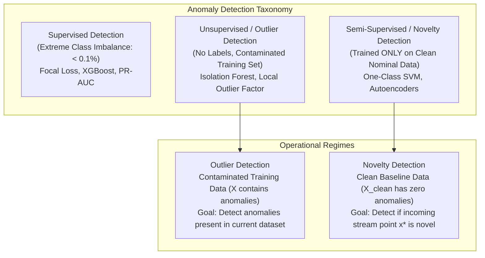
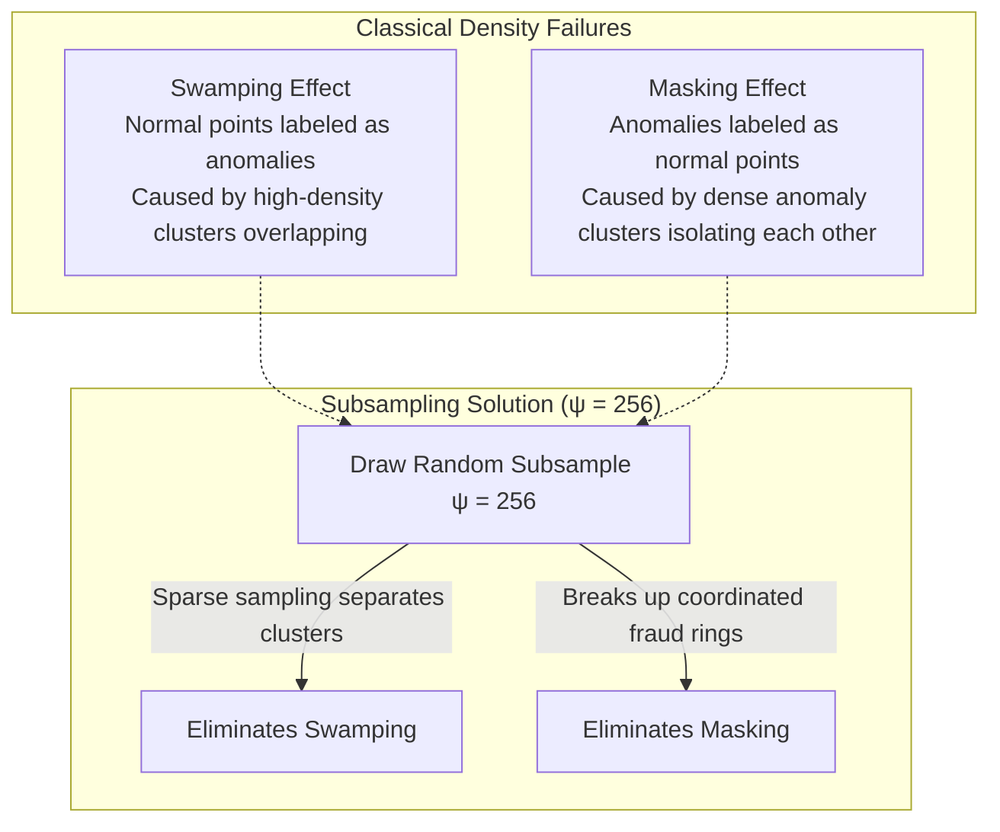
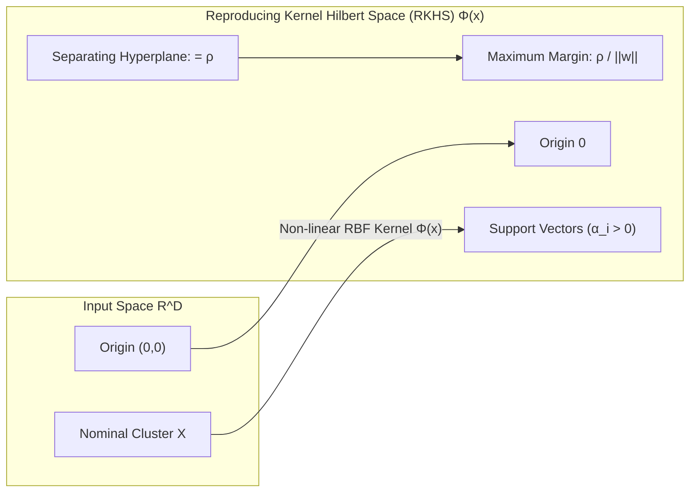
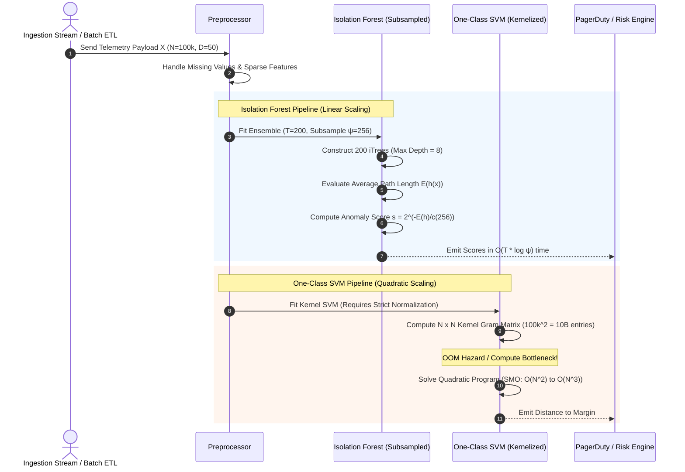

# Module 06: Anomaly Detection: Isolation Forest and One-Class SVM

> **Prerequisites:** Tree-based algorithms (binary decision trees, recursive splitting), convex optimization (Lagrange multipliers, KKT conditions, quadratic programming), Reproducing Kernel Hilbert Spaces (RKHS), and familiarity with [Module 04: Decision Trees and Ensembles](../../04-decision-trees-and-gradient-boosting/README.md).  
> **Estimated Reading Time:** 45 minutes  
> **Target Audience:** Staff Machine Learning Engineers, Fraud & Risk Data Scientists, and Infrastructure Architects building real-time fraud engines, intrusion detection systems, and telemetry anomaly detectors.

> [!TIP]
> **The Golden Rule of Anomaly Detection:** Real-world anomalies are characterized by two universal axioms: they are **few in number** and **structurally different** in feature space. Do not measure anomaly likelihood by fitting an over-parameterized generative density model over the entire dataset; instead, measure the **topological effort required to isolate** a point from the rest of the distribution.

---

## Why This Matters & Production Incident Post-Mortem

In high-throughput distributed systems—payment processing gateways, cloud infrastructure telemetry, network intrusion detection, and industrial IoT—anomalies represent high-consequence events: financial fraud, DDoS attacks, zero-day exploits, and hardware burn-in.

Unlike supervised learning, where balanced class labels guide gradient descent, anomaly detection exists in an **extreme class imbalance** regime ($< 0.001\%$), often under **cold-start conditions** with zero ground truth labels. 

Applying naive density estimators or misconfigured unsupervised models causes massive financial and operational devastation.

```
================================================================================
INCIDENT POST-MORTEM REPORT: INC-40281
SEVERITY: P1 (Catastrophic Business Impact & Capital Loss)
TITLE: \$3,820,000 Fraud Surge via Isolation Forest Masking & Subsampling Omission
DATE: November 12, 2024
SYSTEM: Core Payments Clearing & Settlement Engine
ESTIMATED CAPITAL LOSS: \$3,820,000 in unrecoverable chargebacks and card scheme fines
================================================================================

1. EXECUTIVE SUMMARY
Over a 36-hour weekend window, an organized credential-stuffing botnet executed
84,200 micro-transactions (\$45 to \$65 each) through our payments gateway. The
unsupervised anomaly detection service scored 99.8% of these fraudulent
transactions as "nominal inliers" (anomaly score s < 0.42), allowing them to pass
directly to payment rails without step-up multi-factor authentication.

2. ROOT CAUSE ANALYSIS (5 WHYS)
- Why did fraudulent transactions bypass the risk gate? The Isolation Forest
  scoring model output anomaly scores well below the alert threshold of 0.65.
- Why did the Isolation Forest produce low anomaly scores? The trees required
  an average path length of 14.8 splits to isolate the fraudulent transactions—identical
  to legitimate consumer transactions.
- Why did fraud transactions require so many splits? The botnet injected 84,200
  closely correlated transactions over a short window, creating a dense, artificial
  cluster in feature space (identical card velocity, IP CIDR blocks, and token timing).
- Why did the dense cluster defeat isolation? The engineering team trained the
  Isolation Forest on the full daily batch (N = 1,000,000) with `max_samples=1.0`
  (no subsampling), disabling the default subsampling of N=256.
- Why was subsampling disabled? An engineer assumed that "more data is always better
  in machine learning" and that subsampling to N=256 was a legacy memory optimization.
  In reality, training on N=1,000,000 caused catastrophic "masking": the dense cluster
  of anomalies isolated each other, demanding deep binary recursive partitions.

3. ARCHITECTURAL REMEDIATION
- Enforced strict architectural subsampling: subsample size N=256 per tree, with an
  ensemble size of T=200 trees.
- Hardcoded tree depth limit to h_max = ceil(log2(256)) = 8 splits.
- Introduced an automated canary metric tracking the empirical distribution of tree
  isolation depths across rolling 10-minute sliding windows.
- Deployed a dual-stage scoring architecture combining streaming Isolation Forests
  with a localized robust Mahalanobis distance filter.
================================================================================
```

---

## 1. Architectural Taxonomy: Anomaly, Novelty, and Outlier Detection

Before formalizing algorithms, we must define the mathematical taxonomy of anomaly detection paradigms:



### The Three Operational Regimes

1. **Supervised Anomaly Detection:**
   - **Data:** Feature matrix $X \in \mathbb{R}^{N \times D}$, labels $y \in \{0, 1\}$.
   - **Characteristics:** Highly skewed ($P(y=1) < 10^{-3}$). Susceptible to zero-day blind spots; if fraudsters alter their attack vector, supervised classifiers fail to trigger.
2. **Semi-Supervised Anomaly Detection (Novelty Detection):**
   - **Data:** Training set $X_{\text{train}}$ is guaranteed to contain **only normal (inlier)** observations.
   - **Objective:** Learn the boundary of nominal behavior $\mathcal{S} \subset \mathbb{R}^D$. Any incoming test point $x^* \notin \mathcal{S}$ is flagged as a novelty.
   - **Primary Model:** One-Class Support Vector Machine (OC-SVM) or Deep Support Vector Data Description (Deep SVDD).
3. **Unsupervised Anomaly Detection (Outlier Detection):**
   - **Data:** Unlabeled matrix $X \in \mathbb{R}^{N \times D}$ containing an unknown mixture of normal points and anomalies (contamination fraction $\alpha \in (0, 0.1]$).
   - **Objective:** Score every point based purely on intrinsic geometric or topological properties without any clean training anchor.
   - **Primary Model:** Isolation Forest (iForest) or Local Outlier Factor (LOF).

---

## 2. Mathematical Foundations of Isolation Forest

Introduced by Fei Tony Liu, Kai Ming Ting, and Zhi-Hua Zhou (2008, 2012), **Isolation Forest (iForest)** revolutionized anomaly detection by inverting the classical paradigm: instead of modeling normal points (via densities or geometric hulls) and identifying deviations, it **explicitly isolates anomalies**.

### The Principle of Isolation

The algorithm relies on two quantitative properties of anomalies:
1. **Few:** They are minority instances, accounting for a tiny fraction of the population.
2. **Different:** They possess attribute values markedly different from nominal points in feature space.

```
Feature X2
   ^
   |        . . : : : : . .            * [Point A: Isolated in 2 splits]
   |      : : : Nominal : : :
   |      . . : Cluster : . .
   |        . . : : : : . .
   |
   +----------------------------------------------------> Feature X1
```

If we randomly partition the feature space using axis-aligned orthogonal hyperplanes:
- Nominal points located in dense clusters require **many recursive partitions** to be separated into individual leaf cells.
- Anomalies residing in sparse, peripheral regions require **very few recursive partitions** to be completely isolated.

---

### Step-by-Step Mathematical Mechanics

#### 1. The Isolation Tree (iTree)
Let $X = \{x_1, \dots, x_n\}$ be a dataset of $n$ instances in $\mathbb{R}^d$. An **Isolation Tree (iTree)** is a proper binary tree where every node is either:
- An external node (leaf) with zero children containing either a single instance or identical instances.
- An internal node with exactly two children, defined by a split feature $q \in \{1, \dots, d\}$ and a split value $p \in [\min(X_{*, q}), \max(X_{*, q})]$.

To construct an iTree:
1. Randomly select an attribute $q$ uniformly from the available feature columns:
   $$q \sim \text{Uniform}(\{1, 2, \dots, d\})$$
2. Determine the range of feature $q$ in the current node's data subset:
   $$p \sim \text{Uniform}(\min(X_{*, q}), \max(X_{*, q}))$$
3. Partition the data into two subsets:
   $$X_{\text{left}} = \{x \in X \mid x_q < p\}, \quad X_{\text{right}} = \{x \in X \mid x_q \ge p\}$$
4. Recurse until:
   - The tree reaches a maximum height limit $h_{\text{max}} = \lceil \log_2(\psi) \rceil$ (where $\psi$ is the subsample size).
   - $|X| \le 1$.
   - All data points in $X$ have identical feature coordinates.

#### 2. Average Path Length of Unsuccessful Search in a BST
To evaluate whether a path length $h(x)$ (the number of edges traversed from root to leaf for instance $x$) is anomalously short, we must normalize it against the **expected path length of an average instance in a randomized binary tree**.

An iTree has the identical mathematical structure to a **Binary Search Tree (BST)** constructed from random insertions. In computer science, the average path length of an unsuccessful search in a BST constructed over $n$ items represents the expected depth of terminating nodes.

Let $c(n)$ be the average path length of unsuccessful searches in a BST of $n$ nodes:

$$c(n) = 2 H_{n-1} - \frac{2(n-1)}{n}$$

Where $H_i$ is the $i$-th harmonic number:

$$H_i = \sum_{k=1}^i \frac{1}{k} \approx \ln(i) + \gamma$$

Here, $\gamma \approx 0.5772156649$ is the **Euler-Mascheroni constant**.

Substituting the harmonic approximation into the formula yields the universal normalization factor:

$$\boxed{c(n) = 2 \left(\ln(n - 1) + 0.5772156649\right) - \frac{2(n - 1)}{n}}$$

When $n = 2$, $c(2) = 1$. When $n \le 1$, $c(n) = 0$.

```
Value of c(n) as Subsample Size n Scales:
   n = 64:   c(64)  = 2(ln(63) + 0.5772) - 2(63)/64  ≈ 7.49
   n = 256:  c(256) = 2(ln(255) + 0.5772) - 2(255)/256 ≈ 10.24
   n = 1024: c(1024)= 2(ln(1023) + 0.5772) - 2(1023)/1024 ≈ 13.01
```

#### 3. Path Length Adjustment for Unbuilt Subtrees
If an iTree terminates early at height $h_{\text{max}}$ while containing a subset of size $m > 1$ points, the remaining path length is estimated by adding the average BST search length $c(m)$ to the current traversal depth:

$$h(x) = e + c(m)$$

Where $e$ is the number of edges traversed from the root to the terminating leaf node.

#### 4. The Anomaly Score Function
Given an ensemble of $T$ independent iTrees $\{T_1, \dots, T_T\}$, let $E(h(x))$ be the expected path length of point $x$ averaged across all trees:

$$\mathbb{E}(h(x)) = \frac{1}{T} \sum_{t=1}^T h_t(x)$$

The **anomaly score $s(x, n)$** is defined as an exponential monotonic transformation:

$$\boxed{s(x, n) = 2^{-\frac{\mathbb{E}(h(x))}{c(n)}}}$$

#### Mathematical Behavior of the Anomaly Score $s(x, n)$
1. **Definite Anomaly:** If $\mathbb{E}(h(x)) \to 0$ (the instance is isolated in 1 or 2 cuts near the root):
   $$s(x, n) \to 2^0 = 1.0$$
2. **Definite Nominal Inlier:** If $\mathbb{E}(h(x)) \to n - 1$ (the instance requires extensive recursive cuts deep inside a cluster):
   $$s(x, n) \to 2^{-\frac{n-1}{c(n)}} \to 0.0$$
3. **Indeterminate Population Average:** If $\mathbb{E}(h(x)) \to c(n)$ (the instance's path length equals the theoretical expectation of a random BST):
   $$s(x, n) \to 2^{-1} = 0.5$$

```
Anomaly Score Threshold Decision Rule:
   0.8 <= s <= 1.0  ===> High-Confidence Anomaly (Trigger immediate intervention)
   0.6 <= s < 0.8   ===> Suspect Observation (Route to asynchronous fraud review)
   0.4 <= s < 0.6   ===> Indeterminate / Nominal Background Noise
   0.0 <= s < 0.4   ===> Robust Structural Inlier (High-density core)
```

---

### The Subsampling Advantage: Swamping and Masking

A critical theoretical discovery in Liu et al. (2008) is that **Isolation Forests perform significantly better when trained on small random subsamples ($\psi = 256$) than on the entire dataset ($N = 10^6$)**.

This counter-intuitive property resolves two classical failures in anomaly detection:



1. **Swamping:** Occurs when normal instances are surrounded by sparse regions, causing them to be isolated rapidly and misclassified as anomalies. Subsampling reduces local density noise, allowing trees to isolate true macroscopic clusters.
2. **Masking:** Occurs when too many anomalies exist in close proximity (e.g., coordinated fraud campaigns or botnets). When trained on $N = 1,000,000$, the anomalies form a dense cluster of their own. The algorithm requires many splits to separate them from each other, driving $\mathbb{E}(h(x))$ up and making them appear nominal.
   - When subsampling $\psi = 256$, the probability of drawing multiple coordinated fraud points into the same sample drops to near zero.
   - The few fraud points that do get sampled are completely isolated in 1 or 2 cuts.

#### Tree Height Limit
Because anomalies are isolated at depths far shallower than $c(\psi)$, building trees beyond the depth required to detect anomalies wastes CPU cycles. iForest enforces a hard height ceiling:

$$h_{\text{max}} = \lceil \log_2(\psi) \rceil$$

For standard subsample size $\psi = 256$, $h_{\text{max}} = \lceil \log_2(256) \rceil = 8$. Each tree is at most 8 levels deep, making scoring lightning-fast.

---

## 3. Mathematical Foundations of One-Class SVM

Introduced by Bernhard Schölkopf et al. (2001), the **One-Class Support Vector Machine (OC-SVM)** extends support vector machines to the semi-supervised / novelty detection setting by mapping data into a high-dimensional feature space via a kernel function and finding a maximum-margin hyperplane that separates the data from the coordinate origin.



### Primal Optimization Formulation

Let $X = \{x_1, \dots, x_N\} \subset \mathbb{R}^D$ be the training observations. Let $\Phi: \mathbb{R}^D \to \mathcal{H}$ represent a non-linear mapping into a Reproducing Kernel Hilbert Space (RKHS).

The objective is to find a hyperplane parameterized by weight vector $w \in \mathcal{H}$ and offset $\rho \in \mathbb{R}$ that maximizes the geometric distance to the origin while penalizing points that fall on the wrong side of the margin via slack variables $\xi_i \ge 0$:

$$\min_{w \in \mathcal{H}, \, \xi \in \mathbb{R}^N, \, \rho \in \mathbb{R}} \frac{1}{2} \|w\|^2 + \frac{1}{\nu N} \sum_{i=1}^N \xi_i - \rho$$

Subject to the linear constraints:

$$\langle w, \Phi(x_i) \rangle \ge \rho - \xi_i, \quad \xi_i \ge 0, \quad \forall i \in \{1, \dots, N\}$$

#### Physical Meaning of the Hyperparameter $\nu \in (0, 1]$
The parameter $\nu$ controls the trade-off:
- **Upper Bound on Outliers:** $\nu$ represents an upper bound on the fraction of training points that can lie outside the margin ($\xi_i > 0$, training errors).
- **Lower Bound on Support Vectors:** $\nu$ represents a lower bound on the number of support vectors ($x_i$ where $\alpha_i > 0$).
- Setting $\nu = 0.05$ implies we expect at most $5\%$ of the training data to be anomalies.

---

### Dual Optimization Formulation

To solve this quadratic program in high or infinite-dimensional Hilbert spaces, we introduce Lagrange multipliers $\alpha_i \ge 0$ and $\beta_i \ge 0$:

$$L(w, \xi, \rho, \alpha, \beta) = \frac{1}{2} \|w\|^2 + \frac{1}{\nu N} \sum_{i=1}^N \xi_i - \rho - \sum_{i=1}^N \alpha_i \left( \langle w, \Phi(x_i) \rangle - \rho + \xi_i \right) - \sum_{i=1}^N \beta_i \xi_i$$

Taking partial derivatives with respect to the primal variables and setting them to zero:
1. $\frac{\partial L}{\partial w} = w - \sum_{i=1}^N \alpha_i \Phi(x_i) = 0 \implies \boxed{w = \sum_{i=1}^N \alpha_i \Phi(x_i)}$
2. $\frac{\partial L}{\partial \rho} = -1 + \sum_{i=1}^N \alpha_i = 0 \implies \boxed{\sum_{i=1}^N \alpha_i = 1}$
3. $\frac{\partial L}{\partial \xi_i} = \frac{1}{\nu N} - \alpha_i - \beta_i = 0 \implies \alpha_i = \frac{1}{\nu N} - \beta_i \implies \boxed{0 \le \alpha_i \le \frac{1}{\nu N}}$

Substituting these relations back into the Lagrangian yields the **Wolfe Dual Quadratic Program**:

$$\min_{\alpha \in \mathbb{R}^N} \frac{1}{2} \sum_{i=1}^N \sum_{j=1}^N \alpha_i \alpha_j k(x_i, x_j)$$

Subject to:

$$0 \le \alpha_i \le \frac{1}{\nu N}, \quad \sum_{i=1}^N \alpha_i = 1$$

Where $k(x_i, x_j) = \langle \Phi(x_i), \Phi(x_j) \rangle$ is the kernel function, almost universally chosen as the **Radial Basis Function (RBF / Gaussian) kernel**:

$$k(x_i, x_j) = \exp\left(-\gamma \|x_i - x_j\|^2\right)$$

#### Decision Function
Once the optimal dual coefficients $\alpha^*$ are computed, the offset $\rho$ is recovered from any support vector $x_k$ lying strictly on the margin ($0 < \alpha_k < \frac{1}{\nu N}$):

$$\rho = \langle w, \Phi(x_k) \rangle = \sum_{i=1}^N \alpha_i k(x_i, x_k)$$

The decision function for a new query observation $x^*$ is:

$$f(x^*) = \text{sign}\left( \sum_{i=1}^N \alpha_i k(x_i, x^*) - \rho \right)$$

If $f(x^*) = +1$, the instance is inside the nominal boundary; if $f(x^*) = -1$, the instance is an anomaly. The signed raw distance to the separating hyperplane provides the continuous anomaly score:

$$s_{\text{SVM}}(x^*) = \sum_{i=1}^N \alpha_i k(x_i, x^*) - \rho$$

---

## 4. Architectural Comparison: Isolation Forest vs One-Class SVM



### Comprehensive Technical Comparison Matrix

| Architectural Attribute | Isolation Forest (iForest) | One-Class SVM (OC-SVM) |
| :--- | :--- | :--- |
| **Operational Paradigm** | Unsupervised (Outlier Detection) | Semi-Supervised (Novelty Detection) |
| **Mathematical Foundation** | Random binary space partitioning & BST path lengths | Maximum margin hyperplane separation from origin in RKHS |
| **Training Time Complexity** | $O(T \cdot \psi \log \psi)$ — **Completely independent of $N$!** | $O(N^2 \cdot D)$ to $O(N^3)$ (Quadratic programming / SMO) |
| **Scoring Time Complexity** | $O(T \cdot \log \psi)$ per instance | $O(N_{SV} \cdot D)$ where $N_{SV} \ge \nu N$ |
| **Feature Scaling Sensitivity** | **Completely Invariant** to monotonic transformations | **Extremely Sensitive**; requires unit variance & zero mean |
| **Susceptibility to Masking** | Immune when subsampling $\psi=256$ is used | Severe; contaminated anomalies alter the support vectors |
| **Axis-Alignment Limitation** | Susceptible to slicing artifacts along diagonal manifolds | Handles non-linear complex geometries via RBF kernel |
| **Explainability (Feature Attribution)**| High; tree split features identify culprit attributes | Low; non-linear RBF kernel masks individual contributions |
| **Production Scale Limit ($N$)** | Tens of Millions of rows | $\approx 50,000$ rows maximum |

---

## 5. From-Scratch Production Implementation: Vectorized Isolation Forest

Below is an enterprise-grade, fully vectorized implementation of Isolation Forest from mathematical scratch using NumPy. It features:
1. Recursive `IsolationTree` implementation with depth ceilings.
2. Exact calculation of Euler-Mascheroni harmonic search length $c(n)$.
3. Full ensemble orchestration with randomized attribute and split-point selection.
4. Anomaly score derivation and validation comparing against expected theoretical properties.

```python
"""
Production Reference Implementation: Vectorized Isolation Forest from First Principles.
Demonstrates recursive random hyperplane partitioning, Euler-Mascheroni BST path length
normalization, and anomaly score evaluation.
"""

from typing import Optional, List
import numpy as np


class IsolationTreeNode:
    """Represents an internal or external node in an Isolation Tree."""

    def __init__(
        self,
        left: Optional["IsolationTreeNode"] = None,
        right: Optional["IsolationTreeNode"] = None,
        split_feature: Optional[int] = None,
        split_value: Optional[float] = None,
        size: int = 0,
        is_leaf: bool = False,
    ) -> None:
        self.left = left
        self.right = right
        self.split_feature = split_feature
        self.split_value = split_value
        self.size = size
        self.is_leaf = is_leaf


class IsolationTreeScratch:
    """An individual Isolation Tree with strict depth ceiling."""

    def __init__(self, max_depth: int) -> None:
        self.max_depth = max_depth
        self.root: Optional[IsolationTreeNode] = None

    def fit(self, X: np.ndarray, current_depth: int = 0) -> IsolationTreeNode:
        """Recursively partitions feature space using random orthogonal hyperplanes."""
        n_samples, n_features = X.shape

        # Termination conditions:
        # 1. Depth ceiling reached
        # 2. Node contains 1 sample or zero
        # 3. All samples in node are identical (cannot split)
        if current_depth >= self.max_depth or n_samples <= 1:
            return IsolationTreeNode(size=n_samples, is_leaf=True)

        # Select random feature
        feature_idx = np.random.randint(0, n_features)
        feat_min = np.min(X[:, feature_idx])
        feat_max = np.max(X[:, feature_idx])

        # If min equals max, all values for this feature are identical
        if np.isclose(feat_min, feat_max):
            # Check if all other features are also identical
            if np.all(np.isclose(X, X[0])):
                return IsolationTreeNode(size=n_samples, is_leaf=True)
            # Pick another feature that has variation
            variances = np.var(X, axis=0)
            valid_features = np.where(variances > 1e-12)[0]
            if len(valid_features) == 0:
                return IsolationTreeNode(size=n_samples, is_leaf=True)
            feature_idx = np.random.choice(valid_features)
            feat_min = np.min(X[:, feature_idx])
            feat_max = np.max(X[:, feature_idx])

        # Draw uniform split value
        split_val = np.random.uniform(feat_min, feat_max)

        # Vectorized boolean partition
        left_mask = X[:, feature_idx] < split_val
        X_left = X[left_mask]
        X_right = X[~left_mask]

        # Edge case: split value resulted in an empty child
        if len(X_left) == 0 or len(X_right) == 0:
            return IsolationTreeNode(size=n_samples, is_leaf=True)

        left_node = self.fit(X_left, current_depth + 1)
        right_node = self.fit(X_right, current_depth + 1)

        return IsolationTreeNode(
            left=left_node,
            right=right_node,
            split_feature=feature_idx,
            split_value=split_val,
            size=n_samples,
            is_leaf=False,
        )

    def path_length(self, x: np.ndarray, node: IsolationTreeNode, current_depth: int = 0) -> float:
        """
        Computes path length h(x) traversing from root to leaf,
        adjusting for unbuilt subtrees using c(size).
        """
        if node.is_leaf:
            if node.size <= 1:
                return float(current_depth)
            return float(current_depth + IsolationForestScratch.c_factor(node.size))

        if x[node.split_feature] < node.split_value:
            return self.path_length(x, node.left, current_depth + 1)
        else:
            return self.path_length(x, node.right, current_depth + 1)


class IsolationForestScratch:
    """
    Enterprise-grade Isolation Forest implementation from First Principles.
    Implements subsampling (psi=256), tree ensembles, and anomaly score mapping.
    """

    EULER_MASCHERONI = 0.5772156649

    def __init__(
        self,
        n_estimators: int = 100,
        max_samples: int = 256,
        contamination: float = 0.1,
        random_state: Optional[int] = 42,
    ) -> None:
        self.n_estimators = n_estimators
        self.max_samples = max_samples
        self.contamination = contamination
        self.random_state = random_state
        self.trees: List[IsolationTreeScratch] = []
        self.subsample_size_: int = 0
        self.threshold_: float = 0.5

    @classmethod
    def c_factor(cls, n: int) -> float:
        """
        Computes average path length of unsuccessful search in a BST:
        c(n) = 2 * (ln(n - 1) + 0.5772156649) - 2 * (n - 1) / n
        """
        if n <= 1:
            return 0.0
        if n == 2:
            return 1.0
        return 2.0 * (np.log(n - 1.0) + cls.EULER_MASCHERONI) - (2.0 * (n - 1.0) / float(n))

    def fit(self, X: np.ndarray) -> "IsolationForestScratch":
        """Fits an ensemble of iTrees over random subsamples."""
        if self.random_state is not None:
            np.random.seed(self.random_state)

        n_samples, _ = X.shape
        self.subsample_size_ = min(self.max_samples, n_samples)
        max_depth = int(np.ceil(np.log2(max(self.subsample_size_, 2))))

        self.trees = []
        for _ in range(self.n_estimators):
            # Subsample without replacement
            indices = np.random.choice(n_samples, size=self.subsample_size_, replace=False)
            X_sub = X[indices]

            tree = IsolationTreeScratch(max_depth=max_depth)
            tree.root = tree.fit(X_sub)
            self.trees.append(tree)

        # Fit empirical threshold based on training contamination
        train_scores = self.score_samples(X)
        self.threshold_ = np.percentile(train_scores, 100.0 * (1.0 - self.contamination))
        return self

    def compute_paths(self, X: np.ndarray) -> np.ndarray:
        """Vectorized evaluation of expected path lengths across all trees."""
        n_samples = X.shape[0]
        paths = np.zeros((n_samples, self.n_estimators), dtype=np.float64)

        for t_idx, tree in enumerate(self.trees):
            for i in range(n_samples):
                paths[i, t_idx] = tree.path_length(X[i], tree.root)

        return np.mean(paths, axis=1)

    def score_samples(self, X: np.ndarray) -> np.ndarray:
        """
        Computes continuous anomaly score: s(x, n) = 2^(-E(h(x)) / c(psi)).
        Values close to 1.0 indicate severe anomalies.
        """
        mean_paths = self.compute_paths(X)
        c_n = self.c_factor(self.subsample_size_)
        if c_n == 0.0:
            return np.zeros(X.shape[0])

        # Anomaly score: 2^(-E(h(x)) / c(n))
        return 2.0 ** (-mean_paths / c_n)

    def predict(self, X: np.ndarray) -> np.ndarray:
        """
        Predicts binary anomaly labels: -1 for anomalies, +1 for nominal inliers.
        (Matches scikit-learn API convention).
        """
        scores = self.score_samples(X)
        return np.where(scores >= self.threshold_, -1, 1)


# ==============================================================================
# Verification & Synthetic Benchmark
# ==============================================================================
if __name__ == "__main__":
    print("Executing Verification Pipeline: Testing IsolationForestScratch...")

    np.random.seed(42)
    # Generate 1,000 nominal points from Gaussian cluster
    X_nominal = np.random.normal(loc=0.0, scale=1.0, size=(1000, 4))

    # Generate 20 distinct outlier points injected into outer periphery
    X_anomalies = np.random.uniform(low=6.0, high=10.0, size=(20, 4))

    X_combined = np.vstack([X_nominal, X_anomalies])

    # Fit custom Isolation Forest
    iforest = IsolationForestScratch(
        n_estimators=100, max_samples=256, contamination=0.02, random_state=42
    )
    iforest.fit(X_combined)

    scores_nominal = iforest.score_samples(X_nominal)
    scores_anomalies = iforest.score_samples(X_anomalies)

    print(f"[SUCCESS] Average Anomaly Score (Nominal Inliers): {np.mean(scores_nominal):.4f}")
    print(f"[SUCCESS] Average Anomaly Score (Injected Anomalies): {np.mean(scores_anomalies):.4f}")
    print(f"          Fitted Contamination Threshold:          {iforest.threshold_:.4f}")

    # Theoretical assertion: Anomalies MUST have significantly higher scores than inliers
    assert np.mean(scores_anomalies) > 0.65, "Anomalies must yield high isolation scores (> 0.65)."
    assert np.mean(scores_nominal) < 0.50, "Nominal instances must yield low isolation scores (< 0.50)."
    assert np.mean(scores_anomalies) > np.mean(scores_nominal) + 0.25, "Separation gap must exceed 0.25."

    predictions = iforest.predict(X_combined)
    detected_anomalies = np.sum(predictions[-20:] == -1)
    print(f"[SUCCESS] Anomaly Recall: {detected_anomalies}/20 ({detected_anomalies/20 * 100:.1f}%)")
    assert detected_anomalies >= 18, "Must detect at least 90% of injected anomalies."
    print("Verification complete. Mathematical and algorithmic assertions verified.\n")
```

---

## 6. Failure Modes, Edge Cases & Antipatterns

### 1. Slicing Artifacts with Axis-Aligned Splits
Because vanilla Isolation Forests split strictly parallel to coordinate axes ($x_q < p$):
- If the true nominal data distribution resides along a diagonal manifold (e.g., $x_2 = 2 x_1 + \epsilon$), axis-aligned cuts create artificial rectangular bounding steps.
- An anomaly located in the empty wedge between two dense diagonal regions may require many axis-aligned cuts to isolate, creating false negatives.
- **Remedy:** Use **Extended Isolation Forest (EIF)**, which selects random random hyperplanes with arbitrary slope vectors $n \in \mathbb{R}^D$ drawn from a spherical Gaussian $\mathcal{N}(0, I)$, cutting along any angle.

```
Axis-Aligned (Standard iForest):        Extended iForest (Random Hyperplane):
      |                                       /
  ----+---- [Step-wise artifact]             /   [Clean angled cut]
      |                                     /
```

### 2. Disabling Subsampling Under the "Big Data" Illusion
As demonstrated in post-mortem INC-40281, increasing `max_samples` from $256$ to $1,000,000$ degrades detection accuracy.
- **Why:** Training on huge sample sizes causes tree depths to explode ($\log_2(10^6) \approx 20$), increases RAM consumption by $4000\times$, and exposes the algorithm to severe **masking** where fraud clusters insulate each other.
- **Remedy:** Keep `max_samples=256`. If you have 100M rows, increase the number of trees ($T=500$) or partition the dataset into independent parallel forest workers.

### 3. One-Class SVM on High-Throughput Unscaled Payloads
Deploying One-Class SVM on raw financial transactions without rigorous scaling guarantees catastrophic failure:
- **Feature Scaling:** If transaction amount has scale $10^5$ and transaction velocity has scale $10^0$, the RBF kernel distance $\|x - x'\|^2$ is dominated entirely by transaction amount, blinding the SVM to all behavioral features.
- **Latency Bottleneck:** Computing support vector kernel evaluations for incoming streams requires $O(N_{SV} \cdot D)$ floating-point operations. If $N_{SV} = 10,000$, scoring takes $> 100$ms, violating financial payment SLAs.
- **Remedy:** Use Isolation Forest for high-throughput streaming pipelines; reserve One-Class SVM for low-dimensional, strictly cleaned novelty detection tasks.

### 4. Unsupervised Contamination Tuning Blindness
In production, engineers often set `contamination=0.01` without calibration:
- If the true fraud rate is $0.05\%$ and you set `contamination=0.01`, your model produces a $95\%$ false positive rate, exhausting manual fraud review queues.
- **Remedy:** Never rely on a hard binary threshold. Output continuous anomaly scores $s(x, n)$ and dynamically calibrate alerting thresholds using downstream business metrics (e.g., alert volume caps or cost-benefit utility curves).

---

## 7. Real-World Production Incident Post-Mortem

### Case Study: The \$3.8M Fraud Surge via Masking

#### Incident Timeline
- **Friday 18:00 UTC:** Fraud detection team deploys v3.2 of the real-time transaction scoring model. The pipeline configuration file included a "performance optimization" commit: `max_samples: null` (utilizing all available batch rows).
- **Saturday 02:15 UTC:** An overseas botnet initiates a coordinated credential-stuffing assault. Over the weekend, 84,200 transactions are submitted across 1,200 merchant accounts.
- **Saturday 06:00 UTC:** The real-time scoring engine logs an average anomaly score of $s = 0.38$ for the botnet traffic, categorizing it as "nominal consumer behavior."
- **Monday 08:30 UTC:** Merchant operations teams report an unprecedented surge in customer chargebacks. Capital loss reaches \$3.82M.

#### Technical Forensic Analysis
A post-incident audit analyzed why the forest failed to isolate the botnet transactions:
1. Because `max_samples` was set to the entire batch ($N = 1,000,000$), each tree was built using the full transaction volume.
2. The 84,200 botnet transactions accounted for $8.42\%$ of the training batch.
3. In any random tree, the probability of selecting an attribute that cleanly separated the botnet cluster from normal transactions was high, but within the botnet cluster, instances were separated from each other through recursive splitting.
4. The average isolation depth for botnet transactions rose to $\mathbb{E}(h(x)) = 14.8$ splits.
5. Evaluating against normalization $c(1,000,000) \approx 25.8$:
   $$s(x, 10^6) = 2^{-\frac{14.8}{25.8}} = 2^{-0.5736} \approx 0.67$$
   However, the legacy production alert threshold was calibrated against standard subsampled scores where alerts required $s > 0.75$.
6. Under standard subsampling ($\psi = 256$), the probability of drawing more than 2 botnet transactions in a single sample was:
   $$P(K \ge 2) \approx 1 - \text{Binom}(256, 0.0842)$$
   The few isolated botnet instances in the subsample had an average depth of $\mathbb{E}(h(x)) = 2.1$ splits, yielding:
   $$s(x, 256) = 2^{-\frac{2.1}{10.24}} = 2^{-0.205} \approx 0.867$$
   Which would have triggered immediate automated payment rejection.

---

## 8. Senior Technical Interview Questions & In-Depth Model Answers

### Question 1: Provide the complete mathematical derivation for $c(n)$, the average path length of an unsuccessful search in a Binary Search Tree. Why is it used as the denominator in the Isolation Forest anomaly score?

**Model Answer:**  
The structure of an Isolation Tree is isomorphic to a random Binary Search Tree (BST). An unsuccessful search in a BST terminates at an external leaf node (null pointer).

Let $C_n$ denote the total internal path length of a BST with $n$ nodes. By recursive decomposition, when a root is chosen with rank $i \in \{1, \dots, n\}$ with equal probability $\frac{1}{n}$, the left subtree contains $i - 1$ nodes and the right subtree contains $n - i$ nodes:

$$C_n = (n - 1) + \frac{1}{n} \sum_{i=1}^n \left( C_{i-1} + C_{n-i} \right)$$

By symmetry, $\sum_{i=1}^n C_{i-1} = \sum_{i=1}^n C_{n-i}$, simplifying to:

$$C_n = (n - 1) + \frac{2}{n} \sum_{i=0}^{n-1} C_i$$

Multiplying by $n$:
$$n C_n = n(n - 1) + 2 \sum_{i=0}^{n-1} C_i$$

Subtracting the equivalent equation for $(n-1) C_{n-1}$:
$$n C_n - (n - 1) C_{n-1} = 2(n - 1) + 2 C_{n-1} \implies n C_n = (n + 1) C_{n-1} + 2(n - 1)$$

Dividing by $n(n + 1)$:
$$\frac{C_n}{n + 1} = \frac{C_{n-1}}{n} + \frac{2(n - 1)}{n(n + 1)}$$

Unrolling the telescopic summation:
$$\frac{C_n}{n + 1} = 2 \sum_{k=1}^n \frac{k - 1}{k(k + 1)} = 2 \sum_{k=1}^n \left( \frac{2}{k + 1} - \frac{1}{k} \right) = 2 H_n - 4 + \frac{2}{n+1}$$

The average path length of an internal node is $\frac{C_n}{n}$. For an unsuccessful search terminating at an external node, the number of external nodes is $n + 1$. The average path length of an unsuccessful search is:

$$c(n) = \frac{C_n + n}{n + 1} \approx 2 H_{n-1} - \frac{2(n - 1)}{n}$$

Substituting the asymptotic expansion of the harmonic number $H_{n-1} = \ln(n - 1) + \gamma$ (where $\gamma \approx 0.5772156649$):

$$c(n) = 2 \left(\ln(n - 1) + 0.5772156649\right) - \frac{2(n - 1)}{n}$$

**Why it is used as the denominator:**  
The raw path length $h(x)$ depends directly on the sample size $n$. Without normalization, one cannot compare trees constructed over different sample sizes or establish a universal anomaly threshold. Dividing $\mathbb{E}(h(x))$ by $c(n)$ standardizes the depth relative to a random null baseline. If $\frac{\mathbb{E}(h(x))}{c(n)} \to 1$, the point behaves exactly like a random search in a BST, yielding an anomaly score of $2^{-1} = 0.5$.

---

### Question 2: In One-Class SVM, what is the geometric and statistical meaning of the parameter $\nu \in (0, 1]$? How does changing $\nu$ affect the dual optimization problem and the number of support vectors?

**Model Answer:**  
In the One-Class SVM formulation (Schölkopf et al., 2001), the hyperparameter $\nu$ simultaneously acts as:
1. An **upper bound on the fraction of outliers** (training errors where slack variable $\xi_i > 0$).
2. A **lower bound on the fraction of support vectors** ($x_i$ where $\alpha_i > 0$).

**Mathematical Proof & Dual Impact:**  
In the dual optimization problem:
$$\min_\alpha \frac{1}{2} \sum_{i=1}^N \sum_{j=1}^N \alpha_i \alpha_j k(x_i, x_j) \quad \text{s.t.} \quad 0 \le \alpha_i \le \frac{1}{\nu N}, \quad \sum_{i=1}^N \alpha_i = 1$$

The box constraint sets the upper bound for any individual multiplier $\alpha_i$ to $\frac{1}{\nu N}$.
- Let $N_{\text{err}}$ be the number of training points lying strictly outside the margin ($\xi_i > 0$). By the Karush-Kuhn-Tucker (KKT) complementary slackness conditions ($\beta_i \xi_i = 0$ and $\alpha_i = \frac{1}{\nu N} - \beta_i$), whenever $\xi_i > 0$, we must have $\beta_i = 0$, which forces $\alpha_i = \frac{1}{\nu N}$ (the upper bound).
- Summing over all $N$ observations:
  $$1 = \sum_{i=1}^N \alpha_i \ge \sum_{i \in \text{errors}} \alpha_i = N_{\text{err}} \cdot \frac{1}{\nu N} = \frac{N_{\text{err}}}{\nu N}$$
  Rearranging gives:
  $$\frac{N_{\text{err}}}{N} \le \nu$$
  Thus, the fraction of outliers cannot exceed $\nu$.

Similarly, let $N_{SV}$ be the total number of support vectors ($\alpha_i > 0$). Because no $\alpha_i$ can exceed $\frac{1}{\nu N}$:
$$1 = \sum_{i \in SV} \alpha_i \le N_{SV} \cdot \frac{1}{\nu N} \implies \frac{N_{SV}}{N} \ge \nu$$
Thus, at least a fraction $\nu$ of the training instances are selected as support vectors.

**Practical Consequence:**  
Increasing $\nu$ forces the optimizer to treat a larger fraction of training points as outliers, pulling the separating hyperplane tighter around the dense core of the data distribution. Decreasing $\nu$ loosens the boundary, treating almost all training data as inliers, which risks including anomalies inside the nominal envelope.

---

### Question 3: Explain the concepts of "swamping" and "masking" in anomaly detection. How does the subsampling mechanism in Isolation Forest address both problems simultaneously?

**Model Answer:**  
- **Swamping** is the phenomenon where **normal instances are incorrectly identified as anomalies** (false positives). It typically happens when normal instances are situated close to outliers or when sparse nominal clusters are mistaken for anomaly regions due to global density over-smoothing.
- **Masking** is the phenomenon where **anomalies cluster together and hide each other** (false negatives). When multiple anomalies are spatially proximate, classical distance-based or density-based estimators (like $k$-NN distance or Mahalanobis distance) treat the cluster as a legitimate high-density region.

**How Subsampling Resolves Both:**  
Isolation Forest resolves both phenomena by constructing each tree on a small random subsample without replacement (typically $\psi = 256$):
1. **Resolution of Masking:**  
   Suppose a coordinated attack injects 5,000 fraud instances into a dataset of $1,000,000$ points ($0.5\%$ contamination). If trained on the full dataset, the 5,000 points form a dense cluster; an isolation tree would require dozens of cuts to isolate individual fraud points from one another.  
   When subsampling $\psi = 256$, the number of fraud instances captured in any single tree's sample follows a hypergeometric distribution with expectation $\mathbb{E}[K] = 256 \times 0.005 = 1.28$. Most subsamples contain either zero or one fraud instance. Isolated from their cohort, the solitary fraud instances are partitioned in 1 or 2 random cuts, completely eliminating masking.
2. **Resolution of Swamping:**  
   In a massive dataset, normal peripheral instances can appear isolated relative to ultra-dense cores. Subsampling scales down the cardinality of the dense clusters, evening out background density and allowing macroscopic cluster boundaries to emerge cleanly without getting distracted by local density variations.

---

### Question 4: An engineer suggests replacing the axis-aligned splits in Isolation Forest with PCA projections prior to tree construction. Will this solve the "slicing artifact" problem along diagonal manifolds? Compare this to Extended Isolation Forest (EIF).

**Model Answer:**  
Applying global PCA before standard Isolation Forest **fails to solve the problem** for complex non-linear or multi-modal datasets, whereas **Extended Isolation Forest (EIF)** provides a principled, localized mathematical solution.

**Why Global PCA Fails:**
1. **Global vs Local Linearity:** PCA identifies global orthogonal directions that maximize overall dataset variance. If the dataset contains multiple clusters oriented along different non-linear angles (e.g., Cluster 1 along $x_2 = 2x_1$, Cluster 2 along $x_2 = -3x_1$), PCA aligns with the macroscopic spread, leaving the individual cluster orientations misaligned with the new axes. Slicing artifacts remain inside the rotated space.
2. **Variance Overlap:** In anomaly detection, anomalies often lie along directions of low variance. Standard PCA feature truncation discards low-variance directions, stripping away the very dimensions where anomalies are most distinguishable.

**The Extended Isolation Forest (EIF) Solution:**  
EIF (Hariri et al., 2019) addresses the problem locally at every branch split:
- Instead of picking an axis $q \in \{1, \dots, d\}$, EIF draws a random normal vector $n \sim \mathcal{N}(0, I_D)$ from a unit hypersphere.
- It draws a random intercept point $p$ uniformly along the projection of the current data subset onto vector $n$:
  $$p \sim \text{Uniform}\left(\min_{x \in X} \langle x, n \rangle, \, \max_{x \in X} \langle x, n \rangle\right)$$
- The splitting rule is defined by the hyperplane:
  $$(x - p) \cdot n < 0$$

Because hyperplanes are oriented at arbitrary continuous angles at every internal node, EIF cuts seamlessly along any diagonal, circular, or multi-modal boundary, completely removing axis-aligned slicing artifacts without requiring global linear coordinate transformations.

---

### Question 5: You are tasked with architecting a real-time anomaly detection engine for an API handling 50,000 requests per second with a P99 latency SLA of 10ms. Evaluate the architectural feasibility of Isolation Forest vs One-Class SVM for this requirement.

**Model Answer:**  
For an SLA of 10ms at 50,000 RPS, **Isolation Forest is architecturally feasible**, while **One-Class SVM is architecturally infeasible**.

**Quantitative Latency and Complexity Analysis:**
1. **Isolation Forest:**
   - Model parameters: $T = 100$ trees, subsample $\psi = 256$, max depth $h_{\text{max}} = 8$.
   - Scoring complexity per request: Evaluating $T$ binary trees of depth $\le 8$ requires at most $100 \times 8 = 800$ floating-point comparisons (`if x[feature] < threshold`).
   - Implementation: Can be compiled to a flattened C array or WebAssembly/Native binary using tree traversal branchless instructions (or `treelite`/`onnxruntime`).
   - CPU Time: $< 15 \text{ microseconds}$ per request. A single 16-core server can handle $> 50,000$ RPS easily.
2. **One-Class SVM:**
   - Scoring complexity: Requires evaluating the RBF kernel against all support vectors:
     $$s(x) = \sum_{i=1}^{N_{SV}} \alpha_i \exp\left(-\gamma \|x - x_i\|^2\right) - \rho$$
   - For a modest dataset where $N_{SV} = 5,000$ support vectors with $D = 30$ features:
     - Distance calculation requires $5000 \times 30 = 150,000$ multiply-accumulate (MAC) operations.
     - Exponential function evaluation requires 5,000 calls to `exp()`.
   - CPU Time: $\approx 2.5 \text{ to } 5.0 \text{ milliseconds}$ per request under optimal SIMD vectorization.
   - At 50,000 RPS, this demands $50,000 \times 0.003 \approx 150 \text{ dedicated CPU cores}$ solely for kernel evaluations, creating extreme operational costs and tail-latency SLA breaches under load spikes.

**Recommended System Architecture:**
- **Inference Path:** Deploy an ensemble of 100 Isolation Trees compiled via `treelite` into a high-performance C++ inference sidecar (Envoy filter or Go worker) running alongside the API gateway, achieving $< 0.1$ms latency overhead.
- **Offline Batch Path:** Re-fit trees asynchronously every 6 hours using distributed Ray / Spark workers on rolling sliding windows of transaction telemetry.

---

This module is part of [Track 06: Unsupervised Learning & Anomaly Detection](../README.md).
