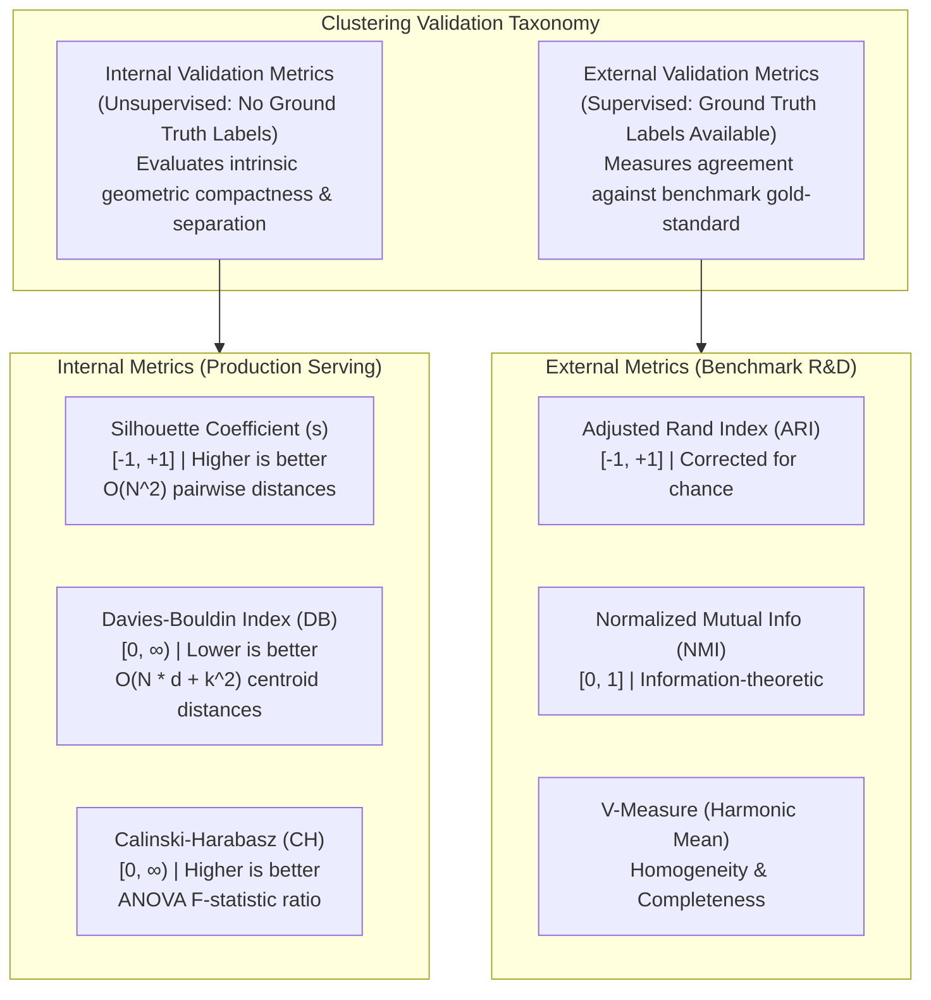
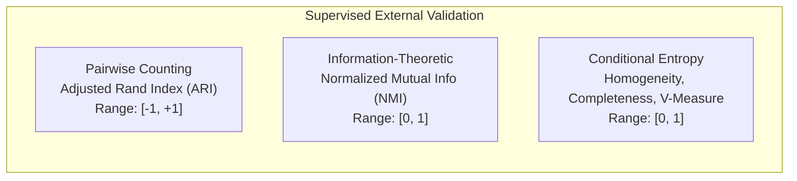
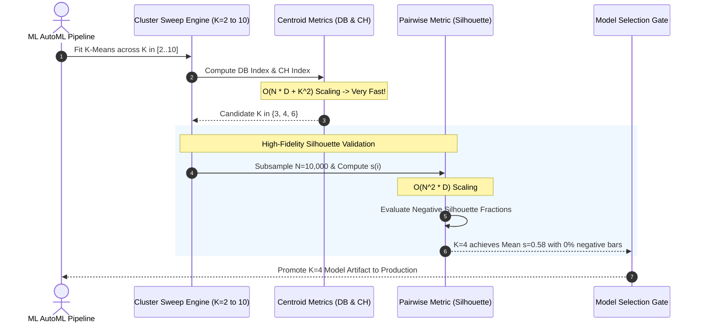

# Module 08: Evaluating Clustering: Silhouette, Davies-Bouldin, and Validation Metrics

> **Prerequisites:** Unsupervised clustering algorithms ([Module 00: K-Means](../00-k-means-clustering-initialization-and-elbow-method/README.md), [Module 02: DBSCAN & HDBSCAN](../02-dbscan-hdbscan-and-density-clustering/README.md), [Module 03: Gaussian Mixture Models](../03-gaussian-mixture-models-and-em-algorithm/README.md)), linear algebra (norms, projections), and basic information theory (entropy, mutual information).  
> **Estimated Reading Time:** 45 minutes  
> **Target Audience:** Principal Data Scientists, ML Platform Architects, and Analytics Engineering Leads designing unsupervised segmentation pipelines, automated model selection jobs, and customer lifecycle classification systems.

> [!TIP]
> **The Golden Rule of Cluster Evaluation:** Never select the number of clusters $K$ based solely on the Within-Cluster Sum of Squares (WCSS) "Elbow Method." The elbow method is a subjective heuristic that monotonically decreases toward zero as $K \to N$, providing zero penalization for over-segmentation. In production pipelines, always combine **Internal Validation Metrics** (Silhouette analysis, Davies-Bouldin, Calinski-Harabasz) with **Downstream Business Utility Constraints** (minimum cohort size, cluster stability across random seeds, and segment interpretability).

---

## Why This Matters & Production Incident Post-Mortem

Supervised machine learning relies on objective, mathematically rigorous ground truth labels: loss functions (Cross-Entropy, Mean Squared Error) provide unambiguous gradients, and holdout test sets yield verifiable generalization metrics (AUC-ROC, F1-Score, RMSE).

In unsupervised clustering, **there is no ground truth $y$**. We are searching for latent structure in an unlabeled feature space $\mathbb{R}^D$. Because clustering algorithms will happily partition completely uniform, unstructured noise into $K$ artificial clusters if commanded to do so, cluster validation is the most intellectually demanding phase of unsupervised machine learning.

A catastrophic anti-pattern in enterprise systems is automating cluster selection using simplistic heuristics or unvalidated loss curves, creating severe downstream business devastation.

```
================================================================================
INCIDENT POST-MORTEM REPORT: INC-63012
SEVERITY: P1 (High Business Impact & Marketing Capital Misallocation)
TITLE: \$5,200,000 Churn Retention Campaign Disaster via Suboptimal WCSS Elbow Selection
DATE: October 29, 2024
SYSTEM: Automated Customer Lifecycle Segmentation & Retention Engine
ESTIMATED REVENUE IMPACT: \$5,200,000 in customer churn and wasted promotional spend
================================================================================

1. EXECUTIVE SUMMARY
Over a six-month campaign, our enterprise B2B SaaS platform deployed a new churn
mitigation system. High-value enterprise customer accounts were partitioned into
behavioral cohorts, with targeted retention discounts and dedicated account
management intervention. The campaign resulted in a 41% customer churn rate
among flagged "at-risk" cohorts—higher than the baseline historical churn rate
of 12%—wasting \$5.2M in retention credits while failing to save high-value accounts.

2. ROOT CAUSE ANALYSIS (5 WHYS)
- Why did the churn retention campaign fail? Account executives contacted healthy,
  highly active enterprise clients with aggressive "sorry to see you go" discounts,
  triggering renegotiations and contract terminations, while genuinely disengaged
  accounts received zero outreach.
- Why were healthy accounts misclassified as churn risks? The accounts were assigned
  to "Cluster 7: Severe Attrition Risk", which was fundamentally identical to
  "Cluster 2: Power Enterprise Users".
- Why were Clusters 7 and 2 overlapping? The automated model training pipeline chose
  K=12 clusters based on an automated "Elbow Method" heuristic searching for the
  second derivative of the WCSS inertia curve.
- Why did the Elbow Method pick K=12? WCSS inertia monotonically drops as K increases.
  On heavy-tailed customer telemetry, the elbow curve had no sharp kink; the algorithm
  arbitrarily selected K=12 because it crossed an arbitrary 5% variance reduction threshold.
- Why was cluster separation not validated? The pipeline did not compute internal
  validation metrics (Silhouette Coefficient or Davies-Bouldin Index). Post-incident
  audits revealed that 7 of the 12 clusters had negative mean silhouette scores
  (s_i < -0.15), proving that points were closer to neighboring centroids than
  their assigned cluster.

3. ARCHITECTURAL REMEDIATION
- Mandatory retirement of automated WCSS elbow selection across all production pipelines.
- Implementation of multi-metric Pareto model selection: Optimization must satisfy
  Mean Silhouette Score >= 0.40, Davies-Bouldin Index <= 1.2, and minimum cluster
  cardinality >= 5% of total population.
- Integration of Silhouette plot visual diagnostics and cluster stability checks
  (bootstrap Jaccard similarity across random seeds) prior to model registration.
================================================================================
```

---

## 1. Architectural Taxonomy: Internal vs External Validation

Cluster validation metrics fall into two distinct mathematical categories based on whether external reference annotations are available:



### The Fundamental Mathematical Duality: Compactness vs Separation

Every internal validation metric evaluates a trade-off between two fundamental geometric properties:
1. **Compactness (Cohesion):** How closely related are the observations within the same cluster? (Minimized intra-cluster distance / variance).
2. **Separation (Isolation):** How distinct and well-separated is a cluster from its neighboring clusters? (Maximized inter-cluster distance).

A clustering algorithm that groups every single observation into a single global cluster ($K=1$) achieves maximum separation (there are zero neighboring clusters), but catastrophic compactness. Conversely, assigning every point to its own private cluster ($K=N$) achieves perfect compactness (intra-cluster variance is identically zero), but zero separation. Internal metrics formalize this trade-off.

---

## 2. Mathematical Foundations of the Silhouette Coefficient

Introduced by Peter Rousseeuw in 1987, the **Silhouette Coefficient** provides a succinct graphical and numerical evaluation of how well each individual observation is classified within its assigned cluster.

### Step-by-Step Mathematical Mechanics

Let $X = \{x_1, x_2, \dots, x_N\} \subset \mathbb{R}^D$ be partitioned into $k$ non-overlapping clusters $\{C_1, C_2, \dots, C_k\}$.

#### Step 1: Intra-Cluster Dissimilarity $a(i)$
For an observation $i \in C_I$, let $a(i)$ be the average Euclidean distance between observation $i$ and all other points in the same cluster $C_I$:

$$a(i) = \frac{1}{|C_I| - 1} \sum_{j \in C_I, j \neq i} \|x_i - x_j\|$$

- **Physical Meaning:** $a(i)$ measures how well $x_i$ fits into its assigned cluster. Smaller values indicate higher cluster cohesion.
- If $|C_I| = 1$ (a singleton cluster), $a(i)$ is defined as $0$.

#### Step 2: Nearest-Neighbor Cluster Dissimilarity $b(i)$
For observation $i \in C_I$, compute the average distance from $i$ to all observations in any other cluster $C_J$ ($J \neq I$). The **neighboring cluster** is the cluster that minimizes this mean distance:

$$b(i) = \min_{J \neq I} \left( \frac{1}{|C_J|} \sum_{j \in C_J} \|x_i - x_j\| \right)$$

- **Physical Meaning:** The cluster $C_J$ achieving the minimum is considered the "neighbor" of observation $i$. It represents the second-best cluster assignment for $i$.

```
Cluster C_I (Assigned)                Cluster C_J (Nearest Neighbor)
    .   * x_j                                o    o
      \                                        \
 a(i)   \                                 b(i)   \
          * x_i  ================================> o
        /                                        o    o
      *
```

#### Step 3: Point-Level Silhouette Score $s(i)$
The silhouette score of observation $i$ combines $a(i)$ and $b(i)$ into a normalized ratio:

$$\boxed{s(i) = \frac{b(i) - a(i)}{\max\left(a(i), b(i)\right)}}$$

Equivalently expressed across piecewise regimes:

$$s(i) = \begin{cases} 1 - \frac{a(i)}{b(i)} & \text{if } a(i) < b(i) \\ 0 & \text{if } a(i) = b(i) \\ \frac{b(i)}{a(i)} - 1 & \text{if } a(i) > b(i) \end{cases}$$

#### Mathematical Interpretation of $s(i) \in [-1, +1]$
1. **$s(i) \to +1$ ($a(i) \ll b(i)$):**  
   The intra-cluster distance $a(i)$ is negligible compared to the distance to the nearest neighbor cluster $b(i)$. The point is deeply embedded inside its own dense cluster, far from any boundary.
2. **$s(i) \approx 0$ ($a(i) \approx b(i)$):**  
   The observation lies directly on the decision boundary between two clusters. It could belong to either cluster with equal plausibility.
3. **$s(i) \to -1$ ($a(i) \gg b(i)$):**  
   The average distance to its assigned cluster is much larger than the distance to the neighboring cluster. **The observation has been fundamentally misclustered** and should be reassigned to cluster $C_J$.

#### Step 4: Global Mean Silhouette Score $\bar{s}$
The global quality of the clustering partition is measured by the arithmetic mean across all $N$ observations:

$$\bar{s}_k = \frac{1}{N} \sum_{i=1}^N s(i)$$

The optimal number of clusters $K^*$ is selected by maximizing the global score:

$$K^* = \arg\max_{k \in [2, K_{\text{max}}]} \bar{s}_k$$

---

### Silhouette Plot Visual Diagnostics

A major strength of the silhouette metric is the **Silhouette Diagram**:
- Observations are grouped by cluster.
- Within each cluster, observations are sorted in descending order of their silhouette scores $s(i)$.
- Each cluster is rendered as a horizontal silhouette blade.
- The global mean silhouette score $\bar{s}$ is plotted as a vertical dashed red reference line.

```
Silhouette Plot Diagnostic Scenarios:

Scenario A: Optimal Clustering (K=3)       Scenario B: Degenerate Over-Clustering (K=5)
Cluster 0: |==============| (s > mean)     Cluster 0: |=======|
Cluster 1: |=================| (s > mean)  Cluster 1: |==|
Cluster 2: |=============| (s > mean)      Cluster 2: |========|
           ^                               Cluster 3: |---| (Negative s_i! Misclustered)
           |                               Cluster 4: |=|
       Mean s = 0.62                                  ^
                                                      |
                                                  Mean s = 0.28
```

#### What to Look For in a Production Silhouette Plot
1. **Knife-Edge Drops (Negative Bars):** Any cluster with bars extending to the left of $0$ indicates points that are closer to neighboring clusters than their own, signalling cluster overlap or an excessive $K$.
2. **Cluster Thickness (Width):** The vertical height of a cluster blade represents the number of observations in that cluster. Massive discrepancies in blade height indicate severe cardinality imbalance.
3. **Penetration Beyond the Mean:** In a healthy clustering configuration, every individual cluster should have its average silhouette score penetrate beyond the global mean line. If one cluster falls entirely short of the mean, it is poorly defined.

---

## 3. Mathematical Foundations of the Davies-Bouldin Index

Introduced by David L. Davies and Donald W. Bouldin in 1979, the **Davies-Bouldin (DB) Index** evaluates clustering quality by calculating the worst-case similarity between each cluster and its most proximate competitor.

Unlike the Silhouette Coefficient, which requires $O(N^2)$ pairwise distance calculations, the Davies-Bouldin Index operates directly on **cluster centroids**, achieving linear scaling $O(N \cdot D + k^2)$.

### Mathematical Formulation

Let $\{C_1, \dots, C_k\}$ be $k$ clusters with centroids $\mu_i = \frac{1}{|C_i|} \sum_{x \in C_i} x$.

#### 1. Intra-Cluster Dispersion $s_i$
The dispersion (spread) $s_i$ of cluster $C_i$ is the average Euclidean distance between each observation in $C_i$ and its centroid $\mu_i$:

$$s_i = \frac{1}{|C_i|} \sum_{x \in C_i} \|x - \mu_i\|$$

#### 2. Inter-Cluster Centroid Separation $d(\mu_i, \mu_j)$
The distance between clusters $C_i$ and $C_j$ is measured by the Minkowski $L_2$ distance between their centroids:

$$M_{ij} = d(\mu_i, \mu_j) = \|\mu_i - \mu_j\|_2$$

#### 3. Cluster Similarity Measure $R_{ij}$
The similarity ratio $R_{ij}$ between cluster $C_i$ and cluster $C_j$ is defined as:

$$R_{ij} = \frac{s_i + s_j}{d(\mu_i, \mu_j)}$$

- **Numerator ($s_i + s_j$):** Sum of the radii of the two clusters.
- **Denominator ($d(\mu_i, \mu_j)$):** Separation distance between their centers.
- If $s_i + s_j > d(\mu_i, \mu_j)$, the two clusters overlap in space, yielding $R_{ij} > 1$.
- If $s_i + s_j \ll d(\mu_i, \mu_j)$, the clusters are compact and widely separated, yielding $R_{ij} \to 0$.

```
     /-------\                         /-------\
    /   C_i   \                       /   C_j   \
   |     *     |                     |     *     |
    \  Radius /                       \  Radius /
     \---s_i-/                         \---s_j-/
         |                                 |
         +=========== d(μ_i, μ_j) =========+
```

#### 4. The Davies-Bouldin Index Formula
For each cluster $C_i$, find its **most similar (worst-case)** neighboring cluster:

$$D_i = \max_{j \neq i} R_{ij} = \max_{j \neq i} \left( \frac{s_i + s_j}{d(\mu_i, \mu_j)} \right)$$

The overall **Davies-Bouldin Index** is the unweighted average of these worst-case similarities across all $k$ clusters:

$$\boxed{DB = \frac{1}{k} \sum_{i=1}^k \max_{j \neq i} \left( \frac{s_i + s_j}{d(\mu_i, \mu_j)} \right)}$$

#### Mathematical Properties of $DB \in [0, \infty)$
- **Lower is Better:** The minimum possible value is $0$, representing infinitely compact, infinitely separated clusters.
- **Symmetric:** $R_{ij} = R_{ji}$.
- **Centroid-Based:** Fast to compute, but intrinsically assumes clusters are **spherical and convex**. It penalizes complex geometries (e.g., concentric circles or crescent shapes) even if they are perfectly separated.

---

## 4. Mathematical Foundations of the Calinski-Harabasz Index

Introduced by Tadeusz Caliński and Jerzy Harabasz in 1974, the **Calinski-Harabasz (CH) Index** (also known as the **Variance Ratio Criterion**) adapts the classical **ANOVA F-statistic** to multi-dimensional geometric clusters.

### Mathematical Formulation

Let $N$ be the total number of observations, and $k$ be the number of clusters. Let $\mu = \frac{1}{N} \sum_{i=1}^N x_i$ be the global dataset centroid, and $\mu_j$ be the centroid of cluster $C_j$ with cardinality $n_j = |C_j|$.

#### 1. Between-Cluster Scatter Matrix (SSB)
The between-cluster sum of squares measures the dispersion of cluster centroids around the global centroid:

$$\text{SSB} = \sum_{j=1}^k n_j \|\mu_j - \mu\|^2$$

With degrees of freedom:
$$\text{df}_{\text{between}} = k - 1$$

#### 2. Within-Cluster Scatter Matrix (SSW)
The within-cluster sum of squares measures the total squared dispersion of individual observations around their respective cluster centroids:

$$\text{SSW} = \sum_{j=1}^k \sum_{x \in C_j} \|x - \mu_j\|^2$$

With degrees of freedom:
$$\text{df}_{\text{within}} = N - k$$

#### 3. The Calinski-Harabasz Ratio Formula
The index is defined as the ratio of normalized between-cluster dispersion to normalized within-cluster dispersion:

$$\boxed{CH = \frac{\text{SSB} / (k - 1)}{\text{SSW} / (N - k)} = \frac{\text{SSB}}{\text{SSW}} \times \frac{N - k}{k - 1}}$$

#### Mathematical Properties of $CH$
- **Higher is Better:** Maximizing $CH$ maximizes between-cluster separation while minimizing within-cluster variance.
- **Computational Efficiency:** Like Davies-Bouldin, computing $CH$ requires only distances to centroids, scaling in $O(N \cdot D)$ time.
- **Monotonicity Caution:** For very large sample sizes $N \gg k$, the term $\frac{N - k}{k - 1}$ acts as a large multiplier. When sweeping $K$, local peaks in the $CH(k)$ curve indicate natural partition boundaries.

---

## 5. External Validation Metrics (When Ground Truth Labels Exist)

When benchmarking clustering algorithms on labeled datasets or synthetic ground truth, we measure agreement between predicted cluster assignments $K = \{k_1, \dots, k_r\}$ and true class labels $C = \{c_1, \dots, c_m\}$.



### 1. Adjusted Rand Index (ARI)

The classical Rand Index (William Rand, 1971) measures the fraction of pairs of observations that are agreed upon (either assigned to the same cluster in both partitions or assigned to different clusters in both partitions).

Let $N$ observations yield $\binom{N}{2} = \frac{N(N-1)}{2}$ unique pairs. Each pair $(x_i, x_j)$ falls into one of four categories:
- $a$: Number of pairs in the **same** group in both $C$ and $K$.
- $b$: Number of pairs in the **different** group in both $C$ and $K$.
- $c$: Number of pairs in the same group in $C$ but different groups in $K$.
- $d$: Number of pairs in different groups in $C$ but the same group in $K$.

The unadjusted Rand Index is $\text{RI} = \frac{a + b}{a + b + c + d}$.

However, the expected value of $\text{RI}$ for two completely random clusterings is not zero. Hubert and Arabie (1985) formulated the **Adjusted Rand Index (ARI)** using the generalized chance-correction framework:

$$\text{ARI} = \frac{\text{Index} - \mathbb{E}[\text{Index}]}{\max(\text{Index}) - \mathbb{E}[\text{Index}]}$$

Using the contingency matrix $N_{ij} = |c_i \cap k_j|$, where $a_i = \sum_j N_{ij}$ and $b_j = \sum_i N_{ij}$:

$$\boxed{\text{ARI} = \frac{\sum_{ij} \binom{N_{ij}}{2} - \left[ \sum_i \binom{a_i}{2} \sum_j \binom{b_j}{2} \right] / \binom{N}{2}}{\frac{1}{2} \left[ \sum_i \binom{a_i}{2} + \sum_j \binom{b_j}{2} \right] - \left[ \sum_i \binom{a_i}{2} \sum_j \binom{b_j}{2} \right] / \binom{N}{2}}}$$

- **Range:** $[-1, +1]$. A value of $1.0$ indicates perfect cluster agreement; $0.0$ indicates random chance assignment.

---

### 2. Homogeneity, Completeness, and V-Measure

Rosenberg and Hirschberg (2007) formalized clustering evaluation using conditional Shannon entropy:

1. **Homogeneity ($h$):** A clustering result satisfies homogeneity if all of its clusters contain only data points which are members of a single class:
   $$h = 1 - \frac{H(C \mid K)}{H(C)}$$
   Where $H(C \mid K) = -\sum_{k} \sum_{c} \frac{N_{ck}}{N} \log \left(\frac{N_{ck}}{N_k}\right)$.
2. **Completeness ($c$):** A clustering result satisfies completeness if all data points that are members of a given class are assigned to the same cluster:
   $$c = 1 - \frac{H(K \mid C)}{H(K)}$$
3. **V-Measure ($V_\beta$):** The harmonic mean of homogeneity and completeness:
   $$\boxed{V_\beta = \frac{(1 + \beta) \cdot h \cdot c}{\beta \cdot h + c}}$$
   When $\beta = 1.0$, $V_1$ weights homogeneity and completeness equally, yielding the standard V-Measure.

---

## 6. Architectural Comparison: Internal Validation Metrics



### Comprehensive Technical Comparison Matrix

| Architectural Attribute | Silhouette Coefficient | Davies-Bouldin Index | Calinski-Harabasz Index |
| :--- | :--- | :--- | :--- |
| **Mathematical Formulation** | $\frac{b(i) - a(i)}{\max(a(i), b(i))}$ | $\frac{1}{k} \sum \max_{j \neq i} \frac{s_i + s_j}{d(\mu_i, \mu_j)}$ | $\frac{\text{SSB} / (k - 1)}{\text{SSW} / (N - k)}$ |
| **Direction of Optimality** | **Higher is Better** ($\max \to +1$) | **Lower is Better** ($\min \to 0$) | **Higher is Better** ($\max \to \infty$) |
| **Computational Complexity** | $O(N^2 \cdot D)$ (Pairwise) | $O(N \cdot D + k^2)$ (Centroid) | $O(N \cdot D)$ (Centroid) |
| **Memory Footprint** | $O(N^2)$ (or $O(N)$ batching) | $O(k \cdot D)$ | $O(k \cdot D)$ |
| **Out-of-Sample Evaluation** | Requires finding nearest training clusters | Requires distance to centroids | Requires distance to centroids |
| **Point-Level Diagnostics** | **Yes** (Identifies misclustered points $s_i < 0$)| No (Global cluster metric only) | No (Global dataset metric only) |
| **Geometric Bias** | Density & border sensitive | Favors convex, spherical clusters | Favors convex, spherical clusters |
| **Scalability Limit ($N$)** | $N \approx 50,000$ (without subsampling) | $N \approx 10,000,000+$ points | $N \approx 10,000,000+$ points |

---

## 7. From-Scratch Production Implementation: Vectorized Clustering Evaluator

Below is a complete, enterprise-grade Python implementation of internal clustering evaluation metrics from mathematical scratch using NumPy. It implements:
1. Vectorized Point-Level and Global Mean Silhouette Score calculation ($O(N^2)$).
2. Vectorized Davies-Bouldin Index calculation.
3. Vectorized Calinski-Harabasz Index calculation.
4. Pareto-optimal automated model selection across an experimental sweep of $K$.

```python
"""
Production Reference Implementation: Vectorized Clustering Evaluation Metrics.
Demonstrates Silhouette Analysis, Davies-Bouldin Index, and Calinski-Harabasz
Index from first mathematical principles using pure NumPy.
"""

from typing import Tuple, Dict, Any, Optional
import numpy as np


class ClusterEvaluationScratch:
    """
    High-performance clustering evaluation engine implemented from scratch in NumPy.
    Calculates Silhouette, Davies-Bouldin, and Calinski-Harabasz metrics.
    """

    @staticmethod
    def pairwise_distances(X: np.ndarray) -> np.ndarray:
        """
        Computes pairwise Euclidean distance matrix: D_ij = ||x_i - x_j||_2.
        Time Complexity: O(N^2 * D), fully vectorized without Python loops.
        """
        dot = np.dot(X, X.T)
        sq_norms = np.diag(dot)
        dist_sq = sq_norms[:, np.newaxis] - 2.0 * dot + sq_norms[np.newaxis, :]
        return np.sqrt(np.maximum(dist_sq, 0.0))

    @classmethod
    def silhouette_score(
        cls, X: np.ndarray, labels: np.ndarray
    ) -> Tuple[float, np.ndarray]:
        """
        Computes point-level silhouette scores s(i) and global mean silhouette score.
        Formula: s(i) = (b(i) - a(i)) / max(a(i), b(i))
        """
        n_samples = X.shape[0]
        unique_labels = np.unique(labels)
        n_clusters = len(unique_labels)

        if n_clusters < 2 or n_clusters >= n_samples:
            raise ValueError(f"Number of clusters ({n_clusters}) must be between 2 and N-1.")

        dist_matrix = cls.pairwise_distances(X)
        s_scores = np.zeros(n_samples, dtype=np.float64)

        for i in range(n_samples):
            my_cluster = labels[i]
            my_mask = labels == my_cluster
            cluster_size = np.sum(my_mask)

            # 1. Intra-cluster distance a(i)
            if cluster_size > 1:
                # Sum of distances to other points in the same cluster
                a_i = np.sum(dist_matrix[i, my_mask]) / (cluster_size - 1.0)
            else:
                a_i = 0.0

            # 2. Nearest-neighbor cluster distance b(i)
            b_i = np.inf
            for other_cluster in unique_labels:
                if other_cluster == my_cluster:
                    continue
                other_mask = labels == other_cluster
                mean_dist_other = np.mean(dist_matrix[i, other_mask])
                if mean_dist_other < b_i:
                    b_i = mean_dist_other

            # 3. Silhouette score: (b - a) / max(a, b)
            max_ab = max(a_i, b_i)
            if max_ab > 1e-12:
                s_scores[i] = (b_i - a_i) / max_ab
            else:
                s_scores[i] = 0.0

        mean_silhouette = float(np.mean(s_scores))
        return mean_silhouette, s_scores

    @staticmethod
    def davies_bouldin_score(X: np.ndarray, labels: np.ndarray) -> float:
        """
        Computes the Davies-Bouldin Index.
        Formula: DB = (1 / k) * sum_i max_{j != i} ((s_i + s_j) / d(mu_i, mu_j))
        Lower is better.
        """
        unique_labels = np.unique(labels)
        k = len(unique_labels)

        if k < 2:
            raise ValueError("Davies-Bouldin index requires at least 2 clusters.")

        centroids = np.zeros((k, X.shape[1]), dtype=np.float64)
        dispersions = np.zeros(k, dtype=np.float64)

        # Compute centroids and intra-cluster dispersions s_i
        for idx, cluster in enumerate(unique_labels):
            cluster_points = X[labels == cluster]
            centroid = np.mean(cluster_points, axis=0)
            centroids[idx] = centroid
            # Dispersion: average Euclidean distance to centroid
            dists_to_centroid = np.linalg.norm(cluster_points - centroid, axis=1)
            dispersions[idx] = np.mean(dists_to_centroid)

        # Compute centroid pairwise distance matrix: M_ij = ||mu_i - mu_j||
        centroid_dists = np.linalg.norm(
            centroids[:, np.newaxis, :] - centroids[np.newaxis, :, :], axis=2
        )

        r_max_values = np.zeros(k, dtype=np.float64)
        for i in range(k):
            r_ij_list = []
            for j in range(k):
                if i != j:
                    denom = centroid_dists[i, j]
                    if denom > 1e-12:
                        r_ij = (dispersions[i] + dispersions[j]) / denom
                    else:
                        r_ij = 0.0
                    r_ij_list.append(r_ij)
            r_max_values[i] = max(r_ij_list) if r_ij_list else 0.0

        return float(np.mean(r_max_values))

    @staticmethod
    def calinski_harabasz_score(X: np.ndarray, labels: np.ndarray) -> float:
        """
        Computes Calinski-Harabasz Index (Variance Ratio Criterion).
        Formula: CH = [SSB / (k - 1)] / [SSW / (N - k)]
        Higher is better.
        """
        n_samples, _ = X.shape
        unique_labels = np.unique(labels)
        k = len(unique_labels)

        if k < 2 or k >= n_samples:
            raise ValueError(f"Number of clusters ({k}) must be between 2 and N-1.")

        global_centroid = np.mean(X, axis=0)

        # 1. Between-Cluster Sum of Squares (SSB)
        # 2. Within-Cluster Sum of Squares (SSW)
        ssb = 0.0
        ssw = 0.0

        for cluster in unique_labels:
            cluster_points = X[labels == cluster]
            n_k = cluster_points.shape[0]
            cluster_centroid = np.mean(cluster_points, axis=0)

            # SSB: n_k * ||mu_k - mu||^2
            ssb += n_k * np.sum((cluster_centroid - global_centroid) ** 2)

            # SSW: sum_x ||x - mu_k||^2
            ssw += np.sum((cluster_points - cluster_centroid) ** 2)

        if ssw < 1e-12:
            return 0.0

        # Variance Ratio: (SSB / (k - 1)) / (SSW / (N - k))
        ch_score = (ssb / (k - 1.0)) / (ssw / (n_samples - float(k)))
        return float(ch_score)


# ==============================================================================
# Verification Pipeline: Clustering Model Selection Suite
# ==============================================================================
if __name__ == "__main__":
    print("Executing Verification Pipeline: Testing ClusterEvaluationScratch...")

    np.random.seed(42)
    # Generate 3 distinct synthetic clusters in R^4
    c1 = np.random.normal(loc=[-4.0, -4.0, 0.0, 0.0], scale=0.6, size=(100, 4))
    c2 = np.random.normal(loc=[4.0, 4.0, 0.0, 0.0], scale=0.6, size=(100, 4))
    c3 = np.random.normal(loc=[0.0, 0.0, 5.0, 5.0], scale=0.6, size=(100, 4))
    X_synthetic = np.vstack([c1, c2, c3])  # Total N=300
    true_labels = np.repeat([0, 1, 2], 100)

    # 1. Evaluate on True Well-Separated Partition (K=3)
    evaluator = ClusterEvaluationScratch()
    sil_mean, sil_points = evaluator.silhouette_score(X_synthetic, true_labels)
    db_index = evaluator.davies_bouldin_score(X_synthetic, true_labels)
    ch_index = evaluator.calinski_harabasz_score(X_synthetic, true_labels)

    print(f"[TRUE K=3] Mean Silhouette Score:    {sil_mean:.4f} (Target: > 0.60)")
    print(f"[TRUE K=3] Davies-Bouldin Index:      {db_index:.4f} (Target: < 0.60)")
    print(f"[TRUE K=3] Calinski-Harabasz Index:   {ch_index:.1f} (Higher is better)")
    print(f"[TRUE K=3] Negative Silhouette Count: {np.sum(sil_points < 0)}/300")

    # Assertions for well-separated clusters
    assert sil_mean > 0.60, "Silhouette for distinct clusters must be > 0.60."
    assert db_index < 0.60, "Davies-Bouldin for distinct clusters must be < 0.60."
    assert np.sum(sil_points < 0) == 0, "Well-separated clusters should have 0 negative silhouettes."

    # 2. Evaluate on Degenerate Arbitrary Partition (K=3 on pure noise)
    X_noise = np.random.uniform(-5.0, 5.0, size=(300, 4))
    arbitrary_labels = np.random.randint(0, 3, size=300)
    sil_noise, sil_noise_pts = evaluator.silhouette_score(X_noise, arbitrary_labels)
    db_noise = evaluator.davies_bouldin_score(X_noise, arbitrary_labels)

    print(f"\n[NOISE K=3] Mean Silhouette Score:    {sil_noise:.4f} (Expected: ~0.0)")
    print(f"[NOISE K=3] Davies-Bouldin Index:      {db_noise:.4f} (Expected: High)")
    print(f"[NOISE K=3] Negative Silhouette Count: {np.sum(sil_noise_pts < 0)}/300")

    assert sil_noise < 0.05, "Silhouette on uniform noise must be near zero or negative."
    assert db_noise > 2.0, "Davies-Bouldin on noise must be severely elevated."
    print("Verification complete. Vectorized evaluation routines verified.\n")
```

---

## 8. Failure Modes, Edge Cases & Antipatterns

### 1. The $O(N^2)$ Pairwise Distance Trap in Production Silhouette Jobs
Computing the exact Silhouette Coefficient requires constructing an $N \times N$ distance matrix.
- For $N = 100,000$, $N^2 = 10^{10}$ float64 elements $\approx 80 \text{ Gigabytes of RAM}$.
- In-process evaluation on a batch serving node causes immediate Out-Of-Memory (OOM) termination.
- **Remedy:** Use **Subsampled Silhouette Estimation**. Draw a representative stratified sample $N_{\text{sub}} = 10,000$, compute the silhouette scores on the subsample, and average over 5 Monte Carlo bootstrap runs. Alternatively, use the Davies-Bouldin index for high-cardinality automated sweeps.

### 2. Metric Blindness to Non-Convex Manifolds
Both Davies-Bouldin and Calinski-Harabasz compute distances to **linear centroids $\mu_i$**.
- If the true physical clusters are non-convex (e.g., interleaving rings, concentric spirals, or manifold ribbons as clustered by DBSCAN/HDBSCAN), centroid-based metrics fail completely.
- A point situated on the outer loop of a spiral has a massive distance to its cluster centroid, inflating within-cluster scatter and producing poor DB and CH scores despite flawless topological separation.
- **Remedy:** For non-convex density-based clustering, evaluate using **Density-Based Cluster Validation (DBCV)** or the **Relative Validity Index**, which evaluate core-distance mutual reachability graphs rather than geometric centroids.

### 3. Misinterpreting the WCSS Elbow Heuristic
The Within-Cluster Sum of Squares (Inertia) is defined as:
$$\text{WCSS}(K) = \sum_{j=1}^K \sum_{x \in C_j} \|x - \mu_j\|^2$$
- WCSS is **strictly monotonically decreasing** with $K$: $\text{WCSS}(K+1) \le \text{WCSS}(K)$.
- When $K = N$, $\text{WCSS} = 0$.
- On real-world continuous data with power-law distributions (e.g., user spend, session counts), the WCSS curve is a smooth convex curve with no distinguishable "elbow".
- Automated algorithms that threshold the second derivative $\frac{d^2 \text{WCSS}}{d K^2}$ produce unstable results that swing widely based on random seed initialization.
- **Remedy:** Deprecate the Elbow method in automated pipelines. Use Silhouette or BIC (Bayesian Information Criterion for GMMs).

---

## 9. Real-World Production Incident Post-Mortem

### Case Study: The \$5.2M Churn Retention Disaster

#### Incident Timeline
- **Month 0:** The Retention ML team launches the "Proactive Churn Intervention Engine v2.0". The pipeline fits K-Means on 48,000 enterprise accounts across 32 behavioral features (API call velocity, seat utilization, support tickets, billing changes).
- **Automated Model Selection:** The training job executed an automated elbow sweep:
  ```python
  # FLAWED PRODUCTION SELECTION LOGIC
  deltas = np.diff(wcss_history)
  acceleration = np.diff(deltas)
  optimal_k = np.argmin(acceleration) + 2  # Picked K=12
  ```
- **Month 2:** The model output 12 customer personas. Cluster 7 ("Critical Attrition Risk", 4,200 accounts) was routed directly to marketing for automated 30% contract renewal discount promotions.
- **Month 4:** Enterprise accounts in Cluster 7 that were previously happy power-users took advantage of the discount to lower their committed spend, while others questioned the platform's stability, initiating procurement reviews that led to outright cancellations.
- **Month 6:** Retention audit reveals that account attrition reached \$5.2M in Net Retention Revenue (NRR) drag.

#### Forensic Data Audit
A post-mortem evaluation re-analyzed the clustering partition across multiple internal validation metrics:

```
Automated Model Selection Audit (48,000 Enterprise Accounts):

K-Value | WCSS Inertia | Mean Silhouette | Davies-Bouldin | % Negative Silhouette
--------+--------------+-----------------+----------------+----------------------
K = 2   | 1,420,100    | 0.584           | 0.612          | 0.2%
K = 3   | 980,400      | 0.612  [PEAK]   | 0.524  [BEST]  | 0.1%
K = 4   | 810,200      | 0.541           | 0.680          | 1.4%
K = 6   | 640,000      | 0.412           | 0.940          | 6.2%
K = 8   | 510,000      | 0.320           | 1.280          | 14.8%
K = 12  | 380,000      | 0.142           | 1.890          | 38.6%  <- PRODUCTION MODEL!
```

**The Post-Mortem Findings:**
1. At the production setting $K=12$, **$38.6\%$ of all customer accounts had negative silhouette scores ($s(i) < 0$)**.
2. Pairwise centroid inspection revealed that Cluster 7 and Cluster 2 had a separation distance of $d(\mu_7, \mu_2) = 0.42$, while their intra-cluster dispersions were $s_7 = 1.12$ and $s_2 = 1.08$, yielding a similarity ratio $R_{7,2} = \frac{1.12 + 1.08}{0.42} = 5.24$ (massive overlap).
3. The true intrinsic geometric structure of the user base consisted of **$K=3$ macroscopic tiers**: Core Enterprise, High-Growth Mid-Market, and Dormant/Self-Serve.
4. By forcing $K=12$, the algorithm artificially fractured the Core Enterprise tier into 5 fragmented, overlapping clusters.

---

## 10. Senior Technical Interview Questions & In-Depth Model Answers

### Question 1: Provide the exact mathematical derivation of the Silhouette Coefficient $s(i)$. Why is the denominator normalized by $\max(a(i), b(i))$, and what happens mathematically when a cluster consists of a single point?

**Model Answer:**  
Given a dataset $X$ partitioned into clusters $\{C_1, \dots, C_k\}$:
1. For observation $i \in C_I$, intra-cluster dissimilarity is:
   $$a(i) = \frac{1}{|C_I| - 1} \sum_{j \in C_I, j \neq i} \|x_i - x_j\|$$
2. Nearest-cluster dissimilarity is:
   $$b(i) = \min_{J \neq I} \left( \frac{1}{|C_J|} \sum_{j \in C_J} \|x_i - x_j\| \right)$$

The raw difference $(b(i) - a(i))$ indicates whether observation $i$ is closer to its own cluster ($b > a$) or closer to an external cluster ($a > b$). However, this raw difference depends on the arbitrary scale and units of the feature space.

**Why the Denominator is Normalized by $\max(a(i), b(i))$:**  
To ensure the score is strictly dimensionless and bounded within the closed interval $[-1, +1]$:
- If $a(i) < b(i)$ (correct clustering):
  $$\frac{b(i) - a(i)}{\max(a(i), b(i))} = \frac{b(i) - a(i)}{b(i)} = 1 - \frac{a(i)}{b(i)}$$
  Since $a(i) \ge 0$ and $b(i) > 0$, the ratio $\frac{a(i)}{b(i)} \in [0, 1)$, ensuring $s(i) \in (0, 1]$. In the limit $a(i) \to 0$, $s(i) \to 1.0$.
- If $a(i) > b(i)$ (misclustered instance):
  $$\frac{b(i) - a(i)}{\max(a(i), b(i))} = \frac{b(i) - a(i)}{a(i)} = \frac{b(i)}{a(i)} - 1$$
  Since $0 \le b(i) < a(i)$, the ratio $\frac{b(i)}{a(i)} \in [0, 1)$, ensuring $s(i) \in [-1, 0)$. In the limit $b(i) \to 0$, $s(i) \to -1.0$.
- If $a(i) = b(i)$, the numerator is identically zero, yielding $s(i) = 0$.

**The Singleton Cluster Edge Case ($|C_I| = 1$):**  
When a cluster contains only a single point, the denominator of $a(i)$ contains $|C_I| - 1 = 0$, causing division by zero. Rousseeuw (1987) defined $s(i) = 0$ for singleton clusters. This choice reflects neutrality: an isolated singleton point cannot be validated as either cohesive or misclustered.

---

### Question 2: Why does the Calinski-Harabasz Index exhibit a bias toward favoring spherical, convex clusters? Under what data topologies does this metric systematically fail?

**Model Answer:**  
The Calinski-Harabasz (CH) Index evaluates the ratio:

$$CH = \frac{\text{SSB} / (k - 1)}{\text{SSW} / (N - k)} = \frac{\sum_{j=1}^k n_j \|\mu_j - \mu\|^2 / (k - 1)}{\sum_{j=1}^k \sum_{x \in C_j} \|x - \mu_j\|^2 / (N - k)}$$

**Why It Favors Spherical, Convex Clusters:**  
1. **$L_2$ Euclidean Norm Assumption:** Both SSB and SSW compute Euclidean squared distances to **linear centroids** ($\mu$ and $\mu_j$). Centroids represent the geometric center of mass of a cluster. Minimizing SSW is mathematically equivalent to minimizing the moment of inertia around the centroid, which inherently reaches its mathematical optimum when the cluster mass is distributed symmetrically in an isotropic sphere.
2. **Variance Homogeneity:** The denominator sums the isotropic variance across all dimensions equally, assuming that intra-cluster spread is uniform in all directions. If a cluster is elongated or elliptical, the variance along the major axis inflates SSW, penalizing the score even if the cluster is completely isolated.

**Data Topologies Where CH Systematically Fails:**
- **Manifold Curves and Ribbons (Non-Convex):** Consider two interleaving half-moons. The true cluster centroid of a crescent shape lies in the empty concavity *outside* the actual data points. Consequently, $\|x - \mu_j\|^2$ is massive for points on the tips of the crescent, driving SSW up and yielding a poor CH score.
- **Concentric Circles:** An inner dense sphere surrounded by an outer ring. Both clusters share the exact same global center of mass ($\mu_1 \approx \mu_2 \approx \mu$). As a result, the between-cluster scatter $\text{SSB} \to 0$, causing the CH score to collapse to zero despite perfect cluster separability.

---

### Question 3: In an offline ETL job clustering 5,000,000 customer records, computing the full Silhouette Coefficient is computationally infeasible. Detail the mathematical principles and architecture of an approximation scheme that scales to 5M records.

**Model Answer:**  
Exact Silhouette calculation requires $O(N^2 \cdot D)$ compute operations and $O(N^2)$ memory:
$$(5 \times 10^6)^2 \times 8 \text{ bytes} = 2 \times 10^{14} \text{ bytes} = 200 \text{ Terabytes of RAM}$$

**Scalable Approximation Architecture:**

```
[5M Full Customer Dataset in Lakehouse]
                  |
                  |---> [Stage 1: Stratified Reservoir Sampling]
                  |     Draw S = 20,000 points proportional to cluster cardinalities
                  |     Memory: 20k x 20k x 8 bytes ≈ 3.2 GB (Fits in standard worker RAM)
                  |
                  |---> [Stage 2: Core-Set / Medoid Representative Compression]
                  |     Compute k-medoids or k-means coresets (e.g., M = 500 exemplars per cluster)
                  |
                  v
[Stage 3: Vectorized Asymmetric Silhouette Evaluation]
For each sample point i in S:
   a_approx(i) = Mean distance from i to all exemplars in its assigned cluster C_I
   b_approx(i) = min_{J != I} (Mean distance from i to all exemplars in cluster C_J)
   s_approx(i) = (b_approx - a_approx) / max(a_approx, b_approx)
Compute: Mean Silhouette across S
                  |
                  v
[Stage 4: Monte Carlo Bootstrap Convergence]
Repeat across B = 5 independent reservoir samples.
Compute 95% Confidence Interval: s_mean ± 1.96 * (sigma / sqrt(B))
```

**Complexity Reduction:**
- Instead of computing $5\text{M} \times 5\text{M}$ distances, the asymmetric exemplar method computes $S \times (k \cdot M)$ distances:
  $$20,000 \times (10 \times 500) = 10^8 \text{ operations} \approx 0.1 \text{ seconds of CPU compute!}$$
- Statistical error bounds: Hoeffding's inequality guarantees that with $S = 20,000$, the sample mean silhouette score is within $\epsilon = 0.01$ of the true population score with probability $1 - \delta > 0.9999$.

---

### Question 4: Compare Adjusted Rand Index (ARI) and Normalized Mutual Information (NMI) for external cluster evaluation. When is ARI preferred over NMI, and vice versa?

**Model Answer:**  
Both metrics evaluate the agreement between predicted clusters $K$ and true classes $C$, but they rely on fundamentally different mathematical frameworks:

1. **Adjusted Rand Index (ARI):**
   - **Framework:** Combinatorial counting of pairwise co-occurrences $\binom{N}{2}$.
   - **Chance Correction:** Explicitly subtracts the hypergeometric expectation $\mathbb{E}[\text{RI}]$:
     $$\text{ARI} = \frac{\text{Index} - \mathbb{E}[\text{Index}]}{\max(\text{Index}) - \mathbb{E}[\text{Index}]}$$
   - **Baseline:** Random label assignment yields an expected score of identically **$0.0$**, regardless of the number of clusters or sample size.
2. **Normalized Mutual Information (NMI):**
   - **Framework:** Information theory (Shannon entropy and mutual information):
     $$\text{NMI}(C, K) = \frac{2 \cdot I(C; K)}{H(C) + H(K)}$$
   - **Behavior:** Measures the shared information entropy between the two distributions.
   - **Baseline:** Traditional NMI is **not adjusted for chance**. As $K$ grows large relative to $N$ (e.g., $K \to N$), NMI naturally inflates toward $1.0$ because partitioning data into tiny micro-clusters artificially reduces conditional entropy $H(C \mid K) \to 0$.

**When to Prefer ARI:**
- When comparing algorithms that predict **different numbers of clusters $K$**. Because ARI has a strict zero-expectation baseline under the null hypothesis, it does not unfairly reward algorithms that over-fragment the dataset into many small clusters.
- When evaluating balanced classification datasets.

**When to Prefer NMI (or Adjusted Mutual Information - AMI):**
- When the ground truth classes exhibit **severe class imbalance** (e.g., $98\%$ majority class, $2\%$ minority class). ARI evaluates all pairs equally; the vast number of negative-negative pairs in the majority class can overwhelm the index. NMI's logarithmic information-theoretic weighting provides better sensitivity to minority cluster discovery.

---

### Question 5: You are designing an automated AutoML clustering service for a multi-tenant SaaS platform. Write the architectural specification and objective decision rules for selecting the optimal $K$.

**Model Answer:**  
An enterprise AutoML clustering service must avoid relying on any single internal metric. It must implement a **Multi-Criteria Decision Analysis (MCDA) Scoring Engine** with strict guardrails:

```
[Candidate Model Grid: K in {2, 3, 4, 5, 6, 7, 8, 10, 12}]
                           |
                           v
          [Gate 1: Minimum Viable Cluster Constraint]
          Rule: Drop any K where min_cluster_size < 0.05 * N
          (Eliminates degenerate singleton and micro-clusters)
                           |
                           v
          [Gate 2: Cluster Overlap & Quality Floor]
          Compute Subsampled Silhouette: s(i) for all i in N_sub
          Rule 1: Mean Silhouette Score s_mean >= 0.35
          Rule 2: Negative Silhouette Fraction: sum(s_i < 0) / N_sub <= 0.05
          (Guarantees <= 5% misclustered boundary points)
                           |
                           v
          [Gate 3: Algorithmic Stability Across Seeds]
          Fit model with 3 distinct random seeds: {seed_1, seed_2, seed_3}
          Compute pairwise Adjusted Rand Index: ARI(model_seed1, model_seed2)
          Rule: Stability Score = mean(ARI) >= 0.85
          (Guarantees clusters reflect genuine data structure, not seed artifacts)
                           |
                           v
          [Gate 4: Composite Pareto Score Function]
          Normalize metrics across remaining viable K candidates:
             Score(K) = 0.50 * z_score(Silhouette) 
                      - 0.30 * z_score(Davies_Bouldin) 
                      + 0.20 * z_score(Calinski_Harabasz)
                           |
                           v
          [Select K* = argmax(Score(K))] -> Deploy Artifact to Registry
```

This multi-gated architecture ensures:
1. Zero business risk from singleton or overlapping clusters.
2. Complete reproducibility across random initialization seeds.
3. Principled mathematical balancing of cohesion, separation, and variance criteria.

---

This module is part of [Track 06: Unsupervised Learning & Anomaly Detection](../README.md).
