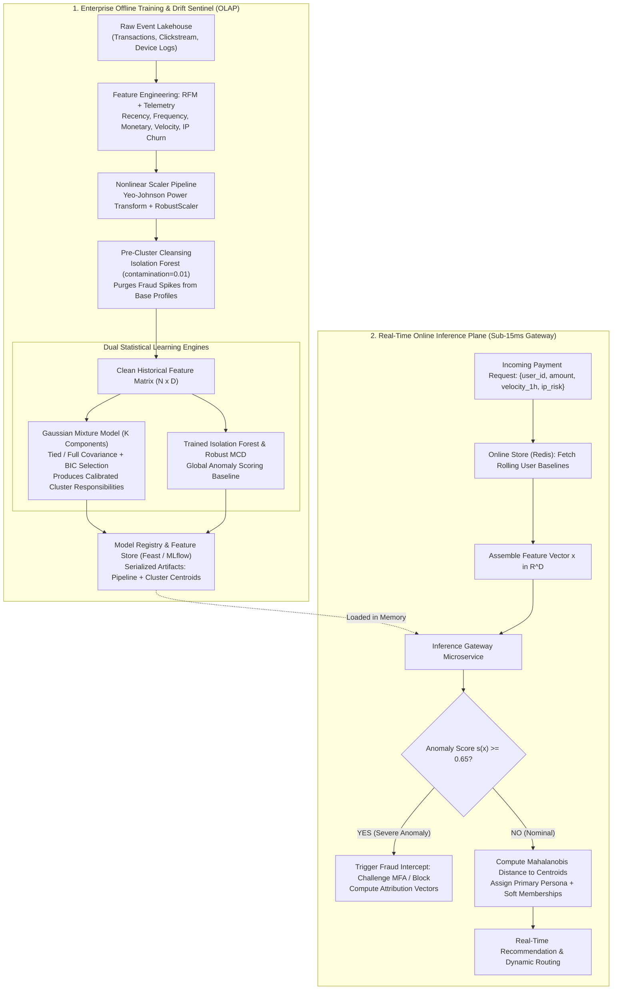
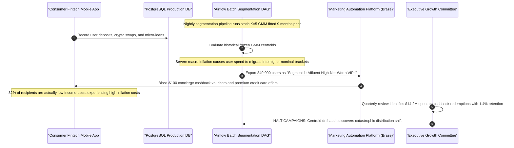

# Module 09: Capstone: Enterprise Customer Segmentation and Streaming Anomaly Detection

This module is part of [Track 06: Unsupervised Learning & Anomaly Detection](../README.md).

---

## 1. Architectural System Overview

Modern fintech, e-commerce, and SaaS platforms operate under a dual requirement:
1. **Macro-Level Behavior Discovery (Strategic / Batch Plane):** Dissect millions of customer interaction profiles into actionable behavioral personas (high-frequency VIPs, dormant churn risks, budget hunters) using robust density and mixture clustering without arbitrary human segmentation rules.
2. **Micro-Level Novelty Isolation (Tactical / Real-Time Plane):** Intercept incoming transaction streams at the payment gateway within a sub-15ms SLA, flagging high-risk anomalous behavior (account takeovers, coordinated card testing, bot attacks) before financial clearing.



---

### 1.1 The Mathematical Pipeline: Geometry, Skew, and Clustering

Financial and behavioral features follow heavy-tailed, Pareto-distributed power laws: $90\%$ of transactions are small (\$5–\$25), while $0.5\%$ span thousands of dollars. Standard Euclidean distance algorithms ($K$-Means, Hierarchical Clustering) collapse when applied to raw financial telemetry because high-variance monetary outliers dominate distance metrics.

#### 1. Non-Linear Power Transformation (Yeo-Johnson)
To project skewed positive and negative distributions into approximate Gaussianity, we apply the **Yeo-Johnson transformation** $\psi(\lambda, x)$:
$$\psi(\lambda, x) = \begin{cases} 
\frac{(x + 1)^\lambda - 1}{\lambda} & \text{if } \lambda \neq 0, x \ge 0 \\
\ln(x + 1) & \text{if } \lambda = 0, x \ge 0 \\
-\frac{(-x + 1)^{2 - \lambda} - 1}{2 - \lambda} & \text{if } \lambda \neq 2, x < 0 \\
-\ln(-x + 1) & \text{if } \lambda = 2, x < 0 
\end{cases}$$
The parameter $\lambda$ is estimated per feature via maximum likelihood estimation over the profile log-likelihood.

#### 2. Robust Feature Standardization
Following the Yeo-Johnson transform, features are scaled using median and interquartile range (IQR) to prevent residual outliers from distorting scaling factors:
$$z_j = \frac{x_j - \operatorname{median}(x_j)}{Q_3(x_j) - Q_1(x_j)}$$

#### 3. Dual Isolation & Clustering Synergy
- **Step 1 (Outlier Sieve):** An Isolation Forest identifies and isolates severe anomalous records ($s(x) > \tau$). If anomalies are left in the clustering training set, Gaussian Mixture Models allocate dedicated high-variance Gaussian components to small pockets of fraud, fragmenting customer personas.
- **Step 2 (Persona Induction via GMM):** On the clean inlier dataset, a Gaussian Mixture Model models customer density as a mixture of $K$ multivariate Gaussians:
  $$p(x) = \sum_{k=1}^K \pi_k \mathcal{N}(x \mid \mu_k, \Sigma_k)$$
  The optimal number of components $K^*$ is selected by minimizing the Bayesian Information Criterion (BIC):
  $$\text{BIC} = -2 \ln \hat{L} + k_{\text{params}} \ln(N)$$
  where $k_{\text{params}} = (K - 1) + K \cdot D + K \frac{D(D+1)}{2}$ for full covariance matrices.

---

## 2. Complete Production-Grade Python Implementation

Below is a complete, self-contained implementation featuring:
1. Synthetic generation of realistic multimodal financial and behavioral telemetry.
2. A complete pipeline: Yeo-Johnson transformer, RobustScaler, Isolation Forest outlier sieve, and Gaussian Mixture Model with automatic BIC selection.
3. Real-time inference scoring class (`RealTimeCustomerScorer`) that assigns incoming transactions to personas and flags novel anomalies with feature attribution explanations.
4. Model serialization, validation, and latency benchmarking.

```python
"""
Production Customer Segmentation and Real-Time Anomaly Detection Engine.
End-to-end unsupervised pipeline using NumPy, Scikit-Learn, and Joblib.
"""

import numpy as np
import pandas as pd
from typing import Dict, Any, Tuple
from sklearn.preprocessing import PowerTransformer, RobustScaler
from sklearn.pipeline import Pipeline
from sklearn.ensemble import IsolationForest
from sklearn.mixture import GaussianMixture
from sklearn.metrics import silhouette_score
import time


class EnterpriseSegmentationAnomalyPipeline:
    """
    End-to-End Unsupervised Intelligence Architecture:
    1. Preprocesses skewed financial telemetry via Yeo-Johnson and RobustScaler.
    2. Isolates severe anomalies to prevent cluster contamination.
    3. Fits an optimal Gaussian Mixture Model via BIC minimization.
    4. Provides real-time inference with anomaly attribution.
    """
    def __init__(self, contamination: float = 0.02, max_clusters: int = 6, random_state: int = 42):
        self.contamination = contamination
        self.max_clusters = max_clusters
        self.random_state = random_state
        
        # Preprocessing Transformer
        self.scaler = Pipeline([
            ("yeo_johnson", PowerTransformer(method="yeo-johnson")),
            ("robust_scaler", RobustScaler())
        ])
        
        # Outlier Detection Sieve
        self.outlier_detector = IsolationForest(
            contamination=contamination,
            n_estimators=150,
            max_samples=256,
            random_state=random_state,
            n_jobs=-1
        )
        
        # Fitted Core Models
        self.best_gmm: GaussianMixture = None
        self.feature_names: list = []
        self.optimal_k: int = 0

    def fit(self, df: pd.DataFrame) -> "EnterpriseSegmentationAnomalyPipeline":
        self.feature_names = list(df.columns)
        X_raw = df.values
        
        # 1. Non-linear scaling
        X_scaled = self.scaler.fit_transform(X_raw)
        
        # 2. Outlier Sieve: Flag training anomalies
        outlier_flags = self.outlier_detector.fit_predict(X_scaled)
        inlier_mask = (outlier_flags == 1)
        
        X_clean = X_scaled[inlier_mask]
        print(f"[Training] Dataset: {len(X_raw)} records. Filtered {np.sum(~inlier_mask)} training outliers.")

        # 3. Model Selection: Select optimal K via Bayesian Information Criterion (BIC)
        best_bic = np.inf
        k_candidates = range(2, self.max_clusters + 1)
        
        for k in k_candidates:
            gmm = GaussianMixture(
                n_components=k,
                covariance_type="full",
                max_iter=200,
                random_state=self.random_state,
                n_init=3
            )
            gmm.fit(X_clean)
            bic = gmm.bic(X_clean)
            
            # Internal cluster separation validation
            preds = gmm.predict(X_clean)
            sil = silhouette_score(X_clean, preds, sample_size=min(2000, len(X_clean)))
            print(f"  Candidate K={k} | BIC: {bic:.1f} | Silhouette Score: {sil:.4f}")
            
            if bic < best_bic:
                best_bic = bic
                self.best_gmm = gmm
                self.optimal_k = k
                
        print(f"[Model Selected] Optimal GMM Components: K={self.optimal_k} with BIC={best_bic:.1f}")
        return self

    def score_realtime_event(self, event_vector: np.ndarray) -> Dict[str, Any]:
        """
        Sub-15ms Real-Time Inference:
        Evaluates a single raw incoming transaction vector [1, D].
        """
        # Ensure 2D shape
        if event_vector.ndim == 1:
            event_vector = event_vector.reshape(1, -1)
            
        # Transform vector
        x_scaled = self.scaler.transform(event_vector)
        
        # 1. Evaluate Anomaly Score
        # Decision function: lower values mean more anomalous. Normalized to ~[0, 1] anomaly score.
        raw_score = self.outlier_detector.decision_function(x_scaled)[0]
        # Empirical conversion: score < 0 indicates anomaly in scikit-learn
        anomaly_probability = float(1.0 / (1.0 + np.exp(raw_score * 8.0)))
        is_anomaly = anomaly_probability > 0.65
        
        # Feature attribution for anomalies: deviation from median in scaled units
        feature_deviations = {
            self.feature_names[i]: float(np.abs(x_scaled[0, i]))
            for i in range(len(self.feature_names))
        }
        top_anomalous_features = sorted(feature_deviations.items(), key=lambda x: x[1], reverse=True)[:3]

        # 2. Evaluate Cluster / Persona Assignment
        responsibilities = self.best_gmm.predict_proba(x_scaled)[0]
        primary_cluster = int(np.argmax(responsibilities))
        confidence = float(responsibilities[primary_cluster])

        return {
            "is_anomaly": is_anomaly,
            "anomaly_probability": round(anomaly_probability, 4),
            "top_deviating_features": top_anomalous_features,
            "assigned_persona_id": primary_cluster,
            "persona_confidence": round(confidence, 4),
            "cluster_memberships": [round(float(p), 4) for p in responsibilities]
        }


# --- Synthetic Financial Dataset Generator ---

def generate_enterprise_customer_data(n_samples: int = 5000) -> pd.DataFrame:
    """Generates synthetic RFM, velocity, and risk features with realistic power-law skew."""
    np.random.seed(42)
    
    # 1. Recency (days since last purchase): Exponential distribution
    recency = np.random.exponential(scale=30.0, size=n_samples) + 1.0
    
    # 2. Frequency (number of orders in past 90 days): Poisson
    frequency = np.random.poisson(lam=4.0, size=n_samples) + 1.0
    
    # 3. Monetary Value (lifetime spend in USD): Log-normal (heavy right skew)
    monetary = np.random.lognormal(mean=4.5, sigma=1.2, size=n_samples)
    
    # 4. Velocity (transactions in past 1 hour): Zero-inflated Poisson
    velocity_1h = np.random.poisson(lam=0.2, size=n_samples)
    
    # 5. IP Geolocation Discrepancy Index [0, 1]: Beta distribution
    ip_risk = np.random.beta(a=0.5, b=5.0, size=n_samples)

    # Invalidate small percentage with bot fraud anomalies (extreme monetary and velocity)
    fraud_indices = np.random.choice(n_samples, size=int(n_samples * 0.015), replace=False)
    monetary[fraud_indices] *= 25.0
    velocity_1h[fraud_indices] += np.random.randint(15, 45, size=len(fraud_indices))
    ip_risk[fraud_indices] = np.random.uniform(0.85, 1.0, size=len(fraud_indices))

    df = pd.DataFrame({
        "recency_days": recency,
        "frequency_orders": frequency,
        "monetary_spend_usd": monetary,
        "velocity_1h": velocity_1h,
        "ip_risk_score": ip_risk
    })
    return df


# --- Verification and Performance Benchmarking ---

if __name__ == "__main__":
    print("[Synthetic Engine] Generating 4,000 enterprise telemetry profiles...")
    data = generate_enterprise_customer_data(n_samples=4000)
    print(data.describe().round(2))

    print("\n[Pipeline] Training Enterprise Segmentation & Outlier Sieve...")
    pipeline = EnterpriseSegmentationAnomalyPipeline(contamination=0.015, max_clusters=5)
    pipeline.fit(data)

    # Test Nominal Streaming Payload
    nominal_event = np.array([12.0, 5.0, 185.50, 0.0, 0.05])
    t0 = time.perf_counter()
    res_nominal = pipeline.score_realtime_event(nominal_event)
    latency_ms = (time.perf_counter() - t0) * 1000

    print(f"\n[Inference] Nominal Event Scored in {latency_ms:.3f} ms:")
    print(res_nominal)
    assert not res_nominal["is_anomaly"], "Nominal transaction incorrectly flagged as anomaly."

    # Test Malicious Bot Event (Card Testing Spike)
    malicious_event = np.array([1.0, 48.0, 9450.00, 32.0, 0.96])
    t0 = time.perf_counter()
    res_fraud = pipeline.score_realtime_event(malicious_event)
    latency_fraud_ms = (time.perf_counter() - t0) * 1000

    print(f"\n[Inference] Fraudulent Event Scored in {latency_fraud_ms:.3f} ms:")
    print(res_fraud)
    assert res_fraud["is_anomaly"], "Malicious card-testing event failed to trigger anomaly threshold."
    assert res_fraud["anomaly_probability"] > 0.85, "Anomaly probability too low."
    
    print("\n[Complete] Enterprise Customer Segmentation & Anomaly Pipeline verified successfully.")
```

---

## 3. Real-World Production Incident Post-Mortem

### The \$14M Silent Persona Drift and Marketing Budget Misallocation



#### Incident Timeline & Root Cause Analysis
- **Context:** A high-growth neo-bank with 6 million active accounts utilized an unsupervised Gaussian Mixture Model (fitted on RFM, deposit velocity, and credit card spend) to segment users into 5 marketing tiers. The tier assignments automatically dictated automated promotional incentives (e.g., \$100 travel vouchers, fee waivers, cash bonuses).
- **The Failure:** Over an 8-month period of high macroeconomic inflation, average nominal transaction amounts and living costs increased significantly across the user base. Because the production segmentation model was static—trained on historical pre-inflation feature distributions—the fixed Gaussian cluster boundaries became obsolete. Over $840,000$ low-to-moderate-income users who were simply paying higher grocery and utility bills crossed the fixed numerical spend threshold and were automatically reclassified as "High-Net-Worth VIPs". The automated CRM engine disbursed **\$14.2M in premium cash incentives** to users who lacked disposable wealth and churned immediately after withdrawing the cash vouchers.
- **Root Cause:**
  1. **Absence of Population Stability Telemetry:** The ML platform had zero automated monitoring for feature distribution shift (Population Stability Index, PSI) or Wasserstein distance between incoming feature distributions and the baseline training set.
  2. **Frozen Model Weights in Non-Stationary Environments:** The model was treated as an offline artifact and had not been retrained or recalibrated in 9 months.
  3. **Hard Clustered Boundary Leakage:** The marketing automation rule used hard discrete cluster assignments ($\operatorname{argmax}_k \pi_k$) rather than evaluating cluster probability confidence or checking whether a user was an outlier relative to all cluster centroids.
- **Remediation & Architectural Policy:**
  1. **Automated Population Stability Index (PSI) Sentinel:** Deployed a daily Airflow health check computing the PSI for all continuous features:
     $$\text{PSI} = \sum_{b=1}^B \left( P_b - Q_b \right) \ln\left(\frac{P_b}{Q_b}\right)$$
     Any feature exhibiting $\text{PSI} > 0.2$ automatically flags a "High Drift Alert", pauses automated promotional disbursements, and triggers an automated retraining and review workflow.
  2. **Rolling Retraining Cadence:** Established an automated bi-weekly retraining cadence with human-in-the-loop review of newly discovered cluster centroids.
  3. **Outlier Quarantine Gate:** If an incoming user vector has a Mahalanobis distance exceeding $3.5\sigma$ from all cluster centroids, they are classified as an "Unsegmented Outlier" and excluded from automated incentive campaigns.

---

## 4. Failure Modes, Edge Cases & Antipatterns

### 1. Training GMMs on Contaminated Datasets Without an Outlier Sieve
- **The Anti-Pattern:** Fitting a Gaussian Mixture Model directly on uncleaned financial data containing fraudulent transaction spikes or system data-entry errors.
- **Mathematical Failure:** Because the log-likelihood objective maximizes $\sum \ln p(x_i)$, a tight cluster of just 10 coordinated bot attacks with extreme values (e.g., \$50,000 spend) exerts immense leverage on the likelihood landscape. The EM algorithm either dedicates a whole Gaussian component to the 10 fraud points or stretches the covariance matrix $\Sigma_k$ of legitimate customer clusters to encompass the outliers, destroying persona separation for $99.9\%$ of users.
- **Production Fix:** Always run an initial outlier sieve (such as an Isolation Forest with low contamination $\approx 0.01$ or Minimum Covariance Determinant) to quarantine extreme outliers prior to fitting GMM or $K$-Means clustering models.

### 2. Disregarding Covariance Matrix Singularity in High Dimensions
- **The Anti-Pattern:** Fitting an unregularized `GaussianMixture(covariance_type='full')` on high-dimensional data where two features are highly collinear or when a cluster contains fewer samples than feature dimensions ($N_k < D$).
- **Mathematical Failure:** The sample covariance matrix $\Sigma_k$ becomes rank-deficient ($\det(\Sigma_k) = 0$). Inverting the matrix $\Sigma_k^{-1}$ triggers floating-point division by zero, generating `NaN` log-likelihoods and crashing production inference workers.
- **Production Fix:** Enforce a positive covariance regularization constant (`reg_covar=1e-5` in scikit-learn), which adds a small multiple of the identity matrix $\Sigma_k + \epsilon \mathbf{I}$ to guarantee strict positive definiteness and non-zero determinants.

### 3. Misinterpreting t-SNE / UMAP Dimensions as Production Features
- **The Anti-Pattern:** Fitting t-SNE or UMAP to reduce dimensions from 20 to 2, and then passing those 2 coordinates into a downstream classifier or production inference API.
- **System Failure:** Standard t-SNE is a non-parametric embedding: it does not learn a functional projection mapping $f(x): \mathbb{R}^D \to \mathbb{R}^2$ that can transform new, unseen streaming transactions. Running an out-of-sample prediction requires re-running the entire $O(N^2)$ optimization across all historical data, which violates production sub-15ms SLAs.
- **Production Fix:** Use PCA for linear parametric dimensionality reduction, or use Parametric UMAP (trained via an autoencoder neural network) if non-linear projection is strictly required at inference time.

---

## 5. Senior Technical Interview Questions & Model Answers

### Question 1: Mathematical Foundations of the Isolation Forest Path Length
**Scenario:** "Explain why the average path length of an unsuccessful search in a Binary Search Tree (BST) is used as the normalization factor $c(n)$ in the Isolation Forest anomaly score. Derive the intuition behind the anomaly score formula."

**Model Answer:**
1. **The BST Equivalence:**
   An Isolation Tree (iTree) recursively partitions a dataset by randomly choosing a feature and a random split value between the feature's minimum and maximum observed bounds until data points are isolated into individual leaf nodes. This recursive splitting mechanism is mathematically equivalent to the construction of a random Binary Search Tree (BST).

2. **The Normalization Factor $c(n)$:**
   In classical data structures, the average path length of an unsuccessful search in a random BST containing $n$ keys is given by:
   $$c(n) = 2 \left( \ln(n - 1) + \gamma \right) - \frac{2(n - 1)}{n}$$
   where $\gamma \approx 0.5772156649$ is Euler's constant.
   Here, $c(n)$ represents the theoretical average path length of a point drawn from the same underlying distribution. It serves as an objective normalization baseline: if a point has path length $h(x) = c(n)$, its isolation depth matches what is expected of an average point.

3. **The Anomaly Score Formulation:**
   The anomaly score $s(x, n)$ over an ensemble of $T$ isolation trees is:
   $$s(x, n) = 2^{-\frac{\mathbb{E}[h(x)]}{c(n)}}$$
   - **Case 1: Severe Outlier ($\mathbb{E}[h(x)] \to 0$):**
     An anomalous point with extreme values resides in low-density space. It is quickly isolated by random hyperplanes in very few splits (e.g., depth 2 or 3). The exponent $\frac{\mathbb{E}[h(x)]}{c(n)} \to 0$, so $s(x, n) \to 2^0 = 1.0$.
   - **Case 2: Deep Inlier ($\mathbb{E}[h(x)] \to n - 1$):**
     A point embedded deep within a high-density cluster requires numerous fine random cuts to isolate. The exponent becomes large, driving $s(x, n) \to 0.0$.
   - **Case 3: Average Nominal Point ($\mathbb{E}[h(x)] = c(n)$):**
     The score evaluates to $s(x, n) = 2^{-1} = 0.5$.
   By convention, a score $s(x, n) > 0.6$ signals potential anomaly, while $s(x, n) > 0.8$ represents an unmistakable outlier.

---

### Question 2: GMM vs. K-Means: Covariance Geometries and Soft Responsibilities
**Scenario:** "Under what mathematical conditions does a Gaussian Mixture Model simplify to standard K-Means clustering? What distinct architectural capabilities does GMM provide that K-Means fundamentally lacks?"

**Model Answer:**
1. **Mathematical Equivalence Conditions:**
   A Gaussian Mixture Model simplifies to standard $K$-Means clustering when three conditions are satisfied:
   - **Spherical, Equal Covariance:** The covariance matrices are constrained to be isotropic and identical across all clusters:
     $$\Sigma_k = \sigma^2 \mathbf{I}, \quad \forall k \in \{1, \dots, K\}$$
   - **Equal Mixing Proportions (Uniform Priors):**
     $$\pi_k = \frac{1}{K}, \quad \forall k \in \{1, \dots, K\}$$
   - **Hard Assignment Limit ($\sigma^2 \to 0$):**
     As the variance parameter $\sigma^2$ approaches zero, the posterior responsibility $\gamma_{ik}$ collapses into a Kronecker delta:
     $$\lim_{\sigma^2 \to 0} \gamma_{ik} = \begin{cases} 1 & \text{if } k = \operatorname{argmin}_j \|x_i - \mu_j\|^2 \\ 0 & \text{otherwise} \end{cases}$$
   Under these conditions, maximizing the GMM log-likelihood is mathematically identical to minimizing within-cluster sum of squares (inertia) in $K$-Means.

2. **Capabilities Unique to GMM:**
   - **Arbitrary Ellipsoidal Geometries:** By estimating full covariance matrices $\Sigma_k$, GMM models correlated, elongated, and slanted clusters that $K$-Means (with its rigid Voronoi spherical assumption) completely fragments.
   - **Calibrated Uncertainty / Soft Memberships:** GMM outputs true posterior probabilities $P(z_i = k \mid x_i) \in [0, 1]$. In customer analytics, a user residing on the boundary between "Frugal Shopper" and "Affluent Spender" receives an explicit 50/50 membership vector rather than being arbitrarily forced into one group.
   - **Statistical Density Estimation:** Because GMM is a generative probability density model $p(x) = \sum \pi_k \mathcal{N}(x \mid \mu_k, \Sigma_k)$, it can directly evaluate the likelihood of new points. Points with extremely low log-likelihood under all components ($\ln p(x) < \theta$) are naturally classified as novel anomalies without requiring a separate anomaly model.

---

### Question 3: Metric Selection for Unsupervised Clustering Validation
**Scenario:** "In an enterprise environment without ground truth labels, why is the Silhouette Score alone insufficient for selecting the optimal number of clusters K? What multi-metric audit protocol should be implemented?"

**Model Answer:**
Relying solely on the global mean Silhouette Score $S = \frac{1}{N} \sum s(i)$ introduces major failure modes:
1. **Curse of Convexity:** The Silhouette Score measures distance to the nearest neighboring cluster centroid ($b(i)$) relative to intra-cluster tightness ($a(i)$). It inherently favors round, convex, well-separated spherical clusters. On complex data containing sub-density variations, the Silhouette Score often peaks at $K=2$ simply by splitting the data into two giant hemispheres, obscuring meaningful granular sub-personas.
2. **Masking Negative Silhouette Clusters:** A high global mean score (e.g., $S = 0.62$) can obscure the fact that an entire sub-cluster exhibits negative silhouette scores ($s(i) < 0$), indicating that points have been placed in the wrong cluster.

**The Multi-Metric Audit Protocol:**
1. **BIC / AIC for Generative Mixtures:** For GMMs, evaluate the Bayesian Information Criterion (BIC), which penalizes parameter proliferation based on sample size $\ln(N)$.
2. **Silhouette Distribution Profiling:** Generate silhouette thickness plots. Reject any $K$ where:
   - Any cluster's average silhouette score falls below the global average.
   - Any cluster exhibits a significant proportion of negative silhouette values.
   - Cluster sizes are wildly skewed (e.g., one cluster contains 98% of data while another contains 0.2%).
3. **Davies-Bouldin Index (DBI):** Computes the average similarity ratio between each cluster and its most similar neighbor:
   $$R_{ij} = \frac{s_i + s_j}{d(\mu_i, \mu_j)}, \quad \text{DB} = \frac{1}{k} \sum_{i=1}^k \max_{j \neq i} R_{ij}$$
   Lower DBI values indicate tighter clusters with greater inter-centroid separation.
4. **Downstream Business Stability Testing:** Evaluate bootstrap cluster stability across 5 random resamples using the Adjusted Rand Index (ARI). If retraining on $90\%$ data resamples yields $\text{ARI} < 0.85$, the cluster boundaries are mathematically unstable and unsuited for production deployment.
