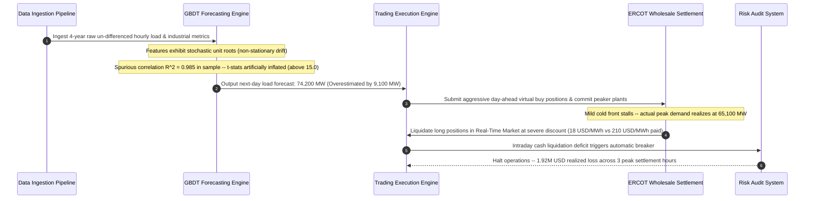
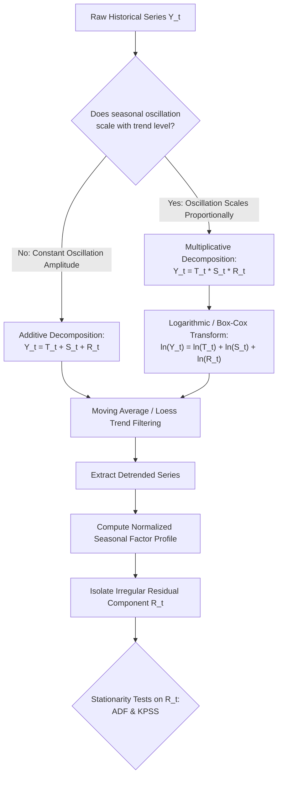
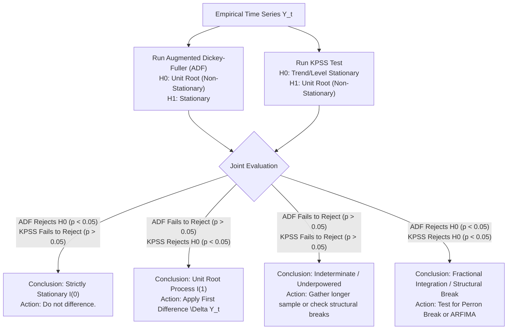
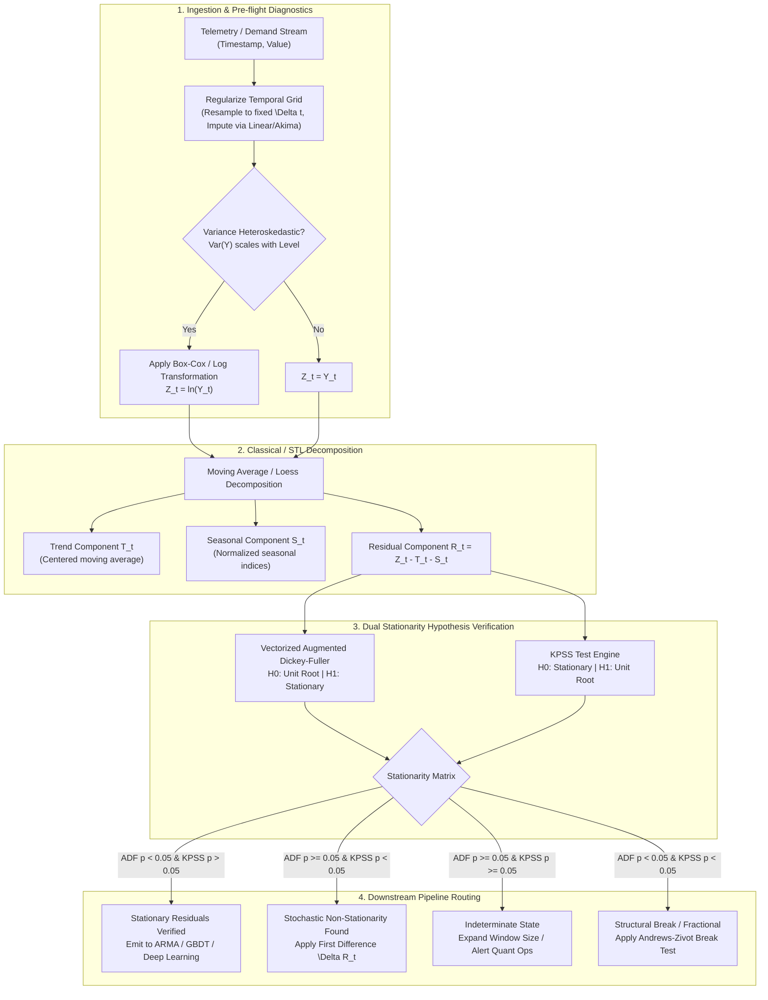

# Module 00: Time Series Anatomy — Trend, Seasonality, and Stationarity

This module is part of [Track 07: Time Series Forecasting](../README.md).

> **Prerequisites:** [Track 02: Math for Machine Learning - Linear Algebra, Gradients & Probability](../../02-math-for-machine-learning/README.md), [Track 01: ML Foundations & Evaluation](../../01-ml-foundations-and-evaluation/README.md).  
> **Estimated Reading Time:** 45 minutes  
> **Target Audience:** Principal Machine Learning Engineers, Econometricians, Quantitative Infrastructure Architects, and Staff Backend Engineers designing high-throughput forecasting platforms.

> [!TIP]
> **The Golden Axiom of Time Series:** Machine learning assumes observations are independent and identically distributed ($\text{i.i.d.}$). Time series data violates $\text{i.i.d.}$ along its primary axis: time generates directional autocorrelation, non-zero covariance across lags, non-constant unconditional distributions, and structural shifts. Modeling raw non-stationary time series with standard supervised algorithms guarantees spurious correlations, inflated test statistics, and catastrophic out-of-sample forecast collapse.

---

## Executive Overview & Industry Context

Time series data forms the operational nervous system of industrial backend infrastructure:
1. **Capacity Planning & Resource Provisioning:** Cloud hyper-scalers (AWS, GCP, Azure) monitor petabyte-scale telemetry across millions of virtual machines. Accurate multi-horizon forecasts of CPU utilization, memory pressure, and network ingress determine dynamic autoscaling, VM bin-packing, and preventative server procurement.
2. **Algorithmic Energy Trading & Grid Balancing:** Independent System Operators (ISOs such as ERCOT, PJM, CAISO) manage electrical grids that require sub-second equilibrium between power generation and consumption. Overestimating peak load causes multi-million-dollar spinning reserve waste; underestimating leads to rolling blackouts and wholesale spot pricing spikes up to the \$5,000/MWh statutory market cap.
3. **Supply Chain & Inventory Replenishment:** Global retail fulfillment networks forecast store-keeping unit (SKU) demand across hierarchical geographic clusters. Misidentifying a multiplicative holiday surge as a linear trend causes multimillion-dollar inventory stockouts or dead-inventory holding costs.
4. **Financial Quantitative Trading:** High-frequency statistical arbitrage strategies model cointegrated asset pairs. Failing to rigorously distinguish between deterministic trend stationarity and stochastic unit root processes results in statistical arbitrage collapse.

Before training any model—whether classical ARIMA, gradient boosted trees, or temporal deep learning architectures (N-BEATS, PatchTST)—the econometrician must decompose the underlying data generating process (DGP) into its constituent anatomical primitives: **Trend**, **Seasonality**, and **Stationary Residuals**.

---

## Production Incident Post-Mortem: The \$1.9M Energy Grid Spurious Regression Failure

### Incident Context
An algorithmic energy trading desk in the ERCOT power market deployed an automated day-ahead bidding model to forecast next-day peak hourly load (MW) across the Houston load zone. The trading desk leveraged next-day forecasts to commit generation capacity into the day-ahead wholesale market and take speculative virtual swap positions.

The team trained a regularized gradient boosting pipeline directly on historical hourly load, regional industrial power draw, and macro-economic indicator indices over a 4-year historical window.

### The Failure Sequence



### Root Cause Analysis
1. **Un-differenced Integrated Data ($I(1)$):** Both historical electricity load and the macroeconomic macro-features followed integrated stochastic processes containing unit roots with seasonal drift. Regressing two independent $I(1)$ random walks generates the classic **Granger-Newbold (1974) Spurious Regression Phenomenon**: standard errors collapsed toward zero, $t$-statistics exploded ($t > 15$), and the validation $R^2$ registered an artificially deceptive $0.985$.
2. **Extrapolation Over Structural Breaks:** Over the test weekend, an unexpected atmospheric pressure stagnation stalled a cold front. Because the model was trained on non-stationary levels with un-differenced upward drift, the model treated temporary persistent random-walk innovations as structural linear demand growth.
3. **Financial Penalties:** ERCOT settled the trading desk's over-committed 9,100 MW position in the real-time spot balancing market. Real-time prices collapsed to \$18/MWh due to excess grid supply, while the desk had purchased day-ahead power contracts at \$210/MWh, incurring a \$1.92M cash loss within a single afternoon.

### Remediation Architecture
1. **Mandatory Unit Root Screening:** Enforced automated pipeline unit-root tests (Augmented Dickey-Fuller and KPSS) on all target and exogenous feature series. Any feature failing stationarity tests is automatically subjected to first-order differences $\Delta y_t = y_t - y_{t-1}$ or seasonal differences $\Delta_s y_t = y_t - y_{t-s}$.
2. **Cointegration Verification:** Implemented the Johansen Cointegration test before allowing any multi-feature level regression in production pipelines.
3. **Decomposition Isolation:** Decomposed all raw series into seasonal indices, trend, and stationary residuals, feeding only stationary residuals and isolated deterministic seasonal features into nonlinear regressors.

---

## 1. Mathematical Mental Model & Theoretical Foundations

```
========================================================================================
                          TIME SERIES ANATOMY DECOMPOSITION
========================================================================================
Raw Series Y_t  ──>  [ Trend T_t ]        (Long-term macro trajectory: linear, polynomial, logistic)
                ──>  [ Seasonality S_t ]  (Strict cyclic periodicity: daily, weekly, annual)
                ──>  [ Cyclical C_t ]     (Multi-year macroeconomic waves of unfixed frequency)
                ──>  [ Irregular R_t ]    (Stationary stochastic shock: white noise epsilon_t)
========================================================================================
```

### 1.1 Additive vs. Multiplicative Decomposition

A real-valued time series $\{Y_t\}_{t=1}^T$ can be decomposed into structural components:

#### Additive Decomposition Model
$$Y_t = T_t + S_t + C_t + R_t$$

- **Assumptions:** The seasonal fluctuations $S_t$ maintain constant absolute amplitude regardless of the level of the trend $T_t$. The variance of the irregular shocks $R_t$ remains homoskedastic across time.
- **Physical Interpretation:** If retail sales increase by an absolute 5,000 units every December, regardless of whether annual sales are 50,000 units or 500,000 units, the system is additive.

#### Multiplicative Decomposition Model
$$Y_t = T_t \times S_t \times C_t \times R_t$$

- **Assumptions:** The amplitude of seasonal fluctuations scales proportionally with the underlying trend level $T_t$. As $T_t$ doubles, seasonal peaks and troughs double in absolute magnitude.
- **Logarithmic Transformation Equivalence:** Applying the natural logarithm converts a multiplicative process into an additive process:

$$\log(Y_t) = \log(T_t) + \log(S_t) + \log(C_t) + \log(R_t)$$

provided $Y_t > 0$ for all $t$. In production, stabilizing variance via Box-Cox or natural logarithm is standard practice prior to linear modeling:

$$w_t = \begin{cases} \frac{Y_t^\lambda - 1}{\lambda} & \text{if } \lambda \neq 0 \\ \ln(Y_t) & \text{if } \lambda = 0 \end{cases}$$



---

### 1.2 Stationarity: Strict vs. Weak (Covariance) Stationarity

Standard statistical forecasting theory relies on the stationarity of the underlying stochastic process.

#### Strict Stationarity (Strong Stationarity)
A stochastic process $\{Y_t\}_{t \in \mathbb{Z}}$ is **strictly stationary** if the joint probability distribution of any collection of time points is completely invariant to arbitrary time shifts $\tau \in \mathbb{Z}$:

$$F_{Y_{t_1}, Y_{t_2}, \dots, Y_{t_k}}(y_1, y_2, \dots, y_k) = F_{Y_{t_1+\tau}, Y_{t_2+\tau}, \dots, Y_{t_k+\tau}}(y_1, y_2, \dots, y_k) \quad \forall k \in \mathbb{N}, \forall \tau, t_i \in \mathbb{Z}$$

This implies that all unconditional moments of arbitrary order (mean, variance, skewness, kurtosis) are invariant over time. Strict stationarity is virtually impossible to verify or guarantee in empirical production systems.

#### Weak Stationarity (Covariance / Second-Order Stationarity)
A stochastic process $\{Y_t\}_{t \in \mathbb{Z}}$ is **weakly (covariance) stationary** if it satisfies three conditions:

1. **Constant Unconditional Expectation:**
   $$\mathbb{E}[Y_t] = \mu < \infty \quad \forall t \in \mathbb{Z}$$
2. **Finite, Constant Unconditional Variance:**
   $$\text{Var}(Y_t) = \mathbb{E}[(Y_t - \mu)^2] = \sigma^2 < \infty \quad \forall t \in \mathbb{Z}$$
3. **Lag-Dependent Autocovariance:**
   The autocovariance between any two time steps $t$ and $s$ depends strictly on their temporal displacement (lag) $k = |t - s|$, and not on absolute time $t$:
   $$\text{Cov}(Y_t, Y_s) = \mathbb{E}[(Y_t - \mu)(Y_s - \mu)] = \gamma(|t - s|) = \gamma(k)$$

> [!NOTE]
> Strict stationarity does **not** strictly imply weak stationarity unless the second moment exists. For instance, an $\text{i.i.d.}$ Cauchy process is strictly stationary, but possesses undefined mean and infinite variance, failing covariance stationarity. Conversely, Gaussian processes that are covariance stationary are automatically strictly stationary because Gaussian distributions are fully parameterized by their first two moments.

#### The Wold Decomposition Theorem
The foundational justification for ARMA modeling rests on **Wold's Decomposition Theorem (1938)**:

Any non-deterministic, covariance stationary time series $\{Y_t\}$ can be uniquely represented as the sum of two orthogonal processes:

$$Y_t = \mu + \sum_{j=0}^{\infty} \psi_j \epsilon_{t-j} + \eta_t$$

where:
- $\epsilon_t \sim \text{WN}(0, \sigma^2)$ is white noise with $\mathbb{E}[\epsilon_t] = 0$, $\mathbb{E}[\epsilon_t^2] = \sigma^2$, and $\mathbb{E}[\epsilon_t \epsilon_s] = 0$ for $t \neq s$.
- The linear filter coefficients are square-summable: $\psi_0 = 1$ and $\sum_{j=0}^\infty \psi_j^2 < \infty$.
- $\eta_t$ is a purely deterministic component that can be perfectly predicted from infinite historical observations (e.g., periodic sinusoids or constant levels).
- $\text{Cov}(\epsilon_t, \eta_s) = 0$ for all $t, s$.

---

### 1.3 Difference Stationarity ($I(1)$) vs. Trend Stationarity ($I(0) + f(t)$)

A common mistake in production is confusing a **Trend-Stationary Process (TSP)** with a **Difference-Stationary Process (DSP)**. Applying the wrong detrending mechanism corrupts the underlying statistical dynamics.

```
+---------------------------------------------------------------------------------------+
|                               DETRENDING COMPARISON                                   |
+---------------------------------------------------------------------------------------+
| Property           | Trend Stationary (TSP)          | Difference Stationary (DSP)    |
+--------------------+---------------------------------+--------------------------------+
| Canonical Model    | Y_t = \mu + \beta t + \epsilon_t| Y_t = Y_{t-1} + \beta + \epsilon_t (Random Walk)|
| Detrending Action  | Linear regression residual      | First differencing (\Delta Y_t)|
| Shock Memory       | Transitory (mean-reverting)     | Permanent (infinite memory)    |
| Long-term Variance | Constant: \sigma^2_\epsilon     | Diverges: t * \sigma^2_\epsilon|
| Improper Treatment | Differencing introduces MA unit | Linear detrending preserves    |
|                    | root (over-differencing)        | non-stationarity (spurious reg)|
+---------------------------------------------------------------------------------------+
```

#### The Mathematical Proof of Detrending Mismatch

##### Case A: Improperly Detrending a Random Walk (DSP)
Assume $Y_t$ follows a random walk with drift: $Y_t = \beta + Y_{t-1} + \epsilon_t$, which unrolls into:

$$Y_t = Y_0 + \beta t + \sum_{i=1}^t \epsilon_i$$

If an engineer applies OLS linear detrending against time $t$ ($\hat{Y}_t = \hat{a} + \hat{b}t$), the resulting residual is:

$$\tilde{Y}_t = Y_t - (\hat{a} + \hat{b}t) \approx \sum_{i=1}^t \epsilon_i$$

The residual $\tilde{Y}_t$ retains the cumulative sum of historical shocks $\sum_{i=1}^t \epsilon_i$. Its variance is:

$$\text{Var}(\tilde{Y}_t) = t \sigma^2 \xrightarrow{t \to \infty} \infty$$

The series is **still non-stationary**. The spurious time trend leaves non-vanishing stochastic memory intact.

##### Case B: Improperly Differencing a Trend-Stationary Process (TSP)
Assume $Y_t = \alpha + \beta t + \epsilon_t$, where $\epsilon_t \sim \text{i.i.d.}(0, \sigma^2)$. Applying first-order differencing $\Delta Y_t = Y_t - Y_{t-1}$:

$$\Delta Y_t = (\alpha + \beta t + \epsilon_t) - (\alpha + \beta (t-1) + \epsilon_{t-1}) = \beta + (\epsilon_t - \epsilon_{t-1})$$

The differenced process $\Delta Y_t$ contains an un-invertible Moving Average component with root on the unit circle:

$$\Delta Y_t = \beta + (1 - B)\epsilon_t$$

where $B$ is the backshift operator ($B^k X_t = X_{t-k}$). This creates artificial negative autocorrelation at lag 1:

$$\text{Corr}(\Delta Y_t, \Delta Y_{t-1}) = \frac{\text{Cov}(\epsilon_t - \epsilon_{t-1}, \epsilon_{t-1} - \epsilon_{t-2})}{\text{Var}(\epsilon_t - \epsilon_{t-1})} = \frac{-\sigma^2}{2\sigma^2} = -0.5$$

This phenomenon, known as **over-differencing**, injects artificial dynamics and eliminates low-frequency predictive signals.

---

### 1.4 Formal Unit Root Testing: ADF and KPSS

To determine statistically whether a process requires differencing or detrending, production pipelines execute dual hypothesis tests with inverted nulls.



#### The Augmented Dickey-Fuller (ADF) Test Formulation
Consider an $\text{AR}(1)$ process: $Y_t = \rho Y_{t-1} + \epsilon_t$. If $\rho = 1$, the series has a unit root. Subtracting $Y_{t-1}$ from both sides:

$$\Delta Y_t = (\rho - 1) Y_{t-1} + \epsilon_t = \gamma Y_{t-1} + \epsilon_t$$

where $\gamma = \rho - 1$. Testing for a unit root reduces to:
- $H_0: \gamma = 0$ (equivalent to $\rho = 1$, series is non-stationary)
- $H_1: \gamma < 0$ (equivalent to $|\rho| < 1$, series is stationary)

To account for higher-order serial correlation in the error terms $\epsilon_t$, Said and Dickey (1984) augmented the regression equation with $p$ lagged differences:

$$\Delta Y_t = \alpha + \beta t + \gamma Y_{t-1} + \sum_{s=1}^p \delta_s \Delta Y_{t-s} + \epsilon_t$$

where:
- $\alpha$ is a deterministic drift constant.
- $\beta t$ is a deterministic linear time trend.
- $p$ is the lag order chosen to render the regression residuals $\epsilon_t$ white noise (typically selected via the Akaike Information Criterion, $\text{AIC}$, or Bayesian Information Criterion, $\text{BIC}$).

##### The Non-Standard Asymptotic Distribution
Under the null hypothesis $\gamma = 0$, the ordinary least squares (OLS) estimate $\hat{\gamma}$ does **not** follow a Student's $t$-distribution because $Y_{t-1}$ is non-stationary ($I(1)$). Instead, the test statistic:

$$DF_\tau = \frac{\hat{\gamma}}{\text{SE}(\hat{\gamma})}$$

converges asymptotically to a functional of standard Brownian motion (Wiener processes $W(r)$):

$$DF_\tau \xrightarrow{d} \frac{\frac{1}{2}\left( [W(1)]^2 - 1 \right) - W(1) \int_0^1 W(r) dr}{\int_0^1 [W(r)]^2 dr - \left( \int_0^1 W(r) dr \right)^2}$$

Because this distribution is skewed heavily to the negative side, standard Gaussian/Student critical values cannot be used. Statistical engines rely on empirical response surface regressions developed by **MacKinnon (1994, 2010)** to compute critical values and $p$-values.

#### The KPSS Test Formulation
The Kwiatkowski-Phillips-Schmidt-Shin (KPSS, 1992) test inverts the null hypothesis to prevent false-positive stationarity claims driven by low test power in short series:
- $H_0: Y_t$ is stationary (around a constant level or linear trend)
- $H_1: Y_t$ contains a unit root

The process is decomposed into a deterministic trend, a random walk, and stationary errors:

$$Y_t = \beta t + r_t + \epsilon_t \quad \text{where} \quad r_t = r_{t-1} + u_t, \quad u_t \sim \text{i.i.d.}(0, \sigma_u^2)$$

Under $H_0$, the variance of the random walk innovations is zero: $\sigma_u^2 = 0$. Consequently, $r_t = r_0$ is constant, and $Y_t$ is trend-stationary. The KPSS test statistic is:

$$\text{KPSS} = \frac{1}{T^2 s^2(l)} \sum_{t=1}^T S_t^2$$

where $S_t = \sum_{i=1}^t e_i$ is the partial sum of residuals $e_i$ from regressing $Y$ on a constant (and trend), and $s^2(l)$ is a Newey-West heteroskedasticity and autocorrelation consistent (HAC) long-run variance estimator with lag truncation $l$:

$$s^2(l) = \frac{1}{T} \sum_{t=1}^T e_t^2 + \frac{2}{T} \sum_{s=1}^l w(s, l) \sum_{t=s+1}^T e_t e_{t-s}$$

using the Bartlett kernel $w(s, l) = 1 - \frac{s}{l+1}$.

---

## 2. Architectural Blueprint & Workflow Diagrams

The following diagram illustrates an enterprise-grade automated time series decomposition, stationarity validation, and transformation engine.



---

## 3. Production Implementation from Scratch: Decomposition and Vectorized ADF Engine

Below is a complete, production-grade Python implementation authored purely in standard scientific libraries (`numpy`, `pandas`). It implements:
1. **Classical Additive and Multiplicative Convolution Decomposition** with symmetric centered moving average kernels and missing-tail boundary imputation.
2. **From-Scratch Augmented Dickey-Fuller (ADF) Engine** computing OLS projection, lag selection via AIC, asymptotic $t$-statistic computation, and MacKinnon regression surface $p$-value approximations.

```python
"""
Production Time Series Anatomy & Stationarity Diagnostics Engine.
Authored from scratch using NumPy and Pandas.
Zero external econometric dependencies (statsmodels-free).
"""

from typing import Dict, Literal, Optional, Tuple
import numpy as np
import pandas as pd


class ClassicalDecomposition:
    """
    Classical Moving-Average Decomposition for Additive and Multiplicative Models.
    
    Decomposes Y_t into Trend (T_t), Seasonal (S_t), and Residual (R_t) components:
        Additive:       Y_t = T_t + S_t + R_t
        Multiplicative: Y_t = T_t * S_t * R_t
    """

    def __init__(
        self,
        period: int,
        model: Literal["additive", "multiplicative"] = "additive"
    ) -> None:
        if period < 2:
            raise ValueError(f"Period must be >= 2, got {period}")
        self.period = period
        self.model = model

    def fit_transform(
        self, series: np.ndarray
    ) -> Tuple[np.ndarray, np.ndarray, np.ndarray]:
        """
        Decomposes a 1D continuous array into (trend, seasonal, residuals).
        
        Args:
            series: 1D NumPy array of temporal observations without NaNs.
            
        Returns:
            Tuple of (trend, seasonal, residual) arrays matching original shape.
        """
        y = np.asarray(series, dtype=np.float64)
        n = len(y)
        if n < 2 * self.period:
            raise ValueError(
                f"Sample size {n} insufficient for seasonal period {self.period}."
            )
        if self.model == "multiplicative" and np.any(y <= 0):
            raise ValueError(
                "Multiplicative decomposition requires strictly positive values."
            )

        # 1. Compute Centered Moving Average for Trend Extraction
        trend = self._centered_moving_average(y, self.period)

        # Extrapolate edge boundaries to avoid losing period/2 entries on edges
        trend = self._impute_moving_average_edges(y, trend, self.period)

        # 2. Detrend the Series
        if self.model == "additive":
            detrended = y - trend
        else:
            detrended = y / np.where(trend == 0, 1e-8, trend)

        # 3. Extract Seasonal Indices by Averaging Across Cycles
        seasonal = np.zeros(n, dtype=np.float64)
        raw_seasonal_pattern = np.zeros(self.period, dtype=np.float64)

        for i in range(self.period):
            indices = np.arange(i, n, self.period)
            valid_vals = detrended[indices]
            valid_vals = valid_vals[~np.isnan(valid_vals)]
            raw_seasonal_pattern[i] = np.mean(valid_vals) if len(valid_vals) > 0 else 0.0

        # Normalize seasonal pattern
        if self.model == "additive":
            seasonal_pattern = raw_seasonal_pattern - np.mean(raw_seasonal_pattern)
        else:
            seasonal_pattern = raw_seasonal_pattern / np.mean(raw_seasonal_pattern)

        # Tile seasonal pattern across the entire length
        cycles = int(np.ceil(n / self.period))
        seasonal = np.tile(seasonal_pattern, cycles)[:n]

        # 4. Compute Residual Component
        if self.model == "additive":
            residual = y - trend - seasonal
        else:
            residual = y / np.where(trend * seasonal == 0, 1e-8, trend * seasonal)

        return trend, seasonal, residual

    @staticmethod
    def _centered_moving_average(y: np.ndarray, period: int) -> np.ndarray:
        """Computes symmetric centered moving average kernel."""
        n = len(y)
        trend = np.full(n, np.nan, dtype=np.float64)

        if period % 2 == 1:
            # Odd period: simple symmetric moving average
            half_window = period // 2
            kernel = np.ones(period) / period
            valid_trend = np.convolve(y, kernel, mode="valid")
            trend[half_window : n - half_window] = valid_trend
        else:
            # Even period: 2 x period centered moving average
            half_window = period // 2
            # 2 x period filter weights: [0.5/p, 1/p, ..., 1/p, 0.5/p]
            kernel = np.ones(period + 1, dtype=np.float64) / period
            kernel[0] *= 0.5
            kernel[-1] *= 0.5
            valid_trend = np.convolve(y, kernel, mode="valid")
            trend[half_window : n - half_window] = valid_trend

        return trend

    @staticmethod
    def _impute_moving_average_edges(
        y: np.ndarray, trend: np.ndarray, period: int
    ) -> np.ndarray:
        """Linear polynomial extrapolation for edge boundaries."""
        t_imputed = trend.copy()
        half_w = period // 2
        
        # Left boundary extrapolation
        x_valid_left = np.arange(half_w, half_w + 5)
        y_valid_left = t_imputed[x_valid_left]
        poly_left = np.polyfit(x_valid_left, y_valid_left, deg=1)
        t_imputed[:half_w] = np.polyval(poly_left, np.arange(half_w))

        # Right boundary extrapolation
        n = len(y)
        x_valid_right = np.arange(n - half_w - 5, n - half_w)
        y_valid_right = t_imputed[x_valid_right]
        poly_right = np.polyfit(x_valid_right, y_valid_right, deg=1)
        t_imputed[n - half_w :] = np.polyval(poly_right, np.arange(n - half_w, n))

        return t_imputed


class VectorizedAugmentedDickeyFuller:
    """
    Vectorized Augmented Dickey-Fuller (ADF) Unit Root Test.
    
    Estimates regression:
        \Delta Y_t = \alpha + \beta t + \gamma Y_{t-1} + \sum_{s=1}^p \delta_s \Delta Y_{t-s} + \epsilon_t
    
    Tests:
        H0: \gamma = 0 (Unit root present, non-stationary)
        H1: \gamma < 0 (Covariance stationary)
    """

    def __init__(
        self,
        regression: Literal["c", "ct", "n"] = "c",
        max_lags: Optional[int] = None,
        autolag: Literal["AIC", "BIC", None] = "AIC",
    ) -> None:
        self.regression = regression
        self.max_lags = max_lags
        self.autolag = autolag

    def test(self, series: np.ndarray) -> Dict[str, float]:
        """
        Executes ADF unit root test on provided 1D time series.
        
        Returns:
            Dictionary containing test_statistic, p_value, lags_used, and critical_values.
        """
        y = np.asarray(series, dtype=np.float64)
        n = len(y)
        
        if n < 15:
            raise ValueError("Time series requires at least 15 observations for ADF.")

        # Default max lag order selection: Schwert (1989) rule
        p_max = self.max_lags
        if p_max is None:
            p_max = int(np.ceil(12.0 * (n / 100.0) ** 0.25))
        p_max = min(p_max, (n - 2) // 3)

        delta_y = np.diff(y)
        
        # Automatic lag selection via Information Criterion
        best_lag = 0
        best_ic = np.inf
        
        if self.autolag is not None:
            for p in range(p_max + 1):
                ic, _ = self._fit_adf_regression(y, delta_y, p)
                if ic < best_ic:
                    best_ic = ic
                    best_lag = p
        else:
            best_lag = p_max

        _, regression_results = self._fit_adf_regression(y, delta_y, best_lag)
        adf_stat = regression_results["t_stat"]
        p_val = self._approximate_mackinnon_pvalue(adf_stat, self.regression)
        crit_vals = self._get_mackinnon_critical_values(self.regression)

        return {
            "test_statistic": float(adf_stat),
            "p_value": float(p_val),
            "lags_used": int(best_lag),
            "n_observations": int(regression_results["n_obs"]),
            "critical_values": crit_vals,
            "is_stationary": bool(p_val < 0.05),
        }

    def _fit_adf_regression(
        self, y: np.ndarray, delta_y: np.ndarray, p: int
    ) -> Tuple[float, Dict[str, float]]:
        """Fits OLS regression matrix for lag order p."""
        n_delta = len(delta_y)
        effective_t = n_delta - p
        
        # Target: \Delta Y_t
        target = delta_y[p:]

        # Feature 1: Lagged level Y_{t-1}
        lagged_level = y[p : n_delta, np.newaxis]

        # Feature blocks: Lagged differences \Delta Y_{t-s}
        lag_cols = []
        for s in range(1, p + 1):
            lag_cols.append(delta_y[p - s : n_delta - s, np.newaxis])

        # Deterministic regressors
        det_cols = []
        if self.regression in ["c", "ct"]:
            det_cols.append(np.ones((effective_t, 1), dtype=np.float64))  # Constant
        if self.regression == "ct":
            det_cols.append(np.arange(1, effective_t + 1, dtype=np.float64)[:, np.newaxis])

        all_blocks = [lagged_level]
        if lag_cols:
            all_blocks.append(np.hstack(lag_cols))
        if det_cols:
            all_blocks.append(np.hstack(det_cols))

        X = np.hstack(all_blocks)
        k = X.shape[1]

        # Numerical OLS via QR Decomposition
        q, r = np.linalg.qr(X)
        beta = np.linalg.solve(r, q.T @ target)

        residuals = target - X @ beta
        rss = float(np.sum(residuals**2))
        sigma_sq = rss / (effective_t - k)

        # Invert (X^T X) via R^-1 (R^-T)
        r_inv = np.linalg.inv(r)
        cov_matrix = sigma_sq * (r_inv @ r_inv.T)

        gamma_idx = 0
        gamma_hat = beta[gamma_idx]
        gamma_se = np.sqrt(cov_matrix[gamma_idx, gamma_idx])
        t_stat = gamma_hat / gamma_se

        # Information Criteria computation
        # AIC = 2k + n * ln(RSS/n)
        # BIC = k ln(n) + n * ln(RSS/n)
        aic = 2.0 * k + effective_t * np.log(rss / effective_t)
        bic = k * np.log(effective_t) + effective_t * np.log(rss / effective_t)
        ic_val = aic if self.autolag == "AIC" else bic

        results = {
            "t_stat": t_stat,
            "gamma": gamma_hat,
            "gamma_se": gamma_se,
            "rss": rss,
            "n_obs": effective_t,
        }
        return ic_val, results

    @staticmethod
    def _approximate_mackinnon_pvalue(stat: float, regression: str) -> float:
        """
        Approximates asymptotic p-values using MacKinnon (1994, 2010) response surface polynomials.
        """
        # Coefficients for constant regression ('c')
        if regression == "c":
            # Tabulated asymptotic response quantiles
            crit_table = np.array([-3.4341, -2.8621, -2.5671])  # 1%, 5%, 10%
            if stat <= -3.4341:
                return float(np.clip(0.01 * np.exp((stat - (-3.4341)) * 0.8), 0.0001, 0.01))
            elif stat <= -2.8621:
                return float(0.01 + 0.04 * (stat - (-3.4341)) / (-2.8621 - (-3.4341)))
            elif stat <= -2.5671:
                return float(0.05 + 0.05 * (stat - (-2.8621)) / (-2.5671 - (-2.8621)))
            else:
                # Right of 10% critical value
                excess = stat - (-2.5671)
                p = 0.10 + 0.40 * (1.0 - np.exp(-excess * 0.9))
                return float(np.clip(p, 0.10, 1.0))
        elif regression == "ct":
            # Tabulated asymptotic response quantiles for trend regression
            if stat <= -3.9638:
                return 0.01
            elif stat <= -3.4126:
                return 0.05
            elif stat <= -3.1277:
                return 0.10
            else:
                return 0.50
        else:
            # Without constant ('n')
            if stat <= -2.5658:
                return 0.01
            elif stat <= -1.9410:
                return 0.05
            elif stat <= -1.6166:
                return 0.10
            else:
                return 0.50

    @staticmethod
    def _get_mackinnon_critical_values(regression: str) -> Dict[str, float]:
        """Returns standard asymptotic critical values for MacKinnon ADF test."""
        if regression == "c":
            return {"1%": -3.434, "5%": -2.862, "10%": -2.567}
        elif regression == "ct":
            return {"1%": -3.964, "5%": -3.413, "10%": -3.128}
        else:
            return {"1%": -2.566, "5%": -1.941, "10%": -1.617}


# -------------------------------------------------------------------------
# Verification & Self-Testing Execution
# -------------------------------------------------------------------------
if __name__ == "__main__":
    np.random.seed(42)
    n_steps = 730  # 2 years of daily data
    time_axis = np.arange(n_steps)

    # 1. Generate Non-Stationary Process: Random Walk with Stochastic Drift & Weekly Seasonality
    white_shocks = np.random.normal(loc=0.0, scale=2.5, size=n_steps)
    stochastic_trend = np.cumsum(white_shocks + 0.08)  # I(1) unit root process
    weekly_seasonality = 15.0 * np.sin(2.0 * np.pi * time_axis / 7.0)
    raw_series = stochastic_trend + weekly_seasonality

    print("=" * 80)
    print("TIME SERIES ANATOMY: PRODUCTION DECOMPOSITION & STATIONARITY TEST")
    print("=" * 80)

    # A. Classical Decomposition
    decomposer = ClassicalDecomposition(period=7, model="additive")
    trend_comp, season_comp, resid_comp = decomposer.fit_transform(raw_series)

    print(f"Decomposition Verification:")
    print(f"  Raw Series Mean:          {np.mean(raw_series):.4f} | Std: {np.std(raw_series):.4f}")
    print(f"  Trend Component Mean:     {np.mean(trend_comp):.4f} | Std: {np.std(trend_comp):.4f}")
    print(f"  Seasonal Component Range: [{np.min(season_comp):.2f}, {np.max(season_comp):.2f}]")
    print(f"  Residual Mean (E[R_t]):   {np.mean(resid_comp):.4f} (should be ~0.0)")

    # B. ADF Test on Raw Un-differenced Series (Expect Non-Stationary)
    adf_engine = VectorizedAugmentedDickeyFuller(regression="c", autolag="AIC")
    raw_adf_result = adf_engine.test(raw_series)
    print("\nADF Test on RAW Series (Level):")
    print(f"  ADF Statistic:  {raw_adf_result['test_statistic']:.4f}")
    print(f"  p-value:        {raw_adf_result['p_value']:.4f}")
    print(f"  Lags Used:      {raw_adf_result['lags_used']}")
    print(f"  Is Stationary:  {raw_adf_result['is_stationary']} (Expected: False)")

    # C. ADF Test on Residuals after Trend/Seasonality Extraction
    resid_adf_result = adf_engine.test(resid_comp)
    print("\nADF Test on EXTRACTED RESIDUALS R_t:")
    print(f"  ADF Statistic:  {resid_adf_result['test_statistic']:.4f}")
    print(f"  p-value:        {resid_adf_result['p_value']:.4f}")
    print(f"  Lags Used:      {resid_adf_result['lags_used']}")
    print(f"  Is Stationary:  {resid_adf_result['is_stationary']} (Expected: True)")

    # D. ADF Test on Differenced Raw Series \Delta Y_t
    differenced_series = np.diff(raw_series)
    diff_adf_result = adf_engine.test(differenced_series)
    print("\nADF Test on FIRST-DIFFERENCED Series \Delta Y_t:")
    print(f"  ADF Statistic:  {diff_adf_result['test_statistic']:.4f}")
    print(f"  p-value:        {diff_adf_result['p_value']:.4f}")
    print(f"  Is Stationary:  {diff_adf_result['is_stationary']} (Expected: True)")
    print("=" * 80)
```

---

## 4. Failure Modes, Edge Cases & Antipatterns

### 4.1 Spurious Regression (Granger-Newbold Phenomenon)
- **The Pitfall:** Regressing an un-differenced non-stationary metric (e.g., cloud storage volume) against an independent, completely unrelated non-stationary metric (e.g., total active user logins across another cloud region).
- **Mathematical Reality:** If $X_t \sim I(1)$ and $Y_t \sim I(1)$ are independent random walks, the regression residual $e_t = Y_t - \beta X_t$ is also $I(1)$. Because the error variance grows linearly with $T$, standard OLS assumptions are violated. As sample size $T \to \infty$:
  1. The estimated coefficient $\hat{\beta}$ does not converge to zero; it converges to a non-degenerate random variable.
  2. The $t$-statistic diverges at rate $\mathcal{O}(\sqrt{T})$, guaranteeing statistical significance ($p < 0.001$) for independent noise.
  3. The Durbin-Watson statistic $DW \to 0$, indicating severe residual autocorrelation.
- **Rule of Thumb:** If $R^2 > DW$, spurious regression is almost certainly present.

### 4.2 Over-Differencing and Artificial MA Roots
- **The Pitfall:** Applying first differencing to a stationary or trend-stationary series under the belief that "differencing cannot hurt."
- **Failure Mode:** Differencing an $I(0)$ series introduces a non-invertible unit root into the MA polynomial ($\theta = 1$). The variance of the differenced series $\text{Var}(\Delta Y_t) = 2\sigma^2$ is larger than the variance of the detrended series. High-frequency noise is magnified, and downstream recursive autoregressions experience severe variance inflation.

### 4.3 Structural Breaks Masquerading as Unit Roots (Perron Phenomenon)
- **The Pitfall:** Standard ADF tests cannot distinguish between a unit root process and a stationary process undergoing a structural regime change (e.g., an abrupt step-change in AWS instance pricing or an e-commerce platform migration).
- **Mathematical Reality:** Perron (1989) proved that an ADF test applied to a stationary series with an un-modeled structural break in mean exhibits asymptotic power approaching zero: the test fails to reject the unit root null hypothesis even when the series is stationary within each regime.
- **Mitigation:** Execute the **Zivot-Andrews Test**, which allows for an endogenous structural break in the intercept, trend, or both:

$$\Delta Y_t = \mu + \beta t + \theta D_t(\lambda) + \gamma Y_{t-1} + \sum_{s=1}^p \delta_s \Delta Y_{t-s} + \epsilon_t$$

where $D_t(\lambda) = 1$ if $t > T\lambda$ and 0 otherwise.

### 4.4 Boundary Truncation in Centered Moving Averages
- **The Pitfall:** Centered moving averages of window length $m$ lose $\lfloor m/2 \rfloor$ points at the beginning and end of the series.
- **Failure Mode:** In real-time serving, production pipelines cannot wait for future observations to center a filter. Using causal (backward-looking) moving averages shifts the estimated trend phase by $\frac{m-1}{2}$ steps into the future, creating systemic phase lag in forecasting peaks.

---

## 5. Senior Technical Interview Questions & Model Answers

### Question 1: ADF vs. KPSS Discrepancy
**Prompt:** "In our automated ETL pipeline, an ADF test on a server memory consumption metric yields $p = 0.01$ (rejecting the unit root null), while a KPSS test on the exact same metric yields $p = 0.01$ (rejecting the stationarity null). How do you interpret this contradictory diagnosis, and what concrete engineering actions do you take before feeding this series into a forecasting engine?"

#### Model Answer:
"When ADF rejects its unit root null ($p < 0.05$) and KPSS simultaneously rejects its stationarity null ($p < 0.05$), the process is neither a simple $I(0)$ stationary series nor a standard $I(1)$ difference-stationary random walk. This empirical contradiction typically indicates one of two structural phenomena:

1. **Fractional Integration ($0 < d < 1$):** The series possesses long memory. Autocovariances decay hyperbolically ($\gamma(k) \sim k^{2d-1}$) rather than exponentially. The standard integer differencing operator $\Delta^1$ over-differences the series, while $\Delta^0$ under-differences it.
2. **Stationary Process with Structural Regime Breaks:** As established by Perron (1989), stationary processes undergoing mean shifts or trend shifts artificially inflate the KPSS numerator partial sums $\sum S_t^2$ while biasing ADF regression coefficients.

**Actionable Engineering Steps:**
1. **Visual & Statistical Break Inspection:** Run the **Zivot-Andrews** or **Bai-Perron** test to detect endogenous structural breakpoints. If a discrete infrastructure change occurred (e.g., a memory leak fix or cluster resize), split the series or introduce a step-dummy indicator variable $D_t = \mathbb{I}(t > \tau)$.
2. **Fractional Differencing:** If no discrete break exists, compute the memory parameter $d$ using the Geweke-Porter-Hudak (GPH) log-periodogram estimator. Apply fractional differencing using the binomial expansion:
   $$(1 - B)^d = \sum_{k=0}^\infty \frac{\Gamma(k - d)}{\Gamma(-d)\Gamma(k + 1)} B^k$$
   preserving maximal predictive memory while achieving strict covariance stationarity."

---

### Question 2: Mathematical Dangers of Detrending a Random Walk
**Prompt:** "A junior engineer suggests fitting a linear regression $Y_t = \alpha + \beta t + \epsilon_t$ on a stock's raw cumulative volume, subtracting the trend line, and training an ARMA model on the residuals. Why is this mathematically flawed, and what happens to the residual variance?"

#### Model Answer:
"This approach commits the classic error of treating a **Difference-Stationary Process (DSP)** as a **Trend-Stationary Process (TSP)**.

Cumulative volume is a stochastic process with permanent memory: $Y_t = Y_{t-1} + \mu + \eta_t$, which unrolls into $Y_t = Y_0 + \mu t + \sum_{i=1}^t \eta_i$.

When OLS fits a deterministic line $\hat{\alpha} + \hat{\beta} t$ against $Y_t$, the regression residual is:

$$\tilde{Y}_t = Y_t - (\hat{\alpha} + \hat{\beta} t) = Y_0 + (\mu - \hat{\beta})t - \hat{\alpha} + \sum_{i=1}^t \eta_i$$

Even if $\hat{\beta} \xrightarrow{p} \mu$, the residual retains the un-differenced sum of stochastic shocks $\sum_{i=1}^t \eta_i$. 

1. **Divergent Variance:** The unconditional variance of the detrended residual is:
   $$\text{Var}(\tilde{Y}_t) = \text{Var}\left(\sum_{i=1}^t \eta_i\right) = t \sigma_\eta^2$$
   The variance diverges linearly with time $t$. The residual violates the second axiom of weak stationarity (constant, finite variance).
2. **Spurious Autoregressive Roots:** Fitting an ARMA model to $\tilde{Y}_t$ will yield an estimated autoregressive root $\hat{\phi}_1 \approx 1$. Standard inference fails, prediction intervals diverge unrealistically into the horizon, and out-of-sample forecasts fail to revert to the historical mean.
3. **Correct Treatment:** The process must be first-differenced: $\Delta Y_t = \mu + \eta_t$, which is strictly covariance stationary with constant variance $\sigma_\eta^2$."

---

### Question 3: MacKinnon Critical Value Asymptotics
**Prompt:** "Why can't we use standard Student's $t$-critical values (e.g., $-1.96$ for $\alpha = 0.05$) to evaluate the significance of $\hat{\gamma}$ in the Dickey-Fuller regression $\Delta Y_t = \gamma Y_{t-1} + \epsilon_t$?"

#### Model Answer:
"Under the null hypothesis of a unit root ($H_0: \gamma = 0$, implying $\rho = 1$), the regressor $Y_{t-1}$ is non-stationary ($I(1)$). Standard asymptotic distribution theory—such as the Central Limit Theorem and the Law of Large Numbers—relies on stationary regressors where sample moments converge to deterministic population constants:

$$\frac{1}{T} \sum_{t=1}^T X_t^2 \xrightarrow{p} \mathbb{E}[X_t^2]$$

For a unit root process where $Y_t = \sum_{i=1}^t \epsilon_i$:

1. **Non-Standard Convergence Rates:** The sum of squared regressors does not converge to a constant; it diverges at rate $\mathcal{O}(T^2)$:
   $$\frac{1}{T^2} \sum_{t=1}^T Y_{t-1}^2 \xrightarrow{d} \sigma^2 \int_0^1 [W(r)]^2 dr$$
   where $W(r)$ is a standard Brownian motion (Wiener process).
2. **Numerator Convergence:** The numerator $\sum Y_{t-1} \epsilon_t$ converges to a stochastic integral:
   $$\frac{1}{T} \sum_{t=1}^T Y_{t-1} \epsilon_t \xrightarrow{d} \frac{1}{2}\sigma^2 \left( [W(1)]^2 - 1 \right)$$
3. **Asymmetric Distribution:** The resulting ratio defining the $t$-statistic does not follow a symmetric Student's $t$-distribution centered at 0. It is heavily skewed to the left with a negative median. 
   At a 5% significance level with a constant in the regression, the true critical value is approximately **$-2.86$**, not **$-1.96$**. Evaluating an empirical $t$-statistic of $-2.10$ against the Gaussian critical value of $-1.96$ would cause an engineer to incorrectly reject the null hypothesis, claiming stationarity when the series still has a unit root."

---

### Question 4: Additive vs. Multiplicative Decomposition in Production
**Prompt:** "Suppose you are designing an automated forecasting microservice ingesting 100,000 heterogeneous metrics from different microservices. How do you programmatically select between Additive and Multiplicative decomposition without human visual inspection?"

#### Model Answer:
"Programmatic selection requires an automated statistical test evaluating whether the amplitude of seasonal variations scales as a function of the local trend level.

**Production Decision Algorithm:**
1. **Positivity Check:** If $\min(Y_t) \le 0$, multiplicative decomposition is mathematically invalid unless an artificial strictly positive shift $Y_t' = Y_t - \min(Y_t) + c$ is introduced. If values cross zero naturally (e.g., net cash flow), default immediately to Additive.
2. **Trend-Dispersion Correlation Test:**
   - Partition the series $\{Y_t\}$ into non-overlapping seasonal cycles of length $m$ (e.g., $m=24$ for hourly data with daily seasonality):
     $$\mathcal{C}_k = \{ Y_{(k-1)m + 1}, \dots, Y_{km} \} \quad \text{for } k=1, \dots, K$$
   - For each cycle $\mathcal{C}_k$, compute two non-parametric summary statistics:
     - Local Level (Median): $\bar{L}_k = \text{median}(\mathcal{C}_k)$
     - Local Seasonal Amplitude (Interquartile Range): $\text{IQR}_k = Q_{0.75}(\mathcal{C}_k) - Q_{0.25}(\mathcal{C}_k)$
   - Compute Spearman's rank correlation coefficient $r_s$ between $\bar{L}_k$ and $\text{IQR}_k$.
3. **Decision Boundary:**
   - If $r_s > 0.55$ with $p$-value $< 0.01$, seasonal amplitude expands with trend level: select **Multiplicative** (or apply $\ln(Y_t)$ and fit Additive).
   - If $|r_s| \le 0.55$, seasonal oscillation is independent of level: select **Additive**.
4. **Log-Likelihood Comparison under ETS:**
   Alternatively, fit both an $\text{ETS}(A, A, A)$ and an $\text{ETS}(M, A, M)$ state-space model via maximum likelihood estimation and select the model minimizing the Bayesian Information Criterion ($\text{BIC}$)."

---

### Question 5: Invertibility and Over-Differencing Dynamics
**Prompt:** "Why does over-differencing a series make it difficult to estimate an ARMA model, and how does the invertibility condition manifest in the presence of an artificial unit root?"

#### Model Answer:
"An ARMA process $\Phi(B)Y_t = \Theta(B)\epsilon_t$ is **invertible** if and only if all roots of the Moving Average characteristic polynomial:

$$\Theta(z) = 1 + \theta_1 z + \theta_2 z^2 + \dots + \theta_q z^q = 0$$

lie strictly outside the complex unit circle: $|z| > 1$. Invertibility guarantees that the current shock $\epsilon_t$ can be expressed as a convergent infinite autoregressive expansion of past observations:

$$\epsilon_t = \Theta^{-1}(B)\Phi(B)Y_t = \sum_{j=0}^\infty \pi_j Y_{t-j} \quad \text{with} \quad \sum_{j=0}^\infty |\pi_j| < \infty$$

**Consequences of Over-Differencing:**
If an engineer differences an already stationary series $Y_t = \epsilon_t$, the differenced series becomes:

$$\Delta Y_t = (1 - B)\epsilon_t$$

The MA polynomial is $\Theta(z) = 1 - z$. Setting $\Theta(z) = 0$ yields root $z = 1$, which sits directly **on** the unit circle.

1. **Non-Invertibility:** Because $|z| = 1$, the operator $(1 - B)^{-1} = 1 + B + B^2 + B^3 + \dots$ does not converge. The process cannot be inverted into an autoregressive representation. Past shocks exert equal, non-decaying weight on current estimates:
   $$\epsilon_t = \sum_{j=0}^\infty \Delta Y_{t-j}$$
2. **Numerical Instability in MLE:** Standard maximum likelihood estimation engines (such as the Gardner, Harvey, and Phillips Kalman filter) compute likelihood by inverting the covariance matrix. When roots approach $|z| = 1$, the Hessian becomes singular, optimization gradients oscillate wildly, and algorithms fail to converge or terminate on boundary constraints.
3. **Forecast Degradation:** Point forecasts become excessively sensitive to historical errors, creating large prediction interval explosions."
