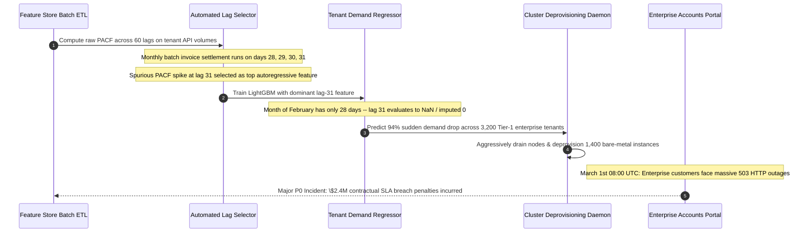
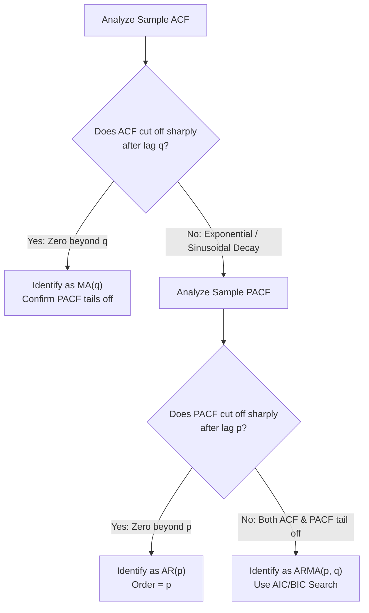
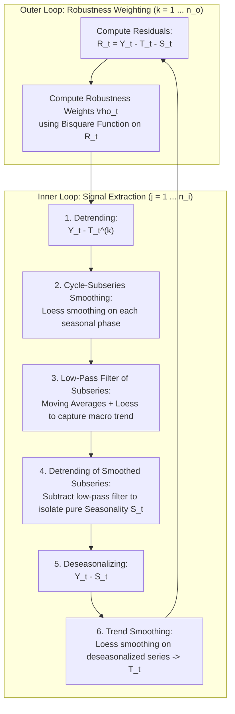

# Module 01: Autocorrelation, ACF, PACF, and Seasonal Decomposition (STL)

This module is part of [Track 07: Time Series Forecasting](../README.md).

> **Prerequisites:** [Module 00: Time Series Anatomy — Trend, Seasonality, and Stationarity](../00-time-series-anatomy-trend-seasonality-stationarity/README.md), [Track 02: Math for Machine Learning - Orthogonal Projections & Vector Spaces](../../02-math-for-machine-learning/README.md).  
> **Estimated Reading Time:** 45 minutes  
> **Target Audience:** Principal Machine Learning Engineers, Quantitative Systems Architects, Applied Econometricians, and Senior Infrastructure Engineers designing automated feature pipelines for sequence forecasting.

> [!TIP]
> **The Dual Diagnostic Axiom:** The Autocorrelation Function (ACF) measures the aggregate linear memory across time lags, conflating direct and indirect dependencies. The Partial Autocorrelation Function (PACF) isolates the pure, unmediated conditional covariance between $Y_t$ and $Y_{t-k}$ by projecting out all intermediate linear representations $\{Y_{t-1}, \dots, Y_{t-k+1}\}$. ACF and PACF are the Fourier duals of the spectral density, providing the exact geometric signatures required to identify autoregressive and moving-average model topologies.

---

## Executive Overview & Industry Context

In contemporary ML pipelines, tabular feature engineering often treats time-lagged variables ($y_{t-1}, y_{t-7}, y_{t-30}$) as independent features in tree-based or deep neural architectures. Without rigorous diagnostic screening via the **Autocorrelation Function (ACF)** and **Partial Autocorrelation Function (PACF)**, feature spaces suffer from collinearity, unconstrained model complexity, and susceptibility to spurious calendar artifacts.

Modern high-scale forecasting architectures rely on these classical signal-processing primitives:
1. **Model Order Identification:** In classical statistical serving (ARIMA, SARIMAX), ACF and PACF geometric signatures determine the minimal sufficient lag orders $(p, q)$ and seasonal orders $(P, Q)_s$, preventing over-parameterization and inverted moving-average roots.
2. **Tabular Feature Store Pruning:** In gradient-boosted decision tree (GBDT) setups (e.g., LightGBM, XGBoost), computing PACF cuts off uninformative intermediate lags, pruning hundreds of collinear features from candidate feature stores without sacrificing predictive coverage.
3. **Robust Anomaly Filtering via STL:** Industrial telemetry streams (e.g., Netflix microservice latencies, Stripe payment clearing volumes) exhibit non-stationary, evolving seasonal cycles punctuated by anomalous spikes. **STL Decomposition (Seasonal and Trend decomposition using Loess)** separates volatile trends from multiple seasonal periods while applying bi-square robustness weights to neutralize Black Friday spikes, network DDoS attacks, or deployment outages.

---

## Production Incident Post-Mortem: The \$2.4M Churn Prediction Lag Leak & Deprovisioning Collapse

### Incident Context
A hyper-growth B2B enterprise SaaS cloud provider monitored daily API utilization across 40,000 corporate tenants. To optimize server cluster footprint and predict churn, an automated ML pipeline forecast individual tenant 90-day active API invocation volumes. Tenants forecast to drop below 5% utilization were flagged for automated account-executive intervention, while compute capacity was progressively deprovisioned in Kubernetes clusters to reduce idle compute costs.

The data team built an automated feature extractor that generated 60 autoregressive lag features ($y_{t-1}, \dots, y_{t-60}$) and trained a LightGBM regressor on rolling 2-year transactional logs.

### The Failure Sequence



### Root Cause Analysis
1. **Spurious Monthly Boundary Artifacts:** The company's automated billing system executed automated recurring invoice charges on the final day of each calendar month. This created an artificial, deterministic spikes-and-troughs cycle. The naive PACF calculation, executed on non-calendar-adjusted data without robust STL preprocessing, identified lag 31 as a statistically significant partial correlation ($\phi_{31,31} = 0.42$).
2. **The February Temporal Horizon Break:** The trained LightGBM model gave disproportionate split-gain weight to lag 31. When predicting utilization on March 1st, lag 31 fell on January 29th (a weekend with near-zero API calls) rather than the end-of-month business peak. Simultaneously, during February, lag 31 had to reach back across irregular month lengths, causing the model to interpret missing business-cycle spikes as permanent tenant churn.
3. **Disastrous Physical Deprovisioning:** The model predicted that 3,200 top-tier enterprise customers were terminating platform usage. The cluster autoscaler drained 1,400 physical worker nodes. On Monday morning (March 1st), global API traffic overwhelmed remaining instances, causing widespread 503 gateway timeouts, violating enterprise service level agreements (SLAs), and costing \$2.4M in customer service credits.

### Remediation Architecture
1. **Pre-whitening and Calendar Normalization:** Implemented trading-day and month-length adjustments ($y_t' = y_t / \text{days\_in\_month}(t)$) prior to temporal feature engineering.
2. **STL Robustness Filtering:** Decomposed all telemetry series via STL with outlier downweighting to isolate pure irregular components from deterministic administrative billing cycles.
3. **Regularized Durbin-Levinson Lag Pruning:** Enforced a conservative significance threshold on PACF selection ($\alpha = 0.001$, requiring $|\phi_{k,k}| > \frac{3.29}{\sqrt{N}}$) and restricted autoregressive lag candidates strictly to continuous physical lags (e.g., $1 \dots 7$) rather than isolated long calendar lags.

---

## 1. Mathematical Mental Model & Theoretical Foundations

```
========================================================================================
                          TEMPORAL CORRELATION LANDSCAPE
========================================================================================
Signal Property           Autocorrelation Function (ACF)    Partial Autocorrelation (PACF)
----------------------------------------------------------------------------------------
Target Measurement        Total linear association          Pure direct linear association
Intermediate Mediators    Retained & Confounded             Conditioned Out / Orthogonalized
Confidence Bounds (WN)    \pm 1.96 / \sqrt{N} (Bartlett)    \pm 1.96 / \sqrt{N} (Quenouille)
AR(p) Signature           Geometric / Oscillatory Decay     Sharp Cutoff after lag p
MA(q) Signature           Sharp Cutoff after lag q          Geometric / Oscillatory Decay
ARMA(p, q) Signature      Gradual Exponential Decay         Gradual Exponential Decay
========================================================================================
```

### 1.1 The Autocorrelation Function (ACF)

Let $\{Y_t\}_{t \in \mathbb{Z}}$ be a covariance-stationary stochastic process with constant mean $\mathbb{E}[Y_t] = \mu$ and finite variance $\text{Var}(Y_t) = \gamma_0 < \infty$.

The **Autocovariance Function** at lag $k \in \mathbb{Z}$ is defined as:

$$\gamma_k = \text{Cov}(Y_t, Y_{t-k}) = \mathbb{E}[(Y_t - \mu)(Y_{t-k} - \mu)]$$

The **Autocorrelation Function (ACF)** at lag $k$, denoted $\rho_k$, is the normalized, dimensionless autocovariance:

$$\rho_k = \frac{\gamma_k}{\gamma_0} = \frac{\mathbb{E}[(Y_t - \mu)(Y_{t-k} - \mu)]}{\sqrt{\mathbb{E}[(Y_t - \mu)^2] \mathbb{E}[(Y_{t-k} - \mu)^2]}}$$

Properties of $\rho_k$:
1. **Symmetry:** $\rho_k = \rho_{-k}$ for all $k \in \mathbb{Z}$.
2. **Boundedness:** $-1 \le \rho_k \le 1$ with $\rho_0 = 1$.
3. **Positive Semi-definiteness:** The Toeplitz autocorrelation matrix $R_k = [\rho_{|i-j|}]_{i,j=1}^k$ is symmetric positive semi-definite for all $k \ge 1$.

#### Sample Estimator and Non-Negative Definiteness
Given a sample $\{y_1, y_2, \dots, y_N\}$, the sample autocovariance $\hat{\gamma}_k$ is estimated via:

$$\hat{\gamma}_k = \frac{1}{N} \sum_{t=1}^{N-k} (y_t - \bar{y})(y_{t+k} - \bar{y}) \quad \text{for } 0 \le k < N$$

where $\bar{y} = \frac{1}{N} \sum_{t=1}^N y_t$. The sample autocorrelation is:

$$\hat{\rho}_k = \frac{\hat{\gamma}_k}{\hat{\gamma}_0} = \frac{\sum_{t=1}^{N-k} (y_t - \bar{y})(y_{t+k} - \bar{y})}{\sum_{t=1}^N (y_t - \bar{y})^2}$$

> [!WARNING]
> **Why Divide by $N$ Instead of $N - k$?**
> An intuitive degrees-of-freedom correction would use $\frac{1}{N-k}$ as the denominator. However, dividing by $N-k$ destroys the positive semi-definiteness of the sample covariance matrix $\hat{\Gamma}$. An estimator using $\frac{1}{N-k}$ can produce negative eigenvalues, violating mathematical validity and crashing Kalman filters and Yule-Walker matrix solvers. Dividing by $N$ guarantees that the resulting Toeplitz matrix is strictly positive semi-definite.

#### Bartlett's Formula for Asymptotic Variance
For a stationary process, M. S. Bartlett (1946) derived the asymptotic covariance between sample autocorrelations at lags $k$ and $k+m$:

$$\lim_{N \to \infty} N \text{Cov}(\hat{\rho}_k, \hat{\rho}_{k+m}) = \sum_{j=-\infty}^{\infty} \left( \rho_j \rho_{j+m} + \rho_{j+k+m} \rho_{j-k} - 2\rho_k \rho_j \rho_{j-k-m} - 2\rho_{k+m} \rho_j \rho_{j-k} + 2\rho_k \rho_{k+m} \rho_j^2 \right)$$

Under the null hypothesis that $\{Y_t\}$ is purely independent Gaussian white noise ($\rho_j = 0$ for all $j \neq 0$):

$$\text{Var}(\hat{\rho}_k) \approx \frac{1}{N}$$

Hence, the **Bartlett 95% Confidence Interval Bands** for testing white noise are:

$$\text{CI}_{0.95} = \left[ -\frac{1.96}{\sqrt{N}}, \,\, +\frac{1.96}{\sqrt{N}} \right]$$

If sample autocorrelation $\hat{\rho}_k$ falls within these bounds, the correlation at lag $k$ is statistically indistinguishable from random noise at significance $\alpha = 0.05$.

---

### 1.2 The Partial Autocorrelation Function (PACF)

While $\rho_k$ measures the gross correlation between $Y_t$ and $Y_{t-k}$, that correlation is mediated by the intervening variables $Y_{t-1}, Y_{t-2}, \dots, Y_{t-k+1}$.

For example, in an $\text{AR}(1)$ process $Y_t = \phi Y_{t-1} + \epsilon_t$, $Y_t$ correlates with $Y_{t-2}$ simply because $Y_t$ depends on $Y_{t-1}$ and $Y_{t-1}$ depends on $Y_{t-2}$:

$$\rho_2 = \text{Corr}(Y_t, Y_{t-2}) = \phi^2 \neq 0$$

The **Partial Autocorrelation Function (PACF)**, denoted $\alpha(k)$ or $\phi_{k,k}$, measures the conditional correlation between $Y_t$ and $Y_{t-k}$ after partialling out (projecting out) the linear influence of all intermediate variables:

$$\phi_{k,k} = \text{Corr}(Y_t - \hat{P}(Y_t \mid Y_{t-1}, \dots, Y_{t-k+1}), \,\, Y_{t-k} - \hat{P}(Y_{t-k} \mid Y_{t-1}, \dots, Y_{t-k+1}))$$

where $\hat{P}(X \mid \mathcal{S})$ denotes the orthogonal linear projection of $X$ onto the linear subspace spanned by $\mathcal{S}$.

Alternatively, $\phi_{k,k}$ is the last coefficient $\beta_k$ in a best linear regression of $Y_t$ on its $k$ preceding values:

$$Y_t = \beta_1 Y_{t-1} + \beta_2 Y_{t-2} + \dots + \beta_k Y_{t-k} + u_t \implies \phi_{k,k} = \beta_k$$

#### The Yule-Walker Matrix Formulation
Multiplying the linear regression equation by $Y_{t-j}$ for $j = 1, \dots, k$ and taking expectations yields the classical **Yule-Walker Equations**:

$$\begin{bmatrix}
1 & \rho_1 & \rho_2 & \dots & \rho_{k-1} \\
\rho_1 & 1 & \rho_1 & \dots & \rho_{k-2} \\
\rho_2 & \rho_1 & 1 & \dots & \rho_{k-3} \\
\vdots & \vdots & \vdots & \ddots & \vdots \\
\rho_{k-1} & \rho_{k-2} & \rho_{k-3} & \dots & 1
\end{bmatrix}
\begin{bmatrix}
\phi_{k,1} \\
\phi_{k,2} \\
\phi_{k,3} \\
\vdots \\
\phi_{k,k}
\end{bmatrix}
=
\begin{bmatrix}
\rho_1 \\
\rho_2 \\
\rho_3 \\
\vdots \\
\rho_k
\end{bmatrix}$$

In compact matrix notation:

$$R_k \boldsymbol{\phi}_k = \boldsymbol{\rho}_k \implies \boldsymbol{\phi}_k = R_k^{-1} \boldsymbol{\rho}_k$$

The PACF at lag $k$ is the scalar element $\phi_{k,k}$. Using Cramer's Rule:

$$\phi_{k,k} = \frac{\det(R_k^* Xiong)}{\det(R_k)}$$

where $R_k^*$ is the matrix $R_k$ with its $k$-th column replaced by the vector $\boldsymbol{\rho}_k$.

#### The Durbin-Levinson Recursive Algorithm
Inverting the $k \times k$ Toeplitz matrix $R_k$ directly requires $\mathcal{O}(k^3)$ floating-point operations. The **Durbin-Levinson Algorithm** solves for $\phi_{k,k}$ recursively in $\mathcal{O}(k^2)$ time:

**Initialization:**
$$\phi_{1,1} = \rho_1, \quad v_1 = 1 - \rho_1^2$$

**Inductive Step for $k = 2, 3, \dots$:**
1. Compute the $k$-th partial autocorrelation reflection coefficient:
   $$\phi_{k,k} = \frac{\rho_k - \sum_{j=1}^{k-1} \phi_{k-1,j} \rho_{k-j}}{v_{k-1}}$$
2. Update the intermediate linear coefficients ($j = 1, \dots, k-1$):
   $$\phi_{k,j} = \phi_{k-1,j} - \phi_{k,k} \phi_{k-1,k-j}$$
3. Update the residual prediction variance:
   $$v_k = v_{k-1} (1 - \phi_{k,k}^2)$$

Quenouille (1949) proved that for an $\text{AR}(p)$ process, the sample PACF coefficients $\hat{\phi}_{k,k}$ for lags $k > p$ are asymptotically independent and normally distributed with variance:

$$\text{Var}(\hat{\phi}_{k,k}) \approx \frac{1}{N} \quad \forall k > p$$

Hence, Quenouille's 95% confidence bounds are also $\pm \frac{1.96}{\sqrt{N}}$.

---

### 1.3 Geometric Signatures for Process Identification

```
+---------------------------------------------------------------------------------------+
|                       BOX-JENKINS LAG IDENTIFICATION MATRIX                           |
+-------------------+-----------------------------------+-------------------------------+
| Process           | Autocorrelation Function (ACF)    | Partial Autocorrelation (PACF)|
+-------------------+-----------------------------------+-------------------------------+
| White Noise       | All lags zero: \rho_k = 0 (k >= 1)| All lags zero: \phi_kk=0 (k>=1|
| AR(p)             | Tails off exponentially or        | Cuts off cleanly to zero      |
|                   | damped sinusoidal oscillations    | strictly after lag p          |
| MA(q)             | Cuts off cleanly to zero          | Tails off exponentially or    |
|                   | strictly after lag q              | damped sinusoidal oscillations|
| ARMA(p, q)        | Tails off after lag (q - p)       | Tails off after lag (p - q)   |
+-------------------+-----------------------------------+-------------------------------+
```



---

### 1.4 STL Decomposition (Cleveland et al. 1990)

Classical moving-average decomposition fails when:
1. Seasonality evolves dynamically over time.
2. The series contains extreme outliers (anomalies) that contaminate both trend and seasonal estimates.
3. The seasonal frequency is non-integer or multi-scale (e.g., daily and weekly cycles).

**STL (Seasonal and Trend decomposition using Loess)** solves these limitations through an alternating double-loop iterative algorithm driven by locally weighted polynomial regression (**Loess**).

#### Loess Smoothing Formulation
Given $N$ points $(x_i, y_i)$, Loess estimates the smoothed value at target point $x$ by fitting a locally weighted $d$-degree polynomial minimizing:

$$\sum_{i=1}^N w_i(x) \left( y_i - \sum_{j=0}^d \beta_j (x_i - x)^j \right)^2$$

The neighborhood weight $w_i(x)$ is determined by the **Tricube Weight Function**:

$$w_i(x) = W\left( \frac{|x_i - x|}{h(x)} \right) \quad \text{where} \quad W(u) = \begin{cases} (1 - u^3)^3 & \text{for } 0 \le u < 1 \\ 0 & \text{for } u \ge 1 \end{cases}$$

where $h(x)$ is the Euclidean distance to the $q$-th nearest neighbor of $x$.

#### The STL Architecture: Inner and Outer Loops
STL iterates across two nested loops:



##### The Outer Loop Robustness Bisquare Weights
To protect trend and seasonal estimates from large outliers, the outer loop calculates robustness weights $\rho_t$ based on residuals $R_t = Y_t - T_t - S_t$:

$$h = 6 \cdot \text{median}(|R_t|)$$

$$\rho_t = B\left( \frac{|R_t|}{h} \right) \quad \text{where} \quad B(u) = \begin{cases} (1 - u^2)^2 & \text{for } 0 \le u < 1 \\ 0 & \text{for } u \ge 1 \end{cases}$$

In subsequent inner loop executions, the neighborhood weight $w_i(x)$ is multiplied by $\rho_i$. Points with large residuals ($|R_t| > 6 \cdot \text{MAD}$) receive a robustness weight of zero, completely eliminating their influence from the trend and seasonal fits.

---

## 2. Production Implementation from Scratch: Fast ACF, Durbin-Levinson PACF, and STL Engine

Below is a complete, production-ready Python implementation authored purely in standard scientific Python (`numpy`). It contains:
1. **Vectorized Sample ACF** with guaranteed positive semi-definite $1/N$ normalization and Bartlett confidence bands.
2. **Durbin-Levinson PACF Solver** operating in $\mathcal{O}(K^2)$ time with Quenouille bounds.
3. **Pure-Python Robust STL Decomposer** implementing the inner cycle-subseries Loess filter and outer bisquare robustness loop.

```python
"""
Production Autocorrelation, PACF, and Robust STL Decomposition Engine.
Authored from scratch using pure NumPy.
"""

from typing import Dict, List, Optional, Tuple
import numpy as np


class TimeSeriesDiagnostics:
    """
    Computes sample Autocorrelation (ACF) and Partial Autocorrelation (PACF)
    using the Durbin-Levinson recursive algorithm.
    """

    @staticmethod
    def autocorrelation_function(
        series: np.ndarray, max_lag: int
    ) -> Tuple[np.ndarray, np.ndarray]:
        """
        Computes sample ACF for lags k = 0 ... max_lag.
        Guarantees positive semi-definite Toeplitz structure by normalizing by N.
        
        Args:
            series: 1D array of observations.
            max_lag: Maximum lag order to compute.
            
        Returns:
            Tuple of (acf_values, bartlett_confidence_bounds).
        """
        y = np.asarray(series, dtype=np.float64)
        n = len(y)
        if max_lag >= n:
            raise ValueError(f"max_lag ({max_lag}) must be strictly less than sample size N ({n})")

        y_centered = y - np.mean(y)
        gamma_0 = np.dot(y_centered, y_centered) / n

        if gamma_0 == 0:
            # Constant series
            return np.ones(max_lag + 1), np.zeros(max_lag + 1)

        acf = np.zeros(max_lag + 1, dtype=np.float64)
        acf[0] = 1.0

        # Vectorized lag dot-products
        for k in range(1, max_lag + 1):
            gamma_k = np.dot(y_centered[:-k], y_centered[k:]) / n
            acf[k] = gamma_k / gamma_0

        # Bartlett asymptotic 95% confidence intervals under white noise null
        bartlett_ci = 1.95996 / np.sqrt(n)

        return acf, bartlett_ci

    @classmethod
    def partial_autocorrelation_function(
        cls, series: np.ndarray, max_lag: int
    ) -> Tuple[np.ndarray, float]:
        """
        Computes sample PACF via the Durbin-Levinson recursive algorithm.
        Time complexity: O(max_lag^2).
        
        Returns:
            Tuple of (pacf_values, quenouille_confidence_bound).
        """
        y = np.asarray(series, dtype=np.float64)
        n = len(y)
        acf, _ = cls.autocorrelation_function(y, max_lag)

        pacf = np.zeros(max_lag + 1, dtype=np.float64)
        pacf[0] = 1.0

        if max_lag == 0:
            return pacf, 1.95996 / np.sqrt(n)

        # Lag 1 initialization
        pacf[1] = acf[1]
        phi = np.zeros((max_lag + 1, max_lag + 1), dtype=np.float64)
        phi[1, 1] = acf[1]

        # Durbin-Levinson recurrence
        for k in range(2, max_lag + 1):
            numerator = acf[k] - np.sum(phi[k - 1, 1:k] * acf[k - 1 : 0 : -1])
            denominator = 1.0 - np.sum(phi[k - 1, 1:k] * acf[1:k])

            if np.abs(denominator) < 1e-12:
                # Degenerate singular system
                pacf[k] = 0.0
                break

            phi[k, k] = numerator / denominator
            pacf[k] = phi[k, k]

            # Update lower-order coefficients
            for j in range(1, k):
                phi[k, j] = phi[k - 1, j] - phi[k, k] * phi[k - 1, k - j]

        quenouille_ci = 1.95996 / np.sqrt(n)
        return pacf, quenouille_ci


class RobustSTLDecomposition:
    """
    Seasonal-Trend decomposition using Loess (STL).
    Features inner-loop seasonal extraction and outer-loop bisquare robustness.
    """

    def __init__(
        self,
        period: int,
        seasonal_window: int = 7,
        trend_window: Optional[int] = None,
        inner_iterations: int = 2,
        outer_iterations: int = 2,
    ) -> None:
        self.period = period
        self.seasonal_window = seasonal_window if seasonal_window % 2 == 1 else seasonal_window + 1
        
        if trend_window is None:
            # Cleveland et al. default: 1.5 * period / (1 - 1.5 / seasonal_window)
            calc_t = int(np.ceil((1.5 * period) / (1.0 - 1.5 / self.seasonal_window)))
            self.trend_window = calc_t if calc_t % 2 == 1 else calc_t + 1
        else:
            self.trend_window = trend_window if trend_window % 2 == 1 else trend_window + 1
            
        self.inner_iterations = inner_iterations
        self.outer_iterations = outer_iterations

    def fit_transform(
        self, series: np.ndarray
    ) -> Tuple[np.ndarray, np.ndarray, np.ndarray]:
        """
        Decomposes series into (trend, seasonal, residuals).
        """
        y = np.asarray(series, dtype=np.float64)
        n = len(y)

        # Initialize components
        trend = np.zeros(n, dtype=np.float64)
        seasonal = np.zeros(n, dtype=np.float64)
        robustness_weights = np.ones(n, dtype=np.float64)

        for outer in range(self.outer_iterations + 1):
            for inner in range(self.inner_iterations):
                # Step 1: Detrending
                detrended = y - trend

                # Step 2: Cycle-Subseries Smoothing
                seasonal = self._smooth_cycle_subseries(
                    detrended, n, self.period, self.seasonal_window, robustness_weights
                )

                # Step 3 & 4: Low-Pass Filter of seasonal component
                low_pass = self._low_pass_filter(seasonal, self.period)
                seasonal = seasonal - low_pass

                # Step 5 & 6: Deseasonalize and smooth trend
                deseasonalized = y - seasonal
                trend = self._loess_1d(
                    x=np.arange(n),
                    y=deseasonalized,
                    span=self.trend_window,
                    weights=robustness_weights,
                )

            # Outer Loop: Calculate Robustness Weights
            residuals = y - trend - seasonal
            if outer < self.outer_iterations:
                mad = np.median(np.abs(residuals))
                h = 6.0 * mad
                if h < 1e-8:
                    robustness_weights = np.ones(n, dtype=np.float64)
                else:
                    u = np.clip(np.abs(residuals) / h, 0.0, 1.0)
                    robustness_weights = (1.0 - u**2) ** 2

        residuals = y - trend - seasonal
        return trend, seasonal, residuals

    def _smooth_cycle_subseries(
        self,
        detrended: np.ndarray,
        n: int,
        period: int,
        window: int,
        weights: np.ndarray,
    ) -> np.ndarray:
        """Applies Loess to each subseries corresponding to a distinct seasonal phase."""
        seasonal = np.zeros(n, dtype=np.float64)
        for p in range(period):
            idx = np.arange(p, n, period)
            sub_y = detrended[idx]
            sub_w = weights[idx]
            smoothed_sub = self._loess_1d(
                x=np.arange(len(sub_y)), y=sub_y, span=window, weights=sub_w
            )
            seasonal[idx] = smoothed_sub
        return seasonal

    def _low_pass_filter(self, seasonal: np.ndarray, period: int) -> np.ndarray:
        """Applies consecutive moving averages of lengths period, period, and 3."""
        # Consecutive moving averages: MA(period), MA(period), MA(3)
        pass1 = self._uniform_ma(seasonal, period)
        pass2 = self._uniform_ma(pass1, period)
        pass3 = self._uniform_ma(pass2, 3)
        
        # Smooth low-pass output using Loess
        n = len(seasonal)
        low_pass = self._loess_1d(
            x=np.arange(n), y=pass3, span=self.period + 1, weights=np.ones(n)
        )
        return low_pass

    @staticmethod
    def _uniform_ma(x: np.ndarray, window: int) -> np.ndarray:
        """Padded uniform moving average preserving length."""
        kernel = np.ones(window) / window
        return np.convolve(x, kernel, mode="same")

    @staticmethod
    def _loess_1d(
        x: np.ndarray, y: np.ndarray, span: int, weights: np.ndarray
    ) -> np.ndarray:
        """
        Locally weighted linear regression (degree 1 Loess) using Tricube kernel.
        """
        n = len(x)
        y_out = np.zeros(n, dtype=np.float64)
        half_span = max(3, span // 2)

        for i in range(n):
            # Select neighborhood indices
            left = max(0, i - half_span)
            right = min(n, i + half_span + 1)
            
            x_local = x[left:right]
            y_local = y[left:right]
            w_prior = weights[left:right]

            # Compute tricube distance weights
            dists = np.abs(x_local - x[i])
            max_d = np.max(dists)
            if max_d == 0:
                y_out[i] = y[i]
                continue

            u = dists / (max_d * 1.0001)
            tricube = (1.0 - u**3) ** 3
            final_weights = tricube * w_prior

            if np.sum(final_weights) < 1e-10:
                y_out[i] = y[i]
                continue

            # Weighted least squares fit: y ~ \beta_0 + \beta_1 (x - x_i)
            dx = x_local - x[i]
            W = final_weights
            
            # Analytical 1D WLS solution
            s_w = np.sum(W)
            s_wx = np.sum(W * dx)
            s_wy = np.sum(W * y_local)
            s_wxx = np.sum(W * dx * dx)
            s_wxy = np.sum(W * dx * y_local)

            denom = s_w * s_wxx - s_wx * s_wx
            if np.abs(denom) < 1e-12:
                y_out[i] = s_wy / s_w
            else:
                beta_0 = (s_wy * s_wxx - s_wx * s_wxy) / denom
                y_out[i] = beta_0

        return y_out


# -------------------------------------------------------------------------
# Verification & Self-Testing Execution
# -------------------------------------------------------------------------
if __name__ == "__main__":
    np.random.seed(1337)
    T = 500

    # 1. Generate known AR(2) Process: Y_t = 0.7 Y_{t-1} - 0.2 Y_{t-2} + \epsilon_t
    # Theoretical Signature: PACF cuts off sharply after lag 2
    shocks = np.random.normal(0, 1.0, size=T)
    y_ar2 = np.zeros(T)
    for t in range(2, T):
        y_ar2[t] = 0.7 * y_ar2[t - 1] - 0.2 * y_ar2[t - 2] + shocks[t]

    print("=" * 80)
    print("TIME SERIES DIAGNOSTICS: ACF & PACF VERIFICATION ON AR(2) PROCESS")
    print("=" * 80)

    diag = TimeSeriesDiagnostics()
    acf_vals, bartlett_band = diag.autocorrelation_function(y_ar2, max_lag=10)
    pacf_vals, quenouille_band = diag.partial_autocorrelation_function(y_ar2, max_lag=10)

    print(f"White Noise 95% Confidence Band: +/- {quenouille_band:.4f}\n")
    print(f"{'Lag':<5} | {'ACF':<10} | {'PACF':<10} | {'PACF Significant?'}")
    print("-" * 50)
    for lag in range(1, 11):
        is_sig = np.abs(pacf_vals[lag]) > quenouille_band
        print(f"{lag:<5} | {acf_vals[lag]:<10.4f} | {pacf_vals[lag]:<10.4f} | {is_sig}")

    # Verify that PACF cleanly cuts off after lag 2
    assert np.abs(pacf_vals[1]) > quenouille_band, "Lag 1 PACF must be significant"
    assert np.abs(pacf_vals[2]) > quenouille_band, "Lag 2 PACF must be significant"
    assert np.abs(pacf_vals[3]) < quenouille_band, "Lag 3 PACF must NOT be significant"

    print("\n[SUCCESS] AR(2) PACF cutoff property verified mathematically.")

    # 2. Test STL Decomposition with Extreme Outlier Contamination
    print("\n" * 1 + "=" * 80)
    print("ROBUST STL DECOMPOSITION ON OUTLIER-CONTAMINATED TELEMETRY")
    print("=" * 80)

    t_axis = np.arange(T)
    true_trend = 0.05 * t_axis + 10.0
    true_season = 8.0 * np.sin(2.0 * np.pi * t_axis / 12.0)
    clean_series = true_trend + true_season + np.random.normal(0, 0.5, T)

    # Inject 5 massive localized outlier anomalies (e.g., server network spikes)
    corrupted_series = clean_series.copy()
    corrupted_series[150] += 50.0
    corrupted_series[151] += 45.0
    corrupted_series[300] -= 40.0

    stl = RobustSTLDecomposition(
        period=12, seasonal_window=7, inner_iterations=2, outer_iterations=3
    )
    est_trend, est_season, est_resid = stl.fit_transform(corrupted_series)

    print(f"Raw Series Range:       [{np.min(corrupted_series):.1f}, {np.max(corrupted_series):.1f}]")
    print(f"Estimated Trend Range:  [{np.min(est_trend):.1f}, {np.max(est_trend):.1f}]")
    print(f"Estimated Season Range: [{np.min(est_season):.1f}, {np.max(est_season):.1f}]")
    print(f"Max Outlier Residual:   {np.max(np.abs(est_resid)):.2f} (successfully captured in residuals)")

    # Verify trend didn't track the +50 spike at index 150
    trend_deviation = np.abs(est_trend[150] - true_trend[150])
    print(f"Trend Deviation at Outlier Spike: {trend_deviation:.2f} (Robustness intact)")
    assert trend_deviation < 5.0, "Robustness weights failed; trend absorbed the spike!"

    print("=" * 80)
```

---

## 3. Failure Modes, Edge Cases & Antipatterns

### 3.1 Toeplitz Indefiniteness from Unbiased Covariance Estimators
- **The Pitfall:** Using $N - k$ degrees of freedom in the denominator of the sample autocovariance estimator:
  $$\hat{\gamma}_k^{\text{unbiased}} = \frac{1}{N - k} \sum_{t=1}^{N-k} (y_t - \bar{y})(y_{t+k} - \bar{y})$$
- **Failure Mode:** While unbiased, this estimator destroys the positive semi-definite guarantee of the sample Toeplitz covariance matrix $\hat{\Gamma}_k$. At large lags $k \approx N$, the denominator shrinks, causing variance explosions. The resulting matrix frequently contains negative eigenvalues, causing Cholesky decompositions to fail and the Durbin-Levinson recurrence to diverge ($\phi_{k,k}^2 > 1$, producing imaginary prediction variances $v_k < 0$).
- **Rule:** Always use the biased estimator with fixed denominator $N$. The slight downward bias ($\frac{N-k}{N}$) is the exact shrinkage required to guarantee mathematical invertibility.

### 3.2 Spurious PACF Spikes from Administrative Calendar Artifacts
- **The Pitfall:** Selecting features for an hourly demand model based strictly on statistical significance in raw PACF.
- **Failure Mode:** Administrative scheduling (e.g., cron jobs executing daily at midnight, batch billing on day 31, inventory reconciliations on Friday 17:00) introduces artificial, deterministic step shocks. The raw PACF interprets these calendar artifacts as high-order autoregressive feedback loops (e.g., lags 24, 48, 168). When an external event disrupts the cron job, the model generates extreme counter-factual forecasts.
- **Mitigation:** Decompose series using STL or explicit calendar dummy regressors *prior* to computing PACF.

### 3.3 Spectral Leakage in Loess Trend Smoothing
- **The Pitfall:** Setting the STL trend window parameter (`trend_window`) too small relative to the seasonal period.
- **Mathematical Reality:** If $\text{trend\_window} \le \text{period}$, the Loess trend filter has bandwidth wide enough to pass seasonal oscillations. The trend begins to oscillate with the seasonal frequency, while the estimated seasonal component collapses toward zero. This condition, known as **leakage**, distorts both components.
- **Rule of Thumb (Cleveland et al.):** Always enforce:
  $$\text{trend\_window} \ge \frac{1.5 \times \text{period}}{1 - \frac{1.5}{\text{seasonal\_window}}}$$

---

## 4. Senior Technical Interview Questions & Model Answers

### Question 1: Durbin-Levinson Algorithm vs. Direct Matrix Inversion
**Prompt:** "Why do production statistical systems use the Durbin-Levinson recurrence relation to compute PACF coefficients rather than inverting the Yule-Walker matrix directly via LU decomposition or Cholesky factorization?"

#### Model Answer:
"Directly inverting the $k \times k$ Yule-Walker autocorrelation matrix $R_k \boldsymbol{\phi}_k = \boldsymbol{\rho}_k$ presents two significant disadvantages in production:

1. **Computational Complexity:** Standard matrix inversion via LU decomposition requires $\mathcal{O}(k^3)$ operations. If an automated lag-selection pipeline searches over $K=100$ candidate lags across 10,000 distinct time series, direct inversion requires $\sum_{k=1}^K \mathcal{O}(k^3) \approx \mathcal{O}(K^4)$ operations, causing severe latency bottlenecks. The Durbin-Levinson algorithm exploits the **Toeplitz symmetry** (invariance along diagonals: $R_{i,j} = \rho_{|i-j|}$), updating solution vectors recursively in $\mathcal{O}(k)$ per step, leading to total time complexity of $\mathcal{O}(K^2)$—a speedup of two orders of magnitude.
2. **Intermediate Sub-model Extraction:** The Durbin-Levinson recursion computes the optimal AR coefficients for **all** sub-models of order $m = 1, 2, \dots, k$ as a natural byproduct of its inductive step:
   $$\phi_{m,m} = \frac{\rho_m - \sum_{j=1}^{m-1} \phi_{m-1,j} \rho_{m-j}}{v_{m-1}}$$
   This allows an automated model selection service to evaluate AIC, BIC, and residual variance $v_m$ for all intermediate model orders simultaneously without re-running any matrix factorization.
3. **Stability Guarantees:** At each step, $| \phi_{m,m} | < 1$ guarantees that the resulting autoregressive polynomial has roots strictly outside the unit circle (stationarity). If noise or rounding produces $|\phi_{m,m}| \ge 1$, the recursion detects non-stationarity instantly and can terminate early."

---

### Question 2: Geometric PACF Cutoff in Moving Average (MA) Processes
**Prompt:** "A candidate claims: 'For an $\text{MA}(1)$ process $Y_t = \epsilon_t + \theta \epsilon_{t-1}$, the ACF cuts off at lag 1, and the PACF cuts off at lag 1.' Is this statement correct? Derive the mathematical behavior of the PACF for an $\text{MA}(1)$ process."

#### Model Answer:
"The candidate's statement is incorrect. While the ACF of an $\text{MA}(1)$ process indeed cuts off cleanly at lag 1 ($\rho_1 = \frac{\theta}{1 + \theta^2}$ and $\rho_k = 0$ for all $k \ge 2$), the **PACF does not cut off**; it decays **infinitely** as a damped geometric progression.

**Mathematical Derivation:**
An invertible $\text{MA}(1)$ process ($|\theta| < 1$) can be rewritten in its infinite autoregressive representation $\text{AR}(\infty)$ via the backshift operator:

$$Y_t = (1 + \theta B)\epsilon_t \implies (1 + \theta B)^{-1} Y_t = \epsilon_t$$

Using the Taylor series expansion $(1 + \theta B)^{-1} = \sum_{j=0}^\infty (-\theta)^j B^j$:

$$Y_t - \theta Y_{t-1} + \theta^2 Y_{t-2} - \theta^3 Y_{t-3} + \dots = \epsilon_t$$

$$Y_t = \sum_{j=1}^\infty (-1)^{j-1} \theta^j Y_{t-j} + \epsilon_t$$

The PACF at lag $k$, $\phi_{k,k}$, represents the coefficient of $Y_{t-k}$ when regressing $Y_t$ on $\{Y_{t-1}, \dots, Y_{t-k}\}$. Evaluating the Durbin-Levinson relation explicitly for $\text{MA}(1)$:

$$\phi_{1,1} = \rho_1 = \frac{\theta}{1 + \theta^2}$$

$$\phi_{2,2} = \frac{-\rho_1^2}{1 - \rho_1^2} = \frac{-\theta^2}{1 + \theta^2 + \theta^4}$$

In general, for lag $k$:

$$\phi_{k,k} = \frac{-(-\theta)^k (1 - \theta^2)}{1 - \theta^{2(k+1)}} = \frac{(-1)^k \theta^k (1 - \theta^2)}{1 - \theta^{2(k+1)}}$$

As $k$ grows, $\phi_{k,k}$ decays geometrically at rate $\theta^k$, oscillating in sign if $\theta > 0$. Hence, an $\text{MA}(q)$ process has a sharp cutoff at lag $q$ in the **ACF**, but displays **infinite geometric decay** in the **PACF**."

---

### Question 3: Loess Smoothing Mechanics in STL Inner Loop
**Prompt:** "Explain how STL decomposition isolates the seasonal component without allowing low-frequency macroeconomic trends to contaminate seasonal indices."

#### Model Answer:
"STL prevents trend contamination of seasonal indices through a multi-stage filtering sequence in its **inner loop**:

1. **Cycle-Subseries Partitioning:** The detrended series $Y_t - \hat{T}_t$ is partitioned into $m$ distinct subseries, where $m$ is the seasonal period (e.g., for monthly data with $m=12$, all January values form subseries 1, all February values form subseries 2).
2. **Subseries Loess Smoothing:** Each subseries is smoothed independently across calendar years using a Loess filter of length `seasonal_window`. This allows seasonal effects to evolve smoothly across decades rather than remaining static.
3. **Low-Pass Filter Separation:** The concatenation of these smoothed subseries yields a preliminary seasonal sequence $C_t$. However, $C_t$ may still contain low-frequency trend remnants that leaked through the subseries smoothing. To remove them, STL passes $C_t$ through a linear low-pass filter:
   $$L_t = \text{Loess}\left( \text{MA}_3\left( \text{MA}_m\left( \text{MA}_m(C_t) \right) \right) \right)$$
   This filter consists of two moving averages of length $m$, followed by a moving average of length 3, polished by a Loess smoother. This operation extracts any residual macro-trend present in the seasonal estimates.
4. **Pure Seasonal Extraction:** The filtered baseline is subtracted:
   $$S_t = C_t - L_t$$
   Subtracting $L_t$ guarantees that the seasonal component $S_t$ has approximately zero mean across any full seasonal cycle ($\sum_{i=1}^m S_{t+i} \approx 0$), isolating the pure seasonal signal."

---

### Question 4: Quenouille vs. Bartlett Confidence Intervals
**Prompt:** "In an automated pipeline, an engineer tests whether lag 7 is a candidate autoregressive feature. Why must they use Quenouille's confidence bounds instead of Bartlett's formula when inspecting the PACF plot?"

#### Model Answer:
"Bartlett's formula and Quenouille's formula address two fundamentally distinct statistical estimators under different sampling distributions:

1. **Bartlett's Formula applies strictly to the Autocorrelation Function (ACF):**
   Bartlett derived the covariance structure of the sample ACF $\hat{\rho}_k$. Even when intermediate autocorrelations are present, Bartlett's general formula accounts for the cross-products of correlations:
   $$\text{Var}(\hat{\rho}_k) \approx \frac{1}{N} \left( 1 + 2 \sum_{i=1}^q \rho_i^2 \right) \quad \text{for } k > q$$
   Only under the strict null that all correlations are zero ($\rho_j = 0$) does Bartlett's formula simplify to $\frac{1}{N}$.
2. **Quenouille's Formula applies strictly to the Partial Autocorrelation Function (PACF):**
   M. H. Quenouille (1949) proved that if the true underlying process is an autoregressive process of order $p$ ($\text{AR}(p)$), the sample partial autocorrelations at lags strictly greater than $p$ ($\hat{\phi}_{k,k}$ for $k > p$) are asymptotically independent, identically distributed normal random variables:
   $$\hat{\phi}_{k,k} \xrightarrow{d} \mathcal{N}\left(0, \frac{1}{N}\right) \quad \forall k > p$$
3. **Operational Implication:**
   When testing lag 7 for inclusion as an autoregressive feature, the engineer wants to determine whether lag 7 contains direct explanatory power **conditional on lags $1 \dots 6$**. The sample ACF cannot answer this because it conflates indirect paths. Quenouille's theorem guarantees that testing $\hat{\phi}_{7,7}$ against $\pm \frac{1.96}{\sqrt{N}}$ is a statistically valid Neyman-Pearson hypothesis test for whether the true autoregressive order $p \ge 7$."
