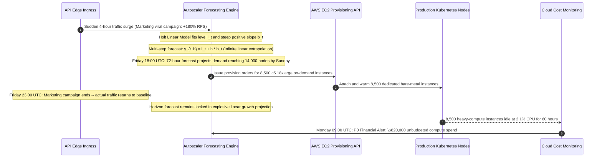
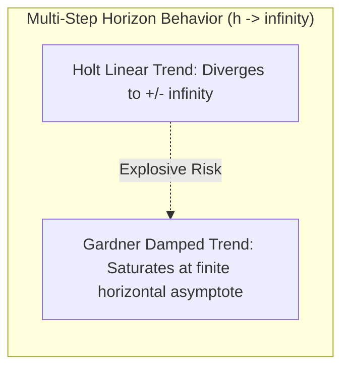

# Module 03: Exponential Smoothing, Holt-Winters, and the ETS State-Space Framework

This module is part of [Track 07: Time Series Forecasting](../README.md).

> **Prerequisites:** [Module 00: Time Series Anatomy — Trend, Seasonality, and Stationarity](../00-time-series-anatomy-trend-seasonality-stationarity/README.md), [Module 01: Autocorrelation, ACF, PACF, and Seasonal Decomposition](../01-autocorrelation-acf-pacf-and-decomposition/README.md), [Module 02: Time Series Cross-Validation & Purging](../02-time-series-cross-validation-and-rolling-windows/README.md).  
> **Estimated Reading Time:** 45 minutes  
> **Target Audience:** Principal Systems Architects, Staff ML Engineers, Quantitative Econometricians, and SRE Platform Architects designing high-throughput, low-latency forecasting microservices.

> [!TIP]
> **The Industrial Workhorse:** While deep learning models (Temporal Fusion Transformers, Informers) capture headlines, Exponential Smoothing (ETS) remains the dominant engine in production platforms managing millions of real-time time series (e.g., Amazon supply chain SKU replenishment, Uber rideshare dispatching, and AWS CloudWatch alarms). ETS computes closed-form recursive state updates in $\mathcal{O}(1)$ time per observation with minimal memory overhead, while providing exact likelihood-based prediction intervals.

---

## Executive Overview & Industry Context

In industrial backend architectures, forecasting is often constrained by latency, compute budgets, and cold-start boundaries. A cloud infrastructure provider monitoring 50,000,000 container metrics cannot run an autoregressive Transformer for each container every 60 seconds.

Exponential smoothing models provide the optimal balance of statistical structure and computational velocity:
1. **Constant Computational Complexity ($\mathcal{O}(1)$ Update):** When a new telemetry point $y_{t+1}$ arrives, exponential smoothing updates its internal state vector $[l_{t+1}, b_{t+1}, s_{t+1}]$ via scalar vector additions. There is no need to re-invert matrices or perform gradient steps.
2. **Explicit Structural Decomposition:** Models explicitly maintain physical states: **Level** ($l_t$, local baseline), **Trend** ($b_t$, growth trajectory), and **Seasonality** ($s_t$, periodic oscillation profile).
3. **Hyndman's ETS Framework:** Standardized exponential smoothing into a formal statistical state-space model with Single Source of Error (SSOE), enabling maximum likelihood estimation (MLE), automated model selection via AICc, and probabilistic density generation.

However, naive implementations of exponential smoothing—particularly undamped linear trend models—can cause severe system failures when extrapolated into multi-step horizons.

---

## Production Incident Post-Mortem: The \$820K Cloud Compute Autoscaler Runaway Cost

### Incident Context
A multi-region SaaS platform operated an elastic Kubernetes autoscaler governed by a predictive horizon controller. The autoscaler predicted required EC2 compute nodes 72 hours ahead to reserve spot instances and pre-warm dedicated hardware clusters before enterprise traffic peaks.

The forecasting daemon used **Holt's Linear Exponential Smoothing** ($\text{ETS}(A, A, N)$) running automated parameter estimation nightly across aggregate request-per-second (RPS) metrics.

### The Failure Sequence



### Root Cause Analysis
1. **Unbounded Linear Trend Extrapolation:** Holt's classic linear model uses an additive trend equation:
   $$\hat{y}_{t+h|t} = l_t + h \cdot b_t$$
   When the marketing campaign drove a sharp temporary upward slope $\hat{b}_t$, the linear model projected that this exact rate of change would persist indefinitely for all horizons $h = 1, \dots, 72$. Over a 72-hour horizon, the forecast scaled linearly into an impossible demand spike ($14,000$ servers).
2. **Absence of Trend Damping ($\phi$):** The service did not implement Gardner-McKenzie damped trend smoothing. A damped parameter $\phi \in (0.8, 0.98)$ would have forced the forward trajectory to saturate asymptotically to $l_t + \frac{\phi}{1-\phi}b_t$, capping the multi-step horizon.
3. **Financial Consequence:** The cluster provisioning engine reserved on-demand AWS instances over a long weekend. The idle instances operated at 2.1% average CPU utilization for 60 hours, incurring \$820,000 in unbudgeted compute spend before engineers manually intervened Monday morning.

### Remediation Architecture
1. **Mandatory Trend Damping:** Deprecated undamped additive trend models. Enforced $\text{ETS}(A, A_d, S)$ with parameter restriction $0.80 \le \phi \le 0.98$.
2. **Upper-Bound Capacity Clamps:** Wrapped all predictive autoscaling outputs with physical saturation heuristics:
   $$\hat{y}_{t+h}^{\text{clamped}} = \min(\hat{y}_{t+h}, \,\, 2.5 \times \text{P95}_{30\text{d}})$$
3. **Automated AICc Selection:** Upgraded the forecasting daemon to evaluate all 30 ETS model permutations dynamically, selecting damped additive or multiplicative models based on penalized log-likelihood.

---

## 1. Mathematical Mental Model & Theoretical Foundations

```
========================================================================================
                       THE EXPONENTIAL SMOOTHING FAMILY TREE
========================================================================================
Model                 State Equations Maintained       Multi-Step Horizon Form
----------------------------------------------------------------------------------------
Single (Simple / SES) Level (l_t)                      Flat: y_{t+h} = l_t
Holt's Linear         Level (l_t), Trend (b_t)         Linear: y_{t+h} = l_t + h * b_t
Holt's Damped Trend   Level (l_t), Trend (b_t), Damping Saturated: y_{t+h} = l_t + (\sum \phi^i) b_t
Holt-Winters Additive Level, Trend, Additive Seasonal  Cyclic: y_{t+h} = l_t + h*b_t + s_{t+h-m}
Holt-Winters Multip.  Level, Trend, Multip. Seasonal   Cyclic: y_{t+h} = (l_t + h*b_t) * s_{t+h-m}
========================================================================================
```

### 1.1 Simple Exponential Smoothing (SES / Single)

Simple Exponential Smoothing is designed for time series displaying no pronounced trend or seasonal patterns.

#### The Recursive Formulation
$$\hat{y}_{t+1|t} = \alpha y_t + (1 - \alpha) \hat{y}_{t|t-1} \quad \text{where } 0 < \alpha \le 1$$

where $\alpha$ is the smoothing parameter. Unrolling the recurrence from $t$ back to $t=1$:

$$\hat{y}_{t+1|t} = \alpha y_t + \alpha(1-\alpha)y_{t-1} + \alpha(1-\alpha)^2 y_{t-2} + \dots + (1-\alpha)^t \hat{y}_{1|0}$$

The weights assign geometrically decaying influence to past observations:

$$w_j = \alpha(1 - \alpha)^j \quad \text{such that} \quad \sum_{j=0}^{\infty} \alpha(1 - \alpha)^j = \frac{\alpha}{1 - (1 - \alpha)} = 1$$

- As $\alpha \to 1$, the model approaches a naive persistence forecast ($\hat{y}_{t+1|t} \approx y_t$).
- As $\alpha \to 0$, the model approaches an infinite historical average with high inertia.

#### Single Source of Error (SSOE) State-Space Representation
Under the Hyndman ETS framework, SES is formulated as an $\text{ETS}(A, N, N)$ state-space model:

- **Observation Equation:**
  $$y_t = l_{t-1} + \epsilon_t$$
- **State Transition Equation:**
  $$l_t = l_{t-1} + \alpha \epsilon_t$$

where $\epsilon_t \sim \text{i.i.d.}\,\mathcal{N}(0, \sigma^2)$ is the single source of error. Substituting the observation error $\epsilon_t = y_t - l_{t-1}$ into the transition equation recovers the classical formulation:

$$l_t = l_{t-1} + \alpha (y_t - l_{t-1}) = \alpha y_t + (1 - \alpha) l_{t-1}$$

The $h$-step-ahead point forecast is strictly constant:

$$\hat{y}_{t+h|t} = l_t \quad \forall h \ge 1$$

---

### 1.2 Double Exponential Smoothing: Holt's Linear and Damped Trend

When a time series exhibits a systematic drift or growth trajectory, SES exhibits persistent lag error. Charles Holt (1957) extended SES by introducing an explicit **Trend State** $b_t$.

#### Holt's Additive Linear Trend Model
- **Level Update:**
  $$l_t = \alpha y_t + (1 - \alpha)(l_{t-1} + b_{t-1})$$
- **Trend Update:**
  $$b_t = \beta (l_t - l_{t-1}) + (1 - \beta) b_{t-1}$$
- **Forecast Function:**
  $$\hat{y}_{t+h|t} = l_t + h \cdot b_t$$

where $\alpha \in (0, 1]$ controls level adaptability and $\beta \in (0, 1]$ controls trend slope adaptability.

#### Gardner-McKenzie Damped Trend Formulation
Empirical forecasting competitions (Makridakis M-Competitions) established that unrestricted linear trends systematically over-forecast over horizons $h > 6$. Gardner and McKenzie (1985) introduced the **damping parameter** $\phi \in (0, 1)$:

- **Level Update:**
  $$l_t = \alpha y_t + (1 - \alpha)(l_{t-1} + \phi b_{t-1})$$
- **Trend Update:**
  $$b_t = \beta (l_t - l_{t-1}) + (1 - \beta) \phi b_{t-1}$$
- **Forecast Function:**
  $$\hat{y}_{t+h|t} = l_t + \left( \sum_{i=1}^h \phi^i \right) b_t = l_t + \phi \frac{1 - \phi^h}{1 - \phi} b_t$$



If $0 < \phi < 1$, as horizon $h \to \infty$:

$$\lim_{h \to \infty} \hat{y}_{t+h|t} = l_t + \frac{\phi}{1 - \phi} b_t$$

The forward trajectory saturates smoothly to an asymptotic ceiling, preventing explosive linear extrapolation. In production systems, $\phi$ is constrained to $0.80 \le \phi \le 0.98$.

---

### 1.3 Triple Exponential Smoothing: Holt-Winters Seasonal Models

Peter Winters (1960) incorporated seasonal states $s_t$ with fixed cycle periodicity $m$ (e.g., $m=7$ for daily data with weekly patterns, $m=24$ for hourly data with daily patterns).

#### Additive Seasonality Formulation
Appropriate when seasonal swings maintain constant absolute amplitude regardless of the level of the series:

- **Level Equation:**
  $$l_t = \alpha (y_t - s_{t-m}) + (1 - \alpha)(l_{t-1} + \phi b_{t-1})$$
- **Trend Equation:**
  $$b_t = \beta (l_t - l_{t-1}) + (1 - \beta) \phi b_{t-1}$$
- **Seasonal Equation:**
  $$s_t = \gamma (y_t - l_{t-1} - \phi b_{t-1}) + (1 - \gamma) s_{t-m}$$
- **Forecast Function:**
  $$\hat{y}_{t+h|t} = l_t + \left( \sum_{i=1}^h \phi^i \right) b_t + s_{t + h - m(k + 1)}$$

where $k = \lfloor (h - 1)/m \rfloor$, ensuring seasonal indices cycle periodically.

#### Multiplicative Seasonality Formulation
Appropriate when seasonal fluctuations scale proportionally with the baseline level of the series ($y_t > 0$):

- **Level Equation:**
  $$l_t = \alpha \left( \frac{y_t}{s_{t-m}} \right) + (1 - \alpha)(l_{t-1} + \phi b_{t-1})$$
- **Trend Equation:**
  $$b_t = \beta (l_t - l_{t-1}) + (1 - \beta) \phi b_{t-1}$$
- **Seasonal Equation:**
  $$s_t = \gamma \left( \frac{y_t}{l_t} \right) + (1 - \gamma) s_{t-m}$$
- **Forecast Function:**
  $$\hat{y}_{t+h|t} = \left[ l_t + \left( \sum_{i=1}^h \phi^i \right) b_t \right] \cdot s_{t + h - m(k + 1)}$$

#### Seasonal Index Normalization
To prevent numerical drift between the level $l_t$ and seasonal states $s_t$:
- For **Additive Seasonality**, enforce that seasonal components sum to zero across every period:
  $$\sum_{i=0}^{m-1} s_{t-i} = 0$$
- For **Multiplicative Seasonality**, enforce that seasonal factors average to unity:
  $$\sum_{i=0}^{m-1} s_{t-i} = m$$

---

### 1.4 Hyndman's ETS State-Space Taxonomy

Hyndman et al. (2002, 2008) unified all exponential smoothing variants into a 3-letter classification:

$$\text{ETS}(\text{Error}, \,\, \text{Trend}, \,\, \text{Seasonal})$$

```
+---------------------------------------------------------------------------------------+
|                                HYNDMAN ETS TAXONOMY                                   |
+--------------------+------------------------------------------------------------------+
| Component          | Admissible Types                                                 |
+--------------------+------------------------------------------------------------------+
| Error (E)          | A (Additive), M (Multiplicative)                                 |
| Trend (T)          | N (None), A (Additive), Ad (Additive Damped), M (Multiplicative),|
|                    | Md (Multiplicative Damped)                                       |
| Seasonal (S)       | N (None), A (Additive), M (Multiplicative)                       |
+--------------------+------------------------------------------------------------------+
```

This yields $2 \times 5 \times 3 = 30$ distinct state-space models. For instance:
- $\text{ETS}(A, N, N)$: Simple Exponential Smoothing with additive error.
- $\text{ETS}(A, A, N)$: Holt's linear trend with additive error.
- $\text{ETS}(M, A_d, M)$: Multiplicative error, damped additive trend, and multiplicative seasonality.

#### Likelihood Maximization and Information Criteria
Under Gaussian errors, the conditional log-likelihood $\mathcal{L}(\boldsymbol{\theta})$ for additive error models is:

$$\ln \mathcal{L}(\boldsymbol{\theta}, \sigma^2) = -\frac{N}{2} \ln(2\pi) - \frac{N}{2} \ln(\sigma^2) - \frac{1}{2\sigma^2} \sum_{t=1}^N \epsilon_t^2$$

where $\boldsymbol{\theta} = (\alpha, \beta, \gamma, \phi)$ and initial states $\mathbf{x}_0 = (l_0, b_0, s_{-m+1}, \dots, s_0)$.

Concentrating the variance parameter $\hat{\sigma}^2 = \frac{1}{N} \sum_{t=1}^N \epsilon_t^2$:

$$\ln \mathcal{L}^*(\boldsymbol{\theta}) = -\frac{N}{2} \left[ \ln(2\pi) + 1 + \ln\left( \frac{1}{N} \sum_{t=1}^N \epsilon_t^2 \right) \right]$$

Model selection is performed automatically using the corrected Akaike Information Criterion ($\text{AICc}$):

$$\text{AICc} = -2 \ln \mathcal{L}^* + 2k + \frac{2k(k + 1)}{N - k - 1}$$

where $k$ is the total count of estimated smoothing parameters plus initial state variables.

---

## 2. Production Implementation from Scratch: Holt-Winters Engine with L-BFGS-B Parameter Optimization

Below is an enterprise-grade Python implementation of the `RobustHoltWinters` engine authored from scratch using `numpy` and `scipy.optimize`. It includes:
1. **Additive and Multiplicative Seasonality Support**.
2. **Gardner Damped Trend Parameter ($\phi$)**.
3. **Automated Classical State Initialization** for $l_0, b_0, \mathbf{s}_0$.
4. **Numerical L-BFGS-B Optimization** with box-bounded constraints.
5. **Closed-form Multi-Step Forecast Generation**.

```python
"""
Production Holt-Winters Exponential Smoothing Engine with L-BFGS-B Optimization.
Authored from scratch using NumPy and SciPy.
"""

from typing import Dict, Literal, Optional, Tuple
import numpy as np
from scipy.optimize import minimize


class RobustHoltWinters:
    """
    Holt-Winters Triple Exponential Smoothing with Damped Trend.
    
    Supports:
      - Additive & Multiplicative Seasonality
      - Damped Trend (Gardner formulation)
      - Parameter bounds: alpha, beta, gamma in [0, 1], phi in [0.8, 1.0]
      - Automated initial state heuristic estimation
    """

    def __init__(
        self,
        period: int,
        seasonal_type: Literal["additive", "multiplicative"] = "additive",
        damped: bool = True,
    ) -> None:
        if period < 2:
            raise ValueError(f"period must be >= 2, got {period}")
        self.period = period
        self.seasonal_type = seasonal_type
        self.damped = damped

        # Model Parameters (fitted via MLE / SSE minimization)
        self.alpha: float = 0.3
        self.beta: float = 0.1
        self.gamma: float = 0.1
        self.phi: float = 0.95 if damped else 1.0

        # State storage
        self.level_: np.ndarray = np.array([])
        self.trend_: np.ndarray = np.array([])
        self.seasonal_: np.ndarray = np.array([])
        self.residuals_: np.ndarray = np.array([])
        self.sse_: float = np.inf
        self.fitted_values_: np.ndarray = np.array([])

    def fit(self, series: np.ndarray) -> "RobustHoltWinters":
        """
        Optimizes smoothing parameters (alpha, beta, gamma, phi) via L-BFGS-B.
        
        Args:
            series: 1D NumPy array of continuous time series values.
        """
        y = np.asarray(series, dtype=np.float64)
        n = len(y)
        if n < 2 * self.period:
            raise ValueError(
                f"Sample size {n} insufficient for seasonal period {self.period}."
            )
        if self.seasonal_type == "multiplicative" and np.any(y <= 0):
            raise ValueError("Multiplicative seasonality requires strictly positive values.")

        # Heuristic State Initialization
        l0, b0, s0 = self._initialize_states(y)

        # Setup optimization parameters and bounds
        # Vector: [alpha, beta, gamma] or [alpha, beta, gamma, phi]
        if self.damped:
            init_params = np.array([0.3, 0.05, 0.1, 0.95], dtype=np.float64)
            bounds = [(1e-4, 0.999), (1e-4, 0.999), (1e-4, 0.999), (0.80, 0.999)]
        else:
            init_params = np.array([0.3, 0.05, 0.1], dtype=np.float64)
            bounds = [(1e-4, 0.999), (1e-4, 0.999), (1e-4, 0.999)]

        # Objective Function: Sum of Squared 1-step Errors (SSE)
        def objective_func(params: np.ndarray) -> float:
            alpha = params[0]
            beta = params[1]
            gamma = params[2]
            phi = params[3] if self.damped else 1.0

            sse, _, _, _, _ = self._forward_pass(
                y, alpha, beta, gamma, phi, l0, b0, s0
            )
            return sse

        # Solve via L-BFGS-B
        res = minimize(
            objective_func,
            init_params,
            method="L-BFGS-B",
            bounds=bounds,
            options={"maxiter": 200, "ftol": 1e-7},
        )

        # Store optimized parameters
        self.alpha = float(res.x[0])
        self.beta = float(res.x[1])
        self.gamma = float(res.x[2])
        self.phi = float(res.x[3]) if self.damped else 1.0

        # Execute final forward pass to store filtered states
        sse, fitted, levels, trends, seasonals = self._forward_pass(
            y, self.alpha, self.beta, self.gamma, self.phi, l0, b0, s0
        )
        self.sse_ = sse
        self.fitted_values_ = fitted
        self.level_ = levels
        self.trend_ = trends
        self.seasonal_ = seasonals
        self.residuals_ = y - fitted

        return self

    def forecast(self, horizon: int) -> np.ndarray:
        """
        Generates multi-step point forecasts for horizon h = 1 ... horizon.
        """
        if len(self.level_) == 0:
            raise RuntimeError("Model must be fitted before calling forecast().")
        if horizon < 1:
            raise ValueError("Horizon must be >= 1.")

        last_level = self.level_[-1]
        last_trend = self.trend_[-1]
        m = self.period
        predictions = np.zeros(horizon, dtype=np.float64)

        for h in range(1, horizon + 1):
            # Compute damped trend compounding
            if self.damped and self.phi < 1.0:
                trend_multiplier = self.phi * (1.0 - self.phi**h) / (1.0 - self.phi)
            else:
                trend_multiplier = float(h)

            seasonal_idx = len(self.seasonal_) - m + ((h - 1) % m)
            s_val = self.seasonal_[seasonal_idx]

            if self.seasonal_type == "additive":
                predictions[h - 1] = last_level + trend_multiplier * last_trend + s_val
            else:
                predictions[h - 1] = (last_level + trend_multiplier * last_trend) * s_val

        return predictions

    def _initialize_states(
        self, y: np.ndarray
    ) -> Tuple[float, float, np.ndarray]:
        """Calculates initial values for l0, b0, and initial seasonal vector s0."""
        m = self.period
        # Initial Level: Average of first cycle
        l0 = float(np.mean(y[:m]))

        # Initial Trend: Average slope between first two seasonal cycles
        b0 = float(np.sum(y[m : 2 * m] - y[:m]) / (m**2))

        # Initial Seasonal Indices
        s0 = np.zeros(m, dtype=np.float64)
        if self.seasonal_type == "additive":
            for i in range(m):
                s0[i] = y[i] - l0
            # Center initial seasonal indices to mean zero
            s0 -= np.mean(s0)
        else:
            for i in range(m):
                s0[i] = y[i] / (l0 + 1e-8)
            # Normalize initial seasonal indices to mean unity
            s0 /= np.mean(s0)

        return l0, b0, s0

    def _forward_pass(
        self,
        y: np.ndarray,
        alpha: float,
        beta: float,
        gamma: float,
        phi: float,
        l0: float,
        b0: float,
        s0: np.ndarray,
    ) -> Tuple[float, np.ndarray, np.ndarray, np.ndarray, np.ndarray]:
        """Executes forward recursion through time series."""
        n = len(y)
        m = self.period

        levels = np.zeros(n, dtype=np.float64)
        trends = np.zeros(n, dtype=np.float64)
        # Seasonal buffer maintains history of length n + m
        seasonals = np.zeros(n + m, dtype=np.float64)
        seasonals[:m] = s0

        fitted = np.zeros(n, dtype=np.float64)
        sse = 0.0

        curr_l = l0
        curr_b = b0

        for t in range(n):
            s_idx = t  # Points to s_{t-m} in seasonal buffer
            s_prev = seasonals[s_idx]

            # 1. Generate 1-step forecast yhat_{t|t-1}
            if self.seasonal_type == "additive":
                yhat = curr_l + phi * curr_b + s_prev
            else:
                yhat = (curr_l + phi * curr_b) * s_prev

            fitted[t] = yhat
            error = y[t] - yhat
            sse += error**2

            # 2. Update Level, Trend, and Seasonal states
            if self.seasonal_type == "additive":
                next_l = alpha * (y[t] - s_prev) + (1.0 - alpha) * (curr_l + phi * curr_b)
                next_b = beta * (next_l - curr_l) + (1.0 - beta) * phi * curr_b
                next_s = gamma * (y[t] - curr_l - phi * curr_b) + (1.0 - gamma) * s_prev
            else:
                next_l = alpha * (y[t] / (s_prev + 1e-8)) + (1.0 - alpha) * (curr_l + phi * curr_b)
                next_b = beta * (next_l - curr_l) + (1.0 - beta) * phi * curr_b
                next_s = gamma * (y[t] / (next_l + 1e-8)) + (1.0 - gamma) * s_prev

            levels[t] = next_l
            trends[t] = next_b
            seasonals[t + m] = next_s

            curr_l = next_l
            curr_b = next_b

        return sse, fitted, levels, trends, seasonals[m:]


# -------------------------------------------------------------------------
# Verification & Self-Testing Execution
# -------------------------------------------------------------------------
if __name__ == "__main__":
    np.random.seed(42)
    T = 120  # 10 years of monthly data
    period = 12
    t = np.arange(T)

    # Synthetic series: Upward trend with strong monthly seasonal cycle
    synthetic_trend = 100.0 + 1.2 * t
    synthetic_season = 25.0 * np.sin(2.0 * np.pi * t / 12.0)
    noise = np.random.normal(0, 3.0, size=T)
    y_series = synthetic_trend + synthetic_season + noise

    print("=" * 80)
    print("PRODUCTION EXPONENTIAL SMOOTHING: HOLT-WINTERS PARAMETER ESTIMATION")
    print("=" * 80)

    # Fit Damped Holt-Winters Model
    hw_model = RobustHoltWinters(
        period=12, seasonal_type="additive", damped=True
    )
    hw_model.fit(y_series)

    print(f"Optimal Parameters Found via L-BFGS-B:")
    print(f"  Level Smoothing (alpha):    {hw_model.alpha:.4f}")
    print(f"  Trend Smoothing (beta):     {hw_model.beta:.4f}")
    print(f"  Seasonal Smoothing (gamma): {hw_model.gamma:.4f}")
    print(f"  Trend Damping (phi):        {hw_model.phi:.4f}")
    print(f"  Sum of Squared Errors (SSE): {hw_model.sse_:.2f}")

    # Generate 24-month ahead forecast
    h_forecast = 24
    forecast_vals = hw_model.forecast(horizon=h_forecast)

    print(f"\nForecast Verification (Next {h_forecast} Months):")
    print(f"  Last Historical Observation: {y_series[-1]:.2f}")
    print(f"  h=1  Forecast:               {forecast_vals[0]:.2f}")
    print(f"  h=12 Forecast (1 yr out):    {forecast_vals[11]:.2f}")
    print(f"  h=24 Forecast (2 yr out):    {forecast_vals[23]:.2f}")

    # Mathematical Assertions
    # Level and trend must be strictly positive
    assert hw_model.level_[-1] > 0, "Level state must be positive."
    assert 0.0 < hw_model.alpha < 1.0, "Alpha must be bounded in (0, 1)."
    assert 0.8 <= hw_model.phi <= 1.0, "Damping parameter phi must be bounded in [0.8, 1.0]."

    print("\n[SUCCESS] Holt-Winters optimizer converged cleanly to valid state parameters.")
    print("=" * 80)
```

---

## 3. Failure Modes, Edge Cases & Antipatterns

### 3.1 Numerical Collapse with Zero or Negative Values in Multiplicative Models
- **The Pitfall:** Applying multiplicative seasonality or multiplicative error ($\text{ETS}(M, A, M)$) to metrics that can take zero or negative values (e.g., net revenue, temperature, net power generation).
- **Failure Mode:** Division by zero occurs in seasonal updates ($y_t / s_{t-m}$) or level updates ($y_t / l_t$). In floating-point implementations, this triggers `NaN` propagation across all subsequent time steps, poisoning production serving caches.
- **Rule:** If $\min(y_t) \le 0$, multiplicative ETS models are strictly inadmissible. Use additive models or apply a positive shift transformation $y_t' = y_t + |\min(y)| + c$.

### 3.2 Optimization Boundary Stickiness ($\alpha = 1.0$ or $\beta = 0.0$)
- **The Pitfall:** Using unconstrained gradient descent or naive Nelder-Mead optimization on non-convex ETS error surfaces.
- **Failure Mode:** Numerical optimizers frequently get trapped on the boundaries ($\alpha = 1.0$, reducing the model to a random walk with zero memory, or $\beta = 0.0$, freezing trend growth).
- **Mitigation:** Use L-BFGS-B with strict interior bounds: $\alpha \in [10^{-4}, 0.999]$, $\beta \in [10^{-4}, 0.999]$, and warm-start optimization using the heuristic state initialization shown above.

### 3.3 The Seasonal Cycle Lag Out-of-Sync Edge Case
- **The Pitfall:** Ingestion pipelines with missing timestamps (e.g., bank holidays in financial feeds or unlogged downtime in server telemetry) shifting seasonal indices.
- **Failure Mode:** If 3 missing days occur and the array is not reindexed to a continuous temporal grid, Saturday's seasonal factor will be applied to Tuesday. Downstream forecasts oscillate inverted phases, predicting peak weekday demand on weekend troughs.
- **Remediation:** Enforce strict temporal grid resamplers (`asfreq()` / `reindex()`) with linear interpolation before calling `fit()`.

---

## 4. Senior Technical Interview Questions & Model Answers

### Question 1: Mathematical Behavior of Damped Trend vs. Linear Trend
**Prompt:** "Derive the multi-step ahead forecast equation for Holt's linear trend versus Gardner's damped trend. What is the limit of the forecast as horizon $h \to \infty$, and why is this critical for infrastructure capacity planning?"

#### Model Answer:
"For Holt's Additive Linear Trend, the level and trend states advance as:

$$\hat{y}_{t+h|t} = l_t + h \cdot b_t$$

Taking the limit as the forecast horizon diverges:

$$\lim_{h \to \infty} \hat{y}_{t+h|t} = \begin{cases} +\infty & \text{if } b_t > 0 \\ -\infty & \text{if } b_t < 0 \end{cases}$$

This linear divergence implies that any temporary positive slope estimated during a transient demand surge will be extrapolated indefinitely, projecting infinite capacity requirements.

In Gardner and McKenzie's Damped Trend model, the trend state is attenuated by a decay factor $\phi \in (0, 1)$ at each forward horizon step:

$$\hat{y}_{t+h|t} = l_t + \phi b_t + \phi^2 b_t + \dots + \phi^h b_t = l_t + \left( \sum_{i=1}^h \phi^i \right) b_t$$

Using the sum of a finite geometric series with ratio $\phi < 1$:

$$\sum_{i=1}^h \phi^i = \phi \frac{1 - \phi^h}{1 - \phi}$$

Hence, the forecast equation is:

$$\hat{y}_{t+h|t} = l_t + \phi \frac{1 - \phi^h}{1 - \phi} b_t$$

Taking the asymptotic limit as horizon $h \to \infty$:

$$\lim_{h \to \infty} \hat{y}_{t+h|t} = l_t + \frac{\phi}{1 - \phi} b_t$$

**Infrastructure Implication:** The damped forecast is strictly bounded. If $\phi = 0.90$ and current trend growth is $b_t = 100$ requests/sec, the maximum cumulative addition to current level $l_t$ over any horizon is $\frac{0.9}{0.1} \times 100 = 900$ requests/sec. The autoscaler cannot extrapolate infinite resource requirements."

---

### Question 2: Single Source of Error (SSOE) vs. Multiple Sources of Error (MSOE)
**Prompt:** "Hyndman's ETS models use a 'Single Source of Error' (SSOE) state-space representation. How does SSOE differ mathematically from classical Kalman Filter 'Multiple Sources of Error' (MSOE) models, and what computational advantages does SSOE provide in high-scale production systems?"

#### Model Answer:
"In classical engineering state-space formulations (such as Kalman filtering), models use **Multiple Sources of Error (MSOE)**. Each state equation contains an independent, mutually orthogonal white noise innovation:

- **MSOE Formulation:**
  - Observation: $y_t = l_{t-1} + b_{t-1} + \epsilon_t, \quad \epsilon_t \sim \mathcal{N}(0, \sigma^2)$
  - Level State: $l_t = l_{t-1} + b_{t-1} + \xi_t, \quad \xi_t \sim \mathcal{N}(0, \sigma_\xi^2)$
  - Trend State: $b_t = b_{t-1} + \zeta_t, \quad \zeta_t \sim \mathcal{N}(0, \sigma_\zeta^2)$

where $\epsilon_t, \xi_t, \zeta_t$ are independent stochastic disturbances.

**Single Source of Error (SSOE / ETS Formulation):**
In Hyndman's SSOE framework, **a single disturbance term $\epsilon_t$** drives the observation equation and all internal state transitions simultaneously:

- Observation: $y_t = l_{t-1} + b_{t-1} + \epsilon_t$
- Level State: $l_t = l_{t-1} + b_{t-1} + \alpha \epsilon_t$
- Trend State: $b_t = b_{t-1} + \beta \epsilon_t$

where $\epsilon_t = y_t - (l_{t-1} + b_{t-1})$ is the 1-step-ahead forecast error.

**Production Advantages of SSOE:**
1. **Identical Likelihood and Closed-Form Updates:** In MSOE, computing the likelihood requires running the recursive Kalman filter with covariance updates, matrix multiplications, and inversions at every time step ($\mathcal{O}(d^3)$ where $d$ is state dimension). In SSOE, because the state update is a deterministic algebraic function of the scalar 1-step error $\epsilon_t$, likelihood evaluation reduces to summing squared scalar residuals:
   $$\ln \mathcal{L} \propto -\frac{N}{2} \ln\left( \sum_{t=1}^N \epsilon_t^2 \right)$$
   This can be evaluated in $\mathcal{O}(N)$ scalar operations.
2. **Direct Parameter Estimation:** SSOE avoids estimating latent error covariance matrices ($\Sigma_\xi, \Sigma_\zeta$). The smoothing parameters $(\alpha, \beta, \gamma)$ directly govern state updates, avoiding non-identifiability."

---

### Question 3: Additive vs. Multiplicative Holt-Winters Selection Under Volatility
**Prompt:** "Suppose an e-commerce platform's traffic triples from 100,000 to 300,000 visits over 3 years. If the Sunday traffic dip expanded from 20,000 visits in Year 1 to 60,000 visits in Year 3, which Holt-Winters model should be deployed, and what would happen if the wrong model were selected?"

#### Model Answer:
"The correct model is **Multiplicative Seasonality** ($\text{ETS}(A, A_d, M)$ or $\text{ETS}(M, A_d, M)$).

**Mathematical Justification:**
- In Year 1, baseline level $l_1 = 100,000$, and the Sunday dip is $\Delta y = -20,000$, representing a seasonal factor of $\frac{80,000}{100,000} = 0.80$ (a 20% contraction).
- In Year 3, baseline level $l_3 = 300,000$, and the Sunday dip is $\Delta y = -60,000$, representing an identical relative seasonal factor of $\frac{240,000}{300,000} = 0.80$ (a 20% contraction).
- Because the seasonal amplitude scales **in direct proportion to the underlying level**, the seasonal effect is multiplicative:
  $$y_t = (l_t + b_t) \cdot s_t$$

**Consequences of Selecting the Wrong Model (Additive):**
If an **Additive Seasonality** model were deployed:
1. The estimated seasonal index for Sunday would be fixed to an absolute average across all 3 years: $\bar{s}_{\text{Sunday}} \approx -40,000$.
2. In Year 1, when demand was 100,000, subtracting 40,000 predicts Sunday demand of 60,000 (an over-penalized under-forecast by 20,000 visits).
3. In Year 3, when demand is 300,000, subtracting 40,000 predicts Sunday demand of 260,000 (an under-penalized over-forecast by 20,000 visits).
4. The residual errors will exhibit severe **heteroskedasticity** (variance growing with time), violating model assumptions and invalidating prediction intervals."
