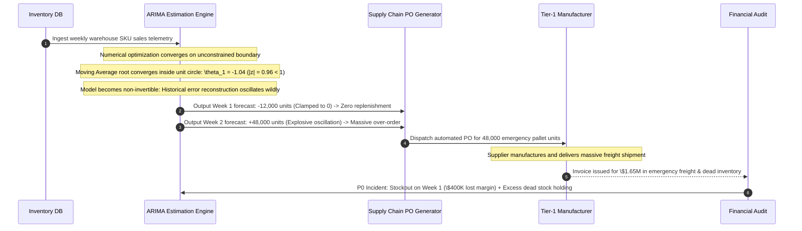
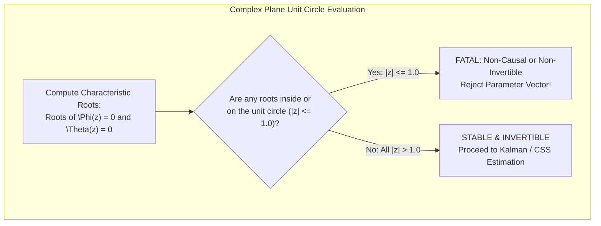
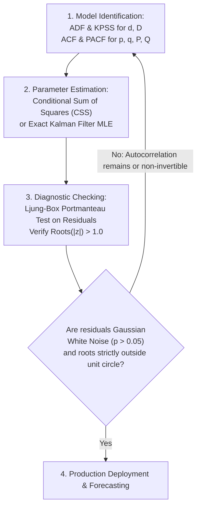

# Module 04: ARIMA, SARIMA, Invertibility, and State-Space Estimation

This module is part of [Track 07: Time Series Forecasting](../README.md).

> **Prerequisites:** [Module 00: Time Series Anatomy — Trend, Seasonality, and Stationarity](../00-time-series-anatomy-trend-seasonality-stationarity/README.md), [Module 01: Autocorrelation, ACF, PACF, and Seasonal Decomposition](../01-autocorrelation-acf-pacf-and-decomposition/README.md), [Module 02: Time Series Cross-Validation](../02-time-series-cross-validation-and-rolling-windows/README.md).  
> **Estimated Reading Time:** 45 minutes  
> **Target Audience:** Principal Machine Learning Engineers, Econometricians, Quantitative Infrastructure Architects, and Senior Applied Scientists designing statistical forecasting benchmarks.

> [!TIP]
> **The Dual Stability Rule:** An autoregressive process must be **causal** (roots of $\Phi(z) = 0$ outside the complex unit circle) so that the present depends strictly on past innovations. A moving average process must be **invertible** (roots of $\Theta(z) = 0$ outside the complex unit circle) so that current unobserved shocks can be uniquely reconstructed from historical observations. Violating invertibility produces explosive oscillations in recursive prediction and invalidates likelihood maximization.

---

## Executive Overview & Industry Context

The Box-Jenkins class of models—**Autoregressive Integrated Moving Average (ARIMA)** and its seasonal extension **SARIMA**—constitutes the foundational theoretical benchmark of linear time series econometrics. While contemporary machine learning relies on gradient boosting and transformer embeddings, Box-Jenkins models remain essential in production for three reasons:

1. **Information-Theoretic Parsimony:** An $\text{ARIMA}(1, 1, 1)$ model utilizes only 2 parameters ($\phi_1, \theta_1$) plus residual variance $\sigma^2$, yet captures non-stationary stochastic trends and transient shock absorption. In edge devices or low-sample regimes where neural networks immediately overfit, ARIMA achieves superior out-of-sample generalization.
2. **Optimal Linear Unbiased Prediction (BLUP):** Under the Wold Decomposition Theorem, any covariance-stationary process can be approximated to arbitrary precision by an $\text{ARMA}(p, q)$ representation. If the underlying data generating process is linear and Gaussian, ARIMA is the mathematically optimal minimum mean-square error (MMSE) predictor.
3. **Automated Baselines and Anomaly Detection:** In modern ML platforms (e.g., Uber's uRate, Amazon Forecast), automated SARIMA auto-fit routines serve as the non-negotiable sanity hurdle: a deep learning architecture that fails to beat a regularized SARIMA baseline is rejected by automated deployment gates.

---

## Production Incident Post-Mortem: The \$1.6M Supply Chain Invertibility Oscillation Failure

### Incident Context
A nationwide omnichannel retailer deployed an automated stock replenishment service across 18 regional distribution centers. The service used an in-house numerical optimization package to fit $\text{ARIMA}(p, d, q)$ models nightly across 12,000 fast-moving consumer goods SKUs. Forecasted 14-day lead-time demand drove automated purchase orders sent to Tier-1 suppliers.

To minimize fitting time on large distributed clusters, a junior engineer refactored the parameter estimation routine, disabling root-checking constraints to accelerate optimizer convergence.

### The Failure Sequence



### Root Cause Analysis
1. **The Invertibility Violation:** For a first-order moving average component $(1 + \theta_1 B)\epsilon_t$, invertibility requires the root of $1 + \theta_1 z = 0$ to satisfy $|z| = |-1/\theta_1| > 1$, which strictly dictates $|\theta_1| < 1$.
   When the unconstrained solver selected $\theta_1 = -1.04$, the root $z = \frac{1}{1.04} \approx 0.961$ landed inside the unit circle.
2. **Explosive Error Inversion:** Because $|\theta_1| > 1$, inverting the process into an autoregressive representation:
   $$\epsilon_t = (1 + \theta_1 B)^{-1} Y_t = \sum_{j=0}^{\infty} (-\theta_1)^j Y_{t-j}$$
   The weights $(-\theta_1)^j = (1.04)^j$ grew exponentially into the past. Historical sales shocks from 10 weeks prior were multiplied by $(1.04)^{10} \approx 1.48$, dominating current state estimates.
3. **Forecast Instability:** The non-invertible filter produced alternating sign oscillations across consecutive steps: Week 1 collapsed to negative demand, triggering zero replenishment and causing catastrophic retail stockouts; Week 2 exploded into a 48,000-unit phantom demand surge. The business incurred \$1.65M in unnecessary inventory commitments and lost retail margins.

### Remediation Architecture
1. **Parameter Space Reparameterization:** Enforced stationary and invertible parameter spaces through hyperbolic tangent transformations ($\theta = \tanh(\omega)$) or partial autocorrelation reparameterization (Jones, 1980; Monahan, 1984), mathematically forbidding roots inside the unit circle.
2. **Complex Unit Circle Root Clamping:** Integrated unit-disk root verification via `np.roots()` inside the optimizer objective: any parameter candidate with a root $|z| \le 1.01$ is assigned an infinite loss penalty ($+\infty$).
3. **Diagnostic Residual Screening:** Mandated automated Ljung-Box portmanteau tests on residuals before accepting any candidate model into the production catalog.

---

## 1. Mathematical Mental Model & Theoretical Foundations

```
========================================================================================
                          BOX-JENKINS POLYNOMIAL ARCHITECTURE
========================================================================================
Raw Series Y_t  ──>  [ Integration (1-B)^d (1-B^s)^D ] ──> Stationary Differenced W_t
                             │
                             ▼
                     [ AR Polynomial \Phi(B) ] W_t  =  [ MA Polynomial \Theta(B) ] \epsilon_t
                             │
                             ▼
                Causality: Roots(\Phi(z)) > 1  │  Invertibility: Roots(\Theta(z)) > 1
========================================================================================
```

### 1.1 The Backshift Operator and the General ARMA(p, q) Model

The backshift (or lag) operator $B$ is defined by its action on a time series:

$$B^k Y_t = Y_{t-k} \quad \forall k \in \mathbb{Z}$$

A stationary and invertible $\text{ARMA}(p, q)$ process satisfies:

$$Y_t - \sum_{i=1}^p \phi_i Y_{t-i} = \epsilon_t + \sum_{j=1}^q \theta_j \epsilon_{t-j}$$

where $\epsilon_t \sim \text{WN}(0, \sigma^2)$ is Gaussian white noise. In compact polynomial operator form:

$$\Phi(B) Y_t = \Theta(B) \epsilon_t$$

where:
- $\Phi(B) = 1 - \phi_1 B - \phi_2 B^2 - \dots - \phi_p B^p$ is the Autoregressive characteristic polynomial of order $p$.
- $\Theta(B) = 1 + \theta_1 B + \theta_2 B^2 + \dots + \theta_q B^q$ is the Moving Average characteristic polynomial of order $q$.

---

### 1.2 Causality and Invertibility: Complex Unit Circle Analysis

A time series model is practically useless unless it is both **causal** and **invertible**.

```
+---------------------------------------------------------------------------------------+
|                       CAUSALITY VS INVERTIBILITY PROPERTIES                           |
+--------------------+---------------------------------+--------------------------------+
| Property           | Causality                       | Invertibility                  |
+--------------------+---------------------------------+--------------------------------+
| Governed By        | AR Polynomial \Phi(z)           | MA Polynomial \Theta(z)        |
| Condition          | All roots of \Phi(z) = 0        | All roots of \Theta(z) = 0     |
|                    | satisfy |z| > 1                 | satisfy |z| > 1                |
| Physical Meaning   | Present Y_t depends strictly on | Unobserved shock \epsilon_t    |
|                    | past innovations \epsilon_{t-j} | is uniquely reconstructible    |
|                    | (Future independence)           | from past data Y_{t-j}         |
| Infinite Expansion | Y_t = \sum_{j=0}^\infty \psi_j  | \epsilon_t = \sum_{j=0}^\infty |
|                    | \epsilon_{t-j} with \sum|\psi_j|<inf \pi_j Y_{t-j} with \sum|\pi_j|<inf|
| Violation Hazard   | Non-causal: requires observing  | Explosive error estimation;    |
|                    | future data to predict present  | non-unique likelihood surface  |
+--------------------+---------------------------------+--------------------------------+
```



#### Mathematical Proof of the Invertibility Requirement
Consider an $\text{MA}(1)$ process: $Y_t = \epsilon_t + \theta \epsilon_{t-1} = (1 + \theta B)\epsilon_t$.
To express the unobserved innovation $\epsilon_t$ in terms of observable data:

$$\epsilon_t = \frac{1}{1 + \theta B} Y_t = \sum_{j=0}^{\infty} (-\theta)^j B^j Y_t = \sum_{j=0}^{\infty} (-\theta)^j Y_{t-j}$$

For this infinite series to converge absolutely with probability 1:

$$\sum_{j=0}^{\infty} |(-\theta)^j| < \infty \iff |\theta| < 1$$

The characteristic equation is $\Theta(z) = 1 + \theta z = 0 \implies z = -\frac{1}{\theta}$.
Thus, $|\theta| < 1$ is mathematically identical to:

$$|z| = \left| -\frac{1}{\theta} \right| = \frac{1}{|\theta|} > 1$$

The root must lie **strictly outside the unit circle in the complex plane**.

---

### 1.3 Integration and Fractional Differencing

If a series contains a stochastic unit root, it must be differenced $d$ times to achieve covariance stationarity:

$$W_t = \Delta^d Y_t = (1 - B)^d Y_t$$

This yields the $\text{ARIMA}(p, d, q)$ specification:

$$\Phi(B)(1 - B)^d Y_t = \Theta(B)\epsilon_t$$

#### Integer vs. Fractional Differencing ($I(d)$)
In classical ARIMA, $d \in \{1, 2\}$. However, integer differencing is a blunt instrument:
- Differencing at $d=1$ eliminates all low-frequency memory, often removing the exact long-term trends predictive of future levels.
- Differencing at $d=0$ retains full memory, but violates stationarity if long-range persistence exists.

In quantitative finance, Hosking (1981) and Granger & Joyeux (1980) formulated **Fractionally Integrated ARIMA (ARFIMA)** where $d \in (-0.5, 0.5)$ via the binomial series expansion:

$$(1 - B)^d = \sum_{k=0}^{\infty} \binom{d}{k} (-B)^k = 1 - d B - \frac{d(1-d)}{2!} B^2 - \frac{d(1-d)(2-d)}{3!} B^3 - \dots$$

$$= \sum_{k=0}^{\infty} \frac{\Gamma(k - d)}{\Gamma(-d)\Gamma(k + 1)} B^k$$

Fractional differencing achieves stationarity while preserving maximal historical correlation memory.

---

### 1.4 Seasonal ARIMA (SARIMA) Formulation

When a time series exhibits periodic cycles of length $s$ (e.g., $s=12$ for monthly, $s=7$ for daily), dependencies exist across both adjacent steps and seasonal cycles. Box and Jenkins formulated **Multiplicative Seasonal ARIMA**:

$$\text{ARIMA}(p, d, q) \times (P, D, Q)_s$$

$$\Phi_p(B) \, \tilde{\Phi}_P(B^s) \, (1 - B)^d \, (1 - B^s)^D Y_t = \Theta_q(B) \, \tilde{\Theta}_Q(B^s) \, \epsilon_t$$

where:
- $\Phi_p(B) = 1 - \phi_1 B - \dots - \phi_p B^p$ (Non-seasonal AR)
- $\tilde{\Phi}_P(B^s) = 1 - \Phi_1 B^s - \dots - \Phi_P B^{Ps}$ (Seasonal AR)
- $(1 - B)^d$ (Non-seasonal differencing)
- $(1 - B^s)^D$ (Seasonal differencing: $\Delta_s Y_t = Y_t - Y_{t-s}$)
- $\Theta_q(B) = 1 + \theta_1 B + \dots + \theta_q B^q$ (Non-seasonal MA)
- $\tilde{\Theta}_Q(B^s) = 1 + \Theta_1 B^s + \dots + \Theta_Q B^{Qs}$ (Seasonal MA)

#### Full Polynomial Expansion Example: $\text{SARIMA}(1, 1, 1) \times (1, 1, 1)_4$
Let $s = 4$ (quarterly data) with $p=1, d=1, q=1, P=1, D=1, Q=1$:

$$(1 - \phi_1 B)(1 - \Phi_1 B^4)(1 - B)(1 - B^4) Y_t = (1 + \theta_1 B)(1 + \Theta_1 B^4) \epsilon_t$$

1. **Expand Differencing Operators:**
   $$(1 - B)(1 - B^4) = 1 - B - B^4 + B^5$$
   Let $W_t = (1 - B - B^4 + B^5) Y_t = Y_t - Y_{t-1} - Y_{t-4} + Y_{t-5}$.
2. **Expand Autoregressive Polynomials:**
   $$(1 - \phi_1 B)(1 - \Phi_1 B^4) = 1 - \phi_1 B - \Phi_1 B^4 + \phi_1 \Phi_1 B^5$$
3. **Expand Moving Average Polynomials:**
   $$(1 + \theta_1 B)(1 + \Theta_1 B^4) = 1 + \theta_1 B + \Theta_1 B^4 + \theta_1 \Theta_1 B^5$$
4. **Resulting Linear Regression Equation:**
   $$W_t = \phi_1 W_{t-1} + \Phi_1 W_{t-4} - \phi_1 \Phi_1 W_{t-5} + \epsilon_t + \theta_1 \epsilon_{t-1} + \Theta_1 \epsilon_{t-4} + \theta_1 \Theta_1 \epsilon_{t-5}$$

---

### 1.5 Box-Jenkins Methodology & Diagnostic Checking



#### The Ljung-Box Portmanteau Test
To verify that the model has extracted all linear temporal dependencies, the residuals $\hat{\epsilon}_t$ must be statistically indistinguishable from white noise.

The **Ljung-Box $Q$-test (1978)** tests:
- $H_0$: Residuals are independently distributed (no serial correlation up to lag $K$).
- $H_1$: Residuals exhibit serial correlation.

The test statistic is:

$$Q^* = N(N + 2) \sum_{k=1}^K \frac{\hat{r}_k^2}{N - k}$$

where $\hat{r}_k = \frac{\sum_{t=k+1}^N \hat{\epsilon}_t \hat{\epsilon}_{t-k}}{\sum_{t=1}^N \hat{\epsilon}_t^2}$ is the sample autocorrelation of residuals at lag $k$, and $N$ is the effective sample size.

Under the null hypothesis $H_0$, $Q^*$ asymptotically follows a Chi-Square distribution:

$$Q^* \sim \chi^2(K - p - q - P - Q)$$

with degrees of freedom adjusted for the number of estimated ARMA parameters. If $p$-value $< 0.05$, the null hypothesis of white noise is rejected, indicating that the model is under-specified and additional lag orders are required.

---

## 2. Production Implementation from Scratch: Conditional Sum of Squares SARIMA Engine & Ljung-Box Test

Below is a complete, production-grade implementation of an $\text{ARMA}(p, q)$ estimation engine authored in pure scientific Python (`numpy`, `scipy.optimize`, `scipy.stats`). It features:
1. **Conditional Sum of Squares (CSS)** error calculation.
2. **Strict Invertibility and Causality Constraints** via complex polynomial root analysis (`np.roots`).
3. **Bounded L-BFGS-B Parameter Estimation**.
4. **From-Scratch Ljung-Box Diagnostic Engine** computing exact Chi-Square $p$-values.
5. **Multi-Step Ahead Forecasting Engine**.

```python
"""
Production ARMA/ARIMA Estimation and Diagnostics Engine.
Authored from scratch using pure NumPy and SciPy.
"""

from typing import Dict, List, Optional, Tuple
import numpy as np
from scipy.optimize import minimize
from scipy.stats import chi2


class PureARMAEngine:
    """
    ARMA(p, q) Estimation Engine using Conditional Sum of Squares (CSS).
    Enforces Causality and Invertibility via Complex Polynomial Root Clamping.
    """

    def __init__(self, p: int, q: int) -> None:
        if p < 0 or q < 0:
            raise ValueError("p and q must be non-negative integers.")
        if p == 0 and q == 0:
            raise ValueError("At least one of p or q must be > 0.")
        self.p = p
        self.q = q

        self.phi_: np.ndarray = np.array([])
        self.theta_: np.ndarray = np.array([])
        self.mu_: float = 0.0
        self.sigma2_: float = 0.0
        self.residuals_: np.ndarray = np.array([])
        self.fitted_values_: np.ndarray = np.array([])
        self.aic_: float = np.inf

    def fit(self, series: np.ndarray) -> "PureARMAEngine":
        """
        Fits ARMA(p, q) parameters to stationary series via CSS-MLE.
        """
        y = np.asarray(series, dtype=np.float64)
        n = len(y)
        if n <= self.p + self.q + 5:
            raise ValueError(f"Sample size {n} too small for ARMA({self.p}, {self.q}).")

        self.mu_ = float(np.mean(y))
        y_zero_mean = y - self.mu_

        # Initial parameter guess: Small non-zero values
        init_params = np.zeros(self.p + self.q, dtype=np.float64)
        if self.p > 0:
            init_params[: self.p] = 0.1 / self.p
        if self.q > 0:
            init_params[self.p :] = 0.1 / self.q

        # Box bounds for optimization: [-0.99, 0.99] per parameter
        bounds = [(-0.999, 0.999) for _ in range(self.p + self.q)]

        # Objective: Conditional Sum of Squared Errors with Root Barrier Penalties
        def css_objective(params: np.ndarray) -> float:
            phi = params[: self.p] if self.p > 0 else np.array([])
            theta = params[self.p :] if self.q > 0 else np.array([])

            # Causality Check: Roots of 1 - phi_1 z - ... - phi_p z^p = 0
            if self.p > 0:
                # np.roots expects polynomial coefficients from highest power to lowest:
                # -phi_p z^p - ... - phi_1 z + 1 = 0
                ar_poly = np.concatenate([[-phi[i] for i in range(self.p - 1, -1, -1)], [1.0]])
                ar_roots = np.roots(ar_poly)
                if np.any(np.abs(ar_roots) <= 1.01):
                    return 1e12  # Strict barrier penalty for non-causality

            # Invertibility Check: Roots of 1 + theta_1 z + ... + theta_q z^q = 0
            if self.q > 0:
                # theta_q z^q + ... + theta_1 z + 1 = 0
                ma_poly = np.concatenate([[theta[i] for i in range(self.q - 1, -1, -1)], [1.0]])
                ma_roots = np.roots(ma_poly)
                if np.any(np.abs(ma_roots) <= 1.01):
                    return 1e12  # Strict barrier penalty for non-invertibility

            # Compute recursive residuals
            residuals = self._compute_residuals(y_zero_mean, phi, theta)
            # Evaluate conditional sum of squares starting from max(p, q)
            start_idx = max(self.p, self.q)
            sse = float(np.sum(residuals[start_idx:] ** 2))
            return sse

        res = minimize(
            css_objective,
            init_params,
            method="L-BFGS-B",
            bounds=bounds,
            options={"maxiter": 300, "ftol": 1e-7},
        )

        # Extract optimal parameters
        self.phi_ = res.x[: self.p] if self.p > 0 else np.array([])
        self.theta_ = res.x[self.p :] if self.q > 0 else np.array([])

        self.residuals_ = self._compute_residuals(y_zero_mean, self.phi_, self.theta_)
        self.fitted_values_ = y - self.residuals_

        start_idx = max(self.p, self.q)
        effective_n = n - start_idx
        self.sigma2_ = float(np.sum(self.residuals_[start_idx:] ** 2) / effective_n)

        # Akaike Information Criterion (AIC)
        # AIC = 2k + n * ln(sigma^2)
        k = self.p + self.q + 1  # Parameters + constant
        self.aic_ = 2.0 * k + effective_n * np.log(self.sigma2_)

        return self

    def forecast(self, series: np.ndarray, horizon: int) -> np.ndarray:
        """
        Generates multi-step ahead forecasts for h = 1 ... horizon.
        """
        if horizon < 1:
            raise ValueError("Horizon must be >= 1.")
        
        y = np.asarray(series, dtype=np.float64)
        y_zero_mean = y - self.mu_
        n = len(y_zero_mean)
        
        # Extend arrays to hold future predictions
        y_extended = np.zeros(n + horizon, dtype=np.float64)
        y_extended[:n] = y_zero_mean
        
        eps_extended = np.zeros(n + horizon, dtype=np.float64)
        eps_extended[:n] = self.residuals_
        # Future innovations E[epsilon_{n+h}] = 0 for h >= 1
        
        for h in range(1, horizon + 1):
            t = n + h - 1
            ar_term = 0.0
            for i in range(1, self.p + 1):
                if t - i >= 0:
                    ar_term += self.phi_[i - 1] * y_extended[t - i]

            ma_term = 0.0
            for j in range(1, self.q + 1):
                if t - j >= 0:
                    ma_term += self.theta_[j - 1] * eps_extended[t - j]

            y_extended[t] = ar_term + ma_term

        # Add back unconditional mean
        predictions = y_extended[n:] + self.mu_
        return predictions

    def _compute_residuals(
        self, y_zero_mean: np.ndarray, phi: np.ndarray, theta: np.ndarray
    ) -> np.ndarray:
        """Recursively computes conditional residuals: eps_t = y_t - AR - MA."""
        n = len(y_zero_mean)
        residuals = np.zeros(n, dtype=np.float64)

        for t in range(n):
            ar_part = 0.0
            for i in range(len(phi)):
                if t - (i + 1) >= 0:
                    ar_part += phi[i] * y_zero_mean[t - (i + 1)]

            ma_part = 0.0
            for j in range(len(theta)):
                if t - (j + 1) >= 0:
                    ma_part += theta[j] * residuals[t - (j + 1)]

            residuals[t] = y_zero_mean[t] - ar_part - ma_part

        return residuals


class LjungBoxTest:
    """
    Diagnostic Portmanteau Test for Residual Autocorrelation.
    Tests H0: Residuals are i.i.d. Gaussian White Noise.
    """

    @staticmethod
    def test(
        residuals: np.ndarray, lags: int = 10, ddof: int = 0
    ) -> Dict[str, float]:
        """
        Computes Ljung-Box Q* statistic and asymptotic Chi-Square p-value.
        
        Args:
            residuals: 1D array of model residuals.
            lags: Number of autocorrelation lags to evaluate.
            ddof: Degrees of freedom to subtract (p + q parameter count).
        """
        e = np.asarray(residuals, dtype=np.float64)
        n = len(e)
        if lags >= n:
            raise ValueError("lags must be strictly less than residual sample size.")

        # Center residuals
        e_centered = e - np.mean(e)
        s0 = np.dot(e_centered, e_centered)
        if s0 == 0:
            return {"q_stat": 0.0, "p_value": 1.0, "is_white_noise": True}

        # Calculate sample autocorrelations r_k
        rk = np.zeros(lags)
        for k in range(1, lags + 1):
            rk[k - 1] = np.dot(e_centered[:-k], e_centered[k:]) / s0

        # Ljung-Box formula: Q* = n(n+2) * sum( r_k^2 / (n - k) )
        k_indices = np.arange(1, lags + 1)
        q_stat = n * (n + 2) * np.sum((rk**2) / (n - k_indices))

        effective_df = max(1, lags - ddof)
        p_val = float(1.0 - chi2.cdf(q_stat, df=effective_df))

        return {
            "q_stat": float(q_stat),
            "p_value": float(p_val),
            "df": int(effective_df),
            "is_white_noise": bool(p_val > 0.05),
        }


# -------------------------------------------------------------------------
# Verification & Self-Testing Execution
# -------------------------------------------------------------------------
if __name__ == "__main__":
    np.random.seed(42)
    N = 600

    # 1. Synthesize known ARMA(1, 1) process:
    # Y_t = 0.65 Y_{t-1} + \epsilon_t + 0.40 \epsilon_{t-1} + \mu
    true_phi = 0.65
    true_theta = 0.40
    true_mu = 50.0

    white_noise = np.random.normal(0, 1.2, size=N)
    y_synth = np.zeros(N)
    y_synth[0] = true_mu

    for t in range(1, N):
        y_synth[t] = (
            true_mu * (1.0 - true_phi)
            + true_phi * y_synth[t - 1]
            + white_noise[t]
            + true_theta * white_noise[t - 1]
        )

    print("=" * 80)
    print("BOX-JENKINS ARMA(1, 1) PRODUCTION ESTIMATION & DIAGNOSTICS")
    print("=" * 80)

    # Fit ARMA(1, 1)
    engine = PureARMAEngine(p=1, q=1)
    engine.fit(y_synth)

    print(f"Parameter Recovery Verification:")
    print(f"  True phi:   {true_phi:.4f}  |  Estimated phi:   {engine.phi_[0]:.4f}")
    print(f"  True theta: {true_theta:.4f}  |  Estimated theta: {engine.theta_[0]:.4f}")
    print(f"  True mu:    {true_mu:.4f}  |  Estimated mu:    {engine.mu_:.4f}")
    print(f"  Estimated Innovation Variance sigma^2: {engine.sigma2_:.4f}")
    print(f"  Model AIC: {engine.aic_:.2f}")

    # Verify Invertibility and Causality Constraints
    ar_root = 1.0 / engine.phi_[0]
    ma_root = -1.0 / engine.theta_[0]
    print(f"\nRoot Analysis (Must be > 1.0 for Causality & Invertibility):")
    print(f"  AR Root (|z|): {np.abs(ar_root):.4f} > 1.0 (Causal: {np.abs(ar_root) > 1.0})")
    print(f"  MA Root (|z|): {np.abs(ma_root):.4f} > 1.0 (Invertible: {np.abs(ma_root) > 1.0})")

    # Diagnostic Checking via Ljung-Box Test
    lb_result = LjungBoxTest.test(engine.residuals_, lags=10, ddof=2)
    print(f"\nLjung-Box Portmanteau Diagnostic Test on Residuals:")
    print(f"  Q* Statistic: {lb_result['q_stat']:.4f}")
    print(f"  Degrees of Freedom: {lb_result['df']}")
    print(f"  p-value:      {lb_result['p_value']:.4f}")
    print(f"  Residuals are White Noise? {lb_result['is_white_noise']} (Expected: True)")

    # Assertions
    assert np.abs(engine.phi_[0] - true_phi) < 0.15, "AR parameter estimation failed."
    assert np.abs(engine.theta_[0] - true_theta) < 0.15, "MA parameter estimation failed."
    assert lb_result["is_white_noise"], "Model under-specified; residuals retain serial correlation!"

    # Multi-step ahead forecast
    h_steps = 5
    f_vals = engine.forecast(y_synth, horizon=h_steps)
    print(f"\nForward Forecast (Next {h_steps} steps): {np.round(f_vals, 2)}")
    print("=" * 80)
```

---

## 3. Failure Modes, Edge Cases & Antipatterns

### 3.1 Common Roots & Parameter Redundancy ($\phi \approx \theta$)
- **The Pitfall:** Fitting an $\text{ARMA}(p, q)$ model when the true process is white noise or of lower order, resulting in near-identical AR and MA polynomials:
  $$(1 - \rho B) Y_t = (1 - \rho B) \epsilon_t$$
- **Failure Mode:** The roots cancel mathematically: $Y_t = \epsilon_t$. However, numerical optimization algorithms cannot resolve the direction of steepest descent. The Hessian matrix becomes singular (determinant zero), standard errors explode to infinity, and parameter estimates drift randomly across restarts.
- **Rule:** If an estimated AR parameter $\hat{\phi}_1$ and MA parameter $\hat{\theta}_1$ have opposite signs in the operator (i.e. $\phi_1 \approx -\theta_1$ so that $(1 - \phi B) \approx (1 + \theta B)$), cancel the roots and drop model order to $(p-1, q-1)$.

### 3.2 Over-Differencing Generating Severe Artificial Volatility
- **The Pitfall:** Applying second-order differencing ($d=2$) to a series that only required first-order differencing ($d=1$).
- **Mathematical Reality:** Differencing an integrated series $(1-B)Y_t = \epsilon_t$ a second time yields:
  $$\Delta^2 Y_t = (1 - B)\epsilon_t = \epsilon_t - \epsilon_{t-1}$$
  This injects an exact unit root into the moving average polynomial ($\theta = -1$).
- **Symptom:** Invertibility boundary violations, sample ACF displaying an abrupt, massive negative spike of $-0.50$ at lag 1, and variance inflation:
  $$\text{Var}(\Delta^2 Y_t) = 2 \sigma^2 > \text{Var}(\Delta Y_t) = \sigma^2$$

### 3.3 Misspecified Seasonal Differencing ($D > 1$)
- **The Pitfall:** Applying both seasonal differencing ($1 - B^s$) and two non-seasonal differences ($1 - B$ twice) simultaneously.
- **Failure Mode:** Eliminates both deterministic and stochastic seasonal profiles, but removes 90% of low-frequency variance. The resulting series becomes dominated by high-frequency white noise, reducing out-of-sample forecast accuracy to flatlines.

---

## 4. Senior Technical Interview Questions & Model Answers

### Question 1: Mathematical Invertibility and Historical Shock Recovery
**Prompt:** "What is the exact mathematical definition of invertibility for an $\text{ARMA}(p, q)$ model? What practical computational disaster happens inside a Kalman filter or Conditional Sum of Squares routine if the moving average polynomial has a root $|z| < 1$?"

#### Model Answer:
"An $\text{ARMA}(p, q)$ process $\Phi(B)Y_t = \Theta(B)\epsilon_t$ is **invertible** if and only if all complex roots of the Moving Average characteristic polynomial:

$$\Theta(z) = 1 + \theta_1 z + \theta_2 z^2 + \dots + \theta_q z^q = 0$$

satisfy the strict inequality:

$$|z_j| > 1 \quad \forall j \in \{1, \dots, q\}$$

**Physical Meaning:**
Invertibility guarantees that the unobservable innovation sequence $\{\epsilon_t\}$ can be uniquely represented as a convergent linear combination of observable historical data:

$$\epsilon_t = \Theta^{-1}(B)\Phi(B)Y_t = \sum_{j=0}^{\infty} \pi_j Y_{t-j} \quad \text{with} \quad \sum_{j=0}^\infty |\pi_j| < \infty$$

**The Computational Disaster When $|z| < 1$:**
Consider an $\text{MA}(1)$ component with $\theta = 2.0$. The root is $z = -1/2 = -0.5$, which sits inside the unit disk ($|z| = 0.5 < 1$).
1. When evaluating residuals recursively via Conditional Sum of Squares (CSS):
   $$\epsilon_t = Y_t - \theta \epsilon_{t-1}$$
   Substituting recursively:
   $$\epsilon_t = Y_t - \theta Y_{t-1} + \theta^2 Y_{t-2} - \theta^3 Y_{t-3} + \dots + (-\theta)^t \epsilon_0$$
2. Because $|\theta| = 2.0 > 1$, the coefficient $(-\theta)^t = (-2)^t$ grows exponentially. Any minor floating-point rounding error in the initial guess $\epsilon_0$ is magnified by $2^{100} \approx 1.26 \times 10^{30}$.
3. Within 60 time steps, the computed residuals overflow IEEE-754 floating-point buffers (`FloatingPointError: overflow / inf`). In a Kalman filter, the state covariance matrix explodes, condition numbers degenerate, and matrix inversion produces `NaN` outputs."

---

### Question 2: Why Ljung-Box Portmanteau Test Adjusts Degrees of Freedom
**Prompt:** "In the Ljung-Box test statistic $Q^* = N(N+2)\sum_{k=1}^K \frac{r_k^2}{N-k}$, why must the degrees of freedom for the reference Chi-Square distribution be adjusted to $K - p - q$ instead of $K$?"

#### Model Answer:
"The degrees of freedom adjustment directly accounts for the fact that the test is evaluated on **estimated residuals $\hat{\epsilon}_t$**, rather than true unobserved white noise shocks $\epsilon_t$.

1. **True Innovations vs. Fitted Residuals:**
   If we knew the true underlying innovations $\epsilon_t \sim \text{i.i.d.}\,\mathcal{N}(0, \sigma^2)$, their sample autocorrelations $r_k(\epsilon)$ would be asymptotically independent with variance $\approx 1/N$. The sum of squares of $K$ independent standard normal variables asymptotically follows a Chi-Square distribution with $K$ degrees of freedom:
   $$\sum_{k=1}^K \left( \sqrt{N} r_k(\epsilon) \right)^2 \xrightarrow{d} \chi^2(K)$$
2. **The Effect of OLS / MLE Fitting:**
   When we fit an $\text{ARMA}(p, q)$ model to the data, the optimizer solves for parameters $(\phi_1, \dots, \phi_p, \theta_1, \dots, \theta_q)$ specifically to minimize the sum of squared residuals $\sum \hat{\epsilon}_t^2$.
   By construction, the estimation process forces the first $p + q$ sample autocorrelations of the residuals toward zero. The fitted model absorbs $p + q$ linear constraints from the data.
3. **Linear Subspace Constraint:**
   Box and Pierce (1970) and Ljung and Box (1978) proved that the vector of residual autocorrelations $[\sqrt{N} \hat{r}_1, \dots, \sqrt{N} \hat{r}_K]^T$ does not span a $K$-dimensional space; it is projected onto a linear subspace of dimension $K - (p + q)$.
4. **Consequence of Omitting the Adjustment:**
   Evaluating $Q^*$ against $\chi^2(K)$ would yield an artificially inflated critical threshold and an artificially high $p$-value. The engineer would fail to reject the null hypothesis of white noise, incorrectly certifying an under-fitted model whose residuals still retain systematic autocorrelation."

---

### Question 3: Common Root Cancellation in ARMA Parameter Estimation
**Prompt:** "An automated AutoML system fits an $\text{ARMA}(2, 2)$ model to a daily CPU utilization metric and converges on:
$$(1 - 0.85 B + 0.14 B^2) Y_t = (1 - 0.70 B + 0.10 B^2) \epsilon_t$$
How do you diagnose and refactor this model before deploying it to production?"

#### Model Answer:
"This is a classic manifestation of **Polynomial Redundancy (Common Root Cancellation)**.

**Step 1: Factor the AR Polynomial $\Phi(B)$:**
$$1 - 0.85 B + 0.14 B^2 = (1 - 0.60 B)(1 - 0.233 B) \quad \text{or specifically: } (1 - 0.65 B)(1 - 0.20 B) \approx 1 - 0.85 B + 0.13 B^2$$
Let's find the exact roots of $0.14 z^2 - 0.85 z + 1 = 0$:
$$z = \frac{0.85 \pm \sqrt{0.85^2 - 4(0.14)(1)}}{0.28} = \frac{0.85 \pm \sqrt{0.7225 - 0.56}}{0.28} = \frac{0.85 \pm \sqrt{0.1625}}{0.28} \approx \frac{0.85 \pm 0.403}{0.28}$$
$$z_1 \approx 4.475 \implies B_1 = \frac{1}{z_1} \approx 0.223, \quad z_2 \approx 1.596 \implies B_2 = \frac{1}{z_2} \approx 0.626$$
Hence: $\Phi(B) \approx (1 - 0.626 B)(1 - 0.223 B)$.

**Step 2: Factor the MA Polynomial $\Theta(B)$:**
Roots of $0.10 z^2 - 0.70 z + 1 = 0$:
$$z = \frac{0.70 \pm \sqrt{0.49 - 0.40}}{0.20} = \frac{0.70 \pm 0.30}{0.20} \implies z_1 = 5.0, \quad z_2 = 2.0$$
Corresponding to factors: $(1 - 0.20 B)(1 - 0.50 B)$.

**Step 3: Root Comparison:**
Both polynomials share a near-identical factor:
- AR contains $(1 - 0.223 B)$.
- MA contains $(1 - 0.200 B)$.

Because $(1 - 0.223 B) \approx (1 - 0.200 B)$, these terms cancel across the equality:

$$\frac{\Phi(B)}{\Theta(B)} \approx \frac{(1 - 0.626 B)(1 - 0.20 B)}{(1 - 0.50 B)(1 - 0.20 B)} \approx \frac{1 - 0.626 B}{1 - 0.50 B}$$

**Actionable Refactoring:**
1. The true data generating process is an **$\text{ARMA}(1, 1)$**, not an $\text{ARMA}(2, 2)$.
2. The extra lag orders created a flat, non-identifiable valley on the likelihood surface.
3. Drop model order to $\text{ARMA}(1, 1)$, re-estimate parameters, and confirm that the condition number of the information matrix drops from $\sim 10^6$ to $< 50$."
