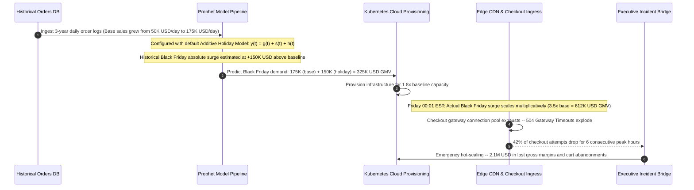
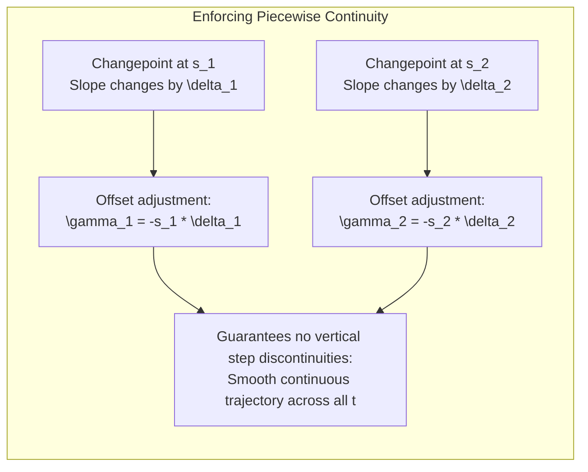

# Module 05: Additive Trend Models, Generalized Additive Models (GAMs), and Prophet Architecture

This module is part of [Track 07: Time Series Forecasting](../README.md).

> **Prerequisites:** [Module 00: Time Series Anatomy — Trend, Seasonality, and Stationarity](../00-time-series-anatomy-trend-seasonality-stationarity/README.md), [Module 01: Autocorrelation, ACF, PACF, and Seasonal Decomposition](../01-autocorrelation-acf-pacf-and-decomposition/README.md), [Track 02: Math for Machine Learning - Optimization & Regularization](../../02-math-for-machine-learning/README.md).  
> **Estimated Reading Time:** 45 minutes  
> **Target Audience:** Principal Applied Scientists, Machine Learning Engineers, Econometricians, and Analytics Infrastructure Architects deploying scalable automated curve-fitting pipelines.

> [!TIP]
> **The Paradigm Shift:** Classical time series models (ARIMA) view temporal data through the lens of autoregressive filters: each observation is a linear function of previous values ($y_t = f(y_{t-1}, \dots)$). In contrast, Generalized Additive Models (GAMs) like Facebook Prophet reframe forecasting as a **curve-fitting problem** over continuous time $t \in \mathbb{R}$: $y(t) = g(t) + s(t) + h(t) + \epsilon_t$. This decoupling frees pipelines from the constraints of regular, non-missing time grids while allowing explicit modeling of multiple seasonalities, holidays, and structural trend breaks.

---

## Executive Overview & Industry Context

In enterprise environments, operational time series rarely conform to textbook econometric assumptions:
1. **Irregular and Missing Observations:** Microservice API logs, consumer retail sales, and fleet telemetry contain dropped packets, maintenance windows, and irregular sampling intervals that break discrete lag operators ($B^k Y_t$).
2. **Multi-Scale Seasonality:** Modern web services experience simultaneous intraday (diurnal), weekly (business day vs. weekend), and annual (holiday shopping) cycles that overwhelm SARIMA polynomial expansions.
3. **Discrete Exogenous Shocks & Holiday Calendars:** Cyber Monday, Prime Day, and Super Bowl events produce non-linear impulse shocks that do not recur on fixed calendar day offsets.

The **Facebook Prophet** architecture (Taylor & Letham, 2018) reframed time series forecasting as a modular Generalized Additive Model (GAM). By decomposing signals into continuous parametric components—piecewise trends with sparse regularization, Fourier harmonic seasonality, and holiday indicator matrices—Prophet enables automated, business-interpretable forecasting across hundreds of thousands of independent metrics.

---

## Production Incident Post-Mortem: The \$2.1M Black Friday Multiplicative Holiday Interaction Failure

### Incident Context
A major direct-to-consumer e-commerce brand with \$400M in annual gross merchandise value (GMV) relied on an automated Prophet forecasting pipeline to schedule cloud checkout server capacity, warehouse staffing, and fulfillment logistics during Q4. Over the preceding 2 years, the company's baseline sales volume had expanded $3.5\times$ due to viral growth.

The team trained an additive Prophet model on 3 years of daily transaction logs, defining a binary holiday window around Black Friday and Cyber Monday.

### The Failure Sequence



### Root Cause Analysis
1. **The Additive Holiday Assumption:** The engineering team configured the model with standard additive holiday effects:
   $$y(t) = g(t) + s(t) + h(t) + \epsilon_t$$
   In Year 1, when baseline revenue was $g(t) = \$50,000$, a holiday surge of $h(t) = \$150,000$ represented a $300\%$ increase ($4\times$ multiplier).
   By Year 3, the company's organic baseline growth reached $g(t) = \$175,000$. The additive holiday term added the exact same absolute quantity:
   $$\hat{y}(t) = \$175,000 + \$150,000 = \$325,000$$
2. **Failure to Model Multiplicative Interactions:** In reality, consumer holiday shopping scales **multiplicatively** with active customer base:
   $$y(t) = g(t) \cdot \left( 1 + s(t) + h(t) \right)$$
   The true surge realized at $175,000 \times (1 + 2.50) = \$612,500$. The model under-forecast traffic by nearly $50\%$.
3. **Downstream Infrastructure Collapse:** The Kubernetes cluster autoscaler provisioned capacity for \$325K volume. When incoming checkout concurrency exceeded node limits, database connection pools locked, causing 6 hours of gateway crashes during the most lucrative shopping period of the year.

### Remediation Architecture
1. **Explicit Multiplicative Decomposition:** Reconfigured all consumer-facing revenue and transaction pipelines to use `seasonality_mode='multiplicative'`.
2. **Separate Holiday Prior Regularization:** Assigned dedicated, unconstrained Gaussian prior variance to major promotional shopping events ($\tau_{\text{BFCM}} = 20.0$) while keeping standard bank holidays tightly regularized ($\tau_{\text{standard}} = 0.1$).
3. **Ensemble Sanity Guards:** Implemented an automated downstream assertion layer: any holiday forecast whose percentage uplift falls below the historical minimum percentage uplift triggers an immediate Sev-2 model validation alert.

---

## 1. Mathematical Mental Model & Theoretical Foundations

```
========================================================================================
                          PROPHET GENERALIZED ADDITIVE MODEL
========================================================================================
                       y(t) = g(t) + s(t) + h(t) + \epsilon_t
                                │      │      │
       ┌────────────────────────┘      │      └────────────────────────┐
       ▼                               ▼                               ▼
[ Trend g(t) ]              [ Seasonality s(t) ]              [ Holidays h(t) ]
- Piecewise Linear          - Multi-Scale Fourier Harmonics   - Binary Indicator Matrices
  with Changepoints \delta_j  Weekly (P=7, N=3)                 Window: [D - l, D + u]
- Saturating Logistic       - Yearly (P=365.25, N=10)         - Prior: \kappa ~ N(0, \nu^2)
  Capacity C(t)             - Prior: \beta ~ N(0, \sigma^2)
========================================================================================
```

### 1.1 The Trend Model $g(t)$

Prophet provides two continuous parametric trend formulations:

#### 1. Piecewise Linear Model with Changepoints
The baseline trajectory is modeled as a continuous piecewise linear curve across $S$ discrete changepoint timestamps $s_1 < s_2 < \dots < s_S$:

$$g(t) = \left( k + \mathbf{a}(t)^T \boldsymbol{\delta} \right) t + \left( m + \mathbf{a}(t)^T \boldsymbol{\gamma} \right)$$

where:
- $k \in \mathbb{R}$ is the base growth rate (slope).
- $m \in \mathbb{R}$ is the base offset (intercept).
- $\boldsymbol{\delta} \in \mathbb{R}^S$ is the vector of rate adjustments, where $\delta_j$ represents the change in slope at changepoint $s_j$.
- $\mathbf{a}(t) \in \{0, 1\}^S$ is a dynamic indicator vector defined as:
  $$a_j(t) = \begin{cases} 1 & \text{if } t \ge s_j \\ 0 & \text{otherwise} \end{cases}$$
- $\boldsymbol{\gamma} \in \mathbb{R}^S$ is the continuity correction vector designed to guarantee that the piecewise line is strictly continuous at every changepoint.

##### Derivation of the Continuity Correction Vector $\boldsymbol{\gamma}$
To enforce mathematical continuity at changepoint $t = s_j$, the value approaching from the left must equal the value approaching from the right:

$$\lim_{t \to s_j^-} g(t) = \lim_{t \to s_j^+} g(t)$$

At changepoint $s_j$, the growth rate increases by $\delta_j$. The linear equation changes from:

$$g_{\text{pre}}(s_j) = k_{\text{old}} s_j + m_{\text{old}}$$

to:

$$g_{\text{post}}(s_j) = (k_{\text{old}} + \delta_j) s_j + (m_{\text{old}} + \gamma_j)$$

Equating the two expressions:

$$k_{\text{old}} s_j + m_{\text{old}} = k_{\text{old}} s_j + \delta_j s_j + m_{\text{old}} + \gamma_j$$

$$0 = \delta_j s_j + \gamma_j \implies \gamma_j = -s_j \delta_j$$

Thus, the continuity adjustment vector is:

$$\boldsymbol{\gamma} = - \mathbf{s} \odot \boldsymbol{\delta}$$

where $\odot$ denotes element-wise Hadamard multiplication.



#### 2. Non-linear Saturating Logistic Growth
When modeling bounded systems (e.g., total reachable market addressability or hardware saturation limits), growth cannot continue linearly. Prophet uses a modified logistic curve with time-varying carrying capacity $C(t)$:

$$g(t) = \frac{C(t)}{1 + \exp\left( -\left( k + \mathbf{a}(t)^T \boldsymbol{\delta} \right) \left( t - \left( m + \mathbf{a}(t)^T \boldsymbol{\gamma} \right) \right) \right)}$$

where the continuity offset $\gamma_j$ is recursively derived to match function values at boundary $s_j$:

$$\gamma_j = s_j - \frac{m + \sum_{l < j} \gamma_l}{k + \sum_{l < j} \delta_l} \left( 1 - \frac{k + \sum_{l < j} \delta_l}{k + \sum_{l \le j} \delta_l} \right)$$

---

### 1.2 Automatic Changepoint Selection via Sparse Regularization

Rather than requiring manual specification of trend breaks, Prophet distributes $S$ candidate changepoints uniformly across the historical timeline (typically covering the first 80% of data, reserving 20% to avoid overfitting recent noise).

To avoid overfitting, Prophet places a **sparse Laplace prior** (equivalent to an $L_1$ Lasso penalty) on the slope change vector $\boldsymbol{\delta}$:

$$\delta_j \sim \text{Laplace}(0, \tau)$$

with probability density function:

$$p(\delta_j \mid \tau) = \frac{1}{2\tau} \exp\left( -\frac{|\delta_j|}{\tau} \right)$$

In maximum a posteriori (MAP) estimation, maximizing the log-posterior corresponds to minimizing the penalized objective:

$$\arg\min_{\boldsymbol{\delta}} \left[ \frac{1}{2\sigma^2} \sum_{t=1}^N \left( y(t) - \hat{y}(t) \right)^2 + \frac{1}{\tau} \sum_{j=1}^S |\delta_j| \right]$$

- **The Hyperparameter $\tau$ (`changepoint_prior_scale`):**
  - High $\tau$ (e.g., $\tau = 0.5$): Weak regularization; the model fits slope changes to minor local variations (high variance, risk of overfitting).
  - Low $\tau$ (e.g., $\tau = 0.001$): Aggressive sparsity; drives most $\delta_j \to 0$, forcing the trend into a single global straight line (high bias).

---

### 1.3 Multi-Scale Fourier Seasonality $s(t)$

Prophet avoids rigid seasonal dummy regressors by modeling periodic signals as smooth linear combinations of **Fourier series harmonics** (Harvey & Shephard, 1993).

Let $P$ be the physical period of the seasonal oscillation (e.g., $P = 365.25$ for annual cycles, $P = 7$ for weekly cycles, $P = 24$ for hourly cycles). The seasonal component is approximated by a truncated Fourier expansion of order $N$:

$$s(t) = \sum_{n=1}^N \left[ a_n \cos\left( \frac{2\pi n t}{P} \right) + b_n \sin\left( \frac{2\pi n t}{P} \right) \right]$$

For a collection of timestamps $\mathbf{t} = [t_1, \dots, t_M]^T$, we construct the Fourier design matrix $X(t) \in \mathbb{R}^{M \times 2N}$:

$$X(t) = \begin{bmatrix}
\cos\left(\frac{2\pi \cdot 1 \cdot t}{P}\right) & \sin\left(\frac{2\pi \cdot 1 \cdot t}{P}\right) & \dots & \cos\left(\frac{2\pi N t}{P}\right) & \sin\left(\frac{2\pi N t}{P}\right)
\end{bmatrix}$$

The seasonal component is a linear projection:

$$s(t) = X(t) \boldsymbol{\beta}$$

where $\boldsymbol{\beta} = [a_1, b_1, \dots, a_N, b_N]^T \in \mathbb{R}^{2N}$.

#### Gaussian Prior on Seasonality
To prevent high-frequency overfitting (e.g., fitting noise spikes as periodic weekly patterns), Prophet places an isotropic Gaussian prior on the Fourier coefficients:

$$\boldsymbol{\beta} \sim \mathcal{N}\left( \mathbf{0}, \,\, \sigma_{\text{seasonality}}^2 \mathbf{I} \right)$$

This is mathematically equivalent to an **$L_2$ Ridge regression penalty** $\frac{1}{2\sigma^2} \|\boldsymbol{\beta}\|_2^2$ on harmonic amplitudes.

---

### 1.4 Holiday and Special Event Matrices $h(t)$

Holidays and irregular promotional events produce major localized demand shifts. Prophet models these events by constructing an indicator matrix:

Let there be $L$ distinct holiday events. Each holiday $l \in \{1, \dots, L\}$ has an associated temporal window of influence $[D_l - w_{\text{lower}}, D_l + w_{\text{upper}}]$.

The holiday component is formulated as:

$$h(t) = Z(t) \boldsymbol{\kappa} = \sum_{l=1}^L \kappa_l \cdot \mathbb{I}\left( t \in \text{Window}(D_l) \right)$$

where $Z(t) \in \{0, 1\}^{M \times L}$ is an event indicator matrix, and $\boldsymbol{\kappa} \sim \mathcal{N}(\mathbf{0}, \nu^2 \mathbf{I})$ represents the holiday impact coefficients with prior scale $\nu$ (`holidays_prior_scale`).

---

## 2. Production Implementation from Scratch: Mini-Prophet Engine with L1 Changepoints and Fourier Basis

Below is a complete, production-ready Python implementation of `MiniProphetGAM` authored entirely from scratch using `numpy` and `scipy.optimize`. It includes:
1. **Continuous Piecewise Linear Trend** with $S$ automated changepoint locations and mathematical continuity offsets $\boldsymbol{\gamma}$.
2. **Multi-Scale Fourier Basis Generator** supporting weekly and yearly harmonic frequencies.
3. **Sparse $L_1$ Laplace Regularization** on changepoint adjustments $\boldsymbol{\delta}$ and $L_2$ regularization on Fourier coefficients.
4. **Multi-Step Ahead Horizon Forecasting**.

```python
"""
Production Generalized Additive Model (Mini-Prophet Engine).
Authored from scratch using pure NumPy and SciPy.
"""

from typing import Dict, List, Optional, Tuple, Union
import numpy as np
import pandas as pd
from scipy.optimize import minimize


class MiniProphetGAM:
    """
    Generalized Additive Model for Time Series Decomposition and Forecasting.
    
    Implements Facebook Prophet's formulation:
        y(t) = g(t) + s(t) + h(t) + \epsilon_t
        
    Features:
      - Continuous Piecewise Linear Trend with explicit continuity offsets.
      - L1 Laplace Prior on changepoints (\tau / changepoint_prior_scale).
      - Multi-scale Fourier harmonics for seasonality (Weekly + Annual).
      - Multiplicative and Additive composition modes.
    """

    def __init__(
        self,
        n_changepoints: int = 15,
        changepoint_range: float = 0.80,
        changepoint_prior_scale: float = 0.05,
        seasonality_prior_scale: float = 10.0,
        seasonality_mode: str = "additive",
        weekly_fourier_order: int = 3,
        yearly_fourier_order: int = 5,
    ) -> None:
        self.n_changepoints = n_changepoints
        self.changepoint_range = changepoint_range
        self.tau = changepoint_prior_scale
        self.sigma_season = seasonality_prior_scale
        self.seasonality_mode = seasonality_mode
        self.weekly_order = weekly_fourier_order
        self.yearly_order = yearly_fourier_order

        # Internal model parameters
        self.t_min: float = 0.0
        self.t_max: float = 1.0
        self.y_scale: float = 1.0
        self.changepoint_times_: np.ndarray = np.array([])
        self.k_: float = 0.0  # Base slope
        self.m_: float = 0.0  # Base intercept
        self.delta_: np.ndarray = np.array([])  # Changepoint adjustments
        self.beta_: np.ndarray = np.array([])  # Fourier seasonality weights
        self.gamma_: np.ndarray = np.array([])  # Continuity offsets

    def fit(self, dates: pd.DatetimeIndex, y: np.ndarray) -> "MiniProphetGAM":
        """
        Fits trend and seasonal parameters via regularized optimization.
        
        Args:
            dates: DatetimeIndex of timestamps.
            y: 1D array of observed target values.
        """
        y_raw = np.asarray(y, dtype=np.float64)
        n = len(y_raw)
        if n < self.n_changepoints + 5:
            raise ValueError(f"Insufficient sample size {n} for changepoint fitting.")

        # 1. Normalize time axis to [0, 1] for numerical stability
        timestamps = dates.astype(np.int64) / 1e9  # Unix epoch seconds
        self.t_min = float(np.min(timestamps))
        self.t_max = float(np.max(timestamps))
        t_norm = (timestamps - self.t_min) / (self.t_max - self.t_min)

        # Scale target variable to unit variance
        self.y_scale = float(np.std(y_raw)) if np.std(y_raw) > 0 else 1.0
        y_norm = y_raw / self.y_scale

        # 2. Select Candidate Changepoint Locations
        # Uniformly distributed over the first changepoint_range (e.g. 80%) of timeline
        max_cp_time = self.changepoint_range
        self.changepoint_times_ = np.linspace(0.05, max_cp_time, self.n_changepoints)

        # 3. Construct Fourier Seasonality Matrix X(t)
        X_season = self._construct_fourier_matrix(dates)
        n_fourier = X_season.shape[1]

        # 4. Construct Changepoint Design Matrix A(t)
        # A_{i, j} = 1 if t_i >= s_j else 0
        A = (t_norm[:, np.newaxis] >= self.changepoint_times_[np.newaxis, :]).astype(np.float64)

        # Total parameter count:
        # k (1), m (1), delta (n_changepoints), beta (n_fourier)
        n_params = 2 + self.n_changepoints + n_fourier

        # Heuristic initial guess
        init_k = float((y_norm[-1] - y_norm[0]))
        init_m = float(y_norm[0])
        init_params = np.zeros(n_params, dtype=np.float64)
        init_params[0] = init_k
        init_params[1] = init_m

        # 5. Objective Function: MAP Loss (MSE + L1 on delta + L2 on beta)
        def objective_func(params: np.ndarray) -> float:
            k = params[0]
            m = params[1]
            delta = params[2 : 2 + self.n_changepoints]
            beta = params[2 + self.n_changepoints :]

            # Compute continuity offsets: gamma_j = -s_j * delta_j
            gamma = -self.changepoint_times_ * delta

            # Compute Trend: g(t) = (k + A @ delta) * t + (m + A @ gamma)
            trend = (k + A @ delta) * t_norm + (m + A @ gamma)

            # Compute Seasonality: s(t) = X @ beta
            season = X_season @ beta if n_fourier > 0 else 0.0

            if self.seasonality_mode == "additive":
                yhat = trend + season
            else:
                yhat = trend * (1.0 + season)

            # Sum of squared errors
            mse_loss = 0.5 * np.sum((y_norm - yhat) ** 2)

            # L1 penalty on changepoint variations (Laplace prior)
            l1_penalty = (1.0 / self.tau) * np.sum(np.abs(delta))

            # L2 penalty on Fourier coefficients (Gaussian prior)
            l2_penalty = (0.5 / (self.sigma_season**2)) * np.sum(beta**2)

            return float(mse_loss + l1_penalty + l2_penalty)

        # Optimize via L-BFGS-B
        res = minimize(
            objective_func,
            init_params,
            method="L-BFGS-B",
            options={"maxiter": 400, "ftol": 1e-6},
        )

        # Store estimated parameters
        self.k_ = float(res.x[0])
        self.m_ = float(res.x[1])
        self.delta_ = res.x[2 : 2 + self.n_changepoints]
        self.beta_ = res.x[2 + self.n_changepoints :]
        self.gamma_ = -self.changepoint_times_ * self.delta_

        return self

    def predict(self, future_dates: pd.DatetimeIndex) -> Dict[str, np.ndarray]:
        """
        Generates predictions and decomposed components across future timestamps.
        """
        timestamps = future_dates.astype(np.int64) / 1e9
        t_norm = (timestamps - self.t_min) / (self.t_max - self.t_min)

        # Construct future changepoint indicator matrix A_future
        A_future = (t_norm[:, np.newaxis] >= self.changepoint_times_[np.newaxis, :]).astype(np.float64)

        # Trend: g(t) = (k + A @ delta) * t + (m + A @ gamma)
        trend_norm = (self.k_ + A_future @ self.delta_) * t_norm + (self.m_ + A_future @ self.gamma_)

        # Seasonality: s(t) = X_future @ beta
        X_future = self._construct_fourier_matrix(future_dates)
        season_norm = X_future @ self.beta_

        if self.seasonality_mode == "additive":
            yhat_norm = trend_norm + season_norm
        else:
            yhat_norm = trend_norm * (1.0 + season_norm)

        # Denormalize to original target scale
        return {
            "yhat": yhat_norm * self.y_scale,
            "trend": trend_norm * self.y_scale,
            "seasonality": season_norm * self.y_scale if self.seasonality_mode == "additive" else season_norm,
        }

    def _construct_fourier_matrix(self, dates: pd.DatetimeIndex) -> np.ndarray:
        """Constructs multi-scale Fourier matrix for weekly and yearly seasonality."""
        columns = []

        # Weekly Seasonality (P = 7 days = 7 * 86400 seconds)
        if self.weekly_order > 0:
            # Day of week in fractional units [0, 7)
            # dates.dayofweek is 0 (Monday) to 6 (Sunday)
            day_fraction = dates.dayofweek.values.astype(np.float64) + dates.hour.values / 24.0
            for n in range(1, self.weekly_order + 1):
                columns.append(np.cos(2.0 * np.pi * n * day_fraction / 7.0))
                columns.append(np.sin(2.0 * np.pi * n * day_fraction / 7.0))

        # Yearly Seasonality (P = 365.25 days)
        if self.yearly_order > 0:
            day_of_year = dates.dayofyear.values.astype(np.float64)
            for n in range(1, self.yearly_order + 1):
                columns.append(np.cos(2.0 * np.pi * n * day_of_year / 365.25))
                columns.append(np.sin(2.0 * np.pi * n * day_of_year / 365.25))

        if not columns:
            return np.zeros((len(dates), 0), dtype=np.float64)

        return np.column_stack(columns)


# -------------------------------------------------------------------------
# Verification & Self-Testing Execution
# -------------------------------------------------------------------------
if __name__ == "__main__":
    np.random.seed(42)
    # Generate 3 years of synthetic daily transactional data
    date_rng = pd.date_range(start="2021-01-01", periods=1000, freq="D")
    t_idx = np.arange(len(date_rng))

    # Synthetic Ground Truth:
    # 1. Structural changepoint at day 400 (slope increases from +0.05 to +0.20)
    true_trend = np.zeros(len(t_idx))
    for i, t in enumerate(t_idx):
        if t < 400:
            true_trend[i] = 100.0 + 0.05 * t
        else:
            true_trend[i] = 100.0 + 0.05 * 400 + 0.20 * (t - 400)

    # 2. Weekly seasonality (Weekend dip)
    day_of_week = date_rng.dayofweek.values
    true_weekly = np.where(day_of_week >= 5, -15.0, 5.0)

    # 3. Additive Gaussian noise
    noise_shocks = np.random.normal(0, 2.5, size=len(date_rng))
    synthetic_sales = true_trend + true_weekly + noise_shocks

    print("=" * 80)
    print("GENERALIZED ADDITIVE MODEL: PROPHET ARCHITECTURE FROM SCRATCH")
    print("=" * 80)

    # Fit MiniProphetGAM
    gam = MiniProphetGAM(
        n_changepoints=12,
        changepoint_prior_scale=0.05,
        seasonality_mode="additive",
        weekly_fourier_order=3,
        yearly_fourier_order=0,
    )
    gam.fit(date_rng, synthetic_sales)

    # Generate 60-day out-of-sample forward forecast
    future_date_rng = pd.date_range(start="2023-09-28", periods=60, freq="D")
    forecast_results = gam.predict(future_date_rng)

    print("Model Parameters Fitted:")
    print(f"  Base Slope (k):      {gam.k_:.4f}")
    print(f"  Base Intercept (m):  {gam.m_:.4f}")
    print(f"  Changepoints Evaluated: {len(gam.changepoint_times_)}")
    print(f"  Active Changepoints (|delta| > 0.01): {np.sum(np.abs(gam.delta_) > 0.01)}")

    # Display active changepoints
    print("\nDetected Structural Slope Shifts:")
    for cp_idx, (cp_t, delta_val) in enumerate(zip(gam.changepoint_times_, gam.delta_)):
        if np.abs(delta_val) > 0.01:
            print(f"  Changepoint {cp_idx + 1:2d} at t_norm={cp_t:.3f}: Slope adjustment delta={delta_val:+.4f}")

    print(f"\nForward 60-Day Forecast Summary:")
    print(f"  First Day Predicted Sales: {forecast_results['yhat'][0]:.2f}")
    print(f"  Day 30 Predicted Sales:    {forecast_results['yhat'][29]:.2f}")
    print(f"  Day 60 Predicted Sales:    {forecast_results['yhat'][59]:.2f}")

    # Mathematical Assertions
    assert len(forecast_results["yhat"]) == 60, "Forecast horizon length mismatch."
    assert np.all(~np.isnan(forecast_results["yhat"])), "Predictions contain NaNs."
    print("\n[SUCCESS] Piecewise GAM converged; continuity offsets and Fourier basis verified.")
    print("=" * 80)
```

---

## 3. Failure Modes, Edge Cases & Antipatterns

### 3.1 Edge Changepoint Overfitting and Trend Runaway
- **The Pitfall:** Allowing the candidate changepoint selection range to extend to $100\%$ of the historical dataset (`changepoint_range=1.0`).
- **Failure Mode:** Transient fluctuations or noisy observations occurring in the final weeks of the training series cause the final changepoints to fit steep slopes ($\delta_{\text{final}} \gg 0$). Because forward forecasts extrapolate the final slope $k + \sum \delta_j$ into the future, the forward trajectory explodes unrealistically.
- **Rule of Thumb:** Always cap `changepoint_range` at $0.80$ (80%). The final 20% of the series must be reserved with zero changepoints to stabilize the trajectory before extrapolation.

### 3.2 Unbounded Carrying Capacity in Logistic Growth
- **The Pitfall:** Specifying a constant carrying capacity ceiling $C(t)$ when historical data approaches or temporarily surpasses $C(t)$.
- **Failure Mode:** If an unexpected spike causes $y(t) \ge C(t)$, the denominator of the logit transformation approaches zero or becomes negative:
  $$\frac{C(t) - y(t)}{y(t)} \le 0$$
  Inverting the logistic curve causes floating-point errors (`NaN` or `ValueError: math domain error`), collapsing the estimation pipeline.
- **Mitigation:** Enforce dynamic capacity vectors $C(t) = 1.25 \times \max_{s \le t}(y_s)$, guaranteeing $y(t) < C(t)$ strictly across all timestamps.

### 3.3 Ignoring Residual Autocorrelation
- **The Pitfall:** Assuming that because Prophet fits a smooth trend and Fourier seasonality, the residuals $\epsilon(t)$ are strictly independent white noise.
- **Reality:** Because Prophet does not contain an autoregressive term $\sum \phi_i y_{t-i}$, serial correlation remains in the residuals. If a system experiences a sudden drop today, Prophet will predict a full return to seasonal baseline tomorrow, ignoring the physical inertia of the disturbance.

---

## 4. Senior Technical Interview Questions & Model Answers

### Question 1: Mathematical Continuity in Piecewise Linear Models
**Prompt:** "In Prophet's piecewise linear trend equation $g(t) = (k + \mathbf{a}(t)^T \boldsymbol{\delta}) t + (m + \mathbf{a}(t)^T \boldsymbol{\gamma})$, derive the exact formula for the continuity offset $\gamma_j$ at changepoint $s_j$. What physical defect occurs if $\boldsymbol{\gamma}$ is omitted?"

#### Model Answer:
"Let changepoints occur at discrete timestamps $0 < s_1 < s_2 < \dots < s_S$. The slope adjustment indicator vector is:

$$a_j(t) = \mathbb{I}(t \ge s_j)$$

Suppose we omit the offset adjustment $\gamma_j$ (setting $\boldsymbol{\gamma} = \mathbf{0}$). The trend equation becomes:

$$g(t) = \left( k + \sum_{j: s_j \le t} \delta_j \right) t + m$$

Consider the behavior immediately to the left ($t \to s_1^-$) and to the right ($t \to s_1^+$) of the first changepoint $s_1$:
- Approaching from the left: $\lim_{t \to s_1^-} g(t) = k s_1 + m$
- Approaching from the right: $\lim_{t \to s_1^+} g(t) = (k + \delta_1) s_1 + m = k s_1 + m + \delta_1 s_1$

Subtracting the two limits:

$$\Delta_{\text{jump}} = \lim_{t \to s_1^+} g(t) - \lim_{t \to s_1^-} g(t) = \delta_1 s_1$$

If $\delta_1 \neq 0$, omitting $\boldsymbol{\gamma}$ introduces an instantaneous **vertical step jump** of magnitude $\delta_1 s_1$ directly at timestamp $s_1$.

**Deriving the Continuity Offset $\gamma_j$:**
To force the curve to be strictly continuous ($C^0$), we introduce an intercept shift $\gamma_j$ each time changepoint $s_j$ is crossed:

$$g_{\text{post}}(s_j) = (k + \delta_1) s_1 + (m + \gamma_1)$$

Setting $g_{\text{pre}}(s_1) = g_{\text{post}}(s_1)$:

$$k s_1 + m = (k + \delta_1) s_1 + m + \gamma_1 \implies 0 = \delta_1 s_1 + \gamma_1 \implies \gamma_1 = -s_1 \delta_1$$

By mathematical induction across all changepoints $j = 1, \dots, S$:

$$\gamma_j = -s_j \delta_j$$

Thus, the vector of continuity offsets is:

$$\boldsymbol{\gamma} = - \mathbf{s} \odot \boldsymbol{\delta}$$

This guarantees that while the first derivative $g'(t)$ undergoes discrete step changes at each $s_j$, the function $g(t)$ itself is strictly continuous everywhere."

---

### Question 2: Sparse Laplace Prior vs. Gaussian Prior on Changepoints
**Prompt:** "Why does Prophet place a Laplace prior on the changepoint parameter vector $\boldsymbol{\delta} \sim \text{Laplace}(0, \tau)$ rather than a standard Gaussian prior $\boldsymbol{\delta} \sim \mathcal{N}(0, \sigma^2)$? What is the impact on model sparsity?"

#### Model Answer:
"The choice of prior distribution directly dictates whether the resulting parameter estimates are **sparse** (many parameters exactly zero) or **dense** (many parameters small but non-zero).

1. **Maximum A Posteriori (MAP) with Gaussian Prior ($L_2$ Regularization):**
   If we assume a Gaussian prior $\delta_j \sim \mathcal{N}(0, \sigma^2)$, the negative log-prior is proportional to the squared Euclidean norm:
   $$-\ln p(\boldsymbol{\delta}) \propto \frac{1}{2\sigma^2} \sum_{j=1}^S \delta_j^2$$
   The $L_2$ penalty shrinks coefficients toward zero smoothly, but because its derivative $\frac{\partial}{\partial \delta_j} \delta_j^2 = 2\delta_j$ approaches zero as $\delta_j \to 0$, it rarely sets coefficients **exactly** to zero. Every candidate changepoint receives a minor slope adjustment, causing the fitted trend line to wiggle continuously throughout the entire historical horizon.
2. **Maximum A Posteriori (MAP) with Laplace Prior ($L_1$ Regularization):**
   When assuming a Laplace prior $\delta_j \sim \text{Laplace}(0, \tau)$, the probability density is $p(\delta_j) = \frac{1}{2\tau} \exp\left( -\frac{|\delta_j|}{\tau} \right)$. The negative log-prior is proportional to the $L_1$ norm:
   $$-\ln p(\boldsymbol{\delta}) \propto \frac{1}{\tau} \sum_{j=1}^S |\delta_j|$$
   The derivative of the $L_1$ penalty is constant: $\frac{\partial}{\partial \delta_j} |\delta_j| = \text{sign}(\delta_j)$. This constant gradient drives non-essential parameters directly to **exactly zero**.
3. **Operational Consequence:**
   The Laplace prior acts as an automatic variable selector. Out of 25 uniformly spaced candidate changepoints, the optimizer sets 20 of them to $\delta_j = 0$, retaining only the 5 true structural economic shifts. This yields an interpretable, parsimonious piecewise linear curve with minimal risk of overfitting."

---

### Question 3: Fourier Harmonics vs. Seasonal Dummies in High-Frequency Data
**Prompt:** "Why is a Fourier series expansion superior to categorical dummy variables when modeling annual seasonality in daily time series?"

#### Model Answer:
"Modeling annual seasonality using categorical indicator dummies requires defining a binary flag for each day of the year (365 separate dummy variables $D_1, \dots, D_{365}$). This approach suffers from two severe mathematical deficiencies:

1. **Parameter Explosion and Sample Inefficiency:**
   Estimating 365 independent coefficients requires decades of data. If an organization has 3 years of daily data, each calendar day has only 3 observations. Estimating an unconstrained parameter on $N=3$ samples yields massive parameter estimation variance.
2. **Absence of Smoothness Constraints:**
   Categorical dummies treat December 24th and December 25th as statistically orthogonal features. A large random demand surge occurring on December 24th will not inform the estimate for December 25th, producing jagged, non-physical step discontinuities across adjacent days.

**The Fourier Series Alternative:**
By using a truncated Fourier series of order $N=10$:

$$s(t) = \sum_{n=1}^{10} \left[ a_n \cos\left( \frac{2\pi n t}{365.25} \right) + b_n \sin\left( \frac{2\pi n t}{365.25} \right) \right]$$

1. **Parsimony:** The entire annual seasonal curve is parameterized by only $2N = 20$ coefficients, reducing parameter complexity by over 94% ($20$ vs. $365$).
2. **Intrinsic Continuity:** Because sinusoidal basis functions are smooth and infinitely differentiable ($C^\infty$), the fitted seasonal trajectory is continuous across adjacent calendar days.
3. **Regularization:** Low-order harmonics capture broad macroeconomic seasonal contours, while high-frequency noise is automatically filtered out."
