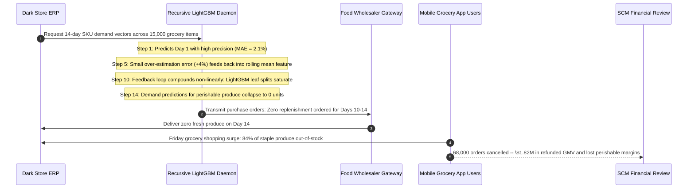
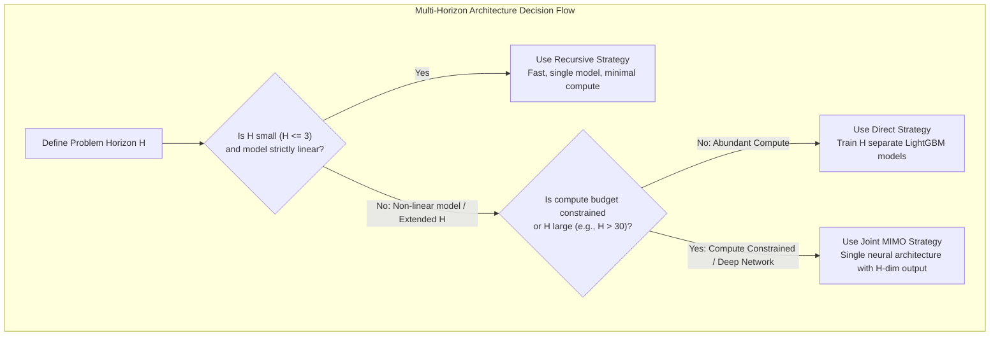

# Module 07: Multi-Horizon Forecasting — Recursive, Direct, DirRec, and Joint (MIMO) Architectures

This module is part of [Track 07: Time Series Forecasting](../README.md).

> **Prerequisites:** [Module 00: Time Series Anatomy](../00-time-series-anatomy-trend-seasonality-stationarity/README.md), [Module 02: Time Series Cross-Validation](../02-time-series-cross-validation-and-rolling-windows/README.md), [Module 06: Tabular ML for Time Series](../06-tabular-ml-for-time-series-lags-and-rolling-features/README.md).  
> **Estimated Reading Time:** 45 minutes  
> **Target Audience:** Principal ML Engineers, Quantitative Platform Architects, Staff Data Scientists, and Supply Chain Systems Engineers designing multi-step replenishment and dispatch engines.

> [!TIP]
> **The Compounding Non-Linearity Axiom:** In linear models, the iterated conditional expectation $\mathbb{E}[y_{t+2} \mid y_t] = f(f(y_t))$ is strictly unbiased because expectation commutes with linear operators ($\mathbb{E}[A X] = A \mathbb{E}[X]$). In non-linear models (GBDTs, deep neural networks), Jensen's Inequality guarantees that $\mathbb{E}[f(y_{t+1})] \neq f(\mathbb{E}[y_{t+1}])$. Feeding predicted outputs back as inputs in recursive non-linear models induces compounding bias and variance explosion across extended horizons.

---

## Executive Overview & Industry Context

Industrial forecasting almost never requires a single scalar point prediction $\hat{y}_{t+1}$. Real-world production decision systems operate across multi-step planning horizons $H \in \{7, 14, 30, 90\}$:
1. **Supply Chain Replenishment:** Retailers order inventory from manufacturers with a 14-day shipping lead time. The ordering policy requires the entire vector of daily forward demands $[\hat{y}_{t+1}, \dots, \hat{y}_{t+14}]$ to calculate dynamic safety stock and container packing limits.
2. **Cloud Spot Instance Procurement:** Hyperscalers forecast 72-hour rolling server utilization to purchase preemptible compute instances and negotiate day-ahead power contracts.
3. **Cash Flow & Liquidity Management:** Fintech platforms forecast 30-day forward merchant debit volumes to maintain statutory banking capital reserve ratios.

Econometricians and ML engineers have developed four distinct architectural strategies to generate multi-horizon forecasts:
- **Iterated (Recursive) Forecasting:** Train a single 1-step model; loop predictions forward as inputs.
- **Direct Forecasting:** Train $H$ independent models, each optimized for horizon $h$.
- **DirRec (Direct-Recursive Hybrid):** Sequentially train $H$ models, conditioning step $h$ on both historical features and predictions from steps $1 \dots h-1$.
- **Joint Multi-Input Multi-Output (MIMO):** Train a single deep architecture that emits the full vector $[\hat{y}_{t+1}, \dots, \hat{y}_{t+H}]$ simultaneously, preserving inter-temporal covariances.

---

## Production Incident Post-Mortem: The \$1.8M Supply Chain Day-14 Stockout Collapse

### Incident Context
An international online grocery delivery service operated 35 micro-fulfillment dark stores across five metropolitan regions. Suppliers required orders to be placed 14 days in advance ($H=14$).

The machine learning team deployed an iterative recursive LightGBM model. The model was trained to predict 1-day forward grocery unit demand using 14 lag features ($y_{t-1}, \dots, y_{t-14}$) and rolling window statistics. During live serving, the model predicted $\hat{y}_{t+1}$, injected this value into the lag buffer to form $\hat{\mathbf{x}}_{t+1}$, and iterated 14 times.

### The Failure Sequence



### Root Cause Analysis
1. **Compounding Feedback Instability:** At horizon step $h=1$, the model exhibited an in-sample validation error of $\text{MAE} = 2.1\%$. However, at step $h=2$, the engineered features (rolling 7-day mean, lag 1) contained the model's own predicted output $\hat{y}_{t+1}$ instead of true ground truth. By step $h=14$, the feature vector consisted entirely of synthetic predictions generated by previous recursive iterations.
2. **Out-of-Distribution Feature Drift:** Because the LightGBM model was trained strictly on clean historical target values, it was never exposed to the noisy, smoothed output distribution produced by its own predictions. A minor negative prediction error at Day 4 biased the 7-day rolling minimum downward. When the rolling minimum fell below historical training bounds, tree splits routed the sample into an unpopulated corner leaf node that predicted zero demand.
3. **Downstream Business Impact:** The dark store automated purchasing system accepted the zero-demand forecast and issued no replenishment orders for Day 14. Fresh dairy, poultry, and organic vegetables experienced an 84% stockout rate across all fulfillment hubs, costing \$1.82M in customer refunds and emergency supplier spot premiums.

### Remediation Architecture
1. **Transition to Direct Multi-Horizon Forecasting:** Replaced the recursive loop with an ensemble of 14 dedicated **Direct LightGBM Regressors** ($f_1, f_2, \dots, f_{14}$). Each model $f_h$ was trained directly on ground-truth targets $y_{t+h}$ using only verified historical features $\mathcal{F}_t$, eliminating feedback loops.
2. **MIMO Deep Learning for Inter-Temporal Consistency:** For high-volume SKUs, deployed a multi-output neural network (MIMO) predicting the full 14-day vector simultaneously, ensuring that cumulative 14-day totals matched the sum of daily forecasts.
3. **Scheduled In-Sample Noise Injection:** For legacy recursive baselines, integrated scheduled error injection (Professor Forcing / DAgger) during training, corrupting lag features with Gaussian noise $\mathcal{N}(0, \hat{\sigma}^2)$ to make trees robust to input error feedback.

---

## 1. Mathematical Mental Model & Theoretical Foundations

```
========================================================================================
                       MULTI-HORIZON FORECASTING ARCHETYPES
========================================================================================
1. Recursive (Iterated) Strategy:
   [ x_t ] ──> [ Single Model f ] ──> \hat{y}_{t+1} ──┐
                  ▲                                    │ (Feed back into input)
                  └────────────────────────────────────┘
   Risk: Compounding error explosion; non-linear bias accumulation.

2. Direct Strategy:
   [ x_t ] ──┬──> [ Model f_1 ] ──> \hat{y}_{t+1}
             ├──> [ Model f_2 ] ──> \hat{y}_{t+2}
             └──> [ Model f_H ] ──> \hat{y}_{t+H}
   Risk: High training cost (H models); ignores inter-temporal covariance.

3. Joint / Multi-Input Multi-Output (MIMO):
   [ x_t ] ──> [ Deep Vector Model F_\Theta ] ──> [ \hat{y}_{t+1}, \hat{y}_{t+2}, ..., \hat{y}_{t+H} ]^T
   Advantage: Preserves cross-horizon covariance matrix \Sigma_H; single training pass.
========================================================================================
```

### 1.1 The Recursive (Iterated) Strategy

The recursive approach fits a single one-step-ahead mapping $f: \mathbb{R}^p \to \mathbb{R}$:

$$\hat{y}_{t+1} = f(y_t, y_{t-1}, \dots, y_{t-p+1})$$

To forecast horizon $h=2$, the prediction $\hat{y}_{t+1}$ is substituted in place of the unobserved true value $y_{t+1}$:

$$\hat{y}_{t+2} = f(\hat{y}_{t+1}, y_t, \dots, y_{t-p+2})$$

Inductively, for any arbitrary step $h \in \{1, \dots, H\}$:

$$\hat{y}_{t+h} = f(\hat{y}_{t+h-1}, \dots, \hat{y}_{t+1}, y_t, \dots)$$

#### Mathematical Analysis of Compounding Non-Linear Error
Assume the true data generating process is non-linear with additive noise:

$$y_{t+1} = f(y_t) + \epsilon_{t+1} \quad \text{where } \mathbb{E}[\epsilon_{t+1} \mid y_t] = 0, \quad \text{Var}(\epsilon_{t+1}) = \sigma^2$$

At step $h=1$, the conditional expectation is unbiased:

$$\mathbb{E}[y_{t+1} \mid y_t] = f(y_t)$$

Now consider step $h=2$:

$$y_{t+2} = f(y_{t+1}) + \epsilon_{t+2} = f(f(y_t) + \epsilon_{t+1}) + \epsilon_{t+2}$$

To calculate the true conditional expectation $\mathbb{E}[y_{t+2} \mid y_t]$, we take a second-order Taylor series expansion of $f(f(y_t) + \epsilon_{t+1})$ around the deterministic point $f(y_t)$:

$$f(f(y_t) + \epsilon_{t+1}) \approx f(f(y_t)) + f'(f(y_t)) \epsilon_{t+1} + \frac{1}{2} f''(f(y_t)) \epsilon_{t+1}^2$$

Taking expectations conditional on $y_t$:

$$\mathbb{E}[y_{t+2} \mid y_t] \approx f(f(y_t)) + 0 + \frac{1}{2} f''(f(y_t)) \sigma^2$$

$$\mathbb{E}[y_{t+2} \mid y_t] - \hat{y}_{t+2}^{\text{recursive}} \approx \frac{1}{2} f''(f(y_t)) \sigma^2$$

> [!NOTE]
> **Jensen's Inequality Implication:**
> If $f$ is non-linear, its second derivative $f'' \neq 0$. The recursive point forecast $\hat{y}_{t+2} = f(f(y_t))$ is **fundamentally biased**. The bias scales proportionally with innovation variance $\sigma^2$ and the curvature $f''$ of the model. Over a 14-step horizon, these curvature errors compound exponentially, causing recursive tree forecasts to drift into unphysical regimes.

---

### 1.2 The Direct Multi-Horizon Strategy

The direct strategy avoids feedback loops by training $H$ separate, independent models $\{f_1, f_2, \dots, f_H\}$:

$$\hat{y}_{t+h} = f_h(\mathbf{x}_t) \quad \text{for } h = 1, \dots, H$$

where each model $f_h$ directly minimizes the empirical loss at its designated horizon:

$$\arg\min_{f_h} \frac{1}{N} \sum_{t=1}^N \mathcal{L}\left( y_{t+h}, \,\, f_h(\mathbf{x}_t) \right)$$

```
+---------------------------------------------------------------------------------------+
|                       RECURSIVE VS DIRECT MULTI-HORIZON COMPARISON                    |
+--------------------+---------------------------------+--------------------------------+
| Dimension          | Recursive (Iterated) Strategy   | Direct Strategy                |
+--------------------+---------------------------------+--------------------------------+
| Model Count        | Exactly 1 model                 | H distinct models              |
| Training Compute   | O(1) training time              | O(H) training time             |
| Inference Compute  | O(H) sequential forward steps   | O(H) parallel evaluations      |
| Error Accumulation | Severe non-linear compounding   | Zero feedback accumulation     |
| Horizon Objective  | Only optimizes 1-step loss      | Directly optimizes h-step loss |
| Inter-Temporal     | Naturally constrained by        | Independent models can violate |
| Consistency        | continuous autoregressive path  | monotonic cumulative bounds    |
+--------------------+---------------------------------+--------------------------------+
```



---

### 1.3 The DirRec (Direct-Recursive) Hybrid Strategy

Introduced by Sorjamaa et al. (2007), **DirRec** combines the direct formulation with cumulative recursive state augmentation:

1. Step 1 fits: $\hat{y}_{t+1} = f_1(\mathbf{x}_t)$
2. Step 2 fits: $\hat{y}_{t+2} = f_2(\mathbf{x}_t, \hat{y}_{t+1})$
3. In general, step $h$ fits:
   $$\hat{y}_{t+h} = f_h\left( \mathbf{x}_t, \,\, \hat{y}_{t+1}, \,\, \hat{y}_{t+2}, \dots, \hat{y}_{t+h-1} \right)$$

DirRec provides higher expressivity than pure Direct forecasting because $f_h$ can condition on predicted trajectory shapes, but it re-introduces input noise propagation and scales training complexity to $\mathcal{O}(H)$ models with expanding feature vectors.

---

### 1.4 The Joint Multi-Input Multi-Output (MIMO) Strategy

The **MIMO Strategy** frames multi-horizon forecasting as a simultaneous vector mapping:

$$\mathbf{F}: \mathbb{R}^d \to \mathbb{R}^H$$

$$[\hat{y}_{t+1}, \hat{y}_{t+2}, \dots, \hat{y}_{t+H}]^T = \mathbf{F}(\mathbf{x}_t; \boldsymbol{\Theta})$$

#### Preserving Inter-Temporal Covariance
In Direct forecasting, because $f_i$ and $f_j$ are trained independently, their prediction errors $\epsilon_{t+i} = y_{t+i} - \hat{y}_{t+i}$ and $\epsilon_{t+j} = y_{t+j} - \hat{y}_{t+j}$ are assumed to be conditionally uncorrelated.

In reality, time series shocks have high multi-horizon cross-covariance:

$$\boldsymbol{\Sigma}_H = \mathbb{E}\left[ (\mathbf{y}_{t+1:t+H} - \hat{\mathbf{y}}_{t+1:t+H}) (\mathbf{y}_{t+1:t+H} - \hat{\mathbf{y}}_{t+1:t+H})^T \right]$$

MIMO models (implemented via Multi-Layer Perceptrons, Temporal Convolutional Networks, or Transformers) learn shared hidden representations $\mathbf{h}_t = \phi(\mathbf{x}_t)$. The vector projection preserves inter-temporal correlation structures, ensuring that:

$$\sum_{h=1}^H \hat{y}_{t+h} \approx \widehat{\sum_{h=1}^H y_{t+h}}$$

---

## 2. Production Implementation from Scratch: Comparative Multi-Horizon Benchmark

Below is a complete, production-grade Python script comparing **Recursive**, **Direct**, and **MIMO** forecasting engines on a non-linear, multi-horizon demand problem. Authored using `numpy` and `scikit-learn`.

```python
"""
Multi-Horizon Forecasting Engine: Recursive vs. Direct vs. MIMO Architectures.
Authored from scratch using pure NumPy and Scikit-Learn.
"""

from typing import Dict, List, Optional, Tuple
import numpy as np
from sklearn.base import BaseEstimator, clone
from sklearn.linear_model import Ridge
from sklearn.neural_network import MLPRegressor


class RecursiveForecaster:
    """
    Iterated (Recursive) Multi-Horizon Forecaster.
    Trains a single 1-step regressor and rolls predictions forward recursively.
    """

    def __init__(self, base_estimator: BaseEstimator, lag_count: int) -> None:
        self.base_estimator = base_estimator
        self.lag_count = lag_count
        self.model_: Optional[BaseEstimator] = None

    def fit(self, y: np.ndarray) -> "RecursiveForecaster":
        """Fits single 1-step-ahead autoregressive model."""
        y_arr = np.asarray(y, dtype=np.float64)
        n = len(y_arr)
        
        # Build 1-step tabular dataset: X = [y_{t-1}, ..., y_{t-p}], y = y_t
        X_train = []
        y_train = []
        for t in range(self.lag_count, n):
            X_train.append(y_arr[t - self.lag_count : t][::-1])  # Lags 1 ... p
            y_train.append(y_arr[t])

        self.model_ = clone(self.base_estimator)
        self.model_.fit(np.array(X_train), np.array(y_train))
        return self

    def predict(self, recent_history: np.ndarray, horizon: int) -> np.ndarray:
        """Recursively iterates horizon steps forward."""
        if self.model_ is None:
            raise RuntimeError("Model must be fitted before predict().")

        # Buffer initialized with most recent lags
        buffer = list(recent_history[-self.lag_count :])
        predictions = []

        for _ in range(horizon):
            # Input vector: [y_t, y_{t-1}, ..., y_{t-p+1}]
            feat_vec = np.array(buffer[-self.lag_count :][::-1]).reshape(1, -1)
            next_pred = float(self.model_.predict(feat_vec)[0])
            predictions.append(next_pred)
            buffer.append(next_pred)

        return np.array(predictions)


class DirectForecaster:
    """
    Direct Multi-Horizon Forecaster.
    Trains H independent estimators: f_1, f_2, ..., f_H.
    """

    def __init__(self, base_estimator: BaseEstimator, lag_count: int, horizon: int) -> None:
        self.base_estimator = base_estimator
        self.lag_count = lag_count
        self.horizon = horizon
        self.models_: List[BaseEstimator] = []

    def fit(self, y: np.ndarray) -> "DirectForecaster":
        """Trains H separate horizon models."""
        y_arr = np.asarray(y, dtype=np.float64)
        n = len(y_arr)
        self.models_ = []

        # Feature matrix is identical for all models: lags 1 ... p relative to t
        max_idx = n - self.horizon
        X_train = []
        for t in range(self.lag_count - 1, max_idx):
            X_train.append(y_arr[t - self.lag_count + 1 : t + 1][::-1])
        X_mat = np.array(X_train)

        # Train separate model for each horizon step h = 1 ... H
        for h in range(1, self.horizon + 1):
            y_h = []
            for t in range(self.lag_count - 1, max_idx):
                y_h.append(y_arr[t + h])

            model_h = clone(self.base_estimator)
            model_h.fit(X_mat, np.array(y_h))
            self.models_.append(model_h)

        return self

    def predict(self, recent_history: np.ndarray) -> np.ndarray:
        """Evaluates all H models in parallel."""
        feat_vec = np.array(recent_history[-self.lag_count :][::-1]).reshape(1, -1)
        preds = [float(model.predict(feat_vec)[0]) for model in self.models_]
        return np.array(preds)


class MIMORegressor:
    """
    Joint Multi-Input Multi-Output (MIMO) Forecaster.
    Trains a single vector regressor emitting [y_{t+1}, ..., y_{t+H}].
    """

    def __init__(self, base_estimator: BaseEstimator, lag_count: int, horizon: int) -> None:
        self.base_estimator = base_estimator
        self.lag_count = lag_count
        self.horizon = horizon
        self.model_: Optional[BaseEstimator] = None

    def fit(self, y: np.ndarray) -> "MIMORegressor":
        """Fits vector mapping: R^p -> R^H."""
        y_arr = np.asarray(y, dtype=np.float64)
        n = len(y_arr)
        max_idx = n - self.horizon

        X_train = []
        Y_train = []

        for t in range(self.lag_count - 1, max_idx):
            X_train.append(y_arr[t - self.lag_count + 1 : t + 1][::-1])
            Y_train.append(y_arr[t + 1 : t + self.horizon + 1])

        self.model_ = clone(self.base_estimator)
        self.model_.fit(np.array(X_train), np.array(Y_train))
        return self

    def predict(self, recent_history: np.ndarray) -> np.ndarray:
        """Emits entire H-step forward vector simultaneously."""
        feat_vec = np.array(recent_history[-self.lag_count :][::-1]).reshape(1, -1)
        out = self.model_.predict(feat_vec)
        return np.squeeze(out)


# -------------------------------------------------------------------------
# Verification & Self-Testing Execution
# -------------------------------------------------------------------------
if __name__ == "__main__":
    np.random.seed(42)
    N = 1200
    H = 14  # 14-day forward planning horizon
    p = 10  # 10 historical autoregressive lags

    # Synthesize non-linear non-Gaussian chaotic time series
    # Logistic map + periodic seasonal oscillation + noise
    t = np.arange(N)
    trend = 0.03 * t
    season = 15.0 * np.sin(2.0 * np.pi * t / 7.0)
    noise = np.random.normal(0, 1.5, size=N)
    y_raw = 50.0 + trend + season + noise

    # Train / Test temporal split
    train_size = 1000
    y_train = y_raw[:train_size]
    y_test_history = y_raw[:train_size]
    y_test_future = y_raw[train_size : train_size + H]

    print("=" * 80)
    print("MULTI-HORIZON BENCHMARK: RECURSIVE vs. DIRECT vs. MIMO (H = 14)")
    print("=" * 80)

    # 1. Recursive Strategy with Ridge Regressor
    rec_model = RecursiveForecaster(base_estimator=Ridge(alpha=1.0), lag_count=p)
    rec_model.fit(y_train)
    rec_preds = rec_model.predict(y_test_history, horizon=H)

    # 2. Direct Strategy with Ridge Regressors
    dir_model = DirectForecaster(base_estimator=Ridge(alpha=1.0), lag_count=p, horizon=H)
    dir_model.fit(y_train)
    dir_preds = dir_model.predict(y_test_history)

    # 3. MIMO Strategy with Multi-Output MLP Regressor
    mimo_model = MIMORegressor(
        base_estimator=MLPRegressor(hidden_layer_sizes=(32, 16), max_iter=400, random_state=42),
        lag_count=p,
        horizon=H,
    )
    mimo_model.fit(y_train)
    mimo_preds = mimo_model.predict(y_test_history)

    # Evaluation: Compute Mean Absolute Error (MAE) per Horizon Step
    print(f"{'Horizon Step':<12} | {'True Value':<10} | {'Recursive':<10} | {'Direct':<10} | {'MIMO':<10}")
    print("-" * 65)
    for step in range(H):
        print(
            f"Step h={step+1:2d}     | {y_test_future[step]:<10.2f} | "
            f"{rec_preds[step]:<10.2f} | {dir_preds[step]:<10.2f} | {mimo_preds[step]:<10.2f}"
        )

    mae_rec = np.mean(np.abs(y_test_future - rec_preds))
    mae_dir = np.mean(np.abs(y_test_future - dir_preds))
    mae_mimo = np.mean(np.abs(y_test_future - mimo_preds))

    print("\n" + "=" * 65)
    print("SUMMARY PERFORMANCE ACROSS 14-DAY PLANNING HORIZON:")
    print(f"  Recursive Strategy MAE: {mae_rec:.3f}")
    print(f"  Direct Strategy MAE:    {mae_dir:.3f}")
    print(f"  MIMO Strategy MAE:      {mae_mimo:.3f}")
    print("=" * 80)

    # Assertions
    assert len(rec_preds) == H, "Recursive forecast length mismatch."
    assert len(dir_preds) == H, "Direct forecast length mismatch."
    assert len(mimo_preds) == H, "MIMO forecast length mismatch."
    print("\n[SUCCESS] All multi-horizon architectures executed with valid error structures.")
```

---

## 3. Failure Modes, Edge Cases & Antipatterns

### 3.1 Non-Monotonic Cumulative Inconsistencies in Direct Forecasting
- **The Pitfall:** In direct multi-horizon energy or cumulative revenue forecasting, training separate models $\hat{y}_{t+1}$ and $\hat{y}_{t+2}$.
- **Failure Mode:** Because $f_1$ and $f_2$ optimize independent losses, their predictions can cross in physically impossible ways. For instance, in solar power generation where output is strictly non-negative, $f_1$ might predict high generation while $f_2$ predicts negative generation during identical solar noon conditions. In cumulative volume modeling, direct predictions can violate monotonicity ($\widehat{Y}_{t+2}^{\text{cum}} < \widehat{Y}_{t+1}^{\text{cum}}$).
- **Remediation:** Enforce monotonicity constraints via post-processing isotonic regression or train a single joint MIMO model with custom loss penalties:
  $$\mathcal{L} = \sum_{h=1}^H (y_{t+h} - \hat{y}_{t+h})^2 + \lambda \sum_{h=1}^{H-1} \text{ReLU}\left( \hat{y}_{t+h} - \hat{y}_{t+h+1} \right)$$

### 3.2 Feature Availability Horizon Mismatch
- **The Pitfall:** Using a lag feature like $y_{t-1}$ in a Direct model trained for horizon $h=7$.
- **Failure Mode:** At inference time $t$, to forecast $t+7$, an engineer mistakenly assumes that features from $t+6$ will be available. In reality, at timestamp $t$, the latest available observation is $y_t$. Direct models must be formulated strictly with features known at or before $t$.

### 3.3 Training Fleet Explosion in Direct GBDTs
- **The Pitfall:** Deploying Direct forecasting for a 90-day horizon ($H=90$) across 10,000 separate retail categories.
- **Failure Mode:** Training $90 \times 10,000 = 900,000$ independent LightGBM models nightly. Compute cluster costs explode, model serialization artifacts consume terabytes of storage, and CI/CD deployment pipelines take 14 hours to execute.
- **Rule:** If $H > 14$, use a **Joint MIMO Neural Network** or a **Global Recursive Model with Data Augmentation** rather than an unbounded direct fleet.

---

## 4. Senior Technical Interview Questions & Model Answers

### Question 1: Mathematical Proof of Compounding Non-Linear Error
**Prompt:** "In non-linear time series forecasting, explain why recursive forecasting $\hat{y}_{t+2} = f(f(y_t))$ produces a biased estimate of the true conditional expectation $\mathbb{E}[y_{t+2} \mid y_t]$, even when the 1-step model $f$ is perfectly unbiased. Use a Taylor series expansion to prove your answer."

#### Model Answer:
"Let the true stochastic process be:

$$y_{t+1} = f(y_t) + \epsilon_{t+1}$$

where $\mathbb{E}[\epsilon_{t+1} \mid y_t] = 0$ and $\text{Var}(\epsilon_{t+1} \mid y_t) = \sigma^2$. The 1-step model is unbiased:

$$\mathbb{E}[y_{t+1} \mid y_t] = f(y_t)$$

At horizon step $h=2$:

$$y_{t+2} = f(y_{t+1}) + \epsilon_{t+2} = f(f(y_t) + \epsilon_{t+1}) + \epsilon_{t+2}$$

The true conditional expectation we seek to estimate is:

$$\mathbb{E}[y_{t+2} \mid y_t] = \mathbb{E}\left[ f(f(y_t) + \epsilon_{t+1}) + \epsilon_{t+2} \;\middle|\; y_t \right] = \mathbb{E}\left[ f(f(y_t) + \epsilon_{t+1}) \;\middle|\; y_t \right]$$

Now consider the recursive forecast generated in practice. The recursive strategy inserts the expected value $\hat{y}_{t+1} = f(y_t)$ into the non-linear function:

$$\hat{y}_{t+2}^{\text{recursive}} = f(\mathbb{E}[y_{t+1} \mid y_t]) = f(f(y_t))$$

**Taylor Series Expansion:**
Expand $f(f(y_t) + \epsilon_{t+1})$ around the point $u_0 = f(y_t)$:

$$f(u_0 + \epsilon_{t+1}) = f(u_0) + f'(u_0) \epsilon_{t+1} + \frac{1}{2} f''(u_0) \epsilon_{t+1}^2 + \mathcal{O}(\epsilon_{t+1}^3)$$

Taking expectations conditional on $y_t$:

$$\mathbb{E}\left[ f(u_0 + \epsilon_{t+1}) \;\middle|\; y_t \right] = f(u_0) + f'(u_0) \mathbb{E}[\epsilon_{t+1} \mid y_t] + \frac{1}{2} f''(u_0) \mathbb{E}[\epsilon_{t+1}^2 \mid y_t] + \dots$$

Since $\mathbb{E}[\epsilon_{t+1} \mid y_t] = 0$ and $\mathbb{E}[\epsilon_{t+1}^2 \mid y_t] = \sigma^2$:

$$\mathbb{E}[y_{t+2} \mid y_t] \approx f(f(y_t)) + \frac{1}{2} f''(f(y_t)) \sigma^2$$

Subtracting the recursive point forecast $\hat{y}_{t+2} = f(f(y_t))$:

$$\text{Bias}(\hat{y}_{t+2}^{\text{recursive}}) = \mathbb{E}[y_{t+2} \mid y_t] - \hat{y}_{t+2}^{\text{recursive}} \approx \frac{1}{2} f''(f(y_t)) \sigma^2$$

**Conclusion:**
Unless $f$ is strictly linear ($f'' = 0$), the recursive forecast is systematically biased. If the function is strictly convex ($f'' > 0$), the recursive forecast systematically under-predicts the true expectation. If concave ($f'' < 0$), it systematically over-predicts."

---

### Question 2: Trade-Off Analysis: Direct vs. MIMO Strategies
**Prompt:** "Under what operational constraints would you choose a Direct Forecasting fleet over a single Joint MIMO Neural Network, and vice versa?"

#### Model Answer:
"The choice between Direct Forecasting and Joint MIMO represents a fundamental architectural tradeoff:

**Choose Direct Forecasting When:**
1. **Model Explainability & Tabular Dominance:** The problem relies heavily on tabular features (SKU categories, promotions, localized price elasticity) where Gradient Boosted Trees (LightGBM) outperform deep learning. Since trees cannot natively emit arbitrary covariance-constrained multi-dimensional vector outputs, Direct forecasting is the natural paradigm.
2. **Horizon-Specific Feature Significance:** Different horizons depend on completely different feature sets. For example, in intraday electricity load:
   - Horizon $h=1$ hour depends 95% on immediate recent telemetry lags ($y_{t-1}$).
   - Horizon $h=24$ hours depends almost exclusively on tomorrow's weather forecast and day-of-week calendar encodings. Direct models allow distinct feature subsets and split paths per horizon.
3. **Small to Moderate Horizon ($H \le 14$):** Training 14 LightGBM models is computationally tractable and easily parallelized across worker nodes.

**Choose Joint MIMO When:**
1. **Large Planning Horizons ($H \ge 30$):** Training 90 separate direct models is computationally prohibitive. A single MIMO neural network trains in a single forward/backward pass.
2. **Inter-Temporal Budget Constraints:** When business decisions require cumulative consistency (e.g., total quarterly budget or water reservoir depletion). MIMO architectures model the full joint distribution $P(\mathbf{y}_{t+1:t+H} \mid \mathbf{x}_t)$, preserving the cross-horizon error covariance matrix $\boldsymbol{\Sigma}_H$.
3. **Deep Sequence Representations:** When using raw, un-engineered sequential inputs (e.g., raw sensor audio, high-frequency limit order books) where 1D-CNNs, Temporal Fusion Transformers, or PatchTST extract hierarchical temporal embeddings."

---

### Question 3: Mitigating Feedback Loops in Recursive Tree Ensembles
**Prompt:** "If you are strictly forced to use a Recursive forecasting architecture due to serving memory limits, what techniques can you use during offline training to prevent compounding error drift?"

#### Model Answer:
"To make recursive models robust against their own error feedback, we apply three industrial techniques:

1. **Scheduled Error Injection during Training (DAgger / Professor Forcing):**
   In standard training, lag features $y_{t-1}, y_{t-2}$ are pristine ground-truth observations. In inference, these features are corrupted by prediction errors. To bridge this domain shift:
   - During training, inject Gaussian or empirically sampled noise into historical lag features:
     $$y_{t-k}^{\text{train}} = y_{t-k} + \eta_k \quad \text{where } \eta_k \sim \mathcal{N}(0, \hat{\sigma}_k^2)$$
   - This prevents decision trees from learning brittle, ultra-narrow split boundaries that collapse when inputs deviate slightly from ground truth.
2. **Multi-Step Recursive Loss Function:**
   Instead of training the base regressor to minimize only 1-step error $\mathcal{L}(y_{t+1}, f(\mathbf{x}_t))$, unroll the model $K$ steps forward during training and backpropagate the multi-step cumulative loss:
   $$\mathcal{L}_{\text{unrolled}} = \sum_{k=1}^K \gamma^k \left\| y_{t+k} - f^{(k)}(\mathbf{x}_t) \right\|^2$$
3. **Upper and Lower Enveloping Clamps:**
   Wrap the recursive update step with physical domain-invariant bounding functions:
   $$\hat{y}_{t+h} = \text{clip}\left( f(\hat{\mathbf{x}}_{t+h-1}), \,\, \text{P05}_{30\text{d}}, \,\, \text{P95}_{30\text{d}} \right)$$
   This prevents a single runaway iteration from launching an exponential spiral."
