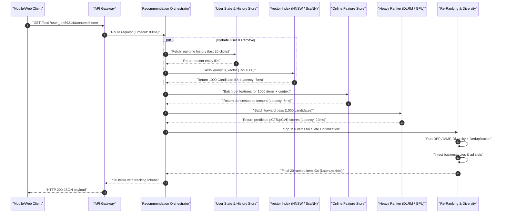

# Anatomy of Modern Recommender Systems: Retrieval, Scoring, and Re-Ranking

This module is part of [Track 08: Recommender Systems & Ranking](../README.md).

---

## 1. Executive Overview & Industry Context

Industrial recommender systems operate at a scale that fundamentally defies single-model computation. At hyper-scale platforms—such as YouTube, Netflix, Spotify, Amazon, and TikTok—the catalog size ($N$) spans tens of millions to billions of items, while the active user base ($U$) encompasses hundreds of millions of individuals demanding responses within strict real-time service level objectives (SLOs), typically under $50\text{ ms}$ to $100\text{ ms}$ end-to-end.

Evaluating an expressive, high-capacity neural network (e.g., a multi-layer Transformer or a Deep Learning Recommendation Model with hundreds of dense and sparse cross-features) across every item in the catalog for each incoming request requires computing:

$$\mathcal{O}(U_{\text{concurrent}} \times N_{\text{catalog}} \times C_{\text{FLOPs}})$$

When $N \approx 10^8$ and peak concurrent queries $Q \approx 50,000\text{ qps}$, computing millions of inference passes per second would require an infrastructure footprint costing tens of millions of dollars per month, while still violating P99 tail latency requirements due to thermal throttling, queuing delays, and memory bus saturation.

To resolve this computational bottleneck, modern production recommender systems decompose recommendation into a cascaded, multi-stage funnel architecture:

```
+--------------------------------------------------------------------------------+
|  Total Catalog: N = 10^7 - 10^9 items                                          |
+--------------------------------------------------------------------------------+
                                        |
                                        v
+--------------------------------------------------------------------------------+
|  Stage 1: Candidate Generation / Retrieval (Sub-10ms)                          |
|  Method: ANN vector search, Graph traversal, Collaborative Filtering           |
|  Scale: 10^8 -> 10^3 items (High Recall, Coarse Complexity)                   |
+--------------------------------------------------------------------------------+
                                        |
                                        v
+--------------------------------------------------------------------------------+
|  Stage 2: Heavy Ranking / Scoring (20ms - 40ms)                                |
|  Method: DLRM, GBDT, Cross-Networks, Multi-Task Neural Nets                    |
|  Scale: 10^3 -> 10^2 items (High Precision, Fine Calibration)                 |
+--------------------------------------------------------------------------------+
                                        |
                                        v
+--------------------------------------------------------------------------------+
|  Stage 3: Re-ranking, Diversity & Business Policy (5ms - 10ms)                 |
|  Method: DPP, MMR, Freshness injection, Deduplication, Sponsored constraints   |
|  Scale: 10^2 -> 10^1 items (Final Slate for Presentation)                      |
+--------------------------------------------------------------------------------+
```

Each stage operates under a distinct trade-off surface between hypothesis class capacity, feature representation richness, computational cost, and latency budgets.

---

## 2. Mathematical Formulations & Latency Budgeting

### 2.1 The Multi-Stage Cascaded Funnel Formulation

Let $\mathcal{I} = \{i_1, i_2, \dots, i_N\}$ represent the item catalog of size $N \sim 10^7 - 10^9$, and let $u \in \mathcal{U}$ denote the querying user with contextual state $c \in \mathcal{C}$ at timestamp $t$.

#### Stage 1: Candidate Generation (Retrieval)
The objective is to compute a reduced subset $\mathcal{C}_u \subset \mathcal{I}$ of cardinality $K_1 \approx 10^2 - 10^3$ such that the probability of excluding the optimal item $i^*$ is bounded by an admissible tolerance $\epsilon$:

$$P\left(i^* \notin \mathcal{C}_u \mid u, c\right) \le \epsilon, \quad \text{where } i^* = \arg\max_{i \in \mathcal{I}} \text{Utility}(u, i, c)$$

Retrieval models prioritize **recall over precision**. The candidate generation scoring function $s_{\text{ret}}(u, i)$ must decouple into separate user and item representations to allow sublinear indexing:

$$s_{\text{ret}}(u, i) = \langle \mathbf{\psi}(u, c), \mathbf{\phi}(i) \rangle = \sum_{d=1}^D \psi_d(u, c) \cdot \phi_d(i)$$

Because $\mathbf{\phi}(i) \in \mathbb{R}^D$ is static with respect to the query context, it is precomputed offline and indexed in an Approximate Nearest Neighbor (ANN) index (e.g., HNSW, IVF-PQ). Query evaluation requires a single forward pass through the user encoder $\mathbf{\psi}(u, c)$ followed by an $\mathcal{O}(\log N)$ index query.

#### Stage 2: Heavy Scoring (Ranking)
The ranking stage receives $\mathcal{C}_u$ and evaluates an expressive joint scoring function $f_{\text{rank}}(u, i, c)$ that operates over explicit cross-features:

$$\hat{y}_{ui} = f_{\text{rank}}\left(\mathbf{x}_u, \mathbf{x}_i, \mathbf{x}_{u \times i}, \mathbf{x}_c\right)$$

where $\mathbf{x}_{u \times i}$ represents cross-product interactions (e.g., historical user category affinity $\times$ item category, price percentile $\times$ user budget). The output $\hat{y}_{ui}$ is typically calibrated as an estimated probability:

$$\hat{y}_{ui} = P(\text{Engagement} \mid u, i, c) = \sigma\left(\mathbf{w}^T \mathbf{z}_L + b\right)$$

The ranking stage sorts $\mathcal{C}_u$ by $\hat{y}_{ui}$ and truncates to the top $K_2 \approx 50 - 200$ items.

#### Stage 3: Re-Ranking & Slate Optimization
The final stage balances pure point utility with collective slate properties: intra-list diversity, freshness, exploration, and commercial constraints. The slate selection is formalized as maximizing a submodular set function over subsets $\mathcal{S} \subset \mathcal{C}_u$ subject to size $|\mathcal{S}| = K$:

$$\mathcal{S}^* = \arg\max_{\substack{\mathcal{S} \subseteq \mathcal{C}_u \\ |\mathcal{S}| = K}} \left[ \sum_{i \in \mathcal{S}} \hat{y}_{ui} + \lambda \cdot \text{Diversity}(\mathcal{S}) - \sum_{k=1}^M \gamma_k \cdot \text{Penalty}_k(\mathcal{S}) \right]$$

### 2.2 Latency Budgets & Hardware Trade-Offs

Production recommenders enforce hard latency budgets to protect end-to-end P99 response times. A representative $60\text{ ms}$ SLA breaks down across distributed microservices as follows:

| Stage | Latency Budget (P95 / P99) | Cardinality In $\to$ Out | Primary Compute / Hardware | Bottleneck Resource |
| :--- | :--- | :--- | :--- | :--- |
| **API Gateway & Hydration** | $5\text{ ms} / 8\text{ ms}$ | $1 \to 1$ | CPU / Memory | Network serialization, Redis cache latency |
| **Stage 1: Retrieval (ANN)** | $8\text{ ms} / 12\text{ ms}$ | $10^8 \to 10^3$ | GPU / High-RAM CPU | Memory bandwidth, graph traversal pointer chasing |
| **Feature Store Fetch** | $4\text{ ms} / 8\text{ ms}$ | $10^3 \text{ candidates}$ | Distributed KV (Aerospike/Feast) | Network I/O, concurrent socket fan-out |
| **Stage 2: Heavy Scoring** | $20\text{ ms} / 35\text{ ms}$ | $10^3 \to 10^2$ | GPU / TPU accelerators | Tensor Core FLOPs, memory transfer latency |
| **Stage 3: Re-Ranking & Rules** | $3\text{ ms} / 6\text{ ms}$ | $10^2 \to 10^1$ | Multi-core CPU | Cache locality, matrix determinant math |
| **Serialization & Network** | $2\text{ ms} / 4\text{ ms}$ | $10^1 \to 1$ | Web Gateway | JSON/Protobuf payload encoding |
| **Total End-to-End** | **$42\text{ ms} / 73\text{ ms}$** | **$10^8 \to 10^1$** | **Hybrid Pipeline** | **Distributed P99 tail latency** |

---

## 3. Feedback Taxonomy: Explicit vs. Implicit Signals

The choice of loss function and optimization target depends directly on the observational feedback mechanism.

```
                             User Interaction Signals
                                        |
         +------------------------------+------------------------------+
         |                                                             |
         v                                                             v
  Explicit Feedback                                            Implicit Feedback
  - Star ratings (1 to 5)                                      - Clicks / Impressions
  - Thumbs Up / Down                                           - Dwell time / Video watch time
  - Numerical reviews                                          - Add to cart / Purchases
  - Survey responses                                           - Scroll depth / Bounces
         |                                                             |
         v                                                             v
  Properties:                                                  Properties:
  * High fidelity, low volume                                  * Massive volume, low SNR
  * Direct utility signal                                      * Extreme selection & position bias
  * Severe Missing-Not-At-Random (MNAR)                        * Positive-Unlabelled (PU) ambiguity
```

### 3.1 Explicit Feedback Formulation
Explicit feedback provides direct numerical evidence of preference:

$$r_{ui} \in \{1, 2, 3, 4, 5\} \quad \text{or} \quad r_{ui} \in \{-1, +1\}$$

The loss is commonly formulated as Mean Squared Error over observed entries $\Omega = \{(u, i) : r_{ui} \ne \text{null}\}$:

$$\mathcal{L}_{\text{explicit}} = \frac{1}{|\Omega|} \sum_{(u, i) \in \Omega} \left(r_{ui} - \hat{r}_{ui}\right)^2 + \lambda \|\Theta\|_2^2$$

#### The MNAR Problem
Explicit ratings suffer from severe **Missing Not At Random (MNAR)** selection bias. Users do not review a random sample of items; they primarily review items they strongly love or hate. An item with an average rating of 4.8 stars may have a lower broad population utility than an item with 4.1 stars because only self-selected enthusiasts reviewed the former.

### 3.2 Implicit Feedback & The Positive-Unlabelled (PU) Problem
Implicit logs record behavioral footprints without explicit sentiment:

$$y_{ui} = \begin{cases} 1 & \text{if interaction (click, purchase, complete view) occurred} \\ 0 & \text{if no interaction observed} \end{cases}$$

Critical characteristics of implicit feedback:
1. **Absence of Negative Evidence**: $y_{ui} = 0$ does not mean user $u$ dislikes item $i$. It typically means user $u$ was never exposed to item $i$ (lack of awareness), or saw it but was distracted.
2. **Noise in Positives**: A click does not guarantee satisfaction; it frequently reflects clickbait or accidental clicks.
3. **Severe Position Bias**: Items shown at position 1 receive vastly higher click-through rates than items at position 10, regardless of relevance:

$$P(\text{Click} = 1) = P(\text{Examined} = 1 \mid \text{Position}) \times P(\text{Relevant} = 1 \mid \text{Item}, \text{User})$$

#### Pointwise Confidence Weighting (Hu, Koren, Volinsky Formulation)
To train models on binary implicit data, the unobserved entries are retained as negatives with low confidence, while positive interactions scale confidence with interaction intensity $r_{ui}$ (e.g., number of clicks or watch time):

$$p_{ui} = \begin{cases} 1 & \text{if } r_{ui} > 0 \\ 0 & \text{if } r_{ui} = 0 \end{cases}, \qquad c_{ui} = 1 + \alpha r_{ui}$$

$$\mathcal{L}_{\text{implicit}} = \sum_{u} \sum_{i} c_{ui} \left(p_{ui} - \hat{p}_{ui}\right)^2 + \mathcal{R}(\Theta)$$

---

## 4. Architectural Deep Dive: End-to-End Recommendation Funnel

The following sequence diagram illustrates the lifecycle of a real-time recommendation request in an enterprise e-commerce or streaming system.



---

## 5. Production Implementation from Scratch

The following complete, runnable Python implementation builds a fully decoupled, production-grade recommendation funnel:
- **Stage 1 (Retrieval)**: Inverted-index collaborative retrieval + Vector dot-product ANN mock.
- **Stage 2 (Scoring)**: Gradient-boosted feature ranking with point-wise CTR prediction and cross-feature interactions.
- **Stage 3 (Re-Ranking)**: Maximal Marginal Relevance (MMR) for diversification combined with frequency capping and business filters.

```python
"""
production_funnel.py
A complete, runnable implementation of a multi-stage recommendation pipeline.
Includes Retrieval -> Heavy Scoring -> Diversity Re-ranking.
"""

from __future__ import annotations
import math
import time
from dataclasses import dataclass, field
from typing import Dict, List, Set, Tuple
import numpy as np


# ============================================================================
# Domain Models & Telemetry
# ============================================================================

@dataclass(frozen=True)
class Item:
    item_id: int
    category: str
    price: float
    embedding: np.ndarray  # Shape: (D,)
    is_promoted: bool = False

    def __hash__(self) -> int:
        return hash(self.item_id)


@dataclass
class UserProfile:
    user_id: int
    history_item_ids: List[int]
    category_affinities: Dict[str, float]
    embedding: np.ndarray  # Shape: (D,)


@dataclass
class ScoredItem:
    item: Item
    score: float
    p_ctr: float = 0.0
    diversity_penalty: float = 0.0


# ============================================================================
# Stage 1: Candidate Generation (Retrieval)
# ============================================================================

class VectorRetrievalEngine:
    """
    Sub-10ms Approximate Nearest Neighbor / Linear Vector Search engine.
    Extracts top K candidates from a catalog of N items.
    """
    def __init__(self, catalog: List[Item], embedding_dim: int):
        self.catalog = catalog
        self.embedding_dim = embedding_dim
        self.item_ids = np.array([item.item_id for item in catalog])
        
        # Build normalized item matrix for cosine dot-product
        raw_mat = np.vstack([item.embedding for item in catalog])
        norms = np.linalg.norm(raw_mat, axis=1, keepdims=True)
        norms[norms == 0] = 1e-12
        self.normed_item_matrix = raw_mat / norms

    def retrieve(self, user_emb: np.ndarray, top_k: int = 200, exclude_ids: Set[int] = None) -> List[Item]:
        t0 = time.perf_counter()
        if exclude_ids is None:
            exclude_ids = set()

        # Normalize query vector
        norm = np.linalg.norm(user_emb)
        q = user_emb / (norm if norm > 0 else 1e-12)

        # Vectorized dot-product scoring
        sims = np.dot(self.normed_item_matrix, q)

        # Mask excluded items
        if exclude_ids:
            for idx, item in enumerate(self.catalog):
                if item.item_id in exclude_ids:
                    sims[idx] = -np.inf

        # Partition top K indices
        if top_k >= len(sims):
            top_indices = np.argsort(-sims)
        else:
            partitioned = np.argpartition(-sims, top_k)[:top_k]
            top_indices = partitioned[np.argsort(-sims[partitioned])]

        candidates = [self.catalog[idx] for idx in top_indices if sims[idx] > -np.inf]
        elapsed = (time.perf_counter() - t0) * 1000.0
        return candidates


# ============================================================================
# Stage 2: Heavy Scoring (Ranking)
# ============================================================================

class HeavyRanker:
    """
    Pointwise probability ranking model using feature crossing and non-linear scoring.
    Simulates a production DLRM / GBDT inference pass.
    """
    def __init__(self):
        # Learned weights for demonstration
        self.w_emb_sim = 2.5
        self.w_cat_aff = 3.0
        self.w_price_log = -0.4
        self.w_promoted = 0.5
        self.bias = -1.2

    def score_candidates(
        self, user: UserProfile, candidates: List[Item], top_m: int = 50
    ) -> List[ScoredItem]:
        t0 = time.perf_counter()
        scored: List[ScoredItem] = []

        for item in candidates:
            # 1. Cosine similarity feature
            dot = float(np.dot(user.embedding, item.embedding))
            u_norm = float(np.linalg.norm(user.embedding))
            i_norm = float(np.linalg.norm(item.embedding))
            cos_sim = dot / (u_norm * i_norm + 1e-12)

            # 2. Historical category affinity
            cat_affinity = user.category_affinities.get(item.category, 0.0)

            # 3. Price sensitivity feature
            log_price = math.log1p(max(0.0, item.price))

            # 4. Feature interaction logit
            logit = (
                self.bias
                + self.w_emb_sim * cos_sim
                + self.w_cat_aff * cat_affinity
                + self.w_price_log * log_price
                + (self.w_promoted if item.is_promoted else 0.0)
            )
            p_ctr = 1.0 / (1.0 + math.exp(-logit))

            scored.append(ScoredItem(item=item, score=p_ctr, p_ctr=p_ctr))

        # Sort descending by predicted CTR
        scored.sort(key=lambda x: x.score, reverse=True)
        return scored[:top_m]


# ============================================================================
# Stage 3: Re-Ranking & Slate Optimization (MMR + Business Rules)
# ============================================================================

class SlateReRanker:
    """
    Applies Maximal Marginal Relevance (MMR) for diversification,
    enforces category freshness caps, and injects commercial constraints.
    """
    def __init__(self, diversity_lambda: float = 0.7, max_per_category: int = 2):
        self.diversity_lambda = diversity_lambda
        self.max_per_category = max_per_category

    def rerank(self, candidates: List[ScoredItem], slate_size: int = 10) -> List[ScoredItem]:
        if not candidates or slate_size <= 0:
            return []

        selected: List[ScoredItem] = []
        category_counts: Dict[str, int] = {}
        remaining = list(candidates)

        while len(selected) < slate_size and remaining:
            best_idx = -1
            best_mmr_score = -float("inf")

            for idx, candidate in enumerate(remaining):
                cat = candidate.item.category
                # Hard Business Rule: Max items per category
                if category_counts.get(cat, 0) >= self.max_per_category:
                    continue

                relevance = candidate.p_ctr

                # Compute maximum similarity to already selected items
                if not selected:
                    max_sim = 0.0
                else:
                    max_sim = max(
                        float(np.dot(candidate.item.embedding, s.item.embedding))
                        for s in selected
                    )

                # MMR Objective: lambda * Rel - (1 - lambda) * MaxSim
                mmr_score = (
                    self.diversity_lambda * relevance
                    - (1.0 - self.diversity_lambda) * max_sim
                )

                if mmr_score > best_mmr_score:
                    best_mmr_score = mmr_score
                    best_idx = idx

            if best_idx == -1:
                # No more items satisfy business rules
                break

            chosen = remaining.pop(best_idx)
            chosen.score = best_mmr_score
            selected.append(chosen)
            category_counts[chosen.item.category] = category_counts.get(chosen.item.category, 0) + 1

        return selected


# ============================================================================
# Unified Recommendation Orchestrator
# ============================================================================

class ProductionRecommendationOrchestrator:
    def __init__(self, catalog: List[Item], embedding_dim: int):
        self.retrieval_stage = VectorRetrievalEngine(catalog, embedding_dim)
        self.ranking_stage = HeavyRanker()
        self.reranking_stage = SlateReRanker(diversity_lambda=0.65, max_per_category=2)

    def recommend(self, user: UserProfile, slate_size: int = 10) -> Dict[str, object]:
        pipeline_start = time.perf_counter()
        telemetry = {}

        # 1. Retrieval
        t0 = time.perf_counter()
        exclude_set = set(user.history_item_ids)
        retrieved_candidates = self.retrieval_stage.retrieve(
            user_emb=user.embedding, top_k=100, exclude_ids=exclude_set
        )
        telemetry["retrieval_ms"] = (time.perf_counter() - t0) * 1000.0
        telemetry["retrieved_count"] = len(retrieved_candidates)

        # 2. Heavy Ranking
        t1 = time.perf_counter()
        ranked_items = self.ranking_stage.score_candidates(
            user=user, candidates=retrieved_candidates, top_m=40
        )
        telemetry["ranking_ms"] = (time.perf_counter() - t1) * 1000.0
        telemetry["ranked_count"] = len(ranked_items)

        # 3. Re-Ranking & Diversity
        t2 = time.perf_counter()
        final_slate = self.reranking_stage.rerank(ranked_items, slate_size=slate_size)
        telemetry["reranking_ms"] = (time.perf_counter() - t2) * 1000.0
        telemetry["final_slate_count"] = len(final_slate)
        telemetry["total_latency_ms"] = (time.perf_counter() - pipeline_start) * 1000.0

        return {
            "slate": [
                {
                    "item_id": s.item.item_id,
                    "category": s.item.category,
                    "price": s.item.price,
                    "p_ctr": round(s.p_ctr, 4),
                    "final_score": round(s.score, 4),
                }
                for s in final_slate
            ],
            "telemetry": telemetry,
        }


# ============================================================================
# Verification & Self-Test
# ============================================================================

if __name__ == "__main__":
    np.random.seed(42)
    DIM = 16
    CATALOG_SIZE = 5000
    CATEGORIES = ["electronics", "apparel", "books", "home", "fitness"]

    print("Generating synthetic catalog of size", CATALOG_SIZE)
    catalog = []
    for i in range(CATALOG_SIZE):
        emb = np.random.randn(DIM).astype(np.float32)
        emb /= np.linalg.norm(emb)
        catalog.append(
            Item(
                item_id=10000 + i,
                category=CATEGORIES[i % len(CATEGORIES)],
                price=float(np.random.uniform(9.99, 499.99)),
                embedding=emb,
                is_promoted=(i % 50 == 0),
            )
        )

    # Synthetic User
    user_emb = np.random.randn(DIM).astype(np.float32)
    user_emb /= np.linalg.norm(user_emb)
    user = UserProfile(
        user_id=1,
        history_item_ids=[10005, 10012, 10099],
        category_affinities={"electronics": 0.8, "fitness": 0.5, "books": 0.1},
        embedding=user_emb,
    )

    orchestrator = ProductionRecommendationOrchestrator(catalog, embedding_dim=DIM)
    result = orchestrator.recommend(user, slate_size=6)

    print("\n--- Recommendation Telemetry ---")
    for k, v in result["telemetry"].items():
        print(f"  {k}: {v:.3f}" if isinstance(v, float) else f"  {k}: {v}")

    print("\n--- Recommended Slate ---")
    for idx, item in enumerate(result["slate"], 1):
        print(
            f"  Pos {idx} | ID: {item['item_id']} | Cat: {item['category']:<12} "
            f"| Price: \${item['price']:.2f} | pCTR: {item['p_ctr']} | Score: {item['final_score']}"
        )
```

---

## 6. Failure Modes, Edge Cases & Antipatterns

### 6.1 The "Funnel Inversion" Antipattern
* **Symptom**: Engineering teams attempt to push heavy ranking features (e.g., cross-network attention, real-time user-item interaction histories) into the candidate retrieval stage.
* **Failure Mechanism**: Evaluating heavy features across $10^7$ items forces either catastrophic P99 latency degradation or drastic undersizing of the candidate pool (e.g., retrieving only 50 items). Undersizing kills retrieval recall, starving the ranker of high-value long-tail items.
* **Mitigation**: Maintain a strict firewall between stages. Stage 1 representations must be separable into inner-product dot products: $\langle \psi(u), \phi(i) \rangle$.

### 6.2 Filter Bubble & Feedback Loop Collapse
* **Symptom**: Repeatedly recommending the same narrow category to a user who clicked one item, causing click-through rate to spike for 48 hours before engagement crashes permanently.
* **Failure Mechanism**: The heavy ranker rewards high immediate $P(\text{Click})$. Training on self-generated click logs creates a positive feedback loop: the model only scores items it previously displayed, reinforcing extreme exposure bias.
* **Mitigation**: Enforce intra-list diversity constraints (e.g., MMR or Determinantal Point Processes) in Stage 3, combined with $\epsilon$-greedy exploration policies (e.g., dedicating 5% of impression slots to cold or diverse items).

### 6.3 Position Bias Contamination
* **Symptom**: Model performance appears to improve during offline validation, but online conversion rates plummet after deployment.
* **Failure Mechanism**: Training the Stage 2 scoring model on unweighted click logs. Items presented at Position 1 receive 5x the clicks of Position 5 due to user visual attention patterns, not intrinsic relevance. The model learns to predict position rather than user affinity.
* **Mitigation**: Include position as an explicit feature during training ($x_{\text{pos}}$), but set it to a constant baseline (e.g., Position 0 or neutral default) during live production inference, or apply Inverse Propensity Weighting (IPW).

---

## 7. Real-World Production Incident Post-Mortem

### Case Study: \$3.8M E-Commerce Revenue Collapse During Black Friday Flash Sale

#### 1. Executive Summary
On Black Friday at 00:02 UTC, a premier global e-commerce platform suffered a complete outage of its personalized homepage feed. P99 API response latencies escalated from $45\text{ ms}$ to $18,200\text{ ms}$, triggering widespread HTTP 504 Gateway Timeouts across web and mobile clients. The outage persisted for 42 minutes before emergency rollback procedures restored a degraded fallback feed, resulting in an estimated **\$3.8M in lost Gross Merchandise Value (GMV)** and thousands of abandoned checkout sessions.

#### 2. Incident Timeline
| Timestamp (UTC) | Event |
| :--- | :--- |
| **23:45** | Flash sale catalog update ingested 1.8M temporary promotion SKUs into the live database. |
| **00:00** | Traffic surged by $420\%$ as the Black Friday countdown reached zero ($85,000\text{ req/sec}$). |
| **00:02** | Gateway alert: P99 latency exceeded $2,000\text{ ms}$. Error budget consumed within 90 seconds. |
| **00:05** | Distributed Ranker microservices reported $100\%$ GPU memory saturation and queue overflows. |
| **00:12** | Core Recommendation service entered cascading crash-loop due to upstream client timeouts. |
| **00:24** | Incident commander initiated cross-functional bridge; traffic diversion to static cache attempted. |
| **00:36** | Root cause identified in the newly deployed dynamic campaign filter bypassing retrieval. |
| **00:44** | Emergency hotfix deployed disabling the bypass flag; static popularity fallback activated. |
| **00:52** | Latencies normalized to $38\text{ ms}$; full personalized funnel restored at steady state. |

#### 3. Root Cause Analysis (RCA)
A late configuration change intended to prioritize promotional flash-sale items bypassed Stage 1 (Candidate Generation). A developer wrote:

```python
# DEFECTIVE PRODUCTION CODE:
if is_black_friday_active():
    # Intention: Give flash sale items a chance to be scored
    # Reality: Bypassed ANN index, feeding 1.8M SKUs directly into DLRM Heavy Ranker!
    candidates = catalog_service.get_all_flash_sale_items()  # Returned 1,840,000 items
else:
    candidates = ann_retrieval_service.query(user_vector, top_k=1000)

scores = gpu_heavy_ranker.predict(user, candidates)  # O(N) GPU memory explosion
```

The Heavy Ranker, designed to score at most $1,500$ candidates per request within a $25\text{ ms}$ GPU Tensor Core budget, was suddenly fed $1.84\times 10^6$ candidates per request. Tensor allocation attempted to materialize dense cross-product matrices of shape $(1.84 \times 10^6, 512)$, triggering immediate Out-Of-Memory (OOM) CUDA exceptions, process restarts, and complete thread pool starvation across the entire GPU serving cluster.

#### 4. Remediation & Architectural Guardrails
1. **Hard Input Cardinality Assertions**: Added an immutable runtime guard in the Heavy Ranker client SDK:
   ```python
   if len(candidates) > MAX_PERMISSIBLE_RANKER_CANDIDATES:  # Hard limit: 2000
       raise CardinalityViolationError(f"Candidate count {len(candidates)} exceeds hard limit.")
   ```
2. **Circuit Breaker Fallback**: Implemented an automated Envoy circuit breaker. If the Heavy Ranker error rate exceeds $2\%$ over 5 seconds, requests fail open immediately to a pre-warmed, in-memory Top-100 Popularity Cache (latency $< 2\text{ ms}$).
3. **Stage Contract Enforcement**: Mandated that all catalog filtering (promotions, regional availability, out-of-stock masks) must occur *inside* or *prior to* the retrieval index, never by dumping unindexed items directly into downstream ranking.

---

## 8. Senior Technical Interview Questions & Model Answers

### Question 1: Why is a single-stage end-to-end neural network infeasible for industrial recommendation, and what mathematical trade-offs define the multi-stage funnel?

**Model Answer:**
A single-stage model fails due to the fundamental conflict between computational complexity and catalog scale under sub-100ms SLAs. 

Let the catalog have $N$ items, the user feature dimension be $D_u$, and the item feature dimension be $D_i$. In an expressive ranking model (e.g., DLRM or Deep & Cross Network), inference involves high-order non-linear feature crosses and multi-layer perceptron projections with complexity $\mathcal{O}(N \cdot L \cdot W^2)$, where $L$ is network depth and $W$ is layer width. Evaluating this for $N = 10^8$ items at $50,000\text{ QPS}$ requires on the order of $10^{14}$ FLOPs/sec, which is physically and economically untenable.

The multi-stage funnel resolves this via a cascaded trade-off between **recall** and **precision**:
1. **Retrieval**: Constrains the hypothesis space to bilinear or inner-product forms:
   $$s(u, i) = \langle \psi(u), \phi(i) \rangle$$
   This restriction allows precomputing $\phi(i)$ offline and executing sublinear search ($\mathcal{O}(\log N)$ or $\mathcal{O}(\sqrt{N})$) using Approximate Nearest Neighbor (ANN) indexes. It achieves high recall ($\ge 95\%$) over $10^8$ items in $< 10\text{ ms}$ at the cost of zero cross-feature expressiveness.
2. **Scoring**: Relaxes the separability constraint over a drastically reduced set ($K_1 \approx 10^3$). Because $K_1 \ll N$, we can afford non-linear interactions, real-time context crosses, and hundreds of dense layers within a $30\text{ ms}$ budget.
3. **Re-ranking**: Optimizes the joint slate utility over $K_2 \approx 10^2$ items, accounting for non-additive properties (diversity, cannibalization, freshness) that cannot be factored into independent pointwise scores.

---

### Question 2: In implicit feedback systems, unobserved interactions ($y_{ui} = 0$) are ambiguous. How do you mathematically formulate the loss function to prevent negative collapse while accounting for exposure bias?

**Model Answer:**
In implicit feedback logs, $y_{ui} = 0$ represents the union of two disjoint states:
1. True Dislike: The user saw item $i$ and consciously chose not to interact.
2. Unobserved / Missing: The user never saw item $i$ due to recommendation exposure limits.

Treating all unobserved interactions as hard negatives ($y_{ui} = 0$) causes **negative collapse**, where the model penalizes relevant niche items simply because they have low overall exposure.

To resolve this, we employ two primary formulations:

#### 1. Confidence-Weighted Matrix Factorization (Hu-Koren-Volinsky)
We map binary feedback to preferences $p_{ui}$ and assign continuous confidence weights $c_{ui}$:
$$p_{ui} = \mathbb{I}(r_{ui} > 0), \qquad c_{ui} = 1 + \alpha r_{ui}$$
$$\mathcal{L} = \sum_{u, i} c_{ui} (p_{ui} - \mathbf{u}_u^T \mathbf{v}_i)^2 + \lambda \sum_u \|\mathbf{u}_u\|_2^2 + \lambda \sum_i \|\mathbf{v}_i\|_2^2$$
For unobserved items ($r_{ui} = 0$), $p_{ui} = 0$ but confidence is minimal ($c_{ui} = 1$). For observed interactions, $c_{ui} \gg 1$. The system avoids collapse because thousands of weak zero-signals are balanced against strong positive signals.

#### 2. Inverse Propensity Scoring (IPS) for Exposure Debiasing
Let $O_{ui} \in \{0, 1\}$ denote the observation variable indicating whether item $i$ was displayed to user $u$. The true relevance is $R_{ui}$. The observed click is $Y_{ui} = O_{ui} \cdot R_{ui}$. The empirical loss weighted by the propensity score $P(O_{ui} = 1 \mid x_u, x_i)$ is an unbiased estimator of the true risk:
$$\mathcal{L}_{\text{IPS}} = \sum_{(u, i) : O_{ui}=1} \frac{\ell(R_{ui}, \hat{R}_{ui})}{P(O_{ui} = 1 \mid x_u, x_i)}$$
Propensities are estimated via historical position-bias models or randomized traffic buckets.

---

### Question 3: How do you design and enforce a 50ms P99 latency SLA across a distributed recommender system featuring asynchronous fan-out?

**Model Answer:**
Guaranteeing a $50\text{ ms}$ P99 SLA requires a combination of strict sub-budgeting, asynchronous execution, hedging, and aggressive deadline propagation.

#### 1. Distributed Latency Budgeting
```
Total SLA: 50ms
├── Network Ingress / Gateway: 3ms
├── Stage 1: Retrieval Fan-out (Parallel ANN + Graph + Rules): 10ms (timeout: 12ms)
├── Feature Hydration (Redis / Aerospike): 6ms (timeout: 8ms)
├── Stage 2: Heavy Ranker (Triton GPU Inference): 22ms (timeout: 25ms)
├── Stage 3: Slate Optimization & Business Filters: 4ms
└── Egress Serialization: 2ms
```

#### 2. Technical Mechanisms
* **Context Deadlines (gRPC Deadlines / Distributed Tracing)**: Every incoming request carries a remaining time budget in its metadata context:
  $$\Delta t_{\text{remaining}} = T_{\text{start}} + 50\text{ ms} - T_{\text{now}}$$
  If a downstream microservice (e.g., Feature Store) detects $\Delta t_{\text{remaining}} < 15\text{ ms}$, it immediately cancels the RPC to avoid wasting compute on a response that will miss the gateway deadline.
* **Hedged Requests for Tail Latency**: The slowest $1\%$ of database or ANN requests are dominated by network jitter or garbage collection. The client orchestrator fires a duplicate request to a replica instance if the primary does not reply within the P90 latency ($6\text{ ms}$). Whichever returns first is accepted, cancelling the other.
* **Graceful Degradation (Degraded Mode Fallback)**: If the heavy ranker times out or returns HTTP 503, the orchestrator immediately catches the exception and returns the candidates directly from Stage 1 ordered by retrieval dot-product score, or serves a cached pre-ranked slate. This guarantees availability at slightly reduced ranking fidelity.

---

### Question 4: What is the mathematical justification for using Maximal Marginal Relevance (MMR) or Determinantal Point Processes (DPP) over naive greedy top-N scoring?

**Model Answer:**
Naive greedy top-$N$ scoring assumes that the total utility of a recommendation slate $\mathcal{S}$ is strictly additive:
$$\text{Utility}(\mathcal{S}) = \sum_{i \in \mathcal{S}} \hat{y}_{ui}$$
This assumption is fundamentally false in real-world consumption due to **diminishing marginal returns** and **item redundancy**. If a user is predicted to have a $0.92$ probability of clicking on an iPhone 15 Pro, their probability of clicking on an iPhone 15 Pro Max placed immediately next to it is severely depressed because their intent is already satisfied. Five near-identical items waste valuable screen real estate.

#### Maximal Marginal Relevance (MMR)
MMR models slate construction as an iterative greedy pursuit that trades off marginal relevance against maximum similarity to already selected items:
$$i^* = \arg\max_{i \in \mathcal{C} \setminus \mathcal{S}} \left[ \lambda \cdot \text{Rel}(u, i) - (1 - \lambda) \max_{j \in \mathcal{S}} \text{Sim}(i, j) \right]$$
While effective and $\mathcal{O}(K \cdot |\mathcal{C}|)$ in runtime, MMR is a heuristic that only considers pairwise max-similarity.

#### Determinantal Point Processes (DPP)
DPP provides a rigorous probabilistic foundation where the probability of selecting a subset $\mathcal{S}$ is proportional to the determinant of a positive semi-definite kernel matrix $L_{\mathcal{S}}$:
$$\mathcal{P}(\mathcal{S}) \propto \det(L_{\mathcal{S}})$$
The kernel matrix decomposes into item quality scores $q_i \in \mathbb{R}^+$ and similarity features $\phi_i \in \mathbb{R}^D$:
$$L_{ij} = q_i \cdot \langle \phi_i, \phi_j \rangle \cdot q_j$$
The determinant $\det(L_{\mathcal{S}})$ equals the squared volume of the parallelepiped spanned by the feature vectors $\{\phi_i\}_{i \in \mathcal{S}}$, scaled by qualities:
$$\det(L_{\mathcal{S}}) = \left( \prod_{i \in \mathcal{S}} q_i^2 \right) \cdot \text{Vol}^2(\{\phi_i\}_{i \in \mathcal{S}})$$
If two items in $\mathcal{S}$ are highly correlated, their feature vectors are nearly collinear, causing $\text{Vol} \to 0$ and $\det(L_{\mathcal{S}}) \to 0$. DPP naturally penalizes redundant slates globally through linear algebraic volume maximization.

---

### Question 5: How does candidate generation quality bound the theoretical performance of the downstream ranking stage?

**Model Answer:**
The candidate generation stage acts as an irreversible information filter. Let $\mathcal{I}$ be the catalog, $\mathcal{C}_u \subset \mathcal{I}$ be the retrieved candidates ($|\mathcal{C}_u| = K_1$), and $\mathcal{S}_u^* \subset \mathcal{C}_u$ be the final slate of size $K_2$ selected by the heavy ranker.

Let the true optimal slate under the ideal full-catalog scoring model be:
$$\mathcal{S}_{\text{true}}^* = \arg\max_{\substack{\mathcal{S} \subseteq \mathcal{I} \\ |\mathcal{S}| = K_2}} \sum_{i \in \mathcal{S}} y_{ui}^*$$

The performance of the ranking stage is strictly bounded by the **Recall@$K_1$** of the retrieval stage:
$$\text{Recall@}K_1 = \frac{|\mathcal{C}_u \cap \mathcal{S}_{\text{true}}^*|}{K_2}$$

If an optimal item $i^* \in \mathcal{S}_{\text{true}}^*$ is omitted during candidate generation ($i^* \notin \mathcal{C}_u$), no amount of architectural complexity, parameter capacity, or calibration in the Stage 2 Heavy Ranker can ever recover it. The downstream ranking model's effective upper bound on ranking metrics (such as NDCG@$K_2$ or Recall@$K_2$) is mathematically constrained:

$$\text{NDCG@}K_2(\text{Full Pipeline}) \le \text{Recall@}K_1(\text{Retrieval}) \times \text{NDCG@}K_2(\text{Ranker} \mid \text{Perfect Retrieval})$$

Consequently, engineering efforts in Stage 1 must focus exclusively on maximizing coverage and recall across diverse behavioral segments (e.g., using multi-source retrieval: combining collaborative filtering, semantic vector search, visual embeddings, and graph random walks) rather than fine-grained calibration.
