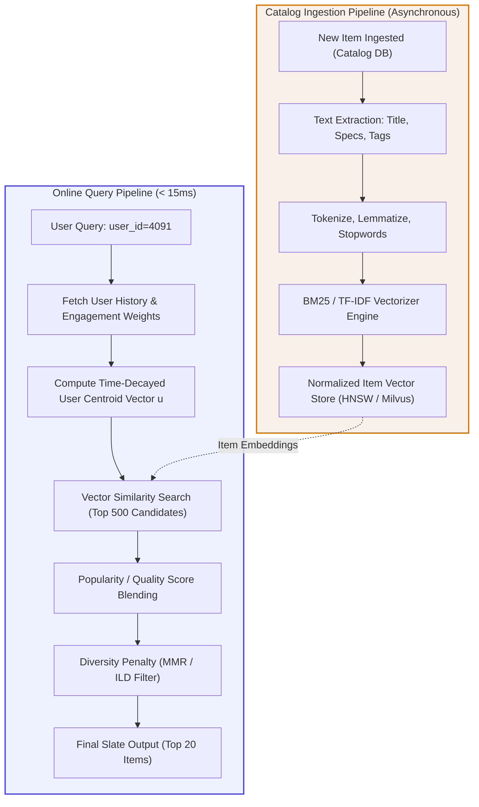

# Popularity Baselines, Content-Based Filtering, and TF-IDF Recommenders

This module is part of [Track 08: Recommender Systems & Ranking](../README.md).

---

## 1. Executive Overview & Industry Context

Every modern industrial recommender system, regardless of its downstream deep learning sophistication, relies on two foundational pillars:
1. **Popularity baselines**: Robust, computationally trivial fallback scoring mechanisms that handle severe cold-start conditions and serve as strict statistical null hypotheses.
2. **Content-based filtering (CBF)**: Recommendation via intrinsic descriptive metadata (e.g., text descriptions, taxonomy attributes, audio tags, visual tags) independent of user interaction logs.

While collaborative filtering requires historical interaction matrices $R \in \mathbb{R}^{M \times N}$, content-based methods map items into an intrinsic feature space $\mathcal{X} \subset \mathbb{R}^D$. If an enterprise launches a new product line with zero user clicks, collaborative filtering fails completely ($R_{*, \text{new}} = \mathbf{0}$). Content-based filtering bridges this cold-start chasm by projecting the item's unstructured metadata into semantic vector spaces using statistical information retrieval (IR) formulations like Term Frequency-Inverse Document Frequency (TF-IDF) and Okapi BM25.

However, unconstrained content-based filtering introduces severe failure modes in production: **over-specialization**, catalog **filter bubbles**, and failure to capture quality signals independent of metadata descriptions. Understanding the mathematical mechanics, time-decay kernels, and similarity bounds of these systems is essential for architecting enterprise retrieval layers.

---

## 2. Mathematical Formulations & Theoretical Foundations

### 2.1 Popularity Baselines & Time-Decayed Ranking Kernels

A naive popularity score based on raw interaction counts $C_i = \sum_{u} y_{ui}$ induces catastrophic stale-catalog lock-in: older items accumulate interactions over years, suppressing newly released, high-velocity items. To balance popularity against freshness, production systems apply continuous time-decay formulations.

#### Power-Law Time Decay (Hacker News Formulation)
The Hacker News ranking algorithm scores an item $i$ at time $t$ based on net upvotes $U_i$ and item age in hours $(t - t_0)$:

$$S_{\text{HN}}(i, t) = \frac{U_i - 1}{\left(t - t_0 + 2\right)^\gamma}$$

where:
* $U_i - 1$ subtracts the author's initial submission vote.
* The constant $2$ prevents division by zero or negative denominators when age is near zero.
* $\gamma$ is the gravity parameter (typically $\gamma \approx 1.8$). When $\gamma > 1$, temporal degradation accelerates non-linearly over time.

#### Logarithmic Decay with Wilson Score Confidence (Reddit Formulation)
The historical Reddit ranking algorithm separates sign, magnitude, and submission timestamp:

$$S_{\text{Reddit}}(i, t) = \text{sign}(U_i - D_i) \cdot \log_{10} \max\left(1, |U_i - D_i|\right) + \frac{t_0 - t_{\text{epoch}}}{\tau}$$

where:
* $U_i$ and $D_i$ represent upvotes and downvotes.
* $\tau = 45,000\text{ seconds}$ ($12.5\text{ hours}$): an item requires $10\times$ more net votes to overcome a $12.5$-hour age deficit.
* The logarithm reflects diminishing returns: the first 10 votes have the same ranking impact as the next 100 or the subsequent 1,000 votes.

#### Continuous Exponential Half-Life Decay
For continuous event streams (e.g., pageviews, purchases), systems apply an exponential decay kernel with half-life $T_{1/2}$:

$$S(i, t) = \sum_{k=1}^{K_i} e^{-\lambda (t - t_k)}, \quad \text{where } \lambda = \frac{\ln(2)}{T_{1/2}}$$

Given a stream of interaction timestamps $\{t_k\}_{k=1}^{K_i}$, this formulation satisfies an online recursive update:

$$S(i, t + \Delta t) = S(i, t) \cdot e^{-\lambda \Delta t} + 1$$

which can be computed in $\mathcal{O}(1)$ space and time per event in distributed caches like Redis.

---

### 2.2 Content-Based Vector Space Models: TF-IDF and BM25

Content-based filtering characterizes an item $i$ by a bag-of-words or n-gram document $d_i \in \mathcal{D}$ extracted from its catalog metadata (title, category, tags, description).

```
                      Raw Metadata: Title, Tags, Description
                                        |
                                        v
                            Tokenization & Stemming
                                        |
                                        v
+--------------------------------------------------------------------------------+
|  Term Frequency TF(t, d)                  Inverse Document Frequency IDF(t)    |
|  Measures local term density in item      Measures global catalog specificity  |
+--------------------------------------------------------------------------------+
                                        |
                                        v
+--------------------------------------------------------------------------------+
|                   Composite Vector: x_i = TF(t, d) * IDF(t)                    |
|                   Normalized to unit hypersphere: ||x_i||_2 = 1                |
+--------------------------------------------------------------------------------+
```

#### Classical TF-IDF Formulation
The Term Frequency $\text{TF}(t, d)$ represents the normalized occurrence of term $t$ in document $d$:

$$\text{TF}(t, d) = \frac{f_{t, d}}{\sum_{t' \in d} f_{t', d}}$$

The Inverse Document Frequency $\text{IDF}(t)$ penalizes ubiquitous terms that convey minimal discriminative information across the catalog of $N$ items:

$$\text{IDF}(t) = \ln\left(\frac{N}{|\{d \in \mathcal{D} : t \in d\}| + 1}\right) + 1$$

The document feature vector $\mathbf{x}_d \in \mathbb{R}^{|V|}$ is:

$$x_{d, t} = \text{TF}(t, d) \times \text{IDF}(t)$$

#### Okapi BM25 Ranking Formulation
While TF-IDF assumes linear scaling with term frequency, Okapi BM25 incorporates **term saturation** and **document length normalization**:

$$\text{BM25}(q, d) = \sum_{t \in q} \text{IDF}_{\text{BM25}}(t) \cdot \frac{f_{t, d} \cdot (k_1 + 1)}{f_{t, d} + k_1 \cdot \left(1 - b + b \cdot \frac{|d|}{\text{avgdl}}\right)}$$

where:
* $k_1 \in [1.2, 2.0]$ controls term frequency saturation limits. As $f_{t, d} \to \infty$, the term weight asymptotes to $(k_1 + 1)$.
* $b \in [0, 1]$ (typically $b = 0.75$) controls length penalization relative to average catalog document length $\text{avgdl}$.
* $\text{IDF}_{\text{BM25}}(t) = \ln\left(\frac{N - n(t) + 0.5}{n(t) + 0.5} + 1\right)$, where $n(t)$ is the count of items containing term $t$.

---

### 2.3 Vector Similarity Metrics & Normalization

Given two item feature vectors $\mathbf{x}_i, \mathbf{x}_j \in \mathbb{R}^D$ or a user profile vector $\mathbf{u} \in \mathbb{R}^D$:

#### 1. Cosine Similarity
Computes the cosine of the angle between two vectors, rendering the metric invariant to document length:

$$\text{Sim}_{\cos}(\mathbf{u}, \mathbf{x}_i) = \frac{\mathbf{u} \cdot \mathbf{x}_i}{\|\mathbf{u}\|_2 \|\mathbf{x}_i\|_2} = \frac{\sum_{d=1}^D u_d x_{i, d}}{\sqrt{\sum_{d=1}^D u_d^2} \sqrt{\sum_{d=1}^D x_{i, d}^2}}$$

#### 2. Jaccard Set Similarity
Operates over binary keyword sets $\mathcal{A}_i, \mathcal{A}_j \subseteq V$:

$$J(\mathcal{A}_i, \mathcal{A}_j) = \frac{|\mathcal{A}_i \cap \mathcal{A}_j|}{|\mathcal{A}_i \cup \mathcal{A}_j|} = \frac{|\mathcal{A}_i \cap \mathcal{A}_j|}{|\mathcal{A}_i| + |\mathcal{A}_j| - |\mathcal{A}_i \cap \mathcal{A}_j|}$$

#### 3. Pearson Correlation Coefficient
Mean-centers vectors prior to cosine calculation, removing user-specific calibration shifts:

$$\rho(\mathbf{u}, \mathbf{x}_i) = \frac{\sum_{d=1}^D (u_d - \bar{u})(x_{i, d} - \bar{x}_i)}{\sqrt{\sum_{d=1}^D (u_d - \bar{u})^2} \sqrt{\sum_{d=1}^D (x_{i, d} - \bar{x}_i)^2}}$$

---

### 2.4 User Profile Construction & Over-Specialization Bounds

In pure content-based filtering, user $u$'s profile vector $\mathbf{u} \in \mathbb{R}^D$ is synthesized by aggregating the feature vectors of items in their interaction history $\mathcal{H}_u = \{(i_k, r_{u, i_k}, t_k)\}_{k=1}^K$:

$$\mathbf{u} = \sum_{k=1}^K w(r_{u, i_k}) \cdot e^{-\lambda (t - t_k)} \cdot \mathbf{x}_{i_k}$$

The predicted relevance for an unobserved candidate item $j \notin \mathcal{H}_u$ is:

$$\hat{y}_{u, j} = \text{Sim}_{\cos}(\mathbf{u}, \mathbf{x}_j)$$

#### Mathematical Bound on Intra-List Diversity (The Filter Bubble)
Let $\mathcal{S} = \{j_1, j_2, \dots, j_M\}$ be the top-$M$ items recommended to user $u$. The **Intra-List Diversity (ILD)** is defined as:

$$\text{ILD}(\mathcal{S}) = \frac{2}{M(M - 1)} \sum_{a=1}^M \sum_{b=a+1}^M \left(1 - \text{Sim}_{\cos}(\mathbf{x}_{j_a}, \mathbf{x}_{j_b})\right)$$

**Theorem (Over-Specialization Collapse)**:
If all candidates are selected by maximizing $\hat{y}_{u, j} = \cos(\mathbf{u}, \mathbf{x}_j)$ such that $\cos(\mathbf{u}, \mathbf{x}_j) \ge 1 - \epsilon$ for all $j \in \mathcal{S}$, then by the Cauchy-Schwarz and triangle inequalities on spherical distance:

$$\arccos\left(\text{Sim}_{\cos}(\mathbf{x}_{j_a}, \mathbf{x}_{j_b})\right) \le \arccos\left(\mathbf{u} \cdot \mathbf{x}_{j_a}\right) + \arccos\left(\mathbf{u} \cdot \mathbf{x}_{j_b}\right) \le 2 \arccos(1 - \epsilon)$$

As $\epsilon \to 0$ (greedy maximization of relevance to user history), the intra-list diversity collapses to zero:

$$\lim_{\epsilon \to 0} \text{ILD}(\mathcal{S}) = 0$$

Pure content-based systems are mathematically guaranteed to construct an acute **filter bubble** unless explicit orthogonal dispersion constraints are enforced.

---

## 3. Architecture of an Industrial Content-Based Engine

The diagram below illustrates how an enterprise content-based recommender processes real-time catalog ingestion, builds vector profiles, and serves personalized recommendations within a multi-stage funnel.



---

## 4. Production Implementation from Scratch

Below is a complete, industrial-grade implementation of a vectorized content-based recommender engine with BM25 item profiling, time-decayed user history aggregation, and intra-list diversity filtering.

```python
"""
content_recommender.py
Production-grade Content-Based Filtering & BM25 Vector Recommender Engine.
Zero external ML library dependencies; fully implemented via NumPy.
"""

from __future__ import annotations
import math
import re
import time
from dataclasses import dataclass, field
from typing import Dict, List, Optional, Set, Tuple
import numpy as np


# ============================================================================
# Domain Data Classes
# ============================================================================

@dataclass
class DocumentItem:
    item_id: int
    title: str
    description: str
    tags: List[str]
    creation_timestamp: float
    raw_popularity_count: int = 0


@dataclass
class UserInteraction:
    item_id: int
    rating_or_weight: float  # e.g., dwell time, purchase signal, explicit star
    timestamp: float


# ============================================================================
# Okapi BM25 & TF-IDF Vectorizer
# ============================================================================

class BM25Vectorizer:
    """
    Vectorizes unstructured text metadata into length-normalized BM25 feature space.
    """
    def __init__(self, k1: float = 1.5, b: float = 0.75):
        self.k1 = k1
        self.b = b
        self.vocabulary: Dict[str, int] = {}
        self.inv_vocab: Dict[int, str] = {}
        self.idf: np.ndarray = np.array([])
        self.avg_doc_len: float = 0.0
        self.is_fitted: bool = False

    @staticmethod
    def _tokenize(text: str) -> List[str]:
        # Fast regex-based lowercase tokenizer
        return re.findall(r"\b[a-zA-Z0-9]{2,}\b", text.lower())

    def fit(self, corpus: List[str]) -> "BM25Vectorizer":
        doc_count = len(corpus)
        df_counts: Dict[str, int] = {}
        total_len = 0

        # Pass 1: Build DF counts and vocabulary
        tokenized_corpus = []
        for text in corpus:
            tokens = self._tokenize(text)
            tokenized_corpus.append(tokens)
            total_len += len(tokens)
            unique_tokens = set(tokens)
            for token in unique_tokens:
                df_counts[token] = df_counts.get(token, 0) + 1

        self.avg_doc_len = total_len / max(1, doc_count)

        # Retain tokens appearing in at least 2 documents
        filtered_terms = [t for t, count in df_counts.items() if count >= 1]
        self.vocabulary = {t: idx for idx, t in enumerate(filtered_terms)}
        self.inv_vocab = {idx: t for t, idx in self.vocabulary.items()}
        vocab_size = len(self.vocabulary)

        # Compute Robertson-Spärck Jones IDF
        self.idf = np.zeros(vocab_size, dtype=np.float32)
        for term, idx in self.vocabulary.items():
            n_t = df_counts[term]
            self.idf[idx] = math.log((doc_count - n_t + 0.5) / (n_t + 0.5) + 1.0)

        self.is_fitted = True
        return self

    def transform(self, corpus: List[str]) -> np.ndarray:
        if not self.is_fitted:
            raise RuntimeError("Vectorizer must be fitted before transform.")

        vocab_size = len(self.vocabulary)
        doc_count = len(corpus)
        matrix = np.zeros((doc_count, vocab_size), dtype=np.float32)

        for i, text in enumerate(corpus):
            tokens = self._tokenize(text)
            doc_len = len(tokens)
            if doc_len == 0:
                continue

            # Compute local term frequencies
            tf_dict: Dict[int, int] = {}
            for t in tokens:
                if t in self.vocabulary:
                    idx = self.vocabulary[t]
                    tf_dict[idx] = tf_dict.get(idx, 0) + 1

            # Populate BM25 row
            denom_const = self.k1 * (1.0 - self.b + self.b * (doc_len / self.avg_doc_len))
            for idx, tf in tf_dict.items():
                bm25_tf = (tf * (self.k1 + 1.0)) / (tf + denom_const)
                matrix[i, idx] = bm25_tf * self.idf[idx]

        # L2-normalize vectors onto unit sphere for cosine equivalence
        norms = np.linalg.norm(matrix, axis=1, keepdims=True)
        norms[norms == 0.0] = 1.0
        return matrix / norms


# ============================================================================
# Content-Based Recommender System
# ============================================================================

class ContentRecommenderEngine:
    def __init__(self, half_life_seconds: float = 86400.0 * 7.0):
        self.vectorizer = BM25Vectorizer()
        self.half_life_seconds = half_life_seconds
        self.decay_lambda = math.log(2.0) / self.half_life_seconds
        self.items: List[DocumentItem] = []
        self.item_id_to_idx: Dict[int, int] = {}
        self.item_vectors: np.ndarray = np.array([])

    def build_catalog_index(self, items: List[DocumentItem]) -> None:
        """
        Ingests items, extracts text profiles, and compiles normalized matrix.
        """
        self.items = items
        self.item_id_to_idx = {item.item_id: idx for idx, item in enumerate(items)}

        # Synthesize textual content profile
        text_corpus = [
            f"{item.title} {item.description} {' '.join(item.tags)}"
            for item in items
        ]
        self.vectorizer.fit(text_corpus)
        self.item_vectors = self.vectorizer.transform(text_corpus)

    def _compute_user_profile(
        self, history: List[UserInteraction], current_time: float
    ) -> Optional[np.ndarray]:
        """
        Constructs a time-decayed, interaction-weighted user centroid vector.
        """
        if not history:
            return None

        dim = self.item_vectors.shape[1]
        user_vec = np.zeros(dim, dtype=np.float32)
        total_weight = 0.0

        for interaction in history:
            if interaction.item_id not in self.item_id_to_idx:
                continue
            idx = self.item_id_to_idx[interaction.item_id]
            
            # Continuous exponential time-decay
            age = max(0.0, current_time - interaction.timestamp)
            temporal_decay = math.exp(-self.decay_lambda * age)
            weight = interaction.rating_or_weight * temporal_decay

            user_vec += weight * self.item_vectors[idx]
            total_weight += weight

        if total_weight <= 0.0:
            return None

        norm = np.linalg.norm(user_vec)
        if norm > 0.0:
            user_vec /= norm
        return user_vec

    def recommend(
        self,
        history: List[UserInteraction],
        current_time: float,
        top_k: int = 10,
        popularity_bias: float = 0.15,
        diversity_threshold: float = 0.85,
    ) -> List[Tuple[DocumentItem, float]]:
        """
        Computes personalized recommendations balancing cosine similarity,
        time-decayed popularity baselines, and intra-list diversity.
        """
        user_vec = self._compute_user_profile(history, current_time)
        consumed_ids = {h.item_id for h in history}

        # Cold-Start User Fallback: Pure Popularity with Age Decay
        if user_vec is None:
            return self._popular_fallback(current_time, top_k, consumed_ids)

        # 1. Vectorized Cosine Similarity: u^T * V
        relevance_scores = np.dot(self.item_vectors, user_vec)

        # 2. Additive time-decayed popularity bonus
        if popularity_bias > 0.0:
            pop_scores = np.zeros(len(self.items), dtype=np.float32)
            for i, item in enumerate(self.items):
                age_days = (current_time - item.creation_timestamp) / 86400.0
                decayed_pop = item.raw_popularity_count / math.pow(age_days + 2.0, 1.2)
                pop_scores[i] = decayed_pop
            
            max_pop = np.max(pop_scores) if np.max(pop_scores) > 0 else 1.0
            relevance_scores += popularity_bias * (pop_scores / max_pop)

        # 3. Mask out already consumed items
        for item_id in consumed_ids:
            if item_id in self.item_id_to_idx:
                relevance_scores[self.item_id_to_idx[item_id]] = -1e9

        # 4. Greedy Selection with Intra-List Diversity Ceiling (Filter Bubble Breaker)
        selected_indices: List[int] = []
        candidate_order = np.argsort(-relevance_scores)

        for candidate_idx in candidate_order:
            if len(selected_indices) >= top_k:
                break
            if relevance_scores[candidate_idx] <= -1e8:
                break

            candidate_vec = self.item_vectors[candidate_idx]

            # Check maximum similarity against already selected items
            is_redundant = False
            for sel_idx in selected_indices:
                pairwise_sim = float(np.dot(candidate_vec, self.item_vectors[sel_idx]))
                if pairwise_sim > diversity_threshold:
                    is_redundant = True
                    break

            if not is_redundant:
                selected_indices.append(candidate_idx)

        return [
            (self.items[idx], float(relevance_scores[idx]))
            for idx in selected_indices
        ]

    def _popular_fallback(
        self, current_time: float, top_k: int, excluded_ids: Set[int]
    ) -> List[Tuple[DocumentItem, float]]:
        """
        Hacker News style power-law time decayed popularity baseline.
        """
        scores = []
        for item in self.items:
            if item.item_id in excluded_ids:
                continue
            age_hours = (current_time - item.creation_timestamp) / 3600.0
            score = (item.raw_popularity_count - 1.0) / math.pow(max(0.0, age_hours) + 2.0, 1.5)
            scores.append((item, score))

        scores.sort(key=lambda x: x[1], reverse=True)
        return scores[:top_k]


# ============================================================================
# Self-Test & Verification Routine
# ============================================================================

if __name__ == "__main__":
    t_now = 1700000000.0

    raw_catalog = [
        DocumentItem(
            item_id=101,
            title="Distributed Systems Engineering in Rust",
            description="High performance fault tolerant consensus Raft Paxos networking",
            tags=["tech", "rust", "distributed-systems", "backend"],
            creation_timestamp=t_now - 86400 * 2,
            raw_popularity_count=450,
        ),
        DocumentItem(
            item_id=102,
            title="Building Async Microservices with Rust and Tokio",
            description="Network programming concurrency multi-threading Rust Tokio runtime",
            tags=["tech", "rust", "networking", "concurrency"],
            creation_timestamp=t_now - 86400 * 5,
            raw_popularity_count=320,
        ),
        DocumentItem(
            item_id=103,
            title="Advanced Italian Sourdough Bread Baking",
            description="Fermentation wild yeast crust hydration flour sourdough",
            tags=["cooking", "baking", "food", "culinary"],
            creation_timestamp=t_now - 86400 * 1,
            raw_popularity_count=980,
        ),
        DocumentItem(
            item_id=104,
            title="French Pastry Masterclass: Croissants & Brioche",
            description="Laminated butter dough baking pastry flaky crust culinary",
            tags=["cooking", "pastry", "food", "baking"],
            creation_timestamp=t_now - 86400 * 10,
            raw_popularity_count=2100,
        ),
        DocumentItem(
            item_id=105,
            title="Deep Learning Recommendation Architectures",
            description="Neural ranking embeddings candidate retrieval two-tower DLRM transformer",
            tags=["tech", "machine-learning", "recsys", "neural-networks"],
            creation_timestamp=t_now - 86400 * 3,
            raw_popularity_count=610,
        ),
    ]

    engine = ContentRecommenderEngine()
    engine.build_catalog_index(raw_catalog)

    # Simulate user who clicked on Rust & Distributed Systems recently
    user_history = [
        UserInteraction(item_id=101, rating_or_weight=1.0, timestamp=t_now - 3600),
    ]

    print("Evaluating recommendations for Rust backend engineer...")
    recs = engine.recommend(
        history=user_history,
        current_time=t_now,
        top_k=3,
        popularity_bias=0.1,
        diversity_threshold=0.80,
    )

    for rank, (item, score) in enumerate(recs, 1):
        print(f"Rank {rank}: [{item.item_id}] {item.title} (Score: {score:.4f})")

    print("\nEvaluating recommendations for new cold-start user (history empty)...")
    cold_recs = engine.recommend(
        history=[],
        current_time=t_now,
        top_k=3,
    )
    for rank, (item, score) in enumerate(cold_recs, 1):
        print(f"Cold Rank {rank}: [{item.item_id}] {item.title} (Decayed Pop Score: {score:.4f})")
```

---

## 5. Failure Modes, Edge Cases & Antipatterns

### 5.1 The "Death Spiral" Filter Bubble
* **Symptom**: A user clicks on one sensationalist video about a niche conspiracy or fringe topic. Within three days, their entire feed contains nothing but that single narrow topic, causing long-term churn.
* **Failure Mechanism**: Content-based centroid aggregation weights recent clicks heavily. Because candidate scoring rewards lexical similarity ($\mathbf{u} \cdot \mathbf{x}_i$), items with near-identical keyword vectors drown out the user's historical core interests.
* **Mitigation**: Introduce an explicit **centroid variance floor** and intra-list similarity ceiling. Enforce categorical diversity constraints in Stage 3 by limiting the maximum allocation for any single semantic cluster to $\le 30\%$ of the slate.

### 5.2 Synonymy and Polysemy Breakdown
* **Symptom**: A user searching for "apple computer repairs" is recommended organic fertilizer for honeycrisp apple orchards.
* **Failure Mechanism**: Surface-level lexical formulations (TF-IDF, BM25) cannot resolve polysemy (words with multiple meanings) or synonymy (distinct words representing identical concepts, e.g., "physician" vs. "doctor").
* **Mitigation**: Transition from discrete n-gram sparse vectors to dense semantic embeddings derived from bi-encoder language models (e.g., Sentence-BERT or multilingual E5) combined with dense ANN search.

### 5.3 Quality-Blind Ranking
* **Symptom**: Low-effort spam articles with highly optimized, keyword-stuffed metadata consistently outrank Pulitzer-grade articles on the same topic.
* **Failure Mechanism**: Pure content similarity evaluates only topical alignment, not intrinsic item quality, production value, or creator credibility.
* **Mitigation**: Blend content similarity multiplicatively or additively with an orthogonal **global item quality prior** $Q(i)$:

$$\text{FinalScore}(u, i) = \text{Sim}_{\cos}(\mathbf{u}, \mathbf{x}_i)^\alpha \times Q(i)^{1 - \alpha}$$

where $Q(i)$ integrates return rates, average completion percentage, and author reputation.

---

## 6. Real-World Production Incident Post-Mortem

### Case Study: Streaming Video Platform User Churn Collapse via Recursive Genre Traps

#### 1. Executive Summary
In Q3, a subscription streaming video-on-demand service deployed an updated content-based retrieval model designed to improve personalization for mid-tier active users. Within 14 days of rollout, the platform experienced a **$14.2\%$ drop in 30-day user retention** and a catastrophic **$22\%$ reduction in total stream hours**. Telemetry revealed that users were being trapped in hyper-specialized content loops: viewing a single Scandinavian crime drama resulted in entire carousels showing exclusively dark Nordic noir shows, driving user frustration and churn.

#### 2. Incident Timeline
| Day | Milestone |
| :--- | :--- |
| **Day 0** | Deployment of the new TF-IDF + Tag Centroid recommender to $50\%$ of global subscribers. |
| **Day 3** | Initial metrics appeared positive: short-term CTR on recommended carousels rose by $+6.4\%$. |
| **Day 7** | Total stream minutes per user turned negative ($-4.1\%$), but dismissed as seasonal fluctuation. |
| **Day 11** | Customer support volume spiked with complaints: "My homepage has lost all variety; feels broken." |
| **Day 14** | A/B test analysis revealed an alarming divergence: 30-day renewal cancellations spiked by $\$2.4\text{M}$ run-rate. Emergency rollback executed. |

#### 3. Root Cause Analysis (RCA)
The incident resulted from three compounding algorithmic flaws:
1. **Unbounded User Profile Decay**: The user vector updated via an aggressive half-life decay of $24\text{ hours}$. Watching two episodes of a single series on a Friday night overwrote $85\%$ of the user's historical feature weight.
2. **Missing Intra-List Diversity Constraints**: The candidate generator directly sorted by $\mathbf{u} \cdot \mathbf{x}_i$ and selected the top 50 items. Because the catalog had over 1,200 Nordic noir titles sharing tags (`#gritty`, `#detective`, `#scandinavia`, `#snow`), the top 50 slots were monopolized by a single micro-genre.
3. **Optimizing Short-Term CTR Over Long-Term Retention**: The online A/B testing framework evaluated immediate click-through rate. Users clicked the initial recommendations out of curiosity, generating misleadingly positive short-term signals while long-term utility degraded.

#### 4. Engineering Remediations
1. **Multi-Centroid User Profiling**: Replaced the single user centroid vector with a Gaussian Mixture / K-Means multi-centroid representation. A user's profile maintained separate persistent vectors for distinct interest clusters (e.g., $60\%$ Sci-Fi, $30\%$ Cooking, $10\%$ Nordic Noir).
2. **Category Hard Caps in Slate Generation**: Implemented a strict rule in the re-ranking layer limiting any single genre/tag combination to at most 2 items per carousel row.
3. **Long-Term Utility Evaluation**: Deprecated pure CTR as the primary metric for recommendation models, replacing it with a 14-day Cumulative Stream Time metric and 30-day retention guardrails.

---

## 7. Senior Technical Interview Questions & Model Answers

### Question 1: What are the mathematical trade-offs between TF-IDF and Okapi BM25, and why does BM25 consistently outperform TF-IDF in content-based retrieval?

**Model Answer:**
TF-IDF calculates term frequency linearly:
$$\text{TF}(t, d) = \frac{f_{t, d}}{|d|}$$
This linear formulation suffers from two critical flaws in recommender systems:
1. **Lack of Term Saturation**: In standard TF-IDF, a document mentioning the keyword "database" 40 times receives roughly double the score of a document mentioning it 20 times. In reality, relevance does not scale linearly with repetition; after 5-10 occurrences, the informational signal saturates.
2. **Inadequate Length Normalization**: Long documents (e.g., comprehensive product manuals) naturally accumulate more terms, causing TF-IDF to disproportionately favor lengthy text over concise, high-density titles.

Okapi BM25 resolves both issues via its non-linear saturation curve and parametrized length normalization:
$$\text{Weight}_{\text{BM25}}(t, d) = \text{IDF}(t) \cdot \frac{f_{t, d} \cdot (k_1 + 1)}{f_{t, d} + k_1 \cdot \left(1 - b + b \cdot \frac{|d|}{\text{avgdl}}\right)}$$

* **Term Frequency Saturation ($k_1$)**: As raw term frequency $f_{t, d} \to \infty$, the term frequency component approaches an asymptotic upper bound of $(k_1 + 1)$. The parameter $k_1$ (typically $1.2 - 2.0$) dictates the curvature of diminishing returns.
* **Document Length Penalization ($b$)**: When $b = 1.0$, the formulation fully normalizes by document length relative to average catalog length ($\text{avgdl}$); when $b = 0$, length normalization is disabled. Setting $b = 0.75$ penalizes verbose, keyword-stuffed descriptions while preserving credit for documents genuinely rich in distinct topical terms.

---

### Question 2: In a streaming service with 10 million items, how do you handle the temporal decay of popularity baselines without running daily $O(N)$ re-indexing jobs across your entire catalog?

**Model Answer:**
Running periodic batch re-indexing jobs across $10^7$ items creates unacceptable batch processing latency and high compute overhead. Instead, we decouple the continuous decay calculation into an $\mathcal{O}(1)$ stream processing update using **epoch-referenced exponential decay**.

Given an exponential decay kernel $S(i, t) = \sum_{k} e^{-\lambda (t - t_k)}$, we can factor out the query timestamp $t$:
$$S(i, t) = e^{-\lambda t} \sum_{k} e^{\lambda t_k} = e^{-\lambda t} \cdot A_i(t)$$
where $A_i(t) = \sum_{k} e^{\lambda t_k}$ is an accumulated, monotonically increasing event sum referenced to a fixed historical epoch $t_{\text{epoch}} = 0$.

When a user interaction occurs at time $t_{\text{event}}$, we update only the accumulated counter in an in-memory key-value store (e.g., Redis):
$$A_i \leftarrow A_i + e^{\lambda (t_{\text{event}} - t_{\text{epoch}})}$$
This update takes $\mathcal{O}(1)$ time and requires no knowledge of prior events.

When querying the score at time $t_{\text{query}}$, the real-time decayed popularity is evaluated on demand:
$$S(i, t_{\text{query}}) = A_i \cdot e^{-\lambda (t_{\text{query}} - t_{\text{epoch}})}$$
Because relative rankings among items that experienced zero interactions remain invariant under monotonic scalar multiplication ($e^{-\lambda t}$), pre-sorted top-K leaderboards in Redis sorted sets (`ZSET`) can simply store $A_i$, completely eliminating batch decay recomputation jobs.

---

### Question 3: How do you mathematically prevent the Filter Bubble / Over-Specialization problem in pure content-based filtering while preserving personalization accuracy?

**Model Answer:**
Preventing the filter bubble requires moving from unconstrained greedy relevance maximization to multi-objective optimization balancing relevance and diversity. Three established mathematical approaches achieve this:

#### 1. Maximal Marginal Relevance (MMR)
Instead of independently picking $\arg\max_i \cos(\mathbf{u}, \mathbf{x}_i)$, MMR constructs the recommendation slate $\mathcal{S}$ iteratively:
$$i^* = \arg\max_{i \in \mathcal{C} \setminus \mathcal{S}} \left[ \lambda \cdot \cos(\mathbf{u}, \mathbf{x}_i) - (1 - \lambda) \max_{j \in \mathcal{S}} \cos(\mathbf{x}_i, \mathbf{x}_j) \right]$$
The hyperparameter $\lambda \in [0, 1]$ tunes the trade-off. Setting $\lambda = 0.7$ guarantees that candidates highly similar to already selected items are penalized, forcing exploration of orthogonal semantic directions.

#### 2. Multi-Centroid Clustering
Representing a user by a single average centroid $\mathbf{u} = \frac{1}{K} \sum \mathbf{x}_k$ averages out distinct interests. If a user likes Python programming ($50\%$) and Italian cooking ($50\%$), the vector centroid lands in an empty space between software and food.
Instead, cluster the user's historical interaction vectors using online K-Means or Dirichlet Process Gaussian Mixture Models into $K$ distinct centroids $\{\mathbf{u}_1, \dots, \mathbf{u}_K\}$ with interaction weights $w_k$. Candidates are retrieved independently from each cluster proportionally to $w_k$, preserving distinct categorical interests.

#### 3. Determinantal Point Processes (DPP)
Construct an item kernel matrix $L \in \mathbb{R}^{M \times M}$ over the candidate pool, where $L_{ij} = q_i \cos(\mathbf{x}_i, \mathbf{x}_j) q_j$, with $q_i$ being the predicted user relevance. DPP slate sampling maximizes $\det(L_{\mathcal{S}})$, which geometrically corresponds to maximizing the volume of the subspace spanned by item vectors. Highly correlated (redundant) items reduce the determinant to zero.

---

### Question 4: Under what conditions does content-based filtering systematically outperform collaborative filtering in production systems?

**Model Answer:**
Content-based filtering systematically outperforms collaborative filtering under four structural operational regimes:

1. **Extreme Item Cold Start**: In domains with high catalog velocity (e.g., breaking news, classified advertisements, fast-fashion e-commerce), new items arrive with zero interaction logs. Matrix factorization and collaborative filtering cannot score items where $R_{*, i} = \mathbf{0}$. Content-based filtering scores new items immediately upon ingestion via metadata text, taxonomy, and attribute extraction.
2. **Extreme Catalog Sparsity**: When the density of the interaction matrix $\rho = \frac{|\Omega|}{M \times N} < 10^{-5}$, collaborative filtering neighborhood graphs become disconnected and latent factor matrices fail to converge. Content attributes provide a dense semantic backbone that regularizes sparse interaction spaces.
3. **Zero Exposure Bias on Niche Items**: Collaborative filtering suffers from severe popularity bias (the Matthew Effect), reinforcing blockbuster recommendations because popular items have dense gradient signals. Content-based filtering evaluates items solely on metadata alignment, surfacing deep long-tail items that match hyper-specific user interests regardless of historical click volume.
4. **Regulatory Transparency and Explainability**: In regulated domains (e.g., medical recommendation, financial investment products, job matching), collaborative filtering's latent factors lack human-interpretable justifications. Content-based filtering provides transparent, auditable rationales: "Recommended because this posting matches your verified skills: *Distributed Systems, Go, Kubernetes*."
