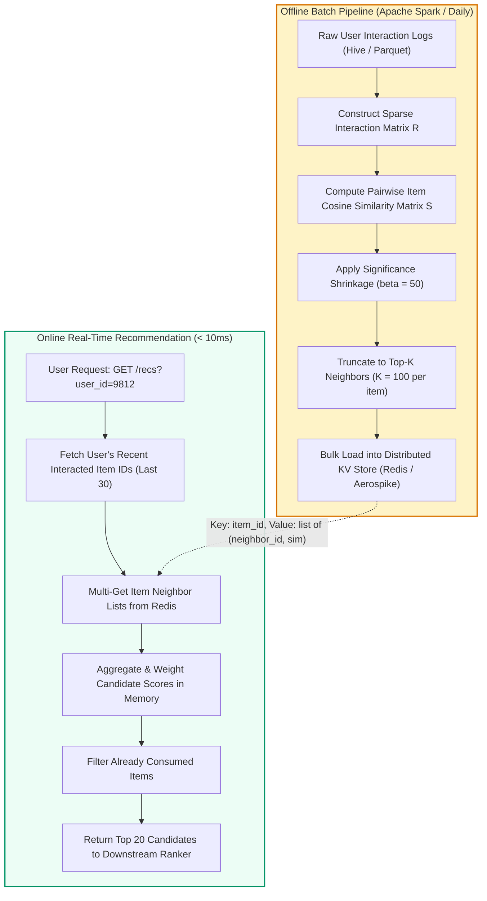

# Neighborhood Collaborative Filtering: User-kNN and Item-kNN

This module is part of [Track 08: Recommender Systems & Ranking](../README.md).

---

## 1. Executive Overview & Industry Context

Neighborhood-based collaborative filtering (Memory-based CF) forms the historical and conceptual bedrock of automated personalization. Pioneered by GroupLens in 1994 and scaled industrially by Amazon's landmark 2003 paper (*Amazon.com Recommendations: Item-to-Item Collaborative Filtering* by Sarwar et al. and Linden et al.), neighborhood methods operate on a simple yet profound premise: **user preferences correlate across shared historical behaviors without requiring any domain-specific metadata or item feature extraction**.

Unlike latent factor models or deep neural networks that compress interactions into opaque continuous embeddings, neighborhood collaborative filtering operates directly on the observed interaction graph $\mathcal{G} = (\mathcal{U}, \mathcal{I}, \mathcal{E})$. This grants memory-based algorithms two massive industrial advantages:
1. **Explainability**: Every recommendation maps directly to an explicit causal justification (e.g., *"Because you bought X, and $78\%$ of customers who bought X also bought Y"*).
2. **Instant Reactivity**: When a user purchases an item, the recommendation slate updates immediately via the precomputed neighborhood graph without requiring backpropagation, gradient updates, or model re-training.

However, memory-based methods face severe computational challenges: matrix sparsity ($\rho < 0.01\%$), co-occurrence noise, and an asymmetric scaling divergence between users and items. In this module, we examine the mathematical foundations of User-User and Item-Item kNN, derive similarity shrinkage formulations, analyze why Item-Item CF dominates industrial architectures, and build a production-grade sparse implementation from scratch.

---

## 2. Mathematical Formulations & Neighborhood Derivations

Let $\mathcal{U} = \{u_1, u_2, \dots, u_M\}$ denote the set of users and $\mathcal{I} = \{i_1, i_2, \dots, i_N\}$ denote the catalog of items. The interaction matrix is $R \in \mathbb{R}^{M \times N}$, where $r_{u, i}$ represents the rating or interaction weight of user $u$ on item $i$.

Let $\Omega \subset \mathcal{U} \times \mathcal{I}$ represent the set of observed interactions, $\mathcal{I}_u = \{i \in \mathcal{I} : (u, i) \in \Omega\}$ denote the items interacted with by user $u$, and $\mathcal{U}_i = \{u \in \mathcal{U} : (u, i) \in \Omega\}$ denote the set of users who interacted with item $i$.

```
                              Interaction Matrix R
                        Items: i_1, i_2, ..., i_N
                     +-------------------------------+
       User u_1      |   5     .     2     .     4   |  --> Row vector r_u
       User u_2      |   .     1     .     5     .   |      (High volatility,
          ...        |   .     .     4     .     .   |       frequent updates)
       User u_M      |   3     .     .     2     1   |
                     +-------------------------------+
                                 |
                                 v
                         Column vector r_i
                   (High support, slow evolution)
```

### 2.1 User-Based Collaborative Filtering (User-kNN)

User-kNN predicts unknown rating $\hat{r}_{u, i}$ by finding a neighborhood $\mathcal{N}_i(u)$ of top-$K$ users most similar to $u$ who have rated item $i$.

#### User Similarity
The standard metric is Pearson Correlation over the intersection of co-rated items $\mathcal{I}_{uv} = \mathcal{I}_u \cap \mathcal{I}_v$:

$$\text{sim}(u, v) = \frac{\sum_{j \in \mathcal{I}_{uv}} (r_{u, j} - \bar{r}_u)(r_{v, j} - \bar{r}_v)}{\sqrt{\sum_{j \in \mathcal{I}_{uv}} (r_{u, j} - \bar{r}_u)^2} \sqrt{\sum_{j \in \mathcal{I}_{uv}} (r_{v, j} - \bar{r}_v)^2}}$$

where $\bar{r}_u = \frac{1}{|\mathcal{I}_u|} \sum_{j \in \mathcal{I}_u} r_{u, j}$ is the mean rating of user $u$.

#### Rating Prediction Formula
Because users exhibit personal rating scale biases (e.g., an optimistic user gives 4s and 5s, while a critical user gives 2s and 3s), the prediction centers user ratings:

$$\hat{r}_{u, i} = \bar{r}_u + \frac{\sum_{v \in \mathcal{N}_i(u)} \text{sim}(u, v) \cdot \left(r_{v, i} - \bar{r}_v\right)}{\sum_{v \in \mathcal{N}_i(u)} |\text{sim}(u, v)|}$$

If $\sum_{v} |\text{sim}(u, v)| = 0$ (no neighbors rated item $i$), the model defaults to the user baseline $\bar{r}_u$.

---

### 2.2 Item-Based Collaborative Filtering (Item-kNN)

Rather than searching for similar people, Item-kNN computes similarities between pairs of items based on user interaction profiles. The prediction $\hat{r}_{u, i}$ is synthesized from items user $u$ has already rated that are similar to target item $i$.

#### Adjusted Cosine Similarity
To account for user scale disparities when comparing items across columns, Adjusted Cosine subtracts the user mean $\bar{r}_u$ from each interaction over co-rated users $\mathcal{U}_{ij} = \mathcal{U}_i \cap \mathcal{U}_j$:

$$\text{sim}_{\text{adj}}(i, j) = \frac{\sum_{u \in \mathcal{U}_{ij}} (r_{u, i} - \bar{r}_u)(r_{u, j} - \bar{r}_u)}{\sqrt{\sum_{u \in \mathcal{U}_{ij}} (r_{u, i} - \bar{r}_u)^2} \sqrt{\sum_{u \in \mathcal{U}_{ij}} (r_{u, j} - \bar{r}_u)^2}}$$

For binary implicit feedback ($r_{u, i} \in \{0, 1\}$), Adjusted Cosine reduces to normalized Cosine Similarity or Jaccard similarity:

$$\text{sim}_{\cos}(i, j) = \frac{\mathbf{r}_i \cdot \mathbf{r}_j}{\|\mathbf{r}_i\|_2 \|\mathbf{r}_j\|_2} = \frac{|\mathcal{U}_i \cap \mathcal{U}_j|}{\sqrt{|\mathcal{U}_i| \cdot |\mathcal{U}_j|}}$$

#### Item-kNN Prediction Formulation
The prediction aggregates items in user $u$'s history $\mathcal{I}_u$ that belong to item $i$'s top-$K$ neighborhood $\mathcal{N}_u(i)$:

$$\hat{r}_{u, i} = \frac{\sum_{j \in \mathcal{N}_u(i)} \text{sim}(i, j) \cdot r_{u, j}}{\sum_{j \in \mathcal{N}_u(i)} |\text{sim}(i, j)|}$$

Or, including baseline item intercepts:

$$\hat{r}_{u, i} = b_{u, i} + \frac{\sum_{j \in \mathcal{N}_u(i)} \text{sim}(i, j) \cdot \left(r_{u, j} - b_{u, j}\right)}{\sum_{j \in \mathcal{N}_u(i)} |\text{sim}(i, j)|}$$

where $b_{u, i} = \mu + b_u + b_i$ captures global mean $\mu$, user bias $b_u$, and item bias $b_i$.

---

### 2.3 Significance Weighting and Shrinkage

A catastrophic failure of raw cosine or Pearson similarity occurs when two items (or users) have very few co-occurrences.
* If user $u$ and user $v$ only co-rated a single movie and both gave it 5 stars, $\text{sim}(u, v) = 1.0$.
* This spurious perfect correlation outranks a reliable neighbor who co-rated 200 movies with an average correlation of $0.85$.

#### Significance Shrinkage Multiplier
To penalize pairs with low statistical support, production systems apply a continuous shrinkage discount:

$$\text{sim}_{\text{shrunk}}(i, j) = \text{sim}(i, j) \cdot \frac{\min\left(|\mathcal{U}_{ij}|, \beta\right)}{\beta}$$

where $\beta$ is a support threshold parameter (typically $\beta \in [25, 100]$). If two items co-occur only 3 times and $\beta = 50$, their raw similarity is discounted by $\frac{3}{50} = 0.06$.

#### Bayesian Regularized Shrinkage
Alternatively, regularize the dot product directly by adding a pseudo-count penalty $\lambda$ to the denominator:

$$\text{sim}_{\text{Bayes}}(i, j) = \frac{\sum_{u \in \mathcal{U}_{ij}} r_{ui} r_{uj}}{\sqrt{\sum_{u \in \mathcal{U}_i} r_{ui}^2} \sqrt{\sum_{u \in \mathcal{U}_j} r_{uj}^2} + \lambda}$$

---

### 2.4 Why Item-Item Dominates Industrial Memory-Based CF

In large-scale production architectures, **Item-Item CF completely supersedes User-User CF**. The reasons stem from fundamental statistical and systems realities:

| System Dimension | User-User Collaborative Filtering | Item-Item Collaborative Filtering |
| :--- | :--- | :--- |
| **Catalog vs. User Asymmetry** | $M \gg N$ (e.g., $10^8$ users vs. $10^5$ items). Pairwise user matrix is $10^{16}$ entries. | $N \ll M$. Item pairwise matrix is $10^{10}$ entries ($10^6\times$ smaller). |
| **Vector Stability** | User tastes evolve rapidly; browsing session creates new entries every 5 seconds. | Item attributes and identity are static; similarity matrix changes slowly over days. |
| **Offline Precomputability** | Infeasible. Neighborhoods must be computed on-the-fly against real-time user states. | Fully offline batch precomputable. The top-$K$ items for every item can be stored in Redis. |
| **Online Serving Latency** | $\mathcal{O}(M)$ search across users or dynamic clustering $\to 150\text{ ms} - 500\text{ ms}$. | $\mathcal{O}(|\mathcal{I}_u| \cdot K)$ hash lookups $\to 2\text{ ms} - 5\text{ ms}$ key-value fetch. |
| **Statistical Support** | Active users have high support, but long-tail users have 2-3 ratings (low support). | Catalog items accumulate interactions from thousands of users (high statistical power). |
| **Explainability** | Poor: *"Users like user_7849 also bought this"* (creepy and non-informative). | Natural: *"Because you purchased Sony A7IV Camera"* (clear causal justification). |

---

## 3. Architecture of an Industrial Item-kNN Serving System



---

## 4. Production Implementation from Scratch

The following complete, runnable Python module implements a high-performance **Sparse Item-Item Collaborative Filter** using SciPy sparse CSR matrices and NumPy. It features:
1. Fast matrix multiplication for all-pairs cosine similarity.
2. Vectorized significance shrinkage.
3. Top-$K$ neighbor truncation.
4. Real-time inference scoring for user interaction vectors.

```python
"""
item_knn_recommender.py
Production-grade Item-to-Item Collaborative Filter with Significance Shrinkage.
Built with SciPy Sparse matrices for enterprise-scale memory efficiency.
"""

from __future__ import annotations
import math
import time
from dataclasses import dataclass
from typing import Dict, List, Optional, Set, Tuple
import numpy as np
import scipy.sparse as sp


# ============================================================================
# Core Sparse Item-kNN Engine
# ============================================================================

class SparseItemItemRecommender:
    """
    Industrial Item-Item Collaborative Filtering using sparse CSR matrix math.
    Includes significance weighting and top-K neighborhood truncation.
    """
    def __init__(self, k_neighbors: int = 50, shrinkage_beta: float = 30.0):
        self.k_neighbors = k_neighbors
        self.shrinkage_beta = shrinkage_beta
        
        # Identity mappings
        self.user_to_idx: Dict[int, int] = {}
        self.idx_to_user: Dict[int, int] = {}
        self.item_to_idx: Dict[int, int] = {}
        self.idx_to_item: Dict[int, int] = {}
        
        # Model state
        self.similarity_matrix: Optional[sp.csr_matrix] = None
        self.num_users: int = 0
        self.num_items: int = 0

    def fit(self, interactions: List[Tuple[int, int, float]]) -> "SparseItemItemRecommender":
        """
        Builds sparse interaction matrix and derives shrunk item-item similarity.
        interactions: List of (user_id, item_id, rating_or_weight)
        """
        t0 = time.perf_counter()

        # 1. Build discrete index mappings
        unique_users = sorted(list({u for u, _, _ in interactions}))
        unique_items = sorted(list({i for _, i, _ in interactions}))

        self.user_to_idx = {u: idx for idx, u in enumerate(unique_users)}
        self.idx_to_user = {idx: u for u, idx in self.user_to_idx.items()}
        self.item_to_idx = {i: idx for idx, i in enumerate(unique_items)}
        self.idx_to_item = {idx: i for i, idx in self.item_to_idx.items()}

        self.num_users = len(unique_users)
        self.num_items = len(unique_items)

        # 2. Construct Sparse User-Item CSR Matrix R: Shape (M, N)
        rows = [self.user_to_idx[u] for u, _, _ in interactions]
        cols = [self.item_to_idx[i] for _, i, _ in interactions]
        data = [r for _, _, r in interactions]

        R = sp.csr_matrix(
            (data, (rows, cols)), shape=(self.num_users, self.num_items), dtype=np.float32
        )

        # 3. Construct Item-User Matrix (Transposed): Shape (N, M)
        # Each row is an item vector across all users
        R_items = R.T.tocsr()

        # Compute L2 norms of item vectors for cosine similarity
        item_squared_sum = R_items.multiply(R_items).sum(axis=1)
        item_norms = np.sqrt(np.asarray(item_squared_sum).flatten())
        item_norms[item_norms == 0.0] = 1e-12

        # Binary co-occurrence counts: C = B_items * B_items^T
        B_items = R_items.copy()
        B_items.data = np.ones_like(B_items.data)
        co_occurrence_matrix = B_items.dot(B_items.T).tocsr()

        # Dot products between all pairs: G = R_items * R_items^T
        unnormalized_sim = R_items.dot(R_items.T).tocoo()

        # 4. Vectorized Cosine Normalization and Significance Shrinkage
        # Iterate over non-zero co-occurrences
        row_indices = unnormalized_sim.row
        col_indices = unnormalized_sim.col
        raw_dot_products = unnormalized_sim.data

        # Mask diagonal (item similarity to itself is 0)
        non_diag_mask = row_indices != col_indices
        row_indices = row_indices[non_diag_mask]
        col_indices = col_indices[non_diag_mask]
        raw_dot_products = raw_dot_products[non_diag_mask]

        # Calculate cosine similarity
        cosine_sims = raw_dot_products / (item_norms[row_indices] * item_norms[col_indices])

        # Fetch co-occurrences for these pairs
        co_counts = np.array(co_occurrence_matrix[row_indices, col_indices]).flatten()

        # Calculate shrinkage multiplier: min(co_occurrences, beta) / beta
        shrinkage_factors = np.minimum(co_counts, self.shrinkage_beta) / self.shrinkage_beta
        shrunk_sims = cosine_sims * shrinkage_factors

        # 5. Build Truncated Top-K Neighborhood Graph
        # Assemble intermediate CSR matrix
        raw_sim_csr = sp.csr_matrix(
            (shrunk_sims, (row_indices, col_indices)),
            shape=(self.num_items, self.num_items),
            dtype=np.float32,
        )

        # Truncate each row to top-K neighbors
        top_k_rows = []
        top_k_cols = []
        top_k_data = []

        for item_idx in range(self.num_items):
            start_ptr = raw_sim_csr.indptr[item_idx]
            end_ptr = raw_sim_csr.indptr[item_idx + 1]
            if start_ptr == end_ptr:
                continue

            row_cols = raw_sim_csr.indices[start_ptr:end_ptr]
            row_vals = raw_sim_csr.data[start_ptr:end_ptr]

            if len(row_vals) > self.k_neighbors:
                # Top K partition
                top_indices = np.argpartition(-row_vals, self.k_neighbors)[: self.k_neighbors]
                # Sort top K descending
                top_indices = top_indices[np.argsort(-row_vals[top_indices])]
                row_cols = row_cols[top_indices]
                row_vals = row_vals[top_indices]

            for c, v in zip(row_cols, row_vals):
                top_k_rows.append(item_idx)
                top_k_cols.append(c)
                top_k_data.append(v)

        self.similarity_matrix = sp.csr_matrix(
            (top_k_data, (top_k_rows, top_k_cols)),
            shape=(self.num_items, self.num_items),
            dtype=np.float32,
        )

        elapsed = time.perf_counter() - t0
        print(
            f"Fitted Item-Item CF in {elapsed:.3f}s. "
            f"Catalog: {self.num_items} items, {self.num_users} users. "
            f"Stored {self.similarity_matrix.nnz} neighbor edges."
        )
        return self

    def recommend_for_user_history(
        self,
        user_history: List[Tuple[int, float]],
        top_n: int = 10,
        exclude_consumed: bool = True,
    ) -> List[Tuple[int, float]]:
        """
        Sub-millisecond online scoring given user interaction history: [(item_id, weight)].
        r_hat = u_vector * S
        """
        if self.similarity_matrix is None:
            raise RuntimeError("Model must be fitted before recommendations.")

        # Construct sparse user vector: Shape (1, N)
        u_indices = []
        u_weights = []
        consumed_item_ids = set()

        for item_id, weight in user_history:
            consumed_item_ids.add(item_id)
            if item_id in self.item_to_idx:
                u_indices.append(self.item_to_idx[item_id])
                u_weights.append(weight)

        if not u_indices:
            return []

        u_vec = sp.csr_matrix(
            (u_weights, ([0] * len(u_indices), u_indices)),
            shape=(1, self.num_items),
            dtype=np.float32,
        )

        # Vector-Matrix multiplication: (1, N) * (N, N) -> (1, N)
        score_vec = u_vec.dot(self.similarity_matrix).toarray().flatten()

        # Exclude consumed items
        if exclude_consumed:
            for item_id in consumed_item_ids:
                if item_id in self.item_to_idx:
                    score_vec[self.item_to_idx[item_id]] = -1e9

        # Extract top N indices
        candidate_indices = np.argpartition(-score_vec, top_n)[:top_n]
        sorted_indices = candidate_indices[np.argsort(-score_vec[candidate_indices])]

        recommendations = []
        for idx in sorted_indices:
            score = float(score_vec[idx])
            if score > 0.0:
                recommendations.append((self.idx_to_item[idx], score))

        return recommendations


# ============================================================================
# Verification & Self-Test
# ============================================================================

if __name__ == "__main__":
    np.random.seed(42)

    # Generate synthetic interaction logs
    # Co-occurrence patterns: Items 101, 102, 103 are camera gear; 201, 202 are espresso gear
    synthetic_logs = [
        # Camera enthusiasts
        (1, 101, 5.0), (1, 102, 4.0), (1, 103, 5.0),
        (2, 101, 5.0), (2, 102, 5.0),
        (3, 102, 4.0), (3, 103, 4.5),
        (4, 101, 4.0), (4, 103, 4.0),
        # Espresso enthusiasts
        (5, 201, 5.0), (5, 202, 5.0),
        (6, 201, 4.5), (6, 202, 4.0),
        (7, 201, 5.0),
        # Spurious co-occurrence with 1 observation
        (8, 101, 5.0), (8, 201, 1.0),
    ]

    print("Fitting Sparse Item-Item Recommender...")
    model = SparseItemItemRecommender(k_neighbors=5, shrinkage_beta=5.0)
    model.fit(synthetic_logs)

    # User who recently purchased camera item 101
    recent_user_history = [(101, 5.0)]
    print("\nScoring user history: Bought Item 101 (Camera)")
    recs = model.recommend_for_user_history(recent_user_history, top_n=3)

    for rank, (item_id, score) in enumerate(recs, 1):
        print(f"  Rank {rank} -> Item ID: {item_id} | Score: {score:.4f}")

    print("\nChecking Item 101 neighbor similarities:")
    idx_101 = model.item_to_idx[101]
    row = model.similarity_matrix.getrow(idx_101)
    for neighbor_idx, sim_score in zip(row.indices, row.data):
        print(f"  Neighbor Item {model.idx_to_item[neighbor_idx]} -> Shrunk Similarity: {sim_score:.4f}")
```

---

## 5. Failure Modes, Edge Cases & Antipatterns

### 5.1 The "Super-User" / Bot Pollution Antipattern
* **Symptom**: Item similarity matrices suddenly report bizarre, nonsensical connections across unrelated categories (e.g., Industrial Welding Torches linked to Baby Diapers).
* **Failure Mechanism**: Scraping bots, automated crawlers, or institutional buyer accounts with $50,000+$ interactions co-rate tens of thousands of random items. In standard unweighted co-occurrence math, a single entity that interacted with both items creates an edge between them, corrupting the neighborhood graphs across the entire catalog.
* **Mitigation**: Implement **Inverse User Frequency (IUF)** weighting and interaction caps:

$$w_u = \log\left(\frac{|\mathcal{U}|}{|\mathcal{I}_u|}\right)$$

Users with interaction counts exceeding $3\sigma$ above the platform median (e.g., $> 1,000$ interactions/day) are quarantined from the offline similarity computation pipeline.

### 5.2 The Harry Potter / Hub-Item Parasitism
* **Symptom**: Universally popular blockbuster items (e.g., *Harry Potter*, *The Beatles*, *Apple iPhone Chargers*) appear as the #1 neighbor for every single item in the catalog.
* **Failure Mechanism**: Raw dot-product co-occurrence scales with item popularity. Even with cosine normalization, items with massive support $|\mathcal{U}_i| \approx 10^7$ dominate pairwise intersections.
* **Mitigation**: Apply asymmetric cosine normalization (cosine $\alpha$-damping):

$$\text{sim}_{\alpha}(i, j) = \frac{|\mathcal{U}_i \cap \mathcal{U}_j|}{|\mathcal{U}_i|^\alpha \cdot |\mathcal{U}_j|^{1 - \alpha}}$$

Setting $\alpha = 0.6 - 0.7$ penalizes high-degree hub nodes, surfacing true categorical affinity rather than global baseline popularity.

### 5.3 Stale Similarity Matrices Under Catalog Churn
* **Symptom**: Newly launched products receive zero recommendations on their product detail pages (PDPs), and are never recommended on other items.
* **Failure Mechanism**: Item-Item similarity matrices are typically computed in overnight batch jobs. If an e-commerce platform launches 5,000 new items during a morning campaign, they remain disconnected islands in the neighborhood graph until the next batch run.
* **Mitigation**: Implement a dual-index architecture. Cold items are seeded with content-based semantic neighbors (using Module 01 metadata vectors) which are dynamically swapped for collaborative neighbors once interaction counts cross the shrinkage threshold $\beta$.

---

## 6. Real-World Production Incident Post-Mortem

### Case Study: Distributed Cache Thrashing & P99 Latency Spike via Real-Time User-User CF

#### 1. Executive Summary
At a major fashion e-commerce marketplace, the engineering team maintained a legacy User-User Collaborative Filtering service to power real-time "People Like You Bought" widgets on the cart page. During a seasonal clearance event, an unauthorized automated dropshipping bot launched $120$ concurrent threads, executing $45,000$ add-to-cart operations across diverse apparel items. 

The real-time User-User kNN engine attempted to find top-$50$ neighbor users for this bot account on every cart refresh. Because the bot had $45,000$ active interactions, the neighbor search traversed $82\%$ of the platform's entire active user base in memory. This triggered massive CPU saturation, evicted hot Redis neighbor caches, caused P99 latency across all cart checkouts to spike from **$18\text{ ms}$ to $14,200\text{ ms}$**, and resulted in **\$1.4M in abandoned checkout carts** before the service was isolated.

#### 2. Incident Timeline
| Time (UTC) | Telemetry Event |
| :--- | :--- |
| **14:00** | Clearance sale launched; concurrent users increased by $3\times$. |
| **14:15** | Dropshipping bot script began executing high-velocity multi-item cart additions. |
| **14:18** | User-kNN microservice CPU utilization jumped from $35\%$ to $100\%$ across all 24 nodes. |
| **14:22** | Redis cluster evicted $4.2\text{GB}$ of hot cached user profiles due to memory thrashing. |
| **14:25** | P99 checkout API latency breached $10\text{ seconds}$; HTTP 504 Gateway errors exceeded $12\%$. |
| **14:38** | On-call SRE identified abnormal query patterns originating from user ID `9048122`. |
| **14:44** | User account quarantined at API gateway; bot traffic blocked. |
| **14:52** | Cache repopulated; P99 latencies recovered to $16\text{ ms}$. |

#### 3. Root Cause Analysis (RCA)
User-User CF requires calculating:
$$\text{sim}(u_{\text{query}}, v) \quad \forall v \in \bigcup_{i \in \mathcal{I}_{u_{\text{query}}}} \mathcal{U}_i$$

For a normal user where $|\mathcal{I}_u| \approx 10$, the candidate neighbor pool is small ($\sim 500$ users). For the bot account where $|\mathcal{I}_u| = 45,000$, the union spanned nearly the entire user database ($1.2\times 10^6$ accounts). Evaluating Pearson correlation across $1.2\times 10^6$ user pairs on every cart click transformed an $\mathcal{O}(K)$ query into an $\mathcal{O}(M \cdot |\mathcal{I}_u|)$ computational catastrophe.

#### 4. Remediation & Architectural Overhaul
1. **Immediate Algorithmic Deprecation**: The User-User CF service was completely decommissioned and replaced with an **Item-Item CF** model. In Item-Item CF, scoring evaluates the cart's items against a precomputed Redis neighbor list in $\mathcal{O}(|\text{Cart}| \cdot K)$ operations, regardless of user history length.
2. **Hard Upper Bound on History Evaluation**: Implemented a strict truncation policy: all real-time scoring engines inspect at most the last $N = 50$ interactions.
3. **Bot Mitigation & Rate Limiting**: Added WAF rate limits at the gateway restricting any single session to at most 100 interaction events per minute.

---

## 7. Senior Technical Interview Questions & Model Answers

### Question 1: Why does Item-Item Collaborative Filtering scale significantly better than User-User Collaborative Filtering in real-world consumer platforms?

**Model Answer:**
The superiority of Item-Item CF over User-User CF stems from three structural asymmetries:

1. **Cardinality and Matrix Dimensions**: In consumer platforms (e.g., Amazon, Netflix, Spotify), the user count $M$ dwarfs the item catalog size $N$ ($M \gg N$). A system may have $200\text{ million}$ users but only $500,000$ active items. The User-User similarity matrix requires $\mathcal{O}(M^2) \approx 4 \times 10^{16}$ cells, which is impossible to compute or cache. The Item-Item similarity matrix requires $\mathcal{O}(N^2) \approx 2.5 \times 10^{11}$ cells, which is easily sharded, compressed, and cached in distributed memory.
2. **Temporal Invariance and Stationarity**: A user's profile is volatile: their mood, session intent, and immediate context change minute by minute. User-User CF requires dynamic neighbor searches against moving user vectors. Conversely, an item's identity is static. An espresso machine remains an espresso machine; its co-purchase relationships with burr grinders and tampers remain stable over weeks. Item similarity matrices can be computed offline in batch jobs (e.g., nightly Spark runs) and served via $\mathcal{O}(1)$ key-value lookups.
3. **Statistical Support and Density**: The average consumer rates or interacts with only a handful of items (extreme sparsity). User-to-user overlap is statistically noisy. Items, however, accumulate interactions across thousands of distinct users. The support for item columns is orders of magnitude denser, yielding robust, statistically significant cosine vectors.

---

### Question 2: What is the mathematical formulation of significance shrinkage in neighborhood models, and what failure mode does it prevent?

**Model Answer:**
Significance shrinkage prevents spurious, high-similarity artifacts caused by low co-occurrence support.

Consider raw cosine similarity between items $i$ and $j$:
$$\text{sim}_{\cos}(i, j) = \frac{|\mathcal{U}_i \cap \mathcal{U}_j|}{\sqrt{|\mathcal{U}_i| \cdot |\mathcal{U}_j|}}$$

If two rare items $i$ and $j$ each have exactly 1 interaction, and both interactions originated from the same user, then:
$$|\mathcal{U}_i \cap \mathcal{U}_j| = 1, \quad |\mathcal{U}_i| = 1, \quad |\mathcal{U}_j| = 1 \implies \text{sim}_{\cos}(i, j) = 1.0$$
The algorithm assigns this pair a maximum similarity score of $1.0$, ranking it higher than two established items that co-occurred $5,000$ times with a correlation of $0.88$. In production, this causes recommendation feeds to surface obscure, low-quality items linked by accidental single-user co-occurrences.

To prevent this, **Significance Shrinkage** discounts similarities that lack sufficient sample size:
$$\text{sim}_{\text{shrunk}}(i, j) = \text{sim}(i, j) \cdot \frac{\min\left(|\mathcal{U}_{ij}|, \beta\right)}{\beta}$$
where $\beta$ is the minimum confidence threshold (typically $\beta \in [25, 100]$).
* For the single co-occurrence pair ($|\mathcal{U}_{ij}| = 1, \beta = 50$), the similarity is discounted:
  $$\text{sim}_{\text{shrunk}} = 1.0 \times \frac{1}{50} = 0.02$$
* For the pair with 5,000 co-occurrences ($|\mathcal{U}_{ij}| = 5000 \ge 50$):
  $$\text{sim}_{\text{shrunk}} = 0.88 \times \frac{50}{50} = 0.88$$
The shrinkage multiplier penalizes small sample sizes, ensuring recommendations are backed by statistical confidence.

---

### Question 3: How do you design an Item-kNN inference pipeline to serve real-time recommendations under a 5ms SLA when a user has thousands of historical interactions?

**Model Answer:**
Serving Item-kNN in $< 5\text{ ms}$ for heavy users requires three architectural optimizations:

#### 1. User History Truncation (Recent Session Windowing)
Real-time intent is dominated by recent actions. Scoring an interaction from three years ago adds latency while degrading relevance. We truncate the user history $\mathcal{I}_u$ to the most recent $W$ items (e.g., $W = 30$):
$$\mathcal{I}_u^{\text{recent}} = \text{SortByTimestampDesc}(\mathcal{I}_u)[:30]$$

#### 2. Precomputed Neighbor KV Lookups (Redis Pipeline / MGET)
The Item-Item similarity matrix $S$ is precomputed offline, truncated to top-$K$ neighbors ($K = 100$ per item), and stored in Redis:
* Key: `item_neighbors:{item_id}`
* Value: Binary packed array or Redis Hash of `[(neighbor_id, similarity_weight), ...]`

At query time, the orchestrator issues a single asynchronous multi-key fetch (`MGET`) across the 30 recent item IDs, taking $< 2\text{ ms}$ over internal datacenter networks.

#### 3. In-Memory Sparse Accumulation & Min-Heap Selection
The scoring formula is:
$$\hat{r}_{u, j} = \sum_{i \in \mathcal{I}_u^{\text{recent}}} r_{u, i} \cdot S_{i, j}$$

Using a thread-local fixed-size hash table or dense array of candidate accumulators:
```python
scores = defaultdict(float)
for item_i, weight_i in recent_history:
    neighbors = redis_cache.get(item_i)  # Top 100
    for neighbor_j, sim_ij in neighbors:
        if neighbor_j not in consumed_set:
            scores[neighbor_j] += weight_i * sim_ij
```
The maximum candidate pool size is bounded by $30 \times 100 = 3,000$ items. Extracting the top 20 items from 3,000 candidates via a Min-Heap (`heapq.nlargest`) takes $< 0.5\text{ ms}$ on modern CPU cores. Total serving latency is well under the $5\text{ ms}$ SLA.

---

### Question 4: How does Adjusted Cosine Similarity resolve the rating scale heterogeneity problem across users?

**Model Answer:**
In explicit rating systems, users exhibit severe **scale calibration divergence**:
* User A is strict: a rating of $4/5$ represents an extraordinary product, while $3/5$ represents an average product.
* User B is generous: a rating of $5/5$ is given to everything acceptable, while $4/5$ represents a defective product.

Standard cosine similarity treats ratings as absolute Euclidean coordinates:
$$\text{sim}_{\cos}(\mathbf{r}_i, \mathbf{r}_j) = \frac{\sum_u r_{ui} r_{uj}}{\sqrt{\sum_u r_{ui}^2} \sqrt{\sum_u r_{uj}^2}}$$
If User A rates items $i$ and $j$ as $(3, 3)$ and User B rates them as $(5, 5)$, standard cosine sees these pairs as pointing in the identical direction ($\cos = 1.0$). However, relative to their personal baselines ($\bar{r}_A = 3.0, \bar{r}_B = 4.8$), User A viewed both items as mediocre ($3 - 3 = 0$), whereas User B viewed them as superior ($5 - 4.8 = +0.2$).

**Adjusted Cosine Similarity** mean-centers each interaction by subtracting the rating user's overall average $\bar{r}_u$:
$$\text{sim}_{\text{adj}}(i, j) = \frac{\sum_{u \in \mathcal{U}_{ij}} (r_{ui} - \bar{r}_u)(r_{uj} - \bar{r}_u)}{\sqrt{\sum_{u \in \mathcal{U}_{ij}} (r_{ui} - \bar{r}_u)^2} \sqrt{\sum_{u \in \mathcal{U}_{ij}} (r_{uj} - \bar{r}_u)^2}}$$

By centering across rows (users) before computing similarity across columns (items), Adjusted Cosine converts absolute ratings into relative deviations:
* Ratings above the user's mean become positive $(+)$.
* Ratings below the user's mean become negative $(-)$.

If two items are rated above the mean by the same users and below the mean by the same users, their adjusted cosine is strongly positive. If users consistently like item $i$ but dislike item $j$, the product of their deviations is negative, correctly driving $\text{sim}_{\text{adj}}(i, j) < 0$.
