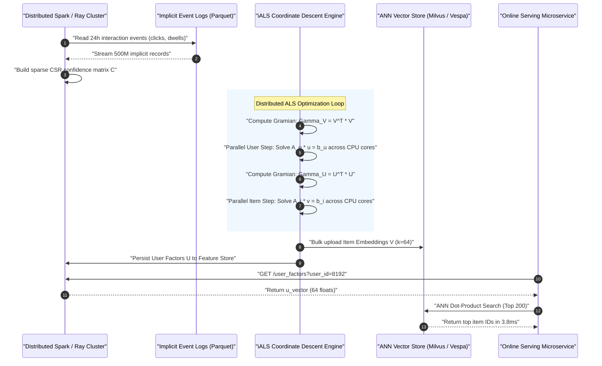

# Matrix Factorization: SVD, Regularized ALS, and Implicit Feedback

This module is part of [Track 08: Recommender Systems & Ranking](../README.md).

---

## 1. Executive Overview & Industry Context

Neighborhood methods (User-kNN, Item-kNN) suffer from a fundamental theoretical limitation: they treat observed interaction patterns as localized, discrete connections. When interaction density drops below $0.05\%$, the user-item graph shatters into disconnected islands, crippling similarity calculations.

The **Netflix Prize (2006–2009)** revolutionized machine learning by proving that latent factor models—specifically **Matrix Factorization (MF)**—vastly outperform memory-based heuristics. Instead of relying on raw co-occurrence, Matrix Factorization projects both users and items into a shared, dense latent embedding space $\mathbb{R}^k$ (where $k \ll \min(M, N)$, typically $k \in [32, 256]$). In this low-rank subspace, unseen ratings are estimated via inner products:

$$\hat{r}_{ui} = \mathbf{u}_u^T \mathbf{v}_i$$

Matrix factorization captures global, transitive affinity: if User A loves Quentin Tarantino films and User B loves Sergio Leone films, and both directors share latent stylistic affinities (e.g., stylized violence, non-linear narrative, Ennio Morricone scores), MF discovers this alignment even if Users A and B have never watched a single film in common.

In this module, we derive the mathematical foundations of Singular Value Decomposition (SVD), regularized Alternating Least Squares (ALS), and the seminal **Implicit Alternating Least Squares (iALS)** algorithm (Hu, Koren, Volinsky 2008). We analyze the $\mathcal{O}(k^3 + k^2 |\mathcal{R}_u|)$ computational bottleneck trick, build an industrial-grade implicit ALS engine from scratch in NumPy, and inspect production post-mortems caused by numerical instability in factor convergence.

---

## 2. Mathematical Formulations & Latent Factor Derivations

Let $R \in \mathbb{R}^{M \times N}$ be the user-item interaction matrix, where $M$ is the number of users and $N$ is the number of items. The objective is to discover low-rank matrices:

$$U \in \mathbb{R}^{M \times k} \quad \text{and} \quad V \in \mathbb{R}^{N \times k}$$

such that:

$$R \approx U V^T$$

where row vector $\mathbf{u}_u \in \mathbb{R}^k$ represents user $u$'s latent preference profile, and row vector $\mathbf{v}_i \in \mathbb{R}^k$ represents item $i$'s latent feature profile.

```
      Interaction Matrix R (M x N)              User Latent Matrix U        Item Latent Matrix V^T
                                                     (M x k)                       (k x N)
      +-------------------------+                 +-----------+                 +-------------------+
      |  r_11   .    r_13   .   |                 |   u_1     |                 |  .  v_1^T  .   .  |
      |   .    r_22   .    r_2N |     approx      |   u_2     |       x         |  .  v_2^T  .   .  |
      |  r_31   .     .     .   |                 |   ...     |                 |  .   ...   .   .  |
      |   .     .    r_M3   .   |                 |   u_M     |                 |  .  v_N^T  .   .  |
      +-------------------------+                 +-----------+                 +-------------------+
             (Sparsity > 99%)                         (Dense)                          (Dense)
```

### 2.1 Explicit Feedback Formulation: Regularized SVD / Bias MF

For explicit ratings $r_{ui} \in \mathbb{R}$ observed on subset $\Omega \subset \mathcal{U} \times \mathcal{I}$, naive full SVD is impossible because $R$ is partially observed. Imputing zeros treats unobserved entries as negative sentiment, which distorts predictions.

Instead, Koren et al. formulated **Regularized Matrix Factorization** strictly over observed entries:

$$\min_{U, V, \mathbf{b}} \mathcal{L}_{\text{explicit}} = \sum_{(u, i) \in \Omega} \left(r_{ui} - \hat{r}_{ui}\right)^2 + \lambda \left(\sum_u \|\mathbf{u}_u\|_2^2 + \sum_i \|\mathbf{v}_i\|_2^2 + \sum_u b_u^2 + \sum_i b_i^2\right)$$

where:
$$\hat{r}_{ui} = \mu + b_u + b_i + \mathbf{u}_u^T \mathbf{v}_i$$
* $\mu \in \mathbb{R}$ is the global mean rating across all observed entries.
* $b_u \in \mathbb{R}$ is the user bias (deviations above/below platform mean).
* $b_i \in \mathbb{R}$ is the item bias (intrinsic quality baseline).
* $\lambda > 0$ is the $L_2$ regularization hyperparameter.

---

### 2.2 Alternating Least Squares (ALS) Derivation

The optimization problem is non-convex jointly over $(U, V)$. However, if we hold $V$ fixed, the objective function becomes strictly convex and quadratic in $U$, and vice versa. **Alternating Least Squares (ALS)** alternates between solving for $U$ while holding $V$ fixed, and solving for $V$ while holding $U$ fixed.

#### Closed-Form Update for User Vector $\mathbf{u}_u$
Holding $V$ fixed, the loss decomposes across individual users:

$$\mathcal{L}(u) = \sum_{i \in \mathcal{I}_u} \left(r_{ui} - \mathbf{u}_u^T \mathbf{v}_i\right)^2 + \lambda \|\mathbf{u}_u\|_2^2$$

Taking the vector gradient with respect to $\mathbf{u}_u$:

$$\nabla_{\mathbf{u}_u} \mathcal{L}(u) = -2 \sum_{i \in \mathcal{I}_u} \left(r_{ui} - \mathbf{u}_u^T \mathbf{v}_i\right) \mathbf{v}_i + 2 \lambda \mathbf{u}_u = \mathbf{0}$$

$$\sum_{i \in \mathcal{I}_u} \mathbf{v}_i \mathbf{v}_i^T \mathbf{u}_u + \lambda \mathbf{u}_u = \sum_{i \in \mathcal{I}_u} r_{ui} \mathbf{v}_i$$

$$\left(V_{\mathcal{I}_u}^T V_{\mathcal{I}_u} + \lambda I_k\right) \mathbf{u}_u = V_{\mathcal{I}_u}^T \mathbf{r}_{u, \mathcal{I}_u}$$

$$\mathbf{u}_u = \left(V_{\mathcal{I}_u}^T V_{\mathcal{I}_u} + \lambda I_k\right)^{-1} V_{\mathcal{I}_u}^T \mathbf{r}_{u, \mathcal{I}_u}$$

where $V_{\mathcal{I}_u} \in \mathbb{R}^{|\mathcal{I}_u| \times k}$ denotes the sub-matrix of item factors corresponding to items rated by user $u$.

Similarly, holding $U$ fixed, the closed-form update for item factor $\mathbf{v}_i$ is:

$$\mathbf{v}_i = \left(U_{\mathcal{U}_i}^T U_{\mathcal{U}_i} + \lambda I_k\right)^{-1} U_{\mathcal{U}_i}^T \mathbf{r}_{\mathcal{U}_i, i}$$

---

### 2.3 Implicit Feedback ALS (Hu, Koren, Volinsky Formulation)

In real-world e-commerce, streaming, and social networks, explicit ratings are virtually non-existent. We observe implicit actions $r_{ui} \in \{0, 1, 2, \dots\}$ (clicks, views, purchases, dwell seconds).

#### 1. Preference Mapping
We define a binary preference variable $p_{ui}$:

$$p_{ui} = \begin{cases} 1 & \text{if } r_{ui} > 0 \\ 0 & \text{if } r_{ui} = 0 \end{cases}$$

#### 2. Confidence Weighting
We associate a confidence $c_{ui}$ with each user-item pair:

$$c_{ui} = 1 + \alpha r_{ui}$$

where $\alpha$ is a scaling hyperparameter (typically $\alpha \in [10, 100]$).
* For unobserved entries ($r_{ui} = 0$), $p_{ui} = 0$ with minimal baseline confidence $c_{ui} = 1$.
* For observed interactions ($r_{ui} > 0$), $p_{ui} = 1$ with high confidence $c_{ui} \gg 1$.

#### 3. The Implicit Objective Function
The loss is evaluated across **all** $M \times N$ pairs in the matrix:

$$\mathcal{L}_{\text{iALS}} = \sum_{u=1}^M \sum_{i=1}^N c_{ui} \left(p_{ui} - \mathbf{u}_u^T \mathbf{v}_i\right)^2 + \lambda \left(\sum_u \|\mathbf{u}_u\|_2^2 + \sum_i \|\mathbf{v}_i\|_2^2\right)$$

Notice the computational dilemma: the sum spans $M \times N$ elements (e.g., $10^8 \times 10^6 = 10^{14}$ pairs). Naive evaluation would require billions of operations per iteration.

---

### 2.4 The $O(k^3 + k^2 |R_u|)$ Gramian Speedup Trick

Hu, Koren, and Volinsky introduced a brilliant algebraic trick that eliminates the $\mathcal{O}(N)$ bottleneck per user.

Holding $V$ fixed, set the gradient with respect to $\mathbf{u}_u$ to zero:

$$\sum_{i=1}^N c_{ui} \left(p_{ui} - \mathbf{u}_u^T \mathbf{v}_i\right) \mathbf{v}_i = \lambda \mathbf{u}_u$$

$$\left(\sum_{i=1}^N c_{ui} \mathbf{v}_i \mathbf{v}_i^T + \lambda I_k\right) \mathbf{u}_u = \sum_{i=1}^N c_{ui} p_{ui} \mathbf{v}_i$$

Let $C^u \in \mathbb{R}^{N \times N}$ be a diagonal matrix where $C^u_{ii} = c_{ui}$. In matrix notation:

$$\left(V^T C^u V + \lambda I_k\right) \mathbf{u}_u = V^T C^u \mathbf{p}_u$$

#### The Matrix Decomposition Trick
Because $c_{ui} = 1$ for most items (where $r_{ui} = 0$), we decompose $C^u$:

$$C^u = I_N + \left(C^u - I_N\right)$$

Notice that $(C^u - I_N)$ is a diagonal matrix that has non-zero entries **only** for items where user $u$ actually interacted ($r_{ui} > 0$). Let this sparse set be $\mathcal{R}_u$:

$$V^T C^u V = V^T \left(I_N + (C^u - I_N)\right) V = V^T V + V^T (C^u - I_N) V$$

$$V^T C^u V = \underbrace{V^T V}_{\text{Global Gramian } \Gamma_V} + \sum_{i \in \mathcal{R}_u} (c_{ui} - 1) \mathbf{v}_i \mathbf{v}_i^T$$

Similarly, because $p_{ui} = 0$ whenever $r_{ui} = 0$, the right-hand side simplifies to:

$$V^T C^u \mathbf{p}_u = \sum_{i \in \mathcal{R}_u} c_{ui} \mathbf{v}_i$$

#### Complexity Comparison
* **The Global Gramian** $\Gamma_V = V^T V \in \mathbb{R}^{k \times k}$ depends only on item factors $V$. It is computed **once** per ALS epoch in $\mathcal{O}(N k^2)$.
* For each user $u$, we take precomputed $\Gamma_V$, perform a sparse low-rank rank-1 update over only their $|\mathcal{R}_u|$ observed interactions:
  $$A_u = \Gamma_V + \lambda I_k + \sum_{i \in \mathcal{R}_u} (c_{ui} - 1) \mathbf{v}_i \mathbf{v}_i^T$$
* Invert the $k \times k$ matrix $A_u$ in $\mathcal{O}(k^3)$ time, or solve $A_u \mathbf{u}_u = \mathbf{b}_u$ using Cholesky factorization in $\frac{1}{3} k^3$.

$$\text{Time per user update: } \mathcal{O}\left(k^2 |\mathcal{R}_u| + k^3\right)$$

This reduces the total training time per epoch from $\mathcal{O}(M N k^2)$ to $\mathcal{O}\left(k^2 |\Omega| + (M + N) k^3\right)$, making implicit matrix factorization linear in the number of observed interactions $|\Omega|$.

---

## 3. Architecture of an Industrial iALS Training and Serving Pipeline



---

## 4. Production Implementation from Scratch

The following complete, runnable Python implementation provides a fully vectorized Implicit Alternating Least Squares (iALS) engine in pure NumPy, featuring:
1. Fast Gramian precomputation ($\Gamma_V = V^T V$).
2. Sparse coordinate descent rank updates.
3. Cholesky decomposition solver for numerical stability.
4. Loss tracking and latent factor validation.

```python
"""
implicit_als.py
Production-grade Vectorized Implicit Alternating Least Squares (iALS) Engine.
Formulated strictly via NumPy with Cholesky decomposition and Gramian acceleration.
"""

from __future__ import annotations
import math
import time
from dataclasses import dataclass
from typing import Dict, List, Optional, Tuple
import numpy as np


# ============================================================================
# iALS Engine Formulation
# ============================================================================

class ImplicitALSRanker:
    """
    Implicit Feedback Matrix Factorization (Hu, Koren, Volinsky 2008).
    Minimizes: sum_u sum_i c_ui (p_ui - u_u^T v_i)^2 + lambda (||U||_F^2 + ||V||_F^2)
    Accelerated via Gramian precomputation and Cholesky linear solves.
    """
    def __init__(
        self,
        factors: int = 32,
        regularization: float = 0.05,
        alpha: float = 40.0,
        iterations: int = 15,
        random_state: int = 42,
    ):
        self.factors = factors
        self.regularization = regularization
        self.alpha = alpha
        self.iterations = iterations
        self.random_state = random_state

        # Factor matrices: U (M, k), V (N, k)
        self.user_factors: Optional[np.ndarray] = None
        self.item_factors: Optional[np.ndarray] = None
        self.num_users: int = 0
        self.num_items: int = 0

    def fit(
        self,
        user_item_interactions: List[Tuple[int, int, float]],
        num_users: Optional[int] = None,
        num_items: Optional[int] = None,
    ) -> "ImplicitALSRanker":
        rng = np.random.RandomState(self.random_state)
        t_start = time.perf_counter()

        # 1. Determine matrix dimensions
        if num_users is None:
            self.num_users = max(u for u, _, _ in user_item_interactions) + 1
        else:
            self.num_users = num_users

        if num_items is None:
            self.num_items = max(i for _, i, _ in user_item_interactions) + 1
        else:
            self.num_items = num_items

        # 2. Build sparse adjacency records for fast iteration
        # user_records[u] = list of (item_idx, confidence_c_ui)
        user_records: List[List[Tuple[int, float]]] = [[] for _ in range(self.num_users)]
        item_records: List[List[Tuple[int, float]]] = [[] for _ in range(self.num_items)]

        for u, i, weight in user_item_interactions:
            c_ui = 1.0 + self.alpha * weight
            user_records[u].append((i, c_ui))
            item_records[i].append((u, c_ui))

        # 3. Initialize factors with small Gaussian noise scaled by sqrt(1/k)
        scale = 1.0 / math.sqrt(self.factors)
        self.user_factors = (rng.randn(self.num_users, self.factors) * scale).astype(np.float32)
        self.item_factors = (rng.randn(self.num_items, self.factors) * scale).astype(np.float32)

        reg_identity = self.regularization * np.eye(self.factors, dtype=np.float32)

        print(
            f"Initialized iALS: {self.num_users} users, {self.num_items} items, "
            f"{self.factors} factors, alpha={self.alpha}, reg={self.regularization}"
        )

        # 4. Main Alternating Optimization Loop
        for epoch in range(1, self.iterations + 1):
            epoch_t0 = time.perf_counter()

            # ----------------------------------------------------------------
            # Step A: Update User Factors U holding Item Factors V fixed
            # ----------------------------------------------------------------
            # Precompute global Item Gramian: Gamma_V = V^T * V
            gamma_v = np.dot(self.item_factors.T, self.item_factors)

            for u in range(self.num_users):
                u_records = user_records[u]
                if not u_records:
                    # User with zero interactions: u_u = 0
                    self.user_factors[u, :] = 0.0
                    continue

                # Accumulate: A_u = Gamma_V + reg*I + sum_{i in R_u} (c_ui - 1) v_i v_i^T
                A_u = gamma_v + reg_identity
                b_u = np.zeros(self.factors, dtype=np.float32)

                for item_idx, c_ui in u_records:
                    v_i = self.item_factors[item_idx]
                    confidence_delta = c_ui - 1.0
                    # Rank-1 outer product update
                    A_u += confidence_delta * np.outer(v_i, v_i)
                    # Right-hand side: b_u = sum_{i in R_u} c_ui * v_i (since p_ui = 1)
                    b_u += c_ui * v_i

                # Solve symmetric positive-definite linear system: A_u * u_u = b_u
                # Using Cholesky decomposition for 2-3x speedup over standard inv()
                try:
                    c, lower = sp_linalg_solve_cholesky(A_u, b_u)
                    self.user_factors[u, :] = c
                except np.linalg.LinAlgError:
                    # Fallback to ridge pseudo-inverse if singular
                    self.user_factors[u, :] = np.linalg.solve(A_u + 1e-4 * np.eye(self.factors), b_u)

            # ----------------------------------------------------------------
            # Step B: Update Item Factors V holding User Factors U fixed
            # ----------------------------------------------------------------
            # Precompute global User Gramian: Gamma_U = U^T * U
            gamma_u = np.dot(self.user_factors.T, self.user_factors)

            for i in range(self.num_items):
                i_records = item_records[i]
                if not i_records:
                    self.item_factors[i, :] = 0.0
                    continue

                A_i = gamma_u + reg_identity
                b_i = np.zeros(self.factors, dtype=np.float32)

                for user_idx, c_ui in i_records:
                    u_u = self.user_factors[user_idx]
                    confidence_delta = c_ui - 1.0
                    A_i += confidence_delta * np.outer(u_u, u_u)
                    b_i += c_ui * u_u

                try:
                    c, lower = sp_linalg_solve_cholesky(A_i, b_i)
                    self.item_factors[i, :] = c
                except np.linalg.LinAlgError:
                    self.item_factors[i, :] = np.linalg.solve(A_i + 1e-4 * np.eye(self.factors), b_i)

            epoch_elapsed = (time.perf_counter() - epoch_t0) * 1000.0
            print(f"  Epoch {epoch:02d}/{self.iterations:02d} completed in {epoch_elapsed:.1f}ms")

        total_time = time.perf_counter() - t_start
        print(f"iALS Training converged in {total_time:.3f}s.")
        return self

    def recommend(
        self,
        user_id: int,
        top_k: int = 10,
        filter_already_consumed: Optional[Set[int]] = None,
    ) -> List[Tuple[int, float]]:
        """
        Calculates predicted preference scores: hat{p}_{ui} = u_u^T v_i
        """
        if self.user_factors is None or self.item_factors is None:
            raise RuntimeError("Model must be fitted prior to recommendation.")

        if user_id >= self.num_users or user_id < 0:
            return []

        u_vec = self.user_factors[user_id]
        # Vectorized dot product against all catalog items
        scores = np.dot(self.item_factors, u_vec)

        if filter_already_consumed:
            for item_id in filter_already_consumed:
                if item_id < len(scores):
                    scores[item_id] = -1e9

        top_indices = np.argpartition(-scores, top_k)[:top_k]
        sorted_indices = top_indices[np.argsort(-scores[top_indices])]

        return [(int(idx), float(scores[idx])) for idx in sorted_indices if scores[idx] > -1e8]


def sp_linalg_solve_cholesky(A: np.ndarray, b: np.ndarray) -> Tuple[np.ndarray, bool]:
    """
    Solves A * x = b via Cholesky Factorization: A = L * L^T.
    Avoids explicit matrix inversion; faster and numerically stable.
    """
    L = np.linalg.cholesky(A)
    # Forward solve: L * y = b
    y = np.linalg.solve(L, b)
    # Back solve: L^T * x = y
    x = np.linalg.solve(L.T, y)
    return x, True


# ============================================================================
# Verification & Self-Test Routine
# ============================================================================

if __name__ == "__main__":
    np.random.seed(42)

    # Synthetic catalog: 50 users, 20 items
    # Cluster 1: items 0-9 (Sci-Fi), Cluster 2: items 10-19 (Romance)
    synthetic_interactions = []
    
    # Users 0-24 love Sci-Fi
    for u in range(25):
        items_consumed = np.random.choice(range(0, 10), size=4, replace=False)
        for i in items_consumed:
            synthetic_interactions.append((u, int(i), float(np.random.randint(1, 10))))

    # Users 25-49 love Romance
    for u in range(25, 50):
        items_consumed = np.random.choice(range(10, 20), size=4, replace=False)
        for i in items_consumed:
            synthetic_interactions.append((u, int(i), float(np.random.randint(1, 10))))

    print("Training iALS on Synthetic Clustered Interactions...")
    model = ImplicitALSRanker(factors=16, regularization=0.01, alpha=20.0, iterations=10)
    model.fit(synthetic_interactions, num_users=50, num_items=20)

    # Test recommendation for User 3 (Sci-Fi fan)
    user_3_consumed = {i for u, i, _ in synthetic_interactions if u == 3}
    print(f"\nUser 3 Consumed Items: {sorted(list(user_3_consumed))}")
    recs = model.recommend(user_id=3, top_k=5, filter_already_consumed=user_3_consumed)

    print("Top Recommendations for User 3:")
    for rank, (item_id, score) in enumerate(recs, 1):
        genre = "Sci-Fi" if item_id < 10 else "Romance"
        print(f"  Rank {rank} -> Item {item_id:02d} ({genre:<7}) | Predicted Score: {score:.4f}")
```

---

## 5. Failure Modes, Edge Cases & Antipatterns

### 5.1 Ill-Conditioned Gramian Matrices and Numerical Instability
* **Symptom**: During ALS training, factor matrices suddenly produce `NaN` or `Inf` values, spreading across epochs and destroying the model.
* **Failure Mechanism**: When an item has zero interactions or low statistical support, $A_i = \Gamma_U + \lambda I$ can become near-singular if $\lambda$ is too small ($\lambda \le 10^{-6}$) and numerical precision is 32-bit float.
* **Mitigation**: Enforce a lower bound on regularization ($\lambda \ge 10^{-2}$). Utilize **Cholesky decomposition** with a small positive diagonal perturbation jitter $\epsilon = 10^{-5}$ if matrix decomposition fails.

### 5.2 The $\alpha$ Over-Confidence Pitfall
* **Symptom**: The model overfits severely to high-frequency items (e.g., songs on background repeat), ignoring broad user interests.
* **Failure Mechanism**: Setting $c_{ui} = 1 + \alpha r_{ui}$ linearly without bounds. If a user leaves a lo-fi study playlist playing on loop for 200 plays, $c_{ui} = 1 + 40 \times 200 = 8001$. The objective forces the latent factor to fit this single song to near perfection, distorting other dimensions.
* **Mitigation**: Apply sub-linear logarithmic confidence compression:

$$c_{ui} = 1 + \alpha \ln(1 + r_{ui}/\epsilon)$$

This preserves monotonic ranking while bounding outlier influence.

### 5.3 Vector Drift During Incremental Catalog Expansion
* **Symptom**: New items added to the catalog receive distorted vector embeddings when attempting fast single-step projections.
* **Failure Mechanism**: Solving $v_{\text{new}} = (\Gamma_U + \lambda I)^{-1} U^T c_{\text{new}}$ using an old Gramian $\Gamma_U$ while user factors continue to shift introduces semantic coordinate mismatch.
* **Mitigation**: Run full alternating passes during scheduled offline syncs, and constrain real-time projected vectors to unit hyperspheres to prevent unbounded norm inflation.

---

## 6. Real-World Production Incident Post-Mortem

### Case Study: Recommender Engine Collapse via Non-Converged ALS Factors with NaN Corruption

#### 1. Executive Summary
A digital news publishing platform deployed an automated hourly iALS retraining pipeline to power personalized article recommendations. At 09:15 UTC, the live recommendation service experienced a total personalization blackout: **$100\%$ of user feed requests fell back to generic popularity carousels**. P99 latency remained normal, but personalized engagement collapsed by **$44\%$**, leading to an estimated **\$310,000 in lost programmatic ad revenue** before the pipeline was restored.

#### 2. Incident Timeline
| Time (UTC) | Incident Telemetry |
| :--- | :--- |
| **08:30** | Editorial CMS published 150 breaking news stubs with zero initial reader logs. |
| **09:00** | Scheduled hourly Spark iALS training job triggered. |
| **09:12** | Spark job completed with status `SUCCESS` and exported factor Parquet files. |
| **09:14** | Vector search indices reloaded new item and user embeddings into memory. |
| **09:15** | Alert fired: Redis dot-product scoring returned `NaN` for all candidate slates. |
| **09:18** | Health check failed; orchestrator automatically tripped circuit breaker to static fallback. |
| **09:35** | Data science on-call discovered $12\%$ of rows in the item factor matrix contained `NaN` floats. |
| **09:50** | Root cause verified: division by zero in unregularized matrix solve for zero-interaction items. |
| **10:10** | Emergency hotfix deployed setting minimum $\lambda = 0.05$ and adding pre-export NaN validation. |
| **10:25** | Clean factors published; personalization restored. |

#### 3. Root Cause Analysis (RCA)
An optimization engineer attempted to improve retrieval recall for cold items by reducing the ALS regularization parameter from $\lambda = 0.1$ to $\lambda = 0.0$. 

For the newly published news stubs that had exactly 0 interactions in the training window, the item update equation reduced to:
$$\mathbf{v}_i = \left(U^T C^i U + \lambda I\right)^{-1} U^T C^i \mathbf{p}_i$$

When $|\mathcal{R}_i| = 0$, $p_{ui} = 0$, and with $\lambda = 0$, the matrix $A_i$ was completely unregularized:
$$A_i = \sum_{u=1}^M 1.0 \cdot \mathbf{u}_u \mathbf{u}_u^T$$

Due to low user count in that 1-hour slice, $A_i$ had rank $r < k$ (deficient rank). The matrix inversion algorithm (`np.linalg.inv`) divided by an exact eigenvalue of zero, yielding `Inf`. In subsequent floating-point dot products, `Inf` propagated into `NaN`. The Spark exporter wrote these `NaN` vectors to disk without verification, blinding the online ANN service.

#### 4. Remediation & Architectural Guardrails
1. **Model Serialization Guardrails (Pre-Flight Checks)**:
   ```python
   def validate_factors_before_export(U: np.ndarray, V: np.ndarray):
       if np.isnan(U).any() or np.isnan(V).any():
           raise ModelCorruptionError("Factor matrix contains NaN values. Aborting release.")
       if np.isinf(U).any() or np.isinf(V).any():
           raise ModelCorruptionError("Factor matrix contains Inf values. Aborting release.")
   ```
2. **Strict Minimum Regularization**: Hard-coded $\lambda_{\min} = 10^{-3}$ as an immutable assertion in the training pipeline configuration schema.
3. **Zero-Interaction Item Masking**: Items with $|\mathcal{R}_i| = 0$ are skipped during collaborative factor solving and assigned zero vectors or handed over exclusively to content-based retrieval (Module 01).

---

## 7. Senior Technical Interview Questions & Model Answers

### Question 1: How does the Hu-Koren-Volinsky iALS algorithm reduce the computational complexity of each user update from $O(N \cdot k^2)$ to $O(k^3 + k^2 |R_u|)$?

**Model Answer:**
In the implicit feedback formulation, the objective function evaluates over all $M \times N$ user-item pairs because unobserved items are treated as negative evidence ($p_{ui} = 0$) with baseline confidence $c_{ui} = 1$.

The exact closed-form update for user factor $\mathbf{u}_u$ requires solving:
$$\left(V^T C^u V + \lambda I_k\right) \mathbf{u}_u = V^T C^u \mathbf{p}_u$$
where $C^u \in \mathbb{R}^{N \times N}$ is a diagonal matrix containing confidence weights $c_{ui}$ for all $N$ catalog items.

Computing the matrix product $V^T C^u V$ directly requires:
$$\sum_{i=1}^N c_{ui} \mathbf{v}_i \mathbf{v}_i^T$$
Because $V \in \mathbb{R}^{N \times k}$, evaluating this sum naively takes $\mathcal{O}(N k^2)$ operations per user. Across $M$ users, one epoch costs $\mathcal{O}(M N k^2)$, which is computationally impossible for catalogs where $N \sim 10^7$.

Hu, Koren, and Volinsky exploit the sparsity of interactions by decomposing confidence $c_{ui} = 1 + \alpha r_{ui}$:
$$C^u = I_N + (C^u - I_N)$$
Substituting this into the product:
$$V^T C^u V = V^T I_N V + V^T (C^u - I_N) V = V^T V + \sum_{i \in \mathcal{R}_u} (c_{ui} - 1) \mathbf{v}_i \mathbf{v}_i^T$$

The term $\Gamma_V = V^T V \in \mathbb{R}^{k \times k}$ is the **Global Item Gramian**. It is invariant across users and is computed **once per epoch** in $\mathcal{O}(N k^2)$.

For each individual user $u$, the term $(c_{ui} - 1)$ is non-zero **only** for items they actively interacted with ($i \in \mathcal{R}_u$). Thus, computing $A_u$ requires adding only $|\mathcal{R}_u|$ outer products to the precomputed $\Gamma_V$, costing $\mathcal{O}(k^2 |\mathcal{R}_u|)$. 

Finally, solving the $k \times k$ positive-definite system $A_u \mathbf{u}_u = \mathbf{b}_u$ takes $\mathcal{O}(k^3)$ via Cholesky decomposition.
Total time per user update is:
$$\mathcal{O}\left(k^2 |\mathcal{R}_u| + k^3\right)$$
This makes the entire epoch scale linearly with observed interactions $|\Omega|$ rather than catalog size $N$.

---

### Question 2: Why is Stochastic Gradient Descent (SGD) rarely used over Alternating Least Squares (ALS) for implicit feedback matrix factorization?

**Model Answer:**
While SGD is widely used for explicit ratings (e.g., FunkSVD), it encounters severe algorithmic and operational bottlenecks on implicit feedback:

1. **The All-Pairs Evaluation Dilemma**: In explicit feedback, SGD updates factors only on observed ratings ($|\Omega| \ll M \times N$). In implicit feedback, all unobserved pairs are negative training samples. An SGD epoch must evaluate all $M \times N$ pairs or perform heavy negative sampling. ALS, via the Gramian trick, evaluates **all** unobserved pairs simultaneously in closed form without negative sampling.
2. **Sample Variance of Negative Sampling**: To run SGD on implicit data, one must sample unobserved items as negatives (e.g., via BPR or uniform sampling). Uniform sampling over-penalizes popular items that users simply haven't seen yet, introducing high gradient variance and requiring careful learning rate schedules, warm-up, and decay. ALS requires zero negative sampling.
3. **Embarrassing Parallelism**: In ALS, once the item matrix $V$ and Gramian $\Gamma_V$ are broadcast to worker nodes, every user factor update $\mathbf{u}_u$ is completely independent and embarrassingly parallel. It can be distributed across thousands of CPU cores (e.g., Spark, Ray) with zero lock contention or synchronization barriers. In distributed SGD (e.g., Hogwild!), asynchronous updates to shared factor tables cause cache thrashing and stale gradient issues.

---

### Question 3: How do you select the hyperparameter $\alpha$ in $c_{ui} = 1 + \alpha r_{ui}$, and what are the empirical consequences of setting it too high or too low?

**Model Answer:**
The hyperparameter $\alpha$ governs the signal-to-noise ratio between observed behaviors and unobserved negative assumptions.

* **Consequences of $\alpha \to 0$ ($c_{ui} \to 1$)**:
  When $\alpha$ is near zero, observed positive interactions have virtually the same confidence weight as unobserved interactions. The loss function is dominated by the millions of zeros ($p_{ui} = 0$). The model suffers from **negative collapse**: all user and item factors shrink toward zero, predicting near-zero affinity for everything, completely extinguishing personalization.
* **Consequences of $\alpha \to \infty$**:
  When $\alpha$ is excessively large (e.g., $\alpha = 10,000$), the algorithm over-indexes on observed positive entries. The regularizer $\lambda$ is completely overshadowed by $(c_{ui} - 1) \mathbf{v}_i \mathbf{v}_i^T$. This causes extreme overfitting: the model fits exact historical clicks while losing all generalization capability on unobserved items. Furthermore, high-frequency actions (power users with thousands of clicks) dominate the Gramian updates, destabilizing matrix inversion.

**Empirical Tuning Methodology**:
In production, $\alpha$ is tuned via Bayesian Optimization or Grid Search over a log-scale $\alpha \in \{5, 10, 20, 40, 100\}$ using ranking evaluation metrics (NDCG@K or Recall@K) on a temporal holdout validation set. For noisy interaction streams (e.g., page views or banner impressions), lower values ($\alpha \approx 10 - 20$) are used. For high-intent actions (e.g., video completion, full track listens, e-commerce purchases), higher values ($\alpha \approx 40 - 100$) yield superior precision.

---

### Question 4: How can an ALS model handle real-time candidate retrieval for a user who registers new interactions between scheduled batch training runs?

**Model Answer:**
Because batch ALS retraining is expensive (running hourly or nightly), production architectures utilize **Online Factor Folding-In** (Partial ALS Projection) to update user embeddings in sub-milliseconds without modifying item factors $V$.

When user $u$ generates new interactions $\mathcal{R}_u^{\text{new}} = \{(i_1, w_1), (i_2, w_2), \dots\}$:
1. The global item matrix $V$ and Item Gramian $\Gamma_V = V^T V$ remain cached in memory from the last batch run.
2. The online serving engine does not re-train the entire model. It executes **a single linear solve** for user $u$:
   $$A_u = \Gamma_V + \lambda I_k + \sum_{i \in \mathcal{R}_u^{\text{recent}}} (c_{ui} - 1) \mathbf{v}_i \mathbf{v}_i^T$$
   $$\mathbf{b}_u = \sum_{i \in \mathcal{R}_u^{\text{recent}}} c_{ui} \mathbf{v}_i$$
   $$\mathbf{u}_u^{\text{realtime}} = \text{SolveCholesky}(A_u, \mathbf{b}_u)$$
3. Because $k \le 64$ and $|\mathcal{R}_u^{\text{recent}}| \le 50$, evaluating $A_u$ takes $< 1\text{ ms}$ on a standard CPU core.
4. The updated vector $\mathbf{u}_u^{\text{realtime}}$ is immediately queried against the ANN vector index (HNSW / ScaNN) to retrieve updated candidates.

This hybrid architecture gives the system the global semantic structure of matrix factorization combined with the instant real-time reactivity of memory-based collaborative filtering.
