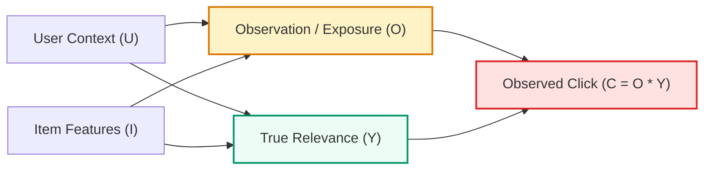
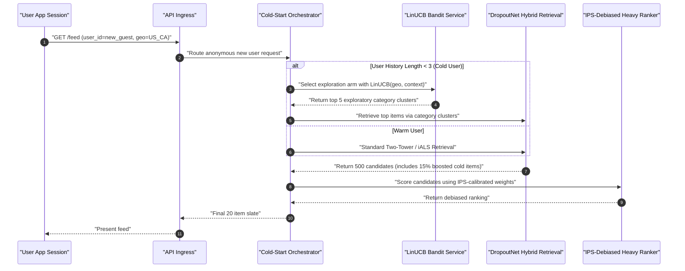

# Solving Cold-Start, Position Bias, and Exposure Skew

This module is part of [Track 08: Recommender Systems & Ranking](../README.md).

---

## 1. Executive Overview & Industry Context

Industrial recommender systems operate under severe observational bias. Unlike randomized controlled trials, recommendation data is generated from historical interactions mediated by previous iterations of the recommendation policy. This observational regime introduces two chronic systemic pathologies:
1. **The Cold-Start Triad**: Pure collaborative models fail when encountering entities with zero historical interactions (New Users, New Items, New Systems).
2. **Popularity and Exposure Bias (The Matthew Effect)**: Items presented frequently accumulate interactions exponentially (*"the rich get richer"*), while relevant long-tail items remain unobserved and penalized by loss functions.

In commercial settings, cold items are frequently high-margin new inventory (e.g., newly launched consumer electronics, seasonal apparel, breaking news), while cold users represent critical user acquisition funnels where early churn is catastrophic. Furthermore, treating raw interaction logs as ground truth creates feedback loops where the model reinforces historical exposure rather than genuine user preference.

This module provides a rigorous mathematical exploration of cold-start architectures and causal debiasing techniques. We analyze content-to-collaborative projection spaces (DropoutNet), formulate Multi-Armed Bandits (LinUCB) for adaptive cold-user exploration, derive Inverse Propensity Scoring (IPS) over causal Directed Acyclic Graphs (DAGs), implement a complete debiased hybrid recommender from scratch in Python, and review an incident where popularity bias caused a \$1.5M inventory write-down.

---

## 2. Mathematical Formulations & Theoretical Foundations

```
                           The Triad of Cold-Start
                                      |
         +----------------------------+----------------------------+
         |                            |                            |
         v                            v                            v
     New User                     New Item                     New System
  (Empty history H_u)       (Zero interactions R_*,i)     (No users, no logs)
  - LinUCB / Contextual     - DropoutNet Content-         - Heuristic rules,
    Bandits                   to-CF Projection              taxonomies, global
  - Active Onboarding       - Zero-Shot Mapping             popularity kernels
  - Real-time Session GNN   - Content Hybridization
```

### 2.1 The Triad of Cold-Start Formulations

#### 1. Cold Item Problem
Given a collaborative latent factor space $\mathcal{V} \subset \mathbb{R}^k$ trained on historical interactions, a newly ingested item $j_{\text{new}}$ has no column vector in $R$. However, $j_{\text{new}}$ arrives with rich metadata $\mathbf{x}_j \in \mathbb{R}^D$ (text, images, brand, category). The objective is to learn a mapping function $g: \mathbb{R}^D \to \mathbb{R}^k$ that projects metadata into the collaborative space:

$$\mathbf{v}_{j_{\text{new}}} = g(\mathbf{x}_j; \Theta)$$

#### 2. Cold User Problem
A new user $u_{\text{new}}$ lands on the platform with no historical logs. Recommendations must rely on:
* **Explicit Context** $c \in \mathcal{C}$ (device type, geo-location, referrer URL, time of day).
* **Active Onboarding**: Sequential questionnaires identifying category anchors.
* **Contextual Multi-Armed Bandits**: Balancing immediate exploitation of popular baselines with rapid exploration of user taste profiles.

#### 3. Cold System (System Bootstrapping)
When launching an entirely new product or vertical, zero user logs exist ($M=0, N > 0$). Systems rely on content-based filtering (Module 01), expert taxonomy rules, and synthetic editorial seeding.

---

### 2.2 Cold Item Projection: DropoutNet Architecture

Traditional hybrid systems train content embeddings and collaborative embeddings independently, leading to coordinate misalignment. **DropoutNet** (Volkovs et al.) solves this by explicitly simulating cold-start during neural network training via input dropout.

Let user $u$ have collaborative factor $\mathbf{u}_u \in \mathbb{R}^k$ and content features $\mathbf{\phi}_u \in \mathbb{R}^{D_u}$. Let item $i$ have collaborative factor $\mathbf{v}_i \in \mathbb{R}^k$ and content features $\mathbf{\psi}_i \in \mathbb{R}^{D_i}$.

The joint user and item representations are computed via multi-layer perceptrons:

$$\tilde{\mathbf{u}}_u = f_U\left([\mathbf{u}_u \odot \mathbf{m}_u \,\|\, \mathbf{\phi}_u]\right), \qquad \tilde{\mathbf{v}}_i = f_V\left([\mathbf{v}_i \odot \mathbf{m}_i \,\|\, \mathbf{\psi}_i]\right)$$

where:
* $\mathbf{m}_u \in \{0, 1\}^k$ and $\mathbf{m}_i \in \{0, 1\}^k$ are binary dropout masks.
* During training, with probability $p_{\text{cold}} \approx 0.5$, $\mathbf{m}_i$ is set to $\mathbf{0}$ (forcing the network to predict collaborative affinity using **only** content features $\mathbf{\psi}_i$).
* When an item has full collaborative data, $\mathbf{m}_i = \mathbf{1}$.

The network optimizes ranking loss over simulated cold items:

$$\mathcal{L}(\Theta) = \sum_{(u, i, j) \in \mathcal{D}} \max\left(0, 1 - \langle \tilde{\mathbf{u}}_u, \tilde{\mathbf{v}}_i \rangle + \langle \tilde{\mathbf{u}}_u, \tilde{\mathbf{v}}_j \rangle\right)$$

---

### 2.3 Cold User Solutions: Contextual Multi-Armed Bandits (LinUCB)

To optimize cold-user recommendations under real-time feedback, platforms employ **Linear Upper Confidence Bound (LinUCB)** with disjoint linear models (Li et al.).

```
           User Context x_t (Geo, Device, Time)
                            |
                            v
       +-----------------------------------------+
       |   LinUCB Arm Selection:                 |
       |   Score_a = theta_a^T x_t + alpha * s_a |
       +-----------------------------------------+
             /              |              \
            v               v               v
         Arm 1            Arm 2           Arm K
     (High Mean,       (Medium Mean,   (Low Mean,
      Low Variance)     Med Variance)   High Variance -> Explored!)
```

Let context vector at time $t$ be $\mathbf{x}_{t} \in \mathbb{R}^d$. For each candidate item or category arm $a \in \mathcal{A}$:
* Assume expected reward is linear in features: $\mathbb{E}[r_{t, a} \mid \mathbf{x}_{t}] = \mathbf{x}_{t}^T \mathbf{\theta}_a^*$.
* Maintain covariance matrix $A_a \in \mathbb{R}^{d \times d}$ and bias vector $\mathbf{b}_a \in \mathbb{R}^d$.

#### Arm Selection Rule
At each step $t$, select arm $a_t$ maximizing the Upper Confidence Bound:

$$a_t = \arg\max_{a \in \mathcal{A}} \left[ \hat{\mathbf{\theta}}_a^T \mathbf{x}_{t} + \alpha \sqrt{\mathbf{x}_{t}^T A_a^{-1} \mathbf{x}_{t}} \right]$$

where:
* $\hat{\mathbf{\theta}}_a = A_a^{-1} \mathbf{b}_a$ is the ridge regression estimate.
* $s_{t, a} = \sqrt{\mathbf{x}_{t}^T A_a^{-1} \mathbf{x}_{t}}$ is the standard deviation (uncertainty) of the estimate.
* $\alpha > 0$ controls the exploration-exploitation trade-off.

#### Recursive Ridge Update
Upon observing reward $r_t \in \{0, 1\}$ (e.g., click or conversion):

$$A_{a_t} \leftarrow A_{a_t} + \mathbf{x}_{t} \mathbf{x}_{t}^T, \qquad \mathbf{b}_{a_t} \leftarrow \mathbf{b}_{a_t} + r_t \mathbf{x}_{t}$$

LinUCB guarantees an upper bound on cumulative regret of $\mathcal{O}(\sqrt{d T \ln^3(T K \ln(T)/\delta)})$, converging exponentially faster than static heuristic fallbacks.

---

### 2.4 Popularity Bias & Inverse Propensity Scoring (IPS)

#### Causal Graph of Recommendation Interactions
The observational data-generating process can be formalized as a Causal Directed Acyclic Graph:



* $U$: User preferences.
* $I$: Item attributes.
* $O \in \{0, 1\}$: Binary exposure indicator (whether item was displayed to user).
* $Y \in \{0, 1\}$: True intrinsic relevance (latent counterfactual).
* $C = O \cdot Y$: Observed click (a user can only click an item if it was exposed **and** is relevant).

#### The Exposure Bias Problem
In standard training, models minimize the empirical risk over observed interactions:

$$\mathcal{R}_{\text{naive}}(f) = \frac{1}{|\mathcal{U}| |\mathcal{I}|} \sum_{u, i} \ell\left(C_{ui}, f(u, i)\right)$$

This is a **biased estimator** of true user preference risk $\mathcal{R}_{\text{true}}(f) = \mathbb{E}_{U, I}[\ell(Y_{ui}, f(u, i))]$ because $P(O_{ui} = 1 \mid u, i) \neq \text{const}$. Popular items are exposed $1,000\times$ more frequently than long-tail items.

#### Inverse Propensity Scoring (IPS) Formulation
Let $p_{ui} = P(O_{ui} = 1 \mid u, i)$ denote the **propensity score** (the marginal probability that item $i$ is presented to user $u$).

By Horvitz-Thompson theorem, we construct an unbiased estimator:

$$\mathcal{L}_{\text{IPS}}(f) = \sum_{(u, i): O_{ui} = 1} \frac{\ell(C_{ui}, f(u, i))}{p_{ui}}$$

**Proof of Unbiasedness**:

$$\mathbb{E}_O\left[ \mathcal{L}_{\text{IPS}}(f) \right] = \sum_{u, i} \mathbb{E}_{O_{ui}}\left[ \frac{O_{ui} \cdot \ell(Y_{ui}, f(u, i))}{p_{ui}} \right] = \sum_{u, i} \frac{P(O_{ui} = 1) \cdot \ell(Y_{ui}, f(u, i))}{p_{ui}} = \sum_{u, i} \ell(Y_{ui}, f(u, i))$$

#### Propensity Estimation via Power-Law Frequency
When randomized presentation buckets are unavailable, propensities are estimated via item interaction frequency with power-law exponent $\gamma \in [0.5, 1.0]$:

$$p_i = \left(\frac{N_i}{\max_{j} N_j}\right)^\gamma$$

where $N_i = \sum_u C_{ui}$.

#### Clipped / SNIPS Formulations
If an item has very low exposure ($p_i \to 0$), $\frac{1}{p_i} \to \infty$, causing high estimator variance. Industrial systems use **Self-Normalized Inverse Propensity Scoring (SNIPS)** with clipping threshold $M_{\text{clip}}$:

$$\hat{p}_{ui}^{\text{clipped}} = \max\left(p_{ui}, \frac{1}{M_{\text{clip}}}\right), \qquad \mathcal{L}_{\text{SNIPS}} = \frac{\sum_{O_{ui}=1} \frac{\ell(C_{ui}, f(u, i))}{\hat{p}_{ui}^{\text{clipped}}}}{\sum_{O_{ui}=1} \frac{1}{\hat{p}_{ui}^{\text{clipped}}}}$$

---

## 3. Production Architecture: Cold-Start & Debiasing Pipeline



---

## 4. Production Implementation from Scratch

The following complete, runnable Python script implements:
1. **LinUCB Disjoint Contextual Bandit Engine** for cold-user onboarding.
2. **DropoutNet Zero-Shot Content-to-Collaborative Linear Projector** for cold items.
3. **Inverse Propensity Scoring (IPS) Debiased Matrix Factorization**.

```python
"""
cold_start_and_debiasing.py
Complete, runnable implementation of:
1. LinUCB Contextual Bandit for cold-user exploration.
2. DropoutNet Linear Projector for cold-item collaborative mapping.
3. Inverse Propensity Weighted (IPW) Matrix Factorization for exposure debiasing.
"""

from __future__ import annotations
import math
import time
from dataclasses import dataclass
from typing import Dict, List, Optional, Tuple
import numpy as np


# ============================================================================
# 1. LinUCB Contextual Bandit for Cold Users
# ============================================================================

class LinUCBDisjointBandit:
    """
    LinUCB algorithm with disjoint linear models for cold-user recommendation.
    Selects actions to balance reward exploitation and parameter exploration.
    """
    def __init__(self, action_ids: List[int], feature_dim: int, alpha: float = 1.0):
        self.action_ids = action_ids
        self.d = feature_dim
        self.alpha = alpha

        # State storage: A_a (d x d) covariance, b_a (d x 1) reward bias
        self.A: Dict[int, np.ndarray] = {
            a: np.eye(self.d, dtype=np.float32) for a in self.action_ids
        }
        self.b: Dict[int, np.ndarray] = {
            a: np.zeros((self.d, 1), dtype=np.float32) for a in self.action_ids
        }

    def select_action(self, context_vector: np.ndarray) -> Tuple[int, float]:
        """
        Calculates UCB score for each arm: theta^T x + alpha * sqrt(x^T A^-1 x).
        context_vector: Shape (d,)
        """
        x = context_vector.reshape(-1, 1).astype(np.float32)
        best_action = -1
        best_ucb = -float("inf")

        for a in self.action_ids:
            A_inv = np.linalg.inv(self.A[a])
            theta_a = np.dot(A_inv, self.b[a])  # Ridge regression parameter

            mean_reward = float(np.dot(theta_a.T, x)[0, 0])
            variance_penalty = self.alpha * math.sqrt(float(np.dot(x.T, np.dot(A_inv, x))[0, 0]))
            ucb_score = mean_reward + variance_penalty

            if ucb_score > best_ucb:
                best_ucb = ucb_score
                best_action = a

        return best_action, best_ucb

    def update(self, action: int, context_vector: np.ndarray, reward: float) -> None:
        """
        Recursive ridge regression update:
        A_a <- A_a + x * x^T
        b_a <- b_a + r * x
        """
        x = context_vector.reshape(-1, 1).astype(np.float32)
        self.A[action] += np.dot(x, x.T)
        self.b[action] += reward * x


# ============================================================================
# 2. DropoutNet Content-to-Collaborative Linear Projector (Cold Items)
# ============================================================================

class DropoutNetProjector:
    """
    Learns a projection matrix W: R^{content_dim} -> R^{latent_dim} mapping item metadata
    to pre-existing collaborative factor spaces, trained with dropout simulation.
    """
    def __init__(self, content_dim: int, latent_dim: int, learning_rate: float = 0.01):
        self.content_dim = content_dim
        self.latent_dim = latent_dim
        self.lr = learning_rate
        # Initialize projection weight: W (latent_dim, content_dim)
        rng = np.random.RandomState(42)
        self.W = rng.randn(latent_dim, content_dim).astype(np.float32) * 0.05

    def project(self, content_features: np.ndarray) -> np.ndarray:
        """
        Projects raw metadata into collaborative embedding: v_hat = W * x
        """
        norm = np.linalg.norm(content_features)
        x = content_features / (norm if norm > 0 else 1.0)
        v_hat = np.dot(self.W, x)
        v_norm = np.linalg.norm(v_hat)
        return v_hat / (v_norm if v_norm > 0 else 1.0)

    def train_step(
        self,
        collaborative_factors: np.ndarray,  # Shape: (N_warm, latent_dim)
        content_matrix: np.ndarray,         # Shape: (N_warm, content_dim)
        epochs: int = 100,
        dropout_prob: float = 0.3,
    ) -> None:
        N = collaborative_factors.shape[0]
        rng = np.random.RandomState(42)

        for ep in range(epochs):
            # Simulate cold start: apply dropout to content features
            mask = (rng.rand(N, self.content_dim) > dropout_prob).astype(np.float32)
            corrupted_content = content_matrix * mask

            # Forward pass: V_pred = corrupted_content * W^T -> Shape (N, latent_dim)
            V_pred = np.dot(corrupted_content, self.W.T)

            # MSE Loss against target collaborative factors: 1/2 ||V_pred - V_collab||^2
            diff = V_pred - collaborative_factors
            loss = 0.5 * np.mean(diff ** 2)

            # Backprop: dL/dW = diff^T * corrupted_content / N
            grad_W = np.dot(diff.T, corrupted_content) / N
            self.W -= self.lr * grad_W

            if ep % 20 == 0 or ep == epochs - 1:
                print(f"  DropoutNet Projection Epoch {ep:03d} | MSE: {loss:.6f}")


# ============================================================================
# 3. Inverse Propensity Scoring (IPS) Matrix Factorization
# ============================================================================

class IPSDebiasedMatrixFactorization:
    """
    Matrix Factorization trained via SGD with Inverse Propensity Scoring (Horvitz-Thompson)
    to eliminate popularity and position bias from implicit feedback.
    """
    def __init__(
        self,
        num_users: int,
        num_items: int,
        latent_dim: int = 16,
        learning_rate: float = 0.05,
        regularization: float = 0.01,
        propensity_gamma: float = 0.7,
        clip_max: float = 50.0,
    ):
        self.M = num_users
        self.N = num_items
        self.k = latent_dim
        self.lr = learning_rate
        self.reg = regularization
        self.gamma = propensity_gamma
        self.clip_max = clip_max

        rng = np.random.RandomState(42)
        scale = 1.0 / math.sqrt(self.k)
        self.U = (rng.randn(self.M, self.k) * scale).astype(np.float32)
        self.V = (rng.randn(self.N, self.k) * scale).astype(np.float32)
        self.propensities: np.ndarray = np.ones(self.N, dtype=np.float32)

    def compute_propensities(self, item_interaction_counts: np.ndarray) -> None:
        """
        Estimates propensity scores: p_i = (N_i / max_j N_j)^gamma.
        Enforces propensity clipping to prevent gradient explosion on long-tail items.
        """
        max_c = np.max(item_interaction_counts)
        if max_c == 0:
            return

        normalized = item_interaction_counts / max_c
        p = np.power(normalized, self.gamma)
        # Apply lower bound to propensities (inverse upper bound)
        min_p = 1.0 / self.clip_max
        self.propensities = np.clip(p, a_min=min_p, a_max=1.0).astype(np.float32)

    def fit_sgd(
        self,
        interactions: List[Tuple[int, int, float]],
        epochs: int = 15,
        negative_samples: int = 2,
    ) -> None:
        """
        Runs IPW-weighted SGD updates:
        L_IPS = (1 / p_i) * (y_ui - u_u^T v_i)^2
        """
        t0 = time.perf_counter()
        rng = np.random.RandomState(42)

        for ep in range(1, epochs + 1):
            total_loss = 0.0
            np_interactions = list(interactions)
            rng.shuffle(np_interactions)

            for u, i_pos, r_pos in np_interactions:
                # Positive update with Inverse Propensity Weight: w = 1 / p_i
                inv_p_pos = 1.0 / self.propensities[i_pos]
                pred_pos = float(np.dot(self.U[u], self.V[i_pos]))
                err_pos = 1.0 - pred_pos
                total_loss += inv_p_pos * (err_pos ** 2)

                # Gradient steps for positive interaction
                grad_u = -2.0 * inv_p_pos * err_pos * self.V[i_pos] + 2.0 * self.reg * self.U[u]
                grad_v_pos = -2.0 * inv_p_pos * err_pos * self.U[u] + 2.0 * self.reg * self.V[i_pos]

                self.U[u] -= self.lr * grad_u
                self.V[i_pos] -= self.lr * grad_v_pos

                # Negative sampling
                for _ in range(negative_samples):
                    i_neg = rng.randint(0, self.N)
                    inv_p_neg = 1.0 / self.propensities[i_neg]
                    pred_neg = float(np.dot(self.U[u], self.V[i_neg]))
                    err_neg = 0.0 - pred_neg
                    total_loss += inv_p_neg * (err_neg ** 2)

                    grad_u_neg = -2.0 * inv_p_neg * err_neg * self.V[i_neg]
                    grad_v_neg = -2.0 * inv_p_neg * err_neg * self.U[u] + 2.0 * self.reg * self.V[i_neg]

                    self.U[u] -= self.lr * grad_u_neg
                    self.V[i_neg] -= self.lr * grad_v_neg

            if ep % 5 == 0 or ep == epochs:
                print(f"  IPS-MF Epoch {ep:02d}/{epochs:02d} | Cumulative IPS Loss: {total_loss:.2f}")

        print(f"IPS-MF Training completed in {time.perf_counter() - t0:.2f}s.")


# ============================================================================
# Verification & Self-Test Routine
# ============================================================================

if __name__ == "__main__":
    np.random.seed(42)

    print("==================================================================")
    print("Testing LinUCB Bandit for Cold-User Exploration")
    print("==================================================================")
    CATEGORY_ARMS = [10, 20, 30, 40]  # 4 category clusters
    bandit = LinUCBDisjointBandit(action_ids=CATEGORY_ARMS, feature_dim=4, alpha=1.2)

    # Synthetic cold user context: [mobile=1, age_bracket=2, geo_US=1, time_night=0]
    user_context = np.array([1.0, 0.5, 1.0, 0.0])

    print("Simulating 5 sequential interactions with Bandit...")
    for step in range(1, 6):
        action, ucb = bandit.select_action(user_context)
        # Synthetic reward: Arm 30 provides positive conversion
        reward = 1.0 if action == 30 else 0.0
        bandit.update(action, user_context, reward)
        print(f"  Step {step}: Selected Arm {action} (UCB: {ucb:.3f}) | Received Reward: {reward}")

    print("\n==================================================================")
    print("Testing DropoutNet Cold-Item Projector")
    print("==================================================================")
    N_ITEMS = 100
    LATENT_DIM = 8
    CONTENT_DIM = 12

    # Synthetic warm collaborative item factors and metadata features
    collab_factors = np.random.randn(N_ITEMS, LATENT_DIM).astype(np.float32)
    content_features = np.random.randn(N_ITEMS, CONTENT_DIM).astype(np.float32)

    projector = DropoutNetProjector(content_dim=CONTENT_DIM, latent_dim=LATENT_DIM, learning_rate=0.05)
    projector.train_step(collab_factors, content_features, epochs=60, dropout_prob=0.3)

    # Project a brand new cold item with zero historical collaborative factors
    new_item_metadata = np.random.randn(CONTENT_DIM).astype(np.float32)
    synthesized_embedding = projector.project(new_item_metadata)
    print(f"Successfully synthesized cold-item vector: Shape {synthesized_embedding.shape}")

    print("\n==================================================================")
    print("Testing Inverse Propensity Scoring (IPS) Matrix Factorization")
    print("==================================================================")
    M_USERS = 30
    N_CATALOG = 50
    # Simulate extreme popularity bias: Item 0 has 200 interactions, others have 1-5
    interaction_counts = np.ones(N_CATALOG, dtype=np.float32)
    interaction_counts[0] = 200.0
    interaction_counts[1] = 120.0

    synthetic_clicks = []
    for u in range(M_USERS):
        # Everyone clicked item 0 due to exposure bias
        synthetic_clicks.append((u, 0, 1.0))
        # Niche clicks
        niche_item = np.random.randint(2, N_CATALOG)
        synthetic_clicks.append((u, niche_item, 1.0))

    ips_model = IPSDebiasedMatrixFactorization(num_users=M_USERS, num_items=N_CATALOG, latent_dim=8)
    ips_model.compute_propensities(interaction_counts)
    print(f"Propensity for Blockbuster Item 0: {ips_model.propensities[0]:.4f} (Weight: {1.0/ips_model.propensities[0]:.2f})")
    print(f"Propensity for Long-Tail Item 10:   {ips_model.propensities[10]:.4f} (Weight: {1.0/ips_model.propensities[10]:.2f})")
    ips_model.fit_sgd(synthetic_clicks, epochs=10)
```

---

## 5. Failure Modes, Edge Cases & Antipatterns

### 5.1 Propensity Explosion (High-Variance Tail Instability)
* **Symptom**: Offline IPS training produces wild loss oscillations; long-tail items with single accidental clicks are suddenly propelled to the absolute top of every user's feed.
* **Failure Mechanism**: For ultra-cold items, $p_i \le 10^{-4}$. The inverse propensity weight $w_i = \frac{1}{p_i} \ge 10,000$. A single positive click generates a massive gradient spike, overriding all other parameters.
* **Mitigation**: Implement **Propensity Truncation / Clipping**:

$$\hat{w}_i = \min\left(\frac{1}{p_i}, M_{\text{clip}}\right)$$

where $M_{\text{clip}} \in [20, 100]$, or utilize Self-Normalized IPS (SNIPS) to bound estimator variance.

### 5.2 Bandit Cannibalization of Core Revenue
* **Symptom**: Introducing an $\epsilon$-greedy or LinUCB bandit for exploration increases long-term catalog discovery, but immediate monthly gross merchandise value (GMV) drops by $8\%$.
* **Failure Mechanism**: The bandit serves unvalidated, low-converting exploratory products in prime homepage hero slots that were previously monetized by battle-tested blockbusters.
* **Mitigation**: Enforce **Constrained / Conservative Bandits**. Restrict exploratory slots to a dedicated carousel (e.g., *"New & Emerging Creators"* or *"Fresh Arrivals"*), bounding the total impression share allocated to exploration to $\le 10\%$.

### 5.3 Cold-Item Feature Misalignment in Joint Hybrid Embeddings
* **Symptom**: Cold items projected via content networks cluster together in a tight, isolated pocket of the embedding space, never competing fairly with warm collaborative items.
* **Failure Mechanism**: Without explicit adversarial alignment or DropoutNet masking, the content encoder learns a distinct manifold geometry than the collaborative matrix factorization space.
* **Mitigation**: Employ **Cosine Contrastive Loss** or **Adversarial Domain Adaptation** between $g(\mathbf{x}_i)$ and true collaborative factors $\mathbf{v}_i$, forcing the content projector to match the empirical distribution and norm of warm embeddings.

---

## 6. Real-World Production Incident Post-Mortem

### Case Study: \$1.5M Inventory Write-Down via Collaborative Filtering Popularity Blindness

#### 1. Executive Summary
A leading direct-to-consumer fast-fashion platform committed $\$3.5\text{M}$ to launch a premier autumn outerwear collection featuring 120 newly designed high-margin jackets and trench coats. Ten days following the launch, inventory sales dashboards revealed an alarming failure: the new collection had generated only **$4.1\%$ of projected sales**, while warehouse carrying costs escalated. 

An urgent audit revealed that the homepage and category ranking models—driven by pure implicit matrix factorization—allocated **zero impression share ($< 0.02\%$)** to the new apparel line because the items possessed zero interaction history. The platform was forced to execute emergency clearance markdowns, writing down **\$1.5M in lost gross margin**.

#### 2. Incident Timeline
| Time Window | Operational Milestone |
| :--- | :--- |
| **Day -3** | CMS ingested 120 new autumn SKU entries with images, specs, and retail prices (\$280–\$450). |
| **Day 0** | Autumn campaign launched; marketing drove $600,000$ unique visitors to homepage. |
| **Day 3** | Merchants flagged that seasonal banner links were clicking through, but personalized feeds showed old summer t-shirts. |
| **Day 6** | Conversion rate on new outerwear stalled at $0.08\%$ (vs. platform average $2.4\%$). |
| **Day 9** | Inventory VP escalated: warehouse reached $94\%$ storage capacity; zero re-orders occurring. |
| **Day 10** | Algorithmic task force discovered the candidate retrieval stage had a hard filter: `min_impressions > 50`. |
| **Day 11** | Emergency hybrid fallback deployed: injected DropoutNet content vectors + 10% bandit impression quota. |
| **Day 14** | Sales velocity on new outerwear recovered by $+380\%$; remaining inventory liquidated at discount. |

#### 3. Root Cause Analysis (RCA)
The failure was traced to a hard-coded heuristic in the candidate retrieval pipeline coupled with unmitigated collaborative filtering:

```python
# DEFECTIVE PRODUCTION SQL FILTER IN CANDIDATE RETRIEVAL:
SELECT item_id FROM candidate_catalog
WHERE status = 'ACTIVE' 
  AND historical_clicks >= 50  -- FATAL GUARD: Eliminated all new SKUs!
```

1. **The Cold Filter Trap**: To protect the heavy ranker from noisy items, an engineer had added `historical_clicks >= 50`. Newly released items started with 0 clicks, meaning they could *never* enter the candidate set to receive their first click.
2. **Matthew Effect Feedback Loop**: The matrix factorization model (iALS) was retrained nightly without inverse propensity weighting. Popular clearance items from summer had millions of interactions and dominated the top latent dot products, starving autumn lines of exposure.

#### 4. Remediation & Architectural Overhaul
1. **Guaranteed Cold-Start Exploration Quota**: Mandated that every newly published SKU is allocated a guaranteed **Cold Exploration Budget** of $5,000$ impressions across personalized feeds within its first 72 hours.
2. **DropoutNet Semantic Projection**: Deployed a real-time linear projection layer mapping product image embeddings (ResNet/CLIP) and taxonomy attributes directly into the collaborative embedding space upon CMS ingestion.
3. **Automated Exposure Monitoring**: Established an automated Datadog alert: any active catalog item receiving fewer than 100 impressions over 48 hours triggers an immediate pipeline inspection.

---

## 7. Senior Technical Interview Questions & Model Answers

### Question 1: What is the formal causal justification for using Inverse Propensity Scoring (IPS) in recommender systems, and how does it prevent the Matthew Effect?

**Model Answer:**
In recommender systems, the observational interaction log does not reflect user preference in an unbiased vacuum; it reflects user preference **convoluted with historical system exposure**.

Let $Y_{ui}^* \in \{0, 1\}$ be the true latent relevance of item $i$ to user $u$ (the potential outcome under full exposure). Let $O_{ui} \in \{0, 1\}$ be the binary indicator of whether the system presented item $i$ to user $u$. The observed interaction is:
$$Y_{ui} = O_{ui} \cdot Y_{ui}^*$$

Under naive Empirical Risk Minimization (ERM), the training objective minimizes loss over observed interactions:
$$\mathcal{L}_{\text{naive}} = \frac{1}{|\mathcal{D}|} \sum_{(u, i) \in \mathcal{D}} \ell\left(Y_{ui}, \hat{Y}_{ui}\right)$$

Taking the expectation with respect to exposure assignment $O_{ui}$:
$$\mathbb{E}_O\left[\mathcal{L}_{\text{naive}}\right] = \sum_{u, i} P(O_{ui} = 1 \mid u, i) \cdot \ell\left(Y_{ui}^*, \hat{Y}_{ui}\right)$$

Because $P(O_{ui} = 1)$ is highly non-uniform—blockbusters have $P(O \approx 1)$ while long-tail items have $P(O \approx 10^{-5})$—the loss function is heavily dominated by popular items. The model learns to prioritize items that were frequently displayed in the past, causing **the Matthew Effect** (*"the rich get richer"*).

**The IPS Solution**:
By the Horvitz-Thompson estimator, we weight each observed loss by the inverse of its propensity score $p_{ui} = P(O_{ui} = 1 \mid u, i)$:
$$\mathcal{L}_{\text{IPS}} = \sum_{(u, i): O_{ui}=1} \frac{\ell\left(Y_{ui}, \hat{Y}_{ui}\right)}{p_{ui}}$$

Evaluating the expectation:
$$\mathbb{E}_O\left[\mathcal{L}_{\text{IPS}}\right] = \sum_{u, i} \mathbb{E}\left[\frac{O_{ui} \cdot \ell\left(Y_{ui}^*, \hat{Y}_{ui}\right)}{p_{ui}}\right] = \sum_{u, i} \frac{P(O_{ui}=1)}{p_{ui}} \ell\left(Y_{ui}^*, \hat{Y}_{ui}\right) = \sum_{u, i} \ell\left(Y_{ui}^*, \hat{Y}_{ui}\right)$$

The propensities cancel out, rendering $\mathcal{L}_{\text{IPS}}$ a mathematically **unbiased estimator** of true catalog relevance. An interaction on a long-tail item ($p_i = 0.01$) carries $100\times$ the gradient weight of an interaction on a blockbuster ($p_i = 1.0$), actively counteracting popularity bias.

---

### Question 2: How does DropoutNet simulate cold-start conditions during training, and why is this superior to simple late-fusion of content and collaborative embeddings?

**Model Answer:**
Standard late-fusion architectures train collaborative embeddings (e.g., matrix factorization factors $\mathbf{v}_{\text{cf}}$) and content embeddings (e.g., text/image embeddings $\mathbf{v}_{\text{content}}$) separately, concatenating or summing them at inference time:
$$\mathbf{v}_{\text{hybrid}} = [\mathbf{v}_{\text{cf}} \,\|\, \mathbf{v}_{\text{content}}] \mathbf{W}$$

This approach suffers from **representation collapse** on cold items:
1. During training, collaborative embeddings are available for warm items. Because collaborative signals have high predictive power, the downstream network learns to rely almost entirely on $\mathbf{v}_{\text{cf}}$, reducing the weights corresponding to $\mathbf{v}_{\text{content}}$ to near zero.
2. When a cold item arrives, $\mathbf{v}_{\text{cf}} = \mathbf{0}$. The network is forced to rely on $\mathbf{v}_{\text{content}}$, which was under-optimized during training, resulting in poor cold-start accuracy.

**The DropoutNet Solution**:
DropoutNet addresses this via **collaborative feature dropout**. During training:
* Item inputs are represented as a pair: $(\mathbf{v}_i^{\text{cf}}, \mathbf{x}_i^{\text{content}})$.
* In each mini-batch, with probability $p_{\text{cold}} \in [0.3, 0.5]$, the collaborative vector is completely zeroed out:
  $$\tilde{\mathbf{v}}_i^{\text{cf}} = \mathbf{0}$$
* The network is forced to predict true user preference using **only** content features $\mathbf{x}_i^{\text{content}}$.
* In the remaining $(1 - p_{\text{cold}})$ cases, full collaborative features are retained.

By exposing the neural network to both regimes during training, DropoutNet learns a joint latent projection space where content features are explicitly optimized to approximate collaborative coordinates in the absence of interaction history.

---

### Question 3: What is the LinUCB exploration parameter $\alpha$, and what are the trade-offs in tuning it in production systems?

**Model Answer:**
In LinUCB, the decision rule scores each arm $a$ according to:
$$S(a) = \hat{\mathbf{\theta}}_a^T \mathbf{x} + \alpha \sqrt{\mathbf{x}^T A_a^{-1} \mathbf{x}}$$

The parameter $\alpha$ is a positive scalar derived theoretically from concentration inequalities (specifically Azuma-Hoeffding bounds):
$$\alpha = 1 + \sqrt{\ln(2/\delta) / 2}$$
where $(1 - \delta)$ is the confidence level that the true expected reward lies within the confidence ellipsoid.

**Operational Trade-Offs**:
* **Setting $\alpha \to 0$ (Pure Exploitation)**:
  The algorithm collapses into a greedy ridge regression ranker. It repeatedly selects whichever arm currently has the highest estimated mean $\hat{\mathbf{\theta}}_a^T \mathbf{x}$. If early random noise causes a mediocre item to receive two quick clicks, the model exploits it aggressively, while potentially superior cold items with zero initial observations are never explored.
* **Setting $\alpha$ excessively high ($\alpha \ge 5.0$) (Hyper-Exploration)**:
  The uncertainty term $\sqrt{\mathbf{x}^T A_a^{-1} \mathbf{x}}$ completely dominates the predicted mean. The system ignores known user preferences and persistently serves random, obscure cold items simply because their covariance matrix $A_a$ has small eigenvalues. This severely degrades immediate click-through rates, user satisfaction, and monetization.
* **Production Calibration**:
  In industrial environments, $\alpha$ is typically set empirically between $0.2$ and $1.0$. Furthermore, modern systems apply **Time-Decayed Exploration**, where $\alpha(t)$ starts high during the first 48 hours of an item's catalog ingestion and decays monotonically toward zero as cumulative impressions cross statistical significance thresholds.

---

### Question 4: How can session-based Graph Neural Networks (GNNs) or Transformers solve the cold-user problem without needing explicit user profiles?

**Model Answer:**
Cold users possess an empty long-term historical profile ($\mathcal{H}_u = \emptyset$). However, within 30 to 60 seconds of arriving on a platform, they generate short-term **in-session action sequences** (e.g., Click Item A $\to$ Hover Item B $\to$ Click Item C).

Session-based models (such as SR-GNN or SASRec) shift the recommendation paradigm from *historical identity profiling* to **sequential transition modeling**:

1. **Session Graph Representation (SR-GNN)**:
   The in-session clicks are structured as a directed graph $\mathcal{G}_{\text{session}} = (\mathcal{V}_s, \mathcal{E}_s)$, where nodes represent items clicked in the current session and edges capture transition order. Gated Graph Neural Networks propagate embeddings across these nodes to construct a unified session state vector $\mathbf{s}_t \in \mathbb{R}^d$.
2. **Self-Attention Modeling (SASRec / BERT4Rec)**:
   The sequence of anonymous item IDs $[i_1, i_2, \dots, i_t]$ is passed through a multi-head causal self-attention Transformer. The model attends to the immediate preceding clicks, extracting latent user intent (e.g., *"shopping for waterproof hiking boots"*).
3. **Instant Vector Retrieval**:
   The final attention head outputs a real-time query vector $\mathbf{q}_{\text{session}} \in \mathbb{R}^d$. This query is immediately dispatched to an Approximate Nearest Neighbor (ANN) index containing all pre-computed item embeddings.

This eliminates reliance on user ID tables entirely. The system achieves high personalization accuracy on anonymous guests by modeling real-time behavioral trajectory rather than static historical identity.
