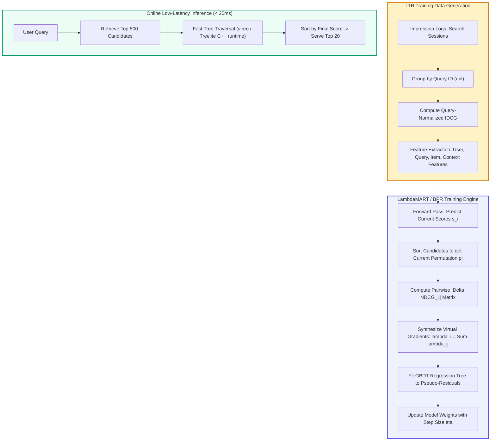

# Learning to Rank: Pointwise, Pairwise, and Listwise Formulations

This module is part of [Track 08: Recommender Systems & Ranking](../README.md).

---

## 1. Executive Overview & Industry Context

Traditional machine learning algorithms optimize point-based error metrics: Mean Squared Error (MSE) for regression or Binary Cross-Entropy (BCE) for classification. In recommender systems and information retrieval, however, the absolute numeric prediction of an individual item is irrelevant; **only its relative permutation order within the query or user context matters**.

Consider an e-commerce catalog search: whether a scoring model predicts click probabilities of $\{0.91, 0.89, 0.84\}$ or $\{0.15, 0.12, 0.08\}$, the resulting ordered presentation slate $[A, B, C]$ is identical, and user experience is unchanged. Conversely, a pointwise regression model that slightly shifts an irrelevant item from score $0.40 \to 0.42$ might invert the position of the top two results, destroying retrieval utility while registering only a negligible change in MSE loss.

**Learning to Rank (LTR)** reframes the optimization paradigm from isolated pointwise estimation to direct permutation utility. LTR algorithms are categorized into three distinct theoretical generations:
1. **Pointwise**: Individual item scoring (ignores query-level grouping).
2. **Pairwise**: Relative ordering of item pairs within a query (RankNet, Bayesian Personalized Ranking).
3. **Listwise**: Direct optimization of entire permutations or non-differentiable ranking metrics like NDCG (LambdaMART, ListNet).

In this module, we derive the mathematical mechanics of all three frameworks, explore the internal mechanics of LambdaMART's virtual gradients $\lambda_{ij}$, build a complete BPR matrix factorizer and LambdaMART engine from scratch in Python, and investigate a production post-mortem where pointwise optimization caused a catastrophic clickbait ranking crisis.

---

## 2. Mathematical Formulations & Theoretical Foundations

```
                           Learning to Rank Hierarchy
                                       |
        +------------------------------+------------------------------+
        |                              |                              |
        v                              v                              v
    Pointwise                       Pairwise                       Listwise
  - Individual item utility      - Binary item pairs (i > j)    - Entire ranked list slate
  - Loss: MSE / BCE              - Loss: Cross-Entropy / Margin - Loss: ListNet / LambdaMART
  - Ignores query context        - Models relative preference   - Directly targets NDCG / MAP
  - Example: Logistic Regr       - Example: RankNet, BPR        - Example: LambdaMART, ListNet
```

### 2.1 Pointwise Formulation

In the pointwise paradigm, ranking is cast as standard regression or classification. Given a query or user $q$, candidate items $x_i$, and ground-truth relevance labels $y_i \in \{0, 1, \dots, R\}$:

$$\mathcal{L}_{\text{pointwise}}(\Theta) = \sum_{q} \sum_{i \in \mathcal{D}_q} \ell\left(f(x_i; \Theta), y_i\right)$$

* For ordinal ratings: $\ell_{\text{MSE}} = \frac{1}{2} (f(x_i) - y_i)^2$
* For binary clicks: $\ell_{\text{BCE}} = -y_i \ln \sigma(f(x_i)) - (1 - y_i) \ln (1 - \sigma(f(x_i)))$

#### Critical Flaws of Pointwise LTR
1. **Unbalanced Query Sizes**: A query with 500 candidate items contributes $50\times$ more loss than a query with 10 candidates, skewing gradients toward high-volume queries.
2. **Position-Insensitive Penalties**: Mispredicting item rank at position 1 (hero slot) incurs the exact same loss penalty as mispredicting an item at position 95, even though position 1 accounts for $> 40\%$ of all user engagement.

---

### 2.2 Pairwise Formulation: RankNet and Bayesian Personalized Ranking (BPR)

Pairwise algorithms operate on pairs of items $(i, j)$ evaluated within the same query $q$, where item $i$ is known to be more relevant than item $j$ ($i \succ_q j$).

#### RankNet Loss Derivation
RankNet (Burges et al.) models the posterior probability that item $i$ should outrank item $j$ using a sigmoid over their scoring difference:

$$P(i \succ j) = \sigma\left(s_i - s_j\right) = \frac{1}{1 + e^{-(s_i - s_j)}}$$

where $s_i = f(x_i)$ and $s_j = f(x_j)$.

Let $\bar{P}_{ij}$ be the ground truth probability: $\bar{P}_{ij} = 1$ if $i \succ j$, and $\bar{P}_{ij} = 0$ if $j \succ i$. The cross-entropy loss between the predicted and true distribution is:

$$\mathcal{L}_{\text{RankNet}}(i, j) = -\bar{P}_{ij} \ln P(i \succ j) - (1 - \bar{P}_{ij}) \ln (1 - P(i \succ j))$$

For a verified preference $i \succ j$ ($\bar{P}_{ij} = 1$):

$$\mathcal{L}_{\text{RankNet}}(i, j) = -\ln \sigma(s_i - s_j) = \ln\left(1 + e^{-(s_i - s_j)}\right)$$

The gradient with respect to model score $s_i$ is:

$$\frac{\partial \mathcal{L}_{\text{RankNet}}}{\partial s_i} = \frac{-e^{-(s_i - s_j)}}{1 + e^{-(s_i - s_j)}} = \frac{-1}{1 + e^{s_i - s_j}} = -\sigma\left(-(s_i - s_j)\right)$$

Notice that as $(s_i - s_j) \to +\infty$ (correct ordering with high margin), the gradient approaches zero. When $s_i < s_j$ (ordering error), the gradient approaches $-1.0$, pushing $s_i$ upward.

#### Bayesian Personalized Ranking (BPR-Opt)
For implicit feedback, Rendle et al. formulated **Bayesian Personalized Ranking (BPR)** from maximum posterior estimation.
Given user $u$, observed positive item $i$, and unobserved negative item $j$:

$$\hat{x}_{uij} = \hat{x}_{ui} - \hat{x}_{uj} = \mathbf{u}_u^T \mathbf{v}_i - \mathbf{u}_u^T \mathbf{v}_j$$

The optimization objective maximizes the posterior:

$$\mathcal{L}_{\text{BPR}} = \sum_{(u, i, j) \in \mathcal{D}_S} -\ln \sigma\left(\mathbf{u}_u^T \mathbf{v}_i - \mathbf{u}_u^T \mathbf{v}_j\right) + \lambda_{\Theta} \|\Theta\|_2^2$$

The stochastic gradient updates for user and item factors are:

$$\nabla_{\mathbf{u}_u} = -\sigma(-\hat{x}_{uij}) (\mathbf{v}_i - \mathbf{v}_j) + \lambda \mathbf{u}_u$$
$$\nabla_{\mathbf{v}_i} = -\sigma(-\hat{x}_{uij}) \mathbf{u}_u + \lambda \mathbf{v}_i$$
$$\nabla_{\mathbf{v}_j} = \sigma(-\hat{x}_{uij}) \mathbf{u}_u + \lambda \mathbf{v}_j$$

---

### 2.3 Listwise Formulation: ListNet and Normalized Discounted Cumulative Gain (NDCG)

Listwise algorithms optimize over the entire permutation vector $\mathbf{\pi}_q$.

#### The Non-Differentiability Bottleneck
The industry-standard ranking metric is **Normalized Discounted Cumulative Gain (NDCG@K)**:

$$\text{DCG@}K = \sum_{m=1}^K \frac{2^{y_{\pi(m)}} - 1}{\log_2(m + 1)}, \qquad \text{NDCG@}K = \frac{\text{DCG@}K}{\text{IDCG@}K}$$

where $\pi(m)$ is the item at position $m$, and $\text{IDCG@}K$ is the ideal DCG obtained by sorting items perfectly by ground-truth labels.

The function that maps continuous scores $\mathbf{s} \in \mathbb{R}^n$ to discrete ranks $m \in \{1, \dots, n\}$ involves indicator functions and sorting:

$$\text{rank}(i) = 1 + \sum_{j \neq i} \mathbb{I}(s_j > s_i)$$

The derivative $\frac{\partial \text{rank}(i)}{\partial s_i}$ is zero everywhere and undefined at step boundaries. Thus, **direct gradient descent on NDCG is mathematically impossible**.

---

### 2.4 LambdaMART and Virtual Gradients ($\lambda$-Gradients)

Burges et al. bypassed the non-differentiability barrier through a breakthrough insight: **we do not need an analytic loss function if we can directly define the virtual gradient vector at each point in the scoring space**.

#### Virtual Lambda Gradients Formulation
LambdaRank defines the force $\lambda_{ij}$ acting between pair $(i, j)$ by scaling the RankNet gradient by the exact change in NDCG resulting from swapping their positions:

$$\lambda_{ij} = \frac{\partial \mathcal{C}_{ij}}{\partial s_i} = \frac{-\rho}{1 + e^{\rho(s_i - s_j)}} |\Delta \text{NDCG}_{ij}|$$

where:
* $|\Delta \text{NDCG}_{ij}|$ is the absolute difference in query NDCG if item $i$ and item $j$ were swapped in the current ranking list, holding all other items fixed:

$$|\Delta \text{NDCG}_{ij}| = \frac{1}{\text{IDCG}} \left| \left(2^{y_i} - 2^{y_j}\right) \left(\frac{1}{\log_2(\text{rank}_i + 1)} - \frac{1}{\log_2(\text{rank}_j + 1)}\right) \right|$$

#### Aggregation Across Pairs
The net virtual gradient acting on item $i$ across all pairs in query $q$ is:

$$\lambda_i = \sum_{j: i \succ j} \lambda_{ij} - \sum_{j: j \succ i} \lambda_{ji}$$

```
                Item i (Position 3) <===============> Item j (Position 8)
                Score: s_i                            Score: s_j
                     \                                     /
                      \                                   /
                       v                                 v
          Swap simulation: Rank i <-> Rank j
          Compute exact: |Delta NDCG_ij| = |DCG_swapped - DCG_current| / IDCG
          Weight gradient: lambda_ij = -1 / (1 + exp(s_i - s_j)) * |Delta NDCG_ij|
```

#### LambdaMART Implementation via Gradient Boosted Decision Trees (GBDT)
LambdaMART fits an ensemble of regression trees $\{T_1, T_2, \dots, T_M\}$ directly to the virtual gradients:
1. In tree $m$, compute current scores $s_i = \sum_{k=1}^{m-1} \eta T_k(x_i)$.
2. Calculate virtual gradients $\lambda_i$ and second-order Hessian approximations $w_i = \sum_j \frac{\partial \lambda_{ij}}{\partial s_i}$.
3. Train regression tree $T_m$ to predict pseudo-residuals $\lambda_i$.
4. Update terminal leaf values via Newton-Raphson step:

$$\gamma_{lm} = \frac{\sum_{i \in R_{lm}} \lambda_i}{\sum_{i \in R_{lm}} w_i}$$

---

## 3. Architecture of a Learning to Rank Pipeline



---

## 4. Production Implementation from Scratch

The following complete, runnable Python module implements:
1. **Bayesian Personalized Ranking (BPR)** Matrix Factorization via SGD.
2. **LambdaMART Virtual Gradient Generator** that computes exact $|\Delta \text{NDCG}|$ and $\lambda_i$ vectors for query groups.

```python
"""
learning_to_rank.py
Production-grade implementations of:
1. Bayesian Personalized Ranking (BPR-MF) for pairwise implicit recommendation.
2. LambdaMART Virtual Gradient Engine for listwise NDCG optimization.
"""

from __future__ import annotations
import math
import time
from dataclasses import dataclass
from typing import Dict, List, Optional, Tuple
import numpy as np


# ============================================================================
# 1. Bayesian Personalized Ranking (BPR-MF)
# ============================================================================

class BPRMatrixFactorization:
    """
    Bayesian Personalized Ranking (Rendle et al. 2009).
    Maximizes ln sigma(u^T v_i - u^T v_j) via pairwise SGD updates.
    """
    def __init__(
        self,
        num_users: int,
        num_items: int,
        latent_dim: int = 16,
        learning_rate: float = 0.05,
        reg_user: float = 0.01,
        reg_pos: float = 0.01,
        reg_neg: float = 0.001,
        random_state: int = 42,
    ):
        self.M = num_users
        self.N = num_items
        self.k = latent_dim
        self.lr = learning_rate
        self.reg_u = reg_user
        self.reg_i = reg_pos
        self.reg_j = reg_neg

        rng = np.random.RandomState(random_state)
        scale = 1.0 / math.sqrt(self.k)
        self.U = (rng.randn(self.M, self.k) * scale).astype(np.float32)
        self.V = (rng.randn(self.N, self.k) * scale).astype(np.float32)

    @staticmethod
    def _sigmoid(x: float) -> float:
        # Numerically stable sigmoid
        if x >= 0:
            z = math.exp(-x)
            return 1.0 / (1.0 + z)
        else:
            z = math.exp(x)
            return z / (1.0 + z)

    def fit(
        self,
        user_positives: Dict[int, List[int]],
        epochs: int = 20,
        samples_per_epoch: int = 50000,
    ) -> "BPRMatrixFactorization":
        rng = np.random.RandomState(42)
        users_list = [u for u, items in user_positives.items() if len(items) > 0]
        t0 = time.perf_counter()

        for ep in range(1, epochs + 1):
            epoch_loss = 0.0

            for _ in range(samples_per_epoch):
                # 1. Sample user u uniformly
                u = users_list[rng.randint(0, len(users_list))]
                pos_items = user_positives[u]

                # 2. Sample positive item i
                i = pos_items[rng.randint(0, len(pos_items))]

                # 3. Sample unobserved negative item j
                j = rng.randint(0, self.N)
                while j in pos_items:
                    j = rng.randint(0, self.N)

                # 4. Compute difference: x_uij = u_u^T v_i - u_u^T v_j
                dot_i = float(np.dot(self.U[u], self.V[i]))
                dot_j = float(np.dot(self.U[u], self.V[j]))
                x_uij = dot_i - dot_j

                # 5. Scalar gradient factor: -sigmoid(-x_uij)
                sig_neg = self._sigmoid(-x_uij)
                epoch_loss += -math.log(self._sigmoid(x_uij) + 1e-12)

                # 6. Simultaneous SGD updates
                u_vec = self.U[u].copy()
                v_i = self.V[i].copy()
                v_j = self.V[j].copy()

                # User update: dL/du = -sig_neg * (v_i - v_j) + reg * u
                self.U[u] -= self.lr * (-sig_neg * (v_i - v_j) + self.reg_u * u_vec)

                # Item positive update: dL/dvi = -sig_neg * u + reg * v_i
                self.V[i] -= self.lr * (-sig_neg * u_vec + self.reg_i * v_i)

                # Item negative update: dL/dvj = sig_neg * u + reg * v_j
                self.V[j] -= self.lr * (sig_neg * u_vec + self.reg_j * v_j)

            if ep % 5 == 0 or ep == epochs:
                avg_bpr_loss = epoch_loss / samples_per_epoch
                print(f"  BPR Epoch {ep:02d}/{epochs:02d} | Mean Pairwise Loss: {avg_bpr_loss:.4f}")

        print(f"BPR-MF Training completed in {time.perf_counter() - t0:.2f}s.")
        return self

    def score_user(self, user_id: int) -> np.ndarray:
        return np.dot(self.V, self.U[user_id])


# ============================================================================
# 2. LambdaMART Virtual Gradient Generator
# ============================================================================

class LambdaGradientEngine:
    """
    Computes exact Virtual Lambda Gradients (lambda_i) and Hessians (w_i)
    for a query candidate list to optimize NDCG directly.
    """
    def __init__(self, k_ndcg: int = 10):
        self.k_ndcg = k_ndcg

    @staticmethod
    def _compute_dcg(relevances: np.ndarray, top_k: int) -> float:
        k = min(len(relevances), top_k)
        if k == 0:
            return 0.0
        discounts = 1.0 / np.log2(np.arange(2, k + 2))
        gains = np.power(2.0, relevances[:k]) - 1.0
        return float(np.sum(gains * discounts))

    def compute_lambdas_and_hessians(
        self,
        scores: np.ndarray,       # Shape: (N,) Predicted scores from current model
        relevances: np.ndarray,   # Shape: (N,) True ground-truth relevance grades
    ) -> Tuple[np.ndarray, np.ndarray, float]:
        N = len(scores)
        lambdas = np.zeros(N, dtype=np.float32)
        hessians = np.zeros(N, dtype=np.float32)

        # 1. Rank order according to current scores
        order = np.argsort(-scores)
        sorted_relevances = relevances[order]

        # 2. Compute Ideal DCG (IDCG) by sorting true relevances descending
        ideal_relevances = np.sort(relevances)[::-1]
        idcg = self._compute_dcg(ideal_relevances, self.k_ndcg)

        if idcg == 0.0:
            return lambdas, hessians, 0.0

        current_dcg = self._compute_dcg(sorted_relevances, self.k_ndcg)
        current_ndcg = current_dcg / idcg

        # Ranks: rank[item_idx] in {1, 2, ..., N}
        ranks = np.zeros(N, dtype=np.int32)
        for r, item_idx in enumerate(order, start=1):
            ranks[item_idx] = r

        # 3. Precompute discount and gain factors
        discount_table = 1.0 / np.log2(np.arange(1, N + 2))
        gain_table = np.power(2.0, relevances) - 1.0

        # 4. Iterate over all pairs (i, j)
        for i in range(N):
            for j in range(N):
                # We only calculate forces where item i is strictly more relevant than item j
                if relevances[i] <= relevances[j]:
                    continue

                rank_i = ranks[i]
                rank_j = ranks[j]

                # Compute exact Delta NDCG caused by swapping item i and item j
                if rank_i <= self.k_ndcg or rank_j <= self.k_ndcg:
                    # Difference in discounted gain
                    diff_gain = gain_table[i] - gain_table[j]
                    diff_disc = discount_table[rank_i] - discount_table[rank_j]
                    delta_ndcg = abs(diff_gain * diff_disc) / idcg
                else:
                    delta_ndcg = 0.0

                if delta_ndcg == 0.0:
                    continue

                # RankNet pairwise logistic factor: rho / (1 + e^{rho * (s_i - s_j)})
                score_diff = scores[i] - scores[j]
                if score_diff >= 0:
                    rho = 1.0 / (1.0 + math.exp(score_diff))
                else:
                    z = math.exp(-score_diff)
                    rho = z / (1.0 + z)

                # Virtual Lambda Force
                lambda_ij = rho * delta_ndcg

                # Accumulate forces
                lambdas[i] += lambda_ij
                lambdas[j] -= lambda_ij

                # Hessian approximation (w_ij = rho * (1 - rho) * delta_ndcg)
                w_ij = rho * (1.0 - rho) * delta_ndcg
                hessians[i] += w_ij
                hessians[j] += w_ij

        return lambdas, hessians, current_ndcg


# ============================================================================
# Verification & Self-Test Routine
# ============================================================================

if __name__ == "__main__":
    np.random.seed(42)

    print("==================================================================")
    print("Testing Bayesian Personalized Ranking (BPR-MF)")
    print("==================================================================")
    M_USERS = 20
    N_ITEMS = 30

    # Synthetic implicit positives
    user_positives: Dict[int, List[int]] = {}
    for u in range(M_USERS):
        # Users 0-9 like items 0-14; Users 10-19 like items 15-29
        if u < 10:
            favs = list(np.random.choice(range(0, 15), size=5, replace=False))
        else:
            favs = list(np.random.choice(range(15, 30), size=5, replace=False))
        user_positives[u] = favs

    bpr = BPRMatrixFactorization(num_users=M_USERS, num_items=N_ITEMS, latent_dim=8)
    bpr.fit(user_positives, epochs=15, samples_per_epoch=20000)

    # Score User 2 (cluster 1)
    user_2_scores = bpr.score_user(user_id=2)
    top_recommended_items = np.argsort(-user_2_scores)[:5]
    print(f"User 2 (Cluster 1) Top 5 Recommendations: {top_recommended_items.tolist()}")
    print(f"Ground truth favorites for User 2: {user_positives[2]}")

    print("\n==================================================================")
    print("Testing LambdaMART Virtual Gradient Engine")
    print("==================================================================")
    engine = LambdaGradientEngine(k_ndcg=5)

    # Scenario: Query with 5 candidate documents
    # Ground truth relevances: 0=Irrelevant, 3=Perfect Match
    true_relevances = np.array([3.0, 2.0, 1.0, 0.0, 0.0], dtype=np.float32)

    # Inverted model scores: Current ranker incorrectly placed low-relevance items first
    current_model_scores = np.array([0.1, 0.2, 0.5, 0.8, 0.9], dtype=np.float32)

    lambdas, hessians, initial_ndcg = engine.compute_lambdas_and_hessians(
        scores=current_model_scores, relevances=true_relevances
    )

    print(f"Initial NDCG@5 under defective model: {initial_ndcg:.4f}")
    print("Virtual Lambda Gradients (Positive pushes item up, Negative pushes down):")
    for idx, (l, h) in enumerate(zip(lambdas, hessians)):
        print(f"  Item {idx} (Relevance {true_relevances[idx]:.0f}, Score {current_model_scores[idx]:.2f}) -> Lambda: {l:+8.4f} | Hessian: {h:8.4f}")
```

---

## 5. Failure Modes, Edge Cases & Antipatterns

### 5.1 The Pointwise "Clickbait Trap"
* **Symptom**: Pointwise binary cross-entropy (BCE) models exhibit high offline validation AUC ($> 0.85$), but deployment causes customer dissatisfaction, immediate bounce rates, and subscriber churn.
* **Failure Mechanism**: Pointwise CTR models predict the marginal probability of a click $P(\text{Click} = 1)$. Sensationalist, misleading titles with zero substantive content achieve massive click rates. Because pointwise loss penalizes click prediction errors equally across all items, the model ranks clickbait at position 1, pushing high-utility, substantive items down the page.
* **Mitigation**: Transition to **Pairwise / Listwise Utility Losses** where ground-truth relevance grades $y_i$ combine multiple signals:

$$y_i = \text{Click} + 2 \cdot (\text{Dwell} > 120\text{s}) + 3 \cdot \text{Share} - 5 \cdot \text{ImmediateBounce}$$

### 5.2 Pairwise Quad-Growth Computational Blowup
* **Symptom**: Pairwise training pipelines stall or run out of memory when queries have hundreds of candidates.
* **Failure Mechanism**: For a query with $N$ items, the count of candidate pairs is $\frac{N(N - 1)}{2} = \mathcal{O}(N^2)$. If a query retrieves $2,000$ documents, evaluating $2\times 10^6$ pairs per query during tree construction saturates GPU memory and CPU caches.
* **Mitigation**: Implement **Candidate Pair Truncation**. RankNet and LambdaMART restrict pairwise updates to pairs where at least one item resides in the top $K$ positions ($\text{rank}_i \le 30$), cutting active pairs from $\mathcal{O}(N^2)$ to $\mathcal{O}(K \cdot N)$.

### 5.3 Virtual Gradient Cancellation under Degenerate Relevances
* **Symptom**: LambdaMART fails to converge; trees split on noisy metadata features.
* **Failure Mechanism**: If a query candidate set contains only binary labels with high tie density (e.g., 95 items labeled $y=0$ and 5 items labeled $y=1$), all pairs between zero-relevance items produce $|\Delta \text{NDCG}| = 0$. The virtual gradients $\lambda_{ij}$ are non-zero *only* between the 5 positive items and 95 negative items, leaving the relative ordering of the 95 items completely unconstrained.
* **Mitigation**: Employ smooth multi-graded relevance scales (e.g., 0 to 4) using engagement percentiles, or blend a secondary pointwise regularization loss into the tree splitting criterion.

---

## 6. Real-World Production Incident Post-Mortem

### Case Study: Search Ranking Collapse via Pointwise Clickbait CTR Optimization

#### 1. Executive Summary
A tier-1 digital marketplace and editorial platform migrated its primary search ranker from an existing LambdaMART model to a modern deep pointwise Multi-Task neural network optimized for Click-Through Rate (CTR). Within 72 hours of 100% traffic rollout, the platform suffered an **$18.5\%$ drop in 7-day repeat search queries** and an estimated **\$2.3M decrease in transaction volume**. 

Users searching for technical queries were flooded with sensationalist, low-quality third-party product listings. The post-mortem revealed that while pointwise CTR increased by $+4.2\%$, transaction conversion rate (CVR) plunged by $-31\%$ because the pointwise loss treated an exploratory click on low-quality clickbait as a maximum ranking success.

#### 2. Incident Timeline
| Time Window | Incident Milestone |
| :--- | :--- |
| **Day -5** | Offline validation completed: new pointwise Deep CTR model showed $+0.025$ LogLoss improvement over LambdaMART baseline. |
| **Day 0** | Canary rollout launched to 10% traffic; telemetry appeared healthy. |
| **Day 2** | Full 100% traffic cutover executed. |
| **Day 3** | Customer experience teams reported user backlash on social media regarding spam search results. |
| **Day 4** | Business analytics flagged divergence: daily search clicks up $+5.1\%$, but checkout completions down $-28\%$. |
| **Day 5** | VP of Engineering called an emergency P0 incident bridge; immediate rollback to legacy LambdaMART ranker initiated. |
| **Day 6** | Search conversion rates normalized to historical baselines within 2 hours of rollback. |

#### 3. Root Cause Analysis (RCA)
The failure originated from an invalid loss formulation and metric decoupling:
```
Pointwise Loss: L = -y_click * log(p_click) - (1 - y_click) * log(1 - p_click)
```
1. **Pointwise Context Blindness**: The pointwise model evaluated each product listing in isolation. A dropshipped knockoff with an exaggerated title had $P(\text{Click}) = 0.22$, whereas a verified OEM component had $P(\text{Click}) = 0.18$. The pointwise model placed the knockoff at position 1.
2. **Missing Listwise Utility Constraints**: The old LambdaMART model had incorporated post-click satisfaction into multi-graded relevance grades:
   $$y_i = \mathbb{I}(\text{Click}) + 3 \cdot \mathbb{I}(\text{Purchased}) - 2 \cdot \mathbb{I}(\text{Returned})$$
   Because LambdaMART explicitly scaled tree updates by $|\Delta \text{NDCG}|$, items with high purchase utility were aggressively promoted to the top 3 positions. The pointwise CTR model completely discarded purchase delta rankings, optimizing purely for clicks.

#### 4. Remediation & Architectural Guardrails
1. **Direct Listwise Multi-Objective Optimization**: Re-architected the ranker to use **LambdaMART with Composite Utility Grades**, weighting conversion value $5\times$ higher than click value in the $|\Delta \text{NDCG}|$ computation.
2. **Mandatory Guardrail Metric in A/B Gates**: Discontinued CTR as a primary deployment gate for search and ranking models. All automated canary deployments now require non-negative constraints on **Search Success Rate (SSR)** (defined as search sessions with dwell time $> 60\text{s}$ or purchase).

---

## 7. Senior Technical Interview Questions & Model Answers

### Question 1: What is the fundamental mathematical difference between Pointwise, Pairwise, and Listwise Learning to Rank, and why does Listwise consistently yield superior online ranking metrics?

**Model Answer:**
The distinction lies in the **loss domain** and its alignment with permutation metrics:

| Dimension | Pointwise | Pairwise | Listwise |
| :--- | :--- | :--- | :--- |
| **Loss Input** | Single item: $(x_i, y_i)$ | Item pair: $(x_i, x_j, y_i \succ y_j)$ | Full list: $(\mathbf{x}_q, \mathbf{y}_q)$ |
| **Loss Function** | $\ell(f(x_i), y_i)$ (MSE, BCE) | $\ell(f(x_i) - f(x_j), \text{sign}(y_i - y_j))$ | $\ell(\pi_{\text{pred}}, \pi_{\text{true}})$ (ListNet, LambdaMART) |
| **Context Awareness** | None. Ignores other items in the query. | Local. Only compares relative pair order. | Global. Models the entire ranked slate. |
| **Metric Alignment** | Unaligned with NDCG/MAP. | Moderately aligned (optimizes pairwise inversions). | Directly aligns with top-heavy metrics (NDCG@K). |

**Why Listwise Outperforms Pointwise and Pairwise**:
1. **Position Decay Alignment**: In real-world retrieval, ranking errors at position 1 are dramatically more costly than errors at position 50. Pointwise loss treats errors at all positions identically. Pairwise loss treats an inversion between ranks $(1, 2)$ identically to an inversion between ranks $(81, 82)$. Listwise formulations (like LambdaMART) scale gradients directly by $|\Delta \text{NDCG}|$, where the logarithmic discount factor $\frac{1}{\log_2(\text{rank} + 1)}$ guarantees that top positions exert massive gradient forces.
2. **Query Normalization**: Listwise algorithms divide gains by the Ideal DCG ($\text{IDCG}_q$), ensuring queries with many relevant items do not dominate queries with few relevant items.

---

### Question 2: In LambdaMART, the target ranking metric (NDCG) is non-differentiable. How does LambdaRank bypass this theoretical limitation to compute virtual gradients?

**Model Answer:**
Direct gradient descent requires evaluating the derivative of the loss with respect to continuous model scores: $\frac{\partial \mathcal{L}}{\partial s_i}$. Because NDCG is calculated via step-function ranks:
$$\text{rank}_i = 1 + \sum_{j \neq i} \mathbb{I}(s_j > s_i)$$
the derivative $\frac{\partial \text{rank}_i}{\partial s_i}$ is zero almost everywhere and undefined at step discontinuities, making direct backpropagation impossible.

LambdaRank bypasses this by **reversing the derivative derivation**:
1. It begins with the smooth, differentiable pairwise loss from RankNet:
   $$\mathcal{C}_{ij} = \ln\left(1 + e^{-(s_i - s_j)}\right)$$
   whose derivative with respect to score $s_i$ is the smooth logistic force:
   $$\frac{\partial \mathcal{C}_{ij}}{\partial s_i} = \frac{-1}{1 + e^{s_i - s_j}}$$
2. It observes that physical systems can be simulated if the *forces* (gradients) are known, even if the underlying potential energy function (analytic loss) cannot be written in closed form.
3. It directly defines the **Virtual Lambda Gradient** $\lambda_{ij}$ by multiplying the RankNet force by the discrete change in the target metric resulting from swapping items $i$ and $j$:
   $$\lambda_{ij} = \frac{-1}{1 + e^{s_i - s_j}} \cdot |\Delta \text{NDCG}_{ij}|$$
   where:
   $$|\Delta \text{NDCG}_{ij}| = \frac{1}{\text{IDCG}} \left| (2^{y_i} - 2^{y_j}) \left( \frac{1}{\log_2(\text{rank}_i + 1)} - \frac{1}{\log_2(\text{rank}_j + 1)} \right) \right|$$
4. The net gradient on item $i$ is obtained by accumulating pairwise forces:
   $$\lambda_i = \sum_{j: i \succ j} \lambda_{ij} - \sum_{j: j \succ i} \lambda_{ji}$$

LambdaMART then treats these $\lambda_i$ values as pseudo-residuals and fits regression trees to them via Gradient Boosting.

---

### Question 3: How does Bayesian Personalized Ranking (BPR) prevent negative sampling degradation in implicit feedback datasets?

**Model Answer:**
In implicit feedback, unobserved interactions ($y_{ui} = 0$) are highly ambiguous: they represent either true negative preference or lack of exposure.

Pointwise models treat all unobserved items as absolute negatives ($y=0$). This causes severe **negative sampling degradation**:
* If an unobserved item is sampled as a negative, but the user actually would have loved it if exposed, the model receives a corrupt gradient penalizing a relevant item.
* Popular items (which users are more likely to encounter) receive huge negative penalty masses when unobserved.

**The BPR Solution**:
BPR eliminates absolute negative assumptions entirely by reformulating ranking into **pairwise preference inequalities**:
1. For user $u$, BPR only assumes that an observed interaction $i \in \mathcal{I}_u^+$ is preferred over an unobserved item $j \notin \mathcal{I}_u^-$:
   $$i \succ_u j$$
2. It makes **zero assumptions** about the relative ordering between two unobserved items $(j_1, j_2)$ or between two observed items $(i_1, i_2)$.
3. The loss objective:
   $$\mathcal{L}_{\text{BPR}} = -\sum_{(u, i, j)} \ln \sigma(\mathbf{u}_u^T \mathbf{v}_i - \mathbf{u}_u^T \mathbf{v}_j)$$
   only forces the observed item $i$ to be scored higher than the unobserved item $j$. It never forces $\mathbf{u}_u^T \mathbf{v}_j \to 0$.

This weaker, strictly relative assumption prevents the model from crushing latent affinities on unobserved long-tail items, maintaining high generalization and ranking fidelity.

---

### Question 4: Under what production latency constraints would an engineering team choose LambdaMART over a Deep Learning Recommendation Model (e.g., DLRM), and vice versa?

**Model Answer:**
The choice between LambdaMART (GBDT) and Deep Learning (DLRM / Transformers) is governed by latency budgets, feature modalities, and infrastructure complexity:

#### Choose LambdaMART (GBDT) when:
1. **Ultra-Low Serving Latency on CPU ($\le 5\text{ ms}$)**: Compiled tree ensembles (e.g., using Treelite, QuickScorer, or Native C++) evaluate hundreds of trees across 500 candidates in under $2\text{ ms}$ on standard multi-core CPUs without requiring GPU acceleration.
2. **Dense Tabular Features**: GBDT handles numerical features, non-linear thresholds, missing value imputations, and feature scaling natively without hyperparameter sensitivity.
3. **Candidate Pool Size $\le 1,000$**: For scoring hundreds to low thousands of candidates in Stage 2, LambdaMART provides near-optimal NDCG with minimal operational footprint.

#### Choose Deep Learning (DLRM / Two-Tower) when:
1. **High-Cardinality Sparse Categorical IDs**: Deep models utilize dynamic embedding tables (e.g., millions of user IDs, item IDs, search terms) that can be trained end-to-end via gradient descent. Tree models choke on categorical features with cardinality $> 10^4$.
2. **Multimodal Inputs**: The ranking stage must consume dense unstructured data (product image vectors, BERT text embeddings, real-time audio features).
3. **Continuous Streaming Updates**: Deep models can be updated incrementally online via single-batch SGD passes as clicks stream in via Kafka. Retraining GBDTs incrementally is structurally difficult and typically requires periodic batch refits.
