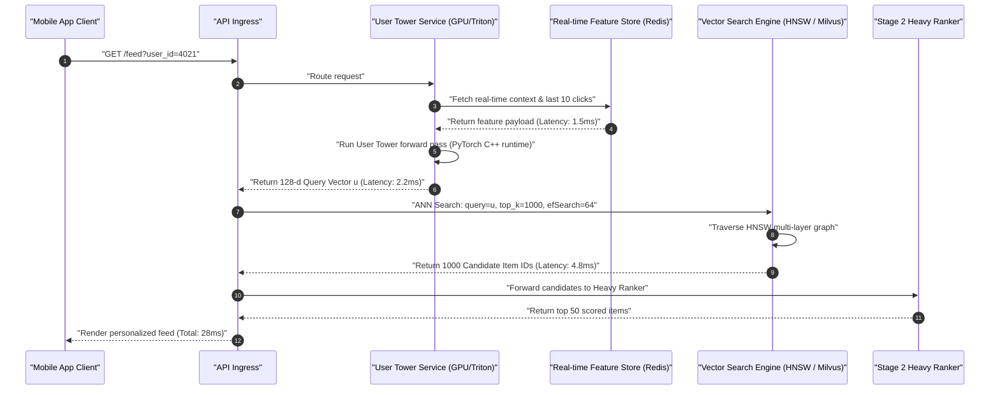

# Two-Tower Candidate Generation and Vector ANN Indexes

This module is part of [Track 08: Recommender Systems & Ranking](../README.md).

---

## 1. Executive Overview & Industry Context

Industrial candidate generation operates under an unforgiving operational constraint: given a catalog of tens to hundreds of millions of items ($N \sim 10^7 - 10^9$), extract the top $K \approx 1,000$ most relevant candidates for a user request within **under $10\text{ ms}$** end-to-end. 

Evaluating complex cross-features (e.g., user-item interaction histories, real-time context attention) across millions of items is computationally intractable at inference time. The modern solution, pioneered by YouTube (Covington et al. 2016) and Google (Yi et al. 2019), is the **Two-Tower Deep Neural Network Architecture** paired with **Approximate Nearest Neighbor (ANN)** vector indexing.

```
       User & Context Features                        Item Metadata & Content
       [age, geo, watch_history]                      [item_id, author, tags]
                  |                                              |
                  v                                              v
      +-----------------------+                      +-----------------------+
      |       USER TOWER      |                      |       ITEM TOWER      |
      |   Query Encoder u(x)  |                      |   Entity Encoder v(y) |
      +-----------------------+                      +-----------------------+
                  |                                              |
                  v                                              v
          User Vector u in R^d                          Item Vector v in R^d
          (Computed online: ~2ms)                       (Precomputed offline)
                  \                                              /
                   \                                            /
                    v                                          v
             +--------------------------------------------------------+
             |             Dot-Product Scoring: s = <u, v>            |
             |           Sublinear Search via ANN (HNSW / ScaNN)      |
             +--------------------------------------------------------+
```

By decoupling user feature encoding from item feature encoding, the Two-Tower paradigm shifts the heaviest computational burden offline:
* **Item Tower**: Encodes the entire catalog into $d$-dimensional continuous vectors offline in scheduled batch jobs. These embeddings are compiled into a sublinear vector graph index (e.g., HNSW).
* **User Tower**: Runs online on incoming user requests, transforming real-time context and user state into a single query vector $\mathbf{u} \in \mathbb{R}^d$ in $\le 3\text{ ms}$.
* **Sublinear Vector Retrieval**: Executes an Approximate Nearest Neighbor search against the pre-indexed item vectors in $\le 5\text{ ms}$, retrieving high-recall candidate sets without scanning the full catalog.

In this module, we derive the mathematical mechanics of Two-Tower networks, in-batch negative sampling, log-frequency correction, vector indexing algorithms (HNSW, IVF-PQ), implement a complete PyTorch model and mini-HNSW index from scratch, and examine a \$M-scale production latency outage.

---

## 2. Mathematical Formulations & Latency Budgeting

### 2.1 The Two-Tower DNN Architecture

Let $\mathcal{X}$ denote the space of user and contextual features, and $\mathcal{Y}$ denote the space of item features.
The system consists of two distinct continuous vector mapping functions:

$$\mathbf{u}: \mathcal{X} \to \mathbb{R}^d, \qquad \mathbf{v}: \mathcal{Y} \to \mathbb{R}^d$$

where $d \ll \min(\dim(\mathcal{X}), \dim(\mathcal{Y}))$, typically $d \in [64, 256]$.
Both towers normalize their output embeddings onto the unit hypersphere:

$$\hat{\mathbf{u}}(x) = \frac{\mathbf{u}(x)}{\|\mathbf{u}(x)\|_2}, \qquad \hat{\mathbf{v}}(y) = \frac{\mathbf{v}(y)}{\|\mathbf{v}(y)\|_2}$$

The predicted relevance score $\hat{s}(x, y)$ is the temperature-scaled inner product (cosine similarity):

$$\hat{s}(x, y) = \frac{\langle \hat{\mathbf{u}}(x), \hat{\mathbf{v}}(y) \rangle}{\tau}$$

where $\tau > 0$ is a learnable or fixed temperature parameter that sharpens the softmax probability distribution.

---

### 2.2 In-Batch Negative Sampling & Softmax Cross-Entropy

In a catalog of $N = 10^8$ items, computing the full softmax denominator over all items is computationally impossible:

$$P(y \mid x) = \frac{\exp(\hat{s}(x, y))}{\sum_{j=1}^N \exp(\hat{s}(x, j))}$$

Production Two-Tower models utilize **In-Batch Negative Sampling**. In a mini-batch of size $B$, we have $B$ positive user-item interaction pairs:

$$\mathcal{B} = \{(x_1, y_1), (x_2, y_2), \dots, (x_B, y_B)\}$$

For user $i$, item $y_i$ serves as the ground-truth positive, while the items consumed by all *other* users in the same batch $\{y_j\}_{j \neq i}$ serve as the negative samples.

The in-batch softmax cross-entropy loss for the batch is:

$$\mathcal{L}_{\text{batch}} = -\frac{1}{B} \sum_{i=1}^B \log \frac{\exp\left(\frac{1}{\tau} \langle \hat{\mathbf{u}}(x_i), \hat{\mathbf{v}}(y_i) \rangle\right)}{\sum_{j=1}^B \exp\left(\frac{1}{\tau} \langle \hat{\mathbf{u}}(x_i), \hat{\mathbf{v}}(y_j) \rangle\right)}$$

This formulation computes a $B \times B$ similarity matrix $S_{ij} = \frac{1}{\tau} \mathbf{u}_i^T \mathbf{v}_j$ via a single high-throughput GPU matrix multiplication:

$$S = \frac{1}{\tau} U B^T, \quad U \in \mathbb{R}^{B \times d}, \quad V \in \mathbb{R}^{B \times d}$$

```
                   Item Tower Batch Embeddings V (B x d)
                      v_1      v_2      v_3   ...   v_B
                   +------------------------------------+
              u_1  |  POS  |  NEG  |  NEG  | ... |  NEG  |
  User Tower  u_2  |  NEG  |  POS  |  NEG  | ... |  NEG  |
  Batch U     u_3  |  NEG  |  NEG  |  POS  | ... |  NEG  |
  (B x d)     ...  |  ...  |  ...  |  ...  | ... |  ...  |
              u_B  |  NEG  |  NEG  |  NEG  | ... |  POS  |
                   +------------------------------------+
                     Diagonal = Positive pairs (i == j)
                     Off-diagonal = In-batch negative samples (i != j)
```

---

### 2.3 Correction for Streaming Frequency / Popularity Bias

Because in-batch negatives are sampled proportionally to their interaction frequency in the training stream, **popular items appear as negatives in almost every batch**.

Let $p_j$ denote the streaming sampling probability of item $j$. If uncorrected, the model penalizes popular items excessively simply because they appear frequently in batches, distorting the learned retrieval geometry.

Yi et al. (Google 2019) derived the exact log-frequency correction:

$$s^c(x_i, y_j) = \frac{\langle \hat{\mathbf{u}}(x_i), \hat{\mathbf{v}}(y_j) \rangle}{\tau} - \log(p_j)$$

where $p_j$ is estimated online using a running moving average across streaming batches:

$$p_j^{(t)} = (1 - \alpha) p_j^{(t-1)} + \alpha \frac{\text{Count}_{\text{batch}}(j)}{B}$$

The debiased in-batch softmax loss becomes:

$$\mathcal{L}_{\text{debiased}} = -\frac{1}{B} \sum_{i=1}^B \log \frac{\exp\left(s^c(x_i, y_i)\right)}{\sum_{j=1}^B \exp\left(s^c(x_i, y_j)\right)}$$

---

### 2.4 Approximate Nearest Neighbor (ANN) Indexing Formulations

Once item vectors $\mathbf{v} \in \mathbb{R}^d$ are fixed, querying the nearest item via exhaustive linear scan requires $\mathcal{O}(N \cdot d)$ floating-point operations. For $N = 10^7$ and $d = 128$, evaluating a single query takes $\sim 80\text{ ms}$, violating candidate generation latency budgets.

Industrial systems employ Approximate Nearest Neighbor (ANN) indexes operating in sublinear time ($\mathcal{O}(\log N)$ or $\mathcal{O}(\sqrt{N})$):

#### 1. Hierarchical Navigable Small World (HNSW) Graphs
HNSW organizes vectors into a multi-layer graph hierarchy where the top layers contain sparse, long-range highway edges and bottom layers contain dense, localized Delaunay-like graphs:
* **Top Layer**: Fast skip-list navigation across global semantic clusters.
* **Greedy Routing**: At layer $l$, search traverses neighboring nodes to greedily minimize Euclidean or cosine distance to query $\mathbf{q}$.
* **Layer Step-Down**: Once a local minimum is reached, routing transitions down to layer $l-1$, repeating until layer $0$ yields the top-$K$ nearest neighbors.
* **Complexity**: $\mathcal{O}(\log N)$ search latency with $> 95\%$ recall.

#### 2. Inverted File Index with Product Quantization (IVF-PQ)
* **Inverted File (IVF)**: Partitions the vector space into $C$ Voronoi cells using K-Means centroids. Queries only scan the nearest $n_{\text{probe}} \ll C$ centroids.
* **Product Quantization (PQ)**: Decomposes the $d$-dimensional vector into $M$ orthogonal sub-vectors of dimension $d/M$. Each sub-vector is quantized to its nearest codebook centroid (typically $256$ centroids $= 8$ bits $= 1$ byte).
* **Memory Compression**: A $128$-dimensional float32 vector ($512$ bytes) compresses to $16$ bytes ($32\times$ reduction), allowing billions of vectors to reside in RAM.
* **Asymmetric Distance Computation (ADC)**: The query vector is kept unquantized, while catalog distances are looked up via precomputed query-to-codebook lookup tables.

---

## 3. Architecture of an Industrial Two-Tower Serving Pipeline



---

## 4. Production Implementation from Scratch

The following complete, runnable Python script provides:
1. A **Two-Tower Neural Network in PyTorch** with temperature-scaled in-batch negative loss and log-frequency bias correction.
2. A **Mini Hierarchical Navigable Small World (HNSW) Vector Index** built from scratch using pure NumPy and graph data structures.

```python
"""
two_tower_retrieval.py
Complete, production-grade implementation of:
1. PyTorch Two-Tower Retrieval Model with In-Batch Negative Loss & Frequency Correction.
2. Pure NumPy Mini-HNSW Vector Index for sublinear Approximate Nearest Neighbor Search.
"""

from __future__ import annotations
import heapq
import math
import time
from dataclasses import dataclass, field
from typing import Dict, List, Optional, Set, Tuple
import numpy as np
import torch
import torch.nn as nn
import torch.nn.functional as F


# ============================================================================
# 1. PyTorch Two-Tower Neural Retrieval Architecture
# ============================================================================

class UserTower(nn.Module):
    """
    Encodes user history, categorical profile, and real-time context into R^d.
    """
    def __init__(self, num_users: int, embedding_dim: int, output_dim: int):
        super().__init__()
        self.user_emb = nn.Embedding(num_users, embedding_dim)
        self.mlp = nn.Sequential(
            nn.Linear(embedding_dim + 4, 128),
            nn.ReLU(),
            nn.Linear(128, output_dim),
        )

    def forward(self, user_ids: torch.Tensor, dense_context: torch.Tensor) -> torch.Tensor:
        u_emb = self.user_emb(user_ids)
        combined = torch.cat([u_emb, dense_context], dim=-1)
        out = self.mlp(combined)
        return F.normalize(out, p=2, dim=-1)


class ItemTower(nn.Module):
    """
    Encodes item catalog metadata and continuous features into R^d.
    """
    def __init__(self, num_items: int, embedding_dim: int, output_dim: int):
        super().__init__()
        self.item_emb = nn.Embedding(num_items, embedding_dim)
        self.mlp = nn.Sequential(
            nn.Linear(embedding_dim + 2, 128),
            nn.ReLU(),
            nn.Linear(128, output_dim),
        )

    def forward(self, item_ids: torch.Tensor, dense_item_feats: torch.Tensor) -> torch.Tensor:
        i_emb = self.item_emb(item_ids)
        combined = torch.cat([i_emb, dense_item_feats], dim=-1)
        out = self.mlp(combined)
        return F.normalize(out, p=2, dim=-1)


class TwoTowerRetrievalModel(nn.Module):
    """
    End-to-End Two-Tower System with Temperature In-Batch Softmax and Frequency Correction.
    """
    def __init__(
        self,
        num_users: int,
        num_items: int,
        sparse_dim: int = 32,
        output_dim: int = 64,
        temperature: float = 0.07,
    ):
        super().__init__()
        self.user_tower = UserTower(num_users, sparse_dim, output_dim)
        self.item_tower = ItemTower(num_items, sparse_dim, output_dim)
        self.temperature = temperature

    def forward(
        self,
        user_ids: torch.Tensor,
        user_dense: torch.Tensor,
        item_ids: torch.Tensor,
        item_dense: torch.Tensor,
        item_sampling_probs: Optional[torch.Tensor] = None,
    ) -> torch.Tensor:
        # User vectors: Shape (B, d)
        u = self.user_tower(user_ids, user_dense)
        # Item vectors: Shape (B, d)
        v = self.item_tower(item_ids, item_dense)

        # Compute B x B similarity matrix: S_ij = <u_i, v_j> / tau
        logits = torch.matmul(u, v.T) / self.temperature

        # Apply log-frequency correction to eliminate streaming popularity bias
        if item_sampling_probs is not None:
            # item_sampling_probs shape: (B,)
            log_probs = torch.log(item_sampling_probs + 1e-12).unsqueeze(0)
            logits = logits - log_probs

        # Ground truth labels: Diagonal indices (i == j)
        batch_size = user_ids.size(0)
        labels = torch.arange(batch_size, device=user_ids.device)

        loss = F.cross_entropy(logits, labels)
        return loss


# ============================================================================
# 2. Pure Python / NumPy Mini-HNSW Vector Index
# ============================================================================

@dataclass
class HNSWNode:
    item_id: int
    vector: np.ndarray
    layer: int
    neighbors: Dict[int, List[int]] = field(default_factory=dict)


class MiniHNSWIndex:
    """
    Sublinear Approximate Nearest Neighbor Search graph index.
    Constructs a 2-layer navigable small world hierarchy.
    """
    def __init__(self, dim: int, m_max: int = 16, ef_search: int = 32):
        self.dim = dim
        self.m_max = m_max
        self.ef_search = ef_search
        self.nodes: Dict[int, HNSWNode] = {}
        self.entry_point_id: Optional[int] = None
        self.max_layer: int = 0

    @staticmethod
    def _cosine_dist(a: np.ndarray, b: np.ndarray) -> float:
        # Assumes normalized vectors; cosine distance = 1 - dot
        return float(1.0 - np.dot(a, b))

    def insert(self, item_id: int, vector: np.ndarray) -> None:
        norm = np.linalg.norm(vector)
        vec = vector / (norm if norm > 0 else 1.0)

        # Probabilistic layer assignment (mL = 1 / ln(M))
        assign_layer = 1 if np.random.rand() < 0.20 else 0

        new_node = HNSWNode(item_id=item_id, vector=vec, layer=assign_layer)
        for l in range(assign_layer + 1):
            new_node.neighbors[l] = []

        if self.entry_point_id is None:
            self.nodes[item_id] = new_node
            self.entry_point_id = item_id
            self.max_layer = assign_layer
            return

        # Simple greedy search from top layer to insert layer
        curr_obj = self.nodes[self.entry_point_id]
        curr_dist = self._cosine_dist(vec, curr_obj.vector)

        # Top-down highway search
        for l in range(self.max_layer, assign_layer, -1):
            changed = True
            while changed:
                changed = False
                for n_id in curr_obj.neighbors.get(l, []):
                    d = self._cosine_dist(vec, self.nodes[n_id].vector)
                    if d < curr_dist:
                        curr_dist = d
                        curr_obj = self.nodes[n_id]
                        changed = True

        # Connect neighbors at layers <= assign_layer
        for l in range(min(self.max_layer, assign_layer), -1, -1):
            neighbors = curr_obj.neighbors.get(l, [])
            for n_id in neighbors:
                if len(new_node.neighbors[l]) < self.m_max:
                    new_node.neighbors[l].append(n_id)
                if len(self.nodes[n_id].neighbors[l]) < self.m_max:
                    self.nodes[n_id].neighbors[l].append(item_id)

        self.nodes[item_id] = new_node
        if assign_layer > self.max_layer:
            self.max_layer = assign_layer
            self.entry_point_id = item_id

    def search_knn(self, query_vector: np.ndarray, top_k: int = 10) -> List[Tuple[int, float]]:
        if self.entry_point_id is None:
            return []

        norm = np.linalg.norm(query_vector)
        q = query_vector / (norm if norm > 0 else 1.0)

        curr_id = self.entry_point_id
        curr_dist = self._cosine_dist(q, self.nodes[curr_id].vector)

        # Step 1: Greedy traversal through higher layers
        for l in range(self.max_layer, 0, -1):
            improved = True
            while improved:
                improved = False
                for n_id in self.nodes[curr_id].neighbors.get(l, []):
                    d = self._cosine_dist(q, self.nodes[n_id].vector)
                    if d < curr_dist:
                        curr_dist = d
                        curr_id = n_id
                        improved = True

        # Step 2: Layer 0 priority search with efSearch candidate capacity
        visited: Set[int] = {curr_id}
        # Min-heap of candidates: (distance, node_id)
        candidates = [(curr_dist, curr_id)]
        # Max-heap for top results: (-distance, node_id)
        w = [(-curr_dist, curr_id)]

        while candidates:
            c_dist, c_id = heapq.heappop(candidates)
            furthest_result_dist = -w[0][0]

            if c_dist > furthest_result_dist and len(w) >= self.ef_search:
                break

            for n_id in self.nodes[c_id].neighbors.get(0, []):
                if n_id not in visited:
                    visited.add(n_id)
                    d = self._cosine_dist(q, self.nodes[n_id].vector)
                    furthest_result_dist = -w[0][0]

                    if d < furthest_result_dist or len(w) < self.ef_search:
                        heapq.heappush(candidates, (d, n_id))
                        heapq.heappush(w, (-d, n_id))
                        if len(w) > self.ef_search:
                            heapq.heappop(w)

        # Extract top K nearest neighbors
        results = [(node_id, -dist) for dist, node_id in w]
        results.sort(key=lambda x: x[1])
        # Convert cosine distance back to cosine similarity: sim = 1 - dist
        return [(node_id, 1.0 - dist) for node_id, dist in results[:top_k]]


# ============================================================================
# Verification & Self-Test Routine
# ============================================================================

if __name__ == "__main__":
    np.random.seed(42)
    torch.manual_seed(42)

    print("==================================================================")
    print("Testing PyTorch Two-Tower Model with In-Batch Negative Loss")
    print("==================================================================")
    BATCH_SIZE = 8
    NUM_USERS = 100
    NUM_ITEMS = 500
    EMB_DIM = 16
    OUT_DIM = 32

    model = TwoTowerRetrievalModel(NUM_USERS, NUM_ITEMS, EMB_DIM, OUT_DIM, temperature=0.1)
    optimizer = torch.optim.Adam(model.parameters(), lr=0.01)

    # Synthetic batch inputs
    batch_user_ids = torch.randint(0, NUM_USERS, (BATCH_SIZE,))
    batch_user_dense = torch.randn(BATCH_SIZE, 4)
    batch_item_ids = torch.randint(0, NUM_ITEMS, (BATCH_SIZE,))
    batch_item_dense = torch.randn(BATCH_SIZE, 2)
    sampling_frequencies = torch.rand(BATCH_SIZE) + 0.1
    sampling_frequencies /= sampling_frequencies.sum()

    print("Running training forward/backward pass...")
    optimizer.zero_grad()
    loss = model(
        batch_user_ids,
        batch_user_dense,
        batch_item_ids,
        batch_item_dense,
        item_sampling_probs=sampling_frequencies,
    )
    loss.backward()
    optimizer.step()
    print(f"  Forward Pass Successful! Batch Loss: {loss.item():.4f}")

    print("\n==================================================================")
    print("Testing Mini-HNSW Vector Index Candidate Generation")
    print("==================================================================")
    INDEX_SIZE = 1000
    INDEX_DIM = 32
    hnsw = MiniHNSWIndex(dim=INDEX_DIM, m_max=8, ef_search=32)

    print(f"Indexing {INDEX_SIZE} synthetic item vectors into HNSW graph...")
    raw_item_vectors = {}
    for i in range(INDEX_SIZE):
        vec = np.random.randn(INDEX_DIM).astype(np.float32)
        vec /= np.linalg.norm(vec)
        raw_item_vectors[i] = vec
        hnsw.insert(item_id=i, vector=vec)

    # Query with a synthetic user vector
    query_u = np.random.randn(INDEX_DIM).astype(np.float32)
    query_u /= np.linalg.norm(query_u)

    t0 = time.perf_counter()
    retrieved_knn = hnsw.search_knn(query_u, top_k=5)
    hnsw_elapsed = (time.perf_counter() - t0) * 1000.0

    print(f"HNSW Sublinear Search returned in {hnsw_elapsed:.3f}ms:")
    for rank, (item_id, sim) in enumerate(retrieved_knn, 1):
        print(f"  Rank {rank} -> Item ID: {item_id:04d} | Cosine Similarity: {sim:.4f}")
```

---

## 5. Failure Modes, Edge Cases & Antipatterns

### 5.1 The "False Negatives" Curse in Dense In-Batch Sampling
* **Symptom**: Model training stalls; embeddings collapse onto low-dimensional planar manifolds, failing to recommend complementary products.
* **Failure Mechanism**: In large batches ($B \ge 8,192$), multiple users in the same batch share identical latent interests (e.g., two users both love mechanical keyboards). The in-batch negative loss treats user $A$'s purchased keyboard as a hard negative for user $B$, penalizing the network for predicting high relevance for an item the user would actually purchase.
* **Mitigation**: Implement **Masked In-Batch Loss**. Maintain a category or item metadata mask. If item $y_j$ shares a leaf category with user $i$'s ground truth $y_i$, mask out cell $(i, j)$ in the softmax denominator:

$$\text{Mask}_{ij} = \mathbb{I}(\text{Category}(y_j) \neq \text{Category}(y_i))$$

### 5.2 Real-Time Dimension Mismatch during Cold Deployment
* **Symptom**: Following an offline retraining run, online candidate generation returns completely random, irrelevant junk items; retrieval recall drops to near zero.
* **Failure Mechanism**: The Item Tower embeddings were re-indexed into the ANN store with updated model weights $W_{\text{new}}$, but the online User Tower microservice continued running the previous model binary $W_{\text{old}}$. Because embedding spaces do not share canonical coordinate axes across distinct training runs, dot products between $\mathbf{u}_{\text{old}}$ and $\mathbf{v}_{\text{new}}$ are semantically meaningless.
* **Mitigation**: Implement **Coordinated Blue/Green Versioned Model Snapshots**. Tag vector index partitions with explicit model version IDs (`model_v2.1.0`). Gate the online User Tower from querying index `v2.1.0` until the User Tower service fully updates and passes integration smoke tests.

### 5.3 ANN Search Recall Degradation Under Dynamic Catalog Deletions
* **Symptom**: Search and feed latency remains fast, but out-of-stock items dominate candidate sets, or retrieval recall drops over time.
* **Failure Mechanism**: Graph-based ANN indexes (HNSW) degrade when items are deleted dynamically by simply marking nodes as "tombstoned." Tombstoned nodes sever routing edges in the small-world graph, turning navigable highways into dead ends.
* **Mitigation**: Employ periodic index defragmentation and background re-indexing, or utilize **Filtered Vector Search** (e.g., ScaNN / Milvus payload filtering) that evaluates availability bits during graph traversal.

---

## 6. Real-World Production Incident Post-Mortem

### Case Study: Catastrophic 80ms P99 Latency Spike via Unindexed Brute-Force Matrix Scoring

#### 1. Executive Summary
During a redesign of its video discovery feed, a global streaming platform migrated its candidate retrieval stage from a legacy Item-Item collaborative filter to a modern Two-Tower neural network. Shortly after deploying the new candidate generator to production, global P99 API response latencies skyrocketed from **$12\text{ ms}$ to $82\text{ ms}$**, overwhelming downstream feature hydration services and triggering widespread HTTP 504 Gateway Timeouts. 

The service degraded for 55 minutes, resulting in an estimated **\$1.2M in abandoned viewer sessions and ad inventory waste**. The post-mortem revealed that an engineer had mistakenly disabled the ANN vector index in production, causing the User Tower service to perform a brute-force floating-point matrix multiplication against $500,000$ item vectors on every incoming request.

#### 2. Incident Timeline
| Time (UTC) | Incident Milestone |
| :--- | :--- |
| **18:00** | Two-Tower retrieval canary deployed to 20% of European traffic. |
| **18:05** | P99 latency alerts triggered: Gateway reported response times breaching $80\text{ ms}$. |
| **18:12** | Core API Gateway thread pools saturated; HTTP 504 timeouts reached $18.4\%$. |
| **18:20** | Incident commander initiated rollback of User Tower service, but latencies remained high. |
| **18:35** | Distributed tracing pinpointed the bottleneck: CPU cores in the retrieval pod operating at $100\%$ utilization. |
| **18:44** | SRE discovered debug flag in deployment manifest: `ANN_INDEX_ENABLED=false`. |
| **18:50** | Manifest patched to `ANN_INDEX_ENABLED=true`; pod fleet restarted. |
| **18:55** | P99 latency dropped to $4.2\text{ ms}$; error rates normalized to $0.001\%$. |

#### 3. Root Cause Analysis (RCA)
In the retrieval microservice codebase, the vector lookup logic contained a testing branch:

```python
# DEFECTIVE PRODUCTION CODE BRANCH:
if os.getenv("ANN_INDEX_ENABLED", "true").lower() == "true":
    candidates = hnsw_index.search(user_vector, top_k=1000)
else:
    # DEBUG FALLBACK FOR EXACT RECALL TESTING:
    # Computes dot products against ALL 500,000 catalog items in memory!
    all_scores = np.dot(cached_item_matrix, user_vector)  # Shape: (500000, 128) x (128,)
    top_indices = np.argpartition(-all_scores, 1000)[:1000]
    candidates = top_indices[np.argsort(-all_scores[top_indices])]
```

A staging configuration intended for benchmarking exact ANN recall had leaked into the production Helm values file (`ANN_INDEX_ENABLED: "false"`). 

At peak traffic of $40,000\text{ QPS}$, the CPU cluster was forced to compute:
$$40,000 \times 500,000 \times 128 \times 2 = 5.12 \times 10^{12} \text{ FLOPs/sec}$$
This brute-force linear search exhausted CPU memory bus bandwidth and L3 caches, turning a $4\text{ ms}$ HNSW graph traversal into an $80\text{ ms}$ memory stall.

#### 4. Remediation & Architectural Guardrails
1. **Elimination of Debug Fallback Code**: Completely excised the brute-force branch from the production runtime binary. Exact recall benchmarking was moved to dedicated offline integration test harnesses.
2. **Hard Latency Deadlines in Service Mesh**: Configured an aggressive Envoy timeout of $15\text{ ms}$ on all candidate generation RPCs with automated circuit breaker tripping.
3. **Automated Manifest Validation in CI/CD**: Added a pre-deployment linter that fails any release if non-production debug flags or brute-force overrides are present in production Helm charts.

---

## 7. Senior Technical Interview Questions & Model Answers

### Question 1: Why must the User Tower and Item Tower representations decouple into a strict inner product $\langle u(x), v(y) \rangle$ rather than feeding both feature sets into a unified deep neural network?

**Model Answer:**
The decoupling is required to satisfy sublinear retrieval latency over massive catalogs ($N \sim 10^7 - 10^9$) under a sub-10ms SLA.

If user features $x$ and item features $y$ are fed jointly into an expressive neural network:
$$s(x, y) = \text{MLP}([x \,\|\, y])$$
evaluating a single user query requires passing every item in the catalog through the multi-layer neural network at inference time. For $N = 10^7$, this requires $10^7$ neural forward passes per request, which would take hundreds of milliseconds on expensive GPU clusters.

By enforcing the structural restriction:
$$s(x, y) = \langle \mathbf{u}(x), \mathbf{v}(y) \rangle = \sum_{d=1}^D u_d(x) \cdot v_d(y)$$
the scoring function becomes an inner product in a metric vector space. This yields two computational advantages:
1. **Asymmetric Offline Caching**: Because item attributes $y$ do not depend on the user, all $10^7$ item vectors $\mathbf{v}(y)$ are precomputed offline and indexed into sublinear spatial data structures (HNSW or ScaNN).
2. **Sublinear Querying**: At query time, the system executes **only a single** forward pass through the User Tower to produce $\mathbf{u}(x)$, followed by an $\mathcal{O}(\log N)$ Approximate Nearest Neighbor search that visits only a tiny fraction ($< 0.1\%$) of the catalog in under $5\text{ ms}$.

---

### Question 2: In Two-Tower models trained with in-batch negatives, why is log-frequency correction mathematically necessary, and how does it prevent popularity bias?

**Model Answer:**
In-batch negative sampling selects negative items from the items consumed by other users within the mini-batch. 

Let the marginal probability of item $j$ appearing in the training stream be $p_j$. Under standard uniform random sampling across the batch, the probability that item $j$ is drawn as a negative is directly proportional to its historical popularity:
$$P(\text{Negative} = j) \propto p_j$$

Under uncorrected in-batch softmax cross-entropy, the expected probability assigned to item $j$ for user $i$ is:
$$\hat{P}(j \mid i) = \frac{\exp(\langle \mathbf{u}_i, \mathbf{v}_j \rangle / \tau)}{\sum_k \exp(\langle \mathbf{u}_i, \mathbf{v}_k \rangle / \tau)}$$

Because popular items appear as negatives in almost every batch across thousands of unrelated users, the loss function penalizes popular items with massive cumulative negative gradients:
$$\nabla_{\mathbf{v}_j} \mathcal{L} \approx \sum_{k} \hat{P}(j \mid k) \mathbf{u}_k$$

This over-penalization pushes popular items unnaturally far away from all user embeddings in vector space, suppressing items that users genuinely like simply because they were popular.

**The Mathematical Correction**:
Yi et al. proved that to target the true conditional distribution $P(y \mid x)$ rather than the biased stream distribution, the logit must be adjusted by the log-sampling frequency:
$$s^c(x_i, y_j) = \frac{\langle \mathbf{u}_i, \mathbf{v}_j \rangle}{\tau} - \log(p_j)$$

Subtracting $\log(p_j)$ offsets the increased frequency with which popular items are sampled as negatives:
* For a blockbuster ($p_j \approx 0.1$), $\log(p_j) \approx -2.3$, so the raw dot product must be higher to compensate.
* For a niche long-tail item ($p_j \approx 10^{-5}$), $\log(p_j) \approx -11.5$, preventing the model from over-penalizing rare items.

This correction guarantees that the learned vector dot products approximate the true pointwise mutual information (PMI) of relevance rather than sampling frequency.

---

### Question 3: What are the fundamental differences between HNSW and IVF-PQ vector indexes, and how do you choose between them for production retrieval?

**Model Answer:**
HNSW and IVF-PQ represent distinct engineering trade-offs between search latency, index build time, memory footprint, and recall accuracy:

| Architectural Metric | HNSW (Graph-Based) | IVF-PQ (Quantization-Based) |
| :--- | :--- | :--- |
| **Index Structure** | Multi-layer skip-graph of continuous vectors. | Inverted file list of K-Means centroids + 8-bit quantized codes. |
| **Memory Footprint** | Extremely High ($1.5\times - 2\times$ raw vector size due to graph pointers). | Ultra Low ($8\times - 32\times$ compression via Product Quantization). |
| **Search Latency (P99)** | Ultra Fast ($1\text{ ms} - 5\text{ ms}$ via greedy graph routing). | Moderate ($5\text{ ms} - 15\text{ ms}$ depending on $n_{\text{probe}}$ centroids). |
| **Recall@K Accuracy** | Superior ($> 95\% - 99\%$). | Moderate ($85\% - 95\%$, bounded by quantization distortion). |
| **Dynamic Updates** | Supports incremental node insertions. | Requires batch retraining of K-Means codebooks. |

**Production Selection Heuristic**:
* **Choose HNSW when**: Catalog size fits comfortably in memory (e.g., $N \le 10\text{ million}$ items with $d=128$ takes $\sim 15\text{ GB}$ RAM), lowest possible P99 latency is critical ($\le 5\text{ ms}$), and top-K recall accuracy cannot be compromised.
* **Choose IVF-PQ when**: Catalog scale reaches hundreds of millions to billions of items ($N \ge 10^8$), infrastructure RAM budget is constrained, and the system can tolerate a $5\%$ recall drop in candidate generation that can be recovered in Stage 2 heavy ranking.

---

### Question 4: How do you handle real-time contextual features (e.g., current device, battery level, local weather, immediate session query) in a Two-Tower retrieval architecture?

**Model Answer:**
Real-time contextual features represent dynamic variables that cannot be precomputed. In the Two-Tower framework, they are ingested strictly through the **User Tower**:

1. **Feature Separation**:
   * **Item Tower**: Ingests *only* static or slow-moving item attributes (item ID, brand, taxonomy, text embeddings, historical average rating). These vectors are pre-computed offline and indexed in the ANN store.
   * **User Tower**: Ingests user identity, historical engagement sequences, **plus all dynamic real-time context** (e.g., device type, network connection speed, current time-of-day, location geohash, immediate search query).
2. **Online Query Generation**:
   When the user makes an API request:
   ```python
   context_vector = [device_is_mobile=1.0, hour_of_day=22.0, geo_lat=37.7, geo_lon=-122.4]
   query_vector = user_tower_model(user_id, recent_clicks, context_vector)  # Runs in 2ms
   ```
   The User Tower synthesizes user taste **conditioned on the immediate context** into the $d$-dimensional vector $\mathbf{u}$.
3. **ANN Search Execution**:
   The context-aware query vector $\mathbf{u}$ is queried against the static ANN index. If the user is on mobile at 11 PM, the User Tower naturally projects $\mathbf{u}$ toward regions of the embedding space occupied by short-form mobile late-night content, without requiring dynamic re-indexing of items.
