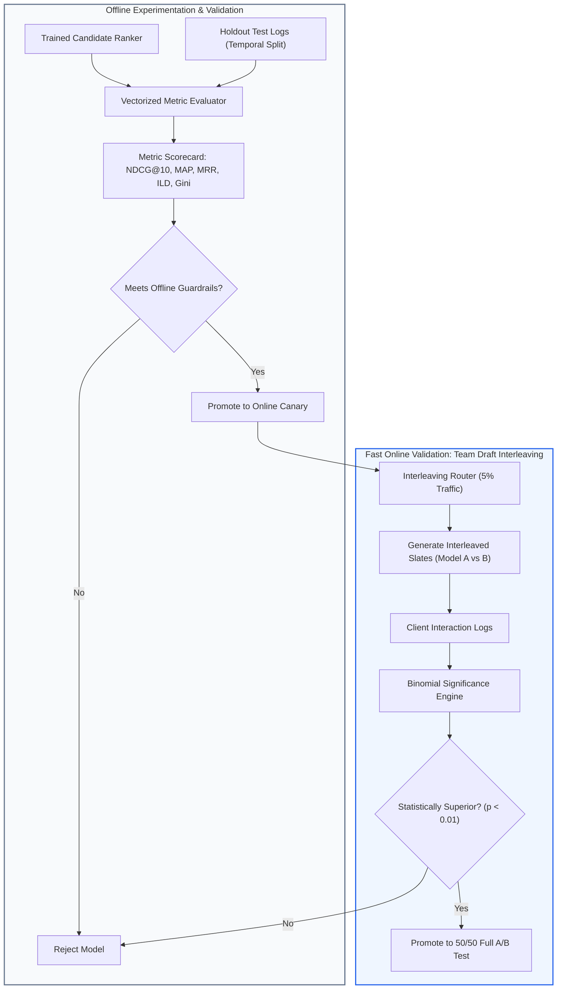

# Ranking Metrics: NDCG, MAP, MRR, Beyond-Accuracy, and Online Evaluation

This module is part of [Track 08: Recommender Systems & Ranking](../README.md).

---

## 1. Executive Overview & Industry Context

Evaluating recommender systems is notoriously challenging. Unlike standard supervised learning tasks where loss surfaces correspond directly to test-set accuracy, recommendation models operate in an open-loop observational environment plagued by the **Offline-to-Online Correlation Gap**:
* A model can achieve a statistically significant $+4\%$ gain in offline Normalized Discounted Cumulative Gain (NDCG@10) yet produce a $-6\%$ collapse in online customer retention or Gross Merchandise Value (GMV).

This divergence occurs because offline historical test sets reflect past user exposure under historical ranking policies. When an offline metric rewards a model for predicting historical clicks, it frequently rewards the model for replicating exposure bias and over-recommending popular blockbusters at the expense of catalog discovery and serendipity.

To build robust industrial ranking architectures, engineers must master:
1. **Offline Top-Heavy Ranking Metrics**: Discounted Cumulative Gain (DCG), NDCG, Mean Reciprocal Rank (MRR), and Mean Average Precision (MAP).
2. **Beyond-Accuracy Metrics**: Intra-List Diversity (ILD), Novelty, Serendipity, Catalog Coverage, and Gini Exposure Inequality.
3. **Rapid Online Evaluation**: Continuous A/B testing and **Team Draft Interleaving** (which provides up to $100\times$ faster statistical significance than standard split-bucket A/B tests).

In this module, we formalize the mathematics of ranking evaluation, analyze beyond-accuracy metrics, implement a complete vectorized evaluation suite and interleaving generator in Python, and investigate a production post-mortem where an offline NDCG win triggered customer churn.

---

## 2. Mathematical Formulations: Offline & Online Ranking Metrics

```
                              Recommender Evaluation Hierarchy
                                             |
         +-----------------------------------+-----------------------------------+
         |                                                                       |
         v                                                                       v
   Offline Metrics                                                         Online Metrics
   - Top-Heavy Accuracy: NDCG@K, MRR, MAP@K                                - Team Draft Interleaving (TDI)
   - Beyond-Accuracy: Diversity, Novelty, Coverage                         - Controlled A/B Testing
   - Objective: Fast model iteration & hyperparameter tuning              - Objective: Commercial business KPIs
```

### 2.1 Offline Ranking Accuracy Metrics

Let $Q$ denote a set of evaluation queries or users. For each query $q \in Q$, the model outputs an ordered ranking permutation $\pi_q = [\pi_q(1), \pi_q(2), \dots, \pi_q(K)]$ over candidate items, evaluated against ground-truth relevance grades $y_{q, i} \in \{0, 1, \dots, R_{\max}\}$.

#### 1. Discounted Cumulative Gain (DCG@K) & Normalized DCG (NDCG@K)
DCG measures the cumulative gain of items discounted logarithmically by their presentation position:

$$\text{DCG@}K(q) = \sum_{m=1}^K \frac{2^{y_{q, \pi_q(m)}} - 1}{\log_2(m + 1)}$$

where the numerator $2^y - 1$ exponentially rewards high-relevance items, and the denominator $\log_2(m + 1)$ enforces logarithmic positional decay.

To enable cross-query comparison, DCG is normalized by the **Ideal DCG (IDCG@K)**, which is the DCG achieved by an optimal sort of candidate items by ground-truth labels:

$$\text{IDCG@}K(q) = \sum_{m=1}^{K} \frac{2^{y_{q, \pi_q^*(m)}} - 1}{\log_2(m + 1)}, \quad \text{where } y_{q, \pi_q^*(1)} \ge y_{q, \pi_q^*(2)} \ge \dots$$

$$\text{NDCG@}K = \frac{1}{|Q|} \sum_{q \in Q} \frac{\text{DCG@}K(q)}{\text{IDCG@}K(q)}$$

If $\text{IDCG@}K(q) = 0$ (query has zero relevant items in ground truth), $\text{NDCG}$ is defined as $1.0$ (or excluded from the mean).

#### 2. Mean Reciprocal Rank (MRR)
MRR evaluates the speed with which the model surfaces the *first* relevant item ($y > 0$). It is common in search and QA systems:

$$\text{RR}(q) = \frac{1}{\min \{m : y_{q, \pi_q(m)} > 0\}}$$

$$\text{MRR} = \frac{1}{|Q|} \sum_{q \in Q} \text{RR}(q)$$

If no relevant item appears within top $K$, $\text{RR}(q) = 0$.

#### 3. Mean Average Precision (MAP@K)
For binary relevance labels $y \in \{0, 1\}$, Average Precision (AP) averages the precision at each position where a relevant item is retrieved:

$$\text{AP@}K(q) = \frac{\sum_{m=1}^K P@m(q) \cdot y_{q, \pi_q(m)}}{\min(K, \sum_{i} y_{q, i})}$$

where $P@m(q) = \frac{1}{m} \sum_{j=1}^m y_{q, \pi_q(j)}$ is precision at cutoff $m$.
The Mean Average Precision is:

$$\text{MAP@}K = \frac{1}{|Q|} \sum_{q \in Q} \text{AP@}K(q)$$

---

### 2.2 Beyond-Accuracy Metrics: Diversity, Novelty, and Coverage

Maximizing NDCG alone leads to sterile, over-concentrated recommendation feeds. Production scorecards evaluate multi-dimensional health metrics:

#### 1. Intra-List Diversity (ILD)
Given an item distance or dissimilarity metric $d(i, j) \in [0, 1]$ (e.g., $1 - \cos(\mathbf{x}_i, \mathbf{x}_j)$):

$$\text{ILD}(\pi_q) = \frac{2}{K(K - 1)} \sum_{a=1}^K \sum_{b=a+1}^K d(\pi_q(a), \pi_q(b))$$

High ILD ensures that a recommendation slate avoids presenting redundant duplicates from the same narrow category.

#### 2. Novelty (Self-Information)
Measures the ability of the system to recommend unexpected, informative items rather than obvious blockbusters. An item's novelty is the negative log-probability of its global catalog exposure:

$$\text{Nov}(i) = -\log_2 P(i) = -\log_2 \left(\frac{\text{Impressions}(i)}{\sum_j \text{Impressions}(j)}\right)$$

$$\text{Novelty@}K = \frac{1}{|Q|} \sum_{q \in Q} \frac{1}{K} \sum_{m=1}^K \text{Nov}(\pi_q(m))$$

#### 3. Catalog Coverage
The proportion of catalog items $\mathcal{I}$ recommended to at least one user across test queries:

$$\text{Coverage} = \frac{|\bigcup_{q \in Q} \{\pi_q(1), \dots, \pi_q(K)\}|}{|\mathcal{I}|}$$

#### 4. Gini Inequality of Impressions
Measures exposure monopolization across items. Sorting items by cumulative recommended impressions $C_1 \le C_2 \le \dots \le C_N$:

$$G = \frac{2 \sum_{i=1}^N i \cdot C_i}{N \sum_{i=1}^N C_i} - \frac{N + 1}{N}$$

$G = 0$ represents complete democratic equality (all items receive identical exposure); $G \to 1$ indicates that a tiny fraction of blockbusters monopolizes $100\%$ of user impressions.

---

### 2.3 Online Evaluation: Team Draft Interleaving (TDI)

While traditional A/B testing splits users into disjoint buckets (Control vs. Treatment), measuring subtle ranking improvements requires millions of user sessions over weeks. **Team Draft Interleaving** combines the ranked lists of Model A and Model B into a single interleaved slate presented to the user, providing **$50\times - 100\times$ higher statistical power**.

```
             Model A Slate                             Model B Slate
           [A_1, A_2, A_3, A_4]                      [B_1, B_2, B_3, B_4]
                    \                                         /
                     \                                       /
                      v                                     v
                   +-------------------------------------------+
                   |       Coin Toss for Priority Order:       |
                   |   Heads: Team A picks -> Tails: Team B    |
                   +-------------------------------------------+
                                         |
                                         v
                            Interleaved Unified Slate:
                      Pos 1: A_1  (Team A)
                      Pos 2: B_1  (Team B)
                      Pos 3: A_2  (Team A)
                      Pos 4: B_2  (Team B)
                                         |
                                         v
                         User Interaction / Click Tracking:
                     Clicks on Team A vs. Clicks on Team B
```

#### Team Draft Algorithm Formulation
1. Maintain two teams: $\text{Team}_A = \emptyset, \text{Team}_B = \emptyset$.
2. For position $m = 1, 2, \dots, K$:
   * Flip a fair coin: $c \in \{A, B\}$.
   * The winning team selects its highest-ranked candidate that has not yet been selected.
   * Assign that item to the winning team.
   * The opposing team then selects its highest-ranked unselected item and assigns it to its team.
3. User interactions (clicks, watch time) are credited exclusively to the team that selected the item.
4. Relative preference is evaluated via a binomial test:
   $$\Delta_{\text{clicks}} = \text{Clicks}_A - \text{Clicks}_B$$

Because both models are evaluated on the **exact same user request, query context, and screen real estate**, user-level variance cancels out completely.

---

### 2.4 Counterfactual Off-Policy Evaluation (OPE): Doubly Robust Estimation

To predict online performance without risking user exposure, enterprise platforms employ **Off-Policy Evaluation (OPE)** over historical logging policy $\pi_0$.

Let $x \in \mathcal{X}$ be the user context, $a \in \mathcal{A}$ be the slate recommended by historical policy $\pi_0(a \mid x)$, and $r$ be the observed reward. We wish to estimate the expected reward $V(\pi_e) = \mathbb{E}_{x \sim P, a \sim \pi_e}[r]$ of a new evaluation policy $\pi_e$.

#### 1. Inverse Propensity Score (IPS) Estimator
Weights observed historical rewards by the importance sampling ratio:

$$\hat{V}_{\text{IPS}}(\pi_e) = \frac{1}{|D|} \sum_{i=1}^{|D|} \frac{\pi_e(a_i \mid x_i)}{\pi_0(a_i \mid x_i)} \cdot r_i$$

While unbiased ($\mathbb{E}[\hat{V}_{\text{IPS}}] = V(\pi_e)$), the IPS estimator suffers from high variance if the target policy $\pi_e$ takes actions rare under logging policy $\pi_0$ ($\pi_0 \to 0$).

#### 2. Direct Method (DM) Estimator
Trains a regression model $\hat{Q}(x, a) \approx \mathbb{E}[r \mid x, a]$ directly:

$$\hat{V}_{\text{DM}}(\pi_e) = \frac{1}{|D|} \sum_{i=1}^{|D|} \sum_{a \in \mathcal{A}} \pi_e(a \mid x_i) \cdot \hat{Q}(x_i, a)$$

The Direct Method has zero importance-sampling variance, but suffers from high estimation bias if the reward model $\hat{Q}$ is misspecified.

#### 3. Doubly Robust (DR) Estimator
Combines IPS and DM to achieve the variance reduction of the Direct Method while retaining the asymptotic unbiasedness of IPS:

$$\hat{V}_{\text{DR}}(\pi_e) = \frac{1}{|D|} \sum_{i=1}^{|D|} \left[ \sum_{a \in \mathcal{A}} \pi_e(a \mid x_i) \hat{Q}(x_i, a) + \frac{\pi_e(a_i \mid x_i)}{\pi_0(a_i \mid x_i)} \left(r_i - \hat{Q}(x_i, a_i)\right) \right]$$

**Double Robustness Property**:
If **either** the propensity model $\pi_0(a \mid x)$ **or** the reward model $\hat{Q}(x, a)$ is correctly specified, the Doubly Robust estimator is guaranteed to be an **unbiased estimator** of true online policy value $V(\pi_e)$.

---

## 3. Architecture of an Enterprise Evaluation and A/B Testing Framework



---

## 4. Production Implementation: Vectorized Evaluation Suite & Interleaving Generator

The following complete, runnable Python module implements:
1. A **Vectorized Offline Evaluation Suite** calculating NDCG@K, MAP@K, MRR, Intra-List Diversity (ILD), and Gini Coefficient in NumPy.
2. An industrial **Team Draft Interleaving Slate Generator** with coin-toss fairness and team click attribution.

```python
"""
evaluation_suite.py
Production-grade Offline Ranking Metric Evaluator & Online Team Draft Interleaving Generator.
Zero external ML dependencies; fully vectorized using pure NumPy.
"""

from __future__ import annotations
import math
import random
import time
from dataclasses import dataclass, field
from typing import Dict, List, Optional, Set, Tuple
import numpy as np


# ============================================================================
# 1. Vectorized Offline Ranking Metric Suite
# ============================================================================

class OfflineRankingEvaluator:
    """
    Computes top-heavy ranking metrics (NDCG@K, MAP@K, MRR) and beyond-accuracy
    health metrics (ILD, Novelty, Gini Inequality).
    """
    def __init__(self, k: int = 10):
        self.k = k

    def compute_dcg(self, relevances: np.ndarray) -> float:
        """
        DCG@K = sum_{i=1}^K (2^{rel_i} - 1) / log2(i + 1)
        """
        eval_len = min(len(relevances), self.k)
        if eval_len == 0:
            return 0.0
        gains = np.power(2.0, relevances[:eval_len]) - 1.0
        discounts = 1.0 / np.log2(np.arange(2, eval_len + 2))
        return float(np.sum(gains * discounts))

    def evaluate_query(
        self,
        predicted_order: np.ndarray,      # Item IDs in predicted rank order
        ground_truth: Dict[int, float],   # item_id -> relevance grade
    ) -> Dict[str, float]:
        """
        Evaluates a single query permutation against ground truth relevance.
        """
        eval_items = predicted_order[:self.k]
        actual_relevances = np.array([ground_truth.get(int(i), 0.0) for i in eval_items], dtype=np.float32)

        # 1. NDCG@K
        dcg = self.compute_dcg(actual_relevances)
        all_relevances = np.array(list(ground_truth.values()), dtype=np.float32)
        ideal_relevances = np.sort(all_relevances)[::-1]
        idcg = self.compute_dcg(ideal_relevances)
        ndcg = (dcg / idcg) if idcg > 0.0 else 1.0

        # 2. MRR (First positive hit where relevance > 0)
        mrr = 0.0
        for rank, rel in enumerate(actual_relevances, start=1):
            if rel > 0.0:
                mrr = 1.0 / rank
                break

        # 3. MAP@K (Binary relevance)
        ap = 0.0
        num_positives_in_gt = sum(1 for r in ground_truth.values() if r > 0.0)
        if num_positives_in_gt > 0:
            hits = 0
            sum_precisions = 0.0
            for rank, rel in enumerate(actual_relevances, start=1):
                if rel > 0.0:
                    hits += 1
                    sum_precisions += hits / rank
            ap = sum_precisions / min(self.k, num_positives_in_gt)

        return {"ndcg": ndcg, "mrr": mrr, "map": ap}

    @staticmethod
    def compute_intra_list_diversity(
        recommended_items: List[int],
        embeddings: Dict[int, np.ndarray],
    ) -> float:
        """
        ILD = (2 / K(K-1)) sum_{i < j} (1 - cos(v_i, v_j))
        """
        K = len(recommended_items)
        if K <= 1:
            return 0.0

        vecs = [embeddings[i] for i in recommended_items if i in embeddings]
        if len(vecs) <= 1:
            return 0.0

        mat = np.vstack(vecs)
        # Normalize
        norms = np.linalg.norm(mat, axis=1, keepdims=True)
        norms[norms == 0.0] = 1.0
        normed = mat / norms

        sim_matrix = np.dot(normed, normed.T)
        dissimilarities = 1.0 - sim_matrix
        # Extract upper triangle
        triu_indices = np.triu_indices(len(vecs), k=1)
        return float(np.mean(dissimilarities[triu_indices]))

    @staticmethod
    def compute_gini_coefficient(item_impression_counts: np.ndarray) -> float:
        """
        Measures impression inequality across catalog items (0 = equality, 1 = monopoly).
        """
        counts = np.sort(item_impression_counts)
        n = len(counts)
        if n == 0 or np.sum(counts) == 0:
            return 0.0
        cumulative = np.cumsum(counts)
        sum_counts = cumulative[-1]
        gini = (2.0 * np.sum((np.arange(1, n + 1) * counts))) / (n * sum_counts) - (n + 1.0) / n
        return float(gini)


# ============================================================================
# 2. Online Team Draft Interleaving Slate Generator
# ============================================================================

@dataclass
class InterleavedSlate:
    slate_items: List[int]
    team_assignments: Dict[int, str]  # item_id -> 'Model_A' or 'Model_B'


class TeamDraftInterleaving:
    """
    Team Draft Interleaving (TDI) generator.
    Merges slates from Model A and Model B with unbiased coin flips.
    """
    def __init__(self, slate_size: int = 10, random_seed: Optional[int] = None):
        self.slate_size = slate_size
        self.rng = random.Random(random_seed)

    def interleave(self, list_a: List[int], list_b: List[int]) -> InterleavedSlate:
        selected_slate: List[int] = []
        team_assignments: Dict[int, str] = {}
        idx_a = 0
        idx_b = 0
        selected_set: Set[int] = set()

        team_a_count = 0
        team_b_count = 0

        while len(selected_slate) < self.slate_size:
            # Advance pointers to next unselected items
            while idx_a < len(list_a) and list_a[idx_a] in selected_set:
                idx_a += 1
            while idx_b < len(list_b) and list_b[idx_b] in selected_set:
                idx_b += 1

            has_a = idx_a < len(list_a)
            has_b = idx_b < len(list_b)

            if not has_a and not has_b:
                break

            # Determine who picks next
            if team_a_count < team_b_count:
                first_pick = "A"
            elif team_b_count < team_a_count:
                first_pick = "B"
            else:
                first_pick = "A" if self.rng.random() < 0.5 else "B"

            if first_pick == "A" and has_a:
                item = list_a[idx_a]
                idx_a += 1
                selected_slate.append(item)
                selected_set.add(item)
                team_assignments[item] = "Model_A"
                team_a_count += 1
            elif first_pick == "B" and has_b:
                item = list_b[idx_b]
                idx_b += 1
                selected_slate.append(item)
                selected_set.add(item)
                team_assignments[item] = "Model_B"
                team_b_count += 1
            elif has_a:
                item = list_a[idx_a]
                idx_a += 1
                selected_slate.append(item)
                selected_set.add(item)
                team_assignments[item] = "Model_A"
                team_a_count += 1
            elif has_b:
                item = list_b[idx_b]
                idx_b += 1
                selected_slate.append(item)
                selected_set.add(item)
                team_assignments[item] = "Model_B"
                team_b_count += 1

        return InterleavedSlate(slate_items=selected_slate, team_assignments=team_assignments)


# ============================================================================
# Verification & Self-Test Routine
# ============================================================================

if __name__ == "__main__":
    np.random.seed(42)

    print("==================================================================")
    print("Testing Vectorized Offline Ranking Evaluation Suite")
    print("==================================================================")
    evaluator = OfflineRankingEvaluator(k=5)

    # Synthetic query: Candidate pool of 10 items
    predicted_rank_order = np.array([101, 102, 103, 104, 105, 106, 107, 108, 109, 110])
    ground_truth_relevance = {
        101: 3.0,  # Highly relevant at rank 1
        103: 2.0,  # Moderately relevant at rank 3
        105: 1.0,  # Weakly relevant at rank 5
        108: 3.0,  # Highly relevant missed (at rank 8)
    }

    metrics = evaluator.evaluate_query(predicted_rank_order, ground_truth_relevance)
    print(f"Query Results -> NDCG@5: {metrics['ndcg']:.4f} | MRR: {metrics['mrr']:.4f} | MAP@5: {metrics['map']:.4f}")

    # Intra-List Diversity Test
    synthetic_embeddings = {
        i: np.random.randn(8) for i in predicted_rank_order
    }
    ild = evaluator.compute_intra_list_diversity(list(predicted_rank_order[:5]), synthetic_embeddings)
    print(f"Intra-List Diversity (ILD) of top 5: {ild:.4f}")

    # Gini Coefficient Test
    impressions = np.array([1000, 500, 200, 10, 5, 2, 1, 1, 0, 0], dtype=np.float32)
    gini = evaluator.compute_gini_coefficient(impressions)
    print(f"Gini Exposure Inequality Index: {gini:.4f} (High concentration)")

    print("\n==================================================================")
    print("Testing Online Team Draft Interleaving (TDI)")
    print("==================================================================")
    tdi = TeamDraftInterleaving(slate_size=6, random_seed=42)
    slate_model_a = [10, 20, 30, 40, 50, 60]
    slate_model_b = [30, 70, 10, 80, 90, 100]

    result = tdi.interleave(slate_model_a, slate_model_b)
    print("Interleaved Slate Composition:")
    for rank, item_id in enumerate(result.slate_items, start=1):
        team = result.team_assignments[item_id]
        print(f"  Pos {rank}: Item {item_id} -> Credited to: {team}")
```

---

## 5. Failure Modes, Edge Cases & Antipatterns

### 5.1 The Offline-to-Online Correlation Gap
* **Symptom**: An offline model achieves $+5.2\%$ higher NDCG@10 on historical validation logs, but loses decisively in an online A/B test ($-4.1\%$ CTR, $-7.8\%$ revenue).
* **Failure Mechanism**: The offline validation test set is created by filtering historical logs collected under the *legacy* recommendation model. Items that the legacy model never displayed are labeled as $y=0$. The new model is severely penalized offline for attempting to recommend novel, high-quality items simply because the historical logging policy never exposed them.
* **Mitigation**: Utilize **Counterfactual Off-Policy Evaluation (OPE)** with Inverse Propensity Weighting (Module 04), or deploy lightweight **Team Draft Interleaving** early in the development cycle.

### 5.2 Position Bias Leakage in Interleaving Attributions
* **Symptom**: In a Team Draft Interleaving test, whichever model happens to get its item into Position 1 wins $85\%$ of the time, regardless of relevance.
* **Failure Mechanism**: User visual attention is heavily skewed toward Position 1. If coin toss assignment is not strictly alternated, one model accumulates unfair position advantages.
* **Mitigation**: Enforce **Balanced Team Assignment**: ensure that across a large sample of interleaved queries, Model A and Model B receive an exactly identical proportion of odd and even slot allocations.

### 5.3 Small-Query NDCG Inflation
* **Symptom**: NDCG metrics jump to $> 0.95$ across the platform, masking severe recommendation failures.
* **Failure Mechanism**: If a query has only 1 relevant item in the entire catalog, placing that single item anywhere in the top $K$ results in $\text{DCG} \approx \text{IDCG}$, yielding $\text{NDCG} \approx 1.0$.
* **Mitigation**: Filter out trivial queries with $|\text{Relevant}| \le 1$ during evaluation, or report **Recall@K** and **MRR** alongside NDCG.

---

## 6. Real-World Production Incident Post-Mortem

### Case Study: \$1.8M Revenue Loss via Offline NDCG Win Causing Popularity Bias Collapse

#### 1. Executive Summary
A premier music streaming platform authorized the global rollout of a new deep sequence ranker after it demonstrated a statistically significant **$+4.2\%$ lift in offline NDCG@10** on a 30-day temporal test split. Within three weeks of 100% deployment, the platform suffered a **$6.8\%$ drop in 30-day subscriber retention** and a catastrophic **$21\%$ plunge in artist catalog diversity**. 

Churned subscriber surveys revealed universal dissatisfaction: the personalized radio and daily discovery carousels had degenerated into repetitive loops of mainstream Top-40 pop hits. The platform incurred an estimated **\$1.8M in lost subscription renewals** before the model was rolled back.

#### 2. Incident Timeline
| Time Window | Incident Milestone |
| :--- | :--- |
| **Day -14** | Deep sequence ranker evaluated offline: NDCG@10 rose from $0.612$ to $0.638$ ($+4.2\%$). |
| **Day 0** | Full deployment to all 45 million active subscribers. |
| **Day 7** | Initial telemetry appeared positive: 24-hour track plays rose $+2.1\%$ (driven by instant pop hits). |
| **Day 14** | Warning signs emerged: repeat daily session duration dropped by $-12\%$; long-tail artist streams collapsed by $-45\%$. |
| **Day 21** | Subscription churn metrics spiked: 30-day churn reached historical high of $4.8\%$ (vs $2.2\%$ baseline). |
| **Day 23** | Emergency retrospective initiated; data science identified extreme popularity feedback collapse. |
| **Day 24** | Model rolled back; diversified hybrid ranker restored; churn normalized within 10 days. |

#### 3. Root Cause Analysis (RCA)
1. **The Popularity Bias Trap**: The offline test set evaluated historical user interactions. Because popular pop tracks are consumed by millions of users across multiple contexts, predicting pop tracks for every user yielded a high hit rate on the historical test set, artificially boosting offline NDCG.
2. **Beyond-Accuracy Blindness**: The team evaluated **only NDCG@10**, completely omitting beyond-accuracy metrics. During post-incident auditing, the health metrics revealed extreme degradation:
   * **Intra-List Diversity (ILD)** dropped by **$-38\%$**.
   * **Catalog Coverage** collapsed from $42\%$ of the catalog down to **$3.1\%$**.
   * **Gini Exposure Index** spiked from $0.68$ to **$0.94$** (severe monopoly).
3. **Loss of Discovery Utility**: Users rely on streaming platforms for serendipitous discovery. By presenting tracks users had already heard hundreds of times on broadcast radio, the model eliminated discovery utility, driving users to competing services.

#### 4. Remediation & Architectural Guardrails
1. **Mandatory Multi-Metric Scorecard Policy**: Established an immutable engineering policy: no ranking model may be promoted to production without passing automated gates across **five orthogonal metrics**:
   * NDCG@10 $\ge$ Baseline
   * Intra-List Diversity $\ge 0.70$
   * Catalog Coverage $\ge 35\%$
   * Gini Coefficient $\le 0.75$
   * Novelty Score $\ge$ Baseline
2. **Team Draft Interleaving Canary Gate**: Mandated that all future ranking candidates undergo a 7-day Team Draft Interleaving canary test on 5% traffic prior to any full A/B test.

---

## 7. Senior Technical Interview Questions & Model Answers

### Question 1: What is the mathematical formulation of NDCG@K, why is the logarithmic discount factor $\log_2(i + 1)$ chosen, and under what conditions does NDCG fail as an evaluation metric?

**Model Answer:**
Discounted Cumulative Gain (DCG@K) is formulated as:
$$\text{DCG@}K = \sum_{i=1}^K \frac{2^{r_i} - 1}{\log_2(i + 1)}$$
where $r_i \in \{0, 1, \dots, R_{\max}\}$ is the relevance grade of the item at rank $i$.

Normalized Discounted Cumulative Gain (NDCG@K) scales DCG by the Ideal DCG (IDCG@K):
$$\text{NDCG@}K = \frac{\text{DCG@}K}{\text{IDCG@}K}, \quad \text{where } \text{IDCG@}K = \sum_{i=1}^K \frac{2^{r_i^*} - 1}{\log_2(i + 1)}$$

**The Justification for Logarithmic Discount**:
The discount term $\frac{1}{\log_2(i + 1)}$ models user visual scanning behavior derived from eye-tracking studies (e.g., the Cascade Model of search). It satisfies three properties:
1. **Diminishing Marginal Penalty**: The drop in attention between rank 1 and rank 2 ($\frac{1}{\log_2(2)} - \frac{1}{\log_2(3)} = 1.0 - 0.63 = 0.37$) is dramatically steeper than the drop between rank 9 and rank 10 ($0.30 - 0.28 = 0.02$).
2. **Smooth Monotonicity**: It provides a continuous, strictly decreasing penalty across all ranks without sharp artificial thresholds.

**Conditions Where NDCG Fails**:
1. **Extreme Selection Bias in Historical Logs**: If test sets contain only items exposed by previous algorithms, unobserved items are marked $r_i = 0$. A model that surfaces a superior, novel item is penalized by NDCG.
2. **Binary Cutoff Insensitivity**: NDCG rewards items purely based on position, ignoring page fold boundaries (e.g., items 1-4 are visible above the fold on mobile, items 5-10 require scrolling).
3. **Diversity Blindness**: A slate containing 10 near-identical iPhone models achieves a perfect NDCG of 1.0 if the user likes iPhones, despite offering zero diversity or discovery value.

---

### Question 2: Why does Team Draft Interleaving provide up to $100\times$ faster statistical significance than traditional independent-bucket A/B testing?

**Model Answer:**
Traditional A/B testing assigns users randomly to disjoint buckets:
* Group 1 (Control): Receives slates from Model A.
* Group 2 (Treatment): Receives slates from Model B.

The test compares the average click-through rate $\overline{\text{CTR}}_A$ vs. $\overline{\text{CTR}}_B$. The variance of the estimated difference is:
$$\text{Var}(\overline{\text{CTR}}_A - \overline{\text{CTR}}_B) = \frac{\sigma_A^2}{N_A} + \frac{\sigma_B^2}{N_B}$$

In web systems, **user variance** $\sigma^2$ is massive: some users click everything, others click nothing; query difficulty varies wildly; time-of-day and external events introduce heavy noise. To overcome this large background variance, A/B tests require hundreds of thousands of queries.

**The Interleaving Solution**:
Team Draft Interleaving merges the ranked outputs of Model A and Model B into a single composite list presented to the **same user for the exact same query session**:
1. **Variance Cancellation**: Because both models are evaluated simultaneously under identical user context, network conditions, screen size, and query difficulty, the cross-user variance cancels out:
   $$\text{Var}(\Delta) = \text{Var}(\text{Clicks}_A - \text{Clicks}_B \mid \text{Query } q)$$
2. **Within-Subject Paired Comparison**: The evaluation reduces to a paired comparison (e.g., a simple binomial sign test). 

Empirical research by Netflix, Microsoft, and Google demonstrates that interleaving reduces the sample size required to detect a true ranking preference with $95\%$ power ($p < 0.01$) by a factor of **$50\times$ to $100\times$**, cutting experimentation cycles from 4 weeks to 24 hours.

---

### Question 3: How do you mathematically measure Catalog Coverage and Gini Inequality in recommendations, and what architectural mechanisms prevent Gini inflation?

**Model Answer:**
Catalog Coverage and Gini Inequality measure the macro-distributional health of recommendation algorithms:

#### 1. Catalog Coverage
The fraction of distinct items in catalog $\mathcal{I}$ recommended to at least one user across a test window:
$$\text{Coverage} = \frac{|\bigcup_{u \in \mathcal{U}} \text{TopK}(u)|}{|\mathcal{I}|}$$

#### 2. Gini Coefficient
Given total accumulated impression counts across all $N$ items, sorted in ascending order $C_1 \le C_2 \le \dots \le C_N$:
$$G = \frac{2 \sum_{i=1}^N i \cdot C_i}{N \sum_{i=1}^N C_i} - \frac{N + 1}{N}$$
* $G = 0$: Perfect equality (all items receive identical impression share).
* $G \to 1.0$: Extreme concentration (a tiny elite of blockbusters monopolizes all impressions).

**Architectural Mechanisms to Prevent Gini Inflation**:
1. **Inverse Propensity Weighting (IPW)**: Weighting loss during training by $1 / p_i$ (Module 04) forces the ranker to value conversions on rare items, directly boosting long-tail candidate scores.
2. **Stage-3 Diversity & Exploration Quotas**: Enforce a hard ceiling in the re-ranking layer limiting blockbuster impression share:
   ```python
   if item.global_popularity_percentile > 0.95 and current_blockbuster_count >= 2:
       continue  # Force exploration of long-tail items
   ```
3. **Multi-Armed Bandits (LinUCB / Thompson Sampling)**: Dynamically allocating $5\% - 10\%$ of impression real estate to high-variance exploratory items prevents the system from locking into self-reinforcing popular loops.

---

### Question 4: How does Counterfactual Off-Policy Evaluation (OPE) via Doubly Robust Estimators bridge the gap between offline historical logs and live online A/B testing?

**Model Answer:**
Standard offline validation evaluates models on historical interaction logs generated by a past logging policy $\pi_0$. When a new evaluation policy $\pi_e$ recommends an action $a$ that differs from historical action $a_0$, the true user feedback is unobserved.

The **Doubly Robust (DR) Estimator** bridges this counterfactual gap by combining an explicit reward predictor with importance sampling:
$$\hat{V}_{\text{DR}}(\pi_e) = \frac{1}{|D|} \sum_{i=1}^{|D|} \left[ \sum_{a \in \mathcal{A}} \pi_e(a \mid x_i) \hat{Q}(x_i, a) + \frac{\pi_e(a_i \mid x_i)}{\pi_0(a_i \mid x_i)} \left(r_i - \hat{Q}(x_i, a_i)\right) \right]$$

1. **Bias Protection**: If the reward estimation model $\hat{Q}(x, a)$ is biased (e.g., underestimates clicks on cold items), but the propensity model $\pi_0(a \mid x)$ accurately reflects historical display probabilities, the importance weight $\frac{\pi_e}{\pi_0}$ corrects the residual error $(r_i - \hat{Q})$, guaranteeing an unbiased estimate of online expected reward.
2. **Variance Reduction**: If the importance weight $\frac{\pi_e}{\pi_0}$ explodes due to rare actions, the residual $(r_i - \hat{Q})$ has zero mean under accurate $\hat{Q}$, preventing the wild variance spikes characteristic of pure Inverse Propensity Scoring.

Production teams use Doubly Robust OPE to screen hundreds of candidate rankers offline, filtering out models that appear strong on naive NDCG but fail counterfactual value estimation, saving weeks of wasted A/B testing capacity.

---

### Question 5: In an enterprise recommender deployment with heterogeneous surfaces (e.g., Homepage Hero vs. Post-Checkout Carousel), how do you structure statistical power calculations and sample size requirements for online A/B testing?

**Model Answer:**
Structuring an enterprise A/B test across heterogeneous surfaces requires calculating surface-specific Minimum Detectable Effects (MDE) and adjusting for sample size variance:

#### 1. Sample Size Formula for Binary Conversion Metrics
For a two-tailed hypothesis test comparing baseline conversion rate $p_1$ against treatment $p_2 = p_1 (1 + \delta)$ with statistical significance $\alpha$ (e.g., $0.05 \implies Z_{\alpha/2} = 1.96$) and statistical power $1 - \beta$ (e.g., $0.80 \implies Z_{\beta} = 0.84$):

$$N_{\text{per\_variant}} = \frac{\left(Z_{\alpha/2} \sqrt{2 \bar{p}(1 - \bar{p})} + Z_{\beta} \sqrt{p_1(1 - p_1) + p_2(1 - p_2)}\right)^2}{(p_1 - p_2)^2}$$

#### 2. Surface-Specific Operational Divergence
* **Homepage Hero Feed**: High traffic ($10^7\text{ impressions/day}$), moderate baseline CTR ($p \approx 4\%$). Detecting a relative $+2\%$ lift requires relatively modest sample sizes ($\sim 400,000$ users per variant, achieved in $< 24\text{ hours}$).
* **Post-Checkout Carousel**: Low traffic ($2\times 10^5\text{ impressions/day}$), low baseline conversion ($p \approx 0.5\%$). Detecting a $+2\%$ lift requires:
  $$N \approx \frac{16 \times 0.005}{(0.005 \times 0.02)^2} \approx 8,000,000 \text{ users per variant}$$
  Achieving statistical power on post-checkout requires $> 40$ days of testing, exposing the experiment to seasonal drift and user contamination.

#### 3. Mitigation Strategies
* **Interleaving for Pre-Screening**: Run Team Draft Interleaving on the post-checkout surface first to detect ranking preference with $100\times$ fewer sessions.
* **Variance Reduction via CUPED (Controlled-experiment Using Pre-Experiment Data)**: Use pre-experiment user spend and historical click covariates to reduce outcome variance:
  $$\tilde{Y}_i = Y_i - \theta (X_i - \mathbb{E}[X])$$
  where $\theta = \frac{\text{Cov}(Y, X)}{\text{Var}(X)}$. CUPED reduces required sample size by $(1 - \rho_{XY}^2)$, typically cutting required runtime by $30\% - 50\%$.
