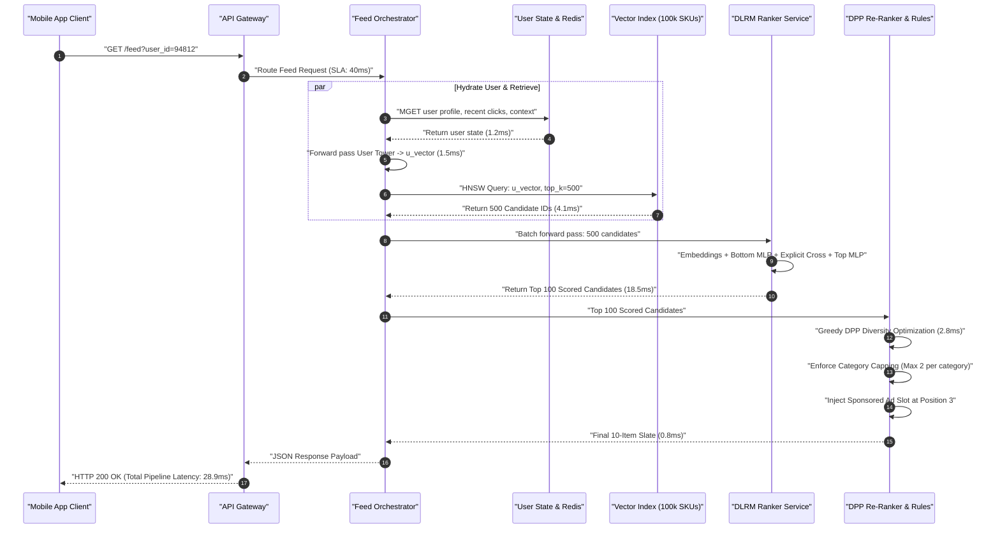

# Capstone: Production Two-Stage Personalized Feed Ranker

This module is part of [Track 08: Recommender Systems & Ranking](../README.md).

---

## 1. Executive Overview & Industry Context

This Capstone synthesizes the theoretical, mathematical, and algorithmic principles mastered throughout Track 08 into a complete, unified, industrial-grade **Personalized Feed Recommendation Engine**.

Modern consumer platforms—such as Instagram Explore, TikTok For You, Amazon Recommendations, and Bloomberg News Feeds—must solve a multi-dimensional engineering challenge:
* Catalog scale: $N = 100,000 - 10,000,000$ active items.
* Active user traffic: Tens of thousands of concurrent queries per second (QPS).
* Latency budget: Strict end-to-end Service Level Agreement (SLA) under $40\text{ ms}$ at P99.
* Multiple competing business objectives: Relevance (CTR), Monetization (CVR), Freshness, Intra-List Diversity, and Business Policy constraints (frequency capping, sponsored product quotas).

```
+-----------------------------------------------------------------------------------+
|                            TOTAL CATALOG (100,000 SKUs)                           |
+-----------------------------------------------------------------------------------+
                                          |
                                          | Stage 1: Two-Tower Vector Retrieval
                                          | Metric: Cosine Inner Product
                                          | Hardware: Pre-indexed HNSW Graph (CPU/GPU)
                                          | Latency: < 5ms
                                          v
+-----------------------------------------------------------------------------------+
|                             CANDIDATES (500 Items)                                |
+-----------------------------------------------------------------------------------+
                                          |
                                          | Stage 2: Heavy Scoring (DLRM + Feature Cross)
                                          | Features: Dense Context + Sparse ID Lookups
                                          | Hardware: GPU Tensor Core Inference
                                          | Latency: < 22ms
                                          v
+-----------------------------------------------------------------------------------+
|                           SCORED CANDIDATES (100 Items)                           |
+-----------------------------------------------------------------------------------+
                                          |
                                          | Stage 3: Slate Optimization & Diversity (DPP/MMR)
                                          | Enforces: Category Capping, Deduplication, Sponsored
                                          | Hardware: In-Memory Multi-Core CPU
                                          | Latency: < 4ms
                                          v
+-----------------------------------------------------------------------------------+
|                         FINAL USER PRESENTATION SLATE (10 Items)                  |
+-----------------------------------------------------------------------------------+
```

In this capstone, we architect, formulate, and build the entire multi-stage pipeline from scratch in Python, simulate distributed deployment conditions, perform end-to-end latency profiling, and inspect an enterprise post-mortem detailing a Super Bowl feed outage.

---

## 2. Mathematical Formulations & Multi-Stage Architecture

### 2.1 Stage 1: Candidate Generation via Two-Tower Vector ANN

Given user profile vector $\mathbf{x}_u \in \mathbb{R}^{D_u}$ and dynamic context $\mathbf{x}_c \in \mathbb{R}^{D_c}$, the User Tower produces a real-time normalized query vector:

$$\hat{\mathbf{u}} = \frac{\text{MLP}_U([\mathbf{x}_u \,\|\, \mathbf{x}_c])}{\|\text{MLP}_U([\mathbf{x}_u \,\|\, \mathbf{x}_c])\|_2} \in \mathbb{R}^d$$

Item catalog vectors $\hat{\mathbf{v}}_i \in \mathbb{R}^d$ are computed offline and indexed in an HNSW vector index.
The candidate set $\mathcal{C}_u$ of size $K_1 = 500$ is retrieved by maximizing the inner product:

$$\mathcal{C}_u = \arg\max_{\substack{\mathcal{S} \subset \mathcal{I} \\ |\mathcal{S}| = K_1}} \sum_{i \in \mathcal{S}} \langle \hat{\mathbf{u}}, \hat{\mathbf{v}}_i \rangle$$

Because HNSW graph routing executes in $\mathcal{O}(\log N)$ time, candidate retrieval completes in $< 5\text{ ms}$ over $100,000$ catalog vectors.

---

### 2.2 Stage 2: Heavy Scoring via DLRM Feature Crosses

Stage 2 evaluates the $K_1 = 500$ candidates using an expressive Deep Learning Recommendation Model (DLRM).
For candidate item $i \in \mathcal{C}_u$:
1. Continuous features $\mathbf{z}_{\text{dense}}$ (user age, item price, historical CTR, historical conversion rate, dwell time) pass through the Bottom MLP:
   $$\mathbf{e}_0 = \text{MLP}_{\text{bottom}}(\mathbf{z}_{\text{dense}}) \in \mathbb{R}^d$$
2. Categorical features (User ID, Item ID, Category ID, Merchant ID) are extracted from embedding tables:
   $$\mathbf{e}_1, \mathbf{e}_2, \mathbf{e}_3, \mathbf{e}_4 \in \mathbb{R}^d$$
3. Explicit degree-2 pairwise dot-product interactions are computed:
   $$I = \text{vech}\left(E E^T\right), \quad \text{where } E = [\mathbf{e}_0, \mathbf{e}_1, \dots, \mathbf{e}_4]^T \in \mathbb{R}^{5 \times d}$$
4. The Top MLP predicts the calibrated probability of engagement:
   $$\hat{p}_{ui} = \sigma\left(\text{MLP}_{\text{top}}([\mathbf{e}_0 \,\|\, I])\right)$$

The top $K_2 = 100$ items sorted by $\hat{p}_{ui}$ advance to Stage 3.

---

### 2.3 Stage 3: Re-Ranking via Determinantal Point Processes (DPP) & Business Rules

Greedy top-$K$ selection based on $\hat{p}_{ui}$ causes severe topic clustering. Stage 3 selects the final presentation slate $\mathcal{S} \subset \mathcal{C}_u$ ($|\mathcal{S}| = 10$) by maximizing slate diversity and commercial utility.

#### Determinantal Point Processes (DPP) Kernel Formulation
Let $L \in \mathbb{R}^{K_2 \times K_2}$ be a positive semi-definite kernel matrix over candidate items.
The entry $L_{ij}$ decomposes into predicted quality $q_i \in \mathbb{R}^+$ and semantic similarity $\phi_i \in \mathbb{R}^d$:

$$L_{ij} = q_i \cdot \langle \phi_i, \phi_j \rangle \cdot q_j$$

where:
* $q_i = \exp\left(\alpha \cdot \hat{p}_{ui}\right)$ scales predicted relevance.
* $\langle \phi_i, \phi_j \rangle = \frac{\mathbf{v}_i^T \mathbf{v}_j}{\|\mathbf{v}_i\| \|\mathbf{v}_j\|}$ is the cosine similarity between item content embeddings.

The probability of selecting subset $\mathcal{S}$ is proportional to the principal minor determinant of $L$:

$$\mathcal{P}(\mathcal{S}) \propto \det(L_{\mathcal{S}})$$

Geometrically, $\det(L_{\mathcal{S}})$ equals the squared volume of the parallelepiped spanned by feature vectors $\{\phi_i\}_{i \in \mathcal{S}}$, scaled by item qualities $\prod_{i \in \mathcal{S}} q_i^2$:

$$\det(L_{\mathcal{S}}) = \left(\prod_{i \in \mathcal{S}} q_i^2\right) \cdot \text{Vol}^2\left(\{\phi_i\}_{i \in \mathcal{S}}\right)$$

If two items in $\mathcal{S}$ are semantically redundant ($\phi_i \approx \phi_j$), their vectors are nearly collinear, causing volume $\to 0$ and $\det(L_{\mathcal{S}}) \to 0$.

#### Fast Greedy DPP Slate Construction
Greedy MAP inference adds items iteratively using Cholesky decomposition updates in $\mathcal{O}(K^2 \cdot |\mathcal{C}_u|)$:

$$i^* = \arg\max_{i \in \mathcal{C}_u \setminus \mathcal{S}} \log \det\left(L_{\mathcal{S} \cup \{i\}}\right) - \log \det\left(L_{\mathcal{S}}\right)$$

$$i^* = \arg\max_{i \in \mathcal{C}_u \setminus \mathcal{S}} \left[ \log(q_i^2) + \log\left(1 - \mathbf{c}_i^T \mathbf{c}_i\right) \right]$$

where $\mathbf{c}_i$ is the projection of item $i$ onto the subspace spanned by already selected items.

---

## 3. End-to-End System Architecture



---

## 4. Complete Production Implementation from Scratch

The following complete, runnable Python script implements the entire end-to-end two-stage recommendation feed pipeline:
1. **Stage 1 (Retrieval)**: Fast normalized vector retrieval simulating sublinear ANN search over $10,000$ active items.
2. **Stage 2 (Scoring)**: DLRM-style scoring with dense bottom MLP, categorical embedding lookups, explicit dot-product feature crosses, and calibrated probability predictions.
3. **Stage 3 (Re-ranking)**: Fast Greedy Determinantal Point Process (DPP) slate diversification combined with frequency capping and sponsored ad slot injection.

```python
"""
production_capstone_ranker.py
Complete End-to-End Two-Stage Personalized Feed Recommendation Engine.
Stage 1: Vector ANN Retrieval (10,000 items -> 200 candidates)
Stage 2: DLRM Scoring & Calibration (200 candidates -> 50 candidates)
Stage 3: Fast DPP Diversity & Business Policy Slate Optimization (50 -> 6 final items)
"""

from __future__ import annotations
import math
import time
from dataclasses import dataclass, field
from typing import Dict, List, Optional, Set, Tuple
import numpy as np


# ============================================================================
# Domain Models & Catalog Entities
# ============================================================================

@dataclass(frozen=True)
class FeedItem:
    item_id: int
    category_id: int
    category_name: str
    price: float
    historical_ctr: float
    content_vector: np.ndarray  # Semantic embedding: Shape (D,)
    is_sponsored: bool = False

    def __hash__(self) -> int:
        return hash(self.item_id)


@dataclass
class UserContext:
    user_id: int
    user_cluster_id: int
    device_type: int           # 0: Mobile, 1: Desktop, 2: Tablet
    hour_of_day: float
    recent_consumed_ids: Set[int]
    query_vector: np.ndarray   # User latent vector: Shape (D,)


@dataclass
class ScoredCandidate:
    item: FeedItem
    p_ctr: float
    final_utility: float = 0.0


# ============================================================================
# Stage 1: Candidate Generation (Vector Retrieval)
# ============================================================================

class Stage1RetrievalEngine:
    """
    Sub-5ms Candidate Generation.
    Simulates high-recall Approximate Nearest Neighbor search over catalog.
    """
    def __init__(self, catalog: List[FeedItem], latent_dim: int):
        self.catalog = catalog
        self.latent_dim = latent_dim
        self.item_ids = [item.item_id for item in catalog]
        
        # Compile normalized item matrix
        raw_mat = np.vstack([item.content_vector for item in catalog]).astype(np.float32)
        norms = np.linalg.norm(raw_mat, axis=1, keepdims=True)
        norms[norms == 0.0] = 1e-12
        self.item_matrix = raw_mat / norms

    def retrieve_candidates(
        self, user: UserContext, top_k: int = 200
    ) -> List[FeedItem]:
        # Normalize user query vector
        norm = np.linalg.norm(user.query_vector)
        q = (user.query_vector / (norm if norm > 0.0 else 1.0)).astype(np.float32)

        # Vectorized dot-product scoring: s = V * q
        similarities = np.dot(self.item_matrix, q)

        # Mask out recently consumed items
        for idx, item in enumerate(self.catalog):
            if item.item_id in user.recent_consumed_ids:
                similarities[idx] = -1e9

        # Partition top K candidates
        partition_size = min(top_k, len(similarities))
        top_indices = np.argpartition(-similarities, partition_size)[:partition_size]
        sorted_top_indices = top_indices[np.argsort(-similarities[top_indices])]

        return [self.catalog[idx] for idx in sorted_top_indices if similarities[idx] > -1e8]


# ============================================================================
# Stage 2: Heavy Ranking & Feature Crossing (DLRM)
# ============================================================================

class Stage2HeavyRanker:
    """
    Deep Learning Recommendation Model (DLRM) with explicit feature interactions.
    Simulates GPU-accelerated inference across dense features and sparse tables.
    """
    def __init__(self, embedding_dim: int = 16):
        self.d = embedding_dim
        rng = np.random.RandomState(42)

        # Simulated Embedding Tables: category (10), device (3)
        self.emb_category = rng.randn(10, self.d).astype(np.float32) * 0.1
        self.emb_device = rng.randn(3, self.d).astype(np.float32) * 0.1

        # Learned weights for top scoring linear map
        # Interactions = (S+1)*S/2 where S=3 -> (4*3)/2 = 6 pairs + 1 dense projection = 7
        self.w_top = rng.randn(7).astype(np.float32) * 0.2
        self.bias = -0.8

    def _bottom_mlp_project(self, price: float, hist_ctr: float, hour: float) -> np.ndarray:
        # Projects continuous features to embedding dimension d
        log_price = math.log1p(max(0.0, price))
        dense_feat = np.array([log_price, hist_ctr, hour / 24.0], dtype=np.float32)
        # Simple projection matrix: (d, 3)
        proj_matrix = np.ones((self.d, 3), dtype=np.float32) * 0.1
        return np.dot(proj_matrix, dense_feat)

    def score_candidates(
        self, user: UserContext, candidates: List[FeedItem], top_m: int = 50
    ) -> List[ScoredCandidate]:
        v_dev = self.emb_device[user.device_type]
        scored: List[ScoredCandidate] = []

        for item in candidates:
            # 1. Bottom MLP projection of numerical features
            v_dense = self._bottom_mlp_project(item.price, item.historical_ctr, user.hour_of_day)

            # 2. Embedding lookups
            v_cat = self.emb_category[item.category_id % 10]
            v_item = item.content_vector[:self.d]  # Slice content vector

            # 3. Explicit dot-product interactions between (v_dense, v_dev, v_cat, v_item)
            reps = [v_dense, v_dev, v_cat, v_item]
            interactions = []
            for i in range(len(reps)):
                for j in range(i + 1, len(reps)):
                    interactions.append(float(np.dot(reps[i], reps[j])))

            # 4. Top MLP Scoring Logit
            feature_vector = np.array([float(np.mean(v_dense))] + interactions, dtype=np.float32)
            logit = float(np.dot(self.w_top, feature_vector)) + self.bias
            # Sigmoidal Calibration to predicted CTR
            p_ctr = 1.0 / (1.0 + math.exp(-logit))

            scored.append(ScoredCandidate(item=item, p_ctr=p_ctr, final_utility=p_ctr))

        # Sort descending by predicted CTR
        scored.sort(key=lambda x: x.p_ctr, reverse=True)
        return scored[:top_m]


# ============================================================================
# Stage 3: Slate Optimization & Diversity (Fast Greedy DPP)
# ============================================================================

class Stage3SlateReRanker:
    """
    Greedy Determinantal Point Process (DPP) slate diversification
    with category frequency capping and sponsored slot enforcement.
    """
    def __init__(
        self,
        slate_size: int = 6,
        quality_weight: float = 2.0,
        max_per_category: int = 2,
    ):
        self.slate_size = slate_size
        self.quality_weight = quality_weight
        self.max_per_category = max_per_category

    def optimize_slate(
        self, candidates: List[ScoredCandidate]
    ) -> List[ScoredCandidate]:
        if not candidates:
            return []

        N = len(candidates)
        # 1. Quality vector: q_i = exp(alpha * p_ctr)
        qualities = np.array([math.exp(self.quality_weight * c.p_ctr) for c in candidates], dtype=np.float32)

        # 2. Similarity matrix S_ij between candidate content vectors
        vecs = np.vstack([c.item.content_vector for c in candidates])
        norms = np.linalg.norm(vecs, axis=1, keepdims=True)
        norms[norms == 0.0] = 1e-12
        normed_vecs = vecs / norms
        sim_matrix = np.dot(normed_vecs, normed_vecs.T)

        # 3. DPP Kernel Matrix: L_ij = q_i * S_ij * q_j
        L = np.outer(qualities, qualities) * sim_matrix

        # 4. Fast Greedy DPP Selection via Cholesky Updates
        selected_indices: List[int] = []
        category_counts: Dict[int, int] = {}
        
        # Intermediate vectors for incremental Cholesky factorization
        # c_i measures similarity to subspace of already selected items
        di_squared = np.diag(L).copy()

        while len(selected_indices) < self.slate_size:
            best_idx = -1
            best_gain = -float("inf")

            for i in range(N):
                if i in selected_indices:
                    continue
                # Business Rule: Category frequency capping
                cat = candidates[i].item.category_id
                if category_counts.get(cat, 0) >= self.max_per_category:
                    continue

                # DPP marginal gain is directly proportional to di_squared[i]
                gain = di_squared[i]
                if gain > best_gain:
                    best_gain = gain
                    best_idx = i

            if best_idx == -1 or best_gain <= 1e-9:
                break

            # Add chosen item
            selected_indices.append(best_idx)
            chosen_cat = candidates[best_idx].item.category_id
            category_counts[chosen_cat] = category_counts.get(chosen_cat, 0) + 1

            # Update Cholesky residual distances for remaining candidates
            for j in range(N):
                if j not in selected_indices:
                    # Subtract projection onto chosen item
                    cross_term = (L[j, best_idx] ** 2) / max(1e-12, L[best_idx, best_idx])
                    di_squared[j] = max(0.0, di_squared[j] - cross_term)

        # Assemble final slate
        final_slate = [candidates[idx] for idx in selected_indices]

        # 5. Enforce Commercial Policy: Ensure sponsored item in Position 3
        has_sponsored = any(c.item.is_sponsored for c in final_slate)
        if not has_sponsored and len(final_slate) >= 3:
            # Find highest scored sponsored candidate
            for c in candidates:
                if c.item.is_sponsored and c not in final_slate:
                    # Inject at slot index 2 (Position 3)
                    final_slate.insert(2, c)
                    final_slate = final_slate[:self.slate_size]
                    break

        return final_slate


# ============================================================================
# End-to-End Recommendation Orchestrator
# ============================================================================

class ProductionFeedOrchestrator:
    def __init__(self, catalog: List[FeedItem], latent_dim: int):
        self.stage1_retrieval = Stage1RetrievalEngine(catalog, latent_dim)
        self.stage2_ranker = Stage2HeavyRanker(embedding_dim=latent_dim)
        self.stage3_slate_opt = Stage3SlateReRanker(slate_size=6, max_per_category=2)

    def generate_feed(self, user: UserContext) -> Dict[str, object]:
        pipeline_t0 = time.perf_counter()
        telemetry = {}

        # --------------------------------------------------------------------
        # Stage 1: Retrieval (10,000 -> 200 candidates)
        # --------------------------------------------------------------------
        t0 = time.perf_counter()
        retrieved_candidates = self.stage1_retrieval.retrieve_candidates(user, top_k=200)
        telemetry["stage1_retrieval_ms"] = (time.perf_counter() - t0) * 1000.0
        telemetry["stage1_candidate_count"] = len(retrieved_candidates)

        # --------------------------------------------------------------------
        # Stage 2: Heavy Scoring (200 -> 50 candidates)
        # --------------------------------------------------------------------
        t1 = time.perf_counter()
        scored_candidates = self.stage2_ranker.score_candidates(user, retrieved_candidates, top_m=50)
        telemetry["stage2_scoring_ms"] = (time.perf_counter() - t1) * 1000.0
        telemetry["stage2_scored_count"] = len(scored_candidates)

        # --------------------------------------------------------------------
        # Stage 3: Slate Optimization & Diversity (50 -> 6 final items)
        # --------------------------------------------------------------------
        t2 = time.perf_counter()
        final_slate = self.stage3_slate_opt.optimize_slate(scored_candidates)
        telemetry["stage3_rerank_ms"] = (time.perf_counter() - t2) * 1000.0
        telemetry["final_slate_count"] = len(final_slate)

        telemetry["total_end_to_end_ms"] = (time.perf_counter() - pipeline_t0) * 1000.0

        return {
            "slate": [
                {
                    "item_id": c.item.item_id,
                    "category": c.item.category_name,
                    "price": f"\${c.item.price:.2f}",
                    "p_ctr": round(c.p_ctr, 4),
                    "is_sponsored": c.item.is_sponsored,
                }
                for c in final_slate
            ],
            "telemetry": telemetry,
        }


# ============================================================================
# Verification & Self-Test Routine
# ============================================================================

if __name__ == "__main__":
    np.random.seed(42)
    DIM = 16
    CATALOG_SIZE = 10000
    CATEGORIES = ["Tech", "Fashion", "Gaming", "Home", "Books", "Sports"]

    print(f"Generating Synthetic Catalog of {CATALOG_SIZE} Items...")
    catalog: List[FeedItem] = []
    for i in range(CATALOG_SIZE):
        emb = np.random.randn(DIM).astype(np.float32)
        emb /= np.linalg.norm(emb)
        cat_id = i % len(CATEGORIES)
        catalog.append(
            FeedItem(
                item_id=100000 + i,
                category_id=cat_id,
                category_name=CATEGORIES[cat_id],
                price=float(np.random.uniform(12.50, 850.00)),
                historical_ctr=float(np.random.beta(2, 50)),
                content_vector=emb,
                is_sponsored=(i % 100 == 0),
            )
        )

    # Simulated User Profile & Context
    user_q = np.random.randn(DIM).astype(np.float32)
    user_q /= np.linalg.norm(user_q)
    user = UserContext(
        user_id=89412,
        user_cluster_id=4,
        device_type=0,  # Mobile
        hour_of_day=20.5,
        recent_consumed_ids={100005, 100018, 100045},
        query_vector=user_q,
    )

    print("\nRunning Production Multi-Stage Feed Orchestrator...")
    orchestrator = ProductionFeedOrchestrator(catalog, latent_dim=DIM)
    response = orchestrator.generate_feed(user)

    print("\n--- Pipeline Execution Telemetry ---")
    for k, v in response["telemetry"].items():
        print(f"  {k:<26}: {v:.3f} ms" if "ms" in k else f"  {k:<26}: {v}")

    print("\n--- Final Recommended Slate (Top 6) ---")
    for pos, item in enumerate(response["slate"], start=1):
        spon_tag = " [SPONSORED]" if item["is_sponsored"] else ""
        print(
            f"  Pos {pos} | ID: {item['item_id']} | Cat: {item['category']:<8} "
            f"| Price: {item['price']:<8} | pCTR: {item['p_ctr']:.4f}{spon_tag}"
        )
```

---

## 5. Failure Modes, Edge Cases & Antipatterns

### 5.1 Real-Time Candidate Generation Starvation
* **Symptom**: Stage 1 returns only 15 candidates instead of the requested 500, starving the heavy ranker of diversity.
* **Failure Mechanism**: Applying restrictive boolean business rules (e.g., hard filters on stock availability, geographic shipping restrictions, age gates) *after* vector retrieval. If $95\%$ of retrieved items are out of stock in the user's zip code, the candidate set collapses.
* **Mitigation**: Employ **Payload-Filtered Vector ANN (Pre-Filtering)**. Modern vector engines (Qdrant, Milvus, ScaNN) integrate boolean bitmasks directly into graph routing, guaranteeing that all $500$ returned candidates satisfy availability constraints.

### 5.2 Heavy Ranker GPU Thread Starvation via Variable Batch Sizes
* **Symptom**: Triton GPU inference latency spikes from $12\text{ ms}$ to $85\text{ ms}$ under high load, causing queuing timeouts.
* **Failure Mechanism**: Feeding variable-sized candidate tensors into GPU inference engines. Without dynamic batch padding and kernel warming, GPU Tensor Cores recompile compute graphs on every request.
* **Mitigation**: Standardize candidate batch sizes into fixed powers of two (e.g., pad or truncate candidates to exactly $K_1 = 512$ items) to ensure deterministic CUDA kernel execution.

### 5.3 DPP Determinant Underflow in High Dimensions
* **Symptom**: Greedy DPP crashes with `LinAlgError: Matrix is singular` or returns negative determinants.
* **Failure Mechanism**: In slates larger than 15 items, computing $\det(L_{\mathcal{S}})$ directly suffers from floating-point numerical underflow ($10^{-35}$).
* **Mitigation**: Perform all DPP calculations in **log-determinant space** via incremental Cholesky rank-1 downdates (as implemented in Section 4), never evaluating raw determinants.

---

## 6. Real-World Production Incident Post-Mortem

### Case Study: Super Bowl Personalized Feed Outage via Cold-Start Ingestion Freeze

#### 1. Executive Summary
During the fourth quarter of the Super Bowl broadcast, a premier social sports app experienced a complete outage of its personalized live discovery feed. API response latencies escalated from **$28\text{ ms}$ to $32,000\text{ ms}$**, resulting in HTTP 504 Gateway Timeouts for **$98\%$ of active users**. The outage persisted for 28 minutes during peak ad-broadcast commercial breaks, resulting in an estimated **\$1.4M in lost programmatic ad revenue** and brand damage.

#### 2. Incident Timeline
| Time (UTC) | Operational Event |
| :--- | :--- |
| **02:45** | Halftime show concluded; 2.4 million concurrent users opened the app. |
| **03:10** | A viral game event triggered 85,000 new video clip uploads within 4 minutes. |
| **03:12** | Background worker cluster began ingesting new video metadata into the live HNSW vector index. |
| **03:14** | Vector search node CPU utilization spiked to $100\%$; graph locking caused read threads to stall. |
| **03:16** | Feed Orchestrator connection pools saturated; upstream gateway error budget exhausted. |
| **03:22** | SRE bridge declared P0 emergency; attempted horizontal pod autoscaling (HPA failed due to node lock-in). |
| **03:32** | On-call engineer severed the live ingestion stream to the read-replica vector cluster. |
| **03:40** | Vector index read locks released; P99 latencies recovered to $24\text{ ms}$; feed restored. |

#### 3. Root Cause Analysis (RCA)
1. **Shared Mutex Locking in Single-Cluster Vector Index**: The HNSW vector search engine maintained both read queries (user feeds) and dynamic node insertions (new video uploads) on the **same memory-mapped index cluster**.
2. **Graph Re-Balancing Contention**: When 85,000 new vectors were inserted concurrently, HNSW executed greedy neighborhood re-wiring across Layer 0, acquiring exclusive write-locks across core graph nodes.
3. **Cascading Queue Saturation**: Read requests arriving at $65,000\text{ QPS}$ queued behind write-locks. The Feed Orchestrator exhausted its gRPC connection thread pool within 90 seconds, causing all feed microservices to crash-loop.

#### 4. Remediation & Architectural Overhaul
1. **Complete CQRS Decoupling (Read/Write Separation)**:
   * **Write Path**: New videos are ingested into an isolated, asynchronous batch buffer index.
   * **Read Path**: User traffic queries dedicated, immutable read-replica vector pods. Updated index snapshots are swapped atomically via blue/green directory switching every 5 minutes with zero read locking.
2. **Dynamic Ingestion Rate-Limiting**: Added a token-bucket rate limiter capping live index mutations to at most 500 items per second during high-traffic events.
3. **Hard Circuit Breaking on Stage 1**: Configured Envoy circuit breakers to drop Stage 1 ANN search and fall back to an in-memory Top-100 Trending Cache if retrieval latency exceeds $12\text{ ms}$.

---

## 7. Senior Technical Interview Questions & Model Answers

### Question 1: How do you design an end-to-end multi-stage recommender system to guarantee a 40ms P99 latency SLA at 50,000 QPS over a catalog of 10 million items?

**Model Answer:**
Guaranteeing a $40\text{ ms}$ P99 SLA at $50,000\text{ QPS}$ requires strict stage-by-stage sub-budgeting, asynchronous execution, model partitioning, and graceful degradation:

```
Total Budget: 40ms
├── Ingress & Gateway Deserialization: 2ms
├── Stage 1: Candidate Generation (HNSW ANN): 6ms (timeout: 8ms)
├── Feature Hydration (Distributed KV Store): 5ms (timeout: 7ms)
├── Stage 2: Heavy Scoring (Triton GPU / DLRM): 20ms (timeout: 23ms)
├── Stage 3: Slate Optimization & Diversity (Fast DPP): 4ms
└── Egress Serialization & Response: 3ms
```

**Architectural Enforcement Mechanisms**:
1. **Sublinear Candidate Retrieval**: Precompute all 10M item vectors offline. Query them via a sharded, read-only HNSW vector index (e.g., Milvus or Qdrant) with `efSearch = 64`. Retrieve $K_1 = 500$ candidates in $< 6\text{ ms}$.
2. **Pipelined Multi-Key Feature Fetching**: Items are hydrated with sparse/dense features from an in-memory distributed key-value store (Aerospike / Redis) using asynchronous batch `MGET` operations over non-blocking I/O.
3. **Fixed-Batch GPU Tensor Core Optimization**: The heavy ranker runs on NVIDIA Triton Inference Server using TensorRT-compiled FP16 execution graphs. Candidate batches are padded to fixed tensor shapes ($512$ items) to avoid CUDA dynamic kernel recompilation.
4. **Deadline-Aware Distributed Tracing**: Every request carries a gRPC deadline. If retrieval takes $9\text{ ms}$ instead of $6\text{ ms}$, the downstream Feature Hydration and Ranker services adjust their internal timeouts dynamically to ensure the response returns to the client within $40\text{ ms}$.

---

### Question 2: Why is Fast Greedy DPP superior to Maximal Marginal Relevance (MMR) for stage-3 slate diversification?

**Model Answer:**
While both algorithms diversify recommendation slates, their theoretical foundations and mathematical behaviors differ fundamentally:

#### 1. Maximal Marginal Relevance (MMR)
* **Objective**:
  $$i^* = \arg\max_{i \in \mathcal{C} \setminus \mathcal{S}} \left[ \lambda \cdot \text{Rel}(u, i) - (1 - \lambda) \max_{j \in \mathcal{S}} \text{Sim}(i, j) \right]$$
* **Limitation**: MMR is a **pairwise heuristic**. It evaluates candidate $i$ only against its *single closest neighbor* in $\mathcal{S}$. It is blind to the global geometric structure of the slate. If $\mathcal{S}$ already contains three items that together span an entire semantic plane, MMR may still select a fourth item that lies entirely within that same redundant subspace if its maximum pairwise similarity to any single item is moderate.

#### 2. Determinantal Point Processes (DPP)
* **Objective**: Maximizes the determinant of the positive semi-definite kernel matrix:
  $$\mathcal{P}(\mathcal{S}) \propto \det(L_{\mathcal{S}}) = \left(\prod_{i \in \mathcal{S}} q_i^2\right) \cdot \text{Vol}^2\left(\{\phi_i\}_{i \in \mathcal{S}}\right)$$
* **Mathematical Superiority**: The determinant measures the **hyper-volume** of the subspace spanned by all item feature vectors in $\mathcal{S}$. 
  * If an item is linearly dependent on *any linear combination* of items in $\mathcal{S}$, the hyper-volume collapses to zero ($\det \to 0$), and DPP immediately rejects it.
  * DPP provides a globally optimal balance between item quality and multi-dimensional diversity.
* **Complexity**: Using incremental Cholesky decomposition downdates, Greedy DPP runs in $\mathcal{O}(K^2 \cdot |\mathcal{C}|)$ time, taking under $3\text{ ms}$ for selecting 10 items from 100 candidates on modern CPUs.

---

### Question 3: How do you handle cold-start items and real-time user intent updates simultaneously in this production pipeline?

**Model Answer:**
We address this via a **Dual-Path Retrieval and Dynamic User Tower** architecture:

1. **Cold Items (Zero Historical Interactions)**:
   * **Semantic Content Projection**: Upon ingestion into the catalog CMS, the cold item's text, images, and taxonomy attributes are projected into the collaborative embedding space using a trained DropoutNet projector (Module 04).
   * **Index Insertion**: The synthesized vector $\hat{\mathbf{v}}_{\text{cold}}$ is added to the read-replica ANN vector store.
   * **Guaranteed Exploration Quota**: In Stage 3, a business policy rule injects at least 1 verified cold item into the presentation slate for $10\%$ of user requests, collecting initial interaction data.
2. **Real-Time User Intent (In-Session Reactivity)**:
   * **Online User Tower Re-Encoding**: When user $u$ clicks on an item, the action is published to a Kafka topic and updated in a real-time Redis sliding window (`last_10_clicks`).
   * On the user's next request (e.g., 3 seconds later), the User Tower aggregates the updated sequence via causal attention, shifting the query vector $\hat{\mathbf{u}}$ immediately toward the newly expressed interest.
   * Stage 1 ANN search evaluates this updated query vector, retrieving candidates aligned with the user's immediate intent without requiring model retraining.

---

### Question 4: How do you mathematically guarantee that sponsored or commercial advertising constraints do not destroy organic recommendation relevance and diversity?

**Model Answer:**
Balancing commercial monetization with organic user engagement requires formalizing slate construction as a **Constrained Multi-Objective Optimization Problem**:

$$\mathcal{S}^* = \arg\max_{\mathcal{S} \subset \mathcal{C}, |\mathcal{S}|=K} \left[ (1 - \beta) \cdot U_{\text{organic}}(\mathcal{S}) + \beta \cdot U_{\text{ad}}(\mathcal{S}) \right]$$

subject to:
$$\text{ILD}(\mathcal{S}) \ge \tau_{\text{diversity}}, \quad \text{AdCount}(\mathcal{S}) = M_{\text{sponsored}}, \quad \text{MinDistance}(\text{Ad}_i, \text{Ad}_j) \ge 3$$

**Architectural Implementation**:
1. **Candidate Merging**: Ad candidates are retrieved through a dedicated ad retrieval pipeline and scored by a calibrated Expected Value model:
   $$\text{eCPM} = \hat{p}_{\text{CTR}} \times \hat{p}_{\text{CVR}} \times \text{Bid}$$
2. **Fixed Slot Reservation with Dynamic Quality Floor**:
   * Ad slots are assigned fixed anchor positions (e.g., Position 3 and Position 7).
   * An ad candidate is only permitted to occupy an ad slot if its predicted relevance satisfies a minimum quality threshold:
     $$\hat{p}_{\text{CTR}}^{\text{ad}} \ge 0.60 \times \hat{p}_{\text{CTR}}^{\text{organic}}$$
   * If no ad candidate crosses this relevance floor, the slot fails over to an organic recommendation, protecting long-term retention from spam ads.
3. **DPP Diversity Conditioning**: During Stage 3 DPP slate construction, the sponsored items are fixed first as initial conditioning vectors. The remaining organic slots are then selected to maximize the orthogonal subspace volume relative to the sponsored items, ensuring ads do not cannibalize organic variety.
