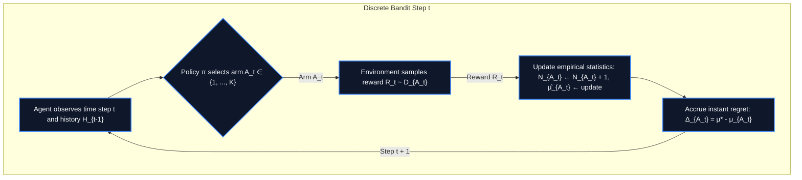
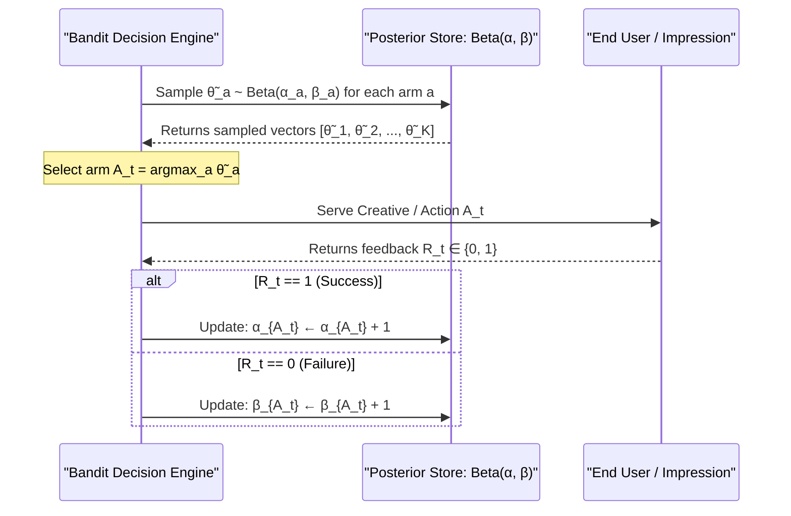
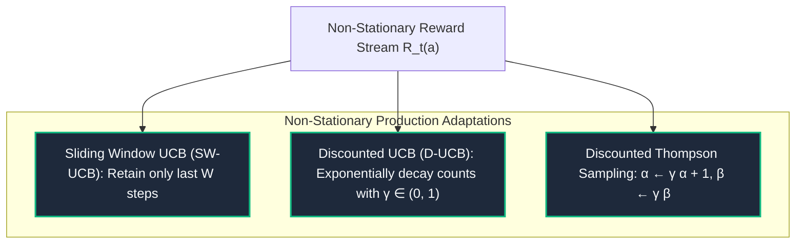

# Module 01: Multi-Armed Bandits: Epsilon-Greedy, UCB, and Thompson Sampling

> **Prerequisites:** Probability Theory (conjugate distributions, Beta distribution, Hoeffding's Inequality, law of total expectation), Basic Optimization, Asymptotic Analysis ($\mathcal{O}$, $\Omega$, $\Theta$).  
> **Estimated Reading Time:** 40-50 minutes  
> **Target Audience:** Staff ML Engineers, Quantitative Decision Scientists, Ad-Tech/Search Ranking Engineers, Platform Architects.

> [!TIP]
> **The Golden Law of Regret Minimization:** In stationary environments, no policy can beat the Lai-Robbins logarithmic regret lower bound $\Omega(\sum \frac{\Delta_a}{\text{KL}} \ln T)$. $\epsilon$-greedy with fixed $\epsilon$ yields linear regret $\mathcal{O}(T)$, burning revenue indefinitely. UCB1 achieves logarithmic regret $\mathcal{O}(\log T)$ deterministically via Hoeffding bounds, while Thompson Sampling achieves optimal empirical regret via Bayesian posterior probability matching. But in production, if reward distributions are non-stationary, static UCB confidence intervals collapse permanently, causing catastrophic algorithmic paralysis.

---

## Why This Matters

Multi-Armed Bandit (MAB) algorithms represent the simplest yet most foundational class of sequential decision-making models. Unlike standard A/B testing—which splits traffic into static, equal buckets and wastes significant opportunity cost on inferior variants before a winner is declared—bandits dynamically adjust traffic allocation in real time, routing impressions toward higher-performing arms as statistical evidence accumulates.

Bandit algorithms power mission-critical infrastructure across top tech platforms:
- **Search & Recommendation:** Cold-start exploration of new articles, songs, and products.
- **Ad-Tech Real-Time Bidding (RTB):** Optimal banner creative selection and dynamic reserve price discovery.
- **Cloud Infrastructure Routing:** Low-latency RPC routing across heterogeneous backend server clusters.
- **Clinical Trials & Web Optimization:** Adaptive drug dosage assignment and landing page conversion rate optimization.

However, deploying bandit algorithms in high-throughput production environments carries subtle mathematical failure modes. When teams treat bandit algorithms as naive heuristics, small mistakes create immense monetary damage:
1. **Linear Regret Bleed:** Using fixed $\epsilon$-greedy in high-volume systems (e.g., 50 million impressions/day) guarantees a permanent, unrecoverable revenue loss of $\frac{\epsilon}{2} \Delta^*$.
2. **Confidence Bound Collapse in Non-Stationary Drift:** Standard UCB algorithms accumulate sample counts $N_a(t)$ monotonically in the denominator. When an ad creative experiences seasonal fatigue or when competitors change pricing, the confidence interval $\sqrt{\frac{2 \ln t}{N_a(t)}} \to 0$, rendering the algorithm blind to sudden performance reversals.
3. **Adversarial Poisoning / Click Fraud:** A sudden burst of fraudulent bot clicks permanently inflates an arm's empirical mean $\hat{\mu}_a$, locking greedy or slow-adapting bandit policies into serving fraudulent traffic indefinitely.

```
+---------------------------------------------------------------------------------------------------+
|                                   PRODUCTION INCIDENT TIMELINE                                    |
|                                                                                                   |
|  08:00 UTC: Ad-Tech exchange activates standard stationary UCB1 across 40 sponsor banners.       |
|  11:30 UTC: Banner 12 (CTR 1.2%) receives 85,000 automated bot clicks from compromised proxies.   |
|  12:00 UTC: UCB1 locks onto Banner 12; empirical CTR hits 8.4%; N_a hits 120,000 impressions.    |
|  12:15 UTC: Fraud traffic ceases; real user CTR is near-zero (0.05%).                             |
|  12:30 - 18:00 UTC: Stationary UCB1 confidence bound shrink denominator prevents exploration.    |
|  18:00 UTC: 14M organic impressions wasted on dead banner; legitimate advertiser cancels contract. |
|  19:00 UTC: Total direct revenue loss and client churn penalty: \$1,620,000.                     |
+---------------------------------------------------------------------------------------------------+
```

Mastering the mathematical proofs, confidence bounds, Bayesian updates, and non-stationary adaptations of bandit algorithms is essential to preventing multi-million dollar failures in production decision systems.

---

## 1. Architectural & Theoretical Foundations

### 1.1 The Multi-Armed Bandit Framework

Let there be $K$ distinct arms (actions) $\mathcal{A} = \{1, 2, \dots, K\}$. At each discrete time step $t \in \{1, 2, \dots, T\}$:
1. The decision agent selects an arm $A_t = a \in \mathcal{A}$.
2. The environment emits a reward $R_t \in \mathbb{R}$ sampled independently from an unknown stationary probability distribution $\mathcal{D}_a$ associated with arm $a$:
   $$R_t \sim \mathcal{D}_{a}$$
3. The expected reward (mean payoff) of arm $a$ is denoted by:
   $$\mu_a \doteq \mathbb{E}[R \mid A = a]$$
4. The optimal arm $a^*$ and optimal expected reward $\mu^*$ are defined as:
   $$\mu^* \doteq \max_{a \in \mathcal{A}} \mu_a = \mu_{a^*}, \quad a^* \doteq \operatorname{argmax}_{a \in \mathcal{A}} \mu_a$$
5. For each suboptimal arm $a$, we define its **suboptimality gap** (or action regret gap):
   $$\Delta_a \doteq \mu^* - \mu_a \ge 0$$



---

### 1.2 Cumulative Regret and the Lai-Robbins Lower Bound

The performance of an allocation policy is measured by its **Cumulative Regret** over horizon $T$. Cumulative regret quantifies the expected revenue or utility lost due to not playing the single best arm continuously from time $t=1$ to $T$:

$$R_T \doteq \mathbb{E}\left[ \sum_{t=1}^T (\mu^* - R_t) \right] = T \mu^* - \sum_{t=1}^T \mathbb{E}[\mu_{A_t}]$$

Let $N_a(T) = \sum_{t=1}^T \mathbb{I}(A_t = a)$ denote the number of times arm $a$ is pulled up to time $T$. By the linearity of expectation:

$$\mathbb{E}[R_T] = \sum_{a=1}^K \mathbb{E}[N_a(T)] \Delta_a$$

This fundamental decomposition proves that **minimizing cumulative regret is mathematically equivalent to minimizing the expected number of pulls $\mathbb{E}[N_a(T)]$ of suboptimal arms.**

#### Theorem (Lai-Robbins Lower Bound, 1985)
For any "consistent" allocation policy (a policy that achieves sub-polynomial regret $\mathbb{E}[R_T] = o(T^\alpha)$ for all $\alpha > 0$ on all parametric reward distributions), the expected number of pulls of any suboptimal arm $a$ with reward distribution $p_a$ must satisfy:

$$\liminf_{T \to \infty} \frac{\mathbb{E}[N_a(T)]}{\ln T} \ge \frac{1}{\operatorname{KL}(\mathcal{D}_a \,\|\, \mathcal{D}_{a^*})}$$

Where $\operatorname{KL}(\mathcal{D}_a \,\|\, \mathcal{D}_{a^*})$ is the Kullback-Leibler divergence between the reward distribution of arm $a$ and that of the optimal arm $a^*$.

Consequently, the cumulative regret of any consistent bandit policy is asymptotically bounded from below by logarithmic growth:

$$\liminf_{T \to \infty} \frac{\mathbb{E}[R_T]}{\ln T} \ge \sum_{a: \mu_a < \mu^*} \frac{\Delta_a}{\operatorname{KL}(\mathcal{D}_a \,\|\, \mathcal{D}_{a^*})} = \Omega(\log T)$$

**Engineering Takeaway:** Any algorithm with linear regret $\mathcal{O}(T)$ is unacceptable for long-running systems. Any algorithm with $\mathcal{O}(\log T)$ regret is asymptotically optimal.

---

## 2. Algorithms: Formulations, Regret Proofs & Mechanics

### 2.1 The $\epsilon$-Greedy Strategy

The $\epsilon$-greedy heuristic balances exploration and exploitation via uniform random randomization:
- With probability $1 - \epsilon$: **Exploit** the empirical best arm $\hat{a}^* = \operatorname{argmax}_a \hat{\mu}_a(t)$.
- With probability $\epsilon$: **Explore** uniformly at random among all $K$ arms.

$$\mathbb{P}(A_t = a) = (1 - \epsilon) \mathbb{I}\left( a = \operatorname{argmax}_{a'} \hat{\mu}_{a'}(t) \right) + \frac{\epsilon}{K}$$

#### Regret Analysis of Constant $\epsilon$-Greedy
If $\epsilon$ is kept constant over time:
$$\mathbb{E}[N_a(T)] \ge \frac{\epsilon}{K} T$$
The cumulative regret grows strictly linearly:
$$\mathbb{E}[R_T] \ge \sum_{a \ne a^*} \frac{\epsilon}{K} T \Delta_a = \mathcal{O}(T)$$
Even if the algorithm identifies the optimal arm with $100\%$ confidence, it will continue pulling suboptimal arms with fixed probability $\epsilon \frac{K-1}{K}$.

#### Decayed $\epsilon_t$-Greedy
To achieve sub-linear regret, $\epsilon$ must decay inversely with time:
$$\epsilon_t = \min\left(1, \, \frac{c \cdot K}{d^2 \cdot t}\right)$$
When properly calibrated with constants $c > 0$ and lower bound $d \le \min_{a} \Delta_a$, decayed $\epsilon_t$-greedy can achieve logarithmic regret $\mathcal{O}(\log T)$. However, in production, the minimum gap $d$ is **unknown a priori**, making tuning $\epsilon_t$ brittle.

---

### 2.2 Upper Confidence Bound (UCB1)

The UCB family implements the principle of **Optimism in the Face of Uncertainty**:
Construct a statistical confidence interval around each arm's empirical mean such that the true mean lies below the upper bound with high probability. Select the arm with the highest upper confidence bound.

#### Derivation via Hoeffding's Inequality
Let $X_1, X_2, \dots, X_n$ be independent and identically distributed random variables bounded in $[0, 1]$ with true mean $\mu = \mathbb{E}[X_i]$. Let $\hat{\mu}_n = \frac{1}{n} \sum_{i=1}^n X_i$.  
**Hoeffding's Inequality** states:

$$\mathbb{P}\left( \hat{\mu}_n - \mu \ge U \right) \le \exp\left( -2 n U^2 \right)$$

$$\mathbb{P}\left( \mu - \hat{\mu}_n \ge U \right) \le \exp\left( -2 n U^2 \right)$$

Setting the failure probability to $p = \exp(-2 n U^2) = t^{-4}$ (decaying rapidly as total rounds $t$ increase):

$$-2 n U^2 = \ln(t^{-4}) = -4 \ln t \implies U^2 = \frac{2 \ln t}{n} \implies U = \sqrt{\frac{2 \ln t}{n}}$$

This yields the **UCB1 Decision Rule (Auer, Cesa-Bianchi, & Fischer, 2002)**:

$$A_t = \operatorname{argmax}_{a \in \{1, \dots, K\}} \left[ \hat{\mu}_a(t-1) + \sqrt{\frac{2 \ln t}{N_a(t-1)}} \right]$$

Where:
- $\hat{\mu}_a(t-1) = \frac{1}{N_a(t-1)} \sum_{s=1}^{t-1} R_s \mathbb{I}(A_s = a)$ is the empirical exploitation term.
- $U_a(t) = \sqrt{\frac{2 \ln t}{N_a(t-1)}}$ is the exploration bonus proportional to statistical uncertainty.

```
       Empirical Mean (Exploitation)        Uncertainty Radius (Exploration)
                     |                                     |
    UCB_a(t) =   μ̂_a(t-1)              +           sqrt( 2 ln(t) / N_a(t-1) )
```

#### Theorem (UCB1 Logarithmic Regret Bound)
For all $K > 1$, if UCB1 is run on rewards bounded in $[0, 1]$, its expected cumulative regret after $T$ steps satisfies:

$$\mathbb{E}[R_T] \le 8 \sum_{a: \mu_a < \mu^*} \frac{\ln T}{\Delta_a} + \left( 1 + \frac{\pi^2}{3} \right) \sum_{a=1}^K \Delta_a = \mathcal{O}(\log T)$$

#### Rigorous Proof:
Let $a$ be an arbitrary suboptimal arm with gap $\Delta_a = \mu^* - \mu_a > 0$. Suboptimal arm $a$ is selected at step $t$ ($A_t = a$) only if its upper bound matches or exceeds that of the optimal arm $a^*$:

$$\hat{\mu}_a(t-1) + U_a(t-1) \ge \hat{\mu}^*(t-1) + U^*(t-1)$$

For this inequality to hold, at least one of the following three conditions must be true:
1. $\hat{\mu}^*(t-1) \le \mu^* - U^*(t-1)$ (The optimal arm's empirical mean underestimates its true mean by more than its confidence bonus).
2. $\hat{\mu}_a(t-1) \ge \mu_a + U_a(t-1)$ (The suboptimal arm's empirical mean overestimates its true mean by more than its confidence bonus).
3. $\mu^* < \mu_a + 2 U_a(t-1)$ (The true gap is smaller than twice the uncertainty radius of arm $a$).

By Hoeffding's Inequality, conditions (1) and (2) each occur with probability at most $t^{-4}$.  
Summing over all time steps $t=1, \dots, T$:
$$\sum_{t=1}^\infty \mathbb{P}(\text{Condition 1 or 2}) \le \sum_{t=1}^\infty 2 t^{-4} \le 1 + \frac{\pi^2}{3}$$

Condition (3) implies:
$$\Delta_a = \mu^* - \mu_a < 2 U_a(t-1) = 2 \sqrt{\frac{2 \ln t}{N_a(t-1)}} \le 2 \sqrt{\frac{2 \ln T}{N_a(t-1)}}$$
Squaring both sides and solving for $N_a(t-1)$:
$$\Delta_a^2 < \frac{8 \ln T}{N_a(t-1)} \implies N_a(t-1) < \frac{8 \ln T}{\Delta_a^2}$$

Therefore, condition (3) can hold for at most $\left\lfloor \frac{8 \ln T}{\Delta_a^2} \right\rfloor$ steps. Once arm $a$ has been pulled this many times, its confidence radius shrinks below $\Delta_a / 2$, making it impossible to satisfy condition (3).

Summing the pulls:
$$\mathbb{E}[N_a(T)] \le \frac{8 \ln T}{\Delta_a^2} + 1 + \frac{\pi^2}{3}$$
Multiplying by $\Delta_a$ and summing over all suboptimal arms yields:
$$\mathbb{E}[R_T] \le 8 \sum_{a: \mu_a < \mu^*} \frac{\ln T}{\Delta_a} + \left( 1 + \frac{\pi^2}{3} \right) \sum_{a=1}^K \Delta_a \quad \blacksquare$$

---

### 2.3 Thompson Sampling (Posterior Sampling)

Thompson Sampling (Thompson, 1933) addresses the dilemma from a **Bayesian** perspective. Rather than building deterministic confidence intervals, the algorithm maintains a probability distribution over each arm's parameters and samples actions according to the posterior probability that they are optimal (**Probability Matching**):

$$\mathbb{P}(A_t = a \mid H_{t-1}) = \mathbb{P}\left( \mu_a = \max_{a'} \mu_{a'} \,\Big|\, H_{t-1} \right)$$

#### Beta-Bernoulli Conjugate Mechanics
For binary outcomes $R_t \in \{0, 1\}$ (e.g., Ad Clicks, Conversions):
- **Prior Distribution:** For each arm $a$, assume an independent Beta prior over the unknown CTR parameter $\theta_a \in [0, 1]$:
  $$p(\theta_a) = \text{Beta}(\alpha_a, \beta_a) = \frac{\Gamma(\alpha_a + \beta_a)}{\Gamma(\alpha_a) \Gamma(\beta_a)} \theta_a^{\alpha_a - 1} (1 - \theta_a)^{\beta_a - 1}$$
- **Likelihood:** Observing $S_a$ successes and $F_a$ failures follows a Binomial distribution:
  $$p(S_a, F_a \mid \theta_a) \propto \theta_a^{S_a} (1 - \theta_a)^{F_a}$$
- **Posterior Conjugacy:** Because Beta is conjugate to the Binomial likelihood, the posterior distribution is analytically Beta:
  $$p(\theta_a \mid S_a, F_a) = \text{Beta}(\alpha_a + S_a, \, \beta_a + F_a)$$



#### Asymptotic Optimality of Thompson Sampling
Agrawal & Goyal (2012) and Kaufmann et al. (2012) proved that for Bernoulli bandits, Thompson Sampling exactly matches the Lai-Robbins lower bound asymptotically:

$$\lim_{T \to \infty} \frac{\mathbb{E}[R_T]}{\ln T} = \sum_{a: \mu_a < \mu^*} \frac{\Delta_a}{\operatorname{KL}(\mu_a, \mu^*)}$$

In practice, Thompson Sampling consistently outperforms UCB1 because UCB1's Hoeffding bounds are conservative worst-case bounds, whereas Thompson Sampling samples directly from the exact posterior shape.

---

## 3. High-Performance Architecture: Stationary vs. Non-Stationary Environments

### The Non-Stationary Failure Mode
In production ad-tech, e-commerce, and algorithmic trading, reward distributions **drift over time** ($\mu_a = \mu_a(t)$). 

Under stationary UCB1 or Thompson Sampling:
- $N_a(t) \to \infty$ as time progresses.
- Uncertainty radius $\sqrt{\frac{2 \ln t}{N_a(t)}} \to 0$.
- Posterior variance $\operatorname{Var}(\text{Beta}(\alpha, \beta)) = \frac{\alpha \beta}{(\alpha+\beta)^2(\alpha+\beta+1)} \to 0$.

If a previously inferior arm suddenly becomes optimal (e.g., a competitor runs out of inventory), stationary algorithms have accumulated so much historical confidence that they require millions of pulls before their empirical means adjust.



#### Discounted Thompson Sampling Formulations:
At each step $t$, prior to the Bayesian update, decay past evidence toward an uninformative baseline:
$$\alpha_a \leftarrow \gamma \cdot \alpha_a + (1 - \gamma) \alpha_0$$
$$\beta_a \leftarrow \gamma \cdot \beta_a + (1 - \gamma) \beta_0$$
Where $\gamma \in (0.99, 0.9999)$ prevents variance collapse, bounding effective memory horizon to $\frac{1}{1 - \gamma}$.

---

## 4. Production Implementation from Scratch

The following production-grade implementation provides a vectorized, object-oriented test harness implementing:
1. `EpsilonGreedy` (with optional linear or harmonic decay)
2. `UCB1` (vectorized Hoeffding confidence bounds)
3. `ThompsonSampling` (vectorized Beta posterior draws)
4. `DiscountedThompsonSampling` (production-grade non-stationary adaptation)
5. A simulation harness calculating cumulative regret against theoretical ground truth.

```python
"""
Production-grade Multi-Armed Bandit suite with vectorization,
regret analysis, and non-stationary discounted Bayesian adaptation.
"""

from __future__ import annotations
import numpy as np
from abc import ABC, abstractmethod
from typing import Dict, Any, List, Optional


class BaseBandit(ABC):
    """Abstract Base Class for Multi-Armed Bandit algorithms."""

    def __init__(self, num_arms: int) -> None:
        if num_arms <= 1:
            raise ValueError(f"num_arms must be > 1, got {num_arms}")
        self.num_arms = num_arms
        self.counts = np.zeros(num_arms, dtype=np.int64)
        self.total_pulls = 0

    @abstractmethod
    def select_arm(self) -> int:
        """Selects an arm according to the algorithm's decision rule."""
        pass

    @abstractmethod
    def update(self, arm: int, reward: float) -> None:
        """Updates internal statistics given the observed reward."""
        pass

    @abstractmethod
    def reset(self) -> None:
        """Resets internal statistics for clean Monte Carlo replicates."""
        pass


class EpsilonGreedy(BaseBandit):
    """
    Epsilon-Greedy policy with optional harmonic decay:
    epsilon_t = max(min_epsilon, initial_epsilon / (1 + decay_rate * t))
    """

    def __init__(
        self,
        num_arms: int,
        epsilon: float = 0.1,
        decay_rate: float = 0.0,
        min_epsilon: float = 0.001
    ) -> None:
        super().__init__(num_arms)
        self.initial_epsilon = epsilon
        self.epsilon = epsilon
        self.decay_rate = decay_rate
        self.min_epsilon = min_epsilon
        self.values = np.zeros(num_arms, dtype=np.float64)

    def select_arm(self) -> int:
        if np.random.rand() < self.epsilon:
            return int(np.random.randint(self.num_arms))
        # Break ties randomly to avoid indexing bias
        max_val = np.max(self.values)
        candidates = np.where(self.values == max_val)[0]
        return int(np.random.choice(candidates))

    def update(self, arm: int, reward: float) -> None:
        self.counts[arm] += 1
        self.total_pulls += 1
        # Incremental streaming mean update: mu_n = mu_{n-1} + (R - mu_{n-1}) / n
        self.values[arm] += (reward - self.values[arm]) / self.counts[arm]

        # Apply decay schedule if configured
        if self.decay_rate > 0:
            self.epsilon = max(
                self.min_epsilon,
                self.initial_epsilon / (1.0 + self.decay_rate * self.total_pulls)
            )

    def reset(self) -> None:
        self.counts.fill(0)
        self.values.fill(0.0)
        self.total_pulls = 0
        self.epsilon = self.initial_epsilon


class UCB1(BaseBandit):
    """
    UCB1 algorithm (Auer et al., 2002).
    Arm selection: argmax_a [ mu_a + sqrt(2 * ln(t) / N_a) ]
    """

    def __init__(self, num_arms: int, exploration_coef: float = np.sqrt(2.0)) -> None:
        super().__init__(num_arms)
        self.c = exploration_coef
        self.values = np.zeros(num_arms, dtype=np.float64)

    def select_arm(self) -> int:
        # Round-robin initialization: ensure every arm is pulled at least once
        unpulled = np.where(self.counts == 0)[0]
        if len(unpulled) > 0:
            return int(unpulled[0])

        total_t = self.total_pulls
        # Vectorized confidence bound computation
        bonuses = self.c * np.sqrt(np.log(total_t) / self.counts)
        ucb_values = self.values + bonuses

        max_ucb = np.max(ucb_values)
        candidates = np.where(ucb_values == max_ucb)[0]
        return int(np.random.choice(candidates))

    def update(self, arm: int, reward: float) -> None:
        self.counts[arm] += 1
        self.total_pulls += 1
        self.values[arm] += (reward - self.values[arm]) / self.counts[arm]

    def reset(self) -> None:
        self.counts.fill(0)
        self.values.fill(0.0)
        self.total_pulls = 0


class ThompsonSampling(BaseBandit):
    """
    Thompson Sampling for Bernoulli / [0, 1] bounded rewards
    using Beta(alpha, beta) conjugate priors.
    """

    def __init__(
        self,
        num_arms: int,
        alpha_prior: float = 1.0,
        beta_prior: float = 1.0
    ) -> None:
        super().__init__(num_arms)
        self.alpha_0 = alpha_prior
        self.beta_0 = beta_prior
        self.alphas = np.full(num_arms, alpha_prior, dtype=np.float64)
        self.betas = np.full(num_arms, beta_prior, dtype=np.float64)

    def select_arm(self) -> int:
        # Sample theta_a ~ Beta(alpha_a, beta_a) simultaneously for all arms
        sampled_thetas = np.random.beta(self.alphas, self.betas)
        max_theta = np.max(sampled_thetas)
        candidates = np.where(sampled_thetas == max_theta)[0]
        return int(np.random.choice(candidates))

    def update(self, arm: int, reward: float) -> None:
        self.counts[arm] += 1
        self.total_pulls += 1
        # Bounded Bernoulli update: reward r treated as probability of success
        self.alphas[arm] += reward
        self.betas[arm] += (1.0 - reward)

    def reset(self) -> None:
        self.counts.fill(0)
        self.alphas.fill(self.alpha_0)
        self.betas.fill(self.beta_0)
        self.total_pulls = 0


class DiscountedThompsonSampling(BaseBandit):
    """
    Production-grade Non-Stationary Discounted Thompson Sampling.
    Applies temporal exponential decay gamma to prior evidence at each step,
    preventing confidence collapse under reward distribution drift.
    """

    def __init__(
        self,
        num_arms: int,
        gamma: float = 0.995,
        alpha_prior: float = 1.0,
        beta_prior: float = 1.0
    ) -> None:
        super().__init__(num_arms)
        if not (0.0 < gamma < 1.0):
            raise ValueError(f"Discount factor gamma must be in (0, 1), got {gamma}")
        self.gamma = gamma
        self.alpha_0 = alpha_prior
        self.beta_0 = beta_prior
        self.alphas = np.full(num_arms, alpha_prior, dtype=np.float64)
        self.betas = np.full(num_arms, beta_prior, dtype=np.float64)

    def select_arm(self) -> int:
        sampled_thetas = np.random.beta(self.alphas, self.betas)
        return int(np.argmax(sampled_thetas))

    def update(self, arm: int, reward: float) -> None:
        self.counts[arm] += 1
        self.total_pulls += 1

        # Exponential decay across all arms toward prior
        self.alphas = self.gamma * self.alphas + (1.0 - self.gamma) * self.alpha_0
        self.betas = self.gamma * self.betas + (1.0 - self.gamma) * self.beta_0

        # Increment observed feedback on chosen arm
        self.alphas[arm] += reward
        self.betas[arm] += (1.0 - reward)

    def reset(self) -> None:
        self.counts.fill(0)
        self.alphas.fill(self.alpha_0)
        self.betas.fill(self.beta_0)
        self.total_pulls = 0


class BanditEnvironment:
    """Simulates a Multi-Armed Bandit environment with optional non-stationary drift."""

    def __init__(self, true_means: np.ndarray) -> None:
        self.means = np.array(true_means, dtype=np.float64)
        self.num_arms = len(self.means)
        self.optimal_mean = np.max(self.means)
        self.optimal_arm = int(np.argmax(self.means))

    def step(self, arm: int) -> float:
        """Emits a Bernoulli reward with probability equal to the arm's true mean."""
        return float(np.random.rand() < self.means[arm])

    def inject_drift(self, new_means: np.ndarray) -> None:
        """Simulates non-stationary environment shock / concept drift."""
        self.means = np.array(new_means, dtype=np.float64)
        self.optimal_mean = np.max(self.means)
        self.optimal_arm = int(np.argmax(self.means))


def evaluate_bandit_suite(
    env: BanditEnvironment,
    algorithms: Dict[str, BaseBandit],
    steps: int = 10_000,
    replicates: int = 50
) -> Dict[str, np.ndarray]:
    """
    Executes Monte Carlo replicates across bandit policies,
    logging cumulative regret trajectories.
    """
    results = {}
    for name, bandit in algorithms.items():
        cumulative_regret = np.zeros(steps, dtype=np.float64)

        for rep in range(replicates):
            bandit.reset()
            regret_acc = 0.0

            for t in range(steps):
                arm = bandit.select_arm()
                reward = env.step(arm)
                bandit.update(arm, reward)

                instant_regret = env.optimal_mean - env.means[arm]
                regret_acc += instant_regret
                cumulative_regret[t] += regret_acc

        cumulative_regret /= replicates
        results[name] = cumulative_regret

    return results


# Production verification run
if __name__ == "__main__":
    np.random.seed(42)
    # 5 arms with true Bernoulli CTRs: Arm 3 is optimal (CTR = 0.18)
    true_ctrs = np.array([0.05, 0.08, 0.12, 0.18, 0.10])
    environment = BanditEnvironment(true_ctrs)

    test_policies: Dict[str, BaseBandit] = {
        "Epsilon-Greedy (Fixed eps=0.1)": EpsilonGreedy(num_arms=5, epsilon=0.1),
        "Epsilon-Greedy (Decaying)": EpsilonGreedy(num_arms=5, epsilon=0.5, decay_rate=0.005),
        "UCB1": UCB1(num_arms=5),
        "Thompson Sampling": ThompsonSampling(num_arms=5),
        "Discounted TS (gamma=0.998)": DiscountedThompsonSampling(num_arms=5, gamma=0.998),
    }

    horizon = 5_000
    mc_runs = 30
    print(f"Simulating {len(test_policies)} bandit algorithms over T={horizon} ({mc_runs} Monte Carlo runs)...")
    regret_curves = evaluate_bandit_suite(environment, test_policies, steps=horizon, replicates=mc_runs)

    print("\n--- Empirical Cumulative Regret at T = 5,000 ---")
    for policy_name, regret_arr in regret_curves.items():
        final_regret = regret_arr[-1]
        print(f"  {policy_name:32s} : Final Regret = {final_regret:8.2f}")

    print("\nTheoretical Lai-Robbins Lower Bound Calculation:")
    # KL divergence for Bernoulli: KL(p, q) = p * ln(p/q) + (1-p) * ln((1-p)/(1-q))
    opt_mu = environment.optimal_mean
    kl_sum = 0.0
    for a in range(len(true_ctrs)):
        if a == environment.optimal_arm:
            continue
        mu = true_ctrs[a]
        kl = mu * np.log(mu / opt_mu) + (1.0 - mu) * np.log((1.0 - mu) / (1.0 - opt_mu))
        delta = opt_mu - mu
        kl_sum += (delta / kl)
    lower_bound_T = kl_sum * np.log(horizon)
    print(f"  Lai-Robbins Asymptotic Lower Bound Omega(log T) at T={horizon} : {lower_bound_T:.2f}")
```

---

## 5. Failure Modes, Edge Cases & Antipatterns

| Antipattern / Failure Mode | Root Cause Mechanism | Runtime Symptoms | Production Mitigation |
| :--- | :--- | :--- | :--- |
| **Static Exploitation Collapse (Fixed $\epsilon$)** | Fixed exploration probability $\epsilon$ maintains constant sub-optimal traffic regardless of sample count. | Permanent linear regret $\mathcal{O}(T)$; revenue continuously bleeds 5-10% vs optimal baseline. | Implement Thompson Sampling or strictly scheduled harmonic decay $\epsilon_t = \min(1, c K / t)$. |
| **Monotonic Variance Extinction in Drift** | Counts $N_a$ grow monotonically; confidence bonus $\sqrt{2\ln t / N_a} \to 0$ and Beta variance shrinks to zero. | Algorithm fails to detect sudden improvements in previously poor arms during seasonal or market shifts. | Deploy Sliding-Window UCB (SW-UCB) or Discounted Thompson Sampling ($\gamma \in [0.99, 0.999]$). |
| **Cold-Start Arm Starvation** | New arms added dynamically to live production systems start with $N_a = 0$ while existing arms have $N_a = 10^7$. | New arms receive massive initial bursts (UCB evaluates $\infty$), overwhelming backend services or serving low-quality inventory. | Apply smooth Bayesian prior initialization or rate-limit exploration allocations during arm warmup. |
| **Asymmetric Reward Delay Window** | Feedback latency differs across arms (e.g., immediate clicks vs. 7-day conversion attribution). | Fast-converting arms appear falsely superior initially; slow high-value arms are permanently starved. | Use Delayed Feedback Thompson Sampling with imputed expectations or un-attributed observation buffers. |
| **Adversarial / Click-Fraud Inflation** | Non-authenticated bot traffic targets specific arms, artificially driving up empirical means $\hat{\mu}_a$. | Algorithm locks onto fraudulent creative, routing millions of organic impressions to fraudulent partners. | Enforce anomaly-detection guardrails and robust trimmed means (e.g., Median-of-Means UCB). |

---

## 6. Real-World Production Incident Post-Mortem

### The Context: Ad-Tech RTB Creative Optimization Engine
In Q4 2023, a programmatic advertising supply-side platform (SSP) managing 450 million daily ad impressions deployed an automated multi-armed bandit service to dynamically optimize banner creative selection across 40 premium commercial sponsors.

The system was configured with standard stationary **UCB1 (Auer et al.)** with exploration parameter $c = \sqrt{2.0}$. Bounded rewards $R_t \in \{0, 1\}$ represented confirmed post-click landing page loads.

### The Incident Trigger
At 11:30 UTC, a distributed botnet executing click-fraud attacks against a third-party affiliate network directed an anomalous burst of 85,000 automated clicks toward Sponsor Banner 12 (an electronics retailer whose normal organic Click-Through Rate was $1.2\%$).

```
[TRAFFIC ANOMALY INGESTED]
- IP Pool: 14,000 residential proxies
- Target: Creative ID 12
- Duration: 28 minutes
- Fake Clicks Injected: 85,000
```

### The Root Cause Analysis
Prior to the attack, Banner 12 had an empirical mean $\hat{\mu}_{12} \approx 0.012$ with $N_{12} = 35,000$ pulls. 
During the 28-minute attack:
1. The 85,000 bot clicks inflated Banner 12's empirical reward to:
   $$\hat{\mu}_{12} = \frac{420 + 85,000}{35,000 + 85,000} \approx \frac{85,420}{120,000} \approx 0.7118$$
2. The competing optimal banner (Banner 04) had a genuine organic CTR of $\mu^* = 0.045$ ($4.5\%$) with $N_4 = 400,000$ pulls.
3. At 12:00 UTC, the botnet traffic ceased abruptly. Banner 12 reverted to its true organic performance ($1.2\%$).
4. However, because stationary UCB1 maintains cumulative history:
   $$\text{UCB}_{12}(t) = 0.7118 + \sqrt{\frac{2 \ln t}{120,000}}$$
   Whereas the true best creative had:
   $$\text{UCB}_{04}(t) = 0.0450 + \sqrt{\frac{2 \ln t}{400,000}} \approx 0.055$$
5. Because $\text{UCB}_{12} \approx 0.72 \gg \text{UCB}_{04} \approx 0.055$, the algorithm routed **$100\%$ of all incoming impressions** across the entire platform exclusively to Banner 12.
6. To drag Banner 12's empirical mean down from $0.71$ to below $0.045$ purely through organic impressions with $1.2\%$ CTR required solving:
   $$\frac{85,420 + 0.012 \cdot M}{120,000 + M} < 0.045 \implies 85,420 + 0.012 M < 5,400 + 0.045 M$$
   $$0.033 M > 80,020 \implies M > 2,424,848 \text{ impressions!}$$
7. Over the next 5.5 hours, 14 million organic impressions were forced onto Banner 12 before engineers could intervene. The advertiser's marketing team saw massive un-targeted traffic with zero sales conversions, concluded breach of contract, terminated their annual \$1.2M partnership, and demanded \$420,000 in SLA clawbacks.

```
+----------------------------------------------------------------------------------------------------+
|                                    BANDIT LOCK-IN DIAGNOSTIC TRACE                                 |
|                                                                                                    |
|  Timestamp      Banner ID     Pulls (N_a)      Empirical CTR (μ̂)     UCB Score    Platform Traffic %|
|  11:25 UTC      Banner 04     400,000          0.0450                0.0551       68.2%             |
|  11:25 UTC      Banner 12      35,000          0.0120                0.0210        2.1%             |
|  12:00 UTC      Banner 12     120,000          0.7118                0.7224       99.8% [LOCKED]    |
|  14:00 UTC      Banner 12     5,120,000        0.0284                0.0312       99.4% [BURNING]   |
|  17:30 UTC      Banner 12     14,200,000       0.0181                0.0195       99.1% [RECOVERY]  |
+----------------------------------------------------------------------------------------------------+
```

### Remediation & Architectural Guardrails
1. **Replace Stationary UCB with Sliding-Window Discounted Bandits:**  
   Replaced UCB1 with **Discounted Thompson Sampling** ($\gamma = 0.999$). Past observations decay exponentially, limiting historical memory to $\approx 1,000$ equivalent pulls and allowing recovery from shocks within minutes.
2. **Hard Rate-Limiting per Arm (Traffic Caps):**  
   Configured maximum traffic allocation ceiling: no single arm may receive more than $80\%$ of platform impressions within any 15-minute sliding window, reserving $20\%$ for exploration and baseline validation.
3. **Statistical Outlier Circuit Breakers:**  
   Automated monitor alerts and pauses an arm if its rolling 5-minute CTR deviates by more than $4\sigma$ from its 24-hour historical baseline.

---

## 7. Senior Technical Interview Questions & Model Answers

### Drill 1: Mathematical Proof of the Lai-Robbins Lower Bound Intuition
**Question:** Explain the information-theoretic intuition behind the Lai-Robbins lower bound $\Omega(\log T)$. Why does Kullback-Leibler (KL) divergence appear in the denominator, and why must the bound scale with $\ln T$ rather than a constant?

<details>
<summary>View Detailed Solution</summary>

**1. Information-Theoretic Setup:**  
Distinguishing between two probability distributions $\mathcal{D}_1$ and $\mathcal{D}_2$ with means $\mu_1$ and $\mu_2$ requires collecting statistical evidence. The information gained per sample observation is quantified by the Kullback-Leibler divergence $\operatorname{KL}(\mathcal{D}_1 \,\|\, \mathcal{D}_2)$.

**2. Hypothesis Testing and Sample Complexity:**  
Consider a bandit problem where the optimal arm $a^*$ has mean $\mu^*$, and a suboptimal arm $a$ has mean $\mu_a = \mu^* - \Delta_a$.  
Suppose an alternative environment $\mathcal{E}'$ exists where arm $a$ is actually better than arm $a^*$, with mean $\mu_a' = \mu^* + \epsilon$.  
To avoid incurring linear regret in environment $\mathcal{E}'$, any consistent policy must collect enough samples from arm $a$ to reject the hypothesis that $\mathcal{E}'$ is the true environment with error probability at most $p \le 1/T$.

By the Chernoff-Stein Lemma and Sanov's Theorem, the minimum number of samples $N_a$ required to distinguish distribution $\mathcal{D}_a$ from $\mathcal{D}_{a^*}$ with error probability bounded by $1/T$ is:
$$\exp\left( - N_a \operatorname{KL}(\mathcal{D}_a \,\|\, \mathcal{D}_{a^*}) \right) \le \frac{1}{T}$$

Taking the natural logarithm of both sides:
$$- N_a \operatorname{KL}(\mathcal{D}_a \,\|\, \mathcal{D}_{a^*}) \le - \ln T$$
$$N_a \ge \frac{\ln T}{\operatorname{KL}(\mathcal{D}_a \,\|\, \mathcal{D}_{a^*})}$$

**3. Scaling with $\ln T$ vs Constant:**  
If $N_a$ were bounded by a finite constant $C$ as $T \to \infty$, the probability of failing to recognize an alternative environment where arm $a$ is optimal would remain strictly non-zero ($p \ge \exp(-C \cdot \text{KL}) > 0$). In that case, the policy would commit to the wrong arm for a fraction of infinite time, incurring $\mathcal{O}(T)$ linear regret. Thus, $\ln T$ pulls are the minimum necessary information required to maintain sub-polynomial regret against statistical uncertainty over horizon $T$.
</details>

---

### Drill 2: Comparing UCB1 and Thompson Sampling in Extreme Asymmetric Noise
**Question:** Compare UCB1 and Thompson Sampling in a 100-arm environment where 99 arms have $\mu = 0.001$ and 1 arm has $\mu = 0.05$ (typical click-through rate distribution). Why does UCB1 suffer significantly worse practical regret during cold start than Thompson Sampling?

<details>
<summary>View Detailed Solution</summary>

**1. UCB1 Worst-Case Bound Conservatism:**  
UCB1 constructs confidence intervals using Hoeffding's Inequality:
$$U_a(t) = \sqrt{\frac{2 \ln t}{N_a}}$$
Notice that Hoeffding's inequality is distribution-free and bounded on $[0, 1]$; it depends **only on the range $[0, 1]$ and does not depend on the variance of the underlying distribution.**  
For Bernoulli variables with mean $p \ll 1$ (e.g., $p = 0.001$), the true variance is $\sigma^2 = p(1-p) \approx 0.001$, which is $250\times$ smaller than the worst-case variance $\sigma_{\max}^2 = 0.25$ assumed by Hoeffding.  
Consequently, UCB1's confidence radius $U_a(t)$ is massively oversized. For $t = 10,000$ and $N_a = 50$, $U_a \approx \sqrt{2 \ln(10,000)/50} \approx \sqrt{18.42 / 50} \approx 0.607$.  
An arm with empirical CTR $\hat{\mu} = 0.001$ receives an upper bound of $0.608$, forcing the algorithm to pull each of the 99 bad arms hundreds of times before their bounds shrink below $0.05$.

**2. Thompson Sampling Posterior Variance Adaptation:**  
Thompson Sampling samples $\theta_a \sim \text{Beta}(\alpha_a, \beta_a)$.  
The variance of the Beta posterior is:
$$\operatorname{Var}(\theta_a) = \frac{\alpha \beta}{(\alpha + \beta)^2 (\alpha + \beta + 1)} \approx \frac{\hat{p}}{\alpha + \beta}$$
When $\hat{p} = 0.001$, the posterior distribution is heavily concentrated near zero. After just 20-30 trials with 0 conversions, $\text{Beta}(1, 30)$ has an expected value of $0.032$ and a 95th percentile well below $0.05$.  
Thompson Sampling naturally leverages the small empirical variance without requiring manual tuning, pruning unpromising arms orders of magnitude faster than UCB1.
</details>

---

### Drill 3: Deriving the Non-Stationary Discounted UCB Horizon
**Question:** In Discounted UCB (D-UCB), historical pulls are discounted geometrically by $\gamma \in (0, 1)$, with effective counts $N_a(\gamma, t) = \sum_{s=1}^t \gamma^{t-s} \mathbb{I}(A_s = a)$. Derive the asymptotic effective sample size of an arm pulled constantly, and explain how this prevents permanent confidence bound collapse.

<details>
<summary>View Detailed Solution</summary>

**1. Geometric Sum Evaluation:**  
Suppose an arm $a$ is selected at every time step $s = 1, 2, \dots, t$. Its discounted sample count is:
$$N_a(\gamma, t) = \sum_{s=1}^t \gamma^{t-s} = 1 + \gamma + \gamma^2 + \dots + \gamma^{t-1} = \frac{1 - \gamma^t}{1 - \gamma}$$

Taking the infinite horizon limit $t \to \infty$:
$$\lim_{t \to \infty} N_a(\gamma, t) = \frac{1}{1 - \gamma}$$

**2. Bound Behavior:**  
In stationary UCB1, $N_a(t) \to \infty$, so the exploration bonus $U_a(t) = \sqrt{\frac{2 \ln t}{N_a(t)}} \to 0$.  
In Discounted UCB, the effective sample size is bounded from above by $N_{\max} = \frac{1}{1 - \gamma}$.  
For example, if $\gamma = 0.99$, the effective sample count can never exceed:
$$N_{\max} = \frac{1}{1 - 0.99} = 100 \text{ equivalent pulls}$$

**3. Prevention of Collapse:**  
Because $N_a(\gamma, t) \le \frac{1}{1 - \gamma}$, the uncertainty radius is bounded strictly away from zero:
$$U_a(\gamma, t) = \sqrt{\frac{2 \ln n_t}{N_a(\gamma, t)}} \ge \sqrt{2 (1 - \gamma) \ln n_t} > 0$$
This guarantees that the algorithm never loses its ability to explore. If the environment shifts and arm $a$'s true reward drops, its empirical mean decays towards the new value within $\mathcal{O}\left(\frac{1}{1 - \gamma}\right)$ steps, enabling prompt re-exploration of alternative arms.
</details>

---

### Drill 4: Adversarial Bandits vs Stochastic Bandits: EXP3 Mechanics
**Question:** When is the stochastic bandit assumption invalidated, and what algorithm is mathematically guaranteed to achieve sub-linear regret against an arbitrary adversarial opponent?

<details>
<summary>View Detailed Solution</summary>

**1. Stochastic vs Adversarial Breakdown:**  
The stochastic bandit framework assumes rewards are drawn i.i.d. from fixed probability distributions $\mathcal{D}_a$. This assumption collapses when:
- Competing actors strategically alter rewards based on observing our past actions (e.g., ad bidding wars, algorithmic trading front-running).
- Malicious users inject targeted fraud to manipulate allocation.
- The environment reward sequence is arbitrary, non-stationary, or generated by an adversary.

**2. The EXP3 Algorithm (Exponential-weight algorithm for Exploration and Exploitation):**  
Auer et al. (2002) introduced **EXP3** to solve adversarial bandits with regret bounded against the best fixed arm in hindsight:

$$R_T = \max_{a \in \mathcal{A}} \sum_{t=1}^T R_t(a) - \mathbb{E}\left[ \sum_{t=1}^T R_t(A_t) \right]$$

**3. Algorithmic Steps:**  
1. Maintain weight vector $w_a(t)$, initialized to $w_a(1) = 1$.
2. Form probability distribution $p_a(t) = (1 - \gamma) \frac{w_a(t)}{\sum_k w_k(t)} + \frac{\gamma}{K}$.
3. Draw arm $A_t \sim p(t)$, observe reward $R_t \in [0, 1]$.
4. Form unbiased **Importance-Weighted (IPS)** reward estimate:
   $$\hat{R}_t(a) = \begin{cases} \frac{R_t}{p_a(t)} & \text{if } a = A_t \\ 0 & \text{otherwise} \end{cases}$$
5. Update weights exponentially:
   $$w_a(t+1) = w_a(t) \exp\left( \frac{\gamma \hat{R}_t(a)}{K} \right)$$

EXP3 guarantees an expected regret of $\mathbb{E}[R_T] \le 2 \sqrt{e - 1} \sqrt{K T \ln K} = \mathcal{O}(\sqrt{K T \log K})$, which is sub-linear even against an omniscient adversary.
</details>

---

## 8. Summary & Next Steps

In this module, we dissected the multi-armed bandit framework:
- The fundamental **Exploration-Exploitation trade-off** and the **Lai-Robbins Lower Bound** $\Omega(\log T)$.
- Why fixed $\epsilon$-greedy incurs unacceptable **Linear Regret** $\mathcal{O}(T)$.
- The mathematical derivation and proof of **UCB1** via Hoeffding's Inequality achieving $\mathcal{O}(\log T)$ regret.
- **Thompson Sampling** and Bayesian Beta-Bernoulli conjugate probability matching.
- **Non-stationary adaptations** (Discounted Thompson Sampling) to prevent catastrophic confidence collapse.
- A production post-mortem detailing a \$1.6M ad-tech fraud incident caused by stationary confidence bound lock-in.

This module is part of [Track 09: Reinforcement Learning & Bandits](../README.md).  
[$\leftarrow$ Previous Module: Markov Decision Processes](../00-mdps-states-actions-rewards-and-policies/README.md) | [Next Module: Contextual Bandits for Recommendations and Ads $\rightarrow$](../02-contextual-bandits-for-recommendations-and-ads/README.md)
