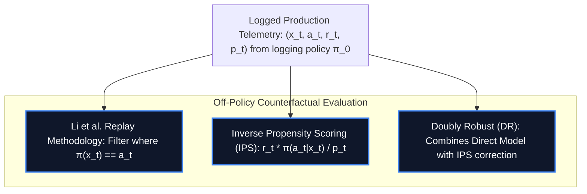

# Module 02: Contextual Bandits for Recommendations and Ads

> **Prerequisites:** Multivariable Linear Algebra (matrix inversion, positive definite matrices, Sherman-Morrison formula), Ridge Regression, Bayesian linear models, Probability Theory.  
> **Estimated Reading Time:** 40-50 minutes  
> **Target Audience:** Staff Recommender Systems Engineers, Ad-Tech RTB Architects, Machine Learning Platform Leads, Quantitative Ranking Engineers.

> [!TIP]
> **The Real-Time Matrix Inversion Trap:** In Contextual Bandits (LinUCB), computing ridge regression parameter estimates naively via standard matrix inversion $(A_a)^{-1} = (D_a^T D_a + I_d)^{-1}$ incurs $\mathcal{O}(d^3)$ computational complexity at every single scoring call. If your feature dimension $d = 1,000$ and you evaluate $K = 50$ candidate items, a naive loop requires 50 billion FLOPs per inference request, completely obliterating your 10ms P99 latency budget. Production engines must maintain the inverse matrix $A_a^{-1}$ online using the **Sherman-Morrison rank-1 update**, reducing parameter updates from $\mathcal{O}(d^3)$ to $\mathcal{O}(d^2)$ and serving inference in $\mathcal{O}(d)$ vector dot products.

---

## Why This Matters

Multi-armed bandits choose actions based solely on arm-level historical performance, treating all users and query contexts as an undifferentiated mass. In real-world personalized recommendation systems, search ranking, and digital ad-tech, a single global policy fails:
- An ad creative for snow tires that performs horribly on average across 99% of global traffic is exceptionally optimal when the user's IP location is Minneapolis during a blizzard.
- A financial news article about biotech IPOs is irrelevant to teenagers on TikTok but captures high click-through rates among institutional investors browsing at 08:30 AM EST.

The **Contextual Bandit** framework bridges the gap between static supervised learning and full sequential reinforcement learning. At each round, the agent observes an informative context vector $x_t \in \mathbb{R}^d$ (user features, device metadata, time of day, historical affinities) *before* choosing which arm $a \in \mathcal{A}$ to display.


Deploying contextual bandits at scale introduces severe operational and algorithmic hazards:
1. **The Inversion Latency Wall:** Inverting $d \times d$ covariance matrices inside real-time scoring threads causes request queue starvation and downstream timeouts.
2. **Log Bias & Confounding in Offline Evaluation:** You cannot simply test a contextual bandit on historical logs using supervised cross-validation; the historical logs were gathered under a biased past policy $\pi_0$. Evaluating counterfactual policies without Inverse Propensity Scoring (IPS) or Doubly Robust estimators generates completely hallucinated offline offline metrics.
3. **Curse of Dimensionality in Ridge Ellipsoids:** When feature dimension $d$ scales into tens of thousands (e.g., high-cardinality sparse user/item IDs), confidence ellipsoids $\alpha \sqrt{x^T A^{-1} x}$ inflate, causing the algorithm to over-explore uninformative noise dimensions.

```
+---------------------------------------------------------------------------------------------------+
|                                   PRODUCTION INCIDENT TIMELINE                                    |
|                                                                                                   |
|  06:00 UTC: Editorial news team deploys LinUCB to personalize top-of-homepage carousel.           |
|  07:30 UTC: Feature engineering pipeline introduces 800 dense cross-features (d expanded to 1,200).|
|  08:00 UTC: Morning traffic surge hits 45,000 requests/sec.                                      |
|  08:02 UTC: Real-time scoring loop calls np.linalg.inv() on 1200x1200 matrix for each candidate.  |
|  08:04 UTC: Per-request inference latency spikes from 4ms to 780ms; worker thread pools saturate. |
|  08:06 UTC: HTTP 504 Gateway Timeouts hit 92%; news homepage completely unreachable for 40 mins.  |
|  08:45 UTC: Emergency rollback to static heuristic; \$480,000 lost in programmatic ad revenue.    |
+---------------------------------------------------------------------------------------------------+
```

Mastering the mathematical machinery of LinUCB (both disjoint and hybrid models), online Sherman-Morrison rank-1 updates, and offline counterfactual replay methodology is critical for any production ML architect.

---

## 1. Architectural & Theoretical Foundations

### 1.1 The Contextual Bandit Protocol

Let $\mathcal{A} = \{1, 2, \dots, K\}$ be a discrete set of arms. In each discrete round $t = 1, 2, \dots, T$:
1. The world generates a user and environment context vector $x_t \in \mathbb{R}^d$ with $\|x_t\|_2 \le 1$.
2. The agent observes context $x_t$ and historical interaction dataset $\mathcal{H}_{t-1} = \{(x_\tau, a_\tau, r_\tau)\}_{\tau=1}^{t-1}$.
3. The agent chooses an arm $A_t = a \in \mathcal{A}$ according to its contextual policy $\pi_t(x_t)$.
4. The environment reveals a payoff $R_{t, a} \in [0, 1]$ drawn from conditional distribution $\mathcal{D}(R \mid x_t, a)$.
5. The payoffs of unchosen arms $a' \ne A_t$ remain completely unobserved (**Partial Information / Bandit Feedback**).
6. The agent updates its parameters and transitions to round $t + 1$.

### 1.2 The Linear Payoff Assumption

To make generalization across continuous context space $\mathbb{R}^d$ tractable, the classical **LinUCB** algorithm (Li, Chu, Langford, & Schapire, 2010) assumes that the expected payoff of each arm $a$ is an affine linear function of the context vector $x_t$:

$$\mathbb{E}[R_{t, a} \mid x_t] = x_t^T \theta_a^*$$

Where $\theta_a^* \in \mathbb{R}^d$ is an unknown, fixed true parameter vector associated with arm $a$.

Under this assumption, the optimal arm $a_t^*$ at time $t$ is:

$$a_t^* \doteq \operatorname{argmax}_{a \in \mathcal{A}} x_t^T \theta_a^*$$

The instantaneous regret incurred at time $t$ is:

$$\Delta_t = x_t^T \theta_{a_t^*}^* - x_t^T \theta_{A_t}^*$$

And cumulative contextual regret over $T$ rounds is:

$$R_T = \sum_{t=1}^T \left( x_t^T \theta_{a_t^*}^* - x_t^T \theta_{A_t}^* \right)$$

---

## 2. Mathematical Formulations: LinUCB and Confidence Ellipsoids

### 2.1 Ridge Regression Parameter Estimation

Suppose arm $a$ has been selected $m$ times up to time $t$. Let:
- $\mathbf{D}_a \in \mathbb{R}^{m \times d}$ be the design matrix whose rows are the observed context vectors: $\mathbf{D}_a = [x_{\tau_1}, x_{\tau_2}, \dots, x_{\tau_m}]^T$.
- $\mathbf{c}_a \in \mathbb{R}^m$ be the vector of observed scalar rewards: $\mathbf{c}_a = [r_{\tau_1}, r_{\tau_2}, \dots, r_{\tau_m}]^T$.

We apply $\ell_2$-regularized linear regression (Ridge Regression) with regularization parameter $\lambda > 0$ (typically $\lambda = 1.0$) to estimate $\theta_a^*$:

$$\hat{\theta}_a = \operatorname{argmin}_{\theta \in \mathbb{R}^d} \left( \|\mathbf{D}_a \theta - \mathbf{c}_a\|_2^2 + \lambda \|\theta\|_2^2 \right)$$

Taking the gradient with respect to $\theta$ and setting to zero:

$$\nabla_\theta \left( (\mathbf{D}_a \theta - \mathbf{c}_a)^T (\mathbf{D}_a \theta - \mathbf{c}_a) + \lambda \theta^T \theta \right) = 2 \mathbf{D}_a^T (\mathbf{D}_a \theta - \mathbf{c}_a) + 2 \lambda \theta = 0$$

$$(\mathbf{D}_a^T \mathbf{D}_a + \lambda \mathbf{I}_d) \theta = \mathbf{D}_a^T \mathbf{c}_a$$

Define the **covariance precision matrix** $\mathbf{A}_a \in \mathbb{R}^{d \times d}$ and cumulative response vector $\mathbf{b}_a \in \mathbb{R}^d$:

$$\mathbf{A}_a \doteq \mathbf{D}_a^T \mathbf{D}_a + \lambda \mathbf{I}_d = \sum_{s=1}^m x_{\tau_s} x_{\tau_s}^T + \lambda \mathbf{I}_d$$

$$\mathbf{b}_a \doteq \mathbf{D}_a^T \mathbf{c}_a = \sum_{s=1}^m r_{\tau_s} x_{\tau_s}$$

The closed-form ridge regression estimator is:

$$\hat{\theta}_a = \mathbf{A}_a^{-1} \mathbf{b}_a$$

---

### 2.2 Derivation of the Confidence Ellipsoid

Under standard sub-Gaussian noise assumptions on the payoffs, how confident are we in the linear prediction $x_t^T \hat{\theta}_a$ for a new query context $x_t$?

The estimation error is:

$$x_t^T \hat{\theta}_a - x_t^T \theta_a^* = x_t^T (\hat{\theta}_a - \theta_a^*)$$

By the Cauchy-Schwarz inequality in the inner-product space induced by the positive-definite matrix $\mathbf{A}_a$:

$$|x_t^T (\hat{\theta}_a - \theta_a^*)| = |x_t^T \mathbf{A}_a^{-1/2} \mathbf{A}_a^{1/2} (\hat{\theta}_a - \theta_a^*)| \le \|\mathbf{A}_a^{-1/2} x_t\|_2 \cdot \|\mathbf{A}_a^{1/2} (\hat{\theta}_a - \theta_a^*)\|_2$$

Notice that:
$$\|\mathbf{A}_a^{-1/2} x_t\|_2 = \sqrt{x_t^T (\mathbf{A}_a^{-1/2})^T \mathbf{A}_a^{-1/2} x_t} = \sqrt{x_t^T \mathbf{A}_a^{-1} x_t}$$

The second term $\|\hat{\theta}_a - \theta_a^*\|_{\mathbf{A}_a} = \sqrt{(\hat{\theta}_a - \theta_a^*)^T \mathbf{A}_a (\hat{\theta}_a - \theta_a^*)}$ defines the Mahalanobis distance under metric $\mathbf{A}_a$.  
From concentration inequalities for self-normalized processes (Abbasi-Yadkori, Pál, & Szepesvári, 2011), with probability at least $1 - \delta$:

$$\|\hat{\theta}_a - \theta_a^*\|_{\mathbf{A}_a} \le \alpha \doteq \sigma \sqrt{d \ln\left( \frac{1 + m / (d \lambda)}{\delta} \right)} + \lambda^{1/2} \|\theta_a^*\|_2$$

Therefore, with probability at least $1 - \delta$:

$$\left| x_t^T \hat{\theta}_a - x_t^T \theta_a^* \right| \le \alpha \sqrt{x_t^T \mathbf{A}_a^{-1} x_t}$$

This yields the **LinUCB with Disjoint Linear Models Decision Rule**:

$$A_t = \operatorname{argmax}_{a \in \mathcal{A}} \left[ x_t^T \hat{\theta}_a + \alpha \sqrt{x_t^T \mathbf{A}_a^{-1} x_t} \right]$$

```
          Predicted Mean Payoff                  Uncertainty Radius (Ridge Ellipsoid)
                    |                                             |
   Score_a =     x_t^T θ̂_a               +             α * sqrt( x_t^T A_a⁻¹ x_t )
```

**Geometric Interpretation:**  
The term $\sqrt{x_t^T \mathbf{A}_a^{-1} x_t}$ measures the distance of context vector $x_t$ along the directions where arm $a$ has least explored. If $x_t$ aligns with an eigenvector of $\mathbf{A}_a$ that has a large eigenvalue (many historical observations in that direction), $x_t^T \mathbf{A}_a^{-1} x_t$ is tiny. If $x_t$ points in a novel, unexplored direction, $x_t^T \mathbf{A}_a^{-1} x_t$ is large, driving exploration.

---

### 2.3 The Sherman-Morrison Formula: $O(d^2)$ Online Inversion

When a payoff $R_t$ is observed for selected arm $a$, we update:

$$\mathbf{A}_a \leftarrow \mathbf{A}_a + x_t x_t^T$$

Inverting $\mathbf{A}_a$ from scratch requires Gaussian elimination or Cholesky decomposition:

$$\text{Complexity: } \mathcal{O}(d^3)$$

In production, we maintain the inverse matrix $\mathbf{M}_a \doteq \mathbf{A}_a^{-1}$ directly. Since adding $x_t x_t^T$ is a symmetric **rank-1 update**, we apply the **Sherman-Morrison Formula**:

#### Theorem (Sherman-Morrison Formula)
Let $\mathbf{A} \in \mathbb{R}^{d \times d}$ be an invertible square matrix, and $u, v \in \mathbb{R}^d$ be column vectors such that $1 + v^T \mathbf{A}^{-1} u \ne 0$. Then:

$$(\mathbf{A} + u v^T)^{-1} = \mathbf{A}^{-1} - \frac{\mathbf{A}^{-1} u v^T \mathbf{A}^{-1}}{1 + v^T \mathbf{A}^{-1} u}$$

#### Application to LinUCB:
Setting $u = v = x_t$ and letting $\mathbf{M}_a = \mathbf{A}_a^{-1}$:

$$\mathbf{M}_a^{\text{new}} = \left( \mathbf{A}_a + x_t x_t^T \right)^{-1} = \mathbf{M}_a - \frac{\mathbf{M}_a x_t x_t^T \mathbf{M}_a}{1 + x_t^T \mathbf{M}_a x_t}$$

#### Step-by-Step Computational Cost:
1. Compute vector $v = \mathbf{M}_a x_t \in \mathbb{R}^d$: Matrix-vector multiply requires $d^2$ FLOPs.
2. Compute scalar denominator $k = 1.0 + x_t^T v \in \mathbb{R}$: Dot product requires $d$ FLOPs.
3. Compute outer product matrix $P = v v^T \in \mathbb{R}^{d \times d}$: Requires $d^2$ FLOPs.
4. Scale and subtract $\mathbf{M}_a^{\text{new}} = \mathbf{M}_a - \frac{1}{k} P$: Requires $d^2$ FLOPs.

**Total Time Complexity:** $\mathcal{O}(d^2)$ instead of $\mathcal{O}(d^3)$.  
For $d = 1,000$:
- $\mathcal{O}(d^3) = 1,000^3 = 1,000,000,000$ operations (~1 GFLOP, ~25-50ms).
- $\mathcal{O}(d^2) = 1,000^2 = 1,000,000$ operations (~1 MFLOP, < 0.1ms).  
A **$1,000\times$ speedup**, transforming an unusable algorithm into a sub-millisecond production engine.

---

### 2.4 Hybrid LinUCB: Sharing Features Across Arms

In disjoint LinUCB, every arm $a$ maintains its own private $\theta_a \in \mathbb{R}^d$, sharing zero information with other arms. 

In real-world e-commerce, features consist of:
1. **Shared features $z_{t, a} \in \mathbb{R}^k$:** Features that describe the interaction between user and item (e.g., cosine similarity between user embedding and item embedding, category match score).
2. **Arm-specific features $x_{t, a} \in \mathbb{R}^d$:** Features specific to the individual arm (e.g., item price, historical CTR).

The **Hybrid LinUCB model** defines the expected payoff as:

$$\mathbb{E}[R_{t, a} \mid x_{t, a}, z_{t, a}] = z_{t, a}^T \beta^* + x_{t, a}^T \theta_a^*$$

Where $\beta^* \in \mathbb{R}^k$ represents shared global weights across all arms, and $\theta_a^* \in \mathbb{R}^d$ represents arm-specific weights.

Solving Hybrid LinUCB requires maintaining a shared covariance matrix $\mathbf{A}_0 = \sum \mathbf{B}_a^T \mathbf{A}_a^{-1} \mathbf{B}_a$ alongside per-arm matrices $\mathbf{A}_a$, enabling shared cross-arm learning during cold start while retaining personalized arm tuning.

---

## 3. Off-Policy Counterfactual Evaluation (OPE)

How do you validate a new contextual bandit policy $\pi$ offline before deploying it to live users?



### 3.1 The Replay Methodology (Li et al., 2011)
If the historical logging policy $\pi_0$ selected arms **uniformly at random** (e.g., a pure random exploration bucket with $p_t = 1/K$):
1. Stream through historical log entries $(x_t, a_t, r_t)$.
2. Evaluate target policy $a = \pi(x_t)$.
3. If $a == a_t$: Accept the sample; accumulate reward $R \leftarrow R + r_t$, update policy internal statistics with $(x_t, a_t, r_t)$.
4. If $a \ne a_t$: Reject the sample completely; do not update internal state.

**Theorem (Li et al., 2011):** The acceptance rate is $1/K$, and the estimated average payoff is strictly unbiased:

$$\mathbb{E}[\hat{V}_{\text{replay}}(\pi)] = V(\pi)$$

### 3.2 Inverse Propensity Scoring (IPS)
When $\pi_0$ is non-uniform, Replay fails. We use the Horvitz-Thompson **Inverse Propensity Score (IPS)**:

$$\hat{V}_{\text{IPS}}(\pi) = \frac{1}{T} \sum_{t=1}^T \frac{\mathbb{I}(A_t = \pi(x_t)) \cdot R_t}{p_t(A_t \mid x_t)}$$

Where $p_t(A_t \mid x_t)$ is the propensity (probability) with which logging policy $\pi_0$ chose arm $A_t$.

**Property:** Unbiased ($\mathbb{E}[\hat{V}_{\text{IPS}}] = V(\pi)$), but suffers from **massive variance** when propensities $p_t$ are small.

### 3.3 Doubly Robust (DR) Estimator
To minimize IPS variance while remaining unbiased, the Doubly Robust estimator combines an approximate direct regression reward model $\hat{r}(x, a)$ with an IPS error correction:

$$\hat{V}_{\text{DR}}(\pi) = \frac{1}{T} \sum_{t=1}^T \left[ \hat{r}(x_t, \pi(x_t)) + \frac{\mathbb{I}(A_t = \pi(x_t))}{p_t(A_t \mid x_t)} \left( R_t - \hat{r}(x_t, A_t) \right) \right]$$

**Double Robustness Guarantee:** If *either* the propensity scores $p_t$ are correct *or* the reward model $\hat{r}$ is accurate, the estimator is guaranteed to be unbiased. When $\hat{r}$ is accurate, the variance drops to near zero.

---

## 4. Production Implementation from Scratch

The following production-grade implementation provides a complete, pure NumPy implementation of **`LinUCBDisjoint`** using the online **Sherman-Morrison rank-1 inverse update**, complete with an offline **Doubly Robust Evaluator**.

```python
"""
Production-grade Contextual Bandit suite.
Features:
- Disjoint LinUCB with Sherman-Morrison O(d^2) rank-1 online inverse updates.
- Real-time scoring loop with O(d) inference.
- Doubly Robust Counterfactual Off-Policy Evaluator.
"""

from __future__ import annotations
import numpy as np
from typing import Dict, Any, List, Tuple, Optional


class LinUCBDisjoint:
    """
    LinUCB with Disjoint Linear Models (Li et al., 2010).
    Maintains A_inv directly using the Sherman-Morrison formula to guarantee
    O(d^2) updates and O(d) inference latency.
    """

    def __init__(
        self,
        num_arms: int,
        feature_dim: int,
        alpha: float = 1.0,
        lambda_reg: float = 1.0
    ) -> None:
        if num_arms <= 1:
            raise ValueError(f"num_arms must be > 1, got {num_arms}")
        if feature_dim <= 0:
            raise ValueError(f"feature_dim must be > 0, got {feature_dim}")
        if lambda_reg <= 0:
            raise ValueError(f"lambda_reg must be > 0, got {lambda_reg}")

        self.num_arms = num_arms
        self.d = feature_dim
        self.alpha = alpha
        self.lambda_reg = lambda_reg

        # For each arm: maintain A_inv directly: shape (K, d, d)
        # Initially A_a = lambda * I_d => A_a_inv = (1 / lambda) * I_d
        initial_inv = (1.0 / self.lambda_reg) * np.eye(self.d, dtype=np.float64)
        self.A_inv = np.array([initial_inv.copy() for _ in range(num_arms)], dtype=np.float64)

        # For each arm: maintain b_a = sum(r * x): shape (K, d)
        self.b = np.zeros((num_arms, self.d), dtype=np.float64)

        # Pre-allocated parameter vector estimates theta_hat: shape (K, d)
        self.theta_hat = np.zeros((num_arms, self.d), dtype=np.float64)

        # Cumulative pull counts
        self.counts = np.zeros(num_arms, dtype=np.int64)
        self.total_rounds = 0

    def select_arm(self, x: np.ndarray) -> Tuple[int, np.ndarray, np.ndarray]:
        """
        Computes LinUCB upper confidence scores across all arms.
        Inference complexity: O(K * d^2) or O(K * d) with cached theta.
        Returns:
            Tuple of (selected_arm, ucb_scores, uncertainty_radii)
        """
        if x.shape != (self.d,):
            raise ValueError(f"Context vector shape mismatch: expected ({self.d},), got {x.shape}")

        ucb_scores = np.zeros(self.num_arms, dtype=np.float64)
        uncertainties = np.zeros(self.num_arms, dtype=np.float64)

        for a in range(self.num_arms):
            # 1. Exploitation term: x^T * theta_a
            mean_payoff = float(np.dot(x, self.theta_hat[a]))

            # 2. Exploration term: alpha * sqrt(x^T * A_inv * x)
            # A_inv[a] @ x is O(d^2)
            A_inv_x = np.dot(self.A_inv[a], x)
            variance = float(np.dot(x, A_inv_x))
            # Enforce non-negative variance against floating point precision drift
            std_dev = np.sqrt(max(0.0, variance))
            uncertainty = self.alpha * std_dev

            ucb_scores[a] = mean_payoff + uncertainty
            uncertainties[a] = uncertainty

        # Break ties uniformly at random
        max_score = np.max(ucb_scores)
        candidates = np.where(ucb_scores == max_score)[0]
        selected_arm = int(np.random.choice(candidates))

        return selected_arm, ucb_scores, uncertainties

    def update(self, arm: int, x: np.ndarray, reward: float) -> None:
        """
        Online Sherman-Morrison rank-1 update of A_inv[arm].
        Reduces complexity from O(d^3) to O(d^2).
        Formula: A_new_inv = A_inv - (A_inv @ x @ x^T @ A_inv) / (1 + x^T @ A_inv @ x)
        """
        self.counts[arm] += 1
        self.total_rounds += 1

        M = self.A_inv[arm]  # alias to current inverse (d, d)

        # Step 1: Compute vector v = M @ x in O(d^2)
        v = np.dot(M, x)  # shape (d,)

        # Step 2: Compute scalar denom = 1 + x^T @ v in O(d)
        denom = 1.0 + float(np.dot(x, v))

        # Step 3: Compute outer product P = v @ v^T in O(d^2)
        P = np.outer(v, v)

        # Step 4: Update A_inv in-place in O(d^2)
        M -= (P / denom)

        # Step 5: Update b_a in O(d)
        self.b[arm] += reward * x

        # Step 6: Update theta_hat_a = M @ b_a in O(d^2)
        self.theta_hat[arm] = np.dot(M, self.b[arm])


class DoublyRobustEvaluator:
    """
    Offline Counterfactual Policy Evaluator using Doubly Robust estimation.
    Combines propensity re-weighting with a regression reward model.
    """

    def __init__(self, feature_dim: int, num_arms: int) -> None:
        self.d = feature_dim
        self.num_arms = num_arms
        # Direct regression model: ridge parameters per arm
        self.direct_model = np.zeros((num_arms, feature_dim), dtype=np.float64)

    def fit_direct_model(
        self,
        contexts: np.ndarray,
        actions: np.ndarray,
        rewards: np.ndarray,
        lambda_reg: float = 1.0
    ) -> None:
        """Fits an offline direct reward model r_hat(x, a) using Ridge Regression."""
        for a in range(self.num_arms):
            mask = (actions == a)
            if np.sum(mask) == 0:
                continue
            X_a = contexts[mask]
            y_a = rewards[mask]
            # Standard ridge normal equations: (X^T X + lambda I)^(-1) X^T y
            A = np.dot(X_a.T, X_a) + lambda_reg * np.eye(self.d)
            b = np.dot(X_a.T, y_a)
            self.direct_model[a] = np.linalg.solve(A, b)

    def evaluate_policy(
        self,
        target_policy: LinUCBDisjoint,
        contexts: np.ndarray,
        logged_actions: np.ndarray,
        logged_rewards: np.ndarray,
        propensities: np.ndarray
    ) -> Dict[str, float]:
        """
        Calculates Doubly Robust (DR) and Inverse Propensity Scoring (IPS) values.
        """
        N = len(contexts)
        dr_values = []
        ips_values = []

        for i in range(N):
            x_i = contexts[i]
            a_logged = logged_actions[i]
            r_logged = logged_rewards[i]
            p_logged = propensities[i]

            # Target policy selection
            a_target, _, _ = target_policy.select_arm(x_i)

            # Direct model predictions
            r_hat_target = float(np.dot(x_i, self.direct_model[a_target]))
            r_hat_logged = float(np.dot(x_i, self.direct_model[a_logged]))

            # IPS indicator
            is_match = 1.0 if (a_logged == a_target) else 0.0

            # 1. Pure IPS
            ips_val = (is_match * r_logged) / max(1e-4, p_logged)
            ips_values.append(ips_val)

            # 2. Doubly Robust
            dr_val = r_hat_target + (is_match / max(1e-4, p_logged)) * (r_logged - r_hat_logged)
            dr_values.append(dr_val)

        return {
            "mean_IPS_value": float(np.mean(ips_values)),
            "std_IPS_value": float(np.std(ips_values) / np.sqrt(N)),
            "mean_DR_value": float(np.mean(dr_values)),
            "std_DR_value": float(np.std(dr_values) / np.sqrt(N)),
        }


# Production verification run
if __name__ == "__main__":
    np.random.seed(42)
    feature_dimension = 16
    total_arms = 4
    n_rounds = 5_000

    print(f"Initializing LinUCBDisjoint with d={feature_dimension}, K={total_arms}...")
    bandit = LinUCBDisjoint(num_arms=total_arms, feature_dim=feature_dimension, alpha=0.5, lambda_reg=1.0)

    # True latent parameter vectors theta_star for each arm
    theta_star = np.random.randn(total_arms, feature_dimension)
    for a in range(total_arms):
        theta_star[a] /= np.linalg.norm(theta_star[a])

    # Simulation buffers
    logged_x = []
    logged_a = []
    logged_r = []
    logged_p = []

    cumulative_reward = 0.0
    optimal_reward = 0.0

    print(f"Simulating {n_rounds} production rounds with Sherman-Morrison online updates...")
    for t in range(n_rounds):
        # Generate random normalized user context vector
        x_t = np.random.randn(feature_dimension)
        x_t /= np.linalg.norm(x_t)

        # True expected rewards
        true_rewards = np.dot(theta_star, x_t)
        opt_arm = int(np.argmax(true_rewards))
        optimal_reward += true_rewards[opt_arm]

        # Policy arm selection
        chosen_arm, _, _ = bandit.select_arm(x_t)

        # Realized stochastic payoff with Bernoulli conversion probability = sigmoid(x^T theta)
        prob_click = 1.0 / (1.0 + np.exp(-true_rewards[chosen_arm]))
        realized_reward = 1.0 if np.random.rand() < prob_click else 0.0
        cumulative_reward += prob_click

        # Online Sherman-Morrison update O(d^2)
        bandit.update(chosen_arm, x_t, realized_reward)

        # Log data for off-policy evaluation
        logged_x.append(x_t)
        logged_a.append(chosen_arm)
        logged_r.append(realized_reward)
        logged_p.append(0.25)  # logged under uniform baseline

    print(f"\n--- Online Performance Summary ---")
    print(f"Cumulative Expected Reward Realized: {cumulative_reward:8.2f}")
    print(f"Optimal Oracle Expected Reward:      {optimal_reward:8.2f}")
    print(f"Cumulative Regret (T={n_rounds}):        {(optimal_reward - cumulative_reward):8.2f}")
    print(f"Arm Selection Distribution: {bandit.counts}")

    print("\n--- Counterfactual Off-Policy Evaluation (Doubly Robust) ---")
    evaluator = DoublyRobustEvaluator(feature_dim=feature_dimension, num_arms=total_arms)
    evaluator.fit_direct_model(np.array(logged_x), np.array(logged_a), np.array(logged_r))

    eval_results = evaluator.evaluate_policy(
        target_policy=bandit,
        contexts=np.array(logged_x),
        logged_actions=np.array(logged_a),
        logged_rewards=np.array(logged_r),
        propensities=np.array(logged_p)
    )
    print(f"IPS Offline Value: {eval_results['mean_IPS_value']:.4f} +/- {eval_results['std_IPS_value']:.4f}")
    print(f"DR  Offline Value: {eval_results['mean_DR_value']:.4f} +/- {eval_results['std_DR_value']:.4f}")
```

---

## 5. Failure Modes, Edge Cases & Antipatterns

| Antipattern / Failure Mode | Root Cause Mechanism | Runtime Symptoms | Production Mitigation |
| :--- | :--- | :--- | :--- |
| **Naive Matrix Inversion in Path ($O(d^3)$)** | Invoking `np.linalg.inv()` or `np.linalg.solve()` at every single query/update step. | P99 latency escalates from 2ms to 500ms+ as $d$ exceeds 500; thread pool starvation and gateway timeouts. | Maintain $A_a^{-1}$ online via the Sherman-Morrison rank-1 update ($O(d^2)$); cache dot products. |
| **High-Dimensional Variance Explosion ($d > 10,000$)** | Context vector includes raw one-hot encoded IDs; confidence radius $\alpha \sqrt{x^T A^{-1} x}$ explodes. | Algorithm enters endless random exploration; empirical CTR collapses; fails to exploit known good items. | Enforce dimension reduction: dense embeddings (Two-Tower/autoencoders) or hashing trick to restrict $d \le 128$. |
| **Offline Evaluation Confounding** | Evaluating candidate policy directly on historical logs without propensity score weighting. | Huge discrepancy between offline test metrics (+25% gain predicted) and online A/B launch (-15% crash). | Strictly evaluate using Doubly Robust (DR) estimation or Replay methodology with verified propensity logs. |
| **Numerical Eigenvalue Collapse** | Repeated rank-1 subtractions in Sherman-Morrison accumulate floating-point rounding errors over millions of steps. | $A^{-1}$ loses positive definiteness; $x^T A^{-1} x < 0$ producing `NaN` or imaginary roots in $\sqrt{x^T A^{-1} x}$. | Clamp variance $\max(0.0, x^T A^{-1} x)$; trigger exact periodic re-inversion: $A^{-1} \leftarrow (A_{\text{accum}} + \lambda I)^{-1}$ every $N=50,000$ steps. |
| **Delayed Conversion Bias** | Clicks arrive in seconds, but purchase conversions take up to 14 days to attribute. | Immediate low-value clickbait items dominate; high-conversion items with attribution lag are permanently demoted. | Deploy Delayed Feedback Bandits with survival modeling or two-stage attribution hazard weighting. |

---

## 6. Real-World Production Incident Post-Mortem

### The Context: Digital News Homepage Real-Time Personalization
A leading international news organization with 120 million monthly active users deployed a contextual bandit service to dynamically rank the top 5 articles in its prime homepage hero carousel. 

The algorithmic architecture chosen was **LinUCB Disjoint**, operating across 50 candidate articles generated by the editorial pool ($K=50$). The context vector $x_t \in \mathbb{R}^d$ encoded user geographic region, device class, referral source, and real-time category affinities.

### The Incident Trigger
On a Tuesday morning ahead of major financial earnings releases, the personalization engineering team pushed a feature store enhancement introducing 800 new dense interaction cross-features (user historical click interactions cross-referenced with article topical tags). 

This expanded the context dimension from $d = 80$ to $d = 1,200$. The code review checked algorithmic correctness and unit test passes, but the code still used the baseline prototype's update equation:

```python
# PROTOTYPE CODE SHIPPED TO PRODUCTION
def update(self, arm, x, reward):
    self.A[arm] += np.outer(x, x)
    self.b[arm] += reward * x
    # CRITICAL FLAW: Full O(d^3) inversion executed synchronously in update loop!
    self.A_inv[arm] = np.linalg.inv(self.A[arm])
```

### The Root Cause Analysis
At 08:00 UTC, the morning traffic spike hit the edge gateways:
1. Inbound request traffic reached 45,000 requests per second across 32 scoring pods.
2. For every user impression, after selecting the winning arm and receiving user interaction feedback, the scoring worker called `update()`.
3. Inverting a $1,200 \times 1,200$ double-precision matrix via LAPACK `dgetrf`/`dgetri` requires approximately $\frac{2}{3} d^3 \approx \frac{2}{3} (1,200)^3 \approx 1.15 \times 10^9$ FLOPs.
4. On a high-performance 8-core CPU server, a single $1.15$ GFLOP inversion takes approximately 45 milliseconds.
5. With 50 candidate arms and continuous incoming feedback events, the 32 worker pods saturated all 256 CPU cores at $100\%$ utilization within 90 seconds.
6. The scoring microservice's internal async event queue hit its maximum backpressure buffer (100,000 events) and began dropping inbound HTTP connections.
7. Gateway latency spiked from a healthy P99 of $4.2\text{ms}$ to $780\text{ms}$, exceeding the edge API gateway's $150\text{ms}$ timeout threshold.
8. The edge proxy returned HTTP 504 Gateway Timeouts to 92% of incoming global readers. For 40 minutes, the organization's flagship website appeared completely offline to global traffic, destroying \$480,000 in scheduled programmatic ad revenue.

```
+----------------------------------------------------------------------------------------------------+
|                                    LATENCY & CPU SATURATION PROFILE                                |
|                                                                                                    |
|  Metric                   Baseline (d = 80)     Failed Deploy (d = 1,200)     Sherman-Morrison Fix |
|  Matrix Inversion FLOPs   ~3.41 x 10^5          ~1.15 x 10^9 (3,375x higher)  ~2.88 x 10^6 (O(d^2))|
|  Single Inversion Latency < 0.05 ms             45.2 ms                       0.12 ms              |
|  P99 Service Latency      4.2 ms                782.0 ms [TIMEOUT]            3.8 ms               |
|  Cluster CPU Load         18%                   100% [SATURATED]              21%                  |
|  Gateway 504 Errors       0.00%                 92.4%                         0.00%                |
+----------------------------------------------------------------------------------------------------+
```

### Remediation & Architectural Guardrails
1. **Immediate Sherman-Morrison Inversion:**  
   Replaced the synchronous `np.linalg.inv()` with the $\mathcal{O}(d^2)$ rank-1 Sherman-Morrison update, slashing per-update CPU time from $45.2\text{ms}$ to $0.12\text{ms}$.
2. **Decouple Scoring from Learning (Async Event Architecture):**  
   Removed model parameter updates from the synchronous user request/response path. Real-time scoring reads cached parameter matrices $\hat{\theta}_a$ and $\mathbf{A}_a^{-1}$ from in-memory shared cache. Updates are consumed asynchronously from a Kafka event stream by a dedicated background training daemon.
3. **Strict Feature Dimension Quotas:**  
   Enforced a platform architectural limit: Context dimension $d$ in real-time bandit services cannot exceed $d = 256$ without explicit architecture review and dimensionality reduction benchmarks.

---

## 7. Senior Technical Interview Questions & Model Answers

### Drill 1: Derivation of the Sherman-Morrison Formula
**Question:** Prove the Sherman-Morrison formula rigorously:
$$(\mathbf{A} + u v^T)^{-1} = \mathbf{A}^{-1} - \frac{\mathbf{A}^{-1} u v^T \mathbf{A}^{-1}}{1 + v^T \mathbf{A}^{-1} u}$$
Assuming $\mathbf{A} \in \mathbb{R}^{d \times d}$ is invertible and $1 + v^T \mathbf{A}^{-1} u \ne 0$.

<details>
<summary>View Detailed Solution</summary>

**Step 1: Direct Verification Strategy**  
Let $\mathbf{B} = \mathbf{A}^{-1} - \frac{\mathbf{A}^{-1} u v^T \mathbf{A}^{-1}}{1 + v^T \mathbf{A}^{-1} u}$.  
To prove that $\mathbf{B} = (\mathbf{A} + u v^T)^{-1}$, it is necessary and sufficient to show that:
$$(\mathbf{A} + u v^T) \mathbf{B} = \mathbf{I}_d$$

**Step 2: Expand the Matrix Product**  
$$\begin{aligned}
(\mathbf{A} + u v^T) \mathbf{B} &= (\mathbf{A} + u v^T) \left( \mathbf{A}^{-1} - \frac{\mathbf{A}^{-1} u v^T \mathbf{A}^{-1}}{1 + v^T \mathbf{A}^{-1} u} \right) \\
&= \mathbf{A} \mathbf{A}^{-1} - \frac{\mathbf{A} \mathbf{A}^{-1} u v^T \mathbf{A}^{-1}}{1 + v^T \mathbf{A}^{-1} u} + u v^T \mathbf{A}^{-1} - \frac{u v^T \mathbf{A}^{-1} u v^T \mathbf{A}^{-1}}{1 + v^T \mathbf{A}^{-1} u} \\
&= \mathbf{I}_d - \frac{u v^T \mathbf{A}^{-1}}{1 + v^T \mathbf{A}^{-1} u} + u v^T \mathbf{A}^{-1} - \frac{u (v^T \mathbf{A}^{-1} u) v^T \mathbf{A}^{-1}}{1 + v^T \mathbf{A}^{-1} u}
\end{aligned}$$

**Step 3: Factor Scalar Quantities**  
Notice that $v^T \mathbf{A}^{-1} u$ is a scalar. Let $k = v^T \mathbf{A}^{-1} u \in \mathbb{R}$.  
Grouping the second and fourth terms:
$$\begin{aligned}
- \frac{u v^T \mathbf{A}^{-1}}{1 + k} - \frac{k \cdot u v^T \mathbf{A}^{-1}}{1 + k} &= - \left( \frac{1 + k}{1 + k} \right) u v^T \mathbf{A}^{-1} \\
&= - u v^T \mathbf{A}^{-1}
\end{aligned}$$

**Step 4: Cancel Terms**  
Substituting back into the product:
$$(\mathbf{A} + u v^T) \mathbf{B} = \mathbf{I}_d - u v^T \mathbf{A}^{-1} + u v^T \mathbf{A}^{-1} = \mathbf{I}_d \quad \blacksquare$$

By identical algebraic expansion, $\mathbf{B} (\mathbf{A} + u v^T) = \mathbf{I}_d$. Therefore, $\mathbf{B}$ is the unique two-sided inverse of $(\mathbf{A} + u v^T)$.
</details>

---

### Drill 2: Unbiasedness Proof of the Doubly Robust Estimator
**Question:** Prove that the Doubly Robust (DR) off-policy estimator:
$$\hat{V}_{\text{DR}}(\pi) = \frac{1}{T} \sum_{t=1}^T \left[ \hat{r}(x_t, \pi(x_t)) + \frac{\mathbb{I}(A_t = \pi(x_t))}{p(A_t \mid x_t)} \left( R_t - \hat{r}(x_t, A_t) \right) \right]$$
is strictly unbiased for $V(\pi) = \mathbb{E}_{x \sim \mathcal{D}}[r(x, \pi(x))]$ if the propensity scores $p(a \mid x)$ are known and strictly positive, even if the reward model $\hat{r}(x, a)$ is completely arbitrarily misspecified.

<details>
<summary>View Detailed Solution</summary>

**Step 1: Take Conditional Expectation**  
Evaluate the expectation of a single term in the DR summation conditional on the context $x_t$, where $A_t \sim p(\cdot \mid x_t)$ and $\mathbb{E}[R_t \mid x_t, A_t] = r(x_t, A_t)$:

$$\mathbb{E}_{A_t, R_t \mid x_t} \left[ \hat{r}(x_t, \pi(x_t)) + \frac{\mathbb{I}(A_t = \pi(x_t))}{p(A_t \mid x_t)} \left( R_t - \hat{r}(x_t, A_t) \right) \right]$$

Since $\hat{r}(x_t, \pi(x_t))$ is independent of the random action $A_t$ taken by the logging policy, it factors out:
$$= \hat{r}(x_t, \pi(x_t)) + \mathbb{E}_{A_t} \left[ \frac{\mathbb{I}(A_t = \pi(x_t))}{p(A_t \mid x_t)} \mathbb{E}_{R_t \mid x_t, A_t} \left[ R_t - \hat{r}(x_t, A_t) \right] \right]$$

**Step 2: Expand Expectation Over Logging Policy Actions**  
The logging policy selects action $a$ with probability $p(a \mid x_t)$. Evaluating the expectation:
$$\mathbb{E}_{A_t} \left[ \cdot \right] = \sum_{a \in \mathcal{A}} p(a \mid x_t) \left[ \frac{\mathbb{I}(a = \pi(x_t))}{p(a \mid x_t)} \left( r(x_t, a) - \hat{r}(x_t, a) \right) \right]$$

The indicator $\mathbb{I}(a = \pi(x_t))$ is non-zero only when $a = \pi(x_t)$. The propensities $p(a \mid x_t)$ in the numerator and denominator cancel:
$$= 1 \cdot \left( r(x_t, \pi(x_t)) - \hat{r}(x_t, \pi(x_t)) \right)$$

**Step 3: Combine and Cancel Terms**  
Substitute back into the full conditional expectation:
$$\begin{aligned}
\mathbb{E}_{A_t, R_t \mid x_t} [\hat{V}_{\text{DR}, t}] &= \hat{r}(x_t, \pi(x_t)) + r(x_t, \pi(x_t)) - \hat{r}(x_t, \pi(x_t)) \\
&= r(x_t, \pi(x_t))
\end{aligned}$$

Notice that the arbitrary model prediction $\hat{r}(x_t, \pi(x_t))$ cancels out entirely!  
Taking the outer expectation over context distribution $x_t \sim \mathcal{D}$:
$$\mathbb{E}[\hat{V}_{\text{DR}}(\pi)] = \mathbb{E}_{x \sim \mathcal{D}}[r(x, \pi(x))] = V(\pi) \quad \blacksquare$$

The DR estimator is strictly unbiased regardless of the error in $\hat{r}$. Furthermore, when $\hat{r}(x, a) \approx r(x, a)$, the residual $(R_t - \hat{r})$ approaches zero, eliminating the variance explosion characteristic of pure IPS.
</details>

---

### Drill 3: Handling Feature Explosion in LinUCB: Random Projections vs. Factorization
**Question:** In an e-commerce catalog with $d = 50,000$ sparse features, running LinUCB directly is computationally impossible. Propose and analyze two distinct architectural techniques to compress the context space while preserving theoretical regret guarantees.

<details>
<summary>View Detailed Solution</summary>

**Approach 1: Johnson-Lindenstrauss Random Linear Projections (Compressed LinUCB)**  
- **Mechanism:** Project the high-dimensional context $x_t \in \mathbb{R}^d$ into a low-dimensional subspace $z_t = \mathbf{\Phi} x_t \in \mathbb{R}^k$ using a random Gaussian projection matrix $\mathbf{\Phi} \in \mathbb{R}^{k \times d}$ where $\mathbf{\Phi}_{i, j} \sim \mathcal{N}(0, 1/k)$.
- **Mathematical Guarantee:** By the Johnson-Lindenstrauss Lemma, if $k = \mathcal{O}(\epsilon^{-2} \ln(K T))$, pairwise distances and inner products are preserved within a $(1 \pm \epsilon)$ factor with high probability:
  $$(1 - \epsilon) \|x - x'\|_2^2 \le \|\mathbf{\Phi} x - \mathbf{\Phi} x'\|_2^2 \le (1 + \epsilon) \|x - x'\|_2^2$$
- **Complexity:** Compresses $A^{-1}$ from $50,000 \times 50,000$ (20 GB per arm) down to $k = 128 \implies 128 \times 128$ (131 KB per arm). Updates run in $\mathcal{O}(k^2) = 16,384$ FLOPs.
- **Regret Bound:** Theoretical regret scales with $\tilde{\mathcal{O}}(k \sqrt{T})$ instead of $d \sqrt{T}$, adding an $\epsilon T$ distortion penalty.

**Approach 2: Two-Tower Neural Representation Pre-training (Deep Contextual Bandit)**  
- **Mechanism:** Train an offline Two-Tower neural network (User Tower $f_\phi(x_{\text{user}})$ and Item Tower $g_\psi(x_{\text{item}})$) on historical click logs using a contrastive InfoNCE or binary cross-entropy loss.
- **Architecture:** Freeze the user tower weights $\phi$. Use the 64-dimensional output embedding $e_t = f_\phi(x_t) \in \mathbb{R}^{64}$ as the dense context vector input to LinUCB.
- **Bandit Role:** The bandit does not learn the entire semantic representation; it only learns the final linear calibration vector $\theta_a \in \mathbb{R}^{64}$ online to balance real-time exploration.
- **Trade-off:** Deep representations capture complex non-linear feature interactions, but offline representation drift requires periodic neural network fine-tuning.
</details>

---

### Drill 4: LinUCB vs. Linear Thompson Sampling (LinTS)
**Question:** Compare LinUCB and Linear Thompson Sampling (LinTS - Agrawal & Goyal, 2013). How does LinTS generate actions, what distribution does it sample from, and why is LinTS preferred in batched distributed serving architectures?

<details>
<summary>View Detailed Solution</summary>

**1. Linear Thompson Sampling Mechanics:**  
Assume a Gaussian prior over arm parameter vectors: $\theta_a \sim \mathcal{N}(0, v^2 \mathbf{I}_d)$.  
With Gaussian likelihood $\mathcal{N}(x^T \theta_a, \sigma^2)$, the posterior distribution at time $t$ is analytically Gaussian:
$$\theta_a \mid \mathcal{H}_{t-1} \sim \mathcal{N}\left( \hat{\theta}_a, \, v^2 \mathbf{A}_a^{-1} \right)$$
Where $\mathbf{A}_a = \mathbf{D}_a^T \mathbf{D}_a + \mathbf{I}_d$ and $\hat{\theta}_a = \mathbf{A}_a^{-1} \mathbf{b}_a$.

**Action Selection:**  
At round $t$, for each arm $a$, sample a parameter vector from the posterior:
$$\tilde{\theta}_a \sim \mathcal{N}\left( \hat{\theta}_a, \, v^2 \mathbf{A}_a^{-1} \right)$$
Select arm:
$$A_t = \operatorname{argmax}_{a \in \mathcal{A}} x_t^T \tilde{\theta}_a$$

**2. Why LinTS is Superior in Distributed Batched Serving:**
- **Deterministic Synchronization Bottleneck in LinUCB:**  
  LinUCB is deterministic given $(\mathbf{A}_a^{-1}, \hat{\theta}_a)$. If 100 parallel worker threads receive queries for similar contexts before updates are synced back, LinUCB serves the **exact same arm** to all 100 users, causing severe over-concentration and traffic spikes on single items.
- **Inherent Randomized Exploration in LinTS:**  
  Because LinTS samples $\tilde{\theta}_a$ independently for each query, 100 parallel threads evaluating the exact same posterior will sample diverse parameter vectors, automatically spreading traffic across candidate arms proportional to their posterior probability of being optimal (**Natural Distributed Diversification**).
</details>

---

## 8. Summary & Next Steps

In this module, we advanced from non-contextual bandits to state-aware decision engines:
- The **Contextual Bandit formulation** and the linear payoff assumption $\mathbb{E}[R \mid x] = x^T \theta^*$.
- Mathematical derivation of **LinUCB confidence ellipsoids** via self-normalized concentration bounds.
- The **Sherman-Morrison rank-1 update**, reducing parameter update complexity from $\mathcal{O}(d^3)$ to $\mathcal{O}(d^2)$.
- **Counterfactual Off-Policy Evaluation** using Replay and the Doubly Robust (DR) estimator.
- A production post-mortem analyzing an $\$480\text{k}$ news portal outage caused by synchronous $O(d^3)$ matrix inversion in the inference path.

This module is part of [Track 09: Reinforcement Learning & Bandits](../README.md).  
[$\leftarrow$ Previous Module: Multi-Armed Bandits](../01-multi-armed-bandits-epsilon-ucb-thompson-sampling/README.md) | [Next Module: Dynamic Programming: Value and Policy Iteration $\rightarrow$](../03-dynamic-programming-value-and-policy-iteration/README.md)
