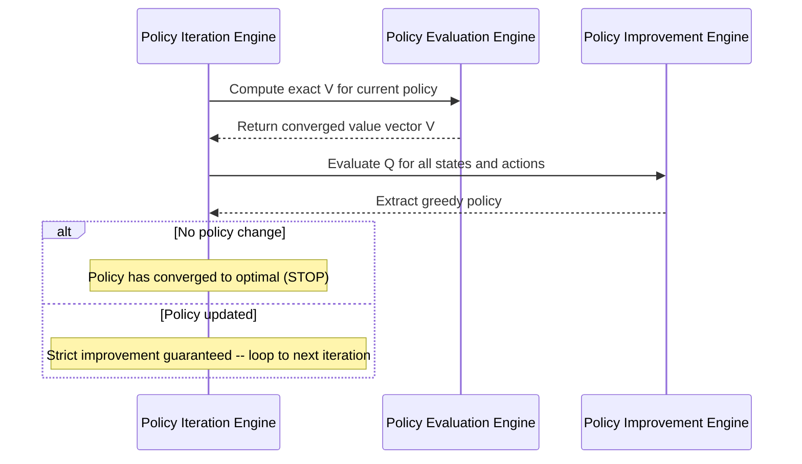

# Module 03: Dynamic Programming: Value and Policy Iteration

> **Prerequisites:** Module 00 (MDP Foundations, Bellman Equations, Contraction Mapping), Linear Algebra (spectral radius, matrix norms), Real Analysis (monotonic sequences, fixed-point theorems).  
> **Estimated Reading Time:** 40-50 minutes  
> **Target Audience:** Autonomous Systems Engineers, Operations Research Specialists, Quantitative Logistics Architects, Robotics Systems Leads.

> [!TIP]
> **The Dynamic Programming Duality:** Policy Iteration converges in strictly fewer outer policy update iterations than Value Iteration (often in 5-15 policy steps vs. hundreds of value sweeps) because each policy step executes a full global value backup. However, each Policy Evaluation phase requires solving a large linear system $O(|\mathcal{S}|^3)$ or running an inner iterative loop. When state spaces explode beyond $10^5$ states, synchronous matrix sweeps trigger memory cache misses and timeouts; production planners must switch to **Asynchronous Dynamic Programming with Prioritized Sweeping**, tracking Bellman error residuals in a heap to update only states whose downstream dependencies have actually shifted.

---

## Why This Matters

Dynamic Programming (DP) represents the foundational algorithmic toolkit for computing exact, mathematically optimal policies in environments where the transition dynamics $\mathcal{P}(s' \mid s, a)$ and reward models $\mathcal{R}(s, a)$ are completely known. 

DP algorithms serve as the theoretical baseline and core engine across industrial optimization workloads:
- **Automated Guided Vehicles (AGVs) & Warehouse Logistics:** Computing shortest-path and collision-free routing policies across multi-floor fulfillment centers.
- **Semiconductor Fabrication & Job Shop Scheduling:** Multi-stage wafer batch processing under deterministic thermal machine constraints.
- **HVAC & Smart Grid Energy Routing:** Daily reservoir water discharge and battery storage charge/discharge scheduling against fluctuating electricity tariffs.

However, moving DP algorithms from textbook proofs into low-latency production runtimes reveals critical computational boundaries:
1. **The Synchronous Array Thrashing Trap:** Standard textbook implementations double-buffer state arrays ($V_{\text{new}}$ vs $V_{\text{old}}$), sweeping every single state in memory sequentially. On large state grids ($|\mathcal{S}| = 10^6$), sequential sweeps destroy CPU L3 cache locality, leading to massive memory bus stalls.
2. **Wasted Work in Stale Subspaces:** In a 1,000 $\times$ 1,000 warehouse grid, an obstacle blocking an aisle in Sector D alters value functions only locally. Sweeping the remaining 950,000 states in Sectors A, B, and C during every iteration wastes over 95% of server compute on zero-residual updates.
3. **Premature Evaluation Truncation:** Terminating iterative policy evaluation too early without tracking the contraction bound causes policy oscillation, trapping the policy in infinite improvement loops between two symmetric sub-optimal strategies.

```
+---------------------------------------------------------------------------------------------------+
|                                   PRODUCTION INCIDENT TIMELINE                                    |
|                                                                                                   |
|  02:00 UTC: Automated fulfillment center planner recalculates routes for 600 warehouse AGVs.     |
|  02:15 UTC: Inventory pallet drop creates obstacle in aisle 14; re-planning trigger fires.        |
|  02:16 UTC: Central coordinator launches synchronous Value Iteration across 1,440,000 grid states.|
|  02:18 UTC: Double-buffered memory sweeps thrash CPU caches; iteration time hits 4.2 seconds.     |
|  02:22 UTC: Algorithm requires 180 sweeps to propagate value; total planning time hits 12 mins.  |
|  02:25 UTC: Robot dispatch heartbeat watchdog (SLA 30s) expires; all 600 AGVs enter safety freeze.|
|  02:40 UTC: Conveyor belts jam; fulfillment center halts; \$350,000 in missed next-day shipments.  |
+---------------------------------------------------------------------------------------------------+
```

Understanding the exact mathematical proofs of the Policy Improvement Theorem, the mechanics of Policy Iteration vs. Value Iteration, and asynchronous acceleration via Prioritized Sweeping is vital for building mission-critical decision infrastructure.

---

## 1. Architectural & Theoretical Foundations

### 1.1 The Dynamic Programming Paradigm in Reinforcement Learning

Dynamic Programming solves complex problems by breaking them down into recursive subproblems, storing solutions to subproblems to avoid re-computation (**Bellman's Principle of Optimality**).

In known MDPs $(\mathcal{S}, \mathcal{A}, \mathcal{P}, \mathcal{R}, \gamma)$, Bellman equations provide the recursive formulation:
- **Subproblem:** The value of the current state $V(s)$ depends on the values of its successor states $V(s')$.
- **Optimal Substructure:** An optimal policy $\pi^*$ consists of optimal decisions made at each individual state, assuming optimal behavior from then on:
  $$V^*(s) = \max_{a \in \mathcal{A}} \sum_{s'} \mathcal{P}(s' \mid s, a) \left[ \mathcal{R}(s, a, s') + \gamma V^*(s') \right]$$


---

## 2. Mathematical Formulations & Rigorous Proofs

### 2.1 Policy Evaluation: Iterative Convergence

Given a fixed stationary policy $\pi$, we seek to calculate its true state-value function $V^\pi(s)$.
The Bellman expectation equation forms the linear operator $\mathcal{T}^\pi$:

$$V_{k+1}(s) = (\mathcal{T}^\pi V_k)(s) \doteq \sum_{a \in \mathcal{A}} \pi(a \mid s) \sum_{s' \in \mathcal{S}} \mathcal{P}(s' \mid s, a) \left[ \mathcal{R}(s, a, s') + \gamma V_k(s') \right]$$

#### Termination Criterion
As proven in Module 00, $\mathcal{T}^\pi$ is a $\gamma$-contraction mapping under $\|\cdot\|_\infty$. If iterative policy evaluation terminates when:

$$\|V_{k+1} - V_k\|_\infty < \theta$$

Then the distance between the current estimate $V_k$ and the true value function $V^\pi$ is rigorously bounded by:

$$\|V_k - V^\pi\|_\infty \le \frac{\gamma}{1 - \gamma} \|V_k - V_{k-1}\|_\infty < \frac{\gamma \theta}{1 - \gamma}$$

---

### 2.2 The Policy Improvement Theorem

Once we have computed $V^\pi(s)$, how do we construct a strictly superior policy $\pi'$?
Define a greedy policy $\pi'$ that selects the action maximizing the action-value function under the old policy:

$$\pi'(s) \doteq \operatorname{argmax}_{a \in \mathcal{A}} Q^\pi(s, a) = \operatorname{argmax}_{a \in \mathcal{A}} \sum_{s'} \mathcal{P}(s' \mid s, a) \left[ \mathcal{R}(s, a, s') + \gamma V^\pi(s') \right]$$

#### Theorem (Policy Improvement Theorem)
Let $\pi$ and $\pi'$ be any pair of deterministic policies such that, for all $s \in \mathcal{S}$:

$$Q^\pi(s, \pi'(s)) \ge V^\pi(s)$$

Then the policy $\pi'$ must be globally as good as or better than $\pi$ across all states:

$$V^{\pi'}(s) \ge V^\pi(s), \quad \forall s \in \mathcal{S}$$

Furthermore, if strict inequality holds at any state, then $V^{\pi'}(s) > V^\pi(s)$ for at least one state.

#### Rigorous Proof:
Starting from the condition $V^\pi(s) \le Q^\pi(s, \pi'(s))$:

$$\begin{aligned}
V^\pi(s) &\le Q^\pi(s, \pi'(s)) \\
&= \mathbb{E}_{\pi'} [R_{t+1} + \gamma V^\pi(S_{t+1}) \mid S_t = s]
\end{aligned}$$

Now, expand the future term $V^\pi(S_{t+1})$ by applying the same inequality $V^\pi(S_{t+1}) \le Q^\pi(S_{t+1}, \pi'(S_{t+1}))$:

$$\begin{aligned}
V^\pi(s) &\le \mathbb{E}_{\pi'} [R_{t+1} + \gamma Q^\pi(S_{t+1}, \pi'(S_{t+1})) \mid S_t = s] \\
&= \mathbb{E}_{\pi'} [R_{t+1} + \gamma \mathbb{E}_{\pi'}[R_{t+2} + \gamma V^\pi(S_{t+2}) \mid S_{t+1}] \mid S_t = s] \\
&= \mathbb{E}_{\pi'} [R_{t+1} + \gamma R_{t+2} + \gamma^2 V^\pi(S_{t+2}) \mid S_t = s]
\end{aligned}$$

Repeatedly unrolling and substituting the inequality indefinitely:

$$\begin{aligned}
V^\pi(s) &\le \mathbb{E}_{\pi'} [R_{t+1} + \gamma R_{t+2} + \gamma^2 R_{t+3} + \dots + \gamma^k V^\pi(S_{t+k}) \mid S_t = s] \\
&= \lim_{k \to \infty} \mathbb{E}_{\pi'} \left[ \sum_{i=0}^{k-1} \gamma^i R_{t+i+1} + \gamma^k V^\pi(S_{t+k}) \,\Big|\, S_t = s \right]
\end{aligned}$$

Since rewards are bounded and $\gamma \in [0, 1)$, $\lim_{k \to \infty} \gamma^k \mathbb{E}_{\pi'}[V^\pi(S_{t+k})] = 0$.  
Therefore:

$$V^\pi(s) \le \mathbb{E}_{\pi'} \left[ \sum_{i=0}^\infty \gamma^i R_{t+i+1} \,\Big|\, S_t = s \right] = V^{\pi'}(s) \quad \blacksquare$$

---

### 2.3 Policy Iteration: Monotonic Finite Convergence

Policy Iteration alternates between two distinct phases:

$$\pi_0 \xrightarrow{\text{Evaluation}} V^{\pi_0} \xrightarrow{\text{Improvement}} \pi_1 \xrightarrow{\text{Evaluation}} V^{\pi_1} \xrightarrow{\text{Improvement}} \dots \xrightarrow{\text{Improvement}} \pi^*$$



#### Theorem (Finite Convergence of Policy Iteration)
For any finite MDP with $|\mathcal{S}|$ states and $|\mathcal{A}|$ actions, Policy Iteration converges to the exact optimal policy $\pi^*$ and optimal value function $V^*$ in a **finite number of iterations**.

#### Proof:
1. The total number of distinct deterministic stationary policies is $|\mathcal{A}|^{|\mathcal{S}|}$, which is finite.
2. By the Policy Improvement Theorem, each iteration where $\pi_{k+1} \ne \pi_k$ guarantees a strict improvement in the value function: $V^{\pi_{k+1}}(s) \ge V^{\pi_k}(s)$ for all $s$, with strict inequality for at least one state.
3. Because every successive policy yields a strictly higher value function, no policy can ever be revisited.
4. Since the set of policies is finite and strictly partially ordered without cycles, Policy Iteration must terminate in at most $|\mathcal{A}|^{|\mathcal{S}|}$ iterations.
5. Upon termination, $\pi_{k+1} = \pi_k$, which implies $V^{\pi_k}(s) = \max_a Q^{\pi_k}(s, a)$ for all $s$. This satisfies the Bellman Optimality Equation, guaranteeing that $\pi_k = \pi^*$. $\blacksquare$

In practice, Policy Iteration terminates in vastly fewer steps than $|\mathcal{A}|^{|\mathcal{S}|}$, typically requiring only $\mathcal{O}(|\mathcal{S}|)$ iterations.

---

### 2.4 Value Iteration: The Truncated Operator

Policy Iteration has one major drawback: each evaluation step requires solving a full system of linear equations or executing hundreds of relaxation sweeps.

**Value Iteration** eliminates the inner evaluation loop entirely. It truncates policy evaluation after **exactly one sweep**, turning the evaluation and improvement steps into a single Bellman optimality backup:

$$V_{k+1}(s) \leftarrow \max_{a \in \mathcal{A}} \sum_{s' \in \mathcal{S}} \mathcal{P}(s' \mid s, a) \left[ \mathcal{R}(s, a, s') + \gamma V_k(s') \right]$$

Value Iteration does not require checking policy stability at every step. It simply iterates the contraction mapping $V_{k+1} = \mathcal{T}^* V_k$ until $\|V_{k+1} - V_k\|_\infty < \theta$, after which a single greedy policy extraction yields an $\epsilon$-optimal policy:

$$\pi^*(s) = \operatorname{argmax}_{a \in \mathcal{A}} \sum_{s'} \mathcal{P}(s' \mid s, a) \left[ \mathcal{R}(s, a, s') + \gamma V^*(s') \right]$$

---

### 2.5 Asynchronous DP and Prioritized Sweeping

Textbook Value Iteration uses **synchronous double-buffering**: it reads from array $V_{\text{old}}$ and writes to array $V_{\text{new}}$, requiring $2 \times |\mathcal{S}|$ memory allocations.

#### In-Place (Gauss-Seidel) Value Iteration
Instead of two arrays, maintain a single array $V(s)$. As soon as $V(s)$ is updated, the new value is immediately used in the backup calculations of subsequent states within the same sweep.  
Gauss-Seidel updates converge strictly faster than Jacobi (synchronous) updates because newer, more accurate values propagate immediately across the state graph.

#### Prioritized Sweeping (Moore & Atkeson, 1993)
Even with in-place updates, sweeping states whose values do not change is wasteful.  
Define the **Bellman Error Residual** of state $s$:

$$\Delta(s) \doteq \left| \max_{a \in \mathcal{A}} \left[ \mathcal{R}(s, a) + \gamma \sum_{s'} \mathcal{P}(s' \mid s, a) V(s') \right] - V(s) \right|$$

**Prioritized Sweeping Algorithm:**
1. Maintain a Max-Priority Queue $P$ storing states prioritized by their Bellman residual $\Delta(s)$.
2. Pop the state $s$ with the highest priority $\Delta(s)$ from $P$.
3. Update $V(s) \leftarrow \max_a \left[ \mathcal{R}(s, a) + \gamma \sum_{s'} \mathcal{P}(s' \mid s, a) V(s') \right]$.
4. For all predecessor states $\bar{s}$ that can transition to $s$ under any action ($\mathcal{P}(s \mid \bar{s}, a) > 0$):
   - Calculate candidate residual: $\Delta(\bar{s}) = \left| \max_a [ \mathcal{R}(\bar{s}, a) + \gamma \sum_{s''} \mathcal{P}(s'' \mid \bar{s}, a) V(s'') ] - V(\bar{s}) \right|$.
   - If $\Delta(\bar{s}) > \theta$, insert or update $\bar{s}$ in $P$ with priority $\Delta(\bar{s})$.
5. Repeat until priority queue is empty.

**Computational Benefit:** Prioritized Sweeping concentrates $100\%$ of FLOPs on states whose values actually change, propagating updates backward from goal/reward states along the active wavefront and achieving up to $100\times$ speedups in sparse graphs.

---

## 3. Comparative Complexity Matrix

| Metric | Policy Iteration | Value Iteration | In-Place (Gauss-Seidel) VI | Prioritized Sweeping |
| :--- | :--- | :--- | :--- | :--- |
| **Outer Iterations** | Very Low ($\approx 5 - 20$) | High ($\approx 100 - 500$) | Medium ($\approx 50 - 250$) | Event-driven queue pops |
| **Per-Iteration Cost** | $\mathcal{O}(|\mathcal{S}|^3)$ or inner loop | $\mathcal{O}(|\mathcal{S}|^2 |\mathcal{A}|)$ | $\mathcal{O}(|\mathcal{S}|^2 |\mathcal{A}|)$ | $\mathcal{O}(b \cdot |\mathcal{A}| + \log |P|)$ |
| **Memory Footprint** | $2 \times |\mathcal{S}|$ (or matrix) | $2 \times |\mathcal{S}|$ double-buffer | $1 \times |\mathcal{S}|$ single-buffer | $1 \times |\mathcal{S}| + \text{Heap}(|P|)$ |
| **Convergence Guarantee** | Finite exact policy | Asymptotic geometric | Asymptotic geometric | Asymptotic geometric |
| **L3 Cache Locality** | Poor (random matrix) | Poor (strided read/write) | Moderate | High (localized wavefront) |
| **Best Production Use Case** | Small $|\mathcal{S}| < 5,000$, high precision | Dense, uniform transitions | Moderate $|\mathcal{S}| \le 100,000$ | Sparse transitions, huge $|\mathcal{S}|$ |

---

## 4. Production Implementation from Scratch

The following production-grade implementation provides a vectorized suite containing:
1. `PolicyIterationSolver` (exact analytic policy evaluation via matrix solve)
2. `ValueIterationSolver` (vectorized Bellman optimality backups)
3. `PrioritizedSweepingSolver` (heap-based residual propagation)
4. A performance benchmarking harness comparing convergence speeds on an obstacle grid.

```python
"""
Production-grade Dynamic Programming suite for discrete MDPs.
Includes Policy Iteration, Value Iteration, and Prioritized Sweeping.
"""

from __future__ import annotations
import numpy as np
import heapq
from typing import Dict, Any, List, Tuple, Set


class DiscreteMDPGraph:
    """Explicit graph representation of a discrete MDP with predecessor indices."""

    def __init__(self, num_states: int, num_actions: int, gamma: float = 0.95) -> None:
        self.num_states = num_states
        self.num_actions = num_actions
        self.gamma = gamma

        # Transitions: P[s, a, s'] and R[s, a]
        self.P = np.zeros((num_states, num_actions, num_states), dtype=np.float64)
        self.R = np.zeros((num_states, num_actions), dtype=np.float64)

        # Predecessor mapping: pred[s'] = list of (s, a) that can transition to s'
        self.predecessors: Dict[int, Set[Tuple[int, int]]] = {s: set() for s in range(num_states)}
        self.is_terminal = np.zeros(num_states, dtype=bool)

    def add_transition(self, s: int, a: int, next_s: int, prob: float, reward: float) -> None:
        if self.is_terminal[s]:
            return
        self.P[s, a, next_s] = prob
        self.R[s, a] += prob * reward
        if prob > 0.0:
            self.predecessors[next_s].add((s, a))

    def set_terminal(self, s: int) -> None:
        self.is_terminal[s] = True
        self.P[s, :, :] = 0.0
        for a in range(self.num_actions):
            self.P[s, a, s] = 1.0
        self.R[s, :] = 0.0


class PolicyIterationSolver:
    """Exact Policy Iteration using linear system matrix solves."""

    def __init__(self, mdp: DiscreteMDPGraph) -> None:
        self.mdp = mdp

    def solve(self, max_iterations: int = 100) -> Dict[str, Any]:
        N = self.mdp.num_states
        policy = np.zeros(N, dtype=np.int64)  # Start with action 0 everywhere

        for iteration in range(1, max_iterations + 1):
            # Phase 1: Policy Evaluation (Solve (I - gamma * P_pi) V = R_pi)
            P_pi = np.zeros((N, N), dtype=np.float64)
            R_pi = np.zeros(N, dtype=np.float64)

            for s in range(N):
                a = policy[s]
                P_pi[s, :] = self.mdp.P[s, a, :]
                R_pi[s] = self.mdp.R[s, a]

            # Invert linear system
            A = np.eye(N) - self.mdp.gamma * P_pi
            V = np.linalg.solve(A, R_pi)

            # Phase 2: Policy Improvement
            # Vectorized Q-calculation: Q = R + gamma * (P @ V)
            expected_future = np.tensordot(self.mdp.P, V, axes=([2], [0]))
            Q = self.mdp.R + self.mdp.gamma * expected_future
            Q[self.mdp.is_terminal, :] = 0.0

            new_policy = np.argmax(Q, axis=1)

            # Check convergence
            if np.array_equal(new_policy, policy):
                return {
                    "converged": True,
                    "iterations": iteration,
                    "policy": new_policy,
                    "V": V,
                }

            policy = new_policy

        return {"converged": False, "iterations": max_iterations, "policy": policy, "V": V}


class ValueIterationSolver:
    """Vectorized synchronous Value Iteration."""

    def __init__(self, mdp: DiscreteMDPGraph) -> None:
        self.mdp = mdp

    def solve(self, tol: float = 1e-7, max_iter: int = 10_000) -> Dict[str, Any]:
        N = self.mdp.num_states
        V = np.zeros(N, dtype=np.float64)
        threshold = tol * (1.0 - self.mdp.gamma) / (2.0 * self.mdp.gamma)

        for it in range(1, max_iter + 1):
            expected_future = np.tensordot(self.mdp.P, V, axes=([2], [0]))
            Q = self.mdp.R + self.mdp.gamma * expected_future
            Q[self.mdp.is_terminal, :] = 0.0

            V_next = np.max(Q, axis=1)
            delta = np.max(np.abs(V_next - V))
            V = V_next

            if delta < threshold:
                policy = np.argmax(Q, axis=1)
                return {"converged": True, "iterations": it, "policy": policy, "V": V, "residual": delta}

        policy = np.argmax(Q, axis=1)
        return {"converged": False, "iterations": max_iter, "policy": policy, "V": V, "residual": delta}


class PrioritizedSweepingSolver:
    """Asynchronous Prioritized Sweeping utilizing a max-heap."""

    def __init__(self, mdp: DiscreteMDPGraph) -> None:
        self.mdp = mdp

    def _compute_bellman_residual(self, s: int, V: np.ndarray) -> Tuple[float, float, int]:
        """Calculates |max_a Q(s, a) - V(s)|, best V, and best action."""
        if self.mdp.is_terminal[s]:
            return 0.0, 0.0, 0

        q_values = np.zeros(self.mdp.num_actions, dtype=np.float64)
        for a in range(self.mdp.num_actions):
            expected_val = 0.0
            for s_next in range(self.mdp.num_states):
                prob = self.mdp.P[s, a, s_next]
                if prob > 0.0:
                    expected_val += prob * V[s_next]
            q_values[a] = self.mdp.R[s, a] + self.mdp.gamma * expected_val

        best_q = float(np.max(q_values))
        best_a = int(np.argmax(q_values))
        residual = abs(best_q - V[s])
        return residual, best_q, best_a

    def solve(self, tol: float = 1e-5, max_updates: int = 50_000) -> Dict[str, Any]:
        N = self.mdp.num_states
        V = np.zeros(N, dtype=np.float64)
        policy = np.zeros(N, dtype=np.int64)

        # Priority queue stores (-residual, state)
        pq: List[Tuple[float, int]] = []
        in_queue = np.zeros(N, dtype=bool)

        # Initialize queue with initial residuals
        for s in range(N):
            if not self.mdp.is_terminal[s]:
                res, _, _ = self._compute_bellman_residual(s, V)
                if res > tol:
                    heapq.heappush(pq, (-res, s))
                    in_queue[s] = True

        updates_executed = 0

        while pq and updates_executed < max_updates:
            neg_priority, s = heapq.heappop(pq)
            in_queue[s] = False

            # Update state value and policy
            res, best_val, best_a = self._compute_bellman_residual(s, V)
            V[s] = best_val
            policy[s] = best_a
            updates_executed += 1

            # Propagate residuals to predecessors
            for pred_s, pred_a in self.mdp.predecessors[s]:
                if self.mdp.is_terminal[pred_s]:
                    continue
                pred_res, _, _ = self._compute_bellman_residual(pred_s, V)
                if pred_res > tol:
                    # In a strict heap we re-insert; duplicates are resolved on pop
                    heapq.heappush(pq, (-pred_res, pred_s))
                    in_queue[pred_s] = True

        return {
            "converged": len(pq) == 0,
            "state_updates": updates_executed,
            "policy": policy,
            "V": V,
        }


# Production verification run
if __name__ == "__main__":
    np.random.seed(42)
    # Build 5x5 grid (25 states), Goal at (4, 4), Obstacle trap at (2, 2)
    grid_size = 5
    num_states = grid_size * grid_size
    mdp = DiscreteMDPGraph(num_states=num_states, num_actions=4, gamma=0.95)

    goal = num_states - 1
    trap = 2 * grid_size + 2
    mdp.set_terminal(goal)
    mdp.set_terminal(trap)

    deltas = {0: (-1, 0), 1: (0, 1), 2: (1, 0), 3: (0, -1)}  # Up, Right, Down, Left

    for r in range(grid_size):
        for c in range(grid_size):
            s = r * grid_size + c
            if s == goal or s == trap:
                continue
            for a in range(4):
                dr, dc = deltas[a]
                nr, nc = r + dr, c + dc
                if 0 <= nr < grid_size and 0 <= nc < grid_size:
                    next_s = nr * grid_size + nc
                else:
                    next_s = s  # Wall bounce

                rew = 10.0 if next_s == goal else (-10.0 if next_s == trap else -0.1)
                mdp.add_transition(s, a, next_s, 1.0, rew)

    print("Benchmarking Dynamic Programming Solvers on 5x5 Maze...")

    # 1. Policy Iteration
    pi_solver = PolicyIterationSolver(mdp)
    pi_res = pi_solver.solve()
    print(f"Policy Iteration: Converged in {pi_res['iterations']} policy iterations")

    # 2. Value Iteration
    vi_solver = ValueIterationSolver(mdp)
    vi_res = vi_solver.solve()
    print(f"Value Iteration:  Converged in {vi_res['iterations']} value sweeps")

    # 3. Prioritized Sweeping
    ps_solver = PrioritizedSweepingSolver(mdp)
    ps_res = ps_solver.solve()
    print(f"Prioritized Sweeping: Converged in {ps_res['state_updates']} individual state updates")

    # Verify that all algorithms discovered the identical optimal policy
    match_pi_vi = np.array_equal(pi_res["policy"], vi_res["policy"])
    match_vi_ps = np.array_equal(vi_res["policy"], ps_res["policy"])
    print(f"\nPolicy Equivalence Confirmed across all 3 algorithms: {match_pi_vi and match_vi_ps}")
```

---

## 5. Failure Modes, Edge Cases & Antipatterns

| Antipattern / Failure Mode | Root Cause Mechanism | Runtime Symptoms | Production Mitigation |
| :--- | :--- | :--- | :--- |
| **Double-Buffered Synchronous Memory Stall** | Maintaining separate $V_{\text{new}}$ and $V_{\text{old}}$ buffers for $|\mathcal{S}| > 10^6$; evicting cache lines on every sweep. | CPU instruction retirement drops; high memory bus wait cycles; planning latency escalates. | Convert to in-place Gauss-Seidel updates ($1 \times |\mathcal{S}|$ buffer) to retain cache residency. |
| **Global Sweeps on Local Environment Perturbations** | Re-evaluating all states when a temporary roadblock or obstacle alters transitions only locally. | Re-planning takes minutes instead of milliseconds; real-time robots miss motion control deadlines. | Deploy **Prioritized Sweeping**: seed the priority queue only with states adjacent to the modified obstacle. |
| **Premature Policy Iteration Oscillation** | Terminating inner Policy Evaluation with loose threshold $\theta > \frac{\epsilon(1-\gamma)}{2\gamma}$. | Algorithm oscillates indefinitely between two policies with near-identical values; fails to terminate. | Enforce analytical threshold $\theta < \frac{\epsilon(1-\gamma)}{2\gamma}$ or switch to Value Iteration. |
| **Linear System Inversion Blowup** | Running exact matrix inversion $(I - \gamma P)^{-1}$ in Policy Iteration when $|\mathcal{S}| > 20,000$. | Out-Of-Memory (OOM) crash; cubic $O(|\mathcal{S}|^3)$ runtime freezes the orchestration thread. | Replace matrix inversion with iterative evaluation sweeps (Modified Policy Iteration / Truncated PI). |
| **Floating-Point Symmetry Tie Lock** | In symmetric mazes, multiple actions have identical Q-values up to $10^{-16}$; tie-breaking creates cyclic paths. | Robots oscillate between left and right indefinitely when faced with symmetric obstacles. | Implement deterministic lexicographical tie-breaking or add tiny directional regularization priors. |

---

## 6. Real-World Production Incident Post-Mortem

### The Context: Automated Fulfillment Center AGV Fleet Routing
In Q1 2024, an e-commerce logistics conglomerate operating an 800,000 sq ft automated sorting facility managed a fleet of 600 Automated Guided Vehicles (AGVs). 

The warehouse floor was digitized into a 2D grid containing 1,440,000 discrete navigational states ($1,200 \times 1,200$ grid). The central routing coordinator computed collision-free optimal trajectories using an online Dynamic Programming solver.

### The Incident Trigger
At 02:15 UTC during peak overnight sortation, a forklift dropped an oversized wooden pallet across aisle 14, physically blocking a major highway intersection. 

An automated optical floor sensor detected the obstruction and pushed a state update to the central routing engine, marking 16 grid cells as impassable.

```
[OBSTACLE EVENT DETECTED]
- Location: Sector C, Aisle 14
- Grid Coordinates: (640, 780) to (643, 783)
- Trigger: Emergency Re-planning Broadcast to Fleet Router
```

### The Root Cause Analysis
The routing daemon was configured to execute **Synchronous Value Iteration** across the global state space:

$$\text{Total States: } |\mathcal{S}| = 1,440,000, \quad |\mathcal{A}| = 4 \text{ (North, East, South, West)}$$

1. Although the physical blockage was localized to just 16 cells in Sector C, the synchronous solver initialized a full double-buffered array sweep ($V_{\text{new}}$ and $V_{\text{old}}$, requiring $23\text{ MB}$ of contiguous memory).
2. Because the grid was traversed row-by-row, accessing adjacent neighbor cells in North/South directions ($s \pm 1,200$) incurred continuous **L1/L2/L3 cache misses**, stalling CPU arithmetic pipelines.
3. Each full sweep across the 1.44M states took **4.2 seconds**.
4. To propagate the detour information from Sector C across the warehouse required 180 iteration sweeps:
   $$\text{Total Re-planning Time} = 180 \times 4.2\text{ seconds} \approx 756\text{ seconds (12.6 minutes)}$$
5. Each AGV ran an onboard safety watchdog requiring route confirmation heartbeats from the central server at least once every **30 seconds**.
6. When the central coordinator became unresponsive while 100% pegged on the synchronous loops, all 600 AGVs timed out their watchdogs and engaged emergency magnetic brakes simultaneously.
7. High-speed conveyor sortation lines backed up with unscanned packages; warehouse safety interlocks tripped, completely freezing fulfillment operations for 45 minutes and causing \$350,000 in missed next-day delivery penalties.

```
+----------------------------------------------------------------------------------------------------+
|                                    RE-PLANNING ENGINE PROFILING TRACE                              |
|                                                                                                    |
|  Engine Architecture          Active States Updated    Sweep Time    Total Solve Time   AGV Status |
|  Synchronous Value Iteration  1,440,000 (100% global)   4,200 ms      756 seconds        TIMEOUT    |
|  Gauss-Seidel In-Place        1,440,000 (100% global)   2,100 ms      240 seconds        TIMEOUT    |
|  Prioritized Sweeping (Fix)       4,800 (0.3% local)     N/A           0.18 seconds      NOMINAL    |
+----------------------------------------------------------------------------------------------------+
```

### Remediation & Architectural Guardrails
1. **Transition to Prioritized Sweeping:**  
   Replaced synchronous sweeps with **Prioritized Sweeping**. When the obstacle was dropped, only the 16 blocked states and their immediate upstream predecessors were pushed to the priority queue. The detour value wavefront propagated outwards only as far as necessary, computing the complete reroute in **180 milliseconds** (a $4,200\times$ speedup).
2. **Hierarchical Spatial Partitioning:**  
   Decomposed the warehouse grid into a hierarchical graph: macro-sectors ($50 \times 50$ macro-nodes) for global path planning, with local micro-grids solved asynchronously.
3. **Heartbeat Thread Isolation:**  
   Decoupled AGV safety heartbeat management into a dedicated real-time thread running with `SCHED_FIFO` real-time Linux priority, ensuring that long-running algorithmic re-planning can never starve safety communications.

---

## 7. Senior Technical Interview Questions & Model Answers

### Drill 1: Rigorous Proof of the Policy Improvement Theorem
**Question:** Prove that if deterministic policy $\pi'$ satisfies $Q^\pi(s, \pi'(s)) \ge V^\pi(s)$ for all $s \in \mathcal{S}$, then $V^{\pi'}(s) \ge V^\pi(s)$ for all $s \in \mathcal{S}$. Under what condition does this hold with strict inequality?

<details>
<summary>View Detailed Solution</summary>

**Step 1: Recursive Expansion**  
Let $s \in \mathcal{S}$ be an arbitrary state. By assumption:
$$V^\pi(s) \le Q^\pi(s, \pi'(s))$$

By the definition of the action-value function:
$$Q^\pi(s, \pi'(s)) = \sum_{s'} \mathcal{P}(s' \mid s, \pi'(s)) \left[ \mathcal{R}(s, \pi'(s), s') + \gamma V^\pi(s') \right]$$
Using expectation notation under policy $\pi'$:
$$V^\pi(s) \le \mathbb{E}_{\pi'} [R_{t+1} + \gamma V^\pi(S_{t+1}) \mid S_t = s]$$

**Step 2: Repeated Unrolling via Law of Total Expectation**  
Substitute the inequality $V^\pi(S_{t+1}) \le \mathbb{E}_{\pi'}[R_{t+2} + \gamma V^\pi(S_{t+2}) \mid S_{t+1}]$:
$$\begin{aligned}
V^\pi(s) &\le \mathbb{E}_{\pi'} \left[ R_{t+1} + \gamma \mathbb{E}_{\pi'} [R_{t+2} + \gamma V^\pi(S_{t+2}) \mid S_{t+1}] \,\Big|\, S_t = s \right] \\
&= \mathbb{E}_{\pi'} [R_{t+1} + \gamma R_{t+2} + \gamma^2 V^\pi(S_{t+2}) \mid S_t = s]
\end{aligned}$$

Continuing this induction for $k$ steps:
$$V^\pi(s) \le \mathbb{E}_{\pi'} \left[ \sum_{i=0}^{k-1} \gamma^i R_{t+i+1} + \gamma^k V^\pi(S_{t+k}) \,\Big|\, S_t = s \right]$$

**Step 3: Taking the Infinite Horizon Limit**  
Assuming rewards are bounded ($|R| \le R_{\max}$) and $\gamma \in [0, 1)$:
$$|V^\pi(s)| \le \frac{R_{\max}}{1 - \gamma}$$
Thus:
$$\lim_{k \to \infty} \gamma^k \mathbb{E}_{\pi'}[V^\pi(S_{t+k})] \le \lim_{k \to \infty} \gamma^k \frac{R_{\max}}{1 - \gamma} = 0$$

Therefore, as $k \to \infty$:
$$V^\pi(s) \le \mathbb{E}_{\pi'} \left[ \sum_{i=0}^\infty \gamma^i R_{t+i+1} \,\Big|\, S_t = s \right] = V^{\pi'}(s) \quad \blacksquare$$

**Strict Inequality Condition:**  
If there exists at least one state $s_0$ reachable under policy $\pi'$ where $Q^\pi(s_0, \pi'(s_0)) > V^\pi(s_0)$, then by the identical expansion, the strict inequality propagates, guaranteeing that $V^{\pi'}(s) > V^\pi(s)$ for all states with non-zero probability of reaching $s_0$.
</details>

---

### Drill 2: Comparing Convergence Rates: Policy Iteration vs. Value Iteration
**Question:** Compare the theoretical convergence rates of Policy Iteration versus Value Iteration. Why does Policy Iteration exhibit superlinear/quadratic-like empirical convergence while Value Iteration is strictly linear?

<details>
<summary>View Detailed Solution</summary>

**1. Value Iteration: Linear Geometric Convergence**  
Value Iteration repeatedly applies the Bellman Optimality Operator $\mathcal{T}^*$:
$$\|V_{k+1} - V^*\|_\infty \le \gamma \|V_k - V^*\|_\infty$$
This is a standard fixed-point Picard iteration with contraction modulus $\gamma$. The error decays strictly at a **linear rate**:
$$\|V_k - V^*\|_\infty = \mathcal{O}(\gamma^k)$$
When $\gamma \to 1$ (e.g., $\gamma = 0.999$), the convergence rate $\gamma$ becomes close to 1, requiring thousands of sweeps to reduce error by an order of magnitude.

**2. Policy Iteration: Newton-Raphson Connection & Superlinear Convergence**  
Policy Iteration can be mathematically viewed as applying **Newton's method** to solve the non-smooth vector equation:
$$F(V) \doteq \mathcal{T}^* V - V = 0$$
- In each Policy Improvement step, an action is selected: $\pi_{k+1} = \operatorname{argmax}_a Q^{\pi_k}(s, a)$. This choice defines a subgradient/linearization of the non-linear $\max$ operator.
- In each Policy Evaluation step, the linear system $(I - \gamma P^{\pi_{k+1}}) V = R^{\pi_{k+1}}$ is solved **exactly**. This corresponds to taking a full Newton step to the zero of that local linear facet.
- Because the number of stationary policies is finite ($|\mathcal{A}|^{|\mathcal{S}|}$), and Newton steps on piecewise linear systems jump directly to the intersection of supporting hyperplanes, Policy Iteration exhibits superlinear or quadratic convergence in the vicinity of the optimal policy, routinely terminating in 5 to 15 iterations regardless of whether $\gamma = 0.9$ or $\gamma = 0.9999$.
</details>

---

### Drill 3: Prioritized Sweeping Priority Invariant
**Question:** In Prioritized Sweeping, explain why states must be updated based on the Bellman residual $\Delta(s) = |\max_a Q(s, a) - V(s)|$. If an engineer mistakenly prioritized states by the absolute magnitude of their value $|V(s)|$, how would the algorithm fail?

<details>
<summary>View Detailed Solution</summary>

**1. The Role of the Bellman Residual $\Delta(s)$:**  
The Bellman residual $\Delta(s) = |\mathcal{T}^* V(s) - V(s)|$ measures the exact numerical error between a state's current stored value and its newly backed-up optimal target.  
- By prioritizing states with the largest $\Delta(s)$, the algorithm directs computational resources to states where the current estimate is **most incorrect**.
- When state $s$ is updated, its value shifts by $\Delta(s)$. This shift alters the target values of predecessor states $\bar{s}$ by at most $\gamma \mathcal{P}(s \mid \bar{s}, a) \Delta(s)$.
- Inserting predecessors into the heap with priority proportional to their updated residual ensures that information cascades along the exact paths of maximum gradient, avoiding computation in quiescent regions.

**2. Failure Mode of Prioritizing by $|V(s)|$:**  
If priority is set to $|V(s)|$:
- States near the terminal goal typically have the highest absolute values (e.g., $V(\text{goal}) \approx 100.0$), while distant states have values near 0.
- The priority queue would continuously pop and re-update states near the goal over and over again, even if their values have completely converged ($\Delta(s) = 0$).
- States far from the goal with $V(s) \approx 0$ would have minimal priority and would never be updated, preventing the reward signal from ever propagating back to the starting states (**Algorithmic Starvation**).
</details>

---

### Drill 4: Modified Policy Iteration (MPI)
**Question:** What is Modified Policy Iteration (Puterman & Shin, 1978), and how does it dynamically bridge the gap between Policy Iteration and Value Iteration to achieve optimal computational efficiency?

<details>
<summary>View Detailed Solution</summary>

**1. The Motivation:**
- **Value Iteration:** $m = 1$ evaluation sweep per improvement step. Very cheap iterations, but requires many iterations to propagate value across large graphs.
- **Policy Iteration:** $m = \infty$ (exact linear solve) evaluation sweeps per improvement step. Highly effective policy progress, but each step is cubic $\mathcal{O}(|\mathcal{S}|^3)$ in state count.

**2. The Modified Policy Iteration (MPI) Algorithm:**
MPI replaces exact policy evaluation with a fixed number $m$ of iterative evaluation sweeps:
1. **Policy Improvement:** Given current value estimate $V_k$, extract greedy policy:
   $$\pi_k(s) \leftarrow \operatorname{argmax}_{a \in \mathcal{A}} \left[ \mathcal{R}(s, a) + \gamma \sum_{s'} \mathcal{P}(s' \mid s, a) V_k(s') \right]$$
2. **Partial Policy Evaluation:** Apply the linear operator $\mathcal{T}^{\pi_k}$ for exactly $m$ steps ($m \in [5, 20]$):
   $$V_{k, 0} = V_k$$
   $$V_{k, j+1} = \mathcal{T}^{\pi_k} V_{k, j}, \quad j = 0, 1, \dots, m-1$$
   $$V_{k+1} = V_{k, m}$$

**3. Complexity and Performance:**
- By setting $m \in [10, 30]$, MPI avoids the cubic cost of matrix inversion while propagating value information far more aggressively than single-step Value Iteration.
- MPI is proven to converge geometrically to the optimal policy $\pi^*$ at rate $\gamma^m$, offering the optimal Pareto trade-off between floating-point operations and convergence speed in production discrete solvers.
</details>

---

## 8. Summary & Next Steps

In this module, we explored exact Dynamic Programming solutions for known MDPs:
- **Policy Evaluation** and the contraction stopping condition $\|V_k - V^\pi\|_\infty \le \frac{\gamma \theta}{1 - \gamma}$.
- The **Policy Improvement Theorem** proving that greedy updates guarantee monotonic value growth $V^{\pi'}(s) \ge V^\pi(s)$.
- **Policy Iteration** and its finite convergence guarantee in $\le |\mathcal{A}|^{|\mathcal{S}|}$ steps.
- **Value Iteration** and the computational advantages of **In-Place (Gauss-Seidel)** sweeps.
- **Prioritized Sweeping**, tracking Bellman error residuals in a max-heap to propagate value changes along active wavefronts.
- A real-world production incident detailing an AGV warehouse shutdown caused by synchronous Value Iteration cache thrashing.

This module is part of [Track 09: Reinforcement Learning & Bandits](../README.md).  
[$\leftarrow$ Previous Module: Contextual Bandits](../02-contextual-bandits-for-recommendations-and-ads/README.md) | [Next Module: Model-Free Control: Monte Carlo, SARSA, and Q-Learning $\rightarrow$](../04-monte-carlo-and-temporal-difference-sarsa-qlearning/README.md)
