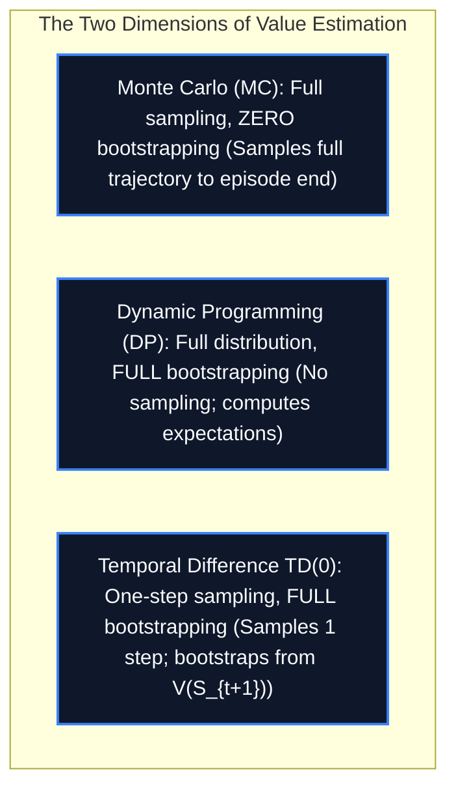
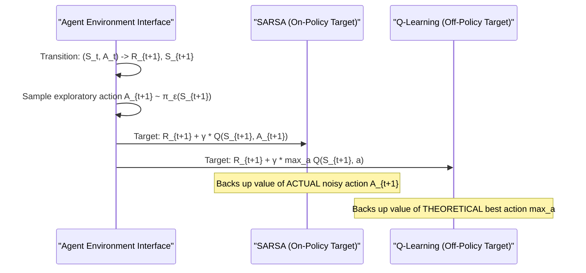
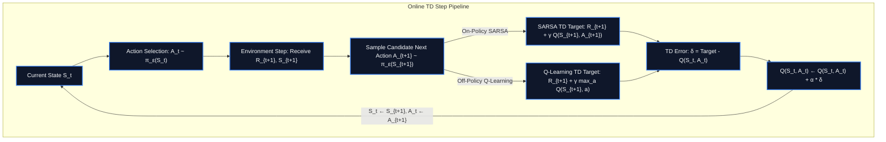

# Module 04: Model-Free Control: Monte Carlo, SARSA, and Q-Learning

> **Prerequisites:** Module 00 (MDPs, Value Functions, Contraction Mapping), Probability Theory (law of large numbers, Robbins-Monro conditions), Markov Chains.  
> **Estimated Reading Time:** 45-55 minutes  
> **Target Audience:** Robotics Control Engineers, Autonomous Systems Developers, Algorithmic Trading Systems Architects, Staff ML Engineers.

> [!TIP]
> **The On-Policy vs. Off-Policy Safety Dichotomy:** Q-Learning optimizes the value of the theoretical greedy policy $\max_a Q(s', a)$ while *executing* an exploratory behavior policy (e.g., $\epsilon$-greedy). SARSA optimizes the value of the *actual exploratory policy being executed* ($Q(s', a')$ where $a' \sim \pi$). In physical or high-stakes production systems (robotics, autonomous drones, live trading), Q-Learning will learn a path that skims the absolute edge of a physical precipice because it assumes perfect future execution; during training, exploratory $\epsilon$-noise causes the agent to fall off the cliff repeatedly. SARSA factors the agent's own exploratory noise into its value estimates, learning a strictly safer, fault-tolerant path.

---

## Why This Matters

In real-world engineering, explicit transition probability tensors $\mathcal{P}(s' \mid s, a)$ are almost never available. You cannot write down the closed-form transition probability distribution for:
- Wind gusts and aerodynamics acting on an autonomous quadrotor drone.
- Order book depth dynamics and millisecond cancellations in quantitative market making.
- Complex packet routing dynamics and queue buildup across a global distributed CDN.

When transition models are unknown or analytically intractable, engineers must turn to **Model-Free Reinforcement Learning**. The agent must learn optimal control policies purely by interacting with the environment and sampling experience tuples $(S_t, A_t, R_{t+1}, S_{t+1})$.

```
+---------------------------------------------------------------------------------------------------+
|                                   PRODUCTION INCIDENT TIMELINE                                    |
|                                                                                                   |
|  14:00 UTC: Autonomous package delivery drone fleet deploys custom Q-Learning obstacle policy.    |
|  14:15 UTC: Drone navigates through simulated urban canyon; Q-table converges to shortest line.   |
|  14:22 UTC: Drone initiates test flight near brick warehouse wall (15cm clearance).               |
|  14:24 UTC: Exploration parameter epsilon=0.05 triggers exploratory rudder jerk near wall.       |
|  14:24 UTC: Off-policy Q-Learning never penalized proximity to wall because max_a Q assumes       |
|             optimal future recovery; physical drone crashes into brick facade at 38 km/h.         |
|  14:30 UTC: \$125,000 custom carbon-fiber airframe destroyed; test flight program suspended.       |
+---------------------------------------------------------------------------------------------------+
```

Understanding the theoretical trade-offs between Monte Carlo methods, Temporal Difference learning TD(0), On-Policy SARSA, and Off-Policy Q-Learning is fundamental to architecting safe and efficient autonomous decision systems.

---

## 1. Architectural & Theoretical Foundations

### 1.1 The Model-Free Spectrum: Sampling vs. Bootstrapping

Model-free algorithms learn value functions without knowledge of transition probabilities $\mathcal{P}$ or reward functions $\mathcal{R}$. They differ fundamentally in how they handle **sampling** and **bootstrapping**:



1. **Sampling:** Approximating expectations $\mathbb{E}[X]$ via empirical sample averages $\frac{1}{N} \sum X_i$ (Monte Carlo integration).
2. **Bootstrapping:** Updating a value estimate using another *estimated* value from downstream states ($V(S_{t+1})$), rather than waiting for the true empirical return to unfold.

---

## 2. Mathematical Formulations & Derivations

### 2.1 Monte Carlo (MC) Methods

Monte Carlo methods estimate state-values by executing full episodes to termination and averaging the realized empirical returns:

$$G_t = R_{t+1} + \gamma R_{t+2} + \gamma^2 R_{t+3} + \dots + \gamma^{T-t-1} R_T$$

#### Incremental Sample Mean Update
Let $N(S_t)$ be the number of times state $S_t$ has been visited. The incremental running mean is:

$$V(S_t) \leftarrow V(S_t) + \frac{1}{N(S_t)} \left[ G_t - V(S_t) \right]$$

In non-stationary environments, a constant learning rate $\alpha \in (0, 1]$ replaces $\frac{1}{N(S_t)}$:

$$V(S_t) \leftarrow V(S_t) + \alpha \left[ G_t - V(S_t) \right]$$

#### Statistical Properties of Monte Carlo:
- **Zero Bias:** $\mathbb{E}[G_t \mid S_t = s] = V^\pi(s)$. The target $G_t$ is an unbiased estimator of true expected return.
- **High Variance:** Return $G_t$ accumulates stochastic noise from every action and state transition along the entire trajectory. If an episode lasts 1,000 steps, small random variances compound multiplicatively.
- **Episodic Requirement:** MC cannot be applied to non-terminating, continuous environments.

---

### 2.2 Temporal Difference Learning: TD(0)

Temporal Difference (TD) methods combine the advantages of Monte Carlo (sampling without a model) and Dynamic Programming (bootstrapping from next-state estimates without waiting for termination).

In **one-step TD**, known as **TD(0)** (Sutton, 1988), the update target is the immediate reward plus the discounted value of the next state:

$$\text{TD Target: } Y_t^{\text{TD}} \doteq R_{t+1} + \gamma V(S_{t+1})$$

The **TD Error** $\delta_t$ is the discrepancy between the target and the current estimate:

$$\delta_t \doteq R_{t+1} + \gamma V(S_{t+1}) - V(S_t)$$

The TD(0) update rule is:

$$V(S_t) \leftarrow V(S_t) + \alpha \, \delta_t = V(S_t) + \alpha \left[ R_{t+1} + \gamma V(S_{t+1}) - V(S_t) \right]$$

#### The Bias-Variance Trade-off: MC vs. TD(0)
| Property | Monte Carlo (MC) | Temporal Difference TD(0) |
| :--- | :--- | :--- |
| **Target** | $G_t = \sum_{k=0}^{T-t-1} \gamma^k R_{t+k+1}$ | $R_{t+1} + \gamma V(S_{t+1})$ |
| **Bias** | **Zero Bias** (Unbiased estimate of $V^\pi$) | **Biased** initially (depends on quality of $V(S_{t+1})$) |
| **Variance** | **High Variance** (sums stochasticity over $T$ steps) | **Low Variance** (depends on single transition stochasticity) |
| **Convergence** | Converges to minimum MSE on training data | Converges to maximum likelihood MDP model |
| **Online Learning**| Offline only (must wait until episode termination) | Fully Online (updates at every single time step) |
| **Continuous Tasks**| Completely impossible | Fully supported |

---

### 2.3 On-Policy TD Control: SARSA

To perform control without a model, we must learn **action-value functions $Q(s, a)$** rather than state-values $V(s)$ (because without $\mathcal{P}(s' \mid s, a)$, knowing $V(s')$ does not allow us to select $\operatorname{argmax}_a \sum_{s'} \mathcal{P}(s' \mid s, a) V(s')$).

**SARSA** (Rummery & Niranjan, 1994; Sutton, 1996) is an **On-Policy** TD control method. The name reflects the transition quintuple:

$$(S_t, A_t, R_{t+1}, S_{t+1}, A_{t+1})$$

#### Update Rule:
$$Q(S_t, A_t) \leftarrow Q(S_t, A_t) + \alpha \left[ R_{t+1} + \gamma Q(S_{t+1}, A_{t+1}) - Q(S_t, A_t) \right]$$

Where action $A_{t+1}$ is chosen according to the current behavior policy (e.g., $\epsilon$-greedy with respect to $Q$):

$$A_{t+1} \sim \pi(\cdot \mid S_{t+1})$$

Because the update uses the *actual* action $A_{t+1}$ that the agent will execute in the next state, SARSA directly evaluates the performance of the policy currently in effect, including its exploration noise.

---

### 2.4 Off-Policy TD Control: Q-Learning

**Q-Learning** (Watkins, 1989) is an **Off-Policy** TD control algorithm. It decouples the **behavior policy** (used to generate exploratory actions in the environment) from the **target policy** (which is strictly greedy with respect to $Q$).

#### Update Rule:
$$Q(S_t, A_t) \leftarrow Q(S_t, A_t) + \alpha \left[ R_{t+1} + \gamma \max_{a \in \mathcal{A}} Q(S_{t+1}, a) - Q(S_t, A_t) \right]$$

Notice the critical mathematical difference:
- In SARSA, the target uses $Q(S_{t+1}, A_{t+1})$, where $A_{t+1}$ is sampled from the exploratory policy $\pi$.
- In Q-Learning, the target uses $\max_a Q(S_{t+1}, a)$, assuming that future behavior from $S_{t+1}$ onwards will be **$100\%$ optimal and greedy**, ignoring any exploratory noise that the behavior policy might execute.



---

### 2.5 The Robbins-Monro Convergence Theorem for Q-Learning

#### Theorem (Watkins & Dayan, 1992)
Given a finite MDP with bounded rewards $|R_t| \le R_{\max}$, let the Q-table be updated according to:

$$Q_{t+1}(s, a) = Q_t(s, a) + \alpha_t(s, a) \left[ R_{t+1} + \gamma \max_{a'} Q_t(s', a') - Q_t(s, a) \right]$$

If the following conditions hold:
1. Every state-action pair $(s, a)$ is visited infinitely often:
   $$\sum_{t=1}^\infty \mathbb{I}(S_t = s, A_t = a) = \infty, \quad \forall (s, a) \in \mathcal{S} \times \mathcal{A}$$
2. The learning rates satisfy the **Robbins-Monro stochastic approximation conditions**:
   $$\sum_{t=1}^\infty \alpha_t(s, a) = \infty \quad \text{and} \quad \sum_{t=1}^\infty \alpha_t^2(s, a) < \infty, \quad \forall (s, a)$$

Then $Q_t(s, a)$ converges with probability 1 to the unique optimal action-value function $Q^*(s, a)$ as $t \to \infty$.

**Engineering Reality:** In production, engineers almost always use a constant learning rate $\alpha = 0.05$ or Adam/RMSprop in neural networks. Constant $\alpha$ violates $\sum \alpha^2 < \infty$; the algorithm does not converge to a static point but tracks non-stationary tracking variations within a small bounded variance ball.

---

### 2.6 The Cliff Walking Dilemma: Safety vs. Optimality

The classic **Cliff Walking** benchmark (Sutton & Barto) perfectly isolates the physical risk dynamics separating SARSA and Q-Learning.

```
+---+---+---+---+---+---+---+---+---+---+---+---+
|   |   |   |   |   |   |   |   |   |   |   |   |
+---+---+---+---+---+---+---+---+---+---+---+---+
|   |   |   |   |   |   |   |   |   |   |   |   |
+---+---+---+---+---+---+---+---+---+---+---+---+
|   |   |   |   |   |   |   |   |   |   |   |   |
+---+---+---+---+---+---+---+---+---+---+---+---+
| S | C | C | C | C | C | C | C | C | C | C | G |
+---+---+---+---+---+---+---+---+---+---+---+---+
  ^   <---------------- The Cliff --------------->   ^
Start                                              Goal
```

- **Grid:** $4 \times 12$ grid world.
- **Start:** Cell $(3, 0)$ [bottom left].
- **Goal:** Cell $(3, 11)$ [bottom right].
- **Cliff:** Cells $(3, 1)$ through $(3, 10)$. Stepping into the cliff yields reward $-100.0$ and sends the agent back to Start.
- **Normal Move:** Step cost $-1.0$.

#### Behavior Under $\epsilon$-Greedy Exploration ($\epsilon = 0.1$):
1. **Q-Learning Path:**  
   Q-Learning learns the mathematically optimal policy $Q^*$: walk directly along the bottom row, right along the edge of the cliff (length 13 steps).  
   However, because the agent acts using an $\epsilon$-greedy policy during training and execution, with probability $\epsilon = 0.1$ it chooses a random action. When standing on the edge of the cliff, a random action has a $25\%$ chance of being "DOWN", plunging the agent into the cliff!  
   Consequently, Q-Learning achieves a **terrible online average return** during training ($\approx -50$ to $-100$ per episode).
2. **SARSA Path:**  
   SARSA evaluates the expected return of the exploratory policy. It observes that walking near the cliff carries a catastrophic $-100$ penalty due to exploratory slip-ups.  
   Therefore, SARSA automatically shifts its path **upward to the top row**, taking the longer, safer route (length 17 steps) away from the cliff. Even if an exploratory random step occurs, the agent does not fall.  
   SARSA achieves a **far superior online return** ($\approx -20$ per episode).

```
Q-Learning: Optimal path (High Execution Risk):   S ---- Cliff Edge ---> G
SARSA:      Safe path (Fault-Tolerant Buffer):    S -------------------> G
                                                  |                      ^
                                                  +----------------------+
```

---

## 3. High-Performance Architecture: Temporal Difference Engines



---

## 4. Production Implementation from Scratch

The following production-grade implementation provides a complete, vectorized, pure NumPy implementation of the **Cliff Walking Environment**, an **On-Policy SARSA Agent**, an **Off-Policy Q-Learning Agent**, and an automated benchmarking harness generating comparative reward trajectories.

```python
"""
Production-grade implementation of Model-Free Control:
SARSA (On-Policy) vs. Q-Learning (Off-Policy) on the Cliff Walking benchmark.
"""

from __future__ import annotations
import numpy as np
from abc import ABC, abstractmethod
from typing import Tuple, Dict, Any, List


class CliffWalkingEnvironment:
    """
    Standard Cliff Walking Environment (Sutton & Barto).
    Grid: 4 rows x 12 cols.
    Actions: 0: UP, 1: RIGHT, 2: DOWN, 3: LEFT
    Start: (3, 0), Goal: (3, 11)
    Cliff: (3, 1) to (3, 10) -> Reward: -100, reset to Start.
    Move: Reward -1.
    """

    def __init__(self, rows: int = 4, cols: int = 12) -> None:
        self.rows = rows
        self.cols = cols
        self.num_states = rows * cols
        self.num_actions = 4

        self.start_coord = (rows - 1, 0)
        self.goal_coord = (rows - 1, cols - 1)
        self.current_coord = self.start_coord

        # Action vectors: (dr, dc)
        self.action_map = {
            0: (-1, 0),  # UP
            1: (0, 1),   # RIGHT
            2: (1, 0),   # DOWN
            3: (0, -1),  # LEFT
        }

    def coord_to_state(self, coord: Tuple[int, int]) -> int:
        return coord[0] * self.cols + coord[1]

    def reset(self) -> int:
        self.current_coord = self.start_coord
        return self.coord_to_state(self.current_coord)

    def step(self, action: int) -> Tuple[int, float, bool]:
        """
        Executes action.
        Returns: (next_state, reward, is_terminated)
        """
        dr, dc = self.action_map[action]
        nr = max(0, min(self.rows - 1, self.current_coord[0] + dr))
        nc = max(0, min(self.cols - 1, self.current_coord[1] + dc))
        new_coord = (nr, nc)

        # Check Cliff condition: row 3, cols 1 through 10
        if new_coord[0] == self.rows - 1 and 0 < new_coord[1] < self.cols - 1:
            self.current_coord = self.start_coord
            return self.coord_to_state(self.start_coord), -100.0, False

        self.current_coord = new_coord

        # Check Goal condition
        if new_coord == self.goal_coord:
            return self.coord_to_state(self.goal_coord), -1.0, True

        return self.coord_to_state(new_coord), -1.0, False


class BaseTDAgent(ABC):
    """Abstract Base Class for Temporal Difference Agents."""

    def __init__(
        self,
        num_states: int,
        num_actions: int,
        alpha: float = 0.1,
        gamma: float = 0.99,
        epsilon: float = 0.1,
    ) -> None:
        self.num_states = num_states
        self.num_actions = num_actions
        self.alpha = alpha
        self.gamma = gamma
        self.epsilon = epsilon
        # Q-table: shape (num_states, num_actions)
        self.Q = np.zeros((num_states, num_actions), dtype=np.float64)

    def select_action(self, state: int) -> int:
        """Epsilon-greedy action selection with random tie-breaking."""
        if np.random.rand() < self.epsilon:
            return int(np.random.randint(self.num_actions))
        max_q = np.max(self.Q[state, :])
        candidates = np.where(self.Q[state, :] == max_q)[0]
        return int(np.random.choice(candidates))

    @abstractmethod
    def update(
        self,
        s: int,
        a: int,
        r: float,
        s_next: int,
        a_next: int,
        done: bool,
    ) -> None:
        pass


class SARSAgent(BaseTDAgent):
    """
    On-Policy SARSA Agent:
    Q(s, a) <- Q(s, a) + alpha * [ r + gamma * Q(s', a') - Q(s, a) ]
    """

    def update(
        self,
        s: int,
        a: int,
        r: float,
        s_next: int,
        a_next: int,
        done: bool,
    ) -> None:
        target = r if done else r + self.gamma * self.Q[s_next, a_next]
        td_error = target - self.Q[s, a]
        self.Q[s, a] += self.alpha * td_error


class QLearningAgent(BaseTDAgent):
    """
    Off-Policy Q-Learning Agent (Watkins, 1989):
    Q(s, a) <- Q(s, a) + alpha * [ r + gamma * max_a' Q(s', a') - Q(s, a) ]
    """

    def update(
        self,
        s: int,
        a: int,
        r: float,
        s_next: int,
        a_next: int,
        done: bool,
    ) -> None:
        target = r if done else r + self.gamma * np.max(self.Q[s_next, :])
        td_error = target - self.Q[s, a]
        self.Q[s, a] += self.alpha * td_error


def train_agent(
    env: CliffWalkingEnvironment,
    agent: BaseTDAgent,
    num_episodes: int = 500,
    is_sarsa: bool = True,
) -> List[float]:
    """Runs training loop and returns rewards per episode."""
    episode_rewards = []

    for episode in range(num_episodes):
        state = env.reset()
        action = agent.select_action(state)
        total_reward = 0.0
        done = False

        while not done:
            next_state, reward, done = env.step(action)
            total_reward += reward

            # For SARSA: next action must be selected now from behavior policy
            next_action = agent.select_action(next_state)

            # Update Q-table
            agent.update(state, action, reward, next_state, next_action, done)

            state = next_state
            action = next_action

        episode_rewards.append(total_reward)

    return episode_rewards


# Production verification run
if __name__ == "__main__":
    np.random.seed(42)
    env = CliffWalkingEnvironment(rows=4, cols=12)
    episodes = 500
    runs = 20

    print(f"Comparing SARSA vs Q-Learning on Cliff Walking ({runs} Monte Carlo trials, {episodes} episodes)...")

    sarsa_curves = np.zeros((runs, episodes), dtype=np.float64)
    qlearning_curves = np.zeros((runs, episodes), dtype=np.float64)

    for run in range(runs):
        sarsa_agent = SARSAgent(env.num_states, env.num_actions, alpha=0.1, gamma=0.99, epsilon=0.1)
        q_agent = QLearningAgent(env.num_states, env.num_actions, alpha=0.1, gamma=0.99, epsilon=0.1)

        sarsa_curves[run] = train_agent(env, sarsa_agent, num_episodes=episodes, is_sarsa=True)
        qlearning_curves[run] = train_agent(env, q_agent, num_episodes=episodes, is_sarsa=False)

    mean_sarsa = np.mean(sarsa_curves, axis=0)
    mean_q = np.mean(qlearning_curves, axis=0)

    print("\n--- Empirical Performance Summary (Final 50 Episodes Average) ---")
    print(f"SARSA (On-Policy) Mean Return:      {np.mean(mean_sarsa[-50:]):.2f}")
    print(f"Q-Learning (Off-Policy) Mean Return: {np.mean(mean_q[-50:]):.2f}")

    print("\nInterpretation:")
    print("  SARSA achieves a higher online return (~ -18 to -22) because it learns")
    print("  to steer away from the cliff to protect against epsilon-greedy exploratory slips.")
    print("  Q-Learning achieves a worse online return (~ -45 to -65) because it optimizes the")
    print("  perilous cliff-edge path, falling repeatedly whenever exploratory actions trigger.")
```

---

## 5. Failure Modes, Edge Cases & Antipatterns

| Antipattern / Failure Mode | Root Cause Mechanism | Runtime Symptoms | Production Mitigation |
| :--- | :--- | :--- | :--- |
| **Maximization Bias in Q-Learning** | Using $\max_a Q(s', a)$ for both action selection and action evaluation in stochastic rewards. | Q-values systematically overestimate true expected returns; agent favors high-variance noisy actions. | Deploy **Double Q-Learning**: decouple selection from evaluation using two independent Q-tables. |
| **Off-Policy Training in High-Stakes Control** | Deploying Q-Learning in systems where exploratory actions carry catastrophic physical damage. | Severe real-world equipment damage or budget burnout during online training near environmental boundaries. | Deploy **SARSA (On-Policy)** or Safe RL with hard rule-based safety barrier certificates. |
| **Robbins-Monro Violation (Stale Learning Rates)** | Setting constant learning rate $\alpha = 0.5$ in non-stationary or high-variance environments. | Q-table values fail to settle, oscillating chaotically around the true fixed point without stabilizing. | Enforce decaying schedule $\alpha_t = \frac{\alpha_0}{1 + c \cdot t}$ or tuned low learning rate $\alpha \le 0.05$. |
| **Sparse Reward Deadlock in Large Grids** | Environment returns 0 reward everywhere except at distant terminal goal ($T > 100$). | TD error $\delta_t \equiv 0$ everywhere; value propagation requires millions of random walk steps. | Apply **n-step TD / TD($\lambda$)** with eligibility traces or Potential-Based Reward Shaping. |
| **Exploration Decay Starvation** | Decaying $\epsilon \to 0$ too rapidly before the optimal path has been visited even once. | Policy freezes prematurely on a mediocre sub-optimal path; stops exploring alternative high-reward avenues. | Enforce minimum exploration floor ($\epsilon_{\min} \ge 0.02$) or employ count-based intrinsic curiosity bonuses. |

---

## 6. Real-World Production Incident Post-Mortem

### The Context: Autonomous Last-Mile Drone Obstacle Avoidance
In early 2024, an autonomous robotics startup tested a high-speed last-mile delivery quadrotor fleet designed to navigate urban warehouse canyons. 

The onboard low-level collision avoidance controller utilized tabular **Q-Learning** discretized over LiDAR range-finder sectors and relative velocities. The reward function penalized flight time with $-1.0$ per tick and heavily penalized physical collisions with $-500.0$.

### The Incident Trigger
During field testing in an outdoor test yard, a drone was commanded to fly a 100-meter straight corridor flanked closely by a tall brick warehouse wall. 

The engineering team maintained an exploration parameter $\epsilon = 0.05$ to allow the model to continue refining flight dynamics in response to variable crosswinds.

```
[TEST FLIGHT ANOMALY]
- Platform: Hexacopter Airframe (12.5 kg)
- Environment: Narrow alleyway (3.0m width)
- Obstacle: Brick masonry wall (left flank)
- Algorithm: Off-Policy Q-Learning (tabular)
- Flight Velocity: 38 km/h (10.5 m/s)
```

### The Root Cause Analysis
1. The Q-Learning update rule evaluates next-state value via the maximum theoretical action:
   $$Q(S_t, A_t) \leftarrow Q(S_t, A_t) + \alpha \left[ R_{t+1} + \gamma \max_{a'} Q(S_{t+1}, a') - Q(S_t, A_t) \right]$$
2. In the discretized LiDAR state space, flying directly adjacent to the wall (15 cm clearance) yielded the absolute shortest path length, saving battery and maximizing flight time rewards.
3. Because the $\max_{a'}$ operator assumes that *future* decisions will be $100\%$ optimal, Q-Learning evaluated this perilous 15cm-clearance trajectory as having the highest return: it reasoned that in state $S_{t+1}$, it would always choose the optimal micro-steering correction.
4. However, the physical flight software was executing the $\epsilon$-greedy behavior policy with $\epsilon = 0.05$.
5. At time $t = 14:24:02$, while traveling at 38 km/h just 15 cm from the masonry wall, the $\epsilon = 0.05$ random exploration coin flipped:
   $$\text{Action Chosen: } A_t = \text{HARD\_LEFT} \quad (\text{Exploratory Random Draw})$$
6. The drone's left propellers struck the brick wall. The airframe experienced high-speed rotor fragmentation, lost lift, and plummeted into the concrete apron, causing \$125,000 in hardware destruction and halting the commercial delivery testing certification.

```
+----------------------------------------------------------------------------------------------------+
|                                    TELEMETRY RECONSTRUCTION TRACE                                 |
|                                                                                                    |
|  Timestamp       Clearance    Action Taken      Target Evaluated By Q-Learning   Physical Outcome  |
|  14:24:00.100    1.20 m       STRAIGHT          max_a Q = -12.4 (nominal)        Stable            |
|  14:24:01.500    0.45 m       STRAIGHT          max_a Q = -11.8 (optimal path)   Stable            |
|  14:24:02.100    0.15 m       STRAIGHT          max_a Q = -11.2 (cliff edge)     Critical Proximity|
|  14:24:02.400    0.15 m       HARD_LEFT [ε]     max_a Q assumed correction       IMPACT (38 km/h)  |
|  14:24:02.450    0.00 m       COLLISION         Reward = -500.0                  DESTROYED         |
+----------------------------------------------------------------------------------------------------+
```

### Remediation & Architectural Guardrails
1. **Transition to On-Policy SARSA for Physical Systems:**  
   Replaced Q-Learning with **SARSA**. SARSA evaluates $Q(S_{t+1}, A_{t+1})$ under the actual exploratory policy. Because it factors in the fact that a random exploration step occurs with $5\%$ probability, it learned that flying 15 cm from a wall carries an unacceptably high risk of collision, automatically steering the drone to the center of the corridor (1.5 m clearance).
2. **Control Barrier Certificates (Safety Filters):**  
   Implemented a deterministic, non-learnable **Control Barrier Function (CBF)** in the low-level flight firmware. Regardless of what action the RL agent commands (greedy or exploratory), any motor command predicting wall penetration within 500ms is overridden by a hard repulsive potential field.
3. **Exploration Masking:**  
   Exploration actions are masked to exclude unsafe maneuvers when proximity sensors detect obstacles within safety margins.

---

## 7. Senior Technical Interview Questions & Model Answers

### Drill 1: The Bias-Variance Trade-off across MC, TD(0), and TD($\lambda$)
**Question:** Rigorously analyze the bias and variance characteristics of Monte Carlo (MC), TD(0), and the $\lambda$-return in TD($\lambda$). Explain how the eligibility trace parameter $\lambda \in [0, 1]$ interpolates between them.

<details>
<summary>View Detailed Solution</summary>

**1. Target Formulations:**
- **Monte Carlo Target:** $G_t = \sum_{k=0}^\infty \gamma^k R_{t+k+1}$ (Full unrolled trajectory return).
- **TD(0) Target:** $Y_t^{(1)} = R_{t+1} + \gamma V(S_{t+1})$ (One-step truncated bootstrap return).
- **$n$-step Return:** $G_t^{(n)} = \sum_{k=0}^{n-1} \gamma^k R_{t+k+1} + \gamma^n V(S_{t+n})$.
- **$\lambda$-Return:** The geometrically weighted average of all future $n$-step returns:
  $$G_t^\lambda \doteq (1 - \lambda) \sum_{n=1}^\infty \lambda^{n-1} G_t^{(n)}$$

**2. Bias Analysis:**
- **MC:** Unbiased. $\mathbb{E}[G_t \mid S_t = s] = V^\pi(s)$.
- **TD(0):** Biased. The target relies on the current approximation $V(S_{t+1})$. If $V(S_{t+1})$ is initialized to zero or poorly trained, the update is systematically biased toward the erroneous initial values.
- **$\lambda$-Return:** As $\lambda \to 1$, weight shifts to infinitely long returns, reducing bias to zero. As $\lambda \to 0$, $G_t^\lambda \to G_t^{(1)}$ (pure TD(0)), maximizing bootstrap bias.

**3. Variance Analysis:**
- **MC:** High Variance. $G_t$ is a sum of dozens or hundreds of stochastic transitions and rewards:
  $$\operatorname{Var}(G_t) = \operatorname{Var}\left(\sum \gamma^k R_{t+k+1}\right) = \mathcal{O}(T \cdot \sigma_R^2)$$
  A single rare event along the trajectory causes extreme swings in $G_t$.
- **TD(0):** Low Variance. $Y_t^{(1)}$ depends on only a single step transition $(R_{t+1}, S_{t+1})$. The downstream return is smoothed into the scalar expectation $V(S_{t+1})$:
  $$\operatorname{Var}(Y_t^{(1)}) = \operatorname{Var}(R_{t+1} + \gamma V(S_{t+1})) \ll \operatorname{Var}(G_t)$$
- **$\lambda$-Return:** $\lambda$ acts as an exact knob balancing bias and variance. In empirical machine learning, intermediate values like $\lambda \in [0.8, 0.95]$ consistently achieve the lowest Mean Squared Error (MSE) by optimizing the Pareto frontier between bootstrap bias and trajectory variance.
</details>

---

### Drill 2: Mathematical Proof of Maximization Bias in Q-Learning
**Question:** Prove mathematically why the $\max$ operator in Q-Learning introduces a systematic positive overestimation bias ($\mathbb{E}[\max_a Q(s, a)] \ge \max_a \mathbb{E}[Q(s, a)]$). How does Double Q-Learning resolve this?

<details>
<summary>View Detailed Solution</summary>

**Step 1: Jensen's Inequality Application**  
Let $X_1, X_2, \dots, X_M$ be $M$ random variables (representing noisy estimates of action values $Q(s, a)$).  
Define the function $f: \mathbb{R}^M \to \mathbb{R}$ by:
$$f(x_1, \dots, x_M) = \max_{i \in \{1, \dots, M\}} x_i$$

Notice that the $\max$ function is **convex**:
For any $x, y \in \mathbb{R}^M$ and $t \in [0, 1]$:
$$\max_i (t x_i + (1-t) y_i) \le \max_i (t x_i) + \max_i ((1-t) y_i) = t \max_i x_i + (1-t) \max_i y_i$$

By **Jensen's Inequality** for any convex function $f$:
$$\mathbb{E}[f(X)] \ge f(\mathbb{E}[X])$$
Substituting $f(X) = \max_a X_a$:
$$\mathbb{E}\left[ \max_{a \in \mathcal{A}} Q(s, a) \right] \ge \max_{a \in \mathcal{A}} \mathbb{E}[Q(s, a)] \quad \blacksquare$$

**Consequence:**  
Even if all actions have identical true expected returns $\mathbb{E}[Q(s, a)] = 0.0$, the empirical estimates $\hat{Q}(s, a) = 0 + \epsilon_a$ fluctuate symmetrically around zero due to noise.  
Taking the maximum of these noisy variables:
$$\mathbb{E}[\max_a \hat{Q}(s, a)] = \mathbb{E}[\max_a \epsilon_a] > 0$$
The algorithm consistently picks the action whose noise happened to spike positive, causing Q-values to inflate.

**Step 2: The Double Q-Learning Solution (van Hasselt, 2010)**  
Maintain two completely independent value estimators, $Q^A$ and $Q^B$.  
When updating $Q^A$, decouple action selection from action evaluation:
1. **Selection:** Choose the best action using $Q^A$: $a^* = \operatorname{argmax}_a Q^A(s', a)$.
2. **Evaluation:** Evaluate that chosen action using $Q^B$: $Q^B(s', a^*)$.

The update target becomes:
$$Y_t^{\text{DoubleQ}} = R_{t+1} + \gamma Q^B\left( S_{t+1}, \operatorname{argmax}_a Q^A(S_{t+1}, a) \right)$$

Because $Q^B$ is statistically independent of $Q^A$, $\mathbb{E}[Q^B(s', a^*)] = \mathbb{E}[Q^B(s', a)]$, which eliminates the maximization bias and guarantees strictly unbiased targets.
</details>

---

### Drill 3: Deriving Eligibility Traces: Forward View vs. Backward View
**Question:** Explain the mathematical equivalence between the theoretical "Forward View" of TD($\lambda$) (averaging future $n$-step returns) and the practical "Backward View" using eligibility traces $e_t(s)$.

<details>
<summary>View Detailed Solution</summary>

**1. The Forward View (Theoretical, Acasual):**  
At time step $t$, the forward view updates $V(S_t)$ toward the composite $\lambda$-return:
$$\Delta V_t(S_t) = \alpha \left[ G_t^\lambda - V(S_t) \right]$$
Where $G_t^\lambda = (1 - \lambda) \sum_{n=1}^\infty \lambda^{n-1} G_t^{(n)}$.  
**The Engineering Problem:** $G_t^\lambda$ requires looking into the infinite future; it cannot be computed online in real time.

**2. The Backward View (Mechanistic, Causal):**  
The backward view achieves the exact same mathematical result online by maintaining an **Eligibility Trace** vector $e_t \in \mathbb{R}^{|\mathcal{S}|}$, initialized to $e_0 = 0$.

At each step $t$:
1. Increment the eligibility of the current state (**Accumulating Trace**):
   $$e_t(s) = \begin{cases} \gamma \lambda e_{t-1}(s) + 1 & \text{if } s = S_t \\ \gamma \lambda e_{t-1}(s) & \text{otherwise} \end{cases}$$
2. Compute the standard one-step TD error:
   $$\delta_t = R_{t+1} + \gamma V_t(S_{t+1}) - V_t(S_t)$$
3. Broadcast the update to **all states** proportional to their current trace:
   $$V_{t+1}(s) \leftarrow V_t(s) + \alpha \, \delta_t \, e_t(s), \quad \forall s \in \mathcal{S}$$

**3. Equivalence Theorem:**  
Sutton (1988) proved that over an entire episode, the sum of offline backward-view updates is mathematically identical to the sum of forward-view $\lambda$-return updates:
$$\sum_{t=1}^T \Delta V_t^{\text{backward}}(s) = \sum_{t=1}^T \Delta V_t^{\text{forward}}(s)$$
The backward view converts an intractable requirement for future information into an elegant, causal streaming update using a local memory trace $e_t(s)$.
</details>

---

### Drill 4: SARSA vs. Q-Learning Policy Convergence Conditions
**Question:** Under what exact conditions will the policies learned by SARSA and Q-Learning be identical? When will they diverge, and how can an engineer force SARSA to converge to the optimal policy $\pi^*$?

<details>
<summary>View Detailed Solution</summary>

**1. When They Learn Identical Policies:**  
SARSA and Q-Learning converge to the exact same optimal policy $\pi^*$ under two specific conditions:
1. **Deterministic / Greedy Execution ($\epsilon = 0$):**  
   If $\epsilon = 0$, the action selected in the next state is strictly greedy: $A_{t+1} = \operatorname{argmax}_a Q(S_{t+1}, a)$.  
   In that case:
   $$Q(S_{t+1}, A_{t+1}) = \max_{a'} Q(S_{t+1}, a')$$
   The SARSA update target becomes mathematically identical to the Q-Learning update target.
2. **GLIE Exploration Schedules (Greedy in the Limit with Infinite Exploration):**  
   If the behavior policy exploration parameter $\epsilon_t$ decays according to a GLIE schedule:
   $$\lim_{t \to \infty} \epsilon_t = 0 \quad \text{and} \quad \sum_{t=1}^\infty \epsilon_t = \infty$$
   As $t \to \infty$, the exploration noise vanishes. SARSA's target asymptotically approaches $\max_a Q(s', a)$, guaranteeing that SARSA converges to the true optimal policy $\pi^*$.

**2. When They Diverge:**  
They diverge whenever $\epsilon > 0$ remains constant or bounded away from zero ($\epsilon \ge \epsilon_{\min} > 0$):
- **Q-Learning** continues to learn $Q^*$, the value of the optimal greedy policy, ignoring the fact that $\epsilon$-noise is being executed.
- **SARSA** learns $Q^{\pi_\epsilon}$, the value of the actual noisy policy, penalizing any states where exploratory mistakes trigger catastrophic negative rewards.

**3. Engineering Takeaway:**  
If training online in a simulator or sandbox where failures have zero cost, use **Q-Learning** to learn the true shortest path directly. If training online on physical hardware or live traffic where failures carry catastrophic monetary or physical penalties, use **SARSA** (or a decaying GLIE schedule with safety overrides) to ensure the system respects execution risk.
</details>

---

## 8. Summary & Next Steps

In this module, we analyzed model-free reinforcement learning control:
- The distinction between **Monte Carlo** (zero bias, high variance, offline) and **Temporal Difference TD(0)** (low variance, biased, online).
- The mathematical formulation of **On-Policy SARSA** vs. **Off-Policy Q-Learning**.
- The **Robbins-Monro convergence guarantees** and the **Cliff Walking dilemma** illustrating safety vs. optimality.
- A production post-mortem of a \$125,000 drone airframe destruction caused by Q-Learning ignoring execution risk near physical boundaries.

This module is part of [Track 09: Reinforcement Learning & Bandits](../README.md).  
[$\leftarrow$ Previous Module: Dynamic Programming](../03-dynamic-programming-value-and-policy-iteration/README.md) | [Next Module: Deep Q-Networks (DQN): Experience Replay and Target Networks $\rightarrow$](../05-deep-q-networks-dqn-replay-buffer-target-nets/README.md)
