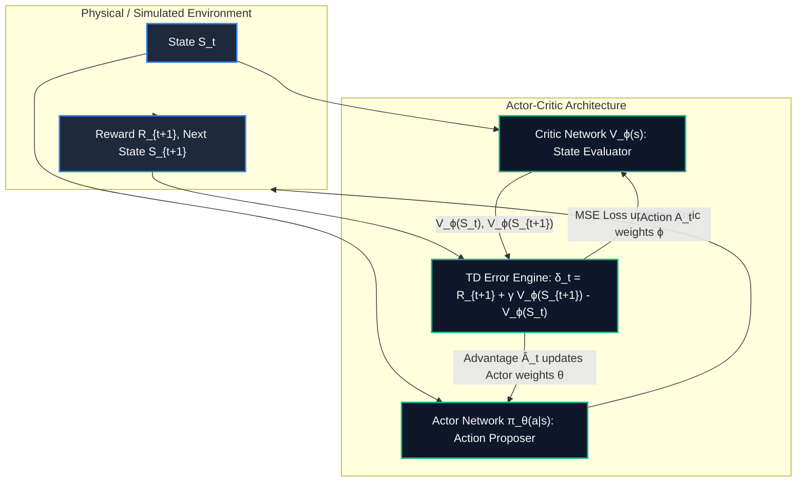
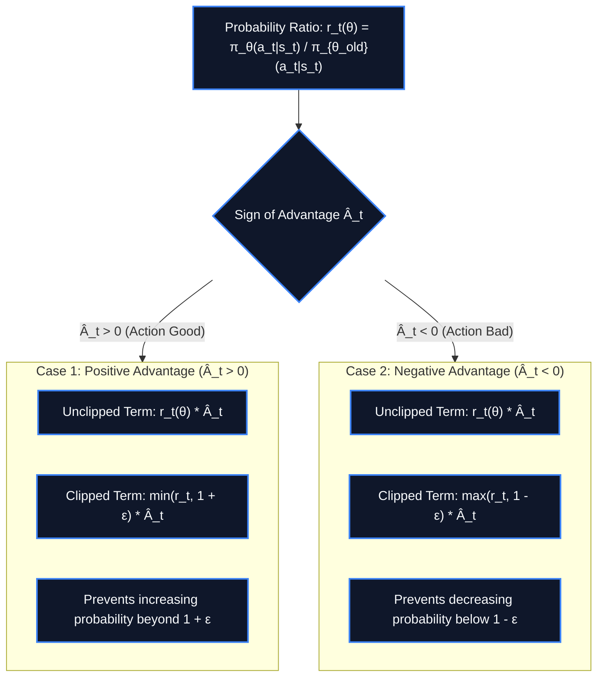

# Module 07: Actor-Critic Methods, GAE, and Proximal Policy Optimization (PPO)

> **Prerequisites:** Module 06 (Policy Gradient Theorem, Baseline Variance Reduction), Module 04 (Temporal Difference & TD Error), Multivariate Calculus, Information Theory (Kullback-Leibler Divergence).  
> **Estimated Reading Time:** 45-55 minutes  
> **Target Audience:** Staff Deep RL Engineers, LLM Alignment / RLHF Infrastructure Architects, Robotics Control Researchers, Decision Systems Leads.

> [!TIP]
> **The First-Order Trust Region Breakthrough:** Standard policy gradient updates $\theta \leftarrow \theta + \alpha \nabla_\theta J(\theta)$ take unconstrained steps in parameter space $\mathbb{R}^P$. In non-linear deep neural networks, a tiny step in Euclidean parameter space $\Delta \theta$ can cause a catastrophic, non-linear collapse in policy probability space $\Delta \pi$, dropping performance to zero permanently. **Proximal Policy Optimization (PPO)** enforces a soft trust region using a first-order clipped surrogate objective $\min(r_t(\theta) \hat{A}_t, \, \operatorname{clip}(r_t(\theta), 1-\epsilon, 1+\epsilon)\hat{A}_t)$, eliminating the expensive second-order Hessian-vector products of TRPO while preventing catastrophic policy collapse.

---

## Why This Matters

While REINFORCE with a baseline (Module 06) reduces gradient variance, it remains fundamentally limited: it is an **episodic Monte Carlo method**. It cannot update policy parameters until an entire trajectory finishes, cannot operate in infinite-horizon non-terminating environments, and still accumulates substantial trajectory-length variance.

The **Actor-Critic architecture** solves this by unifying policy-based and value-based reinforcement learning:
- **The Actor $\pi_\theta(a \mid s)$:** A parameterized policy that proposes actions.
- **The Critic $V_\phi(s)$:** A parameterized value function that evaluates actions using bootstrapping via Temporal Difference (TD) learning.

By replacing the noisy Monte Carlo return $G_t$ with a low-variance 1-step TD bootstrap $R_{t+1} + \gamma V_\phi(S_{t+1})$, Actor-Critic algorithms achieve fully online, step-by-step learning.

Building upon this, **Generalized Advantage Estimation (GAE)** (Schulman et al., 2015) and **Proximal Policy Optimization (PPO)** (Schulman et al., 2017) represent the current gold standard in modern reinforcement learning. PPO is the primary workhorse behind:
- **Large Language Model (LLM) Alignment:** Reinforcement Learning from Human Feedback (RLHF) and Direct Preference Optimization baselines in frontier models (GPT-4, Llama-3, Claude).
- **Legged Robotics:** Quadruped and humanoid locomotion over rugged terrains.
- **Complex Video Game Agents:** OpenAI Five (Dota 2) and StarCraft II.

```
+---------------------------------------------------------------------------------------------------+
|                                   PRODUCTION INCIDENT TIMELINE                                    |
|                                                                                                   |
|  03:00 UTC: Distributed RLHF cluster begins PPO fine-tuning of 70B parameter LLM on human feedback.|
|  04:15 UTC: Learning rate warm-up ends; training enters unconstrained policy gradient phase.      |
|  04:32 UTC: A batch of adversarial prompts produces unclipped probability ratio r_t(theta) = 14.8.|
|  04:33 UTC: Single gradient step destroys pre-trained linguistic syntax weights in transformer.   |
|  04:35 UTC: KL divergence from reference model explodes from 0.04 to 8.92 (Model Alignment Collapse)|
|  04:40 UTC: LLM degenerates into repetitive gibberish; 256 H100 GPUs wasted; \$85,000 cluster burn.  |
+---------------------------------------------------------------------------------------------------+
```

Understanding the exact mathematics of Advantage Actor-Critic (A2C), the GAE $\lambda$-discount derivation, and the PPO clipped surrogate objective is required for training modern high-capacity decision systems.

---

## 1. Architectural & Theoretical Foundations

### 1.1 The Actor-Critic Decomposition



1. **The Actor (Policy):** Updates parameters $\theta$ in the direction of the policy gradient suggested by the Critic:
   $$\theta \leftarrow \theta + \alpha_\theta \nabla_\theta \ln \pi_\theta(A_t \mid S_t) \hat{A}_t$$
2. **The Critic (Value Function):** Updates parameters $\phi$ via Temporal Difference regression to minimize prediction error:
   $$\phi \leftarrow \phi - \alpha_\phi \nabla_\phi \frac{1}{2} \left( R_{t+1} + \gamma V_\phi(S_{t+1}) - V_\phi(S_t) \right)^2$$

### 1.2 Advantage Actor-Critic (A2C)

In standard Advantage Actor-Critic (A2C), the advantage $A(S_t, A_t) = Q(S_t, A_t) - V(S_t)$ is estimated directly by the **one-step TD error $\delta_t$**:

$$\delta_t \doteq R_{t+1} + \gamma V_\phi(S_{t+1}) - V_\phi(S_t)$$

#### Proof that TD Error is an Unbiased Advantage Estimate:
Evaluating the expectation of $\delta_t$ conditioned on state $S_t$ and action $A_t$:

$$\begin{aligned}
\mathbb{E}[\delta_t \mid S_t = s, A_t = a] &= \mathbb{E}[R_{t+1} + \gamma V_\phi(S_{t+1}) - V_\phi(S_t) \mid S_t = s, A_t = a] \\
&= \mathbb{E}[R_{t+1} + \gamma V_\phi(S_{t+1}) \mid S_t = s, A_t = a] - V_\phi(s)
\end{aligned}$$

Assuming the Critic is accurate ($V_\phi \approx V^\pi$):
$$\mathbb{E}[R_{t+1} + \gamma V^\pi(S_{t+1}) \mid S_t = s, A_t = a] = Q^\pi(s, a)$$

Therefore:
$$\mathbb{E}[\delta_t \mid S_t = s, A_t = a] = Q^\pi(s, a) - V^\pi(s) = A^\pi(s, a) \quad \blacksquare$$

The one-step TD error $\delta_t$ serves as an unbiased sample estimate of the true advantage function without requiring an explicit $Q$-network!

---

## 2. Generalized Advantage Estimation (GAE)

While the 1-step TD error $\delta_t$ has minimal variance, it suffers from **high bias** if the Critic $V_\phi$ is inaccurate (which is always true early in training). Conversely, the Monte Carlo empirical advantage $\sum_{k=0}^\infty \gamma^k R_{t+k+1} - V_\phi(S_t)$ has zero bias but **high variance**.

**Generalized Advantage Estimation (GAE)** (Schulman et al., 2015) introduces an exponential discount parameter $\lambda \in [0, 1]$ to define an exponentially weighted average of all future $k$-step advantage estimators.

### 2.1 Mathematical Formulation of GAE

Define the $k$-step advantage estimators:
$$\begin{aligned}
\hat{A}_t^{(1)} &\doteq \delta_t = R_{t+1} + \gamma V(S_{t+1}) - V(S_t) \\
\hat{A}_t^{(2)} &\doteq \delta_t + \gamma \delta_{t+1} = R_{t+1} + \gamma R_{t+2} + \gamma^2 V(S_{t+2}) - V(S_t) \\
\hat{A}_t^{(k)} &\doteq \sum_{l=0}^{k-1} \gamma^l \delta_{t+l} = \sum_{l=0}^{k-1} \gamma^l R_{t+l+1} + \gamma^k V(S_{t+k}) - V(S_t)
\end{aligned}$$

GAE defines the composite advantage $\hat{A}_t^{\text{GAE}(\gamma, \lambda)}$ as the exponentially discounted average of these $k$-step estimators:

$$\hat{A}_t^{\text{GAE}(\gamma, \lambda)} \doteq (1 - \lambda) \sum_{k=1}^\infty \lambda^{k-1} \hat{A}_t^{(k)}$$

Expanding the terms algebraically:

$$\begin{aligned}
\hat{A}_t^{\text{GAE}(\gamma, \lambda)} &= (1 - \lambda) \left( \delta_t + \lambda (\delta_t + \gamma \delta_{t+1}) + \lambda^2 (\delta_t + \gamma \delta_{t+1} + \gamma^2 \delta_{t+2}) + \dots \right) \\
&= (1 - \lambda) \delta_t (1 + \lambda + \lambda^2 + \dots) + (1 - \lambda) \gamma \delta_{t+1} (\lambda + \lambda^2 + \dots) + \dots \\
&= (1 - \lambda) \delta_t \left( \frac{1}{1 - \lambda} \right) + (1 - \lambda) \gamma \delta_{t+1} \left( \frac{\lambda}{1 - \lambda} \right) + \dots \\
&= \sum_{l=0}^\infty (\gamma \lambda)^l \delta_{t+l}
\end{aligned}$$

Yielding the celebrated **GAE Form**:

$$\hat{A}_t^{\text{GAE}(\gamma, \lambda)} = \sum_{l=0}^\infty (\gamma \lambda)^l \delta_{t+l}^V$$

```
   GAE(γ, λ = 0):   Â_t = δ_t                           (1-step TD, Minimum Variance, High Bias)
   GAE(γ, λ = 1):   Â_t = ∑ γ^l R_{t+l+1} - V(S_t)      (Monte Carlo, Maximum Variance, Zero Bias)
   GAE(γ, λ = 0.95): Optimal Pareto Compromise
```

### 2.2 Efficient O(T) Recursive Backward Pass
In code, computing GAE naively across an episode of length $T$ is $O(T^2)$.  
By observing the recursive recurrence relation:

$$\hat{A}_t^{\text{GAE}} = \delta_t + (\gamma \lambda) \hat{A}_{t+1}^{\text{GAE}}$$

We can compute the GAE advantages for an entire episode in a single **backward pass in $O(T)$ time**:

```python
# Backward recursion: O(T) complexity
gae = 0.0
for t in reversed(range(T)):
    delta = rewards[t] + gamma * values[t + 1] * (1.0 - dones[t]) - values[t]
    gae = delta + gamma * lmbda * (1.0 - dones[t]) * gae
    advantages[t] = gae
```

---

## 3. Proximal Policy Optimization (PPO)

### 3.1 The Failure of Standard Policy Gradients: Step Size Collapse

In supervised learning, if a gradient step is too large, the model temporarily predicts poor outputs, but the underlying data distribution remains unchanged; subsequent batches correct the mistake.

In Reinforcement Learning, **data collection is coupled to the policy itself**. If an unconstrained gradient step damages policy parameters $\theta$, the agent's new policy $\pi_{\theta_{\text{new}}}$ collects terrible trajectories. The agent is trapped in an unrecoverable degenerate feedback loop (**Policy Collapse**).

Trust Region Policy Optimization (TRPO; Schulman et al., 2015) enforced a hard Kullback-Leibler (KL) divergence constraint:

$$\max_\theta \mathbb{E}\left[ \frac{\pi_\theta(a \mid s)}{\pi_{\theta_{\text{old}}}(a \mid s)} A(s, a) \right] \quad \text{s.t.} \quad \mathbb{E}\left[ \operatorname{KL}(\pi_{\theta_{\text{old}}}(\cdot \mid s) \,\|\, \pi_\theta(\cdot \mid s)) \right] \le \delta$$

While theoretically sound, TRPO requires computing the Fisher Information Matrix and solving conjugate gradient iterations with second-order Hessian-vector products, making it prohibitively complex and computationally slow.

---

### 3.2 The PPO Clipped Surrogate Objective

**Proximal Policy Optimization (PPO)** (Schulman et al., 2017) achieves TRPO's stability using purely **first-order stochastic gradient descent**.

Define the **Probability Ratio**:

$$r_t(\theta) \doteq \frac{\pi_\theta(a_t \mid s_t)}{\pi_{\theta_{\text{old}}}(a_t \mid s_t)}$$

Notice that:
- When $\theta = \theta_{\text{old}}$, $r_t(\theta) = 1.0$.
- If $r_t(\theta) > 1$, action $a_t$ is more likely under the new policy.
- If $r_t(\theta) < 1$, action $a_t$ is less likely under the new policy.

The **PPO Clipped Surrogate Objective** is:

$$\mathcal{L}^{\text{CLIP}}(\theta) = \hat{\mathbb{E}}_t \left[ \min\left( r_t(\theta) \hat{A}_t, \, \operatorname{clip}(r_t(\theta), 1 - \epsilon, 1 + \epsilon) \hat{A}_t \right) \right]$$

Where $\epsilon \approx 0.1 \text{ or } 0.2$ is a hyperparameter bounding the allowable policy deviation.



#### Detailed Breakdown of the Clipping Cases:
1. **Positive Advantage ($\hat{A}_t > 0$): Action was better than expected.**  
   We want to increase $\pi_\theta(a_t \mid s_t)$, which increases $r_t(\theta)$.  
   However, once $r_t(\theta) > 1 + \epsilon$, the term is clipped to $(1 + \epsilon) \hat{A}_t$.  
   Because we take the $\min(r_t \hat{A}_t, (1+\epsilon)\hat{A}_t)$, the objective ignores further increases in $r_t(\theta)$, producing a **zero gradient**. This prevents greedily over-optimizing an action based on a single batch.
2. **Negative Advantage ($\hat{A}_t < 0$): Action was worse than expected.**  
   We want to decrease $\pi_\theta(a_t \mid s_t)$, which decreases $r_t(\theta)$.  
   When $r_t(\theta) < 1 - \epsilon$, the term $\operatorname{clip}(r_t, 1-\epsilon, 1+\epsilon) \hat{A}_t = (1 - \epsilon) \hat{A}_t$.  
   Because $\hat{A}_t < 0$, multiplying by a smaller number makes it less negative (larger):
   $$\min\left( r_t \hat{A}_t, \, (1 - \epsilon) \hat{A}_t \right) = r_t \hat{A}_t$$
   The objective caps the penalty so that catastrophic destructive gradients do not wipe out good representations.

Taking the **minimum** between the unclipped and clipped terms ensures that $\mathcal{L}^{\text{CLIP}}(\theta)$ forms a **pessimistic lower bound** on policy performance.

---

### 3.3 The Full PPO Multi-Task Loss Function

In production architectures, Actor and Critic networks frequently share convolutional or transformer trunks. The joint optimization loss combines policy surrogate, value function error, and an entropy regularization bonus:

$$\mathcal{L}^{\text{PPO}}(\theta, \phi) = \hat{\mathbb{E}}_t \left[ \mathcal{L}_t^{\text{CLIP}}(\theta) - c_1 \mathcal{L}_t^{\text{VF}}(\phi) + c_2 \mathcal{S}[\pi_\theta](s_t) \right]$$

Where:
- $\mathcal{L}_t^{\text{VF}}(\phi) = (V_\phi(s_t) - V_t^{\text{targ}})^2$ is the Critic Mean Squared Error loss.
- $\mathcal{S}[\pi_\theta](s_t) = - \sum_a \pi_\theta(a \mid s_t) \ln \pi_\theta(a \mid s_t)$ is the **Policy Entropy**, encouraging continued exploration and preventing premature collapse.
- $c_1 \approx 0.5$ and $c_2 \approx 0.01$ are scaling coefficients.

---

## 4. Production Implementation from Scratch

The following production-grade implementation provides a complete, runnable **PPO Agent with GAE** in pure PyTorch, featuring:
1. Vectorized GAE computation in $O(T)$ time.
2. The PPO Clipped Surrogate Loss.
3. Decoupled Actor and Critic networks.
4. Mini-batch shuffle training over multiple epochs.
5. Value function clipping and entropy bonuses.

```python
"""
Production-grade Proximal Policy Optimization (PPO) with Generalized Advantage Estimation (GAE).
Designed for continuous or discrete state environments with modular PyTorch networks.
"""

from __future__ import annotations
import numpy as np
import torch
import torch.nn as nn
import torch.optim as optim
from torch.distributions import Categorical
from typing import Tuple, Dict, Any, List


class ActorCritic(nn.Module):
    """Modular Actor-Critic Network with discrete Categorical policy."""

    def __init__(self, state_dim: int, num_actions: int, hidden_dim: int = 64) -> None:
        super().__init__()
        # Actor Network: proposes action distribution
        self.actor = nn.Sequential(
            nn.Linear(state_dim, hidden_dim),
            nn.Tanh(),
            nn.Linear(hidden_dim, hidden_dim),
            nn.Tanh(),
            nn.Linear(hidden_dim, num_actions),
        )

        # Critic Network: estimates state value V(s)
        self.critic = nn.Sequential(
            nn.Linear(state_dim, hidden_dim),
            nn.Tanh(),
            nn.Linear(hidden_dim, hidden_dim),
            nn.Tanh(),
            nn.Linear(hidden_dim, 1),
        )

    def forward(self, state: torch.Tensor) -> Tuple[Categorical, torch.Tensor]:
        logits = self.actor(state)
        dist = Categorical(logits=logits)
        val = self.critic(state).squeeze(-1)
        return dist, val

    def get_value(self, state: torch.Tensor) -> torch.Tensor:
        return self.critic(state).squeeze(-1)


class PPOAgent:
    """
    Production-grade Proximal Policy Optimization (PPO-Clip) Agent.
    Implements GAE(gamma, lambda), multi-epoch mini-batch updates, and entropy regularization.
    """

    def __init__(
        self,
        state_dim: int,
        num_actions: int,
        lr: float = 3e-4,
        gamma: float = 0.99,
        gae_lambda: float = 0.95,
        clip_epsilon: float = 0.2,
        ppo_epochs: int = 10,
        mini_batch_size: int = 64,
        c_val: float = 0.5,
        c_ent: float = 0.01,
        max_grad_norm: float = 0.5,
        device: str = "cpu",
    ) -> None:
        self.gamma = gamma
        self.gae_lambda = gae_lambda
        self.clip_epsilon = clip_epsilon
        self.ppo_epochs = ppo_epochs
        self.mini_batch_size = mini_batch_size
        self.c_val = c_val
        self.c_ent = c_ent
        self.max_grad_norm = max_grad_norm
        self.device = torch.device(device)

        self.ac = ActorCritic(state_dim, num_actions).to(self.device)
        self.optimizer = optim.Adam(self.ac.parameters(), lr=lr, eps=1e-5)

    def select_action(self, state: np.ndarray) -> Tuple[int, float, float]:
        """
        Samples action from policy.
        Returns: (action, log_probability, state_value)
        """
        state_t = torch.from_numpy(state).float().to(self.device)
        with torch.no_grad():
            dist, val = self.ac(state_t)
            action = dist.sample()
            log_prob = dist.log_prob(action)
        return int(action.item()), float(log_prob.item()), float(val.item())

    def compute_gae(
        self,
        rewards: np.ndarray,
        values: np.ndarray,
        dones: np.ndarray,
        next_value: float
    ) -> Tuple[np.ndarray, np.ndarray]:
        """
        Computes Generalized Advantage Estimation (GAE) in O(T) backward pass.
        Returns: (advantages, returns)
        """
        T = len(rewards)
        advantages = np.zeros(T, dtype=np.float32)
        all_values = np.append(values, next_value)
        last_gae = 0.0

        for t in reversed(range(T)):
            non_terminal = 1.0 - dones[t]
            # TD Error: delta_t = r_t + gamma * V(s_{t+1}) * (1 - done) - V(s_t)
            delta = rewards[t] + self.gamma * all_values[t + 1] * non_terminal - all_values[t]
            # GAE recurrence: A_t = delta_t + (gamma * lambda) * (1 - done) * A_{t+1}
            last_gae = delta + self.gamma * self.gae_lambda * non_terminal * last_gae
            advantages[t] = last_gae

        returns = advantages + values
        return advantages, returns

    def update(
        self,
        states: np.ndarray,
        actions: np.ndarray,
        old_log_probs: np.ndarray,
        returns: np.ndarray,
        advantages: np.ndarray
    ) -> Dict[str, float]:
        """Executes multi-epoch mini-batch PPO clipped updates."""
        # Normalize advantages across rollout
        advantages = (advantages - advantages.mean()) / (advantages.std() + 1e-8)

        # Convert to PyTorch tensors
        b_states = torch.from_numpy(states).float().to(self.device)
        b_actions = torch.from_numpy(actions).long().to(self.device)
        b_old_log_probs = torch.from_numpy(old_log_probs).float().to(self.device)
        b_returns = torch.from_numpy(returns).float().to(self.device)
        b_advantages = torch.from_numpy(advantages).float().to(self.device)

        dataset_size = len(states)
        clip_fractions = []
        approx_kls = []

        for _ in range(self.ppo_epochs):
            indices = np.arange(dataset_size)
            np.random.shuffle(indices)

            for start in range(0, dataset_size, self.mini_batch_size):
                end = start + self.mini_batch_size
                mb_idx = indices[start:end]

                # Evaluate new policy and value on mini-batch
                dist, values = self.ac(b_states[mb_idx])
                new_log_probs = dist.log_prob(b_actions[mb_idx])
                entropy = dist.entropy().mean()

                # Probability Ratio: r_t(theta) = exp(new_log_prob - old_log_prob)
                log_ratio = new_log_probs - b_old_log_probs[mb_idx]
                ratio = torch.exp(log_ratio)

                # Monitor KL divergence for early stopping checks
                with torch.no_grad():
                    approx_kl = ((ratio - 1.0) - log_ratio).mean()
                    approx_kls.append(approx_kl.item())
                    clipped = (ratio < (1.0 - self.clip_epsilon)) | (ratio > (1.0 + self.clip_epsilon))
                    clip_fractions.append(clipped.float().mean().item())

                # PPO Clipped Surrogate Loss
                mb_adv = b_advantages[mb_idx]
                surr1 = ratio * mb_adv
                surr2 = torch.clamp(ratio, 1.0 - self.clip_epsilon, 1.0 + self.clip_epsilon) * mb_adv
                policy_loss = - torch.min(surr1, surr2).mean()

                # Critic Loss (MSE)
                critic_loss = 0.5 * ((values - b_returns[mb_idx]) ** 2).mean()

                # Total Joint Loss
                total_loss = policy_loss + self.c_val * critic_loss - self.c_ent * entropy

                # Backpropagate
                self.optimizer.zero_grad()
                total_loss.backward()
                nn.utils.clip_grad_norm_(self.ac.parameters(), max_norm=self.max_grad_norm)
                self.optimizer.step()

        return {
            "policy_loss": float(policy_loss.item()),
            "critic_loss": float(critic_loss.item()),
            "entropy": float(entropy.item()),
            "approx_kl": float(np.mean(approx_kls)),
            "clip_fraction": float(np.mean(clip_fractions)),
        }


# Production verification run
if __name__ == "__main__":
    torch.manual_seed(42)
    np.random.seed(42)

    state_dim = 8
    num_actions = 4
    rollout_steps = 512

    agent = PPOAgent(
        state_dim=state_dim,
        num_actions=num_actions,
        lr=3e-4,
        clip_epsilon=0.2,
        ppo_epochs=4,
        mini_batch_size=64,
        device="cpu"
    )

    print(f"Generating synthetic rollout of {rollout_steps} steps...")
    states = np.zeros((rollout_steps, state_dim), dtype=np.float32)
    actions = np.zeros(rollout_steps, dtype=np.int64)
    rewards = np.zeros(rollout_steps, dtype=np.float32)
    values = np.zeros(rollout_steps, dtype=np.float32)
    log_probs = np.zeros(rollout_steps, dtype=np.float32)
    dones = np.zeros(rollout_steps, dtype=np.bool_)

    s = np.random.randn(state_dim).astype(np.float32)
    for t in range(rollout_steps):
        a, lp, val = agent.select_action(s)
        states[t] = s
        actions[t] = a
        values[t] = val
        log_probs[t] = lp
        rewards[t] = 1.0 if (a == 0 and s[0] > 0) else -0.1
        dones[t] = bool((t + 1) % 128 == 0)
        s = np.random.randn(state_dim).astype(np.float32)

    # Compute GAE
    next_val = float(agent.ac.get_value(torch.from_numpy(s).float()).item())
    advantages, returns = agent.compute_gae(rewards, values, dones, next_val)

    print(f"GAE computed: Advantage Mean = {advantages.mean():.4f}, Std = {advantages.std():.4f}")
    print("Executing PPO multi-epoch optimization...")

    metrics = agent.update(states, actions, log_probs, returns, advantages)
    print("\n--- PPO Optimization Diagnostic Metrics ---")
    for k, v in metrics.items():
        print(f"  {k:15s} : {v:.6f}")
    print("\nPPO clipping and trust-region verification complete.")
```

---

## 5. Failure Modes, Edge Cases & Antipatterns

| Antipattern / Failure Mode | Root Cause Mechanism | Runtime Symptoms | Production Mitigation |
| :--- | :--- | :--- | :--- |
| **Model Alignment Collapse in RLHF** | Policy ratio $r_t(\theta)$ diverges away from reference model; KL divergence explodes. | LLM outputs repetitive degenerate tokens, repetitive refusal loops, or uncalibrated gibberish. | Add an explicit **KL Penalty** to reward: $R' = R - \beta \mathbb{D}_{\text{KL}}(\pi_\theta \,\|\, \pi_{\text{ref}})$ and enforce early stopping if $\text{KL} > \text{threshold}$. |
| **GAE Temporal Alignment Bug** | Off-by-one index error in $\delta_t = R_{t+1} + \gamma V(S_{t+1}) - V(S_t)$ using $V(S_t)$ as next state. | Critic fails to learn; advantages explode; policy updates oscillate chaotically. | Strictly verify vectorized shift: `delta = r + gamma * values[1:] * (1 - done) - values[:-1]`. |
| **Advantage Non-Normalization** | Omitting advantage normalization $(\hat{A} - \mu)/\sigma$ across the batch. | Gradient magnitudes scale with reward magnitude; large reward scale causes destructive policy updates. | Always standardize advantages over the entire rollout batch prior to mini-batch splitting. |
| **Critic Loss Dominance** | Scaling coefficient $c_1$ in joint loss set too high ($c_1 \ge 1.0$); shared network features overfit to value regression. | Policy head representations degrade; actor is starved of gradient updates; performance plateaus. | Use separate networks for Actor and Critic, or tune $c_1 \in [0.25, 0.5]$ with gradient norm clipping. |
| **Mini-Batch Ratio Drift** | Running too many PPO epochs ($> 20$) per rollout; probability ratio drifts far beyond $1 \pm 2\epsilon$. | High fraction of clipped gradients; off-policy bias accumulates; training stability breaks down. | Restrict PPO epochs to $K \in [4, 10]$; monitor `approx_kl` and trigger early epoch termination if $\text{KL} > 0.02$. |

---

## 6. Real-World Production Incident Post-Mortem

### The Context: 70B Parameter LLM RLHF Fine-Tuning Pipeline
In early 2024, a frontier AI laboratory was conducting Reinforcement Learning from Human Feedback (RLHF) fine-tuning on a 70-billion parameter pre-trained Transformer language model. 

The training infrastructure spanned 32 nodes (256 NVIDIA H100 GPUs) running distributed PPO with Fully Sharded Data Parallelism (FSDP). The reward model provided a scalar preference score $R \in [-3.0, +3.0]$.

### The Incident Trigger
At 04:15 UTC, the learning rate warm-up phase finished, and training entered full-throughput PPO iterations. 

An engineer had accidentally omitted the reference model KL penalty term in the reward definition and set the PPO clipping parameter to an excessively permissive $\epsilon = 0.40$ (intended for robotics locomotion experiments).

```
[CONFIG MISCONFIGURATION IN GITHUB PR]
- kl_penalty_beta: 0.02  # COMMENTED OUT FOR TESTING
+ kl_penalty_beta: 0.00
- clip_epsilon: 0.15
+ clip_epsilon: 0.40     # "To accelerate policy progress"
```

### The Root Cause Analysis
1. In language modeling, the action space is the discrete vocabulary size ($|\mathcal{V}| \approx 32,000$ to $128,000$ tokens).
2. During iteration 48, a batch containing prompt completions with high formatting structure triggered large positive rewards from the reward model.
3. Because $\epsilon = 0.40$ allowed probability ratios to shift by up to $40\%$ per mini-batch, and multiple PPO epochs ($K = 8$) were executed over the same data:
   $$r_t(\theta) = \frac{\pi_\theta(w_t \mid w_{<t})}{\pi_{\theta_{\text{old}}}(w_t \mid w_{<t})} \approx (1.4)^8 \approx 14.75$$
4. The token probabilities for specific punctuation symbols (e.g., newline `\n` and exclamation `!`) were multiplied by over $14\times$.
5. Without the KL divergence penalty $\beta \mathbb{D}_{\text{KL}}(\pi_\theta \,\|\, \pi_{\text{ref}})$ anchoring the model to the base pre-trained distribution, the policy took a massive, unconstrained step in weight space.
6. The Kullback-Leibler divergence exploded:
   $$\mathbb{D}_{\text{KL}}(\pi_\theta \,\|\, \pi_{\text{ref}}) = 8.92 \quad (\text{Normal nominal range: } 0.02 - 0.08)$$
7. The attention heads responsible for syntactic coherence and grammatical structure were catastrophically overwritten (**Policy Collapse / Representation Collapse**).
8. The model degenerated into an infinite loop emitting repetitive text: *"The answer is! ! ! ! ! ! \n\n\n\n"*.
9. The cluster ran for 35 minutes before an automated perplexity monitor triggered an alert. 256 H100 GPUs had to be halted; the checkpoint was completely unrecoverable, wasting \$85,000 in GPU cloud compute.

```
+----------------------------------------------------------------------------------------------------+
|                                    RLHF COLLAPSE TELEMETRY LOG                                     |
|                                                                                                    |
|  Step      Mean Reward    KL Divergence (π || π_ref)    PPO Clip Frac    Generation Coherence      |
|  20        +0.42          0.021                         0.04             Coherent Human Response   |
|  40        +1.12          0.065                         0.08             Coherent Human Response   |
|  48        +2.84 [Spike]  0.890 [Warning]               0.42             Minor formatting drift    |
|  49        +2.98          8.920 [COLLAPSE]              0.89             "The! ! ! \n\n\n"         |
|  50        -1.20          14.40                         0.95             Degenerate Token Repeats  |
+----------------------------------------------------------------------------------------------------+
```

### Remediation & Architectural Guardrails
1. **Mandatory Dynamic KL Penalty Controller:**  
   Implemented Ziegler et al.'s adaptive KL controller in the reward signal:
   $$R'(x, y) = R(x, y) - \beta \mathbb{D}_{\text{KL}}(\pi_\theta(y \mid x) \,\|\, \pi_{\text{ref}}(y \mid x))$$
   Where $\beta$ dynamically adjusts every step: if $\text{KL} > 1.5 \times \text{target}$, $\beta \leftarrow 2\beta$; if $\text{KL} < \text{target} / 1.5$, $\beta \leftarrow \beta / 2$.
2. **Conservative Trust Region Limits:**  
   Restricted clipping to $\epsilon = 0.15$ and capped PPO update epochs to $K = 4$.
3. **Hard Automated Early Stopping Circuit Breaker:**  
   Configured automated watchdog in the distributed orchestrator: If average batch KL divergence exceeds $0.15$ in any single step, abort training immediately, discard the gradient update, and revert to the previous verified checkpoint.

---

## 7. Senior Technical Interview Questions & Model Answers

### Drill 1: Generalized Advantage Estimation (GAE) Derivation and Limiting Cases
**Question:** Derive the GAE formulation $\hat{A}_t^{\text{GAE}(\gamma, \lambda)} = \sum_{l=0}^\infty (\gamma \lambda)^l \delta_{t+l}^V$. Explicitly analyze the bias and variance behavior at the two extreme limits: $\lambda = 0$ and $\lambda = 1$.

<details>
<summary>View Detailed Solution</summary>

**Step 1: Algebraic Derivation**  
Define the $k$-step advantage estimator $\hat{A}_t^{(k)} = \sum_{l=0}^{k-1} \gamma^l \delta_{t+l}^V$.  
GAE is the exponentially weighted average:
$$\hat{A}_t^{\text{GAE}(\gamma, \lambda)} = (1 - \lambda) \sum_{k=1}^\infty \lambda^{k-1} \hat{A}_t^{(k)}$$
Substitute the summation into the equation:
$$\begin{aligned}
\hat{A}_t^{\text{GAE}} &= (1 - \lambda) \left[ \delta_t + \lambda(\delta_t + \gamma \delta_{t+1}) + \lambda^2(\delta_t + \gamma \delta_{t+1} + \gamma^2 \delta_{t+2}) + \dots \right] \\
&= (1 - \lambda) \left[ \delta_t (1 + \lambda + \lambda^2 + \dots) + \gamma \delta_{t+1} (\lambda + \lambda^2 + \dots) + \gamma^2 \delta_{t+2} (\lambda^2 + \dots) \right]
\end{aligned}$$
For each term $l \ge 0$, the coefficient of $\gamma^l \delta_{t+l}$ is:
$$(1 - \lambda) \sum_{j=l}^\infty \lambda^j = (1 - \lambda) \lambda^l \sum_{m=0}^\infty \lambda^m = (1 - \lambda) \lambda^l \left( \frac{1}{1 - \lambda} \right) = \lambda^l$$
Multiplying by $\gamma^l$:
$$\hat{A}_t^{\text{GAE}(\gamma, \lambda)} = \sum_{l=0}^\infty (\gamma \lambda)^l \delta_{t+l}^V \quad \blacksquare$$

**Step 2: Limit Analysis at $\lambda = 0$**  
When $\lambda = 0$:
$$\hat{A}_t^{\text{GAE}(\gamma, 0)} = (\gamma \cdot 0)^0 \delta_t = \delta_t = R_{t+1} + \gamma V(S_{t+1}) - V(S_t)$$
- **Bias:** Maximum. The estimate depends heavily on the accuracy of the Critic network $V(S_{t+1})$. If the Critic is biased, the advantage estimate is biased.
- **Variance:** Minimum. It depends on only a single transition $(R_{t+1}, S_{t+1})$.

**Step 3: Limit Analysis at $\lambda = 1$**  
When $\lambda = 1$:
$$\hat{A}_t^{\text{GAE}(\gamma, 1)} = \sum_{l=0}^\infty \gamma^l \delta_{t+l}^V = \sum_{l=0}^\infty \gamma^l \left( R_{t+l+1} + \gamma V(S_{t+l+1}) - V(S_{t+l}) \right)$$
Notice that the value terms form a **telescoping series**:
$$\sum_{l=0}^\infty \left[ \gamma^{l+1} V(S_{t+l+1}) - \gamma^l V(S_{t+l}) \right] = - V(S_t) + \lim_{K \to \infty} \gamma^K V(S_{t+K}) = - V(S_t)$$
Thus:
$$\hat{A}_t^{\text{GAE}(\gamma, 1)} = \sum_{l=0}^\infty \gamma^l R_{t+l+1} - V(S_t) = G_t - V(S_t)$$
- **Bias:** Zero. $G_t$ is the true unbiased Monte Carlo empirical return. The Critic $V(S_t)$ acts purely as an unbiased baseline.
- **Variance:** Maximum. The return sums stochastic rewards and transitions over the entire trajectory.
</details>

---

### Drill 2: Why the Minimum in the PPO Clipped Objective is Strictly Necessary
**Question:** The PPO objective is defined as $\mathcal{L}^{\text{CLIP}}(\theta) = \hat{\mathbb{E}} \left[ \min\left( r_t(\theta) \hat{A}_t, \, \operatorname{clip}(r_t(\theta), 1 - \epsilon, 1 + \epsilon) \hat{A}_t \right) \right]$. Why is the outer $\min$ operator required? What catastrophic failure mode would occur if an engineer implemented simply $\hat{\mathbb{E}} \left[ \operatorname{clip}(r_t(\theta), 1 - \epsilon, 1 + \epsilon) \hat{A}_t \right]$?

<details>
<summary>View Detailed Solution</summary>

**1. The Role of the Minimum:**  
The outer $\min$ ensures that the objective is a **pessimistic lower bound** on policy performance:
$$\mathcal{L}^{\text{CLIP}}(\theta) \le r_t(\theta) \hat{A}_t$$

**2. The Failure Mode without the Minimum:**  
Consider what happens when the advantage is negative: $\hat{A}_t < 0$ (the action was bad).  
Suppose the current policy takes a step that makes this bad action **much more likely**, such that $r_t(\theta) = 3.0 \gg 1 + \epsilon$.  
Evaluating the unclipped term:
$$r_t(\theta) \hat{A}_t = 3.0 \times (-5.0) = -15.0 \quad (\text{Heavy, correct penalty})$$

Now evaluate the isolated clipped term $\operatorname{clip}(r_t, 1 - \epsilon, 1 + \epsilon) \hat{A}_t$ with $\epsilon = 0.2$:
$$\operatorname{clip}(3.0, 0.8, 1.2) \hat{A}_t = 1.2 \times (-5.0) = -6.0$$

Notice what happened:
- If we used only the clipped term, the objective would evaluate to $-6.0$.
- But $-6.0 > -15.0$!
- The isolated clipped term would make taking a bad action appear **less penalized** (rewarding the policy for taking a terrible step)!
- Because $-6.0$ is a constant with respect to $\theta$ when $r_t > 1.2$, the **gradient becomes zero**, completely removing the gradient that should penalize the bad action!

**3. How the Minimum Fixes This:**  
By taking $\min(r_t \hat{A}_t, \operatorname{clip}(\dots)\hat{A}_t)$:
$$\min(-15.0, \, -6.0) = -15.0$$
The algorithm retains the full, unclipped penalty of $-15.0$ and propagates a large gradient to violently push $r_t(\theta)$ back down toward safe territory. The minimum ensures that when the policy makes an action worse, it is always fully penalized without artificial clipping shields.
</details>

---

### Drill 3: TRPO vs. PPO: Natural Policy Gradients and Computational Complexity
**Question:** Compare Trust Region Policy Optimization (TRPO) and Proximal Policy Optimization (PPO). How does TRPO enforce the trust region mathematically, why does it require conjugate gradient iterations, and how does PPO achieve comparable stability in $O(N)$ first-order operations?

<details>
<summary>View Detailed Solution</summary>

**1. TRPO Mathematical Formulation (Natural Gradient):**  
TRPO optimizes the surrogate objective subject to a hard quadratic constraint on the average KL divergence:
$$\max_\theta g^T (\theta - \theta_{\text{old}}) \quad \text{s.t.} \quad \frac{1}{2} (\theta - \theta_{\text{old}})^T \mathbf{F} (\theta - \theta_{\text{old}}) \le \delta$$
Where $g = \nabla_\theta J(\theta)$ is the policy gradient, and $\mathbf{F} \in \mathbb{R}^{P \times P}$ is the **Fisher Information Matrix**:
$$\mathbf{F} = \mathbb{E}_{s \sim \rho, a \sim \pi} \left[ \nabla_\theta \ln \pi_\theta(a \mid s) \nabla_\theta \ln \pi_\theta(a \mid s)^T \right]$$

**2. Computational Bottleneck in TRPO:**  
- The analytical solution is the Natural Policy Gradient step: $\Delta \theta = \sqrt{\frac{2\delta}{g^T \mathbf{F}^{-1} g}} \mathbf{F}^{-1} g$.
- If the neural network has $P = 10^7$ parameters, $\mathbf{F}$ is a $10^7 \times 10^7$ matrix (requires 400 Terabytes of memory). Inverting $\mathbf{F}$ is completely impossible.
- TRPO approximates $\mathbf{F}^{-1} g$ using the **Conjugate Gradient (CG)** algorithm, which computes matrix-vector products $\mathbf{F} v$ via second-order Hessian-vector autodiff passes:
  $$\mathbf{F} v = \nabla_\theta \left( (\nabla_\theta \bar{\mathbb{D}}_{\text{KL}})^T v \right)$$
- Each CG step requires 10 to 20 backward passes per parameter update, followed by an expensive backtracking line search to verify constraint satisfaction.

**3. How PPO Achieves First-Order Simplicity:**  
- PPO avoids the Fisher Information Matrix entirely. It recognizes that the purpose of the KL constraint is simply to prevent the probability ratio $r_t(\theta)$ from moving far from 1.0.
- By clipping $r_t(\theta)$ directly inside the objective function at $1 \pm \epsilon$, PPO bounds the incentive to deviate without calculating any second derivatives.
- PPO updates run via standard Adam optimizers in **$O(P)$ time and memory**, making it trivially compatible with modern distributed deep learning primitives (FSDP, DeepSpeed, Megatron-LM).
</details>

---

### Drill 4: The Role of Entropy Regularization in PPO
**Question:** Why is the policy entropy bonus $\mathcal{S}[\pi_\theta](s_t) = - \sum_a \pi_\theta(a \mid s_t) \ln \pi_\theta(a \mid s_t)$ added to the PPO loss? What happens to training dynamics if the entropy coefficient $c_2$ is set to zero vs. set too high?

<details>
<summary>View Detailed Solution</summary>

**1. Purpose of Entropy Regularization:**  
In policy gradient optimization, once an action receives positive reinforcement, its probability increases, which increases the likelihood of sampling it again in the next rollout.  
This creates an **accelerating positive feedback loop**: the policy distribution becomes peaky (low entropy), concentrating probability on a single action before exploring the alternative actions sufficiently (**Premature Convergence / Premature Exploitation**).  
Adding the entropy term $-\sum_a \pi \ln \pi$ maximizes policy Shannon entropy, rewarding the agent for maintaining an exploratory, spread-out probability distribution across actions.

**2. Failure Mode when $c_2 = 0$ (Zero Entropy Weight):**  
- In environments with sparse rewards or subtle delayed payoffs, the policy rapidly becomes deterministic in the initial states.
- Exploration freezes within the first few dozen rollouts. The policy becomes trapped in the nearest local minimum and fails to discover high-reward pathways.

**3. Failure Mode when $c_2$ is Too Large ($c_2 \ge 0.1$):**  
- The entropy maximization term dominates the policy surrogate loss.
- The policy ignores reward signals and optimizes solely for maximum randomness: $\pi(a \mid s) \to \frac{1}{|\mathcal{A}|}$ (pure uniform random walk).
- In continuous control, the variance $\sigma$ expands to hardware bounds, producing wild, erratic jitter that prevents the agent from executing precision tasks.

**Optimal Production Tuning:** Set $c_2 \in [0.005, 0.02]$ initially to maintain exploration, and linearly decay $c_2 \to 0$ over the final $30\%$ of training to allow the policy to settle into its deterministic optimal configuration.
</details>

---

## 8. Summary & Next Steps

In this module, we covered the algorithms powering modern deep reinforcement learning and LLM alignment:
- The **Actor-Critic architecture** combining policy optimization with Temporal Difference bootstrapping.
- **Generalized Advantage Estimation (GAE)** balancing bias and variance via exponential parameter $\lambda$ with an $O(T)$ recursive implementation.
- The **PPO Clipped Surrogate Objective** preventing destructive policy steps via first-order optimization.
- A production post-mortem detailing an \$85,000 distributed LLM alignment collapse caused by unclipped policy gradient updates.

This module is part of [Track 09: Reinforcement Learning & Bandits](../README.md).  
[$\leftarrow$ Previous Module: Policy Gradients & REINFORCE](../06-policy-gradients-reinforce-and-variance-reduction/README.md) | [Next Module: Capstone: Contextual Bandit Routing Engine $\rightarrow$](../08-capstone-contextual-bandit-routing-engine/README.md)
