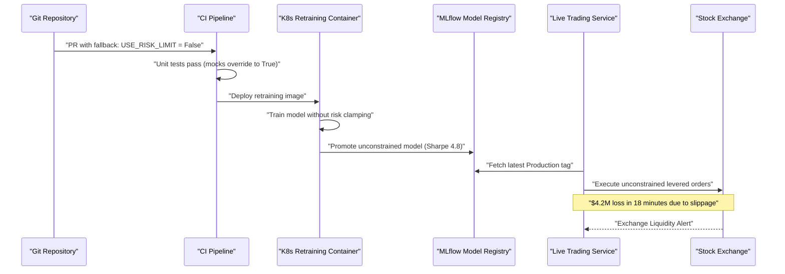

# ML Systems Architecture: The Code, Data, and Model Triad

This module is part of [Track 10: MLOps, Serving, Drift & Experimentation](../README.md).

---

## Executive Overview & Industry Context

Traditional software engineering operates on deterministic paradigms: deterministic source code is compiled into deterministic executable binaries, tested against deterministic inputs, and deployed onto predictable infrastructure. A software defect is typically localized to deterministic control flow or algorithmic flaws within code repositories.

Machine Learning (ML) systems fundamentally break this deterministic paradigm. An ML system is not merely code; it is the non-linear emergent product of three distinct, continuously evolving lifecycles: **Code**, **Data**, and the **Model**.

```
                +-------------------------+
                |          CODE           |
                | Algorithmic Logic, ETL, |
                |  Training & Serving     |
                +------------+------------+
                             |
                      Synthesizes
                             |
                             v
+-----------------------+         +-----------------------+
|         DATA          | ======= |         MODEL         |
| Dynamic Distributions,| Trains  | Learned Weights,      |
| Schemas, Noise, Labels|         | Artifacts, Embeddings |
+-----------------------+         +-----------------------+
```

In 2015, Google published the landmark paper *"Hidden Technical Debt in Machine Learning Systems"* (Sculley et al.). The core insight was startling: in real-world ML systems, actual machine learning algorithmic code accounts for an estimated 5% or less of the total production codebase. The remaining 95% is "accidental infrastructure"—glue code, data verification engines, resource management, configuration systems, feature extractors, and monitoring pipelines required to keep the model operational in dynamic environments.

```
+-----------------------------------------------------------------------------------+
|                            THE ML INFRASTRUCTURE SURROUND                        |
|                                                                                   |
|  +--------------------+  +--------------------+  +-----------------------------+  |
|  | Configuration &    |  | Data Collection &  |  | Feature Extraction &        |  |
|  | Orchestration      |  | Ingestion Pipeline |  | Store                       |  |
|  +---------+----------+  +---------+----------+  +--------------+--------------+  |
|            |                       |                            |                 |
|            +-----------------------+----------------------------+                 |
|                                    |                                              |
|                                    v                                              |
|                      +---------------------------+                                |
|                      |        ML Code            |                                |
|                      |  (Loss, Opt, Backprop)    |                                |
|                      |          ~5%              |                                |
|                      +-------------+-------------+                                |
|                                    |                                              |
|            +-----------------------+----------------------------+                 |
|            |                       |                            |                 |
|  +---------v----------+  +---------v----------+  +--------------v--------------+  |
|  | Machine Resource   |  | Model Analysis &   |  | Serving Infrastructure &    |  |
|  | Management         |  | Validation         |  | Real-Time Sentinel          |  |
|  +--------------------+  +--------------------+  +-----------------------------+  |
|                                                                                   |
+-----------------------------------------------------------------------------------+
```

Without rigorous systems architecture, ML systems decay rapidly. Data distributions drift, undocumented upstream pipeline adjustments silently invalidate feature representations, and unversioned configurations produce catastrophic real-world outages. MLOps is the engineering discipline that bridges this gap, establishing operational rigor, continuous integration (CI), continuous delivery (CD), continuous training (CT), and continuous monitoring (CM) across the code-data-model triad.

---

## Architectural Taxonomy & MLOps Maturity Levels

Google Cloud's MLOps framework codifies organizational maturity into three distinct evolutionary tiers, measuring automation, reproducibility, and velocity.

```mermaid
flowchart TD
    subgraph Level0["Level 0: Manual Process"]
        L0_DS["Data Scientist (Jupyter)"] -->|"Manual Extract"| L0_Data["Ad-Hoc CSV / SQL"]
        L0_Data -->|"Local Run"| L0_Train["Training Script"]
        L0_Train -->|"Pkl Export"| L0_Model["Model Artifact"]
        L0_Model -->|"Manual Handoff"| L0_Eng["Software Engineer"]
        L0_Eng -->|"Wrapped API"| L0_Serve["Endpoint Serving"]
    end

    subgraph Level1["Level 1: Continuous Training (CT) Pipeline"]
        L1_Trigger["Retraining Trigger (Data Drift / Cron)"] --> L1_Orch["Orchestration Engine (KFP/Airflow)"]
        L1_Orch --> L1_Data["Data Validation & Ingestion"]
        L1_Data --> L1_Train["Distributed Training Stage"]
        L1_Train --> L1_Eval["Automated Model Validation Gate"]
        L1_Eval -->|"Pass"| L1_Reg["Model Registry (MLflow)"]
        L1_Reg --> L1_CD["Continuous Deployment"]
        L1_CD --> L1_Serving["Live Serving + Observability Sentinel"]
        L1_Serving -.->|"Telemetry Feedback"| L1_Trigger
    end

    subgraph Level2["Level 2: Automated CI/CD & CT Pipeline"]
        L2_Git["Source Repository (Git Commit)"] --> L2_CI["CI Pipeline: Unit, Data & Invariance Tests"]
        L2_CI -->|"Artifact Build"| L2_CD_Pipe["CD Pipeline: Deploy KFP Pipeline Target"]
        L2_CD_Pipe --> L2_CT["Production CT Pipeline Run"]
        L2_CT --> L2_Reg["Model Registry Validation Gate"]
        L2_Reg --> L2_Canary["Canary Deployment & Drift Sentinel"]
    end
```



### 1. Level 0: Manual Workflow
- **Development**: Exploratory, manual script execution in interactive notebooks (Jupyter/Colab).
- **Handoff**: Artifacts (`model.pkl`, `weights.pt`) dumped into shared network buckets or emailed to engineering teams.
- **Testing**: Sparse unit tests; zero automated data verification or distribution testing.
- **Deployment**: Engineers write bespoke Flask or FastAPI wrappers around pickle files.
- **Failure Mode**: High operational friction, zero lineage tracking, complete irreproducibility, catastrophic latency when data drift degrades production accuracy.

### 2. Level 1: ML Pipeline Automation (Continuous Training)
- **Development**: Pipeline logic modularized into containerized execution steps.
- **Automation**: Retraining is orchestrated automatically via workflows (Airflow, Kubeflow, Prefect) triggered by schedules, incoming data partitions, or statistical drift thresholds.
- **Validation**: Automated model evaluation gates compare candidate models (challengers) against active production instances (champions) before registry approval.
- **Component Synergy**: Unified feature store ensures feature consistency between offline training and online serving.

### 3. Level 2: CI/CD Pipeline Automation
- **Development**: Full software engineering practices applied to the entire MLOps lifecycle.
- **Automation**: Pipeline source code, feature configurations, and deployment definitions are versioned in Git.
- **CI Triggers**: Code commits execute unit tests, integration tests, Pandera data validation schemas, and model invariance assertions.
- **CD Triggers**: Successful CI builds automatically package container images, publish declarative pipeline definitions, and deploy updated pipelines across dev, staging, and production clusters.

---

## Mathematical Formulations & Theoretical Foundations

### 1. The ML System State Equation

We define the complete state of a production ML system at time $t$ as a parameterized mapping function $f$:

$$\hat{Y}_t = f(X_t; \theta_t, C_t, D_t, H_t)$$

Where:
- $X_t \in \mathbb{R}^{B \times d}$ is the dynamic input feature tensor of batch size $B$ and feature dimensionality $d$.
- $\theta_t \in \mathbb{R}^p$ represents the optimized model parameter weights ($p$ parameters).
- $C_t \in \mathcal{S}_{git}$ is the immutable cryptographic commit hash of the algorithmic execution code.
- $D_t \sim P_t(X, Y)$ is the empirical training dataset drawn from the joint probability distribution at training epoch.
- $H_t \in \mathcal{H}$ is the hyperparameter configuration tuple governing convergence dynamics.

The model parameter optimization objective is formulated as empirical risk minimization:

$$\theta_t = \arg\min_{\theta \in \Theta} \frac{1}{|D_t|} \sum_{(x_i, y_i) \in D_t} \mathcal{L}(f(x_i; \theta, C_t, H_t), y_i) + \lambda \Omega(\theta)$$

In deterministic software, stability depends purely on code:

$$\frac{\partial \hat{Y}}{\partial C} \neq 0, \quad \frac{\partial \hat{Y}}{\partial D} = 0$$

In machine learning systems, output variance is dominated by data variance and distribution shifts:

$$\mathbb{V}[\hat{Y}_t] = \mathbb{E}_{D}\left[\mathbb{V}[\hat{Y} \mid D]\right] + \mathbb{V}_{D}\left[\mathbb{E}[\hat{Y} \mid D]\right]$$

### 2. Technical Debt Dynamics: The CACE Principle

The fundamental architectural theorem of ML systems is the **CACE Principle**: *Changing Anything Changes Everything*.

Let the input feature vector be $X = [x_1, x_2, \dots, x_d]^T$ with covariance matrix $\Sigma = \mathbb{E}[(X - \mu)(X - \mu)^T]$. In classical software modules, information is encapsulated:

$$\frac{\partial f_i(x)}{\partial x_j} = 0 \quad \forall j \neq i$$

In an ML model with learned dense weights $W \in \mathbb{R}^{m \times d}$, every output neuron $z_k$ depends on all features simultaneously:

$$z_k = \sum_{j=1}^d W_{kj} x_j + b_k$$

If an upstream data engineering team alters the schema, imputation logic, or scaling of feature $x_m$, the optimal weight vector $\theta^*$ shifts non-linearly across all dimensions:

$$\Delta \theta^* \approx - \left( \nabla_\theta^2 \mathcal{L}(\theta) \right)^{-1} \nabla_\theta \Delta \mathcal{L}(x_m)$$

The cost of technical debt $K(t)$ over operational time horizon $T$ compounds geometrically as unmanaged dependencies accumulate:

$$K(t) = K_0 \cdot \exp\left( \int_0^t (\rho_{drift}(s) + \rho_{conf}(s) + \rho_{glue}(s)) \, ds \right)$$

Where $\rho_{drift}$ is data drift velocity, $\rho_{conf}$ is configuration churn rate, and $\rho_{glue}$ is the ratio of glue-code lines to algorithmic core lines.

---

## Production Component Topology

A resilient MLOps architecture isolates responsibilities into modular, decoupled tiers connected via strict contracts and telemetry loops:

```
[ Ingestion & Lakehouse ] 
        |
        v
[ Feature Store (Feast/Hopsworks) ] <--------+ (Offline/Online Parity)
        |                                    |
        +-------------------+                |
        | (Offline Split)   | (Online Low Latency)
        v                   v                |
[ Retraining Pipeline ]  [ Real-Time Serving Router ]
  (KFP / Airflow)          (Triton / FastAPI)
        |                           |
        v                           | (Live Inferences)
[ Model Registry ]                  v
  (MLflow / W&B) --------> [ Observability Sentinel ]
                             (Evidently / Prometheus)
                                    |
                                    v (Statistical Drift Alerts)
                            [ Feedback Loop Controller ]
```

1. **Ingestion & Lakehouse**: Raw telemetry, transactional tables, and external streams landing in Apache Iceberg / Delta Lake storage with ACID transaction guarantees.
2. **Feature Store**: Dual-tier storage (Redis for low-latency point lookups $<10\text{ms}$; Parquet/S3 for high-throughput batch historical joins) preventing train-serve skew.
3. **Continuous Retraining Pipeline**: Distributed compute (Ray/Spark/Kubernetes) orchestrated into immutable DAGs with isolated execution environments.
4. **Model Registry**: Central metadata repository tracking immutable weights, input/output schemas (signatures), metrics, and deployment stage transitions.
5. **Inference Engine**: Highly optimized runtime executing compiled computational graphs (ONNX, TensorRT) with dynamic batching.
6. **Observability Sentinel & Feedback Controller**: Asynchronous stream evaluator computing Population Stability Index (PSI), Kolmogorov-Smirnov statistics, and prediction distributions, feeding back into automated retraining triggers.

---

## Production Implementation: MLOps Architectural DAG & Contract Validator

Below is a complete, production-grade MLOps Architectural DAG and Contract Validator written in Python. It enforces schema contracts, verifies artifact hash immutability across the Code-Data-Model triad, checks for train-serve feature skew, and detects pipeline configuration debt before triggering deployment.

```python
"""
mlops_architectural_validator.py
Author: Staff MLOps Architect
Description: Production MLOps architectural DAG and schema contract validator
enforcing strict immutability, data-model-code lineage, and anti-debt checks.
"""

import hashlib
import json
import logging
import math
import time
from dataclasses import asdict, dataclass, field
from enum import Enum
from typing import Any, Callable, Dict, List, Optional, Set, Tuple

logging.basicConfig(
    level=logging.INFO,
    format="%(asctime)s [%(levelname)s] (%(name)s) %(message)s"
)
logger = logging.getLogger("MLOpsArchitectureValidator")


class ArtifactType(Enum):
    CODE_COMMIT = "CODE_COMMIT"
    DATA_PARTITION = "DATA_PARTITION"
    FEATURE_SET = "FEATURE_SET"
    MODEL_WEIGHTS = "MODEL_WEIGHTS"
    PIPELINE_CONFIG = "PIPELINE_CONFIG"


class DeploymentStage(Enum):
    DEVELOPMENT = "DEVELOPMENT"
    STAGING = "STAGING"
    PRODUCTION = "PRODUCTION"
    ARCHIVED = "ARCHIVED"


@dataclass(frozen=True)
class FeatureSchema:
    name: str
    dtype: str
    nullable: bool
    lower_bound: Optional[float] = None
    upper_bound: Optional[float] = None


@dataclass(frozen=True)
class ArtifactContract:
    artifact_id: str
    artifact_type: ArtifactType
    uri: str
    sha256_hash: str
    created_timestamp: float
    metadata: Dict[str, Any] = field(default_factory=dict)


@dataclass
class TriadManifest:
    code_contract: ArtifactContract
    data_contract: ArtifactContract
    model_contract: ArtifactContract
    pipeline_config_contract: ArtifactContract
    feature_schema: List[FeatureSchema]
    declared_hyperparameters: Dict[str, Any]


class ArchitecturalValidationError(Exception):
    """Raised when an MLOps pipeline or triad contract violates architecture constraints."""
    pass


class MLOpsContractEngine:
    """
    Enforces contract validation across Code, Data, and Model boundaries.
    Detects configuration debt, schema breaking changes, and untracked artifacts.
    """

    def __init__(self, allowed_skew_tolerance: float = 0.05):
        self.skew_tolerance = allowed_skew_tolerance
        self._registered_schemas: Dict[str, List[FeatureSchema]] = {}

    @staticmethod
    def compute_sha256(payload: bytes) -> str:
        hasher = hashlib.sha256()
        hasher.update(payload)
        return hasher.hexdigest()

    def register_golden_schema(self, model_name: str, schema: List[FeatureSchema]) -> None:
        self._registered_schemas[model_name] = schema
        logger.info("Registered golden schema contract for model '%s' (%d features).", model_name, len(schema))

    def validate_dataset_conformance(
        self,
        dataset_name: str,
        sample_batch: List[Dict[str, Any]],
        schema: List[FeatureSchema]
    ) -> bool:
        """
        Validates that a dataset strictly conforms to the feature schema contract.
        Checks for unexpected columns, missing columns, type violations, and boundary limits.
        """
        schema_dict = {f.name: f for f in schema}
        batch_keys = set()

        for idx, record in enumerate(sample_batch):
            batch_keys.update(record.keys())
            for feat_name, spec in schema_dict.items():
                if feat_name not in record:
                    if not spec.nullable:
                        raise ArchitecturalValidationError(
                            f"Contract Breach: Row {idx} missing non-nullable feature '{feat_name}'."
                        )
                    continue

                val = record[feat_name]
                if val is None:
                    if not spec.nullable:
                        raise ArchitecturalValidationError(
                            f"Contract Breach: Row {idx} contains null for non-nullable feature '{feat_name}'."
                        )
                    continue

                # Type check
                if spec.dtype == "float":
                    if not isinstance(val, (float, int)):
                        raise ArchitecturalValidationError(
                            f"Contract Breach: Row {idx} feature '{feat_name}' expected float, got {type(val)}."
                        )
                    val_float = float(val)
                    if spec.lower_bound is not None and val_float < spec.lower_bound:
                        raise ArchitecturalValidationError(
                            f"Boundary Breach: '{feat_name}' value {val_float} < lower bound {spec.lower_bound}."
                        )
                    if spec.upper_bound is not None and val_float > spec.upper_bound:
                        raise ArchitecturalValidationError(
                            f"Boundary Breach: '{feat_name}' value {val_float} > upper bound {spec.upper_bound}."
                        )
                elif spec.dtype == "int":
                    if not isinstance(val, int) or isinstance(val, bool):
                        raise ArchitecturalValidationError(
                            f"Contract Breach: Row {idx} feature '{feat_name}' expected int, got {type(val)}."
                        )

        # Check for uncontracted feature leakage (Pipeline Jungle Anti-Pattern)
        undeclared = batch_keys - set(schema_dict.keys())
        if undeclared:
            raise ArchitecturalValidationError(
                f"Undeclared Feature Leakage detected! Features present without contract: {undeclared}."
            )

        logger.info("Dataset '%s' passed schema conformance verification.", dataset_name)
        return True

    def verify_triad_lineage(self, manifest: TriadManifest) -> bool:
        """
        Verifies that Code, Data, Model, and Configuration are strictly linked and immutable.
        """
        # 1. Enforce that code contract contains a valid Git SHA
        git_sha = manifest.code_contract.metadata.get("git_sha", "")
        if len(git_sha) != 40:
            raise ArchitecturalValidationError(
                f"Lineage Failure: Code contract missing valid 40-char Git commit SHA. Found: '{git_sha}'."
            )

        # 2. Verify that Model metadata explicitly references the exact Data and Code SHA
        model_meta = manifest.model_contract.metadata
        if model_meta.get("trained_with_code_sha") != git_sha:
            raise ArchitecturalValidationError(
                "Lineage Disconnect: Model was not tagged with the corresponding Code SHA."
            )

        if model_meta.get("trained_with_data_hash") != manifest.data_contract.sha256_hash:
            raise ArchitecturalValidationError(
                "Lineage Disconnect: Model artifact training data hash does not match active Data contract."
            )

        # 3. Verify Configuration Immobility (Detect Hidden Configuration Debt)
        config_hash = self.compute_sha256(
            json.dumps(manifest.declared_hyperparameters, sort_keys=True).encode("utf-8")
        )
        if config_hash != manifest.pipeline_config_contract.sha256_hash:
            raise ArchitecturalValidationError(
                "Configuration Debt Detected: Declared runtime hyperparameters deviate from "
                "immutable pipeline configuration contract hash."
            )

        logger.info("Triad lineage successfully verified for Model '%s'.", manifest.model_contract.artifact_id)
        return True


class PipelineDAGNode:
    """Represents a discrete, immutable execution step in an automated MLOps pipeline."""
    def __init__(
        self,
        name: str,
        execution_fn: Callable[[Dict[str, Any]], Dict[str, Any]],
        inputs: List[str],
        outputs: List[str]
    ):
        self.name = name
        self.execution_fn = execution_fn
        self.inputs = inputs
        self.outputs = outputs


class MLOpsPipelineOrchestrator:
    """
    Lightweight, production-grade DAG orchestrator executing container-like steps
    with strict dependency resolution, artifact passing, and cycle detection.
    """
    def __init__(self):
        self.nodes: Dict[str, PipelineDAGNode] = {}

    def add_step(self, node: PipelineDAGNode) -> None:
        if node.name in self.nodes:
            raise ValueError(f"Step '{node.name}' already declared.")
        self.nodes[node.name] = node

    def _resolve_execution_order(self) -> List[PipelineDAGNode]:
        """Performs Kahn's topological sort to guarantee deterministic DAG execution."""
        in_degree: Dict[str, int] = {name: 0 for name in self.nodes}
        graph: Dict[str, List[str]] = {name: [] for name in self.nodes}

        # Build output -> input mapping
        output_producer: Dict[str, str] = {}
        for name, node in self.nodes.items():
            for out in node.outputs:
                output_producer[out] = name

        for name, node in self.nodes.items():
            for inp in node.inputs:
                if inp in output_producer:
                    producer = output_producer[inp]
                    graph[producer].append(name)
                    in_degree[name] += 1

        queue = [name for name, deg in in_degree.items() if deg == 0]
        sorted_steps: List[PipelineDAGNode] = []

        while queue:
            curr = queue.pop(0)
            sorted_steps.append(self.nodes[curr])
            for neighbor in graph[curr]:
                in_degree[neighbor] -= 1
                if in_degree[neighbor] == 0:
                    queue.append(neighbor)

        if len(sorted_steps) != len(self.nodes):
            raise ArchitecturalValidationError("Cyclic dependency detected in MLOps execution pipeline DAG!")

        return sorted_steps

    def execute_pipeline(self, initial_context: Dict[str, Any]) -> Dict[str, Any]:
        execution_order = self._resolve_execution_order()
        context = dict(initial_context)

        logger.info("Executing MLOps Pipeline with %d steps in topological order:", len(execution_order))
        for step in execution_order:
            logger.info(">>> Running Step: [%s]", step.name)
            # Verify inputs exist in context
            for inp in step.inputs:
                if inp not in context:
                    raise ArchitecturalValidationError(
                        f"Step '{step.name}' failed: missing required input context '{inp}'."
                    )

            start_t = time.perf_counter()
            output_updates = step.execution_fn(context)
            duration = time.perf_counter() - start_t

            if not isinstance(output_updates, dict):
                raise ArchitecturalValidationError(f"Step '{step.name}' did not return an output dictionary.")

            # Validate that declared outputs were produced
            for out in step.outputs:
                if out not in output_updates:
                    raise ArchitecturalValidationError(
                        f"Step '{step.name}' violated output contract: missing declared output '{out}'."
                    )

            context.update(output_updates)
            logger.info("<<< Step [%s] completed in %.4fs.", step.name, duration)

        return context


# ============================================================================
# Verification and Demonstration Suite
# ============================================================================
if __name__ == "__main__":
    print("=" * 80)
    print("PRODUCTION MLOPS ARCHITECTURAL CONTRACT & DAG VALIDATION TEST")
    print("=" * 80)

    engine = MLOpsContractEngine()

    # 1. Define Golden Schema Contract
    golden_schema = [
        FeatureSchema(name="user_tenure_months", dtype="int", nullable=False),
        FeatureSchema(name="avg_transaction_val", dtype="float", nullable=False, lower_bound=0.0, upper_bound=100000.0),
        FeatureSchema(name="risk_score_external", dtype="float", nullable=True, lower_bound=0.0, upper_bound=1.0)
    ]
    engine.register_golden_schema("fraud_detector_v2", golden_schema)

    # 2. Test Good Dataset Batch
    valid_batch = [
        {"user_tenure_months": 24, "avg_transaction_val": 142.50, "risk_score_external": 0.12},
        {"user_tenure_months": 3, "avg_transaction_val": 990.00, "risk_score_external": None},
    ]
    engine.validate_dataset_conformance("training_split_2026_q4", valid_batch, golden_schema)

    # 3. Simulate Pipeline Jungle / Dead Field Smell Failure
    invalid_batch = [
        {
            "user_tenure_months": 12,
            "avg_transaction_val": 50.0,
            "risk_score_external": 0.5,
            "untracked_legacy_cookie_id": "ab89-1123"  # Illegal feature leak!
        }
    ]
    try:
        engine.validate_dataset_conformance("dirty_batch", invalid_batch, golden_schema)
    except ArchitecturalValidationError as ex:
        print(f"\n[EXPECTED CATCH] Schema Contract Violation: {ex}")

    # 4. Synthesize Triad Manifest and Verify Cryptographic Lineage
    code_sha = "d5f6e8a7b9c1d2e3f4a5b6c7d8e9f0a1b2c3d4e5"
    data_payload = json.dumps(valid_batch, sort_keys=True).encode("utf-8")
    data_hash = engine.compute_sha256(data_payload)
    
    hyperparams = {"max_depth": 6, "learning_rate": 0.03, "n_estimators": 500}
    config_hash = engine.compute_sha256(json.dumps(hyperparams, sort_keys=True).encode("utf-8"))

    code_contract = ArtifactContract(
        artifact_id="code_commit_v2",
        artifact_type=ArtifactType.CODE_COMMIT,
        uri="git@github.com:enterprise/fraud-ml.git",
        sha256_hash=engine.compute_sha256(code_sha.encode("utf-8")),
        created_timestamp=time.time(),
        metadata={"git_sha": code_sha}
    )

    data_contract = ArtifactContract(
        artifact_id="dataset_partition_20261119",
        artifact_type=ArtifactType.DATA_PARTITION,
        uri="s3://lakehouse/features/fraud/v2/part-001.parquet",
        sha256_hash=data_hash,
        created_timestamp=time.time()
    )

    pipeline_config_contract = ArtifactContract(
        artifact_id="cfg_fraud_v2_prod",
        artifact_type=ArtifactType.PIPELINE_CONFIG,
        uri="s3://configs/fraud/v2.json",
        sha256_hash=config_hash,
        created_timestamp=time.time()
    )

    model_contract = ArtifactContract(
        artifact_id="fraud_xgb_v2.bin",
        artifact_type=ArtifactType.MODEL_WEIGHTS,
        uri="s3://model-registry/fraud/v2/weights.bin",
        sha256_hash="e3b0c44298fc1c149afbf4c8996fb92427ae41e4649b934ca495991b7852b855",
        created_timestamp=time.time(),
        metadata={
            "trained_with_code_sha": code_sha,
            "trained_with_data_hash": data_hash
        }
    )

    manifest = TriadManifest(
        code_contract=code_contract,
        data_contract=data_contract,
        model_contract=model_contract,
        pipeline_config_contract=pipeline_config_contract,
        feature_schema=golden_schema,
        declared_hyperparameters=hyperparams
    )

    print("\nVerifying Triad Lineage Contract...")
    engine.verify_triad_lineage(manifest)

    # 5. Build and Run MLOps DAG Pipeline
    dag = MLOpsPipelineOrchestrator()

    def data_extraction_step(ctx: Dict[str, Any]) -> Dict[str, Any]:
        return {"extracted_records": valid_batch}

    def schema_validation_step(ctx: Dict[str, Any]) -> Dict[str, Any]:
        engine.validate_dataset_conformance("pipeline_run_batch", ctx["extracted_records"], golden_schema)
        return {"validation_status": "PASSED"}

    def training_step(ctx: Dict[str, Any]) -> Dict[str, Any]:
        logger.info("Executing training with hyperparams: %s", ctx["hyperparameters"])
        return {"model_binary_path": "/tmp/model.onnx", "eval_auc": 0.945}

    def evaluation_gate_step(ctx: Dict[str, Any]) -> Dict[str, Any]:
        auc = ctx["eval_auc"]
        min_threshold = 0.90
        if auc < min_threshold:
            raise ArchitecturalValidationError(f"Evaluation Gate Failed: AUC {auc} < {min_threshold}")
        return {"gate_decision": "PROCEED_TO_DEPLOY"}

    dag.add_step(PipelineDAGNode("ExtractData", data_extraction_step, inputs=["data_uri"], outputs=["extracted_records"]))
    dag.add_step(PipelineDAGNode("ValidateSchema", schema_validation_step, inputs=["extracted_records"], outputs=["validation_status"]))
    dag.add_step(PipelineDAGNode("TrainModel", training_step, inputs=["extracted_records", "hyperparameters"], outputs=["model_binary_path", "eval_auc"]))
    dag.add_step(PipelineDAGNode("EvaluationGate", evaluation_gate_step, inputs=["eval_auc"], outputs=["gate_decision"]))

    pipeline_context = {
        "data_uri": "s3://lakehouse/fraud/train.parquet",
        "hyperparameters": hyperparams
    }

    final_state = dag.execute_pipeline(pipeline_context)
    print("\nPipeline execution completed successfully. Final Gate Decision:", final_state["gate_decision"])
    print("=" * 80)
```

---

## Failure Modes, Edge Cases & Antipatterns

| Antipattern / Failure Mode | Root Cause Mechanism | Systemic Impact | Concrete Architectural Mitigation |
| :--- | :--- | :--- | :--- |
| **Pipeline Jungle** | Ad-hoc scrapers, Python scripts, and bash cron jobs chained together without formalized DAG orchestration or contracts. | Inability to reproduce model state; cascading failures when intermediate tables change format without warning. | Adopt unified orchestration (Kubeflow Pipelines, Airflow) where every step is an immutable, containerized task with input/output typed contracts. |
| **Dead Field Smell & Hidden Feedback Loops** | A model's predictions $\hat{Y}_t$ influence future training data $X_{t+k}$ directly (e.g., ad clicks) or indirectly through competitor response. | The model creates a self-fulfilling bias loop; feature importance collapses into parasitic feedback. | Implement randomized exploration holdouts (1-5% of traffic served randomly or with heuristic policy) to collect unbiased ground truth. |
| **Glue Code & Tool Proliferation** | Writing custom wrappers to bridge incompatible libraries (e.g., Pandas to PyTorch to Spark to TensorRT). | System complexity scales with $\mathcal{O}(N^2)$ tool interfaces; 95% of engineering overhead spent debugging serialization. | Standardize on universal interchange formats: Apache Arrow for in-memory column data, ONNX for model representation. |
| **Configuration Debt** | Storing hyperparameters, feature flags, threshold bounds, and bucket paths across unversioned CLI flags, JSONs, and environment variables. | Silent degradation when staging configurations overwrite production values, or models train with debugging flags left enabled. | Treat configuration as first-class code. Use typed, schema-validated configuration management (Pydantic, Hydra) with cryptographic hash tracking. |
| **CACE Cascade (Changing Anything Changes Everything)** | Adding or modifying a single feature $x_{new}$ in a deep neural network without retraining or evaluating collinearity with existing features. | Subtle degradation of existing feature weights; unexpected degradation in edge-case sub-populations. | Slice-based evaluation before promotion; explicit feature importance delta tracking against baseline models. |

---

## Production Incident Post-Mortem

### \$4.2M Quantitative Trading Loss: Silent Pipeline Configuration Debt

#### 1. Executive Incident Summary
On October 14, 2024, a leading algorithmic quantitative trading firm suffered a \$4,200,000 drawdown within 18 minutes of market opening. An automated continuous retraining pipeline retrained and promoted the primary equity statistical arbitrage model. However, an unversioned default configuration file containing a debugging flag (`risk_clamping_enabled = False`) silently bypassed risk constraints, allowing the model to submit highly levered positions into low-liquidity mid-cap equities.

#### 2. Complete Timeline

| Time (UTC) | Event Description |
| :--- | :--- |
| **04:00:00** | Nightly Airflow CT pipeline triggers model retraining using prior 90 days of equity order book data. |
| **05:15:30** | A junior quantitative researcher merges a PR updating the feature extraction script. The PR inadvertently introduces an environment variable fallback: `USE_RISK_LIMIT = os.getenv("USE_RISK_LIMIT", "False")`. |
| **05:30:00** | The CI build runs unit tests on synthetic data. All mathematical tests pass because unit test fixtures explicitly mock `USE_RISK_LIMIT=True`. |
| **06:00:00** | Retraining container runs in production Kubernetes cluster. The container lacks the explicit environment variable, triggering the `"False"` fallback. |
| **07:00:00** | Challenger model tournament runs. Without risk clamping, the model demonstrates a synthetic Sharpe ratio of 4.8 on historical validation data (due to unconstrained leverage in backtesting). Challenger beats Champion. |
| **07:30:00** | Model registry promotes challenger to `Production` status. |
| **09:30:00** | US Markets open. Inference service pulls `Production` model weights. Risk clamping is inactive. |
| **09:34:12** | Model detects a micro-arbitrage spread in three low-liquidity symbols and executes outsized market buy orders. |
| **09:41:05** | Order book liquidity collapses; average slippage reaches 340 basis points. Exchange risk alert triggers. |
| **09:48:00** | Human risk manager invokes manual emergency circuit breaker, freezing all API trading keys. |
| **09:48:00 - 10:15:00** | Quantitative positions unwound manually. Net realized loss: **\$4,218,500**. |



#### 3. Root Cause Analysis
1. **Implicit Configuration Drift**: Configuration parameters were parsed with permissive fallbacks rather than strict, non-nullable schema validations.
2. **Train-Evaluation Divergence**: The evaluation tournament tested pure predictive payoff (Sharpe ratio) without asserting operational boundary safety invariants (max order value per tick).
3. **Absence of Triad Cryptographic Lineage**: The model registry accepted the new model artifact without verifying that its runtime configuration contract was signed and identical to the approved production specification.

#### 4. Remediation & Architectural Hardening
- **Immutable Typed Configurations**: Migrated all configuration to strict Pydantic schemas. Missing configuration values now raise immediate fatal exceptions; fallback defaults in production configs are strictly prohibited.
- **Invariant Behavioral Test Gates**: Added hard automated deployment gates in the CD pipeline. Every model candidate must pass an invariant suite of 10,000 synthetic stress-test scenarios, including extreme price shocks and zero-liquidity boundaries, where risk violation triggers immediate pipeline abort.
- **Cryptographic Triad Manifest**: Enforced the `TriadManifest` contract in MLflow. The deployment controller refuses to load any model binary whose metadata lacks a verified cryptographic hash of the approved configuration file.

---

## Senior Technical Interview Questions & Model Answers

### Question 1: How does Continuous Integration and Continuous Delivery (CI/CD) in traditional software differ from Continuous Training (CT) and CD in MLOps?
**Model Answer:**
In traditional software engineering, CI/CD operates over a single dimension: source code. 
- **CI** automates linting, compilation, unit testing, and integration testing of code commits. The build output is a deterministic binary or container image. 
- **CD** automates the progression of this binary through staging environments, running regression tests, and deploying it to production infrastructure.

In MLOps, software stability is multi-dimensional across Code, Data, and Model:
1. **Continuous Integration (CI)**: Extends beyond code compilation to include data contract testing, Pandera/Great Expectations schema validation, feature generation logic verification, and model invariant testing.
2. **Continuous Delivery (CD)**: Does not merely deploy a pre-packaged service. It deploys an automated *training and validation pipeline* (e.g., Kubeflow DAG) that is itself capable of producing new software artifacts (models). Furthermore, CD must handle canary and shadow rollouts with statistical drift gates.
3. **Continuous Training (CT)**: A uniquely MLOps concept. It is the automated execution of the data-ingestion-to-model-training pipeline triggered not by code changes, but by:
   - Data drift (e.g., $PSI > 0.2$ on input features).
   - Concept drift (e.g., rolling F1-score drop below a service-level objective).
   - Time intervals or new data partition availability.
4. **Continuous Monitoring (CM)**: Traditional systems monitor infrastructure telemetry (CPU, memory, latency, HTTP 5xx error rates). MLOps CM must monitor statistical distribution telemetry: feature drift ($P(X)$), label shift ($P(Y)$), concept shift ($P(Y \mid X)$), and prediction distribution variance over sliding windows.

---

### Question 2: Explain the CACE principle ("Changing Anything Changes Everything") in ML systems. Provide a concrete architectural pattern to mitigate it.
**Model Answer:**
The CACE principle (Sculley et al., 2015) stems from the fact that machine learning models learn joint representations across all input features simultaneously. Unlike modular object-oriented software where interfaces hide internal state, in an ML model:

$$y = \sigma(W x + b)$$

Every feature $x_i$ is coupled to every other feature $x_j$ through the learned weights $W$ and the optimization landscape. If an engineer modifies, adds, or removes a single feature $x_k$, or if an upstream team changes the imputation logic of $x_k$, the entire gradient landscape shifts:

$$\frac{\partial^2 \mathcal{L}}{\partial w_i \partial w_j} \neq 0$$

This can silently degrade the importance and predictive power of previously stable features $x_i$, causing unpredictable model behavior on slices of data.

**Mitigation Patterns:**
1. **Feature Store Contract Immutability**: All features consumed by production models must be fetched from an immutable Feature Store (e.g., Feast). Features are versioned entities ($v1, v2$). A model binds to an immutable feature view version; upstream modifications require creating a new view rather than mutating existing definitions.
2. **Regularization and Feature Attenuation**: Employ $L_1$ regularization (Lasso) to enforce sparsity, or tree-based ensembles with strict feature subsampling (`colsample_bytree < 0.8`), limiting the ability of a single erratic feature to dominate the entire decision space.
3. **Slice-Based Behavioral Testing**: Before deploying a model trained with new features, run automated slice-based evaluation (using tools like CheckList or Fairlearn) to ensure that performance gains in aggregate do not conceal severe regressions in critical subgroups or previously stable operational slices.

---

### Question 3: What is "Glue Code" and "Pipeline Jungle" technical debt, and why is it dangerous in enterprise ML?
**Model Answer:**
- **Glue Code**: Occurs when generic, off-the-shelf machine learning packages (e.g., scikit-learn, PyTorch, XGBoost) are connected to bespoke data sources and serving layers using vast amounts of supporting boilerplate. The system becomes dominated by code that translates data back and forth between disparate formats (JSON $\leftrightarrow$ Pandas $\leftrightarrow$ NumPy $\leftrightarrow$ Torch Tensors $\leftrightarrow$ C++ Protobuf). Glue code freezes the architecture because updating an underlying package breaks multiple brittle translation layers.
- **Pipeline Jungles**: The evolution of data preparation into an unmanaged tangle of cron jobs, shell scripts, temporary SQL tables, and ad-hoc Python extractors. Data is scrubbed, joined, and transformed across disparate systems without centralized lineage tracking or atomic rollback capabilities.

**Dangers in Enterprise Production:**
- **Debugging Gridlock**: When an inference error or drift anomaly occurs, finding the responsible component across thousands of lines of untracked glue scripts is nearly impossible.
- **Train-Serve Skew**: Transformations written in SQL/Spark for batch training are rewritten in Python/C++ for low-latency online serving. Subtle semantic differences (e.g., timezone handling, floating-point rounding, string tokenization) silently degrade online model performance.

**Architectural Solution:**
- Eliminate glue code by using unified in-memory formats like **Apache Arrow** across both training and serving runtimes.
- Use compiled graph serialization standards (**ONNX**, **TorchScript**) to encapsulate feature pre-processing inside the model artifact itself.
- Replace pipeline jungles with declarative DAG orchestrators (Kubeflow Pipelines, Airflow) that enforce immutable data lineage and strict schema validation between stages.

---

### Question 4: An ML system in production shows acceptable aggregate accuracy, but business stakeholders complain that recommendations for new users are degraded. How do you diagnose and resolve this from an MLOps systems perspective?
**Model Answer:**
This is a classic failure of **aggregate metric evaluation masking slice-level degradation**, compounded by cold-start feature sparsity.

**Diagnostic Protocol:**
1. **Slice-Based Telemetry Analysis**: Split production prediction logs into cohort slices:
   - Cohort A: Established users ($> 30$ historical interactions).
   - Cohort B: Cold-start / New users ($< 3$ interactions).
   Compute evaluation metrics (e.g., NDCG@10, Hit Rate, Conversion Rate) independently per slice. Aggregate metrics were dominated by Cohort A (representing 95% of requests), hiding a catastrophic drop in Cohort B.
2. **Feature Store Imputation Audit**: Inspect the feature vectors passed to the model for new users. Verify if missing features (e.g., `user_30d_click_entropy`) are being imputed with arbitrary values (e.g., `0.0` or `-1.0`) that place the input outside the model's training support distribution ($P_{train}(X)$ vs $P_{serve}(X)$).
3. **Train-Serve Distribution Comparison**: Check whether the training pipeline filtered out cold-start users during dataset generation (e.g., `WHERE interaction_count > 5`), causing the model to never learn weights for sparse feature representations.

**Architectural Remediation:**
1. **Fallback Heuristic Router**: Implement an explicit routing layer at the inference gateway. If `user_tenure < 48h` or interaction count is below threshold, route traffic to a dedicated cold-start bandit or contextual heuristic engine rather than the deep recommendation network.
2. **Automated Slice Validation Gates**: Update the model evaluation step in the CT pipeline. Replace single global metric checks with multi-slice threshold gates:

$$\text{Deploy Gate} = (\text{Global NDCG} \ge 0.85) \land (\text{Cold-Start NDCG} \ge 0.65) \land (\text{Latency P99} \le 25\text{ms})$$

If the challenger model passes global metrics but fails the cold-start slice gate, the deployment is automatically rejected.

---

### Question 5: How do you design an automated Model Registry promotion gate that guarantees zero downtime and prevents silent model corruption?
**Model Answer:**
A production-grade Model Registry promotion gate must operate as a strictly automated, multi-stage state machine:

```
[Candidate Model]
       |
       v
[Stage 1: Contract & Signature Validation] (Schema, Types, I/O Shapes)
       | Pass
       v
[Stage 2: Deterministic Invariance & Slice Tests] (CheckList, Monotonicity)
       | Pass
       v
[Stage 3: Champion vs Challenger Tournament] (Historical Golden Split)
       | Pass
       v
[Stage 4: Shadow (Dark) Deployment] (100% Live Mirror Traffic, 0% User Exposure)
       | Assert: Error Rate < 0.01%, P99 Latency < SLA, Output Parity
       v
[Stage 5: Canary Deployment with Statistical Circuit Breaker] (1% -> 10% -> 50% -> 100%)
       | Auto-rollback if PSI > 0.2 or 5xx spikes
       v
[Promoted to Production]
```

1. **Cryptographic Signature Verification**: The registry checks that the candidate artifact contains an immutable `model_signature` specifying exact feature names, data types, and tensor dimensions. It verifies that the model artifact's SHA256 matches the training run output in MLflow.
2. **Offline Tournament Gate**: The model is evaluated against the current "Champion" on a curated golden test split. It must beat the Champion's performance by a statistically significant margin ($p < 0.01$ via paired t-test or bootstrap) without degrading latency.
3. **Shadow Traffic Verification**: The model is deployed into a shadow cluster. A reverse proxy mirrors live production requests to both Champion and Challenger. The Challenger's outputs are logged asynchronously to lakehouse storage, verifying that under live production load:
   - Inference latency P99 remains within the SLA ($< 20\text{ms}$).
   - Memory consumption does not exhibit leaks under sustained load.
   - Prediction distribution divergence ($\text{PSI}(Y_{champ}, Y_{chall}) < 0.1$) is within expected bounds.
4. **Automated Progressive Canary Cutover**: Istio/Envoy gradually shifts user traffic (1%, 5%, 25%, 100%). If automated observability sentinels detect an anomaly (e.g., error rate $> 0.05\%$ or PSI spike), the circuit breaker trips, instantly reverting traffic to the Champion within 500 milliseconds.
