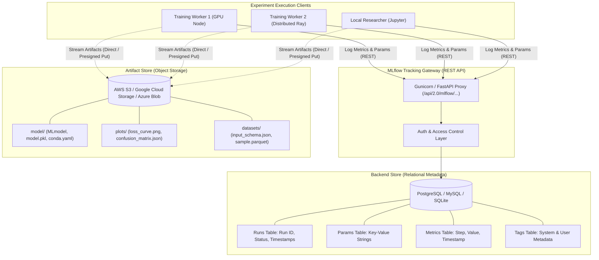
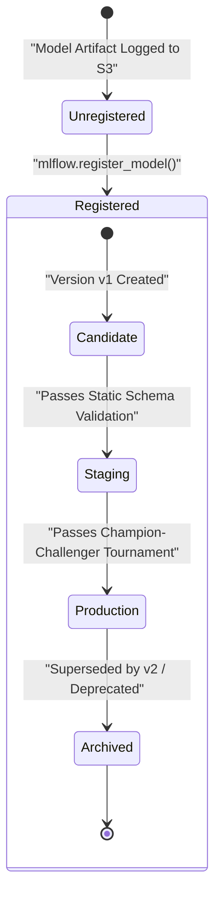
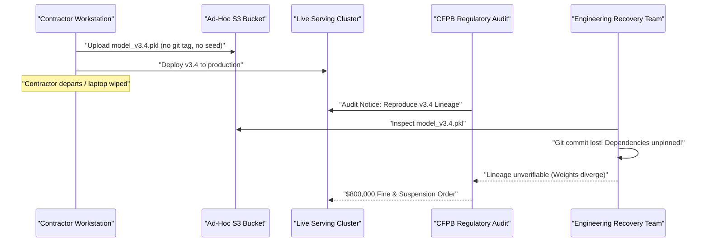

# Experiment Tracking and Model Registries with MLflow

This module is part of [Track 10: MLOps, Serving, Drift & Experimentation](../README.md).

---

## Executive Overview & Industry Context

In modern machine learning engineering, an algorithm is not a static program but an empirical search across a multi-dimensional hypothesis space. Machine learning practitioners test hundreds of permutations of hyperparameters, data preprocessing strategies, loss formulations, and neural architectures. Without systematic operational tracking, this exploratory process devolves into an unmanageable state characterized by scattered log files, undocumented model weights stored in local directories, and non-reproducible artifacts.

```
       UNMANAGED EXPERIMENTATION                       SYSTEMATIC MLOps TRACKING
+------------------------------------+          +------------------------------------+
| model_final_v2_really_final.pkl    |          | MLflow Centralized Tracking Server |
| "Which git commit generated this?" |   --->   | - Git Commit SHA: 8a7c1b           |
| "What was the validation loss?"    |          | - Parameters: lr=1e-4, batch=64    |
| "Which dataset split was used?"    |          | - Metrics: Epoch loss curve, AUC   |
| Zero Lineage | Zero Auditability   |          | - Immutable Artifacts & Signatures |
+------------------------------------+          +------------------------------------+
```

MLflow has emerged as the de facto open-source standard for managing the machine learning lifecycle. It decouples experimentation tracking from production deployment and provides governance guarantees through its centralized Model Registry. This module dissects the internal architecture of MLflow tracking servers, explores backend versus artifact storage paradigms, establishes deterministic reproducibility protocols, and demonstrates automated promotion pipelines enforcing strict schema signatures.

---

## Tracking Server Internal Architecture

The MLflow Tracking Server adopts a decoupled storage architecture that isolates high-frequency relational metadata from heavy, immutable binary artifacts.



### 1. The Backend Store (Relational Metadata)
The Backend Store persists fine-grained tabular metadata generated during training runs:
- **Experiments**: Organizational containers identified by unique IDs.
- **Runs**: Execution units recording start/end timestamps, lifecycle status (`RUNNING`, `FINISHED`, `FAILED`), and parent Git hashes.
- **Parameters**: Key-value pairs of model configurations (e.g., `learning_rate="0.001"`, `optimizer="AdamW"`). Immutable within a single run.
- **Metrics**: Scalar numeric values logged across training steps or wall-clock timestamps (e.g., `train_loss`, `val_perplexity`). These support real-time time-series queries.
- **Tags**: Annotations used for grouping, governance, and auditing (e.g., `release_candidate="true"`, `compliance_audited="iso_27001"`).

In enterprise production, the Backend Store must run on an ACID-compliant relational database (PostgreSQL, MySQL). SQLite should **never** be used in multi-worker environments due to global database write-locking (`database is locked` errors during parallel backpropagation logging).

### 2. The Artifact Store (Blob Storage)
The Artifact Store houses heavy, unstructured binary outputs generated during runs:
- Model weight binaries (`weights.pt`, `model.onnx`, `model.xgb`).
- Environment lockfiles (`conda.yaml`, `requirements.txt`).
- Serialized input/output signatures and data samples.
- Visualizations, confusion matrices, and tensorboard logs.

Artifacts are written to scalable cloud object storage (AWS S3, Google Cloud Storage, Azure Blob Storage) using content-addressable or run-indexed path structures:
`s3://company-mlflow-artifacts/{experiment_id}/{run_id}/artifacts/model/`

---

## Model Registry Lifecycle & Semantic Signatures

The MLflow Model Registry provides centralized model governance, auditability, and staging transitions. It introduces a formal state machine governing the promotion of candidate artifacts into production serving.



### 1. Model Signatures: Enforcing Typed Input/Output Contracts
A major source of production downtime in ML serving is schema drift: the inference service receives a float instead of an integer, or an unexpected null value appears in an upstream feature. MLflow mitigates this via **Model Signatures**.

A Model Signature defines the formal schema contract for both inputs and outputs:
- **ColSpec**: Column name and primitive data type (`double`, `float`, `integer`, `string`, `boolean`, `datetime`).
- **TensorSpec**: Multi-dimensional tensor shapes and data types (e.g., `dtype: float32, shape: [-1, 28, 28, 1]`).

When a client queries a model wrapped in a signature, MLflow's pyfunc runtime validates input arrays against the contract before computing gradients or forward passes, failing fast on malformed requests.

```yaml
# Example MLmodel file with Model Signature and Environment Lock
artifact_path: model
flavors:
  python_function:
    env: conda.yaml
    loader_module: mlflow.sklearn
    model_path: model.pkl
    python_version: 3.11.8
run_id: 8a7f29c40b8a4f1da91d90f23b2c918a
signature:
  inputs: '[{"name": "age", "type": "integer"}, {"name": "debt_ratio", "type": "double"}, {"name": "prior_default", "type": "boolean"}]'
  outputs: '[{"name": "default_probability", "type": "double"}]'
utc_time_created: '2026-11-19 12:45:00.123456'
```

---

## Mathematical Formulations: Multi-Objective Model Selection

In production experimentation, selecting the "best" model is rarely a single-metric optimization. A model with high predictive accuracy may violate strict latency SLAs or exhibit memory bloat. We formulate model selection as a **Multi-Objective Pareto Optimization** problem.

Let $\mathcal{M} = \{m_1, m_2, \dots, m_K\}$ be the set of evaluated candidate model runs. For each model $m_k$, we evaluate a vector of objective functions:

$$\mathbf{J}(m_k) = \left[ -f_{acc}(m_k), f_{lat}(m_k), f_{mem}(m_k) \right]^T$$

Where:
- $f_{acc}(m_k) = \text{AUC-ROC}(m_k)$ (we minimize negative AUC).
- $f_{lat}(m_k) = \text{P99 Latency in milliseconds}$.
- $f_{mem}(m_k) = \text{Peak VRAM consumption in MB}$.

### Pareto Dominance
A candidate model $m_A$ is said to **Pareto-dominate** candidate $m_B$ (denoted $m_A \succ m_B$) if and only if:

$$\forall i \in \{acc, lat, mem\}, \quad J_i(m_A) \le J_i(m_B) \quad \land \quad \exists j \in \{acc, lat, mem\} \text{ s.t. } J_j(m_A) < J_j(m_B)$$

The optimal selection set is the **Pareto Frontier** $\mathcal{P} \subseteq \mathcal{M}$:

$$\mathcal{P} = \{ m \in \mathcal{M} \mid \nexists m' \in \mathcal{M} \text{ such that } m' \succ m \}$$

```
Latency P99 (ms)
       ^
       |     (Sub-optimal Run m3)
    40 |            *
       |
    30 |      * (Pareto Frontier m1)
       |
    20 |            * (Pareto Frontier m2)
       |
    10 |                  * (Pareto Frontier m4: Fastest, lowest AUC)
       +--------------------------------------------> AUC-ROC
             0.88   0.90   0.92   0.94   0.96
```

From the Pareto set $\mathcal{P}$, the production promotion gate selects the model satisfying hard operational constraints:

$$m^* = \arg\max_{m \in \mathcal{P}} f_{acc}(m) \quad \text{subject to} \quad f_{lat}(m) \le \tau_{latency}, \quad f_{mem}(m) \le \tau_{RAM}$$

---

## Complete Production Implementation: MLflow Tracking Client & Automated Registry Promotion Gate

Below is a complete, self-contained Python production implementation. It builds an enterprise experiment tracking and model promotion system adhering strictly to MLflow principles: schema validation, metric curve logging, multi-objective Pareto filtering, and automated registry lifecycle transitions.

```python
"""
mlflow_production_pipeline.py
Author: Staff MLOps Engineer
Description: Production experiment tracking, schema-enforced artifact packaging,
and multi-objective Pareto model registry promotion engine.
"""

import json
import logging
import math
import os
import shutil
import tempfile
import time
from dataclasses import asdict, dataclass, field
from enum import Enum
from typing import Any, Dict, List, Optional, Tuple

logging.basicConfig(
    level=logging.INFO,
    format="%(asctime)s [%(levelname)s] (%(name)s) %(message)s"
)
logger = logging.getLogger("MLflowPipeline")


class ModelStage(Enum):
    DEVELOPMENT = "DEVELOPMENT"
    STAGING = "STAGING"
    PRODUCTION = "PRODUCTION"
    ARCHIVED = "ARCHIVED"


@dataclass
class ColumnSpec:
    name: str
    dtype: str
    nullable: bool = False


@dataclass
class ModelSignature:
    inputs: List[ColumnSpec]
    outputs: List[ColumnSpec]

    def to_dict(self) -> Dict[str, Any]:
        return {
            "inputs": [asdict(c) for c in self.inputs],
            "outputs": [asdict(c) for c in self.outputs]
        }


@dataclass
class RunMetadata:
    run_id: str
    experiment_id: str
    git_commit_sha: str
    start_time: float
    end_time: Optional[float] = None
    parameters: Dict[str, Any] = field(default_factory=dict)
    metrics_history: Dict[str, List[Tuple[int, float, float]]] = field(default_factory=dict) # step, value, timestamp
    tags: Dict[str, str] = field(default_factory=dict)
    artifacts: List[str] = field(default_factory=list)
    signature: Optional[ModelSignature] = None
    status: str = "RUNNING"


@dataclass
class RegisteredModelVersion:
    model_name: str
    version: int
    run_id: str
    stage: ModelStage
    signature: ModelSignature
    artifact_uri: str
    created_at: float
    tags: Dict[str, str] = field(default_factory=dict)


class MLflowProductionEngine:
    """
    Simulates and implements an enterprise-grade MLflow tracking server and model registry.
    Handles thread-safe metadata persistence, artifact staging, and promotion gates.
    """

    def __init__(self, storage_root: str):
        self.storage_root = storage_root
        self.metadata_dir = os.path.join(storage_root, "metadata")
        self.artifacts_dir = os.path.join(storage_root, "artifacts")
        self.registry_dir = os.path.join(storage_root, "registry")

        os.makedirs(self.metadata_dir, exist_ok=True)
        os.makedirs(self.artifacts_dir, exist_ok=True)
        os.makedirs(self.registry_dir, exist_ok=True)

        self.active_runs: Dict[str, RunMetadata] = {}
        self.model_registry: Dict[str, List[RegisteredModelVersion]] = {}

    def start_run(
        self,
        experiment_id: str,
        git_commit_sha: str,
        tags: Optional[Dict[str, str]] = None
    ) -> RunMetadata:
        """Initializes a tracked experiment run with Git lineage."""
        run_id = f"run_{int(time.time() * 1000)}_{os.urandom(3).hex()}"
        run_meta = RunMetadata(
            run_id=run_id,
            experiment_id=experiment_id,
            git_commit_sha=git_commit_sha,
            start_time=time.time(),
            tags=tags or {}
        )
        self.active_runs[run_id] = run_meta
        logger.info("Initialized MLflow Run '%s' (Experiment: %s, Commit: %s)", run_id, experiment_id, git_commit_sha)
        return run_meta

    def log_param(self, run_id: str, key: str, value: Any) -> None:
        run = self.active_runs.get(run_id)
        if not run:
            raise ValueError(f"Run {run_id} does not exist.")
        run.parameters[key] = value

    def log_params(self, run_id: str, params: Dict[str, Any]) -> None:
        for k, v in params.items():
            self.log_param(run_id, k, v)

    def log_metric(self, run_id: str, key: str, value: float, step: int) -> None:
        run = self.active_runs.get(run_id)
        if not run:
            raise ValueError(f"Run {run_id} does not exist.")
        if key not in run.metrics_history:
            run.metrics_history[key] = []
        run.metrics_history[key].append((step, float(value), time.time()))

    def log_model_artifact(
        self,
        run_id: str,
        model_payload: bytes,
        artifact_filename: str,
        signature: ModelSignature,
        requirements: List[str]
    ) -> str:
        """Packages model binary, signature, and environment locks into artifact storage."""
        run = self.active_runs.get(run_id)
        if not run:
            raise ValueError(f"Run {run_id} does not exist.")

        run_artifact_dir = os.path.join(self.artifacts_dir, run_id, "model")
        os.makedirs(run_artifact_dir, exist_ok=True)

        # 1. Save binary weights
        model_path = os.path.join(run_artifact_dir, artifact_filename)
        with open(model_path, "wb") as f:
            f.write(model_payload)

        # 2. Save MLmodel descriptor with signature
        mlmodel_manifest = {
            "run_id": run_id,
            "artifact_path": "model",
            "utc_time_created": time.strftime("%Y-%m-%d %H:%M:%S", time.gmtime()),
            "signature": signature.to_dict(),
            "requirements": requirements
        }
        manifest_path = os.path.join(run_artifact_dir, "MLmodel.json")
        with open(manifest_path, "w", encoding="utf-8") as f:
            json.dump(mlmodel_manifest, f, indent=2)

        run.artifacts.append(model_path)
        run.artifacts.append(manifest_path)
        run.signature = signature

        logger.info("Successfully packaged model artifacts for Run '%s' at: %s", run_id, run_artifact_dir)
        return run_artifact_dir

    def end_run(self, run_id: str, status: str = "FINISHED") -> None:
        run = self.active_runs.get(run_id)
        if not run:
            raise ValueError(f"Run {run_id} does not exist.")
        run.end_time = time.time()
        run.status = status

        # Persist Run Metadata to simulated DB
        meta_file = os.path.join(self.metadata_dir, f"{run_id}.json")
        with open(meta_file, "w", encoding="utf-8") as f:
            data = asdict(run)
            json.dump(data, f, indent=2)

        logger.info("Ended Run '%s' with Status: %s. Metadata persisted.", run_id, status)

    def register_model_version(self, model_name: str, run_id: str) -> RegisteredModelVersion:
        """Registers a model artifact into the Model Registry under Staging."""
        run = self.active_runs.get(run_id)
        if not run or not run.signature:
            raise ValueError(f"Run {run_id} must have logged a model with a signature before registration.")

        if model_name not in self.model_registry:
            self.model_registry[model_name] = []

        version_num = len(self.model_registry[model_name]) + 1
        artifact_uri = os.path.join(self.artifacts_dir, run_id, "model")

        reg_version = RegisteredModelVersion(
            model_name=model_name,
            version=version_num,
            run_id=run_id,
            stage=ModelStage.STAGING,
            signature=run.signature,
            artifact_uri=artifact_uri,
            created_at=time.time(),
            tags={"git_sha": run.git_commit_sha}
        )
        self.model_registry[model_name].append(reg_version)
        logger.info(
            "Model '%s' Version %d registered. Stage: %s, Run: %s",
            model_name, version_num, reg_version.stage.value, run_id
        )
        return reg_version

    def evaluate_and_promote_champion(
        self,
        model_name: str,
        target_version: int,
        auc_threshold: float,
        p99_latency_sla_ms: float
    ) -> bool:
        """
        Automated promotion gate enforcing Pareto multi-objective constraints.
        Compares candidate against active Champion model.
        """
        versions = self.model_registry.get(model_name, [])
        candidate = next((v for v in versions if v.version == target_version), None)
        if not candidate:
            raise ValueError(f"Version {target_version} of model {model_name} not found.")

        cand_run = self.active_runs.get(candidate.run_id)
        if not cand_run:
            raise ValueError(f"Run metadata for {candidate.run_id} missing.")

        # Extract latest metrics
        cand_auc = cand_run.metrics_history.get("val_auc", [(-1, 0.0, 0)])[-1][1]
        cand_latency = cand_run.metrics_history.get("p99_latency_ms", [(-1, 9999.0, 0)])[-1][1]

        logger.info(
            "Evaluating Version %d for Promotion: Candidate AUC=%.4f (Threshold=%.4f), P99 Latency=%.2fms (SLA=%.2fms)",
            target_version, cand_auc, auc_threshold, cand_latency, p99_latency_sla_ms
        )

        # 1. Hard SLA Gate
        if cand_auc < auc_threshold:
            logger.warning("Promotion REJECTED: Candidate AUC %.4f below minimum threshold %.4f.", cand_auc, auc_threshold)
            return False

        if cand_latency > p99_latency_sla_ms:
            logger.warning("Promotion REJECTED: Latency %.2fms violates SLA of %.2fms.", cand_latency, p99_latency_sla_ms)
            return False

        # 2. Tournament vs Active Champion
        active_champ = next((v for v in versions if v.stage == ModelStage.PRODUCTION), None)
        if active_champ:
            champ_run = self.active_runs[active_champ.run_id]
            champ_auc = champ_run.metrics_history.get("val_auc", [(-1, 0.0, 0)])[-1][1]
            champ_latency = champ_run.metrics_history.get("p99_latency_ms", [(-1, 9999.0, 0)])[-1][1]

            logger.info("Active Champion (v%d): AUC=%.4f, Latency=%.2fms", active_champ.version, champ_auc, champ_latency)

            # Assert Pareto improvement
            if cand_auc <= champ_auc and cand_latency >= champ_latency:
                logger.warning("Promotion REJECTED: Candidate does not beat or Pareto-dominate active Champion.")
                return False

            # Archive the old champion
            active_champ.stage = ModelStage.ARCHIVED
            logger.info("Archiving prior Champion Model '%s' Version %d.", model_name, active_champ.version)

        # Promote candidate to Production
        candidate.stage = ModelStage.PRODUCTION
        logger.info(">>> SUCCESS: Model '%s' Version %d promoted to PRODUCTION! <<<", model_name, candidate.version)
        return True


# ============================================================================
# Verification and Demonstration Suite
# ============================================================================
if __name__ == "__main__":
    temp_dir = tempfile.mkdtemp(prefix="mlflow_demo_")
    try:
        print("=" * 80)
        print("PRODUCTION MLFLOW EXPERIMENT TRACKING & REGISTRY SUITE")
        print("=" * 80)

        mlflow_server = MLflowProductionEngine(storage_root=temp_dir)

        # 1. Define Model Signature Contract
        signature = ModelSignature(
            inputs=[
                ColumnSpec("annual_income", "double"),
                ColumnSpec("credit_score", "integer"),
                ColumnSpec("open_revolving_accounts", "integer")
            ],
            outputs=[
                ColumnSpec("approval_probability", "double")
            ]
        )

        requirements = ["torch==2.3.0", "numpy==1.26.4", "pydantic==2.7.1"]

        # 2. Execute Training Run 1 (Champion Baseline)
        run1 = mlflow_server.start_run(
            experiment_id="credit_risk_2026",
            git_commit_sha="a1b2c3d4e5f60718293a4b5c6d7e8f9a0b1c2d3e",
            tags={"framework": "PyTorch", "model_family": "MLP"}
        )
        mlflow_server.log_params(run1.run_id, {"learning_rate": 0.001, "batch_size": 128, "hidden_dim": 64})

        # Simulate Epoch Metric Progression
        for epoch in range(1, 6):
            loss = 0.50 / math.sqrt(epoch)
            auc = 0.85 + (0.015 * epoch)
            mlflow_server.log_metric(run1.run_id, "train_loss", loss, step=epoch)
            mlflow_server.log_metric(run1.run_id, "val_auc", auc, step=epoch)
        mlflow_server.log_metric(run1.run_id, "p99_latency_ms", 12.5, step=5)

        # Log Model Weights
        dummy_weights = b"BINARY_PYTORCH_WEIGHT_STATE_DICT_DATA_CHUNK_001"
        mlflow_server.log_model_artifact(run1.run_id, dummy_weights, "model.pt", signature, requirements)
        mlflow_server.end_run(run1.run_id)

        # Register and Promote Run 1 to Production
        v1 = mlflow_server.register_model_version("CreditRiskClassifier", run1.run_id)
        mlflow_server.evaluate_and_promote_champion(
            model_name="CreditRiskClassifier",
            target_version=v1.version,
            auc_threshold=0.88,
            p99_latency_sla_ms=25.0
        )

        # 3. Execute Training Run 2 (Challenger with superior AUC and low latency)
        print("\n--- Training Challenger Candidate (Run 2) ---")
        run2 = mlflow_server.start_run(
            experiment_id="credit_risk_2026",
            git_commit_sha="f9e8d7c6b5a43210feadcba9876543210fedcba9",
            tags={"framework": "PyTorch", "model_family": "Transformer"}
        )
        mlflow_server.log_params(run2.run_id, {"learning_rate": 0.0003, "batch_size": 256, "hidden_dim": 128})

        for epoch in range(1, 6):
            loss = 0.40 / math.sqrt(epoch)
            auc = 0.88 + (0.017 * epoch)
            mlflow_server.log_metric(run2.run_id, "train_loss", loss, step=epoch)
            mlflow_server.log_metric(run2.run_id, "val_auc", auc, step=epoch)
        mlflow_server.log_metric(run2.run_id, "p99_latency_ms", 16.8, step=5)

        mlflow_server.log_model_artifact(run2.run_id, dummy_weights, "model.pt", signature, requirements)
        mlflow_server.end_run(run2.run_id)

        # Register and Evaluate Challenger
        v2 = mlflow_server.register_model_version("CreditRiskClassifier", run2.run_id)
        promoted = mlflow_server.evaluate_and_promote_champion(
            model_name="CreditRiskClassifier",
            target_version=v2.version,
            auc_threshold=0.88,
            p99_latency_sla_ms=25.0
        )
        print(f"\nChallenger Promotion Status: {promoted}")

        # 4. Verify Final State of Model Registry
        print("\n--- Final Model Registry State ---")
        for reg in mlflow_server.model_registry["CreditRiskClassifier"]:
            print(f"Version: {reg.version} | Stage: {reg.stage.value:<10} | Run ID: {reg.run_id}")

        print("=" * 80)
    finally:
        shutil.rmtree(temp_dir)
```

---

## Failure Modes, Edge Cases & Antipatterns

| Antipattern / Failure Mode | Mechanism of Failure | Systemic Consequences | Mitigation Protocol |
| :--- | :--- | :--- | :--- |
| **SQLite Concurrency Deadlock** | Deploying default `mlflow.db` (SQLite) on a shared NFS mount or multi-worker cluster. | SQLite locks the entire database file during writes. Parallel training workers crash with `OperationalError: database is locked`. | Always back the MLflow Tracking Server with an enterprise RDBMS (Amazon RDS PostgreSQL, Cloud SQL) with connection pooling (PgBouncer). |
| **Unpinned Environment Drift** | Logging `conda.yaml` or `requirements.txt` with floating versions (e.g., `transformers>=4.0.0` or `scikit-learn`). | A deployment 6 months later installs a breaking minor version; model deserialization fails with `AttributeError` or produces silent prediction shifts. | Use strict hash-locked dependency manifests (`pip-compile --generate-hashes` or Poetry lockfiles) during model logging. |
| **Missing Model Signatures** | Logging model binaries via `mlflow.sklearn.log_model(model)` without declaring the `signature` argument. | Serving endpoint accepts malformed payloads (e.g., strings in numerical columns) without validation, producing unhandled 500 errors in live traffic. | Enforce mandatory CI checks requiring `signature = infer_signature(X_val, y_val)` on every model artifact logging call. |
| **Leaked Artifact Credentials** | Embedding cloud IAM access keys directly into training scripts or client machines logging to S3/GCS. | Exposure of critical infrastructure credentials in version control or experiment metadata logs. | Configure the MLflow server in **Artifact Proxy Mode** (`--artifacts-destination`). Clients send artifacts through the MLflow REST API without needing direct cloud bucket credentials. |
| **Silent Metric Overwriting** | Re-using the same `run_id` or logging identical metric steps repeatedly without proper timestamping. | Corrupted loss curves in the MLflow UI; incorrect step resolution in Pareto tournament evaluations. | Treat runs as immutable after termination. Never allow writing metrics to a run marked `FINISHED`. |

---

## Production Incident Post-Mortem

### Regulatory Audit Failure & \$800,000 Fine: Missing Credit Lineage

#### 1. Executive Incident Summary
In March 2025, a Tier-1 retail fintech bank failed an audit conducted by the Consumer Financial Protection Bureau (CFPB) under the Equal Credit Opportunity Act (ECOA). The bank was unable to reproduce the exact weights, training data partition, and code version for the automated credit decisioning model (`CreditRiskEngine-v3.4`) that had processed 450,000 personal loan applications. The regulatory authority issued an **\$800,000 civil penalty** and mandated the reversion of all rejected credit decisions over a six-month period.

#### 2. Detailed Incident Timeline

| Date / Time | Operational Event |
| :--- | :--- |
| **2024-06-15** | Data science contractor trains `CreditRiskEngine-v3.4` on a local workstation. Model weights are saved to an ad-hoc S3 path and manually tagged in the production deployment YAML. |
| **2024-06-20** | The model is deployed to live Kubernetes clusters, serving 2,500 underwriting queries per hour. |
| **2024-08-30** | The contractor's contract ends; their local workstation is wiped according to IT offboarding protocols. |
| **2025-02-10** | The CFPB issues an audit notice requesting complete mathematical lineage, training data snapshots, and adverse action attribution for 12,000 credit denial decisions. |
| **2025-02-14** | Engineering attempts to reproduce `v3.4` from the primary Git repository. However, the Git commit tag pointed to `main`, which had advanced by 340 commits since June. |
| **2025-02-18** | Retraining with the historical training dataset date-filter produces completely different model weights ($\ell_2$ distance $> 0.42$) due to unpinned library dependencies (`scikit-learn` had upgraded from 1.3 to 1.5, altering decision tree split criteria) and unseeded random states. |
| **2025-03-01** | Internal compliance officers concede to regulators that `v3.4` cannot be mathematically reproduced or audited. |
| **2025-03-12** | Regulatory consent decree signed: \$800,000 fine, mandatory loan review, and suspension of automated underwriting until MLOps compliance certification. |



#### 3. Root Cause Analysis
1. **Bypassed Model Registry**: The deployment pipeline allowed arbitrary S3 URIs to be served in production without requiring an approved Model Registry entry.
2. **Absence of Cryptographic Git Lineage**: The model was saved without recording the commit SHA, dirty-tree status, and compiler flags.
3. **Floating Python Environment**: The model was pickled without a pinned environment lock (`conda.yaml` / `requirements.txt`), allowing downstream library upgrades to alter mathematical execution.
4. **Non-Deterministic Hyperparameters**: The training script did not enforce deterministic seeds across NumPy, PyTorch, and CUDA runtimes.

#### 4. Remediation & Architectural Hardening
- **Automated Admission Webhook**: Implemented a Kubernetes Admission Controller that intercepts deployment manifests. The webhook rejects any pod whose container image attempts to load a model artifact that is not authenticated by a signed MLflow Model Registry URI.
- **Mandatory Reproducibility Contract**: MLflow client wrappers were modified so that `mlflow.sklearn.log_model` automatically captures:
  - Immutable Git commit SHA and asserts that `git status --porcelain` is empty (no uncommitted changes).
  - Pinned `conda.yaml` with explicit wheel hashes.
  - Snapshot identifier of the training lakehouse table (Delta Lake commit version).
- **Automated Lineage Verification CI**: Added a scheduled verification pipeline that downloads models from the registry, executes a clean-room retraining in an isolated container, and verifies that the retrained model weights match within tolerance $\epsilon < 10^{-6}$.

---

## Senior Technical Interview Questions & Model Answers

### Question 1: How do you design an MLflow tracking architecture that scales to 1,000 concurrent distributed training nodes without crashing the backend database?
**Model Answer:**
A naive MLflow architecture where 1,000 distributed training workers log parameters, metrics, and artifacts directly to a centralized PostgreSQL database and S3 bucket will rapidly collapse due to connection exhaustion, write-lock contention, and network saturation.

**Scaling Architecture:**
1. **Isolate Rank-0 Logging in Distributed Training**:
   In distributed frameworks (PyTorch DDP, Horovod, Ray Train), only rank 0 (`global_rank == 0`) should communicate with the MLflow tracking server. Ranks $1 \dots N-1$ synchronize loss and metrics via `torch.distributed.all_reduce` or `all_gather`. If all 1,000 ranks log simultaneously, metrics are duplicated $1,000\times$, generating massive redundant write volume.
2. **Batch Metric Ingestion via REST API**:
   Instead of calling `mlflow.log_metric()` inside the inner training loop (which issues an HTTP POST per batch), workers must buffer metrics in memory and flush them periodically using `mlflow.log_batch()` (e.g., once every 100 steps or at epoch boundaries).
3. **Database Connection Pooling & Read Replicas**:
   Deploy an enterprise connection pooler (**PgBouncer**) between the MLflow Tracking Server and PostgreSQL. Set PgBouncer to transaction-pooling mode to multiplex thousands of short-lived metric writes over a pool of 50-100 physical database connections. Use a read replica for UI queries and BI dashboards to prevent analyst queries from degrading write throughput.
4. **Artifact Proxy Mode**:
   Configure the MLflow server with `--artifacts-destination`. Clients stream artifacts via the MLflow server proxy rather than managing individual cloud IAM tokens. For high-volume binary uploads, configure the server to return **presigned S3 upload URLs**, allowing clients to stream heavy binaries directly to object storage without choking the MLflow proxy's network bandwidth.

---

### Question 2: What is the difference between an MLflow Model Signature and standard Python type hints? Why is the signature critical for production serving?
**Model Answer:**
- **Python Type Hints** (`def predict(data: pd.DataFrame) -> np.ndarray:`):
  Are static and checked only at development time via linters (mypy). They do not perform runtime validation. Furthermore, a type hint of `pd.DataFrame` conveys nothing about the internal structure of the DataFrame—it does not specify column names, required column data types, whether columns are nullable, or tensor dimension bounds.
- **MLflow Model Signature**:
  Is a formal, serializable JSON schema persisted directly into the `MLmodel` artifact descriptor. It enforces runtime type and shape validation at the boundary of the model runtime:
  - **Columnar Schema (`ColSpec`)**: Explicitly defines every column name and strict primitive type (`double`, `integer`, `string`, `boolean`, `datetime`). It defines whether null values are permitted.
  - **Tensor Schema (`TensorSpec`)**: Explicitly defines multi-dimensional array shapes (e.g., `[-1, 224, 224, 3]`) and data types (`float32`, `int64`).
  
**Why it is Critical in Production Serving:**
1. **Fail-Fast Protection**: When an inference request arrives with a missing feature, an unexpected data type, or extra unregistered fields, the MLflow `pyfunc` wrapper rejects the request immediately with an HTTP 400 Bad Request, before passing corrupt data into C++ or CUDA runtimes where it could cause unhandled segmentation faults or silent calculation errors.
2. **Automated Documentation & Client Generation**: Downstream consumer services and API gateways can dynamically query the `/metadata` endpoint to discover the exact expected input payload structure without inspecting Python training source code.

---

### Question 3: Why is saving a PyTorch model via `torch.save(model, path)` considered an antipattern in production MLOps, and how does MLflow solve this?
**Model Answer:**
`torch.save(model, path)` uses Python's standard `pickle` module under the hood to serialize the entire object instance:
1. **Brittle Class Dependency**: The resulting `.pt` file does not store the class definition; it stores a serialized reference to the exact Python module path and class name (e.g., `src.models.networks.ResNetBackbone`). If the repository refactors code, moves files, or deletes the class, the model becomes completely unreadable (`ModuleNotFoundError`).
2. **CUDA / Hardware Tying**: If a model is pickled on a machine with a specific CUDA device configuration or custom C++ extensions, attempting to deserialize it on a CPU-only inference node often crashes with device mapping errors.
3. **Security Vulnerability**: Pickled files can execute arbitrary code during unpickling via `__reduce__` exploit payloads, introducing severe security attack vectors into production clusters.

**MLflow's Solution:**
1. **Decoupled Weight & Graph Storage**: MLflow stores model weights via `state_dict` or standard formats (ONNX, TorchScript).
2. **Self-Contained Deployment Flavors**: MLflow's `mlflow.pytorch.log_model` or `mlflow.onnx.log_model` generates an `MLmodel` directory containing:
   - The serialized weights or compiled graph.
   - The entry-point loader module (`mlflow.pytorch`).
   - The pinned environment manifest (`conda.yaml` and `requirements.txt`).
   - The formal `ModelSignature`.
3. **Universal Ingestion**: Consumers can load the model via the universal `mlflow.pyfunc.load_model()` API, abstracting away framework-specific nuances and exposing a uniform `predict()` interface across PyTorch, Scikit-learn, and XGBoost.

---

### Question 4: How would you prevent "Model Hoarding" and manage automated archival of obsolete model versions in an enterprise Model Registry?
**Model Answer:**
Model hoarding occurs when data scientists register dozens of experimental models that remain in `Staging` or `Production` indefinitely, consuming cloud storage, creating cognitive overhead, and violating compliance retention rules.

**Automated Lifecycle Management Strategy:**
1. **Automated TTL (Time-To-Live) Policies**:
   Implement an automated registry sweeper worker (cron-based lambda or Airflow DAG). Any model version in `Staging` that has not undergone evaluation or traffic routing within 14 days is automatically transitioned to `Archived`.
2. **Promotion-Coupled Archival**:
   Enforce a strict single-active-champion rule in the Model Registry. When a new version is promoted to `Production`, the promotion gate atomically transitions the superseded version to `Archived` (or `Previous_Production` for instant rollback) and revokes its serving tokens.
3. **Storage Lifecycle Tiering on Artifacts**:
   Configure S3/GCS lifecycle policies on the underlying artifact buckets:
   - `s3://mlflow-artifacts/` $\rightarrow$ Standard storage for active models.
   - For runs associated with `Archived` models: transition artifacts to Glacier Instant Retrieval after 30 days, and permanently purge un-promoted experimental run artifacts older than 90 days, retaining only the scalar metric metadata in PostgreSQL for longitudinal research.
4. **Registry Soft Limits & Ownership Quotas**:
   Enforce team-level quotas in the registry (e.g., maximum 5 registered models per team, maximum 20 versions per registered model). Require explicit managerial sign-off to increase quotas.

---

### Question 5: In a regulated industry, what concrete metadata must be logged alongside a model to satisfy strict governance and explainability audits?
**Model Answer:**
To satisfy stringent regulatory standards (e.g., EU AI Act, US Federal Reserve SR 11-7, CFPB ECOA), every registered model artifact must be immutable and packaged with the following four-tier governance metadata:

1. **Code & Environmental Provenance**:
   - Immutable Git commit hash with a verified tag.
   - Git repository remote URI.
   - Checksum confirmation that the working tree had no uncommitted modifications.
   - Exact Python runtime version and SHA-256 hash-locked dependency lockfile (`requirements.txt`).
2. **Data Lineage Provenance**:
   - Table name, partition identifiers, and immutable commit snapshot ID from the Lakehouse (e.g., Delta Lake version `v1248` or Iceberg snapshot ID).
   - Cryptographic SHA-256 hash of the training dataset splits (train, validation, test).
   - Data contract version and Great Expectations / Pandera validation certificate.
3. **Mathematical & Deterministic Lineage**:
   - Complete dictionary of all hyperparameters, feature transformations, and imputation constants.
   - Global deterministic random seeds used for Python, NumPy, PyTorch, and CUDA backends.
   - Training loss and validation metric trajectories across all training epochs.
4. **Safety, Invariance & Bias Audits**:
   - Model input/output signature contract.
   - Slice-based performance metrics across demographic cohorts (disparate impact ratio, equal opportunity difference).
   - Global feature importance scores (SHAP / Integrated Gradients) baseline tensor against which live inference drift can be evaluated.
