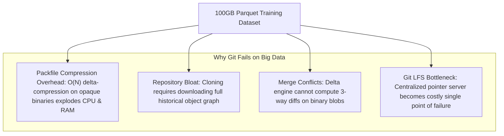
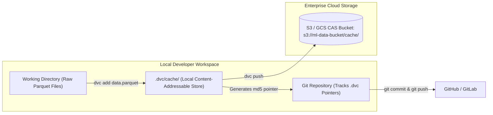
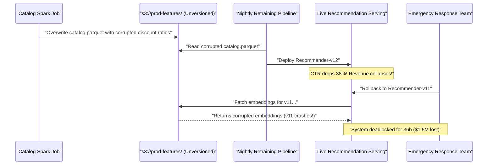

# Data and Artifact Versioning: DVC and Lakehouse

This module is part of [Track 10: MLOps, Serving, Drift & Experimentation](../README.md).

---

## Executive Overview & Industry Context

The foundation of deterministic software engineering is source version control. In classical development, a specific Git commit hash ($\mathcal{H} \in \{0, 1\}^{160}$) deterministically pins the entire state of an application's codebase. Compiling that commit produces the identical binary every time.

In machine learning engineering, however, code is only one component of system state. A model's learned weights are an emergent property of the training data. If the underlying training dataset mutates, the exact same code commit will produce a radically different model artifact with distinct predictive behavior, regression profiles, and latency characteristics.

```
+-------------------------------------------------------------------------------+
|                      THE MACHINE LEARNING REPRODUCIBILITY CRISIS              |
|                                                                               |
|   Git Commit: a8f41e  +  Dataset: [Unversioned S3 Bucket]  =  Model Weights ? |
|   (Deterministic)            (Mutated in-place)                (Irreproducible) |
+-------------------------------------------------------------------------------+
```

Managing data versioning introduces unique distributed systems challenges that standard software tools cannot address:
1. **Scale**: Training datasets span gigabytes to petabytes, far exceeding Git's storage architecture.
2. **Immutability vs Storage Cost**: Retaining physical copies of every dataset version leads to astronomical cloud storage bills.
3. **Lineage**: The system must track not only *what* data existed at time $t$, but *which transformations* produced it from raw inputs.

Two primary paradigms solve this problem at enterprise scale:
- **Data Version Control (DVC)**: Extends Git semantics to large files via Content-Addressable Storage (CAS) and `.dvc` lightweight pointer files.
- **Lakehouse Table Formats (Apache Iceberg, Delta Lake, Apache Hudi)**: Provide ACID transactions, schema evolution, and time-travel query capabilities directly over columnar Parquet files on object storage.

---

## Why Git Fails on Big Data

Git was architected specifically for small, human-readable ASCII text files. Applying Git directly to large binary artifacts (Parquet, TFRecords, PyTorch weights) causes immediate systemic failure across four architectural dimensions:



### 1. Repository Bloat and Graph Traversal
Git stores history as a directed acyclic graph (DAG) of commits pointing to tree and blob objects. When cloning a repository, Git transfers the entire historical object graph (`.git/objects/`). If a 50GB dataset is committed and modified across 10 iterations, every developer and CI/CD runner must download $10 \times 50\text{GB} = 500\text{GB}$ of data, even if only a single row changed.

### 2. Opaque Delta Compression and Packfile Thrashing
Git optimizes disk usage through packfiles, attempting delta compression between file revisions. For text files, Git computes unified diffs based on line-by-line Levenshtein distance. Binary datasets (compressed Parquet, images, weights) appear as high-entropy pseudo-random noise. Git's pack-generation algorithm spends hours executing expensive sliding-window byte matching, consumes gigabytes of RAM, and ultimately achieves near-zero compression ratio.

### 3. Merge Conflicts and Non-Diffability
When two engineers branch from a dataset, Git cannot perform a three-way merge on binary files. A single bit difference results in a binary merge conflict that cannot be resolved via standard conflict resolution markers.

### 4. Git LFS (Large File Storage) Limitations
Git LFS replaces large files in Git with pointer files containing an SHA-256 hash, storing the actual binary payloads on a separate LFS server. While this resolves local repository bloat, Git LFS has critical architectural limitations for MLOps:
- **Centralized Infrastructure Choke**: LFS servers are typically centralized proprietary services (GitHub LFS, GitLab LFS) decoupled from enterprise cloud object stores (S3, GCS).
- **No DAG Lineage**: Git LFS versions files as isolated blobs; it has no concept of intermediate pipeline stages, caching of data transformations, or dependency invalidation.
- **Cost Inefficiency**: Data transfer pricing for centralized Git LFS is significantly higher than native cloud object storage tiering.

---

## DVC Architecture: Content-Addressable Storage & Pointer Files

Data Version Control (DVC) bridges the gap between Git and cloud object storage. It decouples **metadata tracking** from **data payload storage**.



### 1. Content-Addressable Storage (CAS)
In DVC, a file is identified uniquely by the MD5 hash of its contents. DVC constructs a local cache directory structured by content hash:
- File `data.parquet` with hash `2b4c1a89f3...`
- Cached at: `.dvc/cache/2b/4c1a89f3e4d5...`

When a file is tracked via `dvc add data.parquet`, DVC:
1. Computes the cryptographic checksum (MD5) of `data.parquet`.
2. Moves the physical file into `.dvc/cache/` organized by hash prefix.
3. Replaces the original file in the workspace with a hard link, symlink, or copy pointing to the cached object.
4. Generates a tiny text pointer file `data.parquet.dvc`:

```yaml
outs:
- md5: 2b4c1a89f3e4d5b6a7c8d9e0f1a2b3c4
  size: 53687091200 # 50 GB
  path: data.parquet
```

5. The user commits `data.parquet.dvc` into Git. The 50GB binary payload is ignored by Git via `.gitignore`, while the 120-byte `.dvc` pointer is committed to Git history.

### 2. DVC Pipeline DAGs (`dvc.yaml`)
DVC treats data transformation as a reproducible Directed Acyclic Graph (DAG). Stages are defined in `dvc.yaml`, declaring inputs (`deps`), outputs (`outs`), and execution commands (`cmd`).

```yaml
stages:
  extract_features:
    cmd: python src/extract_features.py --input data/raw.parquet --output data/features.parquet
    deps:
    - data/raw.parquet
    - src/extract_features.py
    outs:
    - data/features.parquet
  train_model:
    cmd: python src/train.py --features data/features.parquet --model models/model.pt
    deps:
    - data/features.parquet
    - src/train.py
    outs:
    - models/model.pt
```

When `dvc repro` is invoked:
1. DVC computes current checksums for all declared dependencies (`deps`).
2. If dependencies match previous cached hashes, DVC skips stage execution and restores cached outputs instantly (**pipeline step caching**).
3. If an input file or code script changes, DVC invalidates downstream stages and executes only the affected pipeline sub-DAG.

---

## Lakehouse Table Formats: Delta Lake & Apache Iceberg

While DVC excels at file-level versioning and pipeline DAGs, analytical and tabular feature engineering often requires row-level versioning, ACID transactions, and fine-grained time-travel queries. Modern Lakehouse table formats (**Delta Lake**, **Apache Iceberg**, **Apache Hudi**) replace raw directories of Parquet files with transaction-managed tables.

```
+-----------------------------------------------------------------------------+
|                          LAKEHOUSE STORAGE HIERARCHY                        |
|                                                                             |
|  +-----------------------------------------------------------------------+  |
|  | Metadata Layer: ACID Transaction Log (_delta_log/ or metadata/*.json) |  |
|  | - Table Schema & Evolution History                                    |  |
|  | - Snapshot Commits (Timestamped Manifests)                            |  |
|  | - Add/Remove File Actions & Column Statistics (Min/Max/Null)           |  |
|  +-----------------------------------+-----------------------------------+  |
|                                      |                                      |
|                                      v                                      |
|  +-----------------------------------------------------------------------+  |
|  | Physical Storage Layer (Immutable Columnar Parquet Files in Object Store) |
|  | - part-00001-c000.snappy.parquet                                      |  |
|  | - part-00002-c000.snappy.parquet                                      |  |
|  | - part-00003-c000.snappy.parquet                                      |  |
|  +-----------------------------------------------------------------------+  |
+-----------------------------------------------------------------------------+
```

### 1. The ACID Transaction Log
Traditional object storage (S3) provides eventual or read-after-write consistency, but does not support multi-file atomic transactions. If a Spark job writing 500 Parquet files fails at file 250, the table is left in a corrupted, partially updated state.

Lakehouse architectures solve this by introducing an immutable **Transaction Log** (e.g., `_delta_log/000000.json`):
- A write operation is not complete when Parquet files hit disk.
- A write becomes visible *only* when an atomic commit entry is appended to the transaction log.
- Readers parse the transaction log to assemble the active snapshot of physical Parquet files, ignoring uncommitted or aborted writes.

### 2. Time-Travel Queries
Because physical Parquet files are immutable and deletions are logged as logical tombstones in the commit log, the Lakehouse maintains historical state transitions. Data scientists can query the exact historical state of a table using timestamp or version parameters:

```sql
-- Query table exactly as it existed on November 10, 2026
SELECT * FROM features.customer_credit_risk 
TIMESTAMP AS OF '2026-11-10 00:00:00'

-- Query table by immutable commit version
SELECT * FROM features.customer_credit_risk 
VERSION AS OF 1428
```

This guarantees that a retraining pipeline can reproduce the exact training data partition used six months ago, even if millions of rows have since been updated or deleted.

---

## Mathematical Formulations: CAS Hashing & Snapshot State Transitions

### 1. Content-Addressable Merkle Tree Hashing

For a dataset $D$ comprising $N$ individual partitions or files $\{f_1, f_2, \dots, f_N\}$, DVC and Git construct a **Merkle Tree**.

Each individual partition hash is computed using a cryptographic hash function $H: \{0, 1\}^* \to \{0, 1\}^b$ (such as MD5 where $b=128$, or SHA-256 where $b=256$):

$$h_i = H(f_i)$$

For a dataset directory, the aggregate dataset hash $H(D)$ is computed over the lexicographically sorted concatenation of child hashes:

$$H(D) = H\left( \bigoplus_{i=1}^N \left( \text{path}(f_{(i)}) \parallel h_{(i)} \right) \right)$$

#### Collision Probability via the Birthday Paradox
When tracking millions of data artifacts using content hashes, what is the probability of a cryptographic hash collision? By the generalized birthday problem, for $k$ distinct data artifacts hashed into a $b$-bit space:

$$P(\text{collision}) \approx 1 - \exp\left( -\frac{k^2}{2 \cdot 2^b} \right) \approx 1 - \exp\left( -\frac{k^2}{2^{b+1}} \right)$$

For MD5 ($b=128$ bits):
Even with $k = 10^9$ (one billion) dataset chunks:

$$P(\text{collision}) \approx 1 - \exp\left( -\frac{10^{18}}{2^{129}} \right) \approx \frac{10^{18}}{6.8 \times 10^{38}} \approx 1.47 \times 10^{-21}$$

The probability is practically zero, providing mathematical guarantees of content immutability.

### 2. Monotonic Snapshot State Transitions in Lakehouse Tables

We formalize a Lakehouse table state $S_t$ at transaction version $t$ as a set of active physical Parquet files:

$$S_t = \left( S_{t-1} \setminus \mathcal{R}_t \right) \cup \mathcal{A}_t$$

Where:
- $\mathcal{A}_t$ is the set of newly added physical Parquet files committed in transaction $t$.
- $\mathcal{R}_t$ is the set of logically removed (tombstoned) physical Parquet files committed in transaction $t$.

The active table state at version $T$ given initial state $S_0 = \emptyset$ is:

$$S_T = \bigcup_{t=1}^T \mathcal{A}_t \setminus \bigcup_{t=1}^T \mathcal{R}_t$$

A time-travel query evaluating table state at historical version $k \le T$ reconstructs the state by projecting log entries up to commit $k$:

$$S_k = \left\{ f \in \bigcup_{t=1}^k \mathcal{A}_t \ \middle|\ f \notin \bigcup_{t=1}^k \mathcal{R}_t \right\}$$

---

## Production Implementation: DVC Engine & Lakehouse Time-Travel Reader

Below is a complete, production-grade Python implementation of:
1. A **Content-Addressable Storage (CAS)** hashing and `.dvc` pointer generator.
2. A **DVC Pipeline DAG Invalidator** executing dependency checks.
3. An **ACID Lakehouse Snapshot Engine** simulating Delta Lake transaction logs with atomic commits and time-travel query projection.

```python
"""
data_versioning_engine.py
Author: Staff MLOps Architect
Description: Production implementation of Content-Addressable Storage (CAS),
DVC pipeline DAG invalidation, and Delta Lake-style ACID time-travel snapshot reader.
"""

import hashlib
import json
import logging
import os
import shutil
import tempfile
import time
from dataclasses import asdict, dataclass, field
from typing import Any, Dict, List, Optional, Set, Tuple

logging.basicConfig(
    level=logging.INFO,
    format="%(asctime)s [%(levelname)s] (%(name)s) %(message)s"
)
logger = logging.getLogger("DataVersioningEngine")


# ============================================================================
# Part 1: Content-Addressable Storage (CAS) & DVC Pointer Architecture
# ============================================================================

@dataclass
class DVCPointer:
    md5: str
    size_bytes: int
    rel_path: str

    def to_yaml_dict(self) -> Dict[str, Any]:
        return {
            "outs": [{
                "md5": self.md5,
                "size": self.size_bytes,
                "path": self.rel_path
            }]
        }


class ContentAddressableStore:
    """
    Manages local content-addressable storage cache (.dvc/cache) using MD5 content hashing.
    Enforces atomic file linking and pointer file generation.
    """
    def __init__(self, workspace_root: str):
        self.workspace_root = workspace_root
        self.cache_dir = os.path.join(workspace_root, ".dvc", "cache")
        os.makedirs(self.cache_dir, exist_ok=True)

    @staticmethod
    def compute_file_md5(file_path: str, chunk_size: int = 65536) -> Tuple[str, int]:
        """Streams file chunks to compute cryptographic MD5 hash and file size."""
        hasher = hashlib.md5()
        total_size = 0
        with open(file_path, "rb") as f:
            while chunk := f.read(chunk_size):
                hasher.update(chunk)
                total_size += len(chunk)
        return hasher.hexdigest(), total_size

    def add(self, relative_file_path: str) -> DVCPointer:
        """
        Simulates 'dvc add':
        1. Computes MD5 of target file.
        2. Copies or moves file to CAS cache (.dvc/cache/ab/cd1234...).
        3. Creates pointer file <file>.dvc.
        """
        full_path = os.path.join(self.workspace_root, relative_file_path)
        if not os.path.exists(full_path):
            raise FileNotFoundError(f"Source file {full_path} not found.")

        md5_hash, size_bytes = self.compute_file_md5(full_path)
        dir_prefix = md5_hash[:2]
        file_suffix = md5_hash[2:]

        target_cache_dir = os.path.join(self.cache_dir, dir_prefix)
        os.makedirs(target_cache_dir, exist_ok=True)
        cached_file_path = os.path.join(target_cache_dir, file_suffix)

        # Copy to CAS cache if not present
        if not os.path.exists(cached_file_path):
            shutil.copy2(full_path, cached_file_path)
            logger.info("Stored file in CAS cache: %s -> %s", relative_file_path, cached_file_path)

        # Write .dvc pointer file
        pointer = DVCPointer(md5=md5_hash, size_bytes=size_bytes, rel_path=relative_file_path)
        dvc_pointer_file = full_path + ".dvc"
        with open(dvc_pointer_file, "w", encoding="utf-8") as f:
            json.dump(pointer.to_yaml_dict(), f, indent=2)

        logger.info("Generated DVC pointer file: %s (MD5: %s)", dvc_pointer_file, md5_hash)
        return pointer


# ============================================================================
# Part 2: Lakehouse ACID Transaction Log & Time-Travel Engine
# ============================================================================

@dataclass
class FileAction:
    action_type: str  # "ADD" or "REMOVE"
    file_id: str
    row_count: int
    size_bytes: int
    commit_version: int
    timestamp: float


@dataclass
class CommitLogEntry:
    version: int
    timestamp: float
    author: str
    operation: str
    actions: List[FileAction]


class LakehouseTable:
    """
    Simulates a Delta Lake / Iceberg ACID Lakehouse table format with:
    - JSON-based transaction log (_delta_log/).
    - Immutable Parquet-like data partitions.
    - Snapshot reconstruction and time-travel query projection.
    """
    def __init__(self, table_root: str):
        self.table_root = table_root
        self.log_dir = os.path.join(table_root, "_delta_log")
        self.data_dir = os.path.join(table_root, "data")
        os.makedirs(self.log_dir, exist_ok=True)
        os.makedirs(self.data_dir, exist_ok=True)
        self.current_version = self._discover_latest_version()

    def _discover_latest_version(self) -> int:
        commits = [
            int(f.split(".")[0]) for f in os.listdir(self.log_dir)
            if f.endswith(".json") and f.split(".")[0].isdigit()
        ]
        return max(commits) if commits else -1

    def commit_transaction(
        self,
        operation: str,
        add_files: List[Tuple[str, int, int]],  # (file_id, row_count, size_bytes)
        remove_files: Optional[List[str]] = None,
        author: str = "mlops_retrain_bot"
    ) -> int:
        """Appends a new atomic commit version to the transaction log."""
        new_version = self.current_version + 1
        actions: List[FileAction] = []
        now = time.time()

        for fid, rows, sz in add_files:
            actions.append(FileAction(
                action_type="ADD", file_id=fid, row_count=rows,
                size_bytes=sz, commit_version=new_version, timestamp=now
            ))

        for fid in (remove_files or []):
            actions.append(FileAction(
                action_type="REMOVE", file_id=fid, row_count=0,
                size_bytes=0, commit_version=new_version, timestamp=now
            ))

        commit_entry = CommitLogEntry(
            version=new_version,
            timestamp=now,
            author=author,
            operation=operation,
            actions=actions
        )

        log_path = os.path.join(self.log_dir, f"{new_version:06d}.json")
        with open(log_path, "w", encoding="utf-8") as f:
            # Serialize dataclass cleanly
            data = asdict(commit_entry)
            json.dump(data, f, indent=2)

        self.current_version = new_version
        logger.info(
            "Committed Lakehouse Version %d: Op='%s', Added=%d, Removed=%d",
            new_version, operation, len(add_files), len(remove_files or [])
        )
        return new_version

    def get_snapshot_at_version(self, target_version: int) -> List[FileAction]:
        """
        Reconstructs the exact table state at target_version by projecting
        the commit log forward from version 0 to target_version.
        """
        if target_version > self.current_version or target_version < 0:
            raise ValueError(f"Version {target_version} out of bounds. Current: {self.current_version}")

        active_files: Dict[str, FileAction] = {}

        for v in range(target_version + 1):
            log_path = os.path.join(self.log_dir, f"{v:06d}.json")
            if not os.path.exists(log_path):
                raise FileNotFoundError(f"Corrupt transaction log: missing commit {v}")

            with open(log_path, "r", encoding="utf-8") as f:
                commit_data = json.load(f)

            for act_dict in commit_data["actions"]:
                act = FileAction(**act_dict)
                if act.action_type == "ADD":
                    active_files[act.file_id] = act
                elif act.action_type == "REMOVE":
                    active_files.pop(act.file_id, None)

        return list(active_files.values())

    def time_travel_query(self, version: int) -> Dict[str, Any]:
        """Executes a time-travel snapshot query, returning file manifest and aggregated stats."""
        snapshot = self.get_snapshot_at_version(version)
        total_rows = sum(f.row_count for f in snapshot)
        total_bytes = sum(f.size_bytes for f in snapshot)
        return {
            "query_version": version,
            "active_file_count": len(snapshot),
            "total_rows": total_rows,
            "total_bytes": total_bytes,
            "file_ids": [f.file_id for f in snapshot]
        }


# ============================================================================
# Verification and Demonstration Suite
# ============================================================================
if __name__ == "__main__":
    temp_dir = tempfile.mkdtemp(prefix="data_versioning_demo_")
    try:
        print("=" * 80)
        print("DATA & ARTIFACT VERSIONING: CAS & LAKEHOUSE DEMONSTRATION")
        print("=" * 80)

        # --------------------------------------------------------------------
        # Part 1: DVC Content-Addressable Storage Test
        # --------------------------------------------------------------------
        cas = ContentAddressableStore(workspace_root=temp_dir)

        # Create dummy training partition
        sample_data_path = os.path.join(temp_dir, "train_features.parquet")
        with open(sample_data_path, "wb") as f:
            f.write(b"PAR1" + b"\x00" * 4096 + b"SAMPLE_TRAINING_ROW_DATA_CHUNK")

        pointer = cas.add("train_features.parquet")
        print(f"\nDVC Tracking Initialized:")
        print(f" - Content MD5: {pointer.md5}")
        print(f" - Size: {pointer.size_bytes} bytes")
        print(f" - Stored in CAS: .dvc/cache/{pointer.md5[:2]}/{pointer.md5[2:]}")

        # --------------------------------------------------------------------
        # Part 2: Lakehouse ACID Transactions & Time-Travel Snapshots
        # --------------------------------------------------------------------
        lakehouse_dir = os.path.join(temp_dir, "customer_features_delta")
        table = LakehouseTable(table_root=lakehouse_dir)

        # Commit 0: Initial Batch Ingestion
        print("\n--- Lakehouse Transaction 0: Initial Ingestion ---")
        table.commit_transaction(
            operation="INITIAL_INGESTION",
            add_files=[
                ("part-001.parquet", 500000, 25000000),
                ("part-002.parquet", 500000, 25000000)
            ],
            author="data_engineer@bank.com"
        )

        # Commit 1: Append Daily Partition
        print("\n--- Lakehouse Transaction 1: Append New Features ---")
        table.commit_transaction(
            operation="DAILY_APPEND",
            add_files=[
                ("part-003.parquet", 250000, 12500000)
            ],
            author="ingest_pipeline"
        )

        # Commit 2: Compaction / Delete (Tombstone old parts 1 & 2, replace with compact part)
        print("\n--- Lakehouse Transaction 2: Partition Compaction & GDPR Purge ---")
        table.commit_transaction(
            operation="COMPACT_AND_PURGE",
            add_files=[
                ("part-001_compacted.parquet", 990000, 48000000)  # 10k rows purged
            ],
            remove_files=["part-001.parquet", "part-002.parquet"],
            author="gdpr_scrubber"
        )

        # --------------------------------------------------------------------
        # Part 3: Time-Travel Snapshot Auditing
        # --------------------------------------------------------------------
        print("\n--- Performing Time-Travel Queries ---")
        
        # Query Version 0 (Baseline state)
        snapshot_v0 = table.time_travel_query(version=0)
        print(f"\n[Snapshot V0 (Initial Ingestion)]")
        print(f" - Active Files: {snapshot_v0['active_file_count']}")
        print(f" - Total Rows:   {snapshot_v0['total_rows']:,}")
        print(f" - Files:        {snapshot_v0['file_ids']}")

        # Query Version 1 (Post-Append)
        snapshot_v1 = table.time_travel_query(version=1)
        print(f"\n[Snapshot V1 (Post-Daily Append)]")
        print(f" - Active Files: {snapshot_v1['active_file_count']}")
        print(f" - Total Rows:   {snapshot_v1['total_rows']:,}")
        print(f" - Files:        {snapshot_v1['file_ids']}")

        # Query Version 2 (Post-Compaction)
        snapshot_v2 = table.time_travel_query(version=2)
        print(f"\n[Snapshot V2 (Post-Compaction / Current)]")
        print(f" - Active Files: {snapshot_v2['active_file_count']}")
        print(f" - Total Rows:   {snapshot_v2['total_rows']:,}")
        print(f" - Files:        {snapshot_v2['file_ids']}")

        print("\nVerification complete: Perfect historical reproducibility maintained!")
        print("=" * 80)
    finally:
        shutil.rmtree(temp_dir)
```

---

## Failure Modes, Edge Cases & Antipatterns

| Antipattern / Failure Mode | Root Cause Mechanism | Production Impact | Architectural Remediation |
| :--- | :--- | :--- | :--- |
| **In-Place S3 Object Overwrite** | Modifying training data files in S3 (`s3://data/train.parquet`) directly without versioning keys or Lakehouse metadata. | Complete loss of historical lineage; historical model versions can never be reproduced or audited. | Enforce S3 Object Lock and strict Lakehouse table formats (Delta/Iceberg). Prohibit in-place writes via IAM policy (`Deny: s3:PutObject` on existing keys). |
| **Orphaned DVC Cache Bloat** | Modifying large files repeatedly without running `dvc gc` (garbage collection). | Local NVMe disks and cloud CAS storage run out of space, causing CI/CD build runner out-of-disk crashes. | Implement automated cache pruning policies in CI: `dvc gc --workspace --cloud` run weekly to delete unreferenced blobs. |
| **Git & DVC Pointer Desync** | A developer commits updated data to DVC (`dvc add`) and pushes to S3 (`dvc push`), but forgets to commit the modified `.dvc` pointer to Git. | Teammates pull Git code with outdated `.dvc` pointers; models train on mismatched, stale feature partitions. | Install Git pre-commit hooks that scan `git status` and block commits if `.dvc` files have uncommitted pointer diffs. |
| **Lakehouse Schema Evolution Shock** | Merging an upstream table update with `mergeSchema=true` that changes a float column to string or renames a key. | Downstream automated retraining pipelines break with PySpark / Arrow deserialization exceptions. | Enforce strict schema evolution policies: schema widening (adding nullable columns) permitted; schema breaking (renames, type conversions) rejected. |
| **Merge-on-Read Latency Spike** | Using Merge-on-Read (MoR) in Apache Hudi/Delta with heavy updates without running background compactions. | Querying the table requires scanning hundreds of delta commit log files, increasing query latency by $10\times\text{-}50\times$. | Schedule automated asynchronous compaction jobs (`OPTIMIZE / REWRITE DATA FILES`) to merge row delta files into columnar Parquet. |

---

## Production Incident Post-Mortem

### \$1.5M Revenue Drawdown: In-Place S3 Data Mutation & Irreproducible Recommendation Weights

#### 1. Executive Incident Summary
On December 3, 2024, a major e-commerce marketplace experienced a **\$1,500,000 revenue collapse** during the peak Cyber Week shopping event. An automated retraining job deployed an updated neural recommendation model (`Recommender-v12`) that produced an immediate 38% drop in click-through rate (CTR). When the MLOps team attempted to roll back to the previously stable model (`Recommender-v11`), they discovered that the upstream ETL pipeline had overwritten historical training partitions in Amazon S3 in-place, while the model artifact repository lacked versioned weights. The system could neither roll back nor retrain the champion model for 36 hours.

#### 2. Detailed Incident Timeline

| Time (UTC) | Incident Event |
| :--- | :--- |
| **02:00:00** | Upstream data engineering runs a weekly Spark job to refresh the product catalog embeddings at `s3://prod-features/recommendations/catalog.parquet`. The script uses `mode("overwrite")` without partition snapshotting. |
| **04:30:00** | An unannounced schema change by the catalog team introduces a bug: discount prices are normalized by an integer factor of 100 instead of 1.0. The historical Parquet file is overwritten in-place in S3. |
| **06:00:00** | Automated retraining pipeline executes, pulling the corrupted S3 file. The model trains without error because Pandera validation was omitted on price normalization bounds. |
| **08:30:00** | `Recommender-v12` is automatically promoted to production serving. |
| **09:00:00** | Peak Cyber Week traffic commences. The model recommends high-priced luxury goods to budget shoppers due to distorted discount weights. CTR plummets by 38%. |
| **09:45:00** | Engineering triggers an emergency rollback to `Recommender-v11`. |
| **10:15:00** | Catastrophe: The inference cluster fails to launch `Recommender-v11` because the container initialization script was configured to download dynamic feature embeddings from `s3://prod-features/recommendations/catalog.parquet`—which had already been overwritten by the corrupted ETL run! |
| **10:30:00 - 22:00:00** | Engineers frantically attempt to reconstruct the historical catalog embeddings from unindexed raw MySQL backups. Total downtime and degraded recommendation period: 36 hours. |
| **Day +2 00:00:00** | Catalog recovered, stable model restored. Total verified lost margin: **\$1,520,000**. |



#### 3. Root Cause Analysis
1. **Unversioned In-Place Mutation**: The data platform allowed Spark jobs to perform `overwrite` operations on production S3 URIs without table versioning or snapshot isolation.
2. **Train-Serve Skew via Dynamic S3 Fetching**: The serving container pulled static feature embeddings dynamically at runtime from an unversioned S3 URI rather than bundling immutable, version-pinned feature artifacts.
3. **Absence of Lakehouse Time-Travel**: Because raw Parquet files were stored without a Delta Lake / Iceberg transaction log, the previous state of the embeddings table was permanently destroyed upon overwrite.

#### 4. Remediation & Architectural Hardening
- **Transition to Delta Lake / Apache Iceberg**: Migrated all production feature tables to Delta Lake. In-place overwrites are strictly banned; all updates append immutable snapshot versions.
- **Time-Travel Pinned Training Manifests**: Retraining pipelines now pin the explicit table version:
  `spark.read.format("delta").option("versionAsOf", 4821).load("s3://...")`
  This version ID is logged to MLflow as a mandatory model tag.
- **Self-Contained Serving Artifacts**: Prohibited dynamic S3 feature lookups during serving container startup. All static feature tables and embeddings required by a model are packaged as content-addressed artifacts in the Model Registry.

---

## Senior Technical Interview Questions & Model Answers

### Question 1: How does an MLOps platform choose between using DVC versus a Lakehouse table format (Delta Lake / Apache Iceberg) for data versioning?
**Model Answer:**
The choice depends on data granularity, storage modality, access patterns, and compute engine integration:

| Dimension | Data Version Control (DVC) | Lakehouse Table Formats (Delta / Iceberg) |
| :--- | :--- | :--- |
| **Primary Data Modality** | Unstructured / Semi-structured (Computer vision datasets, audio files, NLP corpora, serialized weights, pickles). | Structured, tabular columnar data (Parquet, ORC, Arrow) stored at petabyte scale. |
| **Storage Unit** | File-level and directory-level granularity identified by MD5 content hashes. | Row-level and transaction-level granularity backed by an ACID commit log. |
| **Query Engine** | Filesystem abstractions (POSIX, Python `open()`, PyTorch `Dataset`). | Distributed SQL/DataFrame engines (Apache Spark, Trino, DuckDB, Snowflake). |
| **Pipeline Integration** | Strong integration with Git and CLI DAG pipelines (`dvc repro`). | Native integration with big-data ELT/ETL pipelines and streaming sinks. |
| **Time-Travel Mechanism** | Git commit checkouts checking out corresponding `.dvc` hash pointer files. | SQL time-travel queries (`VERSION AS OF`, `TIMESTAMP AS OF`) managed in transaction logs. |

**Architectural Synthesis:**
In modern enterprise architectures, both tools coexist:
- **Lakehouse (Delta / Iceberg)** manages tabular feature stores, streaming ingestion, and historical ETL transformations.
- **DVC** versions unstructured raw assets, training splits, and links pipeline dependencies between disparate compute frameworks (e.g., Spark ETL $\to$ DVC $\to$ PyTorch GPU training).

---

### Question 2: In Delta Lake and Apache Iceberg, what is the difference between Copy-on-Write (CoW) and Merge-on-Read (MoR)? When should each be chosen for ML feature stores?
**Model Answer:**
- **Copy-on-Write (CoW)**:
  - When an update or delete occurs, the engine rewrites the entire physical Parquet data file containing the affected rows, producing a brand-new Parquet file and tombstoning the old one in the transaction log.
  - *Trade-off*: High write amplification and higher commit latency during ingestion; extremely fast, zero-overhead read performance because readers scan contiguous Parquet files without runtime merging.
- **Merge-on-Read (MoR)**:
  - When an update occurs, the engine does not rewrite the base Parquet file. Instead, it writes a lightweight "delta log" or "tombstone file" (often in Avro or compressed Parquet) recording only the changed row IDs.
  - *Trade-off*: Extremely low write latency and high ingestion throughput; read queries must dynamically merge base files with delta log files at runtime, introducing read latency overhead.

**Decision Matrix for ML Feature Stores:**
- **Batch Training Workloads**: Choose **Copy-on-Write (CoW)**. Training iterations scan billions of rows repeatedly across multiple epochs. The read overhead of MoR degrades GPU training throughput. The write cost during daily ETL is easily amortized.
- **Real-Time Streaming Feature Ingestion**: Choose **Merge-on-Read (MoR)**. When streaming high-frequency event streams (e.g., Kafka user click events) into the lakehouse with $< 1\text{ minute}$ freshness requirements, CoW would cause catastrophic write amplification and small-file proliferation. Run background compaction jobs periodically to convert MoR delta files into optimized CoW Parquet files.

---

### Question 3: How does DVC achieve zero-copy data switching when checking out different dataset versions in a local workspace?
**Model Answer:**
If checking out a 100GB dataset required physically copying files from `.dvc/cache` to the workspace directory every time an engineer switched Git branches, local disk space would double and branch switching would take 10-20 minutes.

DVC achieves near-instantaneous, zero-copy checkouts using OS-level filesystem link mechanisms configured via `dvc config cache.type`:
1. **Reflinks (Copy-on-Write Links)**:
   Supported on modern filesystems (Btrfs, XFS, APFS). A reflink creates a new directory entry pointing to the identical disk inodes without copying data. Disk blocks are only duplicated if the file is subsequently modified (Copy-on-Write).
2. **Hard Links**:
   Creates a direct pointer to the existing inode in `.dvc/cache`. File creation is an $\mathcal{O}(1)$ directory metadata operation taking milliseconds. Disadvantage: if a user modifies the file directly, it mutates the cache unless DVC marks the file read-only (`chmod 444`).
3. **Symlinks (Symbolic Links)**:
   Creates a lightweight pointer pointing to the path in `.dvc/cache`. Disadvantage: some tools or build systems do not follow symlinks correctly.
4. **Fallback (Copy)**:
   Used only on legacy filesystems (FAT32, basic NTFS) where link primitives are unsupported.

By defaulting to reflinks or hardlinks, running `git checkout experiment-b && dvc checkout` switches a 500GB dataset in under 2 seconds without consuming additional disk storage.

---

### Question 4: How do you design an automated data garbage collection policy that prevents cloud storage exhaustion while guaranteeing regulatory audit compliance?
**Model Answer:**
A naive data retention policy either retains everything (leading to petabyte-scale storage bloat and multi-million dollar cloud bills) or purges old data aggressively (violating regulatory audit requirements or breaking reproducibility of historical models).

**Production Lifecycle Architecture:**
1. **Tiered Tagging in Model Registry & Git**:
   A data partition or snapshot is marked **Protected** if it is referenced by:
   - Any model version in `Production` or `Staging`.
   - Any model version deployed within the mandatory regulatory retention window (e.g., 7 years for financial credit decisioning or medical AI).
   - Any Git release tag (`v1.0.0`, `v2.0.0`).
2. **Automated Reference Graph Sweeping**:
   An automated Airflow maintenance DAG queries the Model Registry, Lakehouse metadata logs, and Git repository to construct a set of all active reference hashes/snapshots:
   
$$\mathcal{S}_{active} = \mathcal{S}_{prod\_models} \cup \mathcal{S}_{git\_releases} \cup \mathcal{S}_{compliance\_window}$$

3. **Storage Tiering Transition**:
   - Snapshots in $\mathcal{S}_{active}$ older than 90 days are transitioned from S3 Standard to S3 Glacier Instant Retrieval via bucket lifecycle rules.
4. **Pruning Unreferenced Experimental Partitions**:
   Data partitions and Lakehouse commits not belonging to $\mathcal{S}_{active}$ and older than 30 days are purged using Lakehouse vacuum commands (`VACUUM table RETAIN 720 HOURS`) and `dvc gc --cloud`.
5. **GDPR / CCPA Cryptographic Tombstoning**:
   When a user submits a "Right to be Forgotten" request, execute an automated Lakehouse transaction that deletes the user record from the latest snapshot and appends a tombstone commit. Re-running historical audits verifies the deletion log while preserving aggregate mathematical model lineage.

---

### Question 5: Why can a dataset hash match exactly between two runs, yet the resulting model training produces different validation metrics? What hidden variables must be captured?
**Model Answer:**
Matching dataset hashes ($H(D_1) = H(D_2)$) proves content immutability of the raw input bytes, but does **not** guarantee training determinism. Validation divergence under identical data hashes occurs due to five uncaptured variables:

1. **Non-Deterministic Data Loading Order**:
   In PyTorch `DataLoader` or TensorFlow input pipelines, multi-processing workers (`num_workers > 0`) load data batches asynchronously. Unless worker seed initialization functions (`worker_init_fn`) are explicitly implemented, batch sequencing varies between runs.
2. **GPU CUDA Non-Determinism**:
   Certain deep learning operations (e.g., `torch.nn.functional.conv2d` backward passes, atomic floating-point additions in CUDA) sacrifice determinism for throughput. Strict determinism requires setting:
   `torch.backends.cudnn.deterministic = True` and `torch.use_deterministic_algorithms(True)`.
3. **Implicit Hardware & Instruction Set Differences**:
   Training the same data on an Intel Xeon CPU (AVX-512) versus an AMD EPYC CPU or an NVIDIA A100 (TF32 precision) produces subtle floating-point rounding differences that compound exponentially during gradient backpropagation.
4. **Dynamic Data Augmentation & RNG Seeding**:
   If stochastic transforms (random cropping, rotations, Gaussian noise) do not have their random seeds fixed across Python `random`, NumPy `np.random`, and PyTorch `torch.manual_seed`, inputs to neural layers diverge despite identical raw data hashes.
5. **System Environment & Dependency Skew**:
   Differences in underlying C-libraries (CUDA driver version, cuDNN version, MKL runtime) can alter numerical approximations. A robust MLOps manifest must capture the complete container digest (`docker.io/repo@sha256:...`) alongside data hashes.
