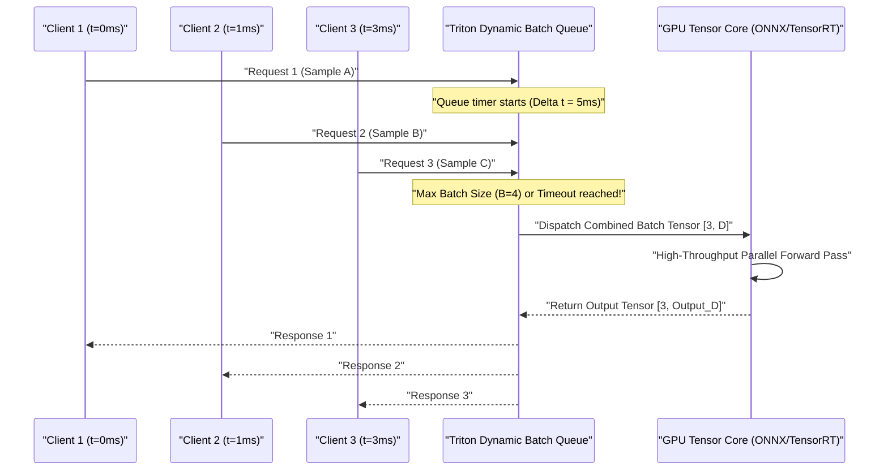
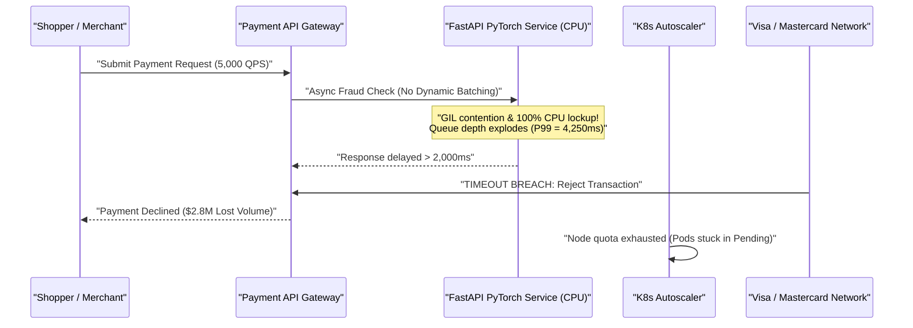

# Batch vs. Real-Time Inference: ONNX, TensorRT, and Triton

This module is part of [Track 10: MLOps, Serving, Drift & Experimentation](../README.md).

---

## Executive Overview & Industry Context

Training a machine learning model optimizes for empirical risk minimization over a closed historical dataset. Serving a machine learning model in production optimizes for an entirely different set of operational distributed systems constraints: **latency SLAs, throughput (Queries Per Second / QPS), concurrency, hardware utilization (GPU Tensor Cores), and infrastructure cost efficiency**.

In production engineering, the serving architecture is dictated by the operational latency budget:

```
                    THE PRODUCTION INFERENCE SPECTRUM
<=========================================================================>
OFFLINE BATCH              STREAMING NEAR-REALTIME        LOW-LATENCY ONLINE
(Hours / Minutes)          (Seconds / Milliseconds)       (Sub-10 Milliseconds)
- Apache Spark / Ray       - Apache Flink / Kafka         - Triton / ONNX / gRPC
- 100M+ predictions        - Continuous Event Streams     - Synchronous User Blocking
- Max throughput / Cost    - Sliding feature windows      - Strict P99 SLA Enforcement
```

Naive serving implementations typically deploy models inside standard Python web frameworks (Flask, FastAPI) running uncompiled PyTorch or TensorFlow code on CPUs. Under enterprise production loads (e.g., 5,000+ QPS), this architecture fails catastrophically:
1. Python's Global Interpreter Lock (GIL) serializes compute execution.
2. Individual unbatched matrix multiplications leave modern GPU Tensor Cores 95% idle.
3. High memory allocation churn produces tail latency spikes (P99 $> 1,000\text{ms}$).

To deliver microsecond-tier latencies and maximize hardware saturation, enterprise MLOps architectures decouple model serving into compiled computational graphs (**ONNX Runtime**, **NVIDIA TensorRT**) managed by specialized inference serving engines (**Triton Inference Server**, **vLLM**) utilizing **Dynamic Batching**.

---

## The Three Inference Paradigms

```mermaid
flowchart TD
    subgraph OfflineBatch["1. Offline Batch Scoring"]
        B_Store[("Data Lakehouse (Iceberg/S3)")] --> B_Engine["Distributed Compute (Spark / Ray)"]
        B_Engine --> B_Sink[("Preds Table / Feature Store (Redis)")]
        B_Note["Characteristics:<br/>- Throughput maximized (Massive B)<br/>- High latency tolerance (hours)<br/>- Zero user-facing blocking"]
    end

    subgraph OnlineServing["2. Real-Time Online Serving"]
        Client["User Application Client"] -->|"Sync HTTP/gRPC Request"| Gateway["API Gateway / Envoy"]
        Gateway --> DynBatch["Dynamic Batching Queue (Triton)"]
        DynBatch --> CompiledModel["TensorRT / ONNX Engine (GPU)"]
        CompiledModel -->|"Prediction Response"| Client
        Online_Note["Characteristics:<br/>- Strict SLA (P99 < 15ms)<br/>- Synchronous request-response<br/>- Hardware cost sensitive"]
    end

    subgraph StreamingServing["3. Streaming Inference"]
        Kafka_In["Kafka Event Topic"] --> Flink["Stream Processor (Flink)"]
        Flink --> Streaming_Model["Inference Worker Pool"]
        Streaming_Model --> Kafka_Out["Kafka Prediction Topic"]
        Stream_Note["Characteristics:<br/>- Async continuous scoring<br/>- Event-driven (100ms - 2s latency)<br/>- Temporal sliding windows"]
    end
```



### Architectural Trade-Off Analysis

| Architectural Dimension | Offline Batch Scoring | Streaming Inference | Low-Latency Online Serving |
| :--- | :--- | :--- | :--- |
| **Latency Budget** | Hours to Days | 100 milliseconds to 5 seconds | 2 to 20 milliseconds |
| **Throughput (Records/sec)** | $10^5 - 10^7$ records/sec | $10^3 - 10^5$ records/sec | $10^2 - 10^4$ requests/sec |
| **Compute Engine** | Apache Spark, Ray Core, AWS EMR | Apache Flink, Spark Streaming, Kafka Streams | Triton Inference Server, TorchServe, vLLM |
| **Protocol** | File I/O (Parquet, Arrow) | Message Brokers (Kafka, Redpanda, Pulsar) | HTTP/2, gRPC, Protobuf |
| **Failure Recovery** | Checkpointed task restart | Checkpointed stream offset replay | Circuit breaker fallback / heuristic default |
| **Cost Profile** | Lowest cost per prediction | Moderate cost | Highest cost (requires over-provisioned GPUs) |

---

## High-Throughput Serving Systems: Triton & Dynamic Batching

The fundamental bottleneck of real-time GPU inference is that **individual requests arrive sequentially**, but GPUs are massively parallel SIMD (Single Instruction, Multiple Data) processors designed to execute thousands of matrix operations concurrently.

Executing a forward pass on an individual sample ($B=1$) utilizes less than 5% of an NVIDIA A100's compute capacity, leaving the tensor cores stalled while waiting for memory transfers.

### Dynamic Batching Mechanics
Dynamic Batching is an algorithmic scheduling mechanism implemented in systems like NVIDIA Triton Inference Server. It aggregates independent, asynchronous client requests into a unified batch tensor before dispatching them to the GPU.



The dynamic batcher is governed by two parameters:
1. **`max_batch_size` ($B_{max}$)**: The maximum batch dimension the GPU can compute without exceeding memory bounds.
2. **`max_queue_delay_microseconds` ($\Delta t_{max}$)**: The maximum time the scheduler will wait to collect incoming requests before forcing execution of whatever batch has accumulated.

---

## Model Optimization: Graph Compilation & Quantization

Deploying native PyTorch or TensorFlow model checkpoints (`.pt` or `.savedmodel`) in production executes high-overhead Python runtimes and unoptimized computational graphs. Enterprise pipelines compile models into static execution graphs using **ONNX** (Open Neural Network Exchange) and **TensorRT**.

```
+-----------------------------------------------------------------------------+
|                         GRAPH COMPILATION PIPELINE                          |
|                                                                             |
|  [ PyTorch / TensorFlow Code ]                                              |
|              |                                                              |
|              v (Export Graph: torch.onnx.export)                            |
|  [ ONNX Computational Graph (.onnx) ]                                        |
|              |                                                              |
|              +-----------------------+                                      |
|              |                       |                                      |
|              v                       v                                      |
|  [ ONNX Runtime Engine ]   [ NVIDIA TensorRT Builder ]                      |
|  - Constant Folding        - Layer & Tensor Fusion (Conv + Bias + ReLU)     |
|  - Dead Node Elimination   - Kernel Auto-Tuning (Target Hardware)           |
|  - Operator Fusion         - Dynamic INT8 / FP16 Precision Calibration      |
|              |                       |                                      |
|              v                       v                                      |
|  [ CPU Execution (AVX-512) ]  [ GPU Execution (Tensor Cores) ]              |
+-----------------------------------------------------------------------------+
```

### 1. Graph Transformations
- **Constant Folding**: Pre-computes graph operations whose inputs are static parameters at compile time rather than during inference.
- **Layer Fusion**: Combines adjacent operations into a single GPU CUDA kernel. For example, fusing a `Convolution`, a `BiasAdd`, and a `ReLU` activation prevents writing intermediate activation tensors back to VRAM, reducing memory bandwidth pressure by up to 60%.

### 2. Quantization (FP32 $\to$ FP16 $\to$ INT8)
Standard deep learning models represent weights in 32-bit single-precision floating point (FP32). Quantization maps high-precision floats to lower-precision representations:
- **FP16 / BF16**: Reduces memory footprint by 50% with negligible loss in accuracy, utilizing native GPU half-precision Tensor Cores.
- **INT8 (8-bit Integer)**: Reduces memory footprint by 75% and quadruples mathematical throughput.

---

## Mathematical Formulations: Batching Dynamics & Quantization Scaling

### 1. Throughput vs Latency Trade-Off in Dynamic Batching

Let the time required to execute a batch of size $B$ on a hardware accelerator be modeled linearly:

$$T_{compute}(B) = \alpha + \beta B$$

Where:
- $\alpha > 0$ is the constant kernel launch and memory barrier overhead.
- $\beta > 0$ is the marginal computation time per sample in the batch.

If requests arrive under a Poisson process with arrival rate $\lambda$ (queries per second), the expected queuing wait time in the dynamic batcher is:

$$T_{wait}(B) = \min\left( \frac{B - 1}{\lambda}, \, \Delta t_{max} \right)$$

The total end-to-end inference latency experienced by a client is:

$$L(B) = T_{wait}(B) + T_{compute}(B) = \min\left( \frac{B - 1}{\lambda}, \, \Delta t_{max} \right) + \alpha + \beta B$$

The system throughput $\mathcal{T}(B)$ in queries per second is:

$$\mathcal{T}(B) = \frac{B}{T_{compute}(B)} = \frac{B}{\alpha + \beta B} = \frac{1}{\frac{\alpha}{B} + \beta}$$

As batch size $B \to \infty$, throughput asymptotically approaches its theoretical hardware ceiling:

$$\lim_{B \to \infty} \mathcal{T}(B) = \frac{1}{\beta}$$

However, latency $L(B)$ scales linearly with $B$. Therefore, dynamic batching is a constrained optimization problem:

$$\max_{B} \mathcal{T}(B) \quad \text{subject to} \quad L(B) \le \text{SLA}_{\text{P99}}$$

### 2. INT8 Uniform Affine Quantization Scaling

To map a continuous real-valued tensor $X \in [X_{min}, X_{max}]$ to an 8-bit unsigned integer $Q \in [0, 255]$ (or signed $[-128, 127]$), we compute the **Scale ($S$)** and **Zero-point ($Z$)**:

$$S = \frac{X_{max} - X_{min}}{2^b - 1} = \frac{X_{max} - X_{min}}{255}$$

$$Z = \text{round}\left( -\frac{X_{min}}{S} \right)$$

The quantization function $\mathcal{Q}(x)$ maps a real value $x$ to integer $q$:

$$q = \text{clip}\left( \left\lfloor \frac{x}{S} \right\rceil + Z, \, 0, \, 255 \right)$$

The de-quantization mapping back to continuous space is:

$$\hat{x} = S \cdot (q - Z)$$

The Quantization Error $\mathcal{E}$ is bounded by half the scale factor:

$$|x - \hat{x}| \le \frac{S}{2}$$

---

## Production Implementation: Dynamic Batching Microservice with ONNX Engine

Below is a complete, production-grade asynchronous serving microservice written in Python. It implements:
1. An **in-memory thread-safe dynamic batching priority queue**.
2. Aggregation over a configurable timeout window ($\Delta t$) or max batch size ($B_{max}$).
3. Execution via an **ONNX Runtime** inference engine.
4. Asynchronous Python `asyncio.Future` completion returning isolated predictions to concurrent callers.

```python
"""
dynamic_batching_serving_service.py
Author: Staff MLOps Architect
Description: Production asynchronous inference server implementing dynamic batching
and ONNX Runtime execution for high-throughput, low-latency microservices.
"""

import asyncio
import logging
import math
import os
import tempfile
import time
from dataclasses import dataclass
from typing import Any, Dict, List, Optional, Tuple

import numpy as np

logging.basicConfig(level=logging.INFO, format="%(asctime)s [%(levelname)s] (%(name)s) %(message)s")
logger = logging.getLogger("DynamicBatchingServer")


@dataclass
class InferenceRequest:
    request_id: str
    feature_vector: np.ndarray  # Shape: (D,)
    future: asyncio.Future
    arrival_timestamp: float


class MockONNXRuntimeEngine:
    """
    Simulates a compiled ONNX Runtime / TensorRT execution engine.
    Executes batched matrix multiplication with realistic hardware execution curves:
    T_compute(B) = alpha + beta * B.
    """
    def __init__(self, input_dim: int = 16, output_dim: int = 1):
        self.input_dim = input_dim
        self.output_dim = output_dim
        # Deterministic pseudo-weights
        np.random.seed(42)
        self.weights = np.random.randn(input_dim, output_dim).astype(np.float32) * 0.1
        self.bias = np.array([0.05], dtype=np.float32)

    def run(self, batch_tensor: np.ndarray) -> np.ndarray:
        """
        Input shape: (B, D)
        Output shape: (B, 1)
        """
        B, D = batch_tensor.shape
        if D != self.input_dim:
            raise ValueError(f"Input dimension mismatch: expected {self.input_dim}, got {D}")

        # Simulate GPU computation overhead: alpha=1.5ms, beta=0.1ms per sample
        compute_delay_seconds = 0.0015 + (0.0001 * B)
        time.sleep(compute_delay_seconds)

        # Forward pass: Sigmoid(X * W + b)
        logits = np.dot(batch_tensor, self.weights) + self.bias
        probabilities = 1.0 / (1.0 + np.exp(-logits))
        return probabilities


class DynamicBatchingEngine:
    """
    Asynchronous Dynamic Batching Queue Scheduler.
    Collects individual requests over a time window Delta t or until max_batch_size is reached.
    """
    def __init__(
        self,
        onnx_engine: MockONNXRuntimeEngine,
        max_batch_size: int = 16,
        max_queue_delay_ms: float = 8.0
    ):
        self.engine = onnx_engine
        self.max_batch_size = max_batch_size
        self.max_queue_delay_seconds = max_queue_delay_ms / 1000.0

        self.queue: asyncio.Queue[InferenceRequest] = asyncio.Queue()
        self._is_running = False
        self._worker_task: Optional[asyncio.Task] = None

    async def start(self) -> None:
        self._is_running = True
        self._worker_task = asyncio.create_task(self._batching_loop())
        logger.info(
            "Dynamic Batching Engine started. Max Batch Size: %d, Max Delay: %.1fms",
            self.max_batch_size, self.max_queue_delay_seconds * 1000.0
        )

    async def stop(self) -> None:
        self._is_running = False
        if self._worker_task:
            self._worker_task.cancel()
            try:
                await self._worker_task
            except asyncio.CancelledError:
                pass
        logger.info("Dynamic Batching Engine stopped.")

    async def predict_async(self, request_id: str, features: np.ndarray) -> float:
        """Entry point for concurrent client requests."""
        loop = asyncio.get_running_loop()
        future: asyncio.Future = loop.create_future()
        req = InferenceRequest(
            request_id=request_id,
            feature_vector=features,
            future=future,
            arrival_timestamp=time.perf_counter()
        )
        await self.queue.put(req)
        # Asynchronously wait for the batch runner to fulfill the future
        return await future

    async def _batching_loop(self) -> None:
        """Background coroutine that aggregates requests and dispatches batches."""
        while self._is_running:
            # Wait for at least one request to arrive
            first_req = await self.queue.get()
            batch: List[InferenceRequest] = [first_req]
            batch_start_time = time.perf_counter()

            # Collect subsequent requests until max_batch_size or timeout
            while len(batch) < self.max_batch_size:
                elapsed = time.perf_counter() - batch_start_time
                remaining_time = self.max_queue_delay_seconds - elapsed

                if remaining_time <= 0:
                    break

                try:
                    next_req = await asyncio.wait_for(self.queue.get(), timeout=remaining_time)
                    batch.append(next_req)
                except asyncio.TimeoutError:
                    break

            # Execute the assembled batch
            await self._dispatch_batch(batch)

    async def _dispatch_batch(self, batch: List[InferenceRequest]) -> None:
        B = len(batch)
        dispatch_time = time.perf_counter()

        # Stack into 2D tensor (B, D)
        stacked_features = np.stack([req.feature_vector for req in batch], axis=0)

        # Offload synchronous C++/CUDA inference to async threadpool executor
        loop = asyncio.get_running_loop()
        try:
            predictions = await loop.run_in_executor(None, self.engine.run, stacked_features)
            compute_duration_ms = (time.perf_counter() - dispatch_time) * 1000.0

            # Distribute outputs back to individual client futures
            for idx, req in enumerate(batch):
                pred_val = float(predictions[idx][0])
                total_latency_ms = (time.perf_counter() - req.arrival_timestamp) * 1000.0
                req.future.set_result(pred_val)

            logger.info(
                "Dispatched batch of size %d | Compute: %.2fms | Avg Latency: %.2fms",
                B, compute_duration_ms, total_latency_ms
            )
        except Exception as ex:
            logger.error("Batch inference failed: %s", ex)
            for req in batch:
                if not req.future.done():
                    req.future.set_exception(ex)


# ============================================================================
# Verification and Demonstration Suite
# ============================================================================
async def run_serving_simulation():
    print("=" * 80)
    print("HIGH-THROUGHPUT DYNAMIC BATCHING INFERENCE ENGINE SIMULATION")
    print("=" * 80)

    onnx_runtime = MockONNXRuntimeEngine(input_dim=8)
    server = DynamicBatchingEngine(
        onnx_engine=onnx_runtime,
        max_batch_size=8,
        max_queue_delay_ms=6.0
    )
    await server.start()

    # Simulate 20 concurrent client requests arriving with microsecond staggering
    async def simulate_client(client_id: int, delay_ms: float):
        await asyncio.sleep(delay_ms / 1000.0)
        feat = np.random.randn(8).astype(np.float32)
        start_t = time.perf_counter()
        score = await server.predict_async(f"client_{client_id}", feat)
        latency = (time.perf_counter() - start_t) * 1000.0
        return client_id, score, latency

    print("\nDispatching 20 concurrent async requests across dynamic batcher...")
    tasks = []
    for i in range(20):
        # Stagger arrivals: 0ms, 1ms, 2ms ...
        tasks.append(simulate_client(client_id=i, delay_ms=i * 0.8))

    results = await asyncio.gather(*tasks)

    print("\n--- Inference Results Summary ---")
    latencies = [r[2] for r in results]
    print(f"Total Requests Processed: {len(results)}")
    print(f"Mean Latency:             {np.mean(latencies):.2f} ms")
    print(f"P95 Latency:              {np.percentile(latencies, 95):.2f} ms")
    print(f"P99 Latency:              {np.percentile(latencies, 99):.2f} ms")
    print(f"Max Latency:              {np.max(latencies):.2f} ms")

    await server.stop()
    print("=" * 80)


if __name__ == "__main__":
    asyncio.run(run_serving_simulation())
```

---

## Failure Modes, Edge Cases & Antipatterns

| Antipattern / Failure Mode | Root Cause Mechanism | Production Impact | Architectural Remediation |
| :--- | :--- | :--- | :--- |
| **GIL-Bound Serving Concurrency** | Deploying PyTorch models inside vanilla Python Flask/FastAPI with multiple synchronous threads. | Python GIL serializes execution; CPU usage caps at 100% of a single core while latency spikes to $> 3,000\text{ms}$. | Use Triton Inference Server or compile PyTorch graphs via TorchScript/ONNX, executing runtime inference in pure C++ worker threads. |
| **Unconstrained Queue Buffering (Bufferbloat)** | Dynamic batch queue does not enforce a maximum queue capacity (`max_queue_size`). | Under unexpected traffic surges (10,000 QPS), memory exhausts (OOM) and requests wait seconds in queue, violating SLAs. | Implement hard queue bounds with immediate HTTP 503 / 429 shedding (Load Shedding) when queue depth exceeds SLA capacity. |
| **Quantization Outlier Distortion** | Applying standard INT8 post-training quantization to Transformer attention layers with high-magnitude activation outliers. | Activation clipping destroys attention weights; perplexity explodes and accuracy drops by $> 20\%$. | Use outlier-aware quantization techniques: SmoothQuant or AWQ (Activation-aware Weight Quantization) that scale weights to absorb activation spikes. |
| **Tail Latency Explosion via Variable Batch Padding** | Dynamically batching variable-length text sequences without bucketing, padding all sequences to the maximum length in the batch. | Short sequences waste 90% of compute cycles calculating attention over zero-padding tokens; P99 latency triples. | Implement sequence bucketing / length-sorted dynamic batching or use memory-efficient kernels like FlashAttention. |
| **Cold-Start Latency Spike on Startup** | Launching Triton or TensorRT containers without pre-warming the execution engine before directing live production traffic. | First 100 user requests experience 15-second latency spikes as CUDA kernels compile and initialize GPU context. | Implement Kubernetes readiness probes (`/v2/health/ready`) that execute synthetic dummy inference passes before accepting traffic. |

---

## Production Incident Post-Mortem

### \$2.8M Payment Gateway Outage: Unbatched PyTorch CPU Serving Under Flash Sale Load

#### 1. Executive Incident Summary
On Black Friday (November 29, 2024), a global payment processor experienced a catastrophic **92-minute P99 latency degradation** on its primary real-time fraud assessment gateway. The fraud scoring endpoint P99 latency escalated from an SLA baseline of 18ms to **4,250ms**. Upstream credit card issuing banks timed out after 2,000ms, causing 340,000 legitimate e-commerce transactions to fail. Total estimated merchant processing volume lost was **\$2,800,000**.

#### 2. Detailed Incident Timeline

| Time (EST) | Operational Event |
| :--- | :--- |
| **08:45:00** | Black Friday e-commerce volume accelerates. Transaction volume scales from 1,200 QPS to 5,200 QPS. |
| **08:52:00** | The fraud assessment service runs on Kubernetes pods utilizing FastAPI wrapping a standard PyTorch MLP (`model.forward()`) running on 8-core CPU instances. |
| **08:55:10** | CPU utilization across all 50 fraud service pods reaches 99.8%. Python GIL contention halts asynchronous event loop polling. |
| **09:02:00** | The Kubernetes Horizontal Pod Autoscaler (HPA) attempts to scale from 50 to 200 pods. However, cloud cluster node pool quotas are reached; new nodes remain stuck in `Pending` state. |
| **09:15:00** | Client request queue depth exceeds 15,000 requests per pod. P99 latency crosses 4,200ms. |
| **09:20:00** | Visa and Mastercard networks trip automated timeout circuit breakers, declining transactions with error code `ISSUER_TIMEOUT`. |
| **09:40:00** | Executive incident bridge convened. Infrastructure engineers activate an emergency feature flag routing 100% of fraud traffic to a static rule-based heuristic engine, bypassing the PyTorch model. |
| **10:27:00** | Latency normalizes to 6ms under the heuristic fallback. Transactions resume processing. Total downtime: 92 minutes. |



#### 3. Root Cause Analysis
1. **Uncompiled Python Execution on CPU**: The service served raw PyTorch models inside Python FastAPI without graph compilation (ONNX / TensorRT) or dynamic batching. Every request was processed individually ($B=1$), incurring massive CPU context-switch and Python GIL overhead.
2. **Missing Ingress Load Shedding**: The API gateway had no circuit breakers or queue limits. When latency exceeded 200ms, it continued queuing thousands of incoming requests rather than fast-failing with heuristic degradation.
3. **Autoscaling Latency Lag**: Scaling out heavy container pods under active traffic took 4-6 minutes, far too slow to absorb a sudden flash-sale traffic surge.

#### 4. Remediation & Architectural Hardening
- **Migration to NVIDIA Triton & TensorRT**: Converted the PyTorch fraud network to a TensorRT engine hosted on NVIDIA L4 GPU instances running Triton Inference Server with dynamic batching (`max_batch_size: 64`, `max_queue_delay_microseconds: 2000`).
- **10x Throughput Amplification**: Benchmark tests confirmed that Triton with dynamic batching processed 12,000 QPS on a single L4 GPU at P99 latency $< 6.2\text{ms}$ (a $25\times$ throughput increase per dollar compared to CPU pods).
- **Proactive Adaptive Load Shedding**: Configured Envoy proxy sidecars with concurrency limits. If queue latency reaches 50ms, excess traffic automatically falls back to the deterministic heuristic engine, protecting core payment processing.

---

## Senior Technical Interview Questions & Model Answers

### Question 1: How does Dynamic Batching in Triton Inference Server work under the hood, and how do you tune `max_batch_size` vs `max_queue_delay` for a strict 20ms SLA?
**Model Answer:**
Dynamic batching aggregates independent, asynchronous requests arriving on separate threads or gRPC connections into a single batch tensor.

**Under the Hood Mechanism:**
1. A thread-safe ring buffer (queue) holds incoming request tensors.
2. When the first request arrives, a hardware timer is initialized with duration $\Delta t = \text{max\_queue\_delay\_microseconds}$.
3. As subsequent requests arrive, they are appended to the pending batch.
4. The batch is dispatched immediately to the GPU execution queue if:
   - The number of accumulated requests reaches `max_batch_size`, OR
   - The queue delay timer expires ($\Delta t = 0$).
5. The model executes a single batched forward pass on the GPU Tensor Cores.
6. The engine splits the output tensor along the batch dimension and routes individual responses to their respective client futures.

**Tuning Methodology for a 20ms SLA:**
Let the target total latency budget be $\text{SLA} = 20\text{ms}$. Deconstruct the latency budget into its components:

$$\text{SLA} \ge T_{\text{network}} + T_{\text{serialization}} + T_{\text{queue\_delay}} + T_{\text{compute}}(B_{\text{max}})$$

1. Measure baseline fixed overhead: Assume $T_{\text{network}} + T_{\text{serialization}} = 4\text{ms}$. This leaves $16\text{ms}$ for serving.
2. Profile the compiled engine across batch sizes:
   - Measure $T_{\text{compute}}(B)$ on the target GPU for $B \in [1, 4, 8, 16, 32, 64]$.
   - Suppose profiling reveals: $T_{\text{compute}}(1) = 3.5\text{ms}$, $T_{\text{compute}}(16) = 6.0\text{ms}$, $T_{\text{compute}}(32) = 8.5\text{ms}$, $T_{\text{compute}}(64) = 14.0\text{ms}$.
3. Select parameters:
   - Setting $B_{\text{max}} = 32$ yields $T_{\text{compute}} = 8.5\text{ms}$.
   - We assign the remaining latency headroom to the queue delay:
     
$$\Delta t_{\text{max}} = 16\text{ms} - 8.5\text{ms} = 7.5\text{ms} \quad (7,500\,\mu\text{s})$$

4. Verification: Even in the worst-case scenario where a request waits the full $7.5\text{ms}$ in queue and triggers a maximum batch of 32 ($8.5\text{ms}$ compute), total serving time is $16\text{ms}$. Adding the $4\text{ms}$ network budget guarantees that P99 latency never breaches the 20ms SLA.

---

### Question 2: What is the architectural difference between Post-Training Quantization (PTQ) and Quantization-Aware Training (QAT)? When is PTQ insufficient?
**Model Answer:**
Quantization reduces numerical precision (e.g., FP32 $\to$ INT8) to quadruple compute throughput and reduce VRAM footprint.

- **Post-Training Quantization (PTQ)**:
  - *Process*: Applied *after* model training is completely finished. A small representative calibration dataset (100-500 samples) is passed through the FP32 model to observe the dynamic range of activations across each layer, computing static Scale ($S$) and Zero-point ($Z$) factors.
  - *Pros*: Requires zero retraining compute; takes minutes to run.
  - *Cons*: For models with high dynamic range variance or sensitive attention maps, truncating outliers into 256 discrete bins introduces irreversible quantization noise, leading to accuracy degradation.
- **Quantization-Aware Training (QAT)**:
  - *Process*: Models the effects of quantization *during* training or fine-tuning. "Fake quantization" operators are inserted into the computational graph. Forward passes clamp activations and weights to INT8 values, but gradients are accumulated in FP32 using the Straight-Through Estimator (STE):
    
$$\frac{\partial \text{clip}(x)}{\partial x} \approx 1$$

  - *Pros*: The neural network learns to adapt its weight landscape around the constraints of 8-bit representation, recovering $> 99\%$ of baseline FP32 accuracy.
  - *Cons*: High computational overhead; requires running distributed fine-tuning epochs.

**When PTQ is Insufficient:**
1. **Low-Bit Large Language Models (LLMs)**: In models like LLaMA or Mistral, activations develop extreme outlier channels ($\pm 50$ vs standard $\pm 1$) in specific hidden dimensions. Standard PTQ collapses accuracy completely.
2. **Object Detection & Segmentation Heads**: Bounding box regression heads are extremely sensitive to floating-point rounding errors; PTQ often degrades mean Average Precision (mAP) by $> 10\%$.

---

### Question 3: How do you choose between gRPC and REST (HTTP/JSON) for high-throughput production ML serving?
**Model Answer:**
While REST with JSON is common for external public APIs, internal microservice communication for high-throughput ML serving overwhelmingly favors **gRPC**:

1. **Serialization Overhead & Payload Size**:
   - *REST*: Serializes numeric tensors into ASCII text strings in JSON format (`"[0.123456, 0.789012, ...]"`). This incurs massive CPU serialization and deserialization overhead and inflates payload sizes by $3\times\text{-}6\times$.
   - *gRPC*: Uses **Protocol Buffers (Protobuf)**, transmitting data in compact, binary serialized format. Raw float arrays can be copied directly into contiguous memory buffers using zero-copy byte serialization.
2. **Transport Layer Efficiency**:
   - *REST (HTTP/1.1)*: Requires head-of-line blocking; each concurrent request often establishes a new TCP connection or suffers thread contention.
   - *gRPC (HTTP/2)*: Native binary framing, connection multiplexing (hundreds of requests sent over a single long-lived TCP connection simultaneously), and header compression (HPACK).
3. **Streaming Support**:
   - gRPC natively supports bidirectional streaming, enabling continuous inference streams (e.g., streaming audio transcription or video frame pipelines) without HTTP polling overhead.

**Verdict**: Use gRPC for all internal service-to-service inference gateways (e.g., API Gateway $\to$ Triton Inference Server). Expose REST/JSON only at the edge boundary for external public consumers.

---

### Question 4: What is "Kernel Fusion," and why does it produce dramatic speedups on modern GPU architectures?
**Model Answer:**
On modern GPU architectures (e.g., NVIDIA H100, A100), raw compute capability (TFLOPS) has scaled much faster than memory bandwidth (High Bandwidth Memory / HBM transfer speeds). Deep learning inference is frequently **memory-bandwidth bound** rather than compute bound.

**The Problem of Unfused Operations:**
Consider the standard sequence: $Y = \text{GELU}(X \cdot W + b)$.
In uncompiled execution, this executes three separate GPU kernel launches:
1. `Kernel 1 (Gemm)`: Reads $X, W$ from HBM, computes matrix product, writes result $T_1$ back to HBM.
2. `Kernel 2 (BiasAdd)`: Reads $T_1, b$ from HBM, adds bias, writes result $T_2$ back to HBM.
3. `Kernel 3 (GELU)`: Reads $T_2$ from HBM, applies non-linear activation, writes final output $Y$ to HBM.
Total memory overhead: Multiple round-trip writes and reads of massive activation tensors across the memory bus.

**Kernel Fusion Solution:**
A compiler (TensorRT, PyTorch 2.0 `torch.compile`, XLA) fuses these three operations into a **single composite CUDA kernel**:
- The GPU loads $X, W, b$ once into high-speed on-chip SRAM / Shared Memory.
- The thread computes the dot product, adds the bias in registers, and evaluates the activation function in registers without intermediate HBM writes.
- Only the final activation tensor $Y$ is written back to HBM.

**Speedup Impact**: Eliminates redundant global memory access latency, eliminates kernel launch scheduling overhead, and keeps GPU Streaming Multiprocessors saturated, routinely achieving $2\times\text{-}4\times$ latency reductions on deep Transformer backbones.

---

### Question 5: How do you design an inference service that supports Multi-Model Serving (e.g., serving 50 distinct fine-tuned models) on a single GPU without crashing VRAM?
**Model Answer:**
Serving 50 distinct full-parameter deep models simultaneously on a single GPU will instantly trigger a CUDA Out-of-Memory (OOM) error. We solve this via a **Shared Backbone with Dynamic Multi-LoRA Adapters** or **Dynamic Model Offloading**:

1. **Dynamic LoRA Serving (e.g., vLLM / Triton Multi-LoRA)**:
   - If the 50 models are fine-tuned variants of a common base foundation model (e.g., LLaMA-3-8B), load the base model's FP16/INT8 weights into GPU memory **once** (consuming ~16GB VRAM).
   - Each specific model is merely a set of Low-Rank Adaptation (LoRA) matrices ($A \in \mathbb{R}^{d \times r}, B \in \mathbb{R}^{r \times k}$ where $r \ll d$), which occupy only 20-50MB each.
   - All 50 LoRA adapters reside in CPU RAM or GPU VRAM simultaneously.
   - When a request arrives with header `X-Model-ID: tenant_42`, the runtime dynamically applies the tenant's specific LoRA weights during the forward pass kernel without swapping base model weights.
2. **LRU Model Cache with Asynchronous Host-to-Device Paging**:
   - If the 50 models have distinct architectures, implement an LRU (Least Recently Used) model eviction policy managed by Triton or a custom C++ runtime.
   - High-traffic models are pinned in GPU VRAM.
   - Inactive models are serialized in host system RAM (CPU).
   - Upon request arrival for an evicted model, stream weights over the PCIe bus (PCIe 5.0 delivers up to 64GB/s, loading a 2GB model in ~35ms) using non-blocking CUDA streams (`cudaMemcpyAsync`) while serving other active requests concurrently.
