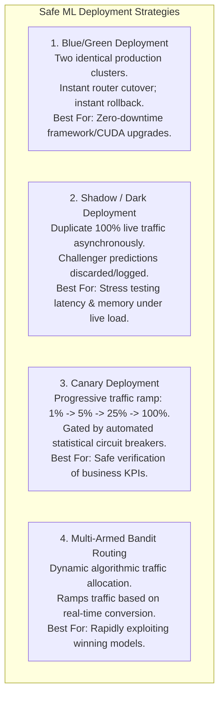
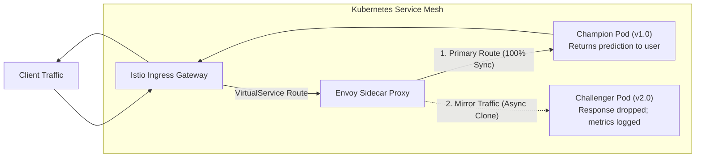
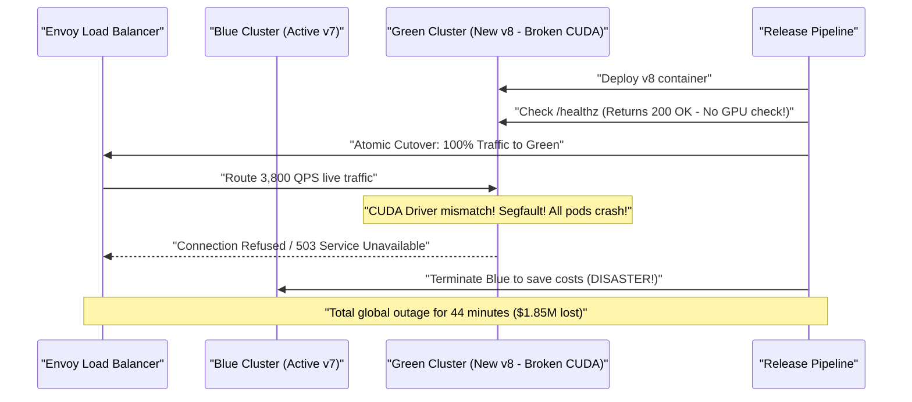

# Safe ML Rollouts: Canary, Shadow, and Blue-Green Deployments

This module is part of [Track 10: MLOps, Serving, Drift & Experimentation](../README.md).

---

## Executive Overview & Industry Context

In classical microservice engineering, deploying a new service revision is primarily a binary check: does the new container start up, respond to health checks (`/healthz`), and pass integration smoke tests without throwing HTTP 5xx errors? If so, the release is deemed successful.

In machine learning systems, **functional health does not imply behavioral correctness**. A newly retrained model service can be 100% healthy at the infrastructure level—passing Kubernetes health probes, returning HTTP 200 OK within 5ms, and consuming nominal RAM—while making completely disastrous predictions that destroy company revenue, violate credit lending regulations, or hallucinate dangerous advice.

```
       INFRASTRUCTURE HEALTH                             BEHAVIORAL ACCURACY
+------------------------------------+          +------------------------------------+
| HTTP Status: 200 OK                |          | Predicted Output: $0.00 / Fraud    |
| CPU Usage:   22%                   |   VS     | Prediction Shift: -85% Drift       |
| Latency P99: 8ms                   |          | Business Impact:  $4M Revenue Drop |
| "Infrastructure is Flawless!"      |          | "Model is Ruining the Business!"   |
+------------------------------------+          +------------------------------------+
```

Consequently, deploying machine learning models directly into 100% production traffic ("big-bang deployment") is an unacceptable operational anti-pattern. Enterprise MLOps architectures employ **Safe Rollout Patterns** designed to isolate risk, measure operational behavior on live uncurated production data, and automate instant circuit-breaker rollbacks before end users suffer degraded experiences.

---

## The Safe Deployment Taxonomy



### 1. Blue/Green Deployment
- **Architecture**: Two identical production environments exist concurrently: `Blue` (active live traffic) and `Green` (idle staging).
- **Execution**: The new model container is deployed to `Green`. Full end-to-end integration and smoke tests run against `Green`. Once certified, the ingress load balancer (Envoy, ALB) atomically shifts 100% of traffic from `Blue` to `Green`.
- **Rollback**: If a critical incident occurs, the load balancer shifts traffic back to `Blue` in $< 500\text{ milliseconds}$.
- **Limitation**: Requires $2\times$ over-provisioned infrastructure compute; exposes 100% of users to model behavioral flaws immediately upon cutover.

### 2. Shadow (Dark) Deployment
- **Architecture**: The ingress reverse proxy intercepts live production requests and routes them to the active Champion model. Simultaneously, it **asynchronously clones (mirrors)** the identical request payload to the Challenger model.
- **Execution**: The Champion's response is returned to the user immediately. The Challenger's response is captured and logged asynchronously to the lakehouse along with inference latency and memory telemetry.
- **Benefits**: Completely risk-free verification. The Challenger is subjected to real-world production load, traffic spikes, and uncurated input distributions without impacting a single real user.
- **Critical Caveat**: The Challenger model must **never execute stateful mutations** (e.g., executing a bank charge, mutating an external database, or dispatching an email notification).

### 3. Canary Deployment
- **Architecture**: User traffic is routed through a weighted traffic splitting proxy.
- **Execution**: The Challenger model receives a small initial allocation (e.g., 1% or 5%). Telemetry sentinels monitor real-time latency, HTTP error codes, prediction distributions, and user engagement metrics.
- **Progressive Promotion**: If error rates remain below threshold and latency stays within SLA over a 60-minute window, traffic is automatically incremented ($5\% \to 25\% \to 50\% \to 100\%$).
- **Automated Rollback**: If the error rate breaches 0.1% or PSI exceeds 0.2, the circuit breaker trips, instantly reverting traffic to 0%.

---

## Service Mesh Architecture: Istio & Envoy Traffic Mirroring

In cloud-native Kubernetes environments, safe rollout patterns are implemented transparently at the networking layer via service mesh proxies (Envoy sidecars managed by **Istio**), requiring zero modifications to application source code.



### Declarative Istio VirtualService Specification for Shadow Traffic

```yaml
apiVersion: networking.istio.io/v1alpha3
kind: VirtualService
metadata:
  name: fraud-detection-service
  namespace: ml-serving
spec:
  hosts:
  - "fraud.internal.enterprise.com"
  http:
  - route:
    - destination:
        host: fraud-service-champion
        subset: v1
      weight: 100
    # Shadow mirroring: Envoy asynchronously clones 100% of live traffic to challenger
    mirror:
      host: fraud-service-challenger
      subset: v2
    mirrorPercentage:
      value: 100.0
```

---

## Mathematical Formulations: Dynamic Bandit Routing & Sequential Rollback

### 1. Multi-Armed Bandit Traffic Routing via Thompson Sampling

Rather than using static canary percentages (e.g., fixed 10% for two weeks), a **Multi-Armed Bandit** dynamically routes traffic to models based on real-time reward feedback (e.g., click conversions, successful fraud preventions).

For $K$ candidate models, let the reward distribution of model $k$ be modeled as a Bernoulli trial with unknown success probability $\theta_k \in [0, 1]$. We maintain independent conjugate **Beta distributions** for each model:

$$\theta_k \sim \text{Beta}(\alpha_k, \beta_k)$$

Where:
- $\alpha_k = 1 + \text{Successes}_k$ (e.g., user converted).
- $\beta_k = 1 + \text{Failures}_k$ (e.g., user bounced).

#### Thompson Sampling Routing Algorithm:
1. For each incoming inference request, sample a success probability from each model's posterior:
   
$$\hat{\theta}_k \sim \text{Beta}(\alpha_k, \beta_k) \quad \forall k \in \{1, \dots, K\}$$

2. Route the request to the model with the highest sampled probability:
   
$$k^* = \arg\max_{k} \hat{\theta}_k$$

3. Observe the user's operational outcome $r \in \{0, 1\}$ and update the posterior parameters:
   
$$\alpha_{k^*} \leftarrow \alpha_{k^*} + r, \quad \beta_{k^*} \leftarrow \beta_{k^*} + (1 - r)$$

Thompson Sampling balances exploration (routing traffic to uncertain models with wide posteriors) and exploitation (concentrating traffic on empirically superior models), minimizing cumulative regret:

$$\mathbb{E}[R_T] = \sum_{k: \Delta_k > 0} \frac{\ln(T)}{\text{KL}(P_k \parallel P^*)} \Delta_k + \mathcal{O}(1)$$

### 2. Automated Canary Rollback via Sequential Probability Ratio Test (SPRT)

To detect whether a canary model has an unacceptably high error rate $\lambda$ without waiting for a fixed large sample size, we employ Wald's **Sequential Probability Ratio Test (SPRT)**.

Let $X_i \in \{0, 1\}$ denote whether request $i$ resulted in an operational failure (e.g., HTTP 500, timeout, or schema parsing exception).
- **Null Hypothesis ($H_0$)**: $\lambda \le \lambda_0$ (Error rate is acceptable, e.g., $\lambda_0 = 0.001$).
- **Alternative Hypothesis ($H_1$)**: $\lambda \ge \lambda_1$ (Error rate is catastrophic, e.g., $\lambda_1 = 0.010$).

The cumulative log-likelihood ratio after $n$ requests is:

$$\Lambda_n = \sum_{i=1}^n \left( X_i \ln \frac{\lambda_1}{\lambda_0} + (1 - X_i) \ln \frac{1 - \lambda_1}{1 - \lambda_0} \right)$$

We define the stopping boundaries based on false positive rate $\alpha$ and false negative rate $\beta$:

$$A = \ln \left( \frac{1 - \beta}{\alpha} \right), \quad B = \ln \left( \frac{\beta}{1 - \alpha} \right)$$

#### Decision Boundary Rules:
- If $\Lambda_n \ge A$: **Reject $H_0$ immediately!** The canary error rate is statistically significantly catastrophic. **Trigger instant automated rollback.**
- If $\Lambda_n \le B$: **Accept $H_0$.** The canary is certified healthy. Proceed with next traffic ramp step ($5\% \to 25\%$).
- If $B < \Lambda_n < A$: Continue sampling requests.

---

## Production Implementation: Shadow Router & Automated Canary Rollback Controller

Below is a complete, production-grade Python implementation of:
1. An **asynchronous shadow routing reverse proxy** that mirrors live requests to a dark challenger model without adding latency to the client response.
2. An **automated canary controller** executing Wald's SPRT sequential error boundary test and tracking P99 latency SLAs, instantly terminating traffic if thresholds are breached.

```python
"""
safe_deployment_controller.py
Author: Staff MLOps Architect
Description: Production implementation of an asynchronous shadow routing proxy
and automated canary progressive traffic controller with SPRT sequential rollback.
"""

import asyncio
import logging
import math
import random
import time
from dataclasses import dataclass
from typing import Any, Callable, Dict, List, Optional, Tuple

logging.basicConfig(level=logging.INFO, format="%(asctime)s [%(levelname)s] (%(name)s) %(message)s")
logger = logging.getLogger("DeploymentController")


@dataclass
class ServiceResponse:
    prediction: float
    latency_ms: float
    status_code: int


class MockModelService:
    """Simulates an independent model serving endpoint."""
    def __init__(self, name: str, base_latency_ms: float, error_rate: float):
        self.name = name
        self.base_latency_ms = base_latency_ms
        self.error_rate = error_rate

    async def predict(self, features: List[float]) -> ServiceResponse:
        start_t = time.perf_counter()
        # Simulate network and compute latency
        latency_seconds = (self.base_latency_ms + random.uniform(-1.0, 2.0)) / 1000.0
        await asyncio.sleep(latency_seconds)

        elapsed_ms = (time.perf_counter() - start_t) * 1000.0

        # Simulate sporadic errors
        if random.random() < self.error_rate:
            return ServiceResponse(prediction=-1.0, latency_ms=elapsed_ms, status_code=500)

        # Output mock score
        score = float(sum(features) / (len(features) + 1e-5))
        return ServiceResponse(prediction=score, latency_ms=elapsed_ms, status_code=200)


class ShadowRoutingProxy:
    """
    Asynchronously mirrors live requests to a shadow challenger model.
    Guarantees that the shadow execution never delays or blocks the primary response.
    """
    def __init__(self, champion_service: MockModelService, challenger_service: MockModelService):
        self.champion = champion_service
        self.challenger = challenger_service
        self.shadow_telemetry_log: List[Dict[str, Any]] = []

    async def route_request(self, request_id: str, features: List[float]) -> ServiceResponse:
        # 1. Fire asynchronous shadow mirror task without awaiting it
        asyncio.create_task(self._execute_shadow_mirror(request_id, features))

        # 2. Execute synchronous production request to champion
        response = await self.champion.predict(features)
        return response

    async def _execute_shadow_mirror(self, request_id: str, features: List[float]) -> None:
        """Asynchronous worker executing dark evaluation."""
        try:
            shadow_resp = await self.challenger.predict(features)
            log_entry = {
                "request_id": request_id,
                "status_code": shadow_resp.status_code,
                "latency_ms": shadow_resp.latency_ms,
                "prediction": shadow_resp.prediction,
                "timestamp": time.time()
            }
            self.shadow_telemetry_log.append(log_entry)
        except Exception as ex:
            logger.error("Shadow mirror execution exception for req '%s': %s", request_id, ex)


class AutomatedCanaryController:
    """
    Manages progressive canary traffic allocation (1% -> 5% -> 25% -> 100%)
    with automated Wald's Sequential Probability Ratio Test (SPRT) rollback.
    """
    def __init__(
        self,
        champion: MockModelService,
        challenger: MockModelService,
        p99_latency_sla_ms: float = 25.0,
        acceptable_error_rate: float = 0.005,
        unacceptable_error_rate: float = 0.030,
        alpha: float = 0.01,
        beta: float = 0.05
    ):
        self.champion = champion
        self.challenger = challenger
        self.p99_latency_sla_ms = p99_latency_sla_ms
        self.lambda_0 = acceptable_error_rate
        self.lambda_1 = unacceptable_error_rate

        # Compute SPRT decision boundaries
        self.upper_bound_A = math.log((1.0 - beta) / alpha)
        self.lower_bound_B = math.log(beta / (1.0 - alpha))

        self.current_traffic_weight = 0.05  # Start at 5% canary
        self.cumulative_log_likelihood = 0.0
        self.canary_latencies: List[float] = []
        self.is_rolled_back = False

    def update_sprt(self, failed: bool) -> str:
        """Appends a new observation to the sequential likelihood ratio."""
        x = 1.0 if failed else 0.0
        term1 = x * math.log(self.lambda_1 / self.lambda_0)
        term2 = (1.0 - x) * math.log((1.0 - self.lambda_1) / (1.0 - self.lambda_0))
        self.cumulative_log_likelihood += (term1 + term2)

        if self.cumulative_log_likelihood >= self.upper_bound_A:
            return "ROLLBACK"
        elif self.cumulative_log_likelihood <= self.lower_bound_B:
            return "CERTIFIED_HEALTHY"
        else:
            return "CONTINUE_SAMPLING"

    async def handle_request(self, features: List[float]) -> ServiceResponse:
        if self.is_rolled_back:
            # Route 100% to Champion if canary was rolled back
            return await self.champion.predict(features)

        # Weighted traffic split
        if random.random() < self.current_traffic_weight:
            # Route to Challenger Canary
            resp = await self.challenger.predict(features)
            self.canary_latencies.append(resp.latency_ms)

            # Check SPRT Error Status
            is_error = (resp.status_code != 200)
            decision = self.update_sprt(is_error)

            if decision == "ROLLBACK":
                logger.critical("SPRT BREACH DETECTED! Error rate exceeds tolerable bound. INITIATING AUTO-ROLLBACK!")
                self.current_traffic_weight = 0.0
                self.is_rolled_back = True
            elif decision == "CERTIFIED_HEALTHY" and self.current_traffic_weight < 0.50:
                logger.info("Canary passed statistical safety gate! Ramping traffic: %.2f -> %.2f",
                            self.current_traffic_weight, self.current_traffic_weight * 2)
                self.current_traffic_weight *= 2.0
                # Reset likelihood ratio for the next stage
                self.cumulative_log_likelihood = 0.0

            return resp
        else:
            # Route to Production Champion
            return await self.champion.predict(features)


# ============================================================================
# Verification and Demonstration Suite
# ============================================================================
async def run_safe_rollout_demo():
    print("=" * 80)
    print("SAFE ML ROLLOUT: SHADOW ROUTING & AUTOMATED CANARY CONTROLLER DEMO")
    print("=" * 80)

    # 1. Test Shadow Deployment
    print("\n1. Testing Asynchronous Shadow Routing (Zero User Impact)...")
    champ_model = MockModelService("Champion-v1", base_latency_ms=10.0, error_rate=0.0)
    # Challenger has an underlying memory leak / bug producing high errors
    bad_challenger = MockModelService("Challenger-v2-Buggy", base_latency_ms=12.0, error_rate=0.08)

    shadow_proxy = ShadowRoutingProxy(champion_service=champ_model, challenger_service=bad_challenger)

    for i in range(15):
        resp = await shadow_proxy.route_request(f"req_{i}", [1.0, 2.0, 3.0])
        # User receives Champion response flawlessly
        assert resp.status_code == 200

    # Allow background shadow mirror tasks to complete
    await asyncio.sleep(0.1)
    print(f"Shadow Mirror Telemetry Logged: {len(shadow_proxy.shadow_telemetry_log)} requests.")
    shadow_errors = sum(1 for e in shadow_proxy.shadow_telemetry_log if e["status_code"] != 200)
    print(f"Shadow Error Count: {shadow_errors} (Users experienced 0 errors!)")

    # 2. Test Automated Canary Controller with SPRT Rollback
    print("\n2. Testing Canary Rollout with Automated SPRT Rollback...")
    canary_controller = AutomatedCanaryController(
        champion=champ_model,
        challenger=bad_challenger,
        p99_latency_sla_ms=25.0,
        acceptable_error_rate=0.005,
        unacceptable_error_rate=0.040
    )

    print("Streaming production requests across canary traffic splitter...")
    for step in range(1, 101):
        resp = await canary_controller.handle_request([0.5, 0.8, 1.2])
        if canary_controller.is_rolled_back:
            print(f"Step {step}: Canary was safely neutralized! Active Traffic: 0% to Challenger.")
            break

    print("\n" + "=" * 80)


if __name__ == "__main__":
    asyncio.run(run_safe_rollout_demo())
```

---

## Failure Modes, Edge Cases & Antipatterns

| Antipattern / Failure Mode | Root Cause Mechanism | Catastrophic System Impact | Architectural Remediation |
| :--- | :--- | :--- | :--- |
| **Side-Effect Leakage in Shadow Routing** | Mirroring traffic to a dark model that executes non-idempotent operations (e.g., database writes, charging credit cards). | Duplicate financial charges and corrupted database state affecting 100% of shadowed users. | The inference service must be purely functional. Enforce read-only IAM credentials on shadow pods and mock out stateful downstream interfaces. |
| **Shadow Traffic Saturation** | Duplicating 100% of live traffic to a challenger model sharing the same downstream feature store (Redis) or database cluster. | The sudden doubling of query load saturates Redis connection pools, crashing the production Champion cluster. | Provision isolated feature store caches for shadow environments or downsample shadow mirroring to 10-20% of traffic. |
| **Canary Under-Powering** | Setting canary traffic to 0.1% on a low-traffic service ($< 10\text{ QPS}$) and concluding it is safe after 30 minutes. | The sample size ($N \approx 180$) is mathematically incapable of detecting a 2% error rate; severe bugs escape into production. | Require statistical power calculations before promotion. Do not promote until the minimum required sample size $N_{min}$ has been observed. |
| **Sticky Session Imbalance** | Hashing on user ID for canary routing when a single high-frequency corporate bot accounts for 40% of all requests. | The canary is either overwhelmed or receives entirely non-representative traffic, skewing all evaluation metrics. | Combine user ID hashing with request entropy, or filter out known automated high-volume bot IDs from canary evaluation cohorts. |
| **Missing Metric Rollback Gates** | Gating canary releases purely on HTTP 500 error rates, ignoring model prediction distribution shift (PSI). | Model outputs constant predictions ($0.0$ for all users) with 100% HTTP 200 OK status; revenue collapses while canary ramps to 100%. | Bind canary rollback triggers to statistical metric sentinels: trip circuit breaker if $\text{PSI} > 0.15$ or P99 latency $> \text{SLA}$. |

---

## Production Incident Post-Mortem

### Complete Black Friday Outage: Blue/Green Cutover Missing CUDA Kernel Dependency

#### 1. Executive Incident Summary
On November 29, 2024, a major international travel and flight booking platform suffered a **100% complete service outage lasting 44 minutes** during the peak morning traffic surge of Black Friday. An infrastructure engineering team executed a Blue/Green router cutover to promote an updated neural flight search ranker (`FlightRanker-v8`). The new container image was compiled against CUDA 12.4 with custom FlashAttention kernels that were incompatible with the host node GPU drivers (running NVIDIA Driver 525 / CUDA 12.0). Upon cutover, every pod in the Green environment triggered an instant C++ segmentation fault. Total direct booking margin loss was **\$1,850,000**.

#### 2. Detailed Incident Timeline

| Time (UTC) | Incident Operational Event |
| :--- | :--- |
| **07:30:00** | Engineering team deploys `FlightRanker-v8` onto the idle Green Kubernetes cluster. |
| **07:45:00** | A junior engineer performs manual smoke tests by curling the `/healthz` endpoint. The HTTP probe returns `200 OK` because the `/healthz` handler merely checked web server availability without executing a GPU forward pass. |
| **08:00:00** | The automated CD pipeline initiates a Blue/Green cutover, switching the Envoy edge load balancer to point 100% of live incoming user traffic to the Green cluster. |
| **08:00:05** | Live production traffic (3,800 QPS) hits the Green cluster. The Python service initializes the model graph and attempts to load the custom attention CUDA kernel. |
| **08:00:08** | Driver mismatch: The host NVIDIA driver fails to load the CUDA 12.4 kernel, triggering an unhandled C++ segmentation fault: `CUDA driver version is insufficient for CUDA runtime version`. |
| **08:00:15** | All 120 Green pod containers crash simultaneously into `CrashLoopBackOff`. Envoy returns HTTP 503 Service Unavailable to 100% of users worldwide. |
| **08:15:00** | Incident bridge convened. An engineer attempts to switch Envoy back to Blue, but discovers that the automated CD script had aggressively terminated the Blue environment 10 minutes after cutover to save cloud costs. |
| **08:32:00** | Cold restart of the Blue environment initiated. Kubernetes spends 12 minutes pulling heavy 18GB container images from the remote registry. |
| **08:44:00** | Blue cluster pods achieve ready status. Traffic restored. Net outage duration: 44 minutes. Net financial impact: **\$1,850,000**. |



#### 3. Root Cause Analysis
1. **Shallow Health Probes**: The Kubernetes readiness probe (`/healthz`) verified only Python HTTP server listening status. It failed to execute a synthetic forward pass through the compiled model weights and GPU kernels.
2. **Premature Blue Decommissioning**: The deployment automation terminated the known-good Blue cluster before validating Green's stability under sustained live traffic.
3. **Big-Bang Cutover**: The team executed a 100% Blue/Green cutover instead of a progressive Canary rollout (1% $\to$ 5%), which would have isolated the segmentation fault to a tiny fraction of users without taking down the platform.

#### 4. Remediation & Architectural Hardening
- **Deep Synthetic Readiness Probes**: Replaced shallow health checks with a mandatory deep probe (`/readyz`). The probe passes a synthetic tensor through the GPU execution engine, asserting that CUDA kernels execute without error before the pod enters the service mesh pool.
- **Mandatory 24-Hour Blue Retention**: Updated deployment governance so that the previous Blue environment remains alive and provisioned at 100% capacity for a minimum of 24 hours post-cutover, guaranteeing sub-second emergency rollback.
- **Canary-Gated Cutover Policy**: Abolished instant 100% cutovers. All releases must execute an automated 3-stage Canary rollout (1% for 15 minutes, 10% for 30 minutes, followed by full promotion).

---

## Senior Technical Interview Questions & Model Answers

### Question 1: How do you design an automated Canary Release system that detects model behavioral degradation when ground-truth labels take 30 days to arrive?
**Model Answer:**
When ground-truth labels exhibit significant observation delay (e.g., credit card default or loan charge-offs), a canary release cannot be gated on traditional predictive accuracy metrics (AUC, F1 score, MSE).

**Architectural Solution — The Proxy Metric Hierarchy:**
1. **Infrastructure Health Metrics (Level 0 Gate)**:
   - Real-time HTTP 5xx error rate ($< 0.01\%$).
   - Latency SLA: P99 latency $< 25\text{ms}$.
   - Hardware health: Pod memory leaks (VRAM / RSS slope over time).
2. **Statistical Distribution Invariance (Level 1 Gate)**:
   - **Prediction Drift**: Compute the Population Stability Index (PSI) between the Champion's output distribution and the Canary's output distribution:
     
$$\text{PSI}(Y_{\text{canary}}, Y_{\text{champ}}) < 0.10$$

   - If the canary model suddenly predicts a high-risk score for 60% of applicants when the champion predicts 10%, the circuit breaker trips immediately.
   - **Feature Reconstruction Error**: Run an autoencoder or compute Mahalanobis distance on input feature embeddings to verify that the canary is not receiving out-of-distribution inputs.
3. **Short-Term Behavioral & Business Proxy Metrics (Level 2 Gate)**:
   - While the true label (default) takes 30 days, early user behavioral feedback occurs immediately:
     - Application completion rate.
     - Upstream credit card approval click-through rate.
     - Drop-off rate at the identity verification step.
   - If the canary cohort exhibits an immediate $5\%$ drop in conversion compared to the control group, automated rollback triggers instantly.

---

### Question 2: In Shadow Deployments, what is "State Leakage" and how do you mathematically and architecturally isolate candidate models from production side-effects?
**Model Answer:**
**State Leakage** occurs when a shadowed (dark) service revision inadvertently executes side-effects that mutate external shared system state, creating duplicate real-world actions or corrupting databases.

**Examples of State Leakage:**
- An automated loan approval model sending an approval email to a borrower.
- A recommendation model writing user interaction counts to a shared Redis counter.
- A fraud model updating a user's failed-attempt counter in PostgreSQL, causing legitimate users to be locked out.

**Architectural Isolation Mechanisms:**
1. **Network-Level Egress Policies (Kubernetes `NetworkPolicy`)**:
   Configure the shadow pod's network policy to block all egress traffic to external third-party APIs (SendGrid, Twilio, Stripe) and production transactional databases. The pod is strictly allowed ingress from the service mesh and egress only to an isolated telemetry collector.
2. **Decoupled Scoring Pipelines**:
   Separate the pure scoring function from the action execution engine:
   - The serving service is purely functional: $f: \mathbf{x} \to \hat{y}$.
   - The caller (API Gateway) owns the execution of business logic: `if y_pred > 0.8: trigger_action()`.
   Because the service mesh proxy discards the shadow response, the caller never executes actions based on shadow predictions.
3. **Database Read-Only IAM Scopes & Shadow Namespaces**:
   If the model requires feature store lookups, grant the shadow pod read-only IAM credentials to an isolated read replica or feature store cache, ensuring it cannot write or overwrite production state.

---

### Question 3: How does Thompson Sampling for model routing compare to standard $\epsilon$-Greedy routing and A/B testing? When is it optimal?
**Model Answer:**
These three strategies represent different trade-offs along the exploration-exploitation spectrum:

- **Traditional A/B Testing**:
  - *Mechanism*: Static 50/50 traffic split for a fixed duration $T$ until statistical significance ($p < 0.05$) is achieved.
  - *Drawback*: High **cumulative regret**. If Model B is substantially worse than Model A, 50% of users are subjected to a degraded experience for the entire duration of the test.
- **$\epsilon$-Greedy Routing**:
  - *Mechanism*: With probability $1 - \epsilon$, route to the empirically best model so far (exploit); with probability $\epsilon$, route uniformly at random among all models (explore).
  - *Drawback*: Inefficient exploration. It allocates equal exploration budget to all losing models regardless of how poorly they perform.
- **Thompson Sampling (Bayesian Multi-Armed Bandit)**:
  - *Mechanism*: Samples model weights from posterior reward distributions ($\theta_k \sim \text{Beta}(\alpha_k, \beta_k)$). Traffic dynamically shifts toward the superior model at a rate proportional to the statistical certainty of its superiority.
  - *Advantage*: Asymptotically optimal regret bound ($\mathcal{O}(\ln T)$). It minimizes the business cost of testing poor candidate models.

**When Thompson Sampling is Optimal:**
- Short-horizon commercial campaigns (e.g., Black Friday flash promotions) where the business cannot afford a two-week static A/B test.
- Content recommendation and ad-click prediction where feedback loops are rapid (seconds to minutes) and the hypothesis space is large ($K \ge 5$ candidate models).

---

### Question 4: How do you configure Envoy proxy to execute Header-Based Routing for internal Canary and Dogfooding rollouts?
**Model Answer:**
Header-based routing allows internal employees, beta testers, or integration test runners to target candidate models without exposing external production traffic.

**Envoy / Istio Architecture:**
The ingress proxy inspects HTTP request headers (e.g., `X-Model-Variant: challenger-v2` or `Cookie: beta_tester=true`). If the header matches, the proxy bypasses standard traffic weights and routes the request directly to the Canary cluster.

```yaml
apiVersion: networking.istio.io/v1alpha3
kind: VirtualService
metadata:
  name: ml-serving-routing
spec:
  hosts:
  - "ml-serving.internal"
  http:
  # Rule 1: Route Internal Dogfooding / QA traffic based on HTTP header
  - match:
    - headers:
        x-model-variant:
          exact: "challenger-v2"
    route:
    - destination:
        host: ml-serving-service
        subset: v2
  # Rule 2: Standard Production Weighted Canary Split
  - route:
    - destination:
        host: ml-serving-service
        subset: v1
      weight: 95
    - destination:
        host: ml-serving-service
        subset: v2
      weight: 5
```

This guarantees that QA automation suites can execute deep end-to-end integration tests on the exact live production infrastructure without altering public canary percentages.

---

### Question 5: What is the "Sticky Session Problem" in ML Canary Deployments, and how do you resolve it mathematically?
**Model Answer:**
In user-facing machine learning systems (e.g., personalized feed ranking, dynamic pricing, conversational chatbots), routing requests randomly across Champion and Canary models causes severe user experience degradation:
- A user refreshes their mobile app and sees UI/pricing variant A; 2 seconds later, a second API call routes to variant B.
- This creates **cross-variant leakage**, breaks session continuity, and invalidates user-level conversion analysis.

**Resolution — Deterministic Cryptographic Consistent Hashing:**
We must guarantee **User Stickiness**: all requests originating from a specific `user_id` must consistently map to the identical model variant for the entire duration of the canary experiment, while ensuring uniform random distribution across the population.

**Mathematical Formulation:**
Let $U$ be the user identifier string and $E$ be the unique experiment identifier string. Compute a cryptographic hash (e.g., MD5 or MurmurHash3):

$$h = \text{Murmur3}(U \parallel E) \pmod{10000}$$

Map the resulting integer $h \in [0, 9999]$ against the cumulative canary threshold weight $W_{canary} \in [0, 10000]$:

$$\text{Target} = \begin{cases} \text{Challenger} & \text{if } h < W_{canary} \\ \text{Champion} & \text{otherwise} \end{cases}$$

**Properties:**
1. **Deterministic**: The same user always evaluates to the identical model variant.
2. **Statistically Uniform**: The hash uniformly distributes users across the $[0, 10000]$ interval.
3. **Monotonic Expansion**: When ramping traffic from 5% ($W=500$) to 10% ($W=1000$), all users originally assigned to the Canary remain assigned to the Canary; only previously unexposed users are added to the cohort.
