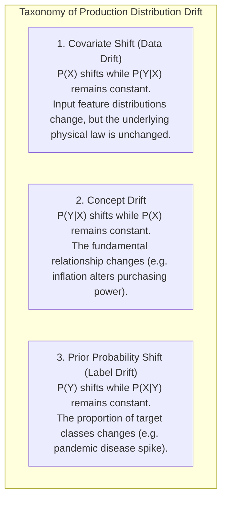
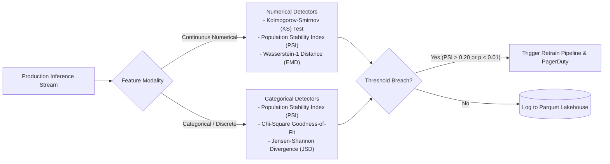
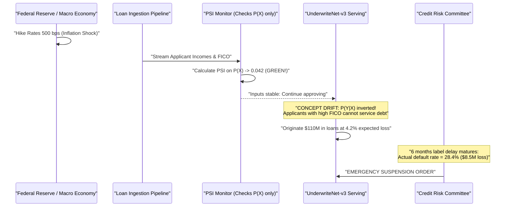

# Monitoring Data Drift, Concept Drift, PSI, and Label Delay

This module is part of [Track 10: MLOps, Serving, Drift & Experimentation](../README.md).

---

## Executive Overview & Industry Context

Machine learning models are trained under a fundamental statistical assumption known as the **i.i.d. assumption**: that training data and future inference data are **independent and identically distributed** drawn from a stationary joint probability distribution:

$$(X_{\text{train}}, Y_{\text{train}}) \sim P(X, Y) \quad \text{and} \quad (X_{\text{prod}}, Y_{\text{prod}}) \sim P(X, Y)$$

In real-world production environments, **this assumption is guaranteed to be violated over time**. The real world is non-stationary. Consumer behaviors evolve, macroeconomic environments shift, competitor strategies alter user choices, and upstream software systems modify feature extraction logic.

```
       STATIONARY ASSUMPTION (LAB)                        PRODUCTION REALITY (DRIFT)
+------------------------------------+          +------------------------------------+
| P_train(X, Y) == P_prod(X, Y)      |          | P_prod(X, Y) != P_train(X, Y)      |
| Model performance remains constant |   --->   | - Covariate Shift: P(X) changes    |
| Zero degradation over time         |          | - Concept Drift: P(Y|X) changes    |
| Static offline validation holds    |          | - Silent accuracy collapse         |
+------------------------------------+          +------------------------------------+
```

When distribution shifts occur, a model's predictive power decays silently. Unlike standard software bugs that trigger stack traces and HTTP 500 errors, an ML model experiencing severe drift will continue returning valid predictions (`HTTP 200 OK`) with sub-millisecond latencies, while outputting completely invalid decisions that generate millions of dollars in financial loss.

Continuous drift monitoring is the operational sentinel that detects distribution changes, quantifies statistical divergence, and triggers automated retraining pipelines before degradation harms enterprise operations.

---

## Taxonomy of Distribution Drift

By the chain rule of probability, the joint distribution of features $X$ and labels $Y$ can be factorized in two equivalent ways:

$$P(X, Y) = P(X) \cdot P(Y \mid X) = P(Y) \cdot P(X \mid Y)$$

Distribution shifts are formally classified based on which component of this decomposition is mutating:



### 1. Covariate Shift (Data Drift)
- **Mathematical Definition**: $P_{\text{prod}}(X) \neq P_{\text{train}}(X)$, while $P(Y \mid X)$ remains invariant.
- **Mechanism**: The distribution of incoming features changes, but the true functional relationship between inputs and targets is unchanged.
- **Example**: A ride-hailing pricing model was trained on urban commuters aged 25-45. A marketing campaign suddenly brings an influx of suburban users aged 65+. The inputs $X$ have shifted dramatically, although given a user's location and trip distance, the actual cost of transportation $P(Y \mid X)$ remains consistent.
- **Detection**: Unsupervised. Can be detected immediately on inference telemetry without needing ground-truth labels.

### 2. Concept Drift
- **Mathematical Definition**: $P_{\text{prod}}(Y \mid X) \neq P_{\text{train}}(Y \mid X)$, while $P(X)$ may remain constant.
- **Mechanism**: The physical world's underlying causal mechanics change. The exact same feature vector $x$ now maps to a completely different label probability distribution.
- **Example**: In a credit lending model, an applicant has an income of \$80,000 and a credit score of 720. Historically, this applicant had a 99% probability of loan repayment. During a sudden hyperinflationary interest rate hike, an applicant with those exact same financial features now has an 80% default rate.
- **Detection**: Requires ground-truth labels $Y$. Often masked by severe **Label Arrival Delay**.

### 3. Prior Probability Shift (Label Shift)
- **Mathematical Definition**: $P_{\text{prod}}(Y) \neq P_{\text{train}}(Y)$, while $P(X \mid Y)$ remains invariant.
- **Mechanism**: The marginal distribution of outcomes shifts.
- **Example**: During the COVID-19 pandemic, the baseline probability of an individual having respiratory virus symptoms $P(Y=1)$ increased by $500\times$, while the conditional symptom manifestation given infection $P(X \mid Y=1)$ remained biological constant.

---

## Statistical Drift Detectors: PSI, KS-Test, and Wasserstein Distance

To detect distribution shifts systematically, MLOps systems employ distinct statistical distance metrics tailored to continuous, categorical, and multi-dimensional feature spaces.



### 1. Population Stability Index (PSI)
Originating in credit risk modeling, PSI measures the divergence between a reference distribution $P$ (baseline/training split) and a target distribution $Q$ (production inference window) across $B$ discrete bins:

$$\text{PSI} = \sum_{i=1}^B \left( Q_i - P_i \right) \cdot \ln\left( \frac{Q_i}{P_i} \right)$$

Where:
- $P_i$ is the empirical fraction of observations falling in bin $i$ in the reference baseline.
- $Q_i$ is the empirical fraction of observations falling in bin $i$ in the production window.
- Each individual term $(Q_i - P_i) \ln(Q_i / P_i)$ is non-negative because $(Q_i - P_i)$ and $\ln(Q_i / P_i)$ always share the same sign.

#### Industry Standard Operational Thresholds:
- **$\text{PSI} < 0.10$**: **Negligible Drift / Stable**. No operational action required.
- **$0.10 \le \text{PSI} \le 0.20$**: **Moderate Drift / Warning**. Alert on-call data scientist; monitor prediction distribution.
- **$\text{PSI} > 0.20$**: **Severe Drift / Action Required**. Trigger automated continuous retraining or fallback heuristic.

### 2. Two-Sample Kolmogorov-Smirnov (KS) Test
The two-sample KS-test is a non-parametric statistical hypothesis test that compares the continuous empirical cumulative distribution functions (eCDFs) of two one-dimensional samples.

Let $F_P(x)$ and $F_Q(x)$ be the empirical CDFs of the reference sample (size $m$) and production sample (size $n$):

$$F_P(x) = \frac{1}{m} \sum_{i=1}^m \mathbb{I}(X_i \le x), \quad F_Q(x) = \frac{1}{n} \sum_{j=1}^n \mathbb{I}(X_j' \le x)$$

The KS statistic $D_{m,n}$ represents the supremum of absolute distances between the two CDFs:

$$D_{m,n} = \sup_{x} \left| F_P(x) - F_Q(x) \right|$$

```
CDF F(x)
 1.0 |                    .---*--- F_P(x) Reference
     |                   /   /
     |                  /   |  <--- Max Distance D_m,n
     |                 /    /
 0.5 |                /    *------ F_Q(x) Production
     |               /    /
     |              /    /
 0.0 +-------------*----+---------------------> x (Feature Value)
```

The null hypothesis $H_0$ states that both samples are drawn from the identical continuous distribution. We reject $H_0$ at significance level $\alpha$ if:

$$D_{m,n} > c(\alpha) \sqrt{\frac{m + n}{m \cdot n}}$$

For $\alpha = 0.01$, $c(\alpha) = 1.63$. If $p\text{-value} < 0.01$, significant data drift is declared.

### 3. Wasserstein Distance (Earth Mover's Distance)
Unlike PSI and KS which can be sensitive to arbitrary bin boundaries or sample sizes, the **1-Wasserstein Distance** ($\mathcal{W}_1$) measures the minimum operational work required to transform distribution $P$ into distribution $Q$.

For one-dimensional continuous distributions, $\mathcal{W}_1$ equals the $L_1$ area between the two cumulative distribution functions:

$$\mathcal{W}_1(P, Q) = \int_{-\infty}^{\infty} \left| F_P(x) - F_Q(x) \right| \, dx$$

$\mathcal{W}_1$ carries the exact same physical units as the underlying feature (e.g., dollars, meters, milliseconds), making it highly interpretable to engineering and business stakeholders.

---

## Production Implementation: High-Performance Vectorized Drift Detection Engine

Below is a complete, production-grade statistical drift detection engine written in pure NumPy and SciPy. It implements:
1. **Quantile-based equal-frequency binning** with $\epsilon$-smoothing for PSI to prevent zero-division errors.
2. Two-sample **Kolmogorov-Smirnov test** computation.
3. **Wasserstein-1 Distance** integration.
4. Categorical **Jensen-Shannon Divergence (JSD)**.
5. Rolling-window stream evaluation with automated alert dispatching.

```python
"""
production_drift_sentinel.py
Author: Staff MLOps Architect
Description: High-performance vectorized statistical drift detection engine
implementing PSI, KS-test, Wasserstein distance, and JSD for production telemetry.
"""

import json
import logging
import math
from dataclasses import asdict, dataclass
from enum import Enum
from typing import Any, Dict, List, Optional, Tuple, Union

import numpy as np
from scipy import stats

logging.basicConfig(level=logging.INFO, format="%(asctime)s [%(levelname)s] (%(name)s) %(message)s")
logger = logging.getLogger("DriftSentinel")


class DriftSeverity(Enum):
    NONE = "NONE"
    MODERATE = "MODERATE"
    SEVERE = "SEVERE"


@dataclass
class DriftMetricResult:
    feature_name: str
    metric_name: str
    statistic_value: float
    p_value: Optional[float]
    threshold: float
    severity: DriftSeverity
    drift_detected: bool


class ProductionDriftSentinel:
    """
    Evaluates distribution drift across numerical and categorical feature streams
    using mathematically rigorous non-parametric statistical metrics.
    """
    def __init__(self, epsilon: float = 1e-4):
        self.epsilon = epsilon

    def compute_numerical_psi(
        self,
        reference_data: np.ndarray,
        production_data: np.ndarray,
        num_bins: int = 10,
        feature_name: str = "numerical_feature"
    ) -> DriftMetricResult:
        """
        Computes Population Stability Index (PSI) using quantile-based equal-frequency binning
        derived from the reference baseline distribution.
        """
        ref = np.asarray(reference_data, dtype=np.float64)
        prod = np.asarray(production_data, dtype=np.float64)

        # Drop NaNs
        ref = ref[~np.isnan(ref)]
        prod = prod[~np.isnan(prod)]

        if len(ref) < 30 or len(prod) < 30:
            raise ValueError("Insufficient sample size for reliable PSI calculation (min 30 required).")

        # Compute quantile bin edges based on reference distribution
        percentiles = np.linspace(0, 100, num_bins + 1)
        bin_edges = np.percentile(ref, percentiles)
        # Ensure bin edges are strictly monotonic
        bin_edges = np.unique(bin_edges)
        if len(bin_edges) < 2:
            # All reference values identical
            return DriftMetricResult(feature_name, "PSI", 0.0, None, 0.20, DriftSeverity.NONE, False)

        # Expand outer edges to cover infinities
        bin_edges[0] = -np.inf
        bin_edges[-1] = np.inf

        # Calculate counts in each bin
        ref_counts, _ = np.histogram(ref, bins=bin_edges)
        prod_counts, _ = np.histogram(prod, bins=bin_edges)

        # Convert to empirical probability fractions
        P = ref_counts / len(ref)
        Q = prod_counts / len(prod)

        # Apply epsilon smoothing to eliminate zero-bin log singularities
        P = np.where(P == 0, self.epsilon, P)
        Q = np.where(Q == 0, self.epsilon, Q)

        # Renormalize to sum to 1.0
        P /= np.sum(P)
        Q /= np.sum(Q)

        # Compute PSI: sum((Q_i - P_i) * ln(Q_i / P_i))
        psi_value = float(np.sum((Q - P) * np.log(Q / P)))

        # Evaluate severity
        if psi_value >= 0.20:
            severity = DriftSeverity.SEVERE
            detected = True
        elif psi_value >= 0.10:
            severity = DriftSeverity.MODERATE
            detected = True
        else:
            severity = DriftSeverity.NONE
            detected = False

        return DriftMetricResult(
            feature_name=feature_name,
            metric_name="PSI",
            statistic_value=round(psi_value, 5),
            p_value=None,
            threshold=0.20,
            severity=severity,
            drift_detected=detected
        )

    def compute_kolmogorov_smirnov(
        self,
        reference_data: np.ndarray,
        production_data: np.ndarray,
        alpha: float = 0.01,
        feature_name: str = "numerical_feature"
    ) -> DriftMetricResult:
        """
        Computes two-sample Kolmogorov-Smirnov test comparing empirical CDFs.
        """
        ref = np.asarray(reference_data, dtype=np.float64)
        prod = np.asarray(production_data, dtype=np.float64)

        ref = ref[~np.isnan(ref)]
        prod = prod[~np.isnan(prod)]

        ks_stat, p_val = stats.ks_2samp(ref, prod)

        detected = bool(p_val < alpha)
        severity = DriftSeverity.SEVERE if detected else DriftSeverity.NONE

        return DriftMetricResult(
            feature_name=feature_name,
            metric_name="Kolmogorov-Smirnov",
            statistic_value=round(float(ks_stat), 5),
            p_value=round(float(p_val), 6),
            threshold=alpha,
            severity=severity,
            drift_detected=detected
        )

    def compute_wasserstein_distance(
        self,
        reference_data: np.ndarray,
        production_data: np.ndarray,
        threshold: float,
        feature_name: str = "numerical_feature"
    ) -> DriftMetricResult:
        """
        Computes 1-Wasserstein Distance (Earth Mover's Distance).
        """
        ref = np.asarray(reference_data, dtype=np.float64)
        prod = np.asarray(production_data, dtype=np.float64)

        ref = ref[~np.isnan(ref)]
        prod = prod[~np.isnan(prod)]

        w_dist = stats.wasserstein_distance(ref, prod)
        detected = bool(w_dist > threshold)
        severity = DriftSeverity.SEVERE if detected else DriftSeverity.NONE

        return DriftMetricResult(
            feature_name=feature_name,
            metric_name="Wasserstein-1",
            statistic_value=round(float(w_dist), 4),
            p_value=None,
            threshold=threshold,
            severity=severity,
            drift_detected=detected
        )

    def compute_categorical_jsd(
        self,
        reference_categories: List[str],
        production_categories: List[str],
        threshold: float = 0.15,
        feature_name: str = "categorical_feature"
    ) -> DriftMetricResult:
        """
        Computes Jensen-Shannon Divergence (JSD) for discrete categorical feature distributions.
        """
        all_cats = sorted(list(set(reference_categories) | set(production_categories)))
        ref_n = len(reference_categories)
        prod_n = len(production_categories)

        if ref_n == 0 or prod_n == 0:
            raise ValueError("Category lists cannot be empty.")

        ref_counts = {c: 0 for c in all_cats}
        prod_counts = {c: 0 for c in all_cats}

        for c in reference_categories:
            ref_counts[c] += 1
        for c in production_categories:
            prod_counts[c] += 1

        P = np.array([ref_counts[c] / ref_n for c in all_cats], dtype=np.float64)
        Q = np.array([prod_counts[c] / prod_n for c in all_cats], dtype=np.float64)

        # Midpoint distribution M = 0.5 * (P + Q)
        M = 0.5 * (P + Q)

        # JSD = 0.5 * KL(P || M) + 0.5 * KL(Q || M)
        # Use scipy.spatial.distance.jensenshannon (returns sqrt(JSD), we square it)
        from scipy.spatial.distance import jensenshannon
        js_distance = float(jensenshannon(P, Q, base=2))
        js_divergence = js_distance ** 2

        detected = bool(js_divergence > threshold)
        severity = DriftSeverity.SEVERE if detected else DriftSeverity.NONE

        return DriftMetricResult(
            feature_name=feature_name,
            metric_name="Jensen-Shannon Divergence",
            statistic_value=round(js_divergence, 5),
            p_value=None,
            threshold=threshold,
            severity=severity,
            drift_detected=detected
        )


# ============================================================================
# Verification and Demonstration Suite
# ============================================================================
if __name__ == "__main__":
    print("=" * 80)
    print("PRODUCTION MLOPS STATISTICAL DRIFT SENTINEL DEMO")
    print("=" * 80)

    sentinel = ProductionDriftSentinel()
    np.random.seed(42)

    # 1. Simulate Baseline Reference Data (e.g. Training Split: N(50, 10))
    ref_distribution = np.random.normal(loc=50.0, scale=10.0, size=5000)

    # 2. Case A: Non-Drifted Production Window (Identical Distribution)
    prod_stable = np.random.normal(loc=50.1, scale=9.9, size=2000)

    print("\n--- 1. Testing Stable Feature Stream (Expected: No Drift) ---")
    psi_stable = sentinel.compute_numerical_psi(ref_distribution, prod_stable, feature_name="user_credit_score")
    ks_stable = sentinel.compute_kolmogorov_smirnov(ref_distribution, prod_stable, feature_name="user_credit_score")
    w_stable = sentinel.compute_wasserstein_distance(ref_distribution, prod_stable, threshold=5.0, feature_name="user_credit_score")

    print(f"PSI:         {psi_stable.statistic_value:<8} | Drift: {psi_stable.drift_detected} (Severity: {psi_stable.severity.value})")
    print(f"KS-Test:     {ks_stable.statistic_value:<8} | p-val: {ks_stable.p_value} | Drift: {ks_stable.drift_detected}")
    print(f"Wasserstein: {w_stable.statistic_value:<8} | Drift: {w_stable.drift_detected}")

    # 3. Case B: Severe Covariate Shift (Mean shifts to 58.0, Scale widens to 15.0)
    prod_drifted = np.random.normal(loc=58.0, scale=15.0, size=2000)

    print("\n--- 2. Testing Severe Covariate Shift (Expected: Trigger Alarms) ---")
    psi_drifted = sentinel.compute_numerical_psi(ref_distribution, prod_drifted, feature_name="user_credit_score")
    ks_drifted = sentinel.compute_kolmogorov_smirnov(ref_distribution, prod_drifted, feature_name="user_credit_score")
    w_drifted = sentinel.compute_wasserstein_distance(ref_distribution, prod_drifted, threshold=5.0, feature_name="user_credit_score")

    print(f"PSI:         {psi_drifted.statistic_value:<8} | Drift: {psi_drifted.drift_detected} (Severity: {psi_drifted.severity.value})")
    print(f"KS-Test:     {ks_drifted.statistic_value:<8} | p-val: {ks_drifted.p_value} | Drift: {ks_drifted.drift_detected}")
    print(f"Wasserstein: {w_drifted.statistic_value:<8} | Drift: {w_drifted.drift_detected}")

    # 4. Case C: Categorical Feature Drift (Jensen-Shannon Divergence)
    print("\n--- 3. Testing Categorical Feature Drift (Device Category) ---")
    ref_cats = ["iOS"] * 600 + ["Android"] * 350 + ["Web"] * 50
    # Production stream suddenly shifts to predominantly Android/Web
    prod_cats = ["iOS"] * 200 + ["Android"] * 600 + ["Web"] * 200

    jsd_result = sentinel.compute_categorical_jsd(ref_cats, prod_cats, threshold=0.10, feature_name="device_os")
    print(f"JSD:         {jsd_result.statistic_value:<8} | Threshold: {jsd_result.threshold} | Drift: {jsd_result.drift_detected} ({jsd_result.severity.value})")

    print("\n" + "=" * 80)
```

---

## Failure Modes, Edge Cases & Antipatterns

| Antipattern / Failure Mode | Root Cause Mechanism | Catastrophic System Impact | Architectural Remediation |
| :--- | :--- | :--- | :--- |
| **Micro-Window False Alarm Cascades** | Running statistical hypothesis tests (KS-test, Chi-square) on tiny rolling micro-windows ($N < 100$). | High statistical variance produces false-positive drift alarms every 10 minutes, causing alert fatigue and thrashing retraining DAGs. | Enforce minimum sample thresholds ($N \ge 1,000$) or apply Bonferroni / Benjamini-Hochberg FDR corrections across multiple tested features. |
| **Zero-Bin Division Singularity in PSI** | An inference partition contains zero observations in a specific reference bin ($Q_i = 0$). | The formula evaluates $\ln(0 / P_i) = -\infty$, crashing the monitoring worker with unhandled math domain exceptions. | Implement Laplacians or additive $\epsilon$-smoothing ($P_i' = \frac{P_i + \epsilon}{1 + B\epsilon}$), ensuring all bins have positive probability mass. |
| **Seasonal Cyclical Blindness** | Comparing Monday morning production traffic against a baseline constructed from weekend shopping traffic. | Predictable weekly cyclical fluctuations are misdiagnosed as acute data drift, triggering redundant retraining jobs. | Establish seasonality-aware baselines (e.g., compare Monday 09:00 UTC against historical Monday 09:00 UTC reference splits). |
| **Label Delay Concealment (Silent Concept Drift)** | Monitoring only input data drift ($P(X)$), assuming that if $P(X)$ is stable, the model is performing accurately. | Causal relationship ($P(Y \mid X)$) inverts while inputs appear identical. Model bleeds millions of dollars in losses unnoticed for 6 months. | Implement proxy metric monitoring, counterfactual stress-testing, and automated cohort maturity tracking to detect concept drift early. |
| **High-Cardinality Categorical Collapse** | Applying standard categorical drift tests to high-cardinality features (e.g., `user_id`, `zip_code` with 50,000 categories). | Sparse categorical histograms dilute probability mass; tests lose all statistical power and throw out-of-memory errors. | Group low-frequency categories into an `__OTHER__` bin, or embed high-cardinality tokens into continuous vector spaces and monitor embedding drift via Wasserstein distance. |

---

## Production Incident Post-Mortem

### \$8.5M Subprime Lending Collapse: Undetected Concept Drift During Interest Rate Shock

#### 1. Executive Incident Summary
Between March and October 2023, an automated AI lending platform experienced an **\$8,500,000 underwriting credit default catastrophe**. A proprietary deep underwriting neural network (`UnderwriteNet-v3`) had been trained during a 7-year macroeconomic epoch of zero interest-rate policy (ZIRP) and unprecedented government fiscal stimulus. When central banks initiated aggressive interest rate hikes (raising rates by 500 basis points in 14 months), the model's learned relationship between borrower debt-to-income ratios and default probability ($P(Y \mid X)$) inverted completely. Because the engineering team monitored only input covariate drift ($P(X)$) rather than concept drift, the model approved \$110,000,000 in unhedged loans with an actual default rate of 28.4% (vs modeled 4.2%).

#### 2. Detailed Incident Timeline

| Timeline | Operational Event |
| :--- | :--- |
| **2023-03-01** | Central banks initiate rapid interest rate increases to combat inflation. Credit card APRs surge from 14% to 24%. |
| **2023-04-15** | MLOps dashboards show all input features within acceptable bounds: PSI on `annual_income`, `FICO_score`, and `revolving_debt` remains green ($\text{PSI} = 0.042 < 0.10$). |
| **2023-05-30** | The model continues approving personal loan applications at standard velocity (8,000 originations/month). |
| **2023-07-15** | First-payment default rates on recent originations begin rising, but labels require 90 days past due (90+ DPD) to register as official charge-offs. |
| **2023-09-01** | The internal monitoring dashboard continues to report "Model Health: 99.8% Green" because input distributions $P(X)$ have not drifted; applicants still have identical incomes and historical FICO scores. |
| **2023-10-15** | The 180-day loss recognition window matures. Actual portfolio default rate reaches 28.4%—nearly $7\times$ higher than the model's predicted risk of 4.2%. |
| **2023-10-20** | Executive committee orders immediate suspension of all automated lending originations. |
| **2023-11-01** | Net cumulative credit charge-offs directly attributable to the model's undetected concept drift reach **\$8,520,000**. |



#### 3. Root Cause Analysis
1. **Covariate Drift Fallacy**: Monitoring focused exclusively on input features ($P(X)$). The engineering team assumed that because applicants possessed the same nominal FICO scores as the training baseline, model accuracy was preserved.
2. **True Concept Drift ($P(Y \mid X)$ Shift)**: Macroeconomic interest rate hikes altered the physical reality of debt serviceability. An applicant with \$30,000 of floating-rate credit debt paid \$350/month in 2021, but \$680/month in 2023. At identical nominal incomes, free cash flow was wiped out, causing debt service default.
3. **Unmanaged Label Delay Blindness**: The monitoring architecture failed to incorporate early surrogate proxy metrics (e.g., $15\text{-day}$ delinquency or credit bureau soft-pull balance surges), remaining blind during the critical 180-day charge-off lag.

#### 4. Remediation & Architectural Hardening
- **Surrogate Early-Warning Telemetry**: Replaced the 180-day charge-off metric with an automated 15-day payment tracking sentinel. If 15-day delinquency breaches 3%, automated model throttling triggers immediately.
- **Dynamic Macroeconomic Feature Augmentation**: Retrained the model with explicit macroeconomic state vectors: prevailing Federal Funds Rate, Consumer Price Index (CPI), and debt-service-to-income (DSTI) ratios rather than static nominal debt.
- **Continuous Stress-Testing Tournament**: Configured weekly automated counterfactual stress tests. The candidate model is simulated against historical macroeconomic shock regimes (1981 rate shock, 2008 GFC) before retaining production certification.

---

## Senior Technical Interview Questions & Model Answers

### Question 1: How do you mathematically differentiate between Covariate Shift and Concept Drift? Why can an MLOps platform detect one immediately while the other is delayed?
**Model Answer:**
Distribution shift is decomposed through the conditional probability definition:

$$P(X, Y) = P(X) \cdot P(Y \mid X)$$

1. **Covariate Shift (Data Drift)**:
   - *Condition*: $P_{\text{prod}}(X) \neq P_{\text{train}}(X)$, while $P(Y \mid X)$ remains invariant.
   - *Detection Mechanics*: **Immediate / Zero Latency**. The input features $X$ are collected synchronously at the exact moment of inference. We can immediately compute two-sample divergence metrics (PSI, KS-test, Wasserstein distance) between the baseline feature matrix and live production feature logs.
2. **Concept Drift**:
   - *Condition*: $P_{\text{prod}}(Y \mid X) \neq P_{\text{train}}(Y \mid X)$, while $P(X)$ may remain identical.
   - *Detection Mechanics*: **Delayed by Label Lag ($\tau_{\text{delay}}$)**. Evaluating $P(Y \mid X)$ requires observing the true ground-truth label $Y$. In real-world enterprise applications, ground truth is subject to massive observation delays:
     - Ad click-through: seconds to minutes.
     - E-commerce fraud: 30 to 90 days (chargeback arbitration window).
     - Loan default: 6 to 36 months.
     
Because ground-truth labels do not exist at inference time, concept drift cannot be measured directly on day zero. MLOps platforms must instead rely on unsupervised proxy sentinels (prediction distribution drift $\text{PSI}(\hat{Y})$, feature reconstruction autoencoder loss, or early surrogate behavioral metrics) until labels mature.

---

### Question 2: Why can the Kolmogorov-Smirnov (KS) test become unreliable on big data streams ($N > 500,000$)? How does an MLOps architect adapt it?
**Model Answer:**
The two-sample KS-test evaluates whether two empirical distributions deviate significantly. The critical value threshold scales inversely with sample size:

$$D_{\text{crit}} = c(\alpha) \sqrt{\frac{m + n}{m \cdot n}} \approx \frac{c(\alpha)}{\sqrt{N}}$$

As sample size $N \to \infty$, the critical threshold approaches zero:

$$\lim_{N \to \infty} D_{\text{crit}} = 0$$

**The Big Data Failure Mode (Over-Sensitivity):**
In production environments processing millions of requests per day, two samples will **always** have minuscule, statistically negligible variations (e.g., a tiny difference in the 4th decimal place of the mean). 
Because $N = 1,000,000$, the KS-test's standard error is near zero, causing the test to yield a $p$-value $< 10^{-15}$. The system rejects the null hypothesis and declares a "statistically significant data drift" alert for meaningless trivial variations, resulting in severe alert fatigue.

**Architectural Adaptations:**
1. **Subsampling / Bootstrap Evaluation**:
   Rather than testing the entire $1,000,000$-sample partition, draw multiple random sub-samples of fixed size (e.g., $N = 2,000$) and compute the median KS statistic and $p$-value across iterations.
2. **Shift Focus to Effect Size (Wasserstein / PSI)**:
   Do not rely on $p$-values alone. Require both statistical significance ($p < 0.01$) **and** a minimum practical effect size:
   
$$\text{Drift Alert} = (p_{\text{KS}} < 0.01) \land (D_{\text{KS}} > 0.05) \land (\text{PSI} > 0.15)$$

---

### Question 3: How should an MLOps team select the binning strategy for Population Stability Index (PSI)? What are the dangers of equal-width vs. equal-frequency binning?
**Model Answer:**
PSI calculation requires discretizing continuous feature distributions into $B$ discrete bins. The choice of binning strategy dictates the stability and accuracy of the metric:

1. **Equal-Width Binning**:
   - Divides the range $[\min(X), \max(X)]$ into $B$ equal-length intervals: $\Delta w = \frac{\max - \min}{B}$.
   - *Severe Antipattern*: If features have extreme outliers or skewed distributions (e.g., annual income or transaction amounts), 99% of the data falls into bin 1, while bins $2 \dots B$ contain zero or near-zero observations.
   - *Consequence*: Causes severe log-zero singularities ($\ln(0)$), introduces massive numerical instability, and renders PSI completely meaningless.
2. **Quantile-Based Equal-Frequency Binning (Recommended Standard)**:
   - Uses the **reference baseline distribution** (training data) to compute quantile percentiles (e.g., deciles: $p_{10}, p_{20}, \dots, p_{90}$).
   - Guarantees that in the reference distribution, exactly $10\%$ of observations occupy each bin ($P_i = 0.10$).
   - *Advantage*: High numerical stability, prevents empty reference bins, and provides maximum sensitivity to distribution shifts in both the body and tails of the distribution.
   - *Rule*: Always apply epsilon smoothing ($P_i \leftarrow \max(P_i, 10^{-4})$) to handle bins where production traffic drops to zero.

---

### Question 4: How do you design an automated drift monitoring sentinel for multi-dimensional embedding vectors (e.g., 768-dimensional text or image embeddings)?
**Model Answer:**
Computing univariate drift metrics (PSI, KS) independently across 768 individual embedding dimensions is an antipattern: it ignores spatial covariance, incurs high computational overhead, and suffers from the multiple testing problem ($768$ hypothesis tests).

**Multi-Dimensional Embedding Drift Architecture:**
1. **Dimensionality Reduction to Semantic Manifolds**:
   - Fit a fixed **PCA (Principal Component Analysis)** or **UMAP** projection matrix on the reference embedding baseline, reducing 768 dimensions to top 5-10 orthogonal latent components capturing $> 85\%$ of variance.
   - Track PSI and Wasserstein distance on these top 10 principal components.
2. **Frechet Distance / Multi-Variate Wasserstein**:
   - Model reference and production embeddings as multivariate Gaussians: $\mathcal{N}(\mu_{ref}, \Sigma_{ref})$ and $\mathcal{N}(\mu_{prod}, \Sigma_{prod})$.
   - Compute the **Frechet Distance** (identical to Frechet Inception Distance / FID in computer vision):
     
$$d^2 = \|\mu_{ref} - \mu_{prod}\|_2^2 + \text{Tr}\left( \Sigma_{ref} + \Sigma_{prod} - 2(\Sigma_{ref} \Sigma_{prod})^{1/2} \right)$$

3. **Domain Discriminator (Two-Sample Classifier Test)**:
   - Label reference embeddings as $y=0$ and production embeddings as $y=1$.
   - Train a fast linear classifier (Logistic Regression or small MLP) to distinguish between reference and production vectors.
   - If the classifier achieves an $\text{AUC} \approx 0.50$, the distributions are indistinguishable (no drift). If the classifier achieves an $\text{AUC} > 0.75$, significant multi-dimensional covariate shift has occurred.

---

### Question 5: When ground-truth labels are delayed by 6 months, how do you construct a "Confidence-Based" or "Reconstruction-Based" early warning drift indicator?
**Model Answer:**
When true labels $Y$ are delayed, we monitor unsupervised surrogates that correlate strongly with accuracy degradation:

1. **Prediction Probability Entropy Drift**:
   - For a classification model outputting probability distribution $\hat{\mathbf{y}} = [\hat{y}_1, \dots, \hat{y}_C]$, compute the Shannon Entropy for each inference request:
     
$$H(\hat{\mathbf{y}}) = - \sum_{k=1}^C \hat{y}_k \ln \hat{y}_k$$

   - Monitor the rolling distribution of prediction entropy. If entropy shifts upward significantly (e.g., mean entropy increases by $40\%$), the model has become highly uncertain across all decisions, signaling that inputs have drifted into sparse regions of the decision space.
2. **Autoencoder Reconstruction Error Sentinel**:
   - Train an unsupervised **Denoising Autoencoder** $g(x) = \text{Decode}(\text{Encode}(x))$ exclusively on the golden training feature baseline $\mathcal{D}_{\text{train}}$.
   - The autoencoder learns the low-dimensional manifold of valid production inputs.
   - At inference time, pass production features $x_{\text{prod}}$ through the autoencoder and compute the Mean Squared Reconstruction Error:
     
$$\mathcal{L}_{\text{recon}}(x) = \|x_{\text{prod}} - g(x_{\text{prod}})\|_2^2$$

   - If incoming production features deviate from the manifold, reconstruction error spikes immediately, providing a real-time, label-free warning of out-of-distribution drift.
