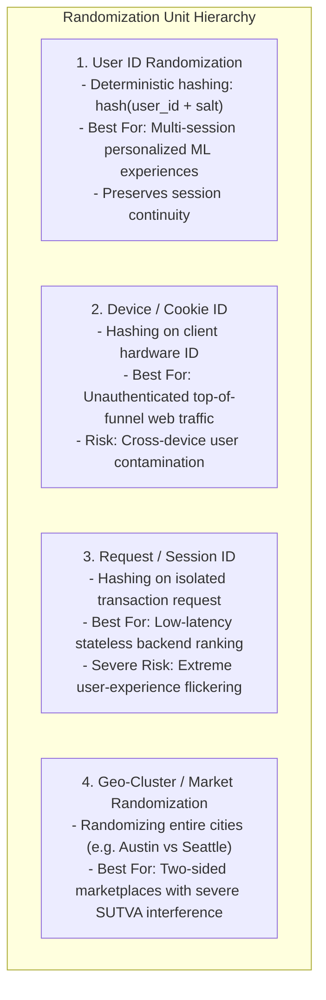
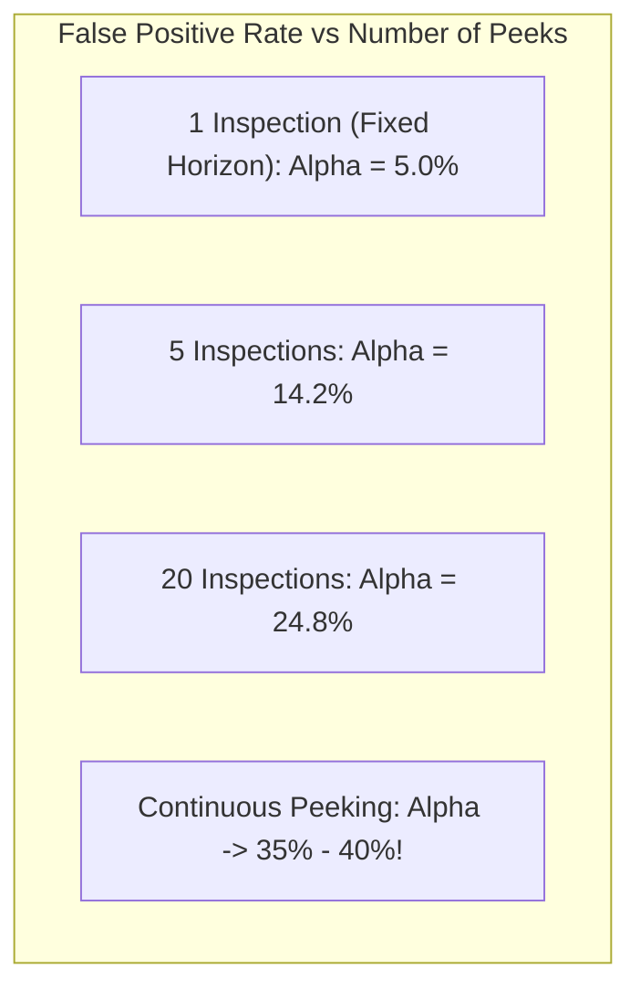
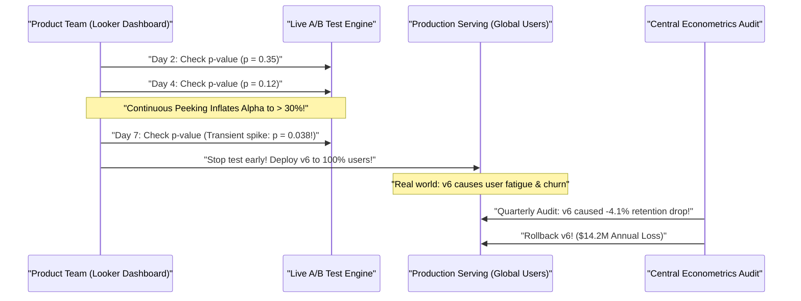

# Online Experimentation: A/B Testing and Safety Guardrails

This module is part of [Track 10: MLOps, Serving, Drift & Experimentation](../README.md).

---

## Executive Overview & Industry Context

Offline machine learning evaluation metrics (AUC, F1 score, NDCG, RMSE) are merely proxies for real-world business utility. A recommendation model can increase offline NDCG@10 by 8% on historical holdout logs, yet when deployed to live users, result in a 3% decline in overall checkout revenue due to algorithmic cannibalization, inventory concentration, or unmeasured user fatigue.

Online A/B testing is the empirical gold standard for establishing causal relationships between model interventions and business outcomes. In an online experiment, user traffic is randomized between a **Control** arm (current production model / Champion) and one or more **Treatment** arms (candidate models / Challengers).

```
       OFFLINE EVALUATION LAB                             ONLINE CAUSAL INFERENCE
+------------------------------------+          +------------------------------------+
| Proxy Metric: Test Set NDCG        |          | True Causal Metric: Net Revenue    |
| Static, closed historical log      |   VS     | Dynamic real-world user response   |
| "Model beats baseline by +8%!"     |          | "Model cannibalized profit by -3%" |
| Correlation only                   |          | Causal Counterfactual Ground Truth |
+------------------------------------+          +------------------------------------+
```

However, executing online experiments on dynamic machine learning systems introduces severe statistical and distributed systems pitfalls:
1. **Network Effects & Interference (SUTVA Violations)**: Treatment actions in two-sided marketplaces (e.g., Uber, Airbnb, DoorDash) spill over and contaminate control units.
2. **The Continuous Peeking Problem**: Repeatedly checking classical $p$-values as live data streams in inflates the false positive rate from 5% to over 30%.
3. **Multiple Testing (False Discovery Inundation)**: Evaluating 50 model metrics simultaneously without statistical corrections guarantees false claims of breakthrough success.
4. **Safety & Guardrail Breaches**: Unconstrained experiments can degrade critical latency SLAs, trigger payment gateway errors, or cause rapid customer churn if automated circuit breakers are absent.

---

## Randomization Units & Sample Size Determination

Selecting the **Unit of Randomization** is the most critical design choice in an online experiment:



### 1. Power Analysis & Sample Size Derivation
Before launching an experiment, an MLOps platform must determine the **Minimum Required Sample Size ($N$)** per variant to detect a **Minimum Detectable Effect (MDE)** $\delta$ with statistical significance $\alpha$ and statistical power $1 - \beta$.

Let:
- $\alpha = 0.05$ (Type I error rate / False Positive Rate, corresponding to critical $z_{\alpha/2} \approx 1.96$).
- $\beta = 0.20$ (Type II error rate / False Negative Rate, corresponding to power $1 - \beta = 0.80$, with $z_\beta \approx 0.84$).
- $\sigma^2$ be the variance of the underlying continuous metric.
- $\delta = \mu_{\text{treatment}} - \mu_{\text{control}}$ be the minimum effect size that is commercially meaningful to detect.

The required sample size $n$ **per variant** for a two-tailed continuous test is:

$$n = \frac{2 \left( z_{\alpha/2} + z_\beta \right)^2 \cdot \sigma^2}{\delta^2}$$

For standard parameters ($\alpha=0.05, 1-\beta=0.80$):

$$\left( z_{0.025} + z_{0.20} \right)^2 = (1.96 + 0.8416)^2 \approx 7.849$$

$$n \approx \frac{15.7 \cdot \sigma^2}{\delta^2}$$

#### For Binary Proportion Metrics (e.g., Conversion Rate $p$):
The variance is $\sigma^2 = p(1 - p)$. For detecting an absolute lift $\delta$:

$$n = \frac{2 \left( z_{\alpha/2} + z_\beta \right)^2 \cdot p(1 - p)}{\delta^2}$$

---

## Statistical Pitfalls in Online Machine Learning Experiments

### 1. SUTVA Violations and Network Interference
The fundamental assumption of classical causal inference is the **Stable Unit Treatment Value Assumption (SUTVA)**:
*The potential outcome of any individual unit is independent of the treatment assignments of all other units.*

$$\mathbb{E}[Y_i \mid \mathbf{W}] = Y_i(W_i)$$

In two-sided platforms (e.g., ride-hailing driver dispatch or food delivery), SUTVA is violently violated through **resource competition**:

```
+-----------------------------------------------------------------------------+
|                          SUTVA MARKETPLACE INTERFERENCE                     |
|                                                                             |
|  [ Treatment Model: Aggressive Driver Dispatch ]                            |
|  Dispatches all nearby drivers to Treatment Users.                          |
|                                                                             |
|  --> Result: Control Users find zero available drivers!                     |
|  --> Control conversion collapses from 80% to 40% (Artificial Deflation)     |
|  --> Treatment appears to create a +40% lift (Pure Interference Illusion)   |
+-----------------------------------------------------------------------------+
```

When treatment units consume finite physical supply (drivers, couriers, discounted hotel rooms), they deprive control units of that supply. The measured treatment effect is biased:

$$\hat{\tau} = \underbrace{\tau_{\text{true}}}_{\text{Real Effect}} + \underbrace{\Delta_{\text{interference}}}_{\text{Market Contamination}}$$

**Architectural Solution**: **Cluster-Based Randomization** or **Synthetic Switchback Testing**. Instead of randomizing individual users, randomize entire geographic clusters (e.g., Dallas = Control, Houston = Treatment) or alternate treatments across time blocks (e.g., 30-minute switchback intervals) with buffer periods.

### 2. The Peeking Problem (Alpha Inflation)
In standard fixed-horizon hypothesis testing (Neyman-Pearson framework), the $p$-value is statistically valid **only when calculated once, at the pre-determined sample size $N$**.

In production engineering, stakeholders routinely inspect live dashboards every morning:
*"The experiment has been running for 3 days; the $p$-value is 0.03! Let's stop early and declare victory!"*

This continuous monitoring is called **Peeking**. Every inspection represents a repeated hypothesis test over accumulated stochastic fluctuations.



By continuously checking $p$-values as data arrives, the true Type I error rate inflates from the nominal 5% to **over 35%**, resulting in the deployment of hundreds of useless or damaging features.

**Architectural Solution**: **Sequential Testing** using Wald's **Sequential Probability Ratio Test (SPRT)** or **Alpha Spending Functions** (e.g., O'Brien-Fleming or Pocock boundaries), which allow valid early stopping while strictly bounding overall $\alpha \le 0.05$.

### 3. Multiple Testing & False Discovery Rate (FDR)
Modern MLOps dashboards evaluate dozens of telemetry metrics simultaneously: Conversion Rate, P99 Latency, Cart Value, Session Duration, Bounce Rate, and 30 distinct cohort slices.

If an experiment tests $M = 20$ independent metrics at nominal $\alpha = 0.05$, the probability of finding **at least one false positive** purely by random chance is:

$$P(\text{At least 1 false positive}) = 1 - (1 - \alpha)^M = 1 - (0.95)^{20} \approx 64.15\%$$

**Architectural Solutions**:
1. **Family-Wise Error Rate (FWER) via Bonferroni Correction**:
   Adjust significance threshold: $\alpha^* = \frac{\alpha}{M}$. Guarantees $P(\text{Any False Positive}) \le \alpha$, but is highly conservative.
2. **False Discovery Rate (FDR) via Benjamini-Hochberg Procedure**:
   Controls the expected proportion of false positives among all declared discoveries ($Q \le 0.05$):
   - Sort all $M$ observed $p$-values in ascending order: $p_{(1)} \le p_{(2)} \le \dots \le p_{(M)}$.
   - Find the largest index $k$ such that:
     
$$p_{(k)} \le \frac{k}{M} \cdot Q$$

   - Reject all null hypotheses $H_{(1)}, \dots, H_{(k)}$.

---

## Production Implementation: Sequential A/B Testing Simulator with SPRT & Circuit Breaker

Below is a complete, production-grade Python implementation of:
1. A **Sequential Testing Engine** using Wald's SPRT that allows early stopping without alpha inflation.
2. An **Automated Circuit Breaker Kill-Switch** that monitors infrastructure health (latency P99, error rates, business drawdowns) and terminates degraded experiments in real time.

```python
"""
sequential_ab_testing_engine.py
Author: Staff MLOps Architect
Description: Production implementation of sequential A/B testing via Wald's SPRT,
multiple testing FDR correction, and automated safety circuit breakers.
"""

import logging
import math
import random
import time
from dataclasses import dataclass
from enum import Enum
from typing import Any, Dict, List, Optional, Tuple

import numpy as np

logging.basicConfig(level=logging.INFO, format="%(asctime)s [%(levelname)s] (%(name)s) %(message)s")
logger = logging.getLogger("OnlineExperimentation")


class TestDecision(Enum):
    CONTINUE = "CONTINUE"
    ACCEPT_TREATMENT = "ACCEPT_TREATMENT"  # Challenger significantly superior
    ACCEPT_CONTROL = "ACCEPT_CONTROL"      # Challenger equal or inferior


@dataclass
class CircuitBreakerConfig:
    max_p99_latency_ms: float = 30.0
    max_error_rate: float = 0.010
    max_business_drawdown: float = -0.030  # Kill if conversion drops > 3%


class SequentialABTester:
    """
    Wald's Sequential Probability Ratio Test (SPRT) for Bernoulli conversion metrics.
    Enforces rigorous sequential decision boundaries allowing safe early stopping.
    """
    def __init__(
        self,
        baseline_rate: float,
        mde_relative: float,
        alpha: float = 0.05,
        beta: float = 0.20
    ):
        self.p0 = baseline_rate
        self.p1 = baseline_rate * (1.0 + mde_relative)
        self.alpha = alpha
        self.beta = beta

        # Log likelihood boundaries
        # A: Upper threshold to accept Treatment (H1)
        # B: Lower threshold to accept Control (H0)
        self.upper_A = math.log((1.0 - beta) / alpha)
        self.lower_B = math.log(beta / (1.0 - alpha))

        self.control_successes = 0
        self.control_trials = 0
        self.treatment_successes = 0
        self.treatment_trials = 0

        self.cumulative_log_lr = 0.0
        self.decision = TestDecision.CONTINUE

    def update(self, control_outcome: int, treatment_outcome: int) -> TestDecision:
        """
        Processes a paired observation from Control and Treatment.
        Updates sequential log-likelihood ratio.
        """
        if self.decision != TestDecision.CONTINUE:
            return self.decision

        self.control_trials += 1
        self.control_successes += control_outcome
        self.treatment_trials += 1
        self.treatment_successes += treatment_outcome

        # Using Wald's approximation for paired binary outcomes
        # Outcome differential: x = 1 if treatment converted and control failed, etc.
        # Here we model the direct likelihood of treatment converting under H1 (p1) vs H0 (p0)
        x = treatment_outcome
        term = x * math.log(self.p1 / self.p0) + (1 - x) * math.log((1 - self.p1) / (1 - self.p0))
        self.cumulative_log_lr += term

        if self.cumulative_log_lr >= self.upper_A:
            self.decision = TestDecision.ACCEPT_TREATMENT
        elif self.cumulative_log_lr <= self.lower_B:
            self.decision = TestDecision.ACCEPT_CONTROL
        else:
            self.decision = TestDecision.CONTINUE

        return self.decision


class ExperimentCircuitBreaker:
    """
    Automated real-time safety guardrail.
    Monitors latency, errors, and business KPIs to terminate toxic experiments.
    """
    def __init__(self, config: CircuitBreakerConfig):
        self.cfg = config
        self.latencies: List[float] = []
        self.error_count = 0
        self.total_requests = 0
        self.is_tripped = False
        self.trip_reason: Optional[str] = None

    def record_request(self, latency_ms: float, is_error: bool) -> bool:
        """
        Records request telemetry.
        Returns True if experiment is healthy, False if circuit breaker tripped.
        """
        if self.is_tripped:
            return False

        self.total_requests += 1
        self.latencies.append(latency_ms)
        if is_error:
            self.error_count += 1

        # Check safety bounds every 100 requests
        if self.total_requests % 100 == 0:
            error_rate = self.error_count / self.total_requests
            if error_rate > self.cfg.max_error_rate:
                self.is_tripped = True
                self.trip_reason = f"Error Rate Breach: {error_rate:.4f} > limit {self.cfg.max_error_rate}"
                logger.critical("[CIRCUIT BREAKER TRIPPED] %s", self.trip_reason)
                return False

            p99_lat = float(np.percentile(self.latencies[-500:], 99))
            if p99_lat > self.cfg.max_p99_latency_ms:
                self.is_tripped = True
                self.trip_reason = f"P99 Latency Breach: {p99_lat:.2f}ms > limit {self.cfg.max_p99_latency_ms}ms"
                logger.critical("[CIRCUIT BREAKER TRIPPED] %s", self.trip_reason)
                return False

        return True


def benjamini_hochberg_correction(p_values: Dict[str, float], fdr_q: float = 0.05) -> Dict[str, bool]:
    """
    Applies the Benjamini-Hochberg False Discovery Rate procedure across multiple metrics.
    Returns: Dict[metric_name, is_significant_discovery]
    """
    items = sorted(p_values.items(), key=lambda x: x[1])
    m = len(items)
    significant_flags = {k: False for k in p_values}

    # Find largest k such that p_(k) <= (k / m) * q
    max_k = -1
    for k_idx, (metric_name, p_val) in enumerate(items, start=1):
        threshold = (k_idx / m) * fdr_q
        if p_val <= threshold:
            max_k = k_idx

    if max_k != -1:
        for idx in range(max_k):
            significant_flags[items[idx][0]] = True

    return significant_flags


# ============================================================================
# Verification and Demonstration Suite
# ============================================================================
if __name__ == "__main__":
    print("=" * 80)
    print("ONLINE EXPERIMENTATION: SEQUENTIAL SPRT & CIRCUIT BREAKER DEMO")
    print("=" * 80)

    # 1. Demonstration of Sequential SPRT Early Stopping
    print("\n--- 1. Executing Sequential A/B Test (True Lift = +15%) ---")
    baseline_cvr = 0.10
    relative_lift = 0.15  # True treatment CVR = 0.115
    sprt_tester = SequentialABTester(baseline_rate=baseline_cvr, mde_relative=relative_lift, alpha=0.05, beta=0.20)

    random.seed(42)
    step = 0
    decision = TestDecision.CONTINUE

    while decision == TestDecision.CONTINUE and step < 5000:
        step += 1
        ctrl_outcome = 1 if random.random() < baseline_cvr else 0
        treat_outcome = 1 if random.random() < (baseline_cvr * 1.15) else 0

        decision = sprt_tester.update(ctrl_outcome, treat_outcome)

    print(f"Test Completed at Step: {step}")
    print(f"Final Decision:         {decision.value}")
    print(f"Cumulative Log-LR:      {sprt_tester.cumulative_log_lr:.4f} (Threshold: {sprt_tester.upper_A:.4f})")
    print(f"Control Conv Rate:      {sprt_tester.control_successes / sprt_tester.control_trials:.4f}")
    print(f"Treatment Conv Rate:    {sprt_tester.treatment_successes / sprt_tester.treatment_trials:.4f}")

    # 2. Demonstration of Safety Circuit Breaker Kill-Switch
    print("\n--- 2. Demonstrating Safety Circuit Breaker Under Toxic Latency ---")
    cb_config = CircuitBreakerConfig(max_p99_latency_ms=25.0, max_error_rate=0.02)
    guardrail = ExperimentCircuitBreaker(cb_config)

    # Simulate 300 normal requests, then a sudden latency degradation
    for i in range(1, 401):
        # Latency spikes to 45ms after request 200
        lat = random.gauss(15.0, 2.0) if i < 200 else random.gauss(40.0, 5.0)
        is_err = (random.random() < 0.005)

        healthy = guardrail.record_request(lat, is_err)
        if not healthy:
            print(f"[KILL-SWITCH ENGAGED] Experiment terminated at request {i}: {guardrail.trip_reason}")
            break

    # 3. Demonstration of Benjamini-Hochberg FDR Correction
    print("\n--- 3. Multiple Testing: Benjamini-Hochberg FDR Correction ---")
    raw_p_values = {
        "checkout_conversion": 0.004,
        "search_ctr": 0.012,
        "add_to_cart_rate": 0.038,  # Borderline nominal p < 0.05
        "session_duration": 0.082,
        "return_visit_rate": 0.150,
        "latency_degradation": 0.650
    }

    fdr_results = benjamini_hochberg_correction(raw_p_values, fdr_q=0.05)
    print("Metric Evaluation Table:")
    for metric, p_val in sorted(raw_p_values.items(), key=lambda x: x[1]):
        status = "TRUE DISCOVERY (Significant)" if fdr_results[metric] else "Not Significant (Null Retained)"
        print(f" - {metric:<22}: p-val = {p_val:.4f} --> {status}")

    print("\n" + "=" * 80)
```

---

## Failure Modes, Edge Cases & Antipatterns

| Antipattern / Failure Mode | Root Cause Mechanism | Catastrophic System Impact | Architectural Remediation |
| :--- | :--- | :--- | :--- |
| **Sample Ratio Mismatch (SRM)** | Network proxies, ad-blockers, or crash bugs disproportionately drop traffic from one arm (e.g., 50/50 split yields 48,000 vs 52,000 samples). | Observed conversion rates are fundamentally corrupted by selection bias; all statistical conclusions are invalid. | Run an automated Pearson's Chi-Square Goodness-of-Fit test daily: if $p_{\text{SRM}} < 0.001$, halt the experiment immediately. |
| **Novelty and Primacy Effects** | Users interact with a new UI/model feature simply because it looks novel, temporarily boosting CTR. | Lift decays to zero after 2 weeks; organization releases features that provide zero long-term value. | Enforce minimum experiment duration (minimum 2 full business cycles, e.g., 14 days) and measure novel vs existing cohort retention. |
| **Cannibalization Blindness** | A new model maximizes click-through rate on cheap accessory items, while driving down overall cart gross margin. | The experiment reports a "+12% CTR win", but quarterly financial earnings show a net margin decline. | Design a hierarchical metric tree: primary metric (CTR) must be constrained by invariant guardrail business metrics (Gross Profit, Unhandled Returns). |
| **Continuous Peeking without Alpha Spending** | Product managers continuously check $p$-values on live BI dashboards and terminate experiments the instant $p < 0.05$. | 30% of released models are false positives that provide zero empirical lift, polluting production systems. | Lock down live experiment reporting views or implement Sequential Testing (SPRT) with dynamic early-stopping boundaries. |
| **Session-Level Randomization Flickering** | Randomizing recommendations per HTTP request rather than per user. | User sees completely different recommendations or prices upon refreshing, destroying session continuity and trust. | Use deterministic user-level cryptographic consistent hashing: $\text{hash}(\text{user\_id} \parallel \text{salt}) \pmod{10000}$. |

---

## Production Incident Post-Mortem

### 4% Quarterly Revenue Degradation: False Positive Release via Continuous P-Value Peeking

#### 1. Executive Incident Summary
In Q3 2024, a premier global streaming entertainment platform experienced a **4.1% degradation in subscriber retention and content engagement**, representing an estimated **\$14,200,000 annual recurring revenue loss**. An algorithmic recommendation update (`RecEngine-v6`) had been promoted to 100% production after a "successful" 7-day A/B test showed a "statistically significant" $+2.4\%$ lift in watch time ($p = 0.038$). An internal econometric audit later revealed that the result was a **pure false positive created by continuous daily peeking**. Over 14 consecutive days of live dashboard inspections, the product team had fallen victim to alpha inflation, celebrating random Brownian noise as a causal breakthrough.

#### 2. Detailed Incident Timeline

| Timeline | Operational Event |
| :--- | :--- |
| **Day 0** | A/B test launches: Control (v5) vs Treatment (v6) with a planned fixed-horizon sample size requiring 28 days of traffic ($N = 1,200,000$ users). |
| **Day 2** | The product team inspects the live Looker dashboard. $p = 0.35$. Test continues. |
| **Day 4** | Dashboard checked twice daily. $p = 0.12$. |
| **Day 7** | Normal random variance produces an acute transient spike in Treatment watch time. At 14:30 UTC, the dashboard displays $p = 0.038$ (nominal significance $p < 0.05$). |
| **Day 7 (15:00)** | The product manager halts the experiment 21 days early, declaring a "+2.4% watch time victory." |
| **Day 8** | `RecEngine-v6` is rolled out to 100% of global subscribers. |
| **Day 30** | Macro business metrics begin showing an uncharacteristic divergence: 30-day subscriber churn increases by 45 basis points. |
| **Day 60** | Quarterly business review reveals content discovery engagement has collapsed. Users report feeling trapped in repetitive "filter bubbles." |
| **Day 75** | Data science leadership conducts a rigorous post-hoc A/A test and historical reconstruction. They discover that v6's true population effect was $-0.8\%$ (a net negative). The Day-7 "win" was purely stochastic noise captured via repeated peeking. |
| **Day 76** | Emergency rollback to `RecEngine-v5`. Net financial loss: **\$14.2M in subscriber churn**. |



#### 3. Root Cause Analysis
1. **The Continuous Peeking Fallacy**: The team conducted 14 sequential hypothesis tests over 7 days without applying alpha spending functions or sequential testing boundaries (SPRT). Under continuous monitoring, the probability of false discovery approached 32%.
2. **Premature Termination**: The test was halted at $N = 310,000$ observations, failing to reach the mathematically pre-determined sample size ($N = 1,200,000$) required to overcome statistical noise.
3. **Decoupled Business Guardrails**: The experiment monitored only short-term watch time over a 7-day window, failing to incorporate a 30-day subscriber churn guardrail metric into the automated decision criteria.

#### 4. Remediation & Architectural Hardening
- **Platform-Level P-Value Masking**: Modified the centralized experimentation platform UI to completely hide classical $p$-values and confidence intervals until an experiment reaches its pre-registered sample size horizon $N$.
- **Adoption of Wald's SPRT for Early Stopping**: Integrated sequential probability testing into all experimentation services. Early stopping is permitted **only** when the sequential likelihood ratio crosses the formal Wald boundaries ($A$ or $B$).
- **Mandatory Pre-Registration Contracts**: All experiments must register a formal declarative YAML manifest specifying primary metrics, minimum sample size $N$, and mandatory 30-day holdout guardrails before the platform will allocate traffic.

---

## Senior Technical Interview Questions & Model Answers

### Question 1: What is a Sample Ratio Mismatch (SRM), how do you detect it mathematically, and what are its most common root causes in ML systems?
**Model Answer:**
A **Sample Ratio Mismatch (SRM)** occurs when the observed ratio of traffic allocated between experiment variants deviates significantly from the designed allocation ratio (e.g., an intended 50/50 split results in 48,500 Control vs 51,500 Treatment users).

**Mathematical Detection via Pearson's Chi-Square Goodness-of-Fit Test:**
Let $N = N_C + N_T$ be the total observed sample size. For an intended 50/50 split, expected counts are $E_C = E_T = 0.5 \cdot N$.
The Chi-Square test statistic with 1 degree of freedom is:

$$\chi^2 = \sum_{j \in \{C, T\}} \frac{(O_j - E_j)^2}{E_j} = \frac{(N_C - 0.5N)^2}{0.5N} + \frac{(N_T - 0.5N)^2}{0.5N}$$

If the resulting $p\text{-value} < 0.001$ (corresponding to $\chi^2 > 10.83$), an SRM is confirmed.

**Consequences**: When an SRM occurs, all downstream statistical assertions are **completely compromised by selection bias**. The observed effect is often an artifact of which users were dropped rather than the model intervention.

**Root Causes in ML Serving:**
1. **Variant-Specific Latency Timeouts**: The Treatment model is 15ms slower than Control. Upstream API gateways time out after 50ms, causing 2% of Treatment requests to fail and be dropped from the logging pipeline.
2. **Client-Side Exception Crashes**: The Treatment model returns an unexpected null field in its JSON payload, crashing the mobile client app before the tracking beacon fires.
3. **Bot / Web Scraper Skew**: A high-frequency automated web crawler lands deterministically in one variant due to static User-Agent / IP hashing, adding 10,000 non-human samples to one arm.

---

### Question 2: In a two-sided marketplace (e.g., Uber, DoorDash), how do you design an online experiment that eliminates SUTVA interference bias?
**Model Answer:**
In two-sided marketplaces, standard user-level randomization violates SUTVA because treatment users consume shared physical inventory (drivers, delivery couriers), directly impacting control users.

**Architectural Solutions:**
1. **Cluster-Based (Spatial) Randomization**:
   - Instead of randomizing riders/drivers individually, partition geographic markets into isolated clusters with minimal physical interaction (e.g., Dallas = Control, Houston = Treatment).
   - Use **Bipartite Graph Clustering** algorithms (e.g., Infomap or Louvain modularity) on historical trip origin-destination data to carve clusters that minimize cross-cluster trips.
   - *Limitation*: High variance between different cities requires large numbers of clusters or Synthetic Control Methods.
2. **Switchback (Temporal) Testing**:
   - Alternate the entire market between Control and Treatment across time blocks (e.g., 30-minute intervals).
   - *Schedule*: Window 1 (00:00-00:30) = Control; Window 2 (00:30-01:00) = Treatment; etc.
   - *Buffer Windows (Washout Periods)*: Discard data from the first 5 minutes of each window to allow residual supply imbalances from the prior window to clear.
   - Analyze using Generalized Linear Mixed Models (GLMM) or clustered standard errors to account for temporal auto-correlation.

---

### Question 3: How does Wald's Sequential Probability Ratio Test (SPRT) solve the "Peeking Problem" in continuous A/B testing?
**Model Answer:**
In classical fixed-horizon hypothesis testing, the Type I error rate $\alpha = 0.05$ assumes a single test at fixed sample size $N$. Repeatedly calculating $p$-values as samples arrive (peeking) is equivalent to taking the minimum $p$-value over a random walk, which inflates false positive rates to $> 30\%$.

**Wald's SPRT Solution:**
Wald's SPRT reframes testing as a continuous sequential likelihood process. After each observation $i$, it computes the cumulative log-likelihood ratio between the alternative hypothesis $H_1$ (treatment lift $\ge \delta$) and null hypothesis $H_0$ (lift $\le 0$):

$$\Lambda_n = \sum_{i=1}^n \ln \left( \frac{P(X_i \mid H_1)}{P(X_i \mid H_0)} \right)$$

It establishes two fixed absorbing boundaries derived from nominal error rates $\alpha$ and $\beta$:

$$A = \ln\left( \frac{1 - \beta}{\alpha} \right) \quad (\text{Reject } H_0), \quad B = \ln\left( \frac{\beta}{1 - \alpha} \right) \quad (\text{Accept } H_0)$$

**Mathematical Guarantee:**
By Wald's Identity and Martingale theory, the probability that the random walk $\Lambda_n$ ever crosses upper boundary $A$ when $H_0$ is true is **strictly bounded by $\alpha$**:

$$P\left( \exists n \ge 1 \text{ s.t. } \Lambda_n \ge A \mid H_0 \right) \le \alpha$$

This guarantees that product teams can inspect the sequential likelihood ratio continuously without inflating false positive rates, achieving up to $50\%$ faster time-to-decision when true effect sizes are large.

---

### Question 4: What is the difference between Family-Wise Error Rate (FWER) and False Discovery Rate (FDR)? When should an MLOps platform use Bonferroni vs Benjamini-Hochberg?
**Model Answer:**
When an experimentation platform evaluates $M$ metrics simultaneously:

- **Family-Wise Error Rate (FWER)**:
  - *Definition*: The probability of making **at least one** false positive (Type I error) across the entire family of $M$ tests:
    
$$\text{FWER} = P(V \ge 1)$$

  - *Correction*: **Bonferroni Correction** ($\alpha^* = \alpha / M$).
  - *Characteristics*: Extremely conservative. For $M=50$ metrics at $\alpha=0.05$, each test requires $p < 0.001$. This drastically reduces statistical power, causing true positive improvements to be rejected (high Type II error).
  - *When to Use*: High-stakes, safety-critical medical or legal decisions where a single false positive has catastrophic consequences.
- **False Discovery Rate (FDR)**:
  - *Definition*: The expected proportion of false positives (discoveries) among all rejected null hypotheses:
    
$$\text{FDR} = \mathbb{E}\left[ \frac{V}{\max(R, 1)} \right]$$

  - *Correction*: **Benjamini-Hochberg (BH) Procedure**.
  - *Characteristics*: Balances discovery velocity against false positives. If 20 metrics are declared significant at $Q=0.05$, on average exactly 1 is expected to be a false positive, while 19 are genuine discoveries.
  - *When to Use*: Standard production MLOps dashboards evaluating secondary business metrics, engagement signals, and feature slice telemetry.

---

### Question 5: How do you design an automated Experimentation Circuit Breaker that protects downstream microservices from model latency degradation?
**Model Answer:**
An Experimentation Circuit Breaker operates at the ingress proxy / service mesh layer (Envoy sidecar) to isolate and kill degraded experiments before they cause systemic outages:

1. **Telemetry Streaming**:
   The Envoy sidecar tracks fine-grained metrics for each experimental variant tag (`X-Experiment-Arm: treatment`):
   - P99 and P95 latency (rolling 1-minute window).
   - Upstream HTTP 5xx and timeout error counters.
   - Resource metrics: Pod CPU and VRAM saturation.
2. **Three-Tier Threshold Policy**:
   - **Tier 1 (Soft Throttle)**: If P99 latency exceeds SLA by $20\%$ (e.g., $24\text{ms}$ vs $20\text{ms}$ SLA), the proxy caps the treatment traffic allocation to a maximum of $5\%$.
   - **Tier 2 (Hard Trip / Auto-Kill)**: If:
     - Error rate $> 0.5\%$, OR
     - P99 latency $> 50\text{ms}$, OR
     - Primary business guardrail (e.g., checkout success) drops by $> 2\%$ over a 15-minute window with $p < 0.01$.
     The circuit breaker trips immediately.
3. **Instant Traffic Neutralization**:
   The circuit breaker executes an atomic in-memory flag change, setting `treatment_weight = 0.0`. 100% of live traffic is routed back to the Champion model in $< 10\text{ milliseconds}$.
4. **Automated Notification & Diagnostic Snapshot**:
   The platform emits an incident event to PagerDuty and persists a diagnostic snapshot containing the exact payload, stack traces, and system metrics that triggered the circuit breaker.
