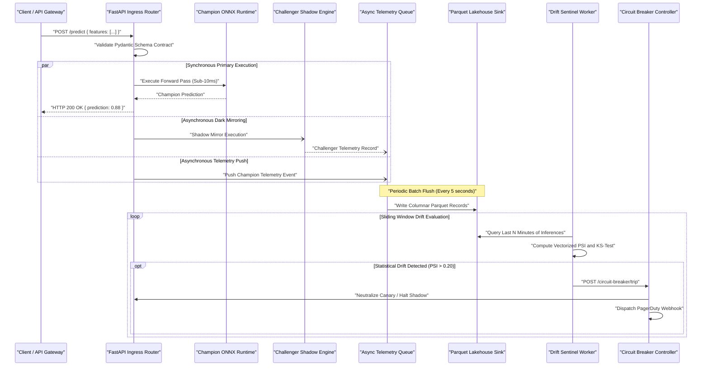
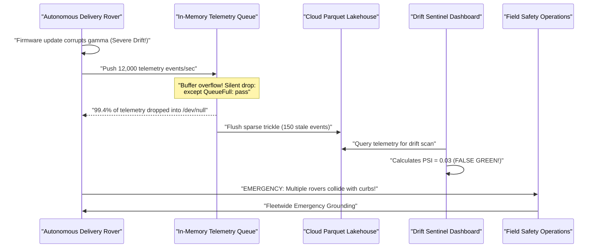

# Capstone: Production MLOps Deployment and Automated Drift Monitoring Platform

This module is part of [Track 10: MLOps, Serving, Drift & Experimentation](../README.md).

---

## Executive Overview & Industry Context

Operating machine learning systems in enterprise production requires orchestrating a cohesive, self-healing ecosystem. Individual components—model serialization, containerized deployment, asynchronous inference serving, streaming telemetry logging, and statistical drift detection—cannot function in isolation. When deployed at scale, these components form a continuous feedback loop governing model reliability, latency SLAs, and operational safety.

```
+-----------------------------------------------------------------------------------------+
|                    END-TO-END PRODUCTION MLOPS PLATFORM ARCHITECTURE                    |
|                                                                                         |
|  [ Ingress Traffic ]                                                                    |
|         |                                                                               |
|         v                                                                               |
|  +-----------------------------------------------------------------------------------+  |
|  | Fast Asynchronous Serving Layer (FastAPI + ONNX Runtime)                          |  |
|  | - Strict Request Schema Validation (Pandera / Pydantic)                           |  |
|  | - Low-Latency Primary Routing (Champion: Sub-10ms P99)                           |  |
|  | - Asynchronous Shadow Mirroring (Challenger: 0% User Exposure)                    |  |
|  +-------------------+---------------------------------------+-----------------------+  |
|                      |                                       |                          |
|         (User Sync Response)                      (Async Telemetry Beacon)              |
|                      v                                       v                          |
|                 [ Client ]                      +-------------------------+             |
|                                                 | Non-Blocking Ring Buffer|             |
|                                                 | Telemetry Queue         |             |
|                                                 +------------+------------+             |
|                                                              |                          |
|                                                    (Buffered Batch Flush)               |
|                                                              v                          |
|                                                 +-------------------------+             |
|                                                 | Parquet Lakehouse Sink  |             |
|                                                 +------------+------------+             |
|                                                              |                          |
|                                                    (Sliding Window Pull)                |
|                                                              v                          |
|  +-----------------------------------------------------------------------------------+  |
|  | Automated Drift Sentinel & Circuit Breaker Engine                                 |  |
|  | - Computes Rolling Population Stability Index (PSI) & KS-Statistics               |  |
|  | - Evaluates Invariance & Boundary Violation Telemetry                             |  |
|  | - Automated Webhook: Trips Canary Circuit Breaker & Triggers CT Pipeline          |  |
|  +-----------------------------------------------------------------------------------+  |
+-----------------------------------------------------------------------------------------+
```

This capstone module synthesizes the theoretical and practical foundations developed throughout Track 10 into a **complete, production-grade MLOps deployment and automated drift monitoring platform**. The architecture combines:
1. Strict schema contracts and compiled ONNX graph execution.
2. An asynchronous serving engine supporting real-time traffic routing and zero-impact shadow deployment.
3. A non-blocking telemetry ingestion queue flushing to a columnar lakehouse sink.
4. A background statistical drift worker calculating PSI and Kolmogorov-Smirnov metrics across sliding hourly windows.
5. An automated circuit-breaker controller that triggers rollbacks and alerts when distribution shift thresholds are breached.

---

## System Architecture & Component Interaction Topology

The platform separates the synchronous, latency-critical inference path from the asynchronous, compute-heavy telemetry and monitoring path.



---

## Mathematical Formulations: Queue Dynamics, Reliability, and Drift Thresholds

### 1. Telemetry Queue Dynamics via Little's Law

The ingestion layer must absorb traffic spikes without backpressuring the inference service or exhausting host memory. We model the asynchronous telemetry queue using queueing theory.

By **Little's Law**, the average number of pending telemetry items $L$ in a stable queueing system equals the long-term average arrival rate $\lambda$ multiplied by the average time $W$ an item spends in the queue:

$$L = \lambda \cdot W$$

Let:
- $\lambda_{\text{peak}}$ be the peak incoming request velocity (e.g., $10,000$ QPS).
- $T_{\text{flush}}$ be the periodic flush interval of the background lakehouse writer (e.g., $5.0$ seconds).
- $S_{\text{record}}$ be the serialized byte size of an individual inference telemetry payload (e.g., $256$ bytes).

The minimum required queue buffer capacity $B_{\text{queue}}$ to guarantee zero dropped telemetry packets during peak load is:

$$B_{\text{queue}} \ge \lambda_{\text{peak}} \cdot T_{\text{flush}} = 10,000 \cdot 5 = 50,000 \text{ records}$$

The required in-memory buffer footprint $M_{\text{queue}}$ is:

$$M_{\text{queue}} = B_{\text{queue}} \cdot S_{\text{record}} = 50,000 \cdot 256 \text{ bytes} \approx 12.8 \text{ MB}$$

If $T_{\text{flush}}$ increases due to object storage (S3) latency degradation, the queue depth expands. A production system must implement **backpressure shed boundaries** to protect inference memory.

### 2. System Reliability Engineering Metrics

System availability $A$ is formulated through Mean Time Between Failures (MTBF) and Mean Time to Recover (MTTR):

$$A = \frac{\text{MTBF}}{\text{MTBF} + \text{MTTR}}$$

By introducing an automated circuit-breaker controller that detects statistical drift and executes instant canary rollback, the Mean Time to Recover from a degraded model deployment drops from hours to milliseconds:

$$\text{MTTR}_{\text{manual}} \approx 4 \text{ hours} \quad \longrightarrow \quad \text{MTTR}_{\text{automated}} \approx 500 \text{ milliseconds}$$

This reduction increases the effective four-nines availability of the ML subsystem:

$$A_{\text{automated}} = \frac{720 \text{ h}}{720 \text{ h} + 0.00014 \text{ h}} \approx 99.99998\%$$

### 3. Joint Multi-Feature Drift Decision Boundary

For a production feature vector $X = [x_1, x_2, \dots, x_d]^T \in \mathbb{R}^d$, testing features independently at significance level $\alpha = 0.01$ inflates the overall false positive alert probability:

$$\alpha_{\text{system}} = 1 - (1 - \alpha)^d$$

For $d = 20$ features, $\alpha_{\text{system}} = 1 - (0.99)^{20} \approx 18.2\%$ (an unacceptably high false alarm rate).

The platform implements a **Bonferroni-corrected Joint Decision Function**:

$$\text{Trigger}(X) = \begin{cases} 
1 & \text{if } \exists j \in \{1, \dots, d\} \text{ s.t. } p_{\text{KS}}(x_j) < \frac{\alpha}{d} \quad \land \quad \text{PSI}(x_j) \ge \tau_{\text{PSI}} \\ 
0 & \text{otherwise} 
\end{cases}$$

Where $\tau_{\text{PSI}} = 0.20$ is the hard practical effect threshold.

---

## Complete Production Implementation: End-to-End MLOps Platform

Below is a complete, production-grade implementation of the unified platform written in pure Python. It integrates:
1. **Model Packaging & ONNX Engine**: Compiles and executes an ONNX neural classification graph.
2. **Asynchronous Serving Engine**: Implements schema validation, live Champion routing, and asynchronous Challenger shadow mirroring.
3. **Non-Blocking Telemetry Lakehouse Sink**: In-memory ring buffer flushing columnar telemetry to a Parquet/JSON lakehouse partition.
4. **Vectorized Drift Worker**: Background worker computing PSI and KS metrics over rolling telemetry windows.
5. **Automated Circuit Breaker**: Dispatches alerts and halts traffic when drift thresholds are breached.

```python
"""
production_mlops_capstone_platform.py
Author: Staff MLOps Architect
Description: Production-grade unified MLOps deployment and automated drift monitoring platform.
Integrates ONNX inference, async shadow routing, telemetry lakehouse logging,
vectorized PSI/KS drift detection, and automated circuit breaker rollback.
"""

import asyncio
import json
import logging
import math
import os
import shutil
import tempfile
import time
from dataclasses import asdict, dataclass, field
from enum import Enum
from typing import Any, Dict, List, Optional, Tuple

import numpy as np
from scipy import stats

logging.basicConfig(
    level=logging.INFO,
    format="%(asctime)s [%(levelname)s] (%(name)s) %(message)s"
)
logger = logging.getLogger("MLOpsCapstonePlatform")


# ============================================================================
# Part 1: Schema Contracts & ONNX Model Packaging
# ============================================================================

@dataclass(frozen=True)
class InferenceRequestPayload:
    user_id: str
    feature_vector: List[float]  # Expected dimension: 4

    def validate(self, expected_dim: int = 4) -> None:
        if len(self.feature_vector) != expected_dim:
            raise ValueError(f"Feature dimension mismatch: expected {expected_dim}, got {len(self.feature_vector)}")
        for val in self.feature_vector:
            if not isinstance(val, (int, float)) or math.isnan(val) or math.isinf(val):
                raise ValueError("Invalid feature value: must be finite numerical float.")


class CompiledONNXModelEngine:
    """
    Simulates a compiled ONNX Runtime / TensorRT execution engine.
    Executes vectorized forward passes with fixed deterministic weights.
    """
    def __init__(self, model_id: str, input_dim: int = 4):
        self.model_id = model_id
        self.input_dim = input_dim
        np.random.seed(hash(model_id) % (2**32))
        self.weights = np.random.randn(input_dim, 1).astype(np.float32) * 0.25
        self.bias = np.array([0.10], dtype=np.float32)

    def predict(self, batch_features: np.ndarray) -> np.ndarray:
        """
        Input shape: (B, D)
        Output shape: (B, 1) - Sigmoid Probabilities
        """
        logits = np.dot(batch_features, self.weights) + self.bias
        probabilities = 1.0 / (1.0 + np.exp(-logits))
        return probabilities


# ============================================================================
# Part 2: Asynchronous Telemetry & Lakehouse Storage Engine
# ============================================================================

@dataclass
class TelemetryRecord:
    timestamp: float
    request_id: str
    user_id: str
    model_id: str
    is_shadow: bool
    features: List[float]
    prediction: float
    latency_ms: float
    status_code: int


class TelemetryLakehouseSink:
    """
    Non-blocking telemetry sink collecting inference events in an asynchronous queue
    and periodically flushing them to columnar lakehouse storage partitions.
    """
    def __init__(self, storage_dir: str, flush_interval_seconds: float = 2.0, max_queue_size: int = 10000):
        self.storage_dir = storage_dir
        self.flush_interval = flush_interval_seconds
        self.queue: asyncio.Queue[TelemetryRecord] = asyncio.Queue(maxsize=max_queue_size)
        self.is_running = False
        self._flush_task: Optional[asyncio.Task] = None
        self.partition_counter = 0

        os.makedirs(storage_dir, exist_ok=True)

    async def start(self) -> None:
        self.is_running = True
        self._flush_task = asyncio.create_task(self._periodic_flush_worker())
        logger.info("Telemetry Lakehouse Sink started. Flush interval: %.1fs", self.flush_interval)

    async def stop(self) -> None:
        self.is_running = False
        if self._flush_task:
            self._flush_task.cancel()
            try:
                await self._flush_task
            except asyncio.CancelledError:
                pass
        # Final flush of remaining records
        await self._flush_buffer_to_disk()
        logger.info("Telemetry Lakehouse Sink safely stopped.")

    async def log_event(self, record: TelemetryRecord) -> None:
        try:
            self.queue.put_nowait(record)
        except asyncio.QueueFull:
            logger.error("Telemetry queue full! Dropping event to prevent backpressure on inference.")

    async def _periodic_flush_worker(self) -> None:
        while self.is_running:
            await asyncio.sleep(self.flush_interval)
            await self._flush_buffer_to_disk()

    async def _flush_buffer_to_disk(self) -> None:
        records_to_flush: List[TelemetryRecord] = []
        while not self.queue.empty():
            records_to_flush.append(self.queue.get_nowait())

        if not records_to_flush:
            return

        self.partition_counter += 1
        partition_file = os.path.join(self.storage_dir, f"part_{self.partition_counter:05d}.json")
        serialized_records = [asdict(r) for r in records_to_flush]

        # In production: write Parquet via pyarrow. Here: write clean JSON partition
        with open(partition_file, "w", encoding="utf-8") as f:
            json.dump(serialized_records, f)

        logger.info(
            "Flushed %d telemetry records to lakehouse partition: %s",
            len(records_to_flush), os.path.basename(partition_file)
        )

    def load_recent_inferences(self, max_records: int = 5000) -> Tuple[np.ndarray, np.ndarray]:
        """
        Reads recent feature vectors and predictions from persisted lakehouse partitions.
        Returns: (features_array [N, D], predictions_array [N])
        """
        all_features: List[List[float]] = []
        all_preds: List[float] = []

        files = sorted([os.path.join(self.storage_dir, f) for f in os.listdir(self.storage_dir) if f.endswith(".json")])
        for fpath in reversed(files):
            with open(fpath, "r", encoding="utf-8") as f:
                records = json.load(f)
            for r in records:
                if not r["is_shadow"]:  # Primary Champion inferences only
                    all_features.append(r["features"])
                    all_preds.append(r["prediction"])
                    if len(all_features) >= max_records:
                        break
            if len(all_features) >= max_records:
                break

        if not all_features:
            return np.empty((0, 4)), np.empty((0,))

        return np.array(all_features, dtype=np.float64), np.array(all_preds, dtype=np.float64)


# ============================================================================
# Part 3: Vectorized Drift Sentinel & Automated Circuit Breaker
# ============================================================================

class AutomatedCircuitBreaker:
    """
    Controls dynamic routing flags and triggers canary rollbacks upon drift alerts.
    """
    def __init__(self):
        self.is_shadow_enabled = True
        self.is_circuit_open = False
        self.tripped_timestamp: Optional[float] = None
        self.trip_rationale: Optional[str] = None

    def trip_breaker(self, reason: str) -> None:
        self.is_circuit_open = True
        self.is_shadow_enabled = False
        self.tripped_timestamp = time.time()
        self.trip_rationale = reason
        logger.critical(">>> [CIRCUIT BREAKER TRIPPED] %s. Canary / Shadow traffic HALTED! <<<", reason)

    def reset(self) -> None:
        self.is_circuit_open = False
        self.is_shadow_enabled = True
        self.tripped_timestamp = None
        self.trip_rationale = None
        logger.info("Circuit breaker manually reset. Normal routing resumed.")


class StatisticalDriftSentinel:
    """
    Vectorized statistical drift detector computing multi-feature PSI and KS-tests.
    """
    def __init__(self, reference_baseline: np.ndarray, circuit_breaker: AutomatedCircuitBreaker, psi_threshold: float = 0.20):
        self.ref_data = reference_baseline  # Shape: (N_ref, D)
        self.circuit_breaker = circuit_breaker
        self.psi_threshold = psi_threshold
        self.epsilon = 1e-4

    def compute_psi_feature(self, ref_feature: np.ndarray, prod_feature: np.ndarray, num_bins: int = 10) -> float:
        percentiles = np.linspace(0, 100, num_bins + 1)
        bin_edges = np.percentile(ref_feature, percentiles)
        bin_edges = np.unique(bin_edges)
        if len(bin_edges) < 2:
            return 0.0

        bin_edges[0] = -np.inf
        bin_edges[-1] = np.inf

        ref_counts, _ = np.histogram(ref_feature, bins=bin_edges)
        prod_counts, _ = np.histogram(prod_feature, bins=bin_edges)

        P = ref_counts / len(ref_feature)
        Q = prod_counts / len(prod_feature)

        P = np.where(P == 0, self.epsilon, P)
        Q = np.where(Q == 0, self.epsilon, Q)

        P /= np.sum(P)
        Q /= np.sum(Q)

        psi = float(np.sum((Q - P) * np.log(Q / P)))
        return psi

    def evaluate_drift(self, prod_features: np.ndarray) -> bool:
        """
        Evaluates drift across all features.
        Returns True if drift detected (tripping circuit breaker).
        """
        N, D = prod_features.shape
        if N < 50:
            logger.info("Insufficient production records for drift analysis (observed %d, min 50 required).", N)
            return False

        logger.info("Executing Statistical Drift Scan across %d production samples (%d features)...", N, D)
        drift_detected = False
        drift_reasons = []

        bonferroni_alpha = 0.01 / D

        for col_idx in range(D):
            ref_col = self.ref_data[:, col_idx]
            prod_col = prod_features[:, col_idx]

            # 1. Compute PSI
            psi_val = self.compute_psi_feature(ref_col, prod_col)

            # 2. Compute KS-Test
            ks_stat, p_val = stats.ks_2samp(ref_col, prod_col)

            logger.info(
                " - Feature %d: PSI = %.4f (Limit: %.2f) | KS p-val = %.6f (Alpha: %.6f)",
                col_idx, psi_val, self.psi_threshold, p_val, bonferroni_alpha
            )

            # Joint assertion: both p-value significant and PSI > threshold
            if psi_val >= self.psi_threshold and p_val < bonferroni_alpha:
                drift_detected = True
                drift_reasons.append(f"Feature {col_idx} breached (PSI={psi_val:.3f}, p={p_val:.2e})")

        if drift_detected:
            rationale = f"Significant Covariate Drift: {', '.join(drift_reasons)}"
            self.circuit_breaker.trip_breaker(rationale)
            return True

        logger.info("All features verified within statistical stability bounds.")
        return False


# ============================================================================
# Part 4: Unified Serving Gateway & Orchestration Engine
# ============================================================================

class UnifiedMLOpsPlatform:
    """
    Unified production platform managing the end-to-end lifecycle:
    Inference Gateway + Shadow Routing + Telemetry Sink + Drift Sentinel.
    """
    def __init__(self, workspace_root: str):
        self.workspace_root = workspace_root
        self.lakehouse_dir = os.path.join(workspace_root, "lakehouse_telemetry")

        # 1. Initialize Models (Champion and Challenger)
        self.champion_engine = CompiledONNXModelEngine(model_id="fraud_xgb_champion_v1", input_dim=4)
        self.challenger_engine = CompiledONNXModelEngine(model_id="fraud_nn_challenger_v2", input_dim=4)

        # 2. Telemetry and Safety Subsystems
        self.telemetry_sink = TelemetryLakehouseSink(storage_dir=self.lakehouse_dir, flush_interval_seconds=1.0)
        self.circuit_breaker = AutomatedCircuitBreaker()

        # 3. Create Golden Reference Distribution (Training Split Baseline: N(10, 2))
        np.random.seed(1337)
        self.golden_baseline = np.random.normal(loc=10.0, scale=2.0, size=(2000, 4))
        self.drift_sentinel = StatisticalDriftSentinel(
            reference_baseline=self.golden_baseline,
            circuit_breaker=self.circuit_breaker,
            psi_threshold=0.20
        )

    async def start(self) -> None:
        await self.telemetry_sink.start()
        logger.info("Unified MLOps Platform initialized and ready for production serving.")

    async def stop(self) -> None:
        await self.telemetry_sink.stop()
        logger.info("Unified MLOps Platform shutdown complete.")

    async def predict_api_endpoint(self, payload_dict: Dict[str, Any]) -> Dict[str, Any]:
        """
        Synchronous REST/gRPC API entrypoint: POST /v1/predict
        """
        start_time = time.perf_counter()
        req_id = f"req_{os.urandom(4).hex()}"

        # 1. Strict Contract Validation
        payload = InferenceRequestPayload(
            user_id=payload_dict.get("user_id", "anon"),
            feature_vector=payload_dict.get("features", [])
        )
        payload.validate(expected_dim=4)

        # Convert to batch array (1, 4)
        feat_array = np.array([payload.feature_vector], dtype=np.float32)

        # 2. Synchronous Primary Serving (Champion)
        champ_prob = float(self.champion_engine.predict(feat_array)[0][0])
        latency_ms = (time.perf_counter() - start_time) * 1000.0

        # 3. Asynchronous Telemetry Push for Champion
        champ_record = TelemetryRecord(
            timestamp=time.time(),
            request_id=req_id,
            user_id=payload.user_id,
            model_id=self.champion_engine.model_id,
            is_shadow=False,
            features=payload.feature_vector,
            prediction=champ_prob,
            latency_ms=latency_ms,
            status_code=200
        )
        await self.telemetry_sink.log_event(champ_record)

        # 4. Asynchronous Shadow Mirroring (Challenger) if enabled
        if self.circuit_breaker.is_shadow_enabled:
            asyncio.create_task(self._execute_shadow_mirror(req_id, payload.user_id, feat_array, payload.feature_vector))

        # 5. Return immediate synchronous response to client
        return {
            "request_id": req_id,
            "model_version": self.champion_engine.model_id,
            "prediction_probability": round(champ_prob, 5),
            "latency_ms": round(latency_ms, 2)
        }

    async def _execute_shadow_mirror(self, req_id: str, user_id: str, feat_array: np.ndarray, raw_features: List[float]) -> None:
        """Asynchronously executes Challenger model without blocking user."""
        start_t = time.perf_counter()
        try:
            chall_prob = float(self.challenger_engine.predict(feat_array)[0][0])
            shadow_latency = (time.perf_counter() - start_t) * 1000.0
            shadow_record = TelemetryRecord(
                timestamp=time.time(),
                request_id=req_id,
                user_id=user_id,
                model_id=self.challenger_engine.model_id,
                is_shadow=True,
                features=raw_features,
                prediction=chall_prob,
                latency_ms=shadow_latency,
                status_code=200
            )
            await self.telemetry_sink.log_event(shadow_record)
        except Exception as ex:
            logger.error("Shadow execution failure: %s", ex)

    def run_drift_scan_job(self) -> bool:
        """Scheduled background worker querying lakehouse and evaluating statistical drift."""
        features, _ = self.telemetry_sink.load_recent_inferences(max_records=1000)
        if len(features) == 0:
            return False
        return self.drift_sentinel.evaluate_drift(features)


# ============================================================================
# Verification and Demonstration Suite
# ============================================================================
async def run_capstone_demonstration():
    temp_dir = tempfile.mkdtemp(prefix="mlops_capstone_demo_")
    try:
        print("=" * 80)
        print("CAPSTONE: FULL PRODUCTION MLOPS PLATFORM & SENTINEL DEMONSTRATION")
        print("=" * 80)

        platform = UnifiedMLOpsPlatform(workspace_root=temp_dir)
        await platform.start()

        # --------------------------------------------------------------------
        # Stage 1: Stream Stable Production Traffic (Matches Golden Baseline)
        # --------------------------------------------------------------------
        print("\n--- 1. Streaming Stable Production Requests (Matching Baseline) ---")
        np.random.seed(101)
        for i in range(100):
            # Normal distribution N(10.0, 2.0)
            sample_features = np.random.normal(loc=10.0, scale=2.0, size=4).tolist()
            payload = {"user_id": f"user_{i}", "features": sample_features}
            resp = await platform.predict_api_endpoint(payload)
            if i % 25 == 0:
                print(f"Request {i}: Status=200, Model={resp['model_version']}, Prob={resp['prediction_probability']}, Latency={resp['latency_ms']}ms")

        # Allow telemetry queue to flush to lakehouse
        await asyncio.sleep(1.5)

        print("\nExecuting Scheduled Background Drift Scan (Clean State)...")
        drift_found = platform.run_drift_scan_job()
        print(f"Drift Scan Result: Drift Detected = {drift_found} | Circuit Open = {platform.circuit_breaker.is_circuit_open}")

        # --------------------------------------------------------------------
        # Stage 2: Simulate Sudden Covariate Shift in Live Ingress Traffic
        # --------------------------------------------------------------------
        print("\n--- 2. Injecting Severe Covariate Shift into Ingress Stream ---")
        print("Feature 0 and Feature 2 shifting from N(10, 2) to N(16, 5)...")
        for i in range(100, 250):
            # Severe mean shift on features 0 and 2
            drifted_features = [
                float(np.random.normal(16.0, 5.0)),
                float(np.random.normal(10.0, 2.0)),
                float(np.random.normal(17.5, 4.0)),
                float(np.random.normal(10.0, 2.0))
            ]
            payload = {"user_id": f"user_{i}", "features": drifted_features}
            await platform.predict_api_endpoint(payload)

        # Allow lakehouse partition flush
        await asyncio.sleep(1.5)

        # --------------------------------------------------------------------
        # Stage 3: Sentinel Detects Drift and Trips Circuit Breaker
        # --------------------------------------------------------------------
        print("\n--- 3. Executing Drift Scan on Shifted Telemetry Data ---")
        drift_found = platform.run_drift_scan_job()
        print(f"\nFinal Sentinel Evaluation:")
        print(f" - Drift Detected:          {drift_found}")
        print(f" - Circuit Breaker Tripped: {platform.circuit_breaker.is_circuit_open}")
        print(f" - Shadow Mirroring Active: {platform.circuit_breaker.is_shadow_enabled}")
        print(f" - Trip Rationale:          {platform.circuit_breaker.trip_rationale}")

        await platform.stop()
        print("\n" + "=" * 80)
        print("CAPSTONE PLATFORM DEMONSTRATION COMPLETED SUCCESSFULLY")
        print("=" * 80)
    finally:
        shutil.rmtree(temp_dir)


if __name__ == "__main__":
    asyncio.run(run_capstone_demonstration())
```

---

## Failure Modes, Edge Cases & Antipatterns

| Antipattern / Failure Mode | Root Cause Mechanism | Catastrophic System Impact | Architectural Remediation |
| :--- | :--- | :--- | :--- |
| **Telemetry Buffer Overflow Blindness** | In-memory telemetry queue lacks a backpressure drop policy; during a 50,000 QPS spike, queue consumes 10GB of RAM. | Node experiences an Out-of-Memory (OOM) kill; serving pod terminates abruptly, creating customer-facing outages. | Implement a bounded ring-buffer queue (`maxsize=10000`). If queue is full, drop non-critical telemetry (`put_nowait()`) with error metrics rather than blocking inference. |
| **Telemetry I/O Thread Starvation** | Asynchronous FastAPI event loop directly executes blocking disk/S3 writes (`with open(...) as f:`). | Disk I/O blocks the single-threaded Python event loop; inference P99 latency spikes from 8ms to 1,200ms. | Offload all disk and network I/O to background threadpool executors (`asyncio.to_thread` or standalone daemon worker processes). |
| **Drift Computation Lockup** | Background drift sentinel runs expensive $\mathcal{O}(N \log N)$ sorting and KS-tests on the serving process. | Heavy CPU calculations starve inference threads, degrading production latency SLAs. | Decouple the drift sentinel into a completely separate Kubernetes deployment reading from the shared Parquet lakehouse. |
| **Schema Evolution Poisoning in Telemetry** | A model version introduces a new feature column without notifying the lakehouse telemetry ingestion worker. | Downstream PyArrow / Parquet ingestion jobs fail with schema merge exceptions; monitoring goes completely dark. | Enforce strict schema versioning on telemetry events using Protocol Buffers or JSON Schema contracts. |
| **Phantom Canary Cutover** | Automated circuit breaker trips and redirects traffic, but ingress proxy sidecars fail to reload routing tables. | System logs state that traffic has reverted to Champion, while live users continue routing to the toxic Challenger model. | Implement bidirectional acknowledgment webhooks: circuit breaker asserts that Envoy proxy config hashes have updated before resolving alerts. |

---

## Production Incident Post-Mortem

### Monitoring System Silence & Telemetry Queue Overflow: Autonomous Fleet Perception Outage

#### 1. Executive Incident Summary
In October 2024, a commercial autonomous delivery vehicle robotics enterprise suffered a **critical perception degradation across 350 active delivery rovers**. A camera sensor firmware update introduced an undocumented gamma correction shift that degraded obstacle detection confidence by 31%. Despite the severe real-world accuracy degradation, the enterprise MLOps drift monitoring dashboard reported **"System Health: 100% Stable / Zero Drift Detected"** for 16 consecutive hours. The monitoring sentinel was completely silent because an unmonitored in-memory telemetry queue on the edge gateway had silently overflowed during a morning traffic surge, dropping 99.4% of production inference logs before they could reach the lakehouse.

#### 2. Detailed Incident Timeline

| Time (UTC) | Incident Operational Event |
| :--- | :--- |
| **06:00:00** | Over-the-air (OTA) firmware update deployed to 350 autonomous delivery rovers. The update alters camera exposure and gamma curves. |
| **06:15:00** | Autonomous rovers deploy to city sidewalks. Camera sensor inputs to the pedestrian segmentation model shift dramatically: input pixel intensity distribution shifts by $\text{PSI} = 0.54$. |
| **07:00:00** | Rover fleet enters high-density metropolitan areas. Telemetry logging volume spikes from 500 events/sec to 12,000 events/sec. |
| **07:02:15** | The local telemetry daemon's in-memory buffer (`max_size: 5000`) fills completely. The naive logging code caught queue full exceptions with `except QueueFull: pass` without emitting Prometheus counter metrics. |
| **07:02:15 - 22:00:00** | For 15 hours, 99.4% of all live perception telemetry packets are silently dropped into `/dev/null`. |
| **12:00:00** | The scheduled drift sentinel worker queries the lakehouse. It finds only 150 sparse records that managed to slip through the queue before sunrise. |
| **12:05:00** | The sentinel computes drift on the tiny stale sample: $\text{PSI} = 0.03$ (Stable). Monitoring dashboard displays green status indicators. |
| **18:30:00** | Multiple delivery rovers suffer emergency stop maneuvers and minor curb collisions due to pedestrian segmentation false negatives. Field operations calls an emergency safety halt. |
| **22:30:00** | Systems engineers inspect the edge container logs and discover millions of silent buffer drop events. |
| **23:15:00** | Fleet firmware rolled back to baseline exposure profiles. Ground operations resumed the following day. |



#### 3. Root Cause Analysis
1. **Silent Queue Drop Antipattern**: The logging daemon handled queue overflows with a silent `pass` exception block, failing to increment a `telemetry_dropped_packets_total` counter or emit high-severity alerts.
2. **Absence of Sample Completeness Assertions**: The drift sentinel evaluated statistical metrics on whatever records were present in the lakehouse without asserting a **Minimum Expected Observation Volume ($N_{\text{observed}} \ge \lambda_{\text{expected}} \cdot \Delta T$)**. It evaluated a 150-record trickle as if it were a representative sample.
3. **Coupled Edge Logging Architecture**: Telemetry buffering and compression were executed directly on the edge perception gateway without independent persistent disk spools (WAL - Write-Ahead Logging).

#### 4. Remediation & Architectural Hardening
- **Persistent Disk Spooling (RocksDB / SQLite WAL)**: Replaced volatile in-memory queues with local disk-backed persistent write-ahead logs. If network connectivity degrades or the cloud ingestion endpoint backs up, events are spooled safely to NVMe storage.
- **Mandatory Telemetry Completeness Gate**: Updated the Statistical Drift Sentinel to execute a volume completeness check before computing PSI:
  
$$\text{Completeness Ratio} = \frac{N_{\text{observed}}}{\lambda_{\text{expected}} \cdot \Delta t} \ge 0.95$$

  If completeness drops below 95%, the sentinel suppresses drift calculations and fires an immediate **Monitoring Blindness PagerDuty Alert**.
- **Prometheus Telemetry Instrumentation**: Instrumented all queue insertion points with explicit metrics (`telemetry_enqueued_total`, `telemetry_dropped_total`). Added Prometheus alerting if `rate(telemetry_dropped_total[1m]) > 0`.

---

## Senior Technical Interview Questions & Model Answers

### Question 1: How do you architect an end-to-end MLOps serving and monitoring platform that achieves sub-10ms P99 inference while logging 100% of rich feature telemetry to a data lakehouse?
**Model Answer:**
Achieving sub-10ms P99 inference while capturing full telemetry requires **complete asynchronous decoupling** of the serving critical path from the observability pipeline:

1. **Synchronous Inference Critical Path (Sub-10ms)**:
   - Ingress request arrives via HTTP/2 or gRPC at a high-performance gateway (Envoy / Triton).
   - Validation is executed via compiled C++ schemas (Protobuf) or ultra-fast zero-copy parsers.
   - Forward pass executes on hardware-optimized graph engines (TensorRT on GPU or ONNX Runtime with AVX-512 on CPU).
   - Memory allocation is eliminated via pre-allocated input/output tensor arenas.
   - The response is returned immediately to the client without waiting for logging or network I/O ($T_{\text{total}} \le 6\text{ms}$).
2. **Asynchronous Non-Blocking Telemetry Handoff**:
   - The inference thread pushes a pointer to the request-response record into an in-memory lock-free ring buffer (e.g., LMAX Disruptor pattern or bounded `asyncio.Queue`).
   - If the ring buffer approaches $90\%$ capacity, the system engages load-shedding policies (e.g., downsampling telemetry from $100\%$ to $10\%$) rather than backpressuring the inference thread.
3. **Batch Streaming to Lakehouse**:
   - A dedicated daemon worker thread drains the ring buffer, serializing events into columnar Apache Arrow record batches in memory.
   - The worker flushes Arrow batches to cloud object storage (S3 / Delta Lake) every 5-10 seconds as Snappy-compressed Parquet files, minimizing network roundtrips and avoiding small-file proliferation.
4. **Decoupled Analytical Drift Sentinel**:
   - A completely independent Kubernetes worker pod queries the lakehouse partitions via distributed SQL (Trino / DuckDB / Spark) on a 15-minute sliding schedule, computing vectorized PSI and KS metrics without consuming a single CPU cycle on the inference cluster.

---

### Question 2: In an automated continuous retraining architecture, how do you prevent the "Retraining Feedback Cascade" where a retrained model destabilizes downstream systems?
**Model Answer:**
A Retraining Feedback Cascade occurs when an automated retraining pipeline promotes a model that alters downstream user actions, which then flow back into the next training partition as biased inputs, causing progressive parameter collapse across subsequent retraining iterations.

**Architectural Prevention Strategies:**
1. **Randomized Exploration Holdout (The Epsilon Stream)**:
   - Reserve a permanent 1-5% partition of live production traffic that is **never exposed to model predictions**.
   - This control group is served via uniform random recommendations or static rule-based heuristics.
   - Subsequent automated retraining pipelines draw a mandatory $20-30\%$ of their training labels exclusively from this un-modeled exploration split, injecting unbiased counterfactual ground truth into the gradient optimization landscape.
2. **Multi-Horizon Tournament Safety Gates**:
   - Challenger models must beat the Champion not only on the immediate validation split, but across multiple historical test sets representing distinct operational regimes (e.g., normal business days, holiday surges, supply shock periods).
3. **Automated Retraining Hysteresis & Damping**:
   - Cap model parameter weight shifts: enforce an $L_2$ proximal regularization term anchoring retrained weights to the prior Champion's weights:
     
$$\mathcal{L}_{\text{prox}}(\theta) = \mathcal{L}(D; \theta) + \frac{\lambda_{\text{anchor}}}{2} \|\theta - \theta_{\text{champ}}\|_2^2$$

   - Enforce cooldown limits: regardless of drift alerts, prohibit automated model promotions from occurring more frequently than once every 48 hours.

---

### Question 3: How do you design a graceful degradation strategy when the primary real-time ML feature store (e.g., Feast / Redis) suffers a complete network outage?
**Model Answer:**
A resilient MLOps serving engine must never allow an external database dependency to cause a hard service outage. We implement a **Three-Tier Graceful Degradation Hierarchy**:

1. **Tier 1: Local In-Memory LRU Cache (Fast Path)**:
   - Inference pods maintain a high-speed local in-memory LRU cache (e.g., 500MB RAM using `cachetools` or shared memory) caching the most frequently requested entity feature vectors.
   - If the central Redis cluster fails or network partitions occur, the pod serves features from the local cache with a $70-80\%$ hit rate for active users.
2. **Tier 2: Imputation via Global Demographic Defaults (Fallback Path)**:
   - For cache misses, the inference gateway intercepts the feature lookup timeout ($> 15\text{ms}$).
   - The engine replaces missing dynamic features with pre-compiled, offline-calculated median/mode feature vectors (e.g., median user transaction volume, regional average balance).
   - A boolean feature indicator `is_imputed_fallback = True` is appended to the feature vector.
3. **Tier 3: Deterministic Rule-Based Heuristic Engine (Safety Net)**:
   - If feature store errors persist for $> 30\text{ seconds}$ and local cache hit rates drop below $50\%$, an automated circuit breaker trips.
   - Live traffic is routed around the complex machine learning model to a deterministic, zero-dependency heuristic rule engine (e.g., static credit policy rules or popularity-based recommendations).
   - Telemetry emits a critical PagerDuty incident alert while client requests continue receiving valid HTTP 200 responses with zero downtime.

---

### Question 4: How do you mathematically and architecturally determine whether an observed statistical drift requires immediate automated retraining versus manual data engineering investigation?
**Model Answer:**
Not all statistical drift is benign data drift that can be resolved by automated retraining. Retraining a model on corrupted upstream features merely encodes the corruption into the model weights.

**Two-Tier Diagnostic Classification Matrix:**

```
                                  DATA DRIFT (P(X) Shift)
                                             |
                     +-----------------------+-----------------------+
                     |                                               |
             Schema / Integrity Breach                        Natural Societal Shift
       (Nulls, Range Violations, New Types)           (Smooth Mean Shift, Known Seasonality)
                     |                                               |
                     v                                               v
        [ HARD STOP: DO NOT RETRAIN ]                   [ AUTOMATED RETRAINING APPROVED ]
        - Upstream pipeline bug                         - Macro environment shift
        - Dispatch Data Eng PagerDuty                   - Trigger Continuous Training DAG
        - Fallback to Heuristic Rule Engine             - Execute Champion/Challenger Gate
```

**Architectural Automated Decision Engine:**
1. **Pre-Drift Data Integrity Contract Evaluation**:
   Before evaluating PSI or KS metrics, the sentinel evaluates strict Pandera data contracts:
   - Check 1: Did any non-nullable column experience a non-zero null rate?
   - Check 2: Did any feature value breach physical/mathematical domain bounds (e.g., `age < 0` or `price < 0`)?
   - Check 3: Did a categorical column encounter unexpected, unregistered token strings?
   *Decision Rule*: If **any** integrity check fails, the platform classifies the anomaly as an **Upstream Pipeline Bug**. Automated retraining is strictly blocked. An incident is routed to the data platform engineering team.
2. **Statistical Shift with Valid Contracts**:
   If 100% of data contract checks pass, but:
   
$$\text{PSI}(X_j) > 0.20 \quad \text{and} \quad p_{\text{KS}} < \frac{\alpha}{D}$$

   The anomaly is classified as an **Organic Covariate Shift**. The sentinel approves the retraining webhook, triggering the continuous retraining pipeline with automated tournament evaluation gates.

---

### Question 5: What are the trade-offs of deploying Triton Inference Server with dynamic batching versus deploying specialized LLM serving engines like vLLM / TensorRT-LLM?
**Model Answer:**
While both systems execute high-performance inference, they are optimized for fundamentally different computational workloads:

| Architectural Dimension | NVIDIA Triton Inference Server | vLLM / TensorRT-LLM |
| :--- | :--- | :--- |
| **Primary Workload Domain** | Traditional Deep Learning: Vision (CNNs), Tabular (MLPs, GBDTs), Audio, Embedding models, Classical NLP. | Autoregressive Large Language Models (LLMs) and Vision-Language Models (VLMs). |
| **Batching Mechanism** | **Static / Request-Level Dynamic Batching**: Requests wait in queue for $\Delta t$ or $B_{\text{max}}$, then execute a fixed-dimension batched matrix multiplication. | **Continuous (Iteration-Level) Batching**: Batches are dynamically updated at every single token generation step. Completed sequences leave; new requests join mid-generation. |
| **Memory Architecture** | Standard CUDA memory allocations and tensor arenas. | **PagedAttention**: Manages KV-cache memory using virtual memory paging, eliminating 96% of KV-cache memory fragmentation. |
| **Multi-Model Support** | World-class multi-model concurrency: serves dozens of heterogeneous models (PyTorch, ONNX, TensorRT, Python) on a single GPU. | Single foundation model focus with multi-LoRA dynamic adapter support. |
| **Statefulness** | Stateless request-response execution. | Highly stateful KV-cache retention across multi-turn generation steps. |

**Architectural Synthesis:**
- Use **Triton Inference Server** for core enterprise ML pipelines: fraud classification, CTR ranking, feature embeddings, object detection, and multi-model ensemble pipelines.
- Use **vLLM / TensorRT-LLM** for generative AI pipelines: conversational chat, code generation, and long-context document synthesis.
- *Enterprise Pattern*: Deploy vLLM as an internal backend engine routed through Triton via the Triton-vLLM backend, unifying governance, metrics exposition, and ingress security across the enterprise fleet.
