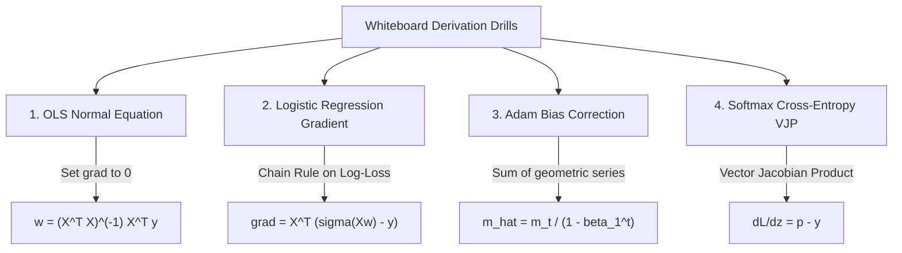
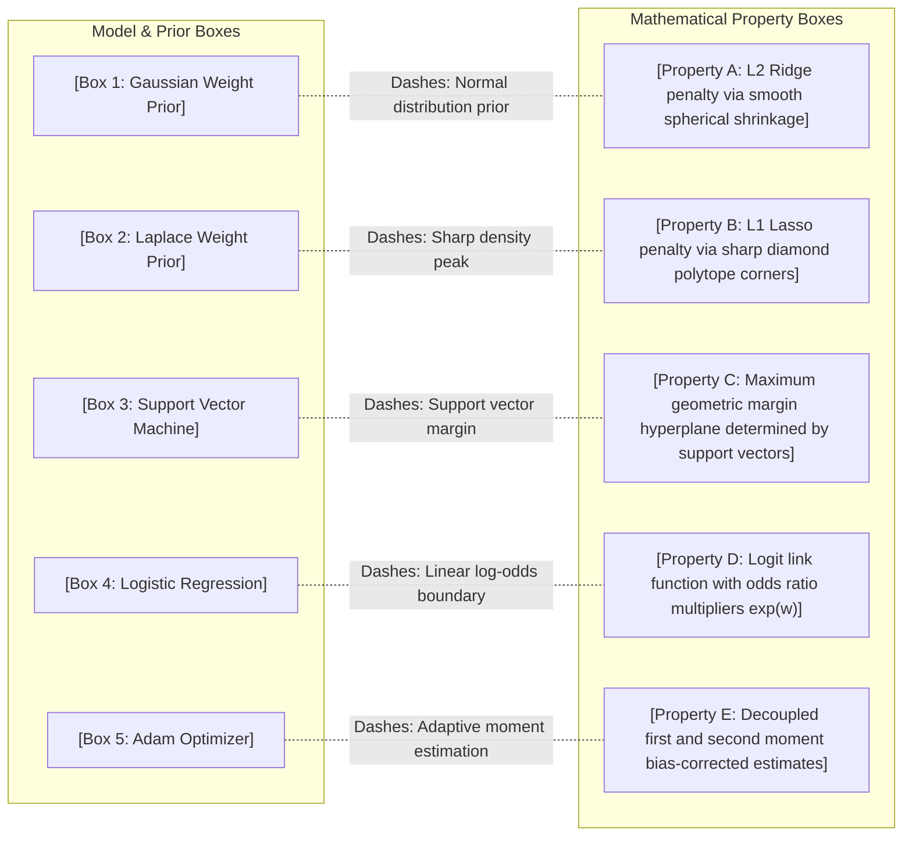

# Machine Learning Practice Arena & Active Recall Workbook

Welcome to the **Machine Learning Practice Arena**. Mastery of machine learning requires balancing two distinct skill sets: mathematical derivation fluency on the whiteboard, and vectorized numeric implementation speed in code.

> [!TIP]
> **The Active Recall Protocol:** Do not merely read proofs or copy scikit-learn boilerplate. Grab a blank notepad or digital whiteboard, derive each closed-form solution from first principles without looking at notes, and then implement the algorithm in pure NumPy.

---

## 🎯 Flagship Practice Center Links

Test yourself in the interactive browser runners:

| Practice Category | Resource | Format & Scope |
| :--- | :--- | :--- |
| **Technical Interview** | [Machine Learning & Math Interview Set](/practice/interview/machine-learning-interview) | 12 Senior Q&As on Bias-Variance, Normal Eq, Adam, SVMs, Leakage |
| **Coding Kata** | [Batch Cosine Similarity](/practice/code/vectorized-cosine-similarity) | $O(M \times N)$ Vectorized metric computation with epsilon stability |
| **Interactive Quiz** | [NumPy Arrays & Broadcasting](/practice/quizzes/numpy-arrays-and-broadcasting) | Stride manipulation, axis reduction, view vs copy rules |
| **Interactive Quiz** | [Pandas Wrangling & EDA](/practice/quizzes/pandas-wrangling-and-eda) | GroupBy split-apply-combine, missingness, leak-free transforms |
| **Interactive Quiz** | [Linear Models & Regularization](/practice/quizzes/linear-models-and-regularization) | Ridge vs Lasso geometry, odds ratios, SVM max-margin |
| **Interactive Quiz** | [ML Splitting & Evaluation Metrics](/practice/quizzes/ml-splitting-and-evaluation-metrics) | PR-AUC vs ROC-AUC, StratifiedKFold, F-beta calibration |

---

## 📝 Whiteboard Mathematical Derivation Drills

Before an ML systems interview, ensure you can reproduce these derivations on a whiteboard in under 10 minutes each:



### Drill 1: Ordinary Least Squares (OLS) Normal Equation
1. Write the residual sum of squares in matrix notation:
   $$J(w) = \frac{1}{2} \|Xw - y\|_2^2 = \frac{1}{2} (Xw - y)^T (Xw - y)$$
2. Expand the quadratic matrix product into individual terms:
   $$J(w) = \frac{1}{2} \left( w^T X^T X w - 2 y^T X w + y^T y \right)$$
3. Take the matrix derivative with respect to vector $w$:
   $$\nabla_w J(w) = X^T X w - X^T y$$
4. Set $\nabla_w J(w) = 0$ and multiply by $(X^T X)^{-1}$ to isolate $w$:
   $$w^* = (X^T X)^{-1} X^T y$$
5. **Interview Follow-Up:** What makes $X^T X$ non-invertible? Answer: Multicollinearity (linearly dependent columns) or when $p > n$ (more features than samples). Ridge regression solves this by adding $\lambda I$, ensuring all eigenvalues are strictly positive.

---

### Drill 2: Logistic Regression Gradient Derivation
1. Write the negative log-likelihood for binary cross-entropy loss:
   $$J(w) = -\sum_{i=1}^n \left[ y_i \ln(\hat{y}_i) + (1 - y_i) \ln(1 - \hat{y}_i) \right]$$
   where $\hat{y}_i = \sigma(z_i) = \frac{1}{1 + e^{-z_i}}$ and $z_i = w^T x_i$.
2. Prove that the derivative of the sigmoid function is $\sigma'(z) = \sigma(z)(1 - \sigma(z))$.
3. Apply the scalar chain rule $\frac{\partial J}{\partial w_j} = \frac{\partial J}{\partial \hat{y}} \frac{\partial \hat{y}}{\partial z} \frac{\partial z}{\partial w_j}$:
   $$\frac{\partial J}{\partial w_j} = \sum_{i=1}^n \left( \frac{\hat{y}_i - y_i}{\hat{y}_i(1 - \hat{y}_i)} \right) \cdot \left( \hat{y}_i (1 - \hat{y}_i) \right) \cdot x_{ij} = \sum_{i=1}^n (\hat{y}_i - y_i) x_{ij}$$
4. Express the final gradient in clean matrix notation:
   $$\nabla_w J(w) = X^T (\hat{y} - y) = X^T (\sigma(Xw) - y)$$

---

### Drill 3: Adam Optimizer Bias Correction Proof
1. In Adam, the first moment estimate is $m_t = \beta_1 m_{t-1} + (1 - \beta_1) g_t$.
2. Assuming $m_0 = 0$, unroll the recurrence relation:
   $$m_t = (1 - \beta_1) \sum_{i=1}^t \beta_1^{t - i} g_i$$
3. Take mathematical expectation $\mathbb{E}[m_t]$, assuming gradients $g_i$ come from a stationary distribution with mean $\mathbb{E}[g]$:
   $$\mathbb{E}[m_t] = \mathbb{E}\left[ (1 - \beta_1) \sum_{i=1}^t \beta_1^{t - i} g_i \right] \approx \mathbb{E}[g] (1 - \beta_1) \sum_{k=0}^{t-1} \beta_1^k$$
4. Sum the finite geometric series $\sum_{k=0}^{t-1} \beta_1^k = \frac{1 - \beta_1^t}{1 - \beta_1}$:
   $$\mathbb{E}[m_t] = \mathbb{E}[g] (1 - \beta_1) \frac{1 - \beta_1^t}{1 - \beta_1} = \mathbb{E}[g] (1 - \beta_1^t)$$
5. Show why dividing by $(1 - \beta_1^t)$ provides an unbiased estimator $\hat{m}_t = \frac{m_t}{1 - \beta_1^t}$ during initial steps ($t \to 1$).

---

## ⚡ NumPy Vectorization Speed-Run Katas

Practice these 4 katas in an interactive Python shell without using loops or external packages:

### Kata 1: Vectorized Pairwise Euclidean Distance Matrix
Given matrix $A \in \mathbb{R}^{M \times D}$ and $B \in \mathbb{R}^{N \times D}$, compute $D_{ij} = \|A_i - B_j\|_2$ using the expansion $\|a - b\|^2 = \|a\|^2 + \|b\|^2 - 2 a^T b$:
```python
import numpy as np

def pairwise_distances(A: np.ndarray, B: np.ndarray) -> np.ndarray:
    # A: (M, D), B: (N, D)
    a_sq = np.sum(A**2, axis=1, keepdims=True)  # (M, 1)
    b_sq = np.sum(B**2, axis=1, keepdims=True)  # (N, 1)
    dists_sq = a_sq + b_sq.T - 2 * np.dot(A, B.T)
    return np.sqrt(np.maximum(dists_sq, 0.0))
```

### Kata 2: One-Hot Encoding Matrix Generation
Convert an integer class label vector $y \in \mathbb{R}^N$ into an $N \times K$ one-hot matrix using identity indexing:
```python
def to_one_hot(y: np.ndarray, num_classes: int) -> np.ndarray:
    return np.eye(num_classes)[y]
```

### Kata 3: Batch Softmax with Log-Sum-Exp Trick
```python
def stable_softmax(z: np.ndarray) -> np.ndarray:
    # z: (N, K)
    shift_z = z - np.max(z, axis=-1, keepdims=True)
    exps = np.exp(shift_z)
    return exps / np.sum(exps, axis=-1, keepdims=True)
```

### Kata 4: Gini Impurity of a Target Split
```python
def gini_impurity(y: np.ndarray) -> float:
    if len(y) == 0:
        return 0.0
    _, counts = np.unique(y, return_counts=True)
    probabilities = counts / len(y)
    return 1.0 - np.sum(probabilities**2)
```

---

## 🛡️ Production Leak-Free Audit Checklist

Before committing any ML model pipeline to production, verify each requirement:

- [ ] **Temporal Split:** Did you split chronologically (`TimeSeriesSplit`) rather than randomly (`train_test_split`) for time-dependent records?
- [ ] **Transformer Scoping:** Are all `StandardScaler`, `SimpleImputer`, and `OneHotEncoder` objects wrapped inside a scikit-learn `Pipeline` so `.fit()` runs strictly on training folds?
- [ ] **Target Encoding Cross-Validation:** Is target encoding calculated out-of-fold (`TargetEncoder(cv=5)`) to avoid overfitting label information into features?
- [ ] **Group Independence:** If records belong to the same entity (e.g., patient, customer, organization), did you use `GroupKFold` so an entity never appears in both train and validation folds?
- [ ] **Imbalance Metric Alignment:** Is evaluation based on PR-AUC or cost-weighted utility rather than raw accuracy when positive event rate is $< 5\%$?

---

## 🧩 Box-Joining & Dash-Matching Active Recall Drills

Connect machine learning modeling components across dashed lines to reinforce mathematical associations:



---

## ✍️ Fill-in-the-Blanks with Dashes (`___`) Speed Drills

- [ ] **1. OLS Closed-Form Solution:** The Ordinary Least Squares Normal Equation is $w = (X^T X)^{-1} X^T y$; it becomes singular when features exhibit `_______` (multicollinearity/heteroskedasticity) or when features exceed samples ($p > n$). *(Answer: multicollinearity)*
- [ ] **2. Sigmoid Gradient Cancellation:** In binary classification, combining Sigmoid activation with Binary Cross-Entropy loss cancels out the saturating derivative $\sigma'(z)$, leaving a clean error gradient of $\nabla_w J = X^T (\sigma(Xw) - `____`)$. *(Answer: $y$)*
- [ ] **3. Metric Skew Selection:** Under severe class skew (e.g. 0.1% fraud), `_______` (ROC-AUC/PR-AUC) gives a misleadingly optimistic score because True Negatives dominate the denominator of False Positive Rate, making `_______` (PR-AUC/Accuracy) the essential metric. *(Answer: ROC-AUC; PR-AUC)*
- [ ] **4. Ridge Condition Number:** Adding $\lambda I$ to $X^T X$ increases every eigenvalue $\lambda_i$ by $\lambda > 0$, shifting the matrix condition number toward `____`, guaranteeing numerical invertibility. *(Answer: 1.0)*
- [ ] **5. Adam First Moment:** In Adam optimization, dividing $m_t$ by $(1 - \beta_1^t)$ provides an `_______` (unbiased/overfitted) estimator during initial training steps when $t \to 1$. *(Answer: unbiased)*


