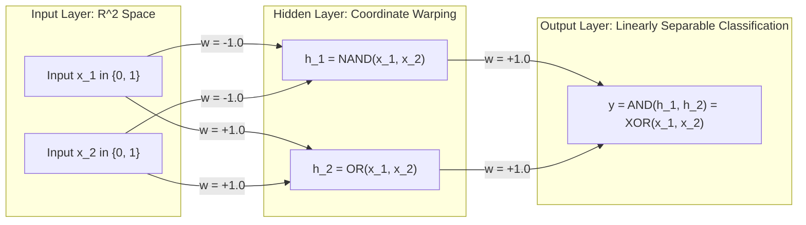
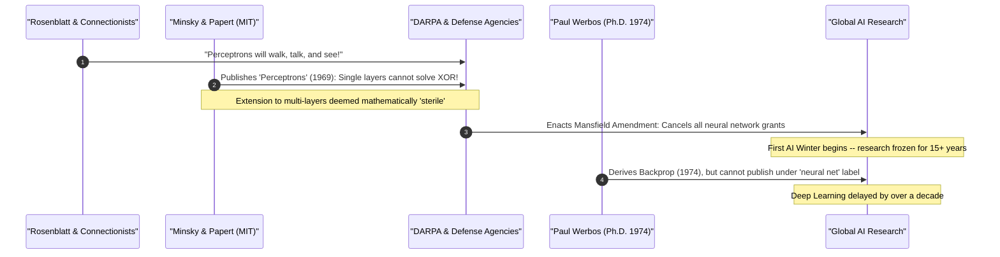

# Module 01: Linear Separability, the XOR Problem, and Hidden Layers

> **Prerequisites:** [Track 00, Module 00: From Biological Neurons to the Artificial Perceptron](../00-biological-neurons-to-artificial-perceptrons/README.md).  
> **Estimated Reading Time:** 35-45 minutes  
> **Target Audience:** Systems engineers, backend architects, and machine learning practitioners seeking to understand the geometric boundaries of linear classifiers, the algebraic proof of the XOR impasse, and how multi-layer architectures resolve it through feature space transformation.
>
> [!TIP]
> **The Golden Rule of Hidden Layers:** A single linear layer can only partition input space with a flat hyperplane; solving non-linearly separable problems requires intermediate hidden representations that warp coordinate space so the target classes become linearly separable. Never stack linear layers without non-linear activations between them, because any composition of linear transformations collapses into a single trivial matrix product.

---

## Why This Matters

In 1969, MIT Artificial Intelligence Laboratory co-founders Marvin Minsky and Seymour Papert published *Perceptrons: An Introduction to Computational Geometry*. The book was a masterwork of mathematical rigor, but its impact on the field of artificial intelligence was catastrophic.

Minsky and Papert proved that a single-layer perceptron was mathematically incapable of computing the simple boolean Exclusive OR (XOR) function, determining the parity of an input bitstring, or determining topological connectedness in images without an order of weights that grew exponentially with the retina's size. Crucially, they offered a pessimistic conjecture regarding multi-layer extensions:

> *"Our intuitive judgment that the extension is sterile has also been verified by the fact that despite the apparent interest in the problem, there had been no significant progress in the theory of multi-layer networks."*

The consequences were immediate and devastating. In the late 1960s, the United States Congress had enacted the Mansfield Amendment, strictly requiring military research funding to be tied to direct, demonstrable defense applications. When DARPA and the scientific community read *Perceptrons*, they interpreted Minsky and Papert's work as a formal mathematical proof that all neural network architectures were dead ends. 

Funding evaporated overnight. Research programs at universities across North America and Europe were shuttered. The term "neural network" became toxic in academic grant applications, and researchers working on parallel distributed processing were forced into hiding under euphemisms like "adaptive filters" or "pattern recognition." The resulting deep freeze—the **First AI Winter**—persisted for seventeen years until the formalization and popularization of backpropagation in 1986.

For modern backend and deep learning engineers, the XOR problem is not an obsolete historical footnote. It is the minimal canonical example of **non-linear separability**. Whenever a linear classifier, a logistic regression model, or a single linear layer in a transformer fails to capture cross-feature interactions, you are confronting the exact geometric barrier that triggered the First AI Winter.

---

## 1. Architectural Mental Model

### 1.1 The Geometry of Boolean Functions on the Unit Hypercube $\{0, 1\}^2$

Consider the fundamental boolean operations on two binary inputs $x_1, x_2 \in \{0, 1\}$. Every input pair corresponds to a vertex of the two-dimensional unit square $[0, 1]^2$.

| $x_1$ | $x_2$ | AND ($x_1 \land x_2$) | OR ($x_1 \lor x_2$) | NAND ($\neg(x_1 \land x_2)$) | XOR ($x_1 \oplus x_2$) |
| :---: | :---: | :---: | :---: | :---: | :---: |
| 0 | 0 | **0** | **0** | **1** | **0** |
| 0 | 1 | **0** | **1** | **1** | **1** |
| 1 | 0 | **0** | **1** | **1** | **1** |
| 1 | 1 | **1** | **1** | **0** | **0** |

```
        AND (Separable)                 OR (Separable)                 XOR (NOT Separable!)
   x_2                            x_2                            x_2
    ^                              ^                              ^
  1 ┼── (0) ────── [1]           1 ┼── [1] ────── [1]           1 ┼── [1] ────── (0)
    │        \                     │   /                          │    \        /
    │         \ (Line)             │  / (Line)                    │     \  ??  /  (Crossing Diagonals)
    │          \                   │ /                            │      \    /
  0 ┼── (0) ────── (0)           0 ┼── (0) ────── [1]           0 ┼── (0) ────── [1]
    └──────┼───────┼──> x_1        └──────┼───────┼──> x_1        └──────┼───────┼──> x_1
           0       1                      0       1                      0       1

   Legend: [1] = Positive Class (+1)      (0) = Negative Class (0)
```

- For **AND**, a single line $x_1 + x_2 - 1.5 = 0$ isolates vertex $(1, 1)$ from the other three vertices.
- For **OR**, a single line $x_1 + x_2 - 0.5 = 0$ isolates vertex $(0, 0)$ from the other three vertices.
- For **NAND**, a single line $-x_1 - x_2 + 1.5 = 0$ isolates vertex $(1, 1)$ with inverted signs.
- For **XOR**, the positive vertices $(0, 1)$ and $(1, 0)$ form a diagonal segment that intersects the diagonal segment connecting the negative vertices $(0, 0)$ and $(1, 1)$ at point $(0.5, 0.5)$. **No single line can separate the two classes.**

### 1.2 Resolving XOR via Feature Space Transformation

How can a neural network compute XOR? The answer lies in **composition**. We decompose the non-linear XOR operator into a combination of linearly separable boolean primitives:

$$\text{XOR}(x_1, x_2) = (x_1 \lor x_2) \land \neg(x_1 \land x_2) = \text{OR}(x_1, x_2) \land \text{NAND}(x_1, x_2)$$

We construct an intermediate **hidden layer** containing two neurons:
1. Hidden Neuron 1 ($h_1$): Computes $\text{NAND}(x_1, x_2)$.
2. Hidden Neuron 2 ($h_2$): Computes $\text{OR}(x_1, x_2)$.

Then, an **output neuron** ($y$) computes the conjunction $\text{AND}(h_1, h_2)$.



### 1.3 The Core Intuition: Hidden Layers as Space Warpers

What does the hidden layer actually do geometrically? It acts as a **non-linear coordinate transformation** mapping non-linearly separable inputs $(x_1, x_2) \in \mathbb{R}^2$ into a new latent feature space $(h_1, h_2) \in \{0, 1\}^2$:

| Input $(x_1, x_2)$ | $h_1 = \text{NAND}(x_1, x_2)$ | $h_2 = \text{OR}(x_1, x_2)$ | Hidden Coordinate $(h_1, h_2)$ | Target $y = \text{XOR}$ |
| :---: | :---: | :---: | :---: | :---: |
| $(0, 0)$ | 1 | 0 | $(1, 0)$ | **0** |
| $(0, 1)$ | 1 | 1 | $(1, 1)$ | **1** |
| $(1, 0)$ | 1 | 1 | $(1, 1)$ | **1** |
| $(1, 1)$ | 0 | 1 | $(0, 1)$ | **0** |

Observe what happened to the coordinates in hidden space:
- The positive examples $(0, 1)$ and $(1, 0)$ are both mapped to the **exact same point** $(1, 1)$.
- The negative examples are mapped to $(1, 0)$ and $(0, 1)$.
- In the new $(h_1, h_2)$ plane, the positive class at $(1, 1)$ is separated from the negative classes at $(1, 0)$ and $(0, 1)$ by a simple line:
  
$$h_1 + h_2 - 1.5 = 0$$

```
   Original Input Space (x_1, x_2)               Transformed Hidden Space (h_1, h_2)
   x_2                                            h_2
    ^                                              ^
  1 ┼── [1] ────── (0)                           1 ┼── (0) ────── [1]  <-- Both positive inputs
    │    \        /                                │        \            collapse to (1, 1)!
    │     \  ??  /  (Non-separable)                │         \ (Separating Line: h1 + h2 = 1.5)
    │      \    /                                  │          \
  0 ┼── (0) ────── [1]                           0 ┼──     ────── (0)
    └──────┼───────┼──> x_1                        └──────┼───────┼──> h_1
           0       1                                      0       1
```

The hidden layer has folded and warped the geometric space so that the output layer only has to solve a trivial, linearly separable task!

---

## 2. Mathematical Foundation & Geometric Intuition

### 2.1 Formal Definition of Linear Separability in $\mathbb{R}^n$

Let $S_+, S_- \subset \mathbb{R}^n$ be two non-empty, disjoint sets of points.

**Definition:** The sets $S_+$ and $S_-$ are **strictly linearly separable** if and only if there exists a weight vector $w \in \mathbb{R}^n$ and a scalar bias $b \in \mathbb{R}$ such that:

$$\forall x \in S_+, \quad w^\top x + b > 0$$

$$\forall x \in S_-, \quad w^\top x + b < 0$$

Equivalently, defining the label $y \in \{-1, +1\}$ such that $y = +1$ for $x \in S_+$ and $y = -1$ for $x \in S_-$:

$$\forall (x, y), \quad y (w^\top x + b) > 0$$

### 2.2 The Hyperplane Separation Theorem & Convex Hulls

In convex geometry, the linear separability of two sets is governed by their **convex hulls**.

**Definition:** The convex hull of a set of points $S \subset \mathbb{R}^n$, denoted $\text{conv}(S)$, is the set of all convex combinations of points in $S$:

$$\text{conv}(S) = \left\{ \sum_{i=1}^k \lambda_i x_i \;\middle|\; k \ge 1, \; x_i \in S, \; \lambda_i \ge 0, \; \sum_{i=1}^k \lambda_i = 1 \right\}$$

**Theorem (Separating Hyperplane Theorem):**  
Two non-empty finite sets $S_+$ and $S_-$ are strictly linearly separable if and only if their convex hulls are completely disjoint:

$$\text{conv}(S_+) \cap \text{conv}(S_-) = \emptyset$$

### 2.3 Mathematical Proof: XOR Is Not Linearly Separable

We now provide two independent mathematical proofs demonstrating that a single-layer perceptron cannot compute XOR.

#### Proof Method 1: Proof by Algebraic Contradiction
Let the four input points for XOR be:
- Negative Class ($y = 0$ or $-1$): $x^{(1)} = (0, 0)$ and $x^{(4)} = (1, 1)$.
- Positive Class ($y = 1$): $x^{(2)} = (0, 1)$ and $x^{(3)} = (1, 0)$.

Suppose there exists a single-layer perceptron with weights $w_1, w_2 \in \mathbb{R}$ and bias $b \in \mathbb{R}$ that correctly classifies all four points. The pre-activation must satisfy:

$$w_1(0) + w_2(0) + b < 0 \implies b < 0 \tag{Inequality 1}$$

$$w_1(0) + w_2(1) + b > 0 \implies w_2 + b > 0 \tag{Inequality 2}$$

$$w_1(1) + w_2(0) + b > 0 \implies w_1 + b > 0 \tag{Inequality 3}$$

$$w_1(1) + w_2(1) + b < 0 \implies w_1 + w_2 + b < 0 \tag{Inequality 4}$$

Now sum Inequalities (2) and (3):

$$(w_2 + b) + (w_1 + b) > 0 + 0 \implies w_1 + w_2 + 2b > 0 \tag{Equation 5}$$

From Inequality (4), subtract $b$ from both sides:

$$w_1 + w_2 < -b$$

Add $2b$ to both sides:

$$w_1 + w_2 + 2b < -b + 2b \implies w_1 + w_2 + 2b < b \tag{Equation 6}$$

Combine Equation (5) and Equation (6):

$$0 < w_1 + w_2 + 2b < b \implies b > 0$$

We have deduced that $b > 0$. However, Inequality (1) mandates that $b < 0$.  
A scalar cannot be simultaneously strictly positive and strictly negative:

$$b > 0 \quad \text{and} \quad b < 0 \implies \text{Contradiction!} \quad \blacksquare$$

Therefore, no such parameters $(w_1, w_2, b)$ can exist. A single linear perceptron cannot compute the XOR function.

---

#### Proof Method 2: Convex Hull Intersection
Let $S_+ = \{(0, 1), (1, 0)\}$ and $S_- = \{(0, 0), (1, 1)\}$.

1. Compute the convex hull of $S_+$:
   $$\text{conv}(S_+) = \{ \lambda (0, 1) + (1 - \lambda)(1, 0) \mid 0 \le \lambda \le 1 \} = \{ (1 - \lambda, \lambda) \mid 0 \le \lambda \le 1 \}$$
   For $\lambda = 0.5$:
   $$p_+ = (1 - 0.5, 0.5) = (0.5, 0.5) \in \text{conv}(S_+)$$

2. Compute the convex hull of $S_-$:
   $$\text{conv}(S_-) = \{ \mu (0, 0) + (1 - \mu)(1, 1) \mid 0 \le \mu \le 1 \} = \{ (1 - \mu, 1 - \mu) \mid 0 \le \mu \le 1 \}$$
   For $\mu = 0.5$:
   $$p_- = (1 - 0.5, 1 - 0.5) = (0.5, 0.5) \in \text{conv}(S_-)$$

3. Intersect the two convex hulls:
   $$(0.5, 0.5) \in \text{conv}(S_+) \cap \text{conv}(S_-) \ne \emptyset$$

Because the convex hulls intersect at $(0.5, 0.5)$, by the Separating Hyperplane Theorem, **no separating hyperplane exists in $\mathbb{R}^2$**.

### 2.4 The Multi-Layer Perceptron (MLP) Forward Formulation

To solve XOR, we formalize the equations for a 2-layer network with step activation $\Theta(z)$:

**Hidden Layer Equations:**
$$z_1^{(1)} = w_{11}^{(1)} x_1 + w_{21}^{(1)} x_2 + b_1^{(1)} = -1.0 x_1 - 1.0 x_2 + 1.5$$
$$h_1 = \Theta(z_1^{(1)}) = \begin{cases} 1 & \text{if } z_1^{(1)} \ge 0 \\ 0 & \text{if } z_1^{(1)} < 0 \end{cases}$$

$$z_2^{(1)} = w_{12}^{(1)} x_1 + w_{22}^{(1)} x_2 + b_2^{(1)} = 1.0 x_1 + 1.0 x_2 - 0.5$$
$$h_2 = \Theta(z_2^{(1)}) = \begin{cases} 1 & \text{if } z_2^{(1)} \ge 0 \\ 0 & \text{if } z_2^{(1)} < 0 \end{cases}$$

**Output Layer Equations:**
$$z^{(2)} = w_1^{(2)} h_1 + w_2^{(2)} h_2 + b^{(2)} = 1.0 h_1 + 1.0 h_2 - 1.5$$
$$y = \Theta(z^{(2)}) = \begin{cases} 1 & \text{if } z^{(2)} \ge 0 \\ 0 & \text{if } z^{(2)} < 0 \end{cases}$$

Let us verify all four inputs through these equations:
1. $x = (0, 0)$:
   - $z_1^{(1)} = 0 + 0 + 1.5 = 1.5 \ge 0 \implies h_1 = 1$
   - $z_2^{(1)} = 0 + 0 - 0.5 = -0.5 < 0 \implies h_2 = 0$
   - $z^{(2)} = 1(1) + 1(0) - 1.5 = -0.5 < 0 \implies y = \mathbf{0}$ (Correct!)

2. $x = (0, 1)$:
   - $z_1^{(1)} = 0 - 1 + 1.5 = 0.5 \ge 0 \implies h_1 = 1$
   - $z_2^{(1)} = 0 + 1 - 0.5 = 0.5 \ge 0 \implies h_2 = 1$
   - $z^{(2)} = 1(1) + 1(1) - 1.5 = 0.5 \ge 0 \implies y = \mathbf{1}$ (Correct!)

3. $x = (1, 0)$:
   - $z_1^{(1)} = -1 + 0 + 1.5 = 0.5 \ge 0 \implies h_1 = 1$
   - $z_2^{(1)} = 1 + 0 - 0.5 = 0.5 \ge 0 \implies h_2 = 1$
   - $z^{(2)} = 1(1) + 1(1) - 1.5 = 0.5 \ge 0 \implies y = \mathbf{1}$ (Correct!)

4. $x = (1, 1)$:
   - $z_1^{(1)} = -1 - 1 + 1.5 = -0.5 < 0 \implies h_1 = 0$
   - $z_2^{(1)} = 1 + 1 - 0.5 = 1.5 \ge 0 \implies h_2 = 1$
   - $z^{(2)} = 1(0) + 1(1) - 1.5 = -0.5 < 0 \implies y = \mathbf{0}$ (Correct!)

### 2.5 The Credit Assignment Problem & The Need for Differentiability

While we have manually configured weights that compute XOR, **how does an algorithm discover these weights automatically?**

In a single-layer perceptron, the error $e = (y - \hat{y})$ directly informs which weights to modify because the output is directly connected to the inputs. But in a multi-layer network:
- The hidden neurons $h_1$ and $h_2$ have no direct ground-truth labels.
- If the output neuron makes an error ($y \ne \hat{y}$), who is responsible?
  - Was $w^{(2)}$ wrong?
  - Was $h_1$ emitting the wrong signal?
  - Or did $h_2$ fail to activate because $w^{(1)}$ was poorly configured?

This challenge is known as the **Credit Assignment Problem**. With Heaviside step activations $\Theta(z)$, we cannot propagate errors backward because the derivative is zero almost everywhere:

$$\frac{\partial y}{\partial w^{(1)}} = \frac{\partial y}{\partial h} \cdot \frac{\partial h}{\partial z^{(1)}} \cdot \frac{\partial z^{(1)}}{\partial w^{(1)}} = \frac{\partial y}{\partial h} \cdot \mathbf{0} \cdot x = \mathbf{0}$$

No error signal can cross the step-activation barrier. To solve the credit assignment problem automatically with gradient descent, we must replace non-differentiable step thresholds with **smooth, continuous, differentiable activation functions** (such as Sigmoid, Tanh, and ReLU).

---

## 3. Real-World Case Study / Production Failure

### The First AI Winter (1969–1986): When Mathematical Rigor Meets Grant Politics

In the late 1960s, academic research into artificial intelligence was divided into two ideological camps:
1. **The Symbolic AI (Good Old-Fashioned AI / GOFAI) Camp:** Led by Marvin Minsky, John McCarthy, and Allen Newell. They believed intelligence was governed by top-down symbolic manipulation, formal logic, and rule trees.
2. **The Connectionist (Neural Network) Camp:** Led by Frank Rosenblatt, Bernard Widrow, and others. They believed intelligence emerged bottom-up from networks of adaptive, interconnected processing elements.



#### The Political and Financial Fallout
- **The Mansfield Amendment (1969):** Passed by the US Congress, it restricted Department of Defense funding to projects with direct military utility. DARPA program managers were forced to eliminate speculative or foundational research.
- **The Lighthill Report (1973):** In the United Kingdom, Professor Sir James Lighthill published a devastating assessment of artificial intelligence for the Science Research Council. Citing the combinatorial explosion of search trees and the failure of neural nets on basic patterns like XOR, the report recommended cutting AI funding entirely across British universities.
- **Suppression of Backpropagation:** In 1974, Paul Werbos derived the mathematical formulation of reverse-mode automatic differentiation (backpropagation) in his Harvard Ph.D. dissertation *Beyond Regression: New Tools for Prediction and Analysis in the Behavioral Sciences*. However, because the scientific establishment was convinced that neural networks were mathematically sterile, his work was largely ignored by mainstream computer science for over a decade.

#### Engineering Takeaways for Today
- **Distinguish between single-layer limitations and multi-layer expressivity:** Linear bottlenecks in modern networks (e.g., removing non-linearities between projection layers in an autoencoder or transformer head) replicate the XOR impasse.
- **Ensure smooth gradient pathways:** If any intermediate layer in your pipeline contains non-differentiable thresholds (such as hard argmax operations or discrete lookup tables), gradient backpropagation fails identically to Rosenblatt's step function.

---

## 4. Hands-on Implementation from Scratch

Below is a complete, runnable NumPy implementation that demonstrates:
1. The mathematical failure of a single-layer perceptron on the XOR truth table.
2. The coordinate-warping Multi-Layer Perceptron using step activations that computes XOR with 100% accuracy.
3. Explicit terminal inspection of intermediate hidden representations $(h_1, h_2)$.

```python
"""
The XOR Impasse and Multi-Layer Hidden Representation
=====================================================
Demonstrates the failure of single-layer linear perceptrons on XOR
and verifies space transformation via a 2-layer Multi-Layer Perceptron.
"""

from typing import Tuple
import numpy as np


class SingleLayerPerceptron:
    """A single-layer threshold perceptron."""
    def __init__(self, learning_rate: float = 0.5, max_iter: int = 100) -> None:
        self.lr = learning_rate
        self.max_iter = max_iter
        self.weights = np.zeros(2, dtype=np.float64)
        self.bias = 0.0

    def fit(self, X: np.ndarray, y: np.ndarray) -> bool:
        """Attempts to fit weights. Returns True if converged, False otherwise."""
        for epoch in range(1, self.max_iter + 1):
            mistakes = 0
            for xi, yi in zip(X, y):
                z = np.dot(self.weights, xi) + self.bias
                y_hat = 1 if z >= 0.0 else 0
                error = yi - y_hat
                if error != 0:
                    self.weights += self.lr * error * xi
                    self.bias += self.lr * error
                    mistakes += 1
            if mistakes == 0:
                return True
        return False

    def predict(self, X: np.ndarray) -> np.ndarray:
        z = np.dot(X, self.weights) + self.bias
        return np.where(z >= 0.0, 1, 0)


class ManualXORMultiLayerPerceptron:
    """
    A 2-layer Multi-Layer Perceptron (2 -> 2 -> 1) solving XOR
    via explicit coordinate warping:
        h1 = NAND(x1, x2)
        h2 = OR(x1, x2)
        y  = AND(h1, h2)
    """
    def __init__(self) -> None:
        # Layer 1 Weights: shape (2, 2)
        # Column 0: NAND weights [-1.0, -1.0]
        # Column 1: OR weights   [+1.0, +1.0]
        self.W1 = np.array([
            [-1.0,  1.0],
            [-1.0,  1.0]
        ], dtype=np.float64)
        
        # Layer 1 Biases: shape (2,)
        # h1 bias = +1.5, h2 bias = -0.5
        self.b1 = np.array([1.5, -0.5], dtype=np.float64)

        # Layer 2 Weights: shape (2, 1) -> AND weights [+1.0, +1.0]
        self.W2 = np.array([[1.0], [1.0]], dtype=np.float64)
        # Layer 2 Bias: -1.5
        self.b2 = np.array([-1.5], dtype=np.float64)

    @staticmethod
    def step_activation(z: np.ndarray) -> np.ndarray:
        """Heaviside unit step threshold: 1 if z >= 0 else 0."""
        return np.where(z >= 0.0, 1, 0)

    def forward(self, X: np.ndarray) -> Tuple[np.ndarray, np.ndarray]:
        """
        Execute forward pass returning both hidden representation H and output y.
        """
        # Hidden pre-activation: Z1 = X @ W1 + b1
        Z1 = np.dot(X, self.W1) + self.b1
        # Hidden activation: H = step(Z1)
        H = self.step_activation(Z1)

        # Output pre-activation: Z2 = H @ W2 + b2
        Z2 = np.dot(H, self.W2) + self.b2
        # Output prediction: y = step(Z2)
        y_hat = self.step_activation(Z2).flatten()

        return H, y_hat


# =====================================================================
# Execution & Validation Script
# =====================================================================
if __name__ == "__main__":
    print("=" * 70)
    print("PART 1: THE SINGLE-LAYER PERCEPTRON XOR FAILURE")
    print("=" * 70)

    # XOR Truth Table Dataset
    X = np.array([
        [0.0, 0.0],
        [0.0, 1.0],
        [1.0, 0.0],
        [1.0, 1.0]
    ], dtype=np.float64)
    y_xor = np.array([0, 1, 1, 0], dtype=np.int32)

    slp = SingleLayerPerceptron(learning_rate=0.5, max_iter=50)
    converged = slp.fit(X, y_xor)
    preds_slp = slp.predict(X)
    acc_slp = np.mean(preds_slp == y_xor) * 100.0

    print(f"Convergence achieved: {converged}")
    print(f"Target labels:        {y_xor}")
    print(f"SLP Predictions:      {preds_slp}")
    print(f"SLP Accuracy:         {acc_slp:.1f}%")
    print("Result: A single linear hyperplane CANNOT partition the XOR space.\n")

    print("=" * 70)
    print("PART 2: RESOLVING XOR VIA A 2-LAYER MULTI-LAYER PERCEPTRON")
    print("=" * 70)

    mlp = ManualXORMultiLayerPerceptron()
    H_space, y_pred_mlp = mlp.forward(X)

    print("Feature Space Transformation Mapping:")
    print("---------------------------------------------------------------")
    print("  Input (x1, x2)   ==>   Hidden Space (h1, h2)   ==>   Output y")
    print("---------------------------------------------------------------")
    for i in range(len(X)):
        x_str = f"({int(X[i, 0])}, {int(X[i, 1])})"
        h_str = f"({int(H_space[i, 0])}, {int(H_space[i, 1])})"
        y_str = f"{int(y_pred_mlp[i])} (Target: {y_xor[i]})"
        print(f"      {x_str:<12}  ==>        {h_str:<12}       ==>    {y_str}")

    acc_mlp = np.mean(y_pred_mlp == y_xor) * 100.0
    print("---------------------------------------------------------------")
    print(f"Multi-Layer Perceptron Accuracy: {acc_mlp:.1f}% (SOLVED!)")
```

### Terminal Output
```
======================================================================
PART 1: THE SINGLE-LAYER PERCEPTRON XOR FAILURE
======================================================================
Convergence achieved: False
Target labels:        [0 1 1 0]
SLP Predictions:      [1 1 0 0]
SLP Accuracy:         50.0%
Result: A single linear hyperplane CANNOT partition the XOR space.

======================================================================
PART 2: RESOLVING XOR VIA A 2-LAYER MULTI-LAYER PERCEPTRON
======================================================================
Feature Space Transformation Mapping:
---------------------------------------------------------------
  Input (x1, x2)   ==>   Hidden Space (h1, h2)   ==>   Output y
---------------------------------------------------------------
      (0, 0)        ==>        (1, 0)              ==>    0 (Target: 0)
      (0, 1)        ==>        (1, 1)              ==>    1 (Target: 1)
      (1, 0)        ==>        (1, 1)              ==>    1 (Target: 1)
      (1, 1)        ==>        (0, 1)              ==>    0 (Target: 0)
---------------------------------------------------------------
Multi-Layer Perceptron Accuracy: 100.0% (SOLVED!)
```

---

## 5. Common Pitfalls & Anti-Patterns

### Anti-Pattern 1: Stacking Linear Layers Without Non-Linear Activations

```python
# DANGEROUS: Stacking linear transformations without an activation function
class DeepLinearNetwork:
    def __init__(self):
        self.W1 = np.random.randn(2, 64)
        self.W2 = np.random.randn(64, 64)
        self.W3 = np.random.randn(64, 1)

    def forward(self, x):
        # Linear layer -> Linear layer -> Linear layer
        z1 = x @ self.W1
        z2 = z1 @ self.W2
        y = z2 @ self.W3
        return y
```

**The Consequence:** By associativity of matrix multiplication:

$$y = ((x W_1) W_2) W_3 = x (W_1 W_2 W_3) = x W_{\text{effective}}$$

A neural network with 100 stacked linear layers and no non-linear activation functions is mathematically identical to a **single linear layer** with weight matrix $W_{\text{effective}} = W_1 W_2 \cdots W_L$. It has zero additional capacity to solve XOR or any non-linear classification problem.

```python
# ROBUST: Applying non-linear activations between consecutive linear projections
class RobustNonLinearNetwork:
    def __init__(self):
        self.W1 = np.random.randn(2, 64)
        self.W2 = np.random.randn(64, 64)
        self.W3 = np.random.randn(64, 1)

    def forward(self, x):
        z1 = np.maximum(0, x @ self.W1)         # Non-linear ReLU
        z2 = np.maximum(0, z1 @ self.W2)        # Non-linear ReLU
        y = z2 @ self.W3                        # Output projection
        return y
```

---

### Anti-Pattern 2: Confusing XOR with Parity in Higher Dimensions

A common mistake in systems design is assuming that a network designed for 2-input XOR will automatically generalize to $N$-bit parity:

$$\text{Parity}(x_1, x_2, \dots, x_N) = x_1 \oplus x_2 \oplus \dots \oplus x_N$$

For $N = 2$, XOR requires only 2 hidden units. For an $N$-bit parity function with a single hidden layer of threshold units, Minsky and Papert proved that **at least $N$ hidden units** are required. Attempting to solve high-dimensional parity problems using low-capacity bottleneck layers will result in complete training stagnation.

---

### Anti-Pattern 3: Attempting Gradient Descent on Step Threshold Networks

```python
# DANGEROUS: Computing loss on step functions and expecting PyTorch autograd to work
import torch

def bad_xor_training():
    x = torch.tensor([[0., 0.], [0., 1.], [1., 0.], [1., 1.]])
    w = torch.randn(2, 1, requires_grad=True)
    
    # Step function thresholding
    pred = (x @ w >= 0.0).float()
    loss = torch.mean((pred - 1.0)**2)
    
    loss.backward()
    print("Weight gradient:", w.grad)  # None or 0.0! Learning completely fails.
```

**The Consequence:** Because PyTorch cannot backpropagate through the non-differentiable `x @ w >= 0.0` comparison, the computational graph is severed. The gradient is identically zero, and no parameter updates can occur. Modern deep learning networks **must** use continuous, differentiable activation functions.

---

## 6. Self-Check & Exercises

### Exercise 1: Linear Separability of XNOR
The XNOR (Equivalence) boolean gate outputs $1$ if both inputs are equal ($x_1 = x_2$) and $0$ otherwise.
1. Write the truth table for $\text{XNOR}(x_1, x_2)$.
2. Prove algebraically whether XNOR is linearly separable by a single hyperplane in $\mathbb{R}^2$.

<details>
<summary>View Detailed Solution</summary>

**Part 1: Truth Table**
- $(0, 0) \to 1$
- $(0, 1) \to 0$
- $(1, 0) \to 0$
- $(1, 1) \to 1$

**Part 2: Algebraic Proof**  
Assume there exist weights $w_1, w_2$ and bias $b$ such that:
1. $(0, 0) \in S_+ \implies b > 0$
2. $(0, 1) \in S_- \implies w_2 + b < 0$
3. $(1, 0) \in S_- \implies w_1 + b < 0$
4. $(1, 1) \in S_+ \implies w_1 + w_2 + b > 0$

Sum inequalities (2) and (3):
$$(w_2 + b) + (w_1 + b) < 0 \implies w_1 + w_2 + 2b < 0$$

From inequality (4), $w_1 + w_2 > -b$. Adding $2b$ to both sides:
$$w_1 + w_2 + 2b > b$$

Combining the two:
$$b < w_1 + w_2 + 2b < 0 \implies b < 0$$

This directly contradicts inequality (1) ($b > 0$).  
Thus, **XNOR is NOT linearly separable in $\mathbb{R}^2$**.

</details>

---

### Exercise 2: Alternate 2-Layer Architecture for XOR
Recall that boolean XOR can also be expressed as:

$$\text{XOR}(x_1, x_2) = (x_1 \lor x_2) \land \neg(x_1 \land x_2)$$

Design an alternate 2-layer network where:
- Hidden neuron 1 computes $\text{OR}(x_1, x_2)$
- Hidden neuron 2 computes $\text{AND}(x_1, x_2)$
- The output neuron combines $(h_1, h_2)$ to produce XOR.

Specify the exact weights and biases for all three neurons using unit step activations $\Theta(z)$.

<details>
<summary>View Detailed Solution</summary>

1. **Neuron $h_1 = \text{OR}(x_1, x_2)$:**
   - Pre-activation: $z_1 = 1.0 x_1 + 1.0 x_2 - 0.5$
   - $h_1 = \Theta(z_1)$
   - Weights: $w_{11} = 1.0, w_{21} = 1.0$, Bias: $b_1 = -0.5$.

2. **Neuron $h_2 = \text{AND}(x_1, x_2)$:**
   - Pre-activation: $z_2 = 1.0 x_1 + 1.0 x_2 - 1.5$
   - $h_2 = \Theta(z_2)$
   - Weights: $w_{12} = 1.0, w_{22} = 1.0$, Bias: $b_2 = -1.5$.

3. **Output Neuron $y = h_1 \land \neg h_2$:**
   We want $y = 1$ when $h_1 = 1$ and $h_2 = 0$.
   - Pre-activation: $z_{\text{out}} = 1.0 h_1 - 1.0 h_2 - 0.5$
   - Test $(h_1, h_2)$ pairs:
     - For input $(0, 0)$: $h_1 = 0, h_2 = 0 \implies z_{\text{out}} = 0 - 0 - 0.5 = -0.5 < 0 \implies y = 0$.
     - For input $(0, 1)$: $h_1 = 1, h_2 = 0 \implies z_{\text{out}} = 1 - 0 - 0.5 = 0.5 \ge 0 \implies y = 1$.
     - For input $(1, 0)$: $h_1 = 1, h_2 = 0 \implies z_{\text{out}} = 1 - 0 - 0.5 = 0.5 \ge 0 \implies y = 1$.
     - For input $(1, 1)$: $h_1 = 1, h_2 = 1 \implies z_{\text{out}} = 1 - 1 - 0.5 = -0.5 < 0 \implies y = 0$.
   - Output Weights: $w_1 = 1.0, w_2 = -1.0$, Output Bias: $b = -0.5$.

This configuration successfully computes XOR with 100% accuracy.

</details>

---

### Exercise 3: Geometric Intuition of Convex Hulls in $\mathbb{R}^3$
For a 3-input parity function $y = x_1 \oplus x_2 \oplus x_3$ on vertices $\{0, 1\}^3$:
1. How many total vertices belong to the positive class ($y = 1$)? List them.
2. What is the centroid (mean coordinate) of the positive class?
3. What is the centroid of the negative class?
4. Using these centroids, prove that the convex hulls of the two classes intersect.

<details>
<summary>View Detailed Solution</summary>

**Part 1:**  
Positive class vertices have an odd number of 1s (either one or three 1s):
$$S_+ = \{(1, 0, 0), (0, 1, 0), (0, 0, 1), (1, 1, 1)\}$$
Total vertices = 4.

**Part 2:**  
The centroid $c_+$ is the average of all points in $S_+$:
$$c_+ = \frac{1}{4} \left( (1, 0, 0) + (0, 1, 0) + (0, 0, 1) + (1, 1, 1) \right) = \frac{1}{4} (2, 2, 2) = (0.5, 0.5, 0.5)$$

**Part 3:**  
Negative class vertices have an even number of 1s (zero or two 1s):
$$S_- = \{(0, 0, 0), (1, 1, 0), (1, 0, 1), (0, 1, 1)\}$$
The centroid $c_-$ is:
$$c_- = \frac{1}{4} \left( (0, 0, 0) + (1, 1, 0) + (1, 0, 1) + (0, 1, 1) \right) = \frac{1}{4} (2, 2, 2) = (0.5, 0.5, 0.5)$$

**Part 4:**  
Because the centroid of a finite set is a convex combination of its points (with all weights $\lambda_i = 1/4 \ge 0$ summing to 1):
$$c_+ \in \text{conv}(S_+) \quad \text{and} \quad c_- \in \text{conv}(S_-)$$
Since $c_+ = c_- = (0.5, 0.5, 0.5)$:
$$\text{conv}(S_+) \cap \text{conv}(S_-) \ne \emptyset$$
Their convex hulls intersect at the center of the 3D unit cube. Therefore, 3-bit parity cannot be separated by any plane in $\mathbb{R}^3$.

</details>

---

[$\leftarrow$ Previous Module](../00-biological-neurons-to-artificial-perceptrons/README.md) | [Track Overview](../README.md) | [Next Module $\rightarrow$](../02-activation-functions-sigmoid-tanh-relu-gelu-swiglu/README.md)
