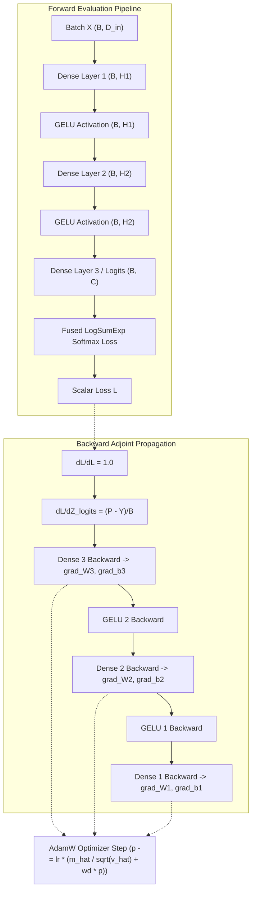

# Module 09: Capstone: Neural Network Classifier from Scratch in NumPy

> **Prerequisites:** `[Track 00, Module 08: Building a Scalar & Tensor Autograd Engine from Scratch](../08-micrograd-building-autograd-from-scratch/README.md)`  
> **Estimated Reading Time:** 40-50 minutes  
> **Target Audience:** Deep learning engineers, backend architects, and machine learning practitioners seeking to consolidate foundational knowledge by engineering a complete, modular, vector-first deep learning framework from bare NumPy.

> [!TIP]
> **The Golden Rule of Modular Neural Frameworks:** Decouple every layer into explicit forward cache and backward vector transformations, stabilize probabilities with LogSumExp before applying loss, and validate analytical Jacobian products against two-sided finite difference numerical checks before training on data. Gradients must update pre-allocated buffers in-place (`[:]`), never rebind variable pointers.

---

## Why This Matters

Every major deep learning framework—from PyTorch and JAX to TensorFlow and ONNX Runtime—is organized around a universal architectural abstraction: modular layers with cached forward activations, reverse vector-Jacobian products, numerically stabilized loss functions, and decoupled stateful optimizers.

When practitioners rely exclusively on high-level APIs like `torch.nn.Sequential` without understanding the underlying matrix calculus and memory layout, subtle defects can cause catastrophic failures in production.

Consider an incident that crippled a perception engineering team building real-time obstacle detection models for autonomous vehicles:
- A newly hired engineer was tasked with implementing a custom projection head connecting a camera backbone to a 3D bounding-box regression head.
- In their layer constructor, the engineer initialized all weight matrices to zeros:
  ```python
  # Naive initialization in custom dense layer
  self.W = np.zeros((in_features, out_features))
  self.b = np.zeros((1, out_features))
  ```
  The engineer assumed that since biases were learned and the loss was non-zero, stochastic gradient descent would naturally push the weights into distinct feature detectors.
- **The Catastrophe (Symmetry Breaking Failure):** During backpropagation, every hidden neuron in the layer received the exact same upstream gradient, computed the exact same activation value ($0.0$), and updated along identical trajectories. The layer collapsed to a rank-1 projection, reducing a 50-million parameter vision model to the expressivity of a single linear unit.
- **Production Impact:** The model trained for 48 hours on a 64-GPU cluster (\$35,000 compute cost). Validation loss flatlined, the vehicle failed standard pedestrian obstacle avoidance benchmarks, and the production release candidate was delayed by three weeks while the team audited data pipelines before discovering the zero-initialization flaw.

In this capstone module, we synthesize everything learned across Track 00. We will build a complete, object-oriented, vector-first deep learning framework in pure NumPy. We will implement He/Kaiming initialization to solve the symmetry breaking trap, code fused LogSumExp softmax cross-entropy to eliminate numerical underflow, implement modern GELU and AdamW optimizers, and rigorously verify analytical backpropagation against finite difference numerical differentiation to $10^{-10}$ precision.

---

## 1. Architectural Mental Model: The Modular Deep Learning Framework

A production-grade neural network engine decouples four orthogonal concerns:
1. **Layers (`Layer`):** Stateful or stateless computational blocks that transform tensor inputs to outputs during `forward(X)` and compute input/parameter gradients during `backward(grad_output)`.
2. **Loss Functions (`Loss`):** Objective criteria that evaluate scalar discrepancy between network predictions and ground truth, providing the initial seed gradient $\frac{\partial \mathcal{L}}{\partial Z}$.
3. **Optimizers (`Optimizer`):** Stateful update rules (like SGD with Momentum or AdamW) that consume accumulated parameter gradients and mutate weights in-place.
4. **Model Containers (`Sequential`):** Linear stacks that pipe tensors forward through layers and reverse-propagate sensitivities during backpropagation.



### Tensor Dimensions Across the Computational Pipe

In vectorized deep learning, operations are batched across $B$ independent samples to exploit SIMD and BLAS matrix-multiplication hardware:

```
Input Batch X:       (B, D_in)
Dense 1 Weights W1:  (D_in, H_1)       Bias b1: (1, H_1)
Dense 1 Output Z1:   (B, H_1)
Activation A1:       (B, H_1)
Dense 2 Weights W2:  (H_1, H_2)        Bias b2: (1, H_2)
Dense 2 Output Z2:   (B, H_2)
Activation A2:       (B, H_2)
Dense 3 Weights W3:  (H_2, C)          Bias b3: (1, C)
Logits Z3:           (B, C)
Softmax Probs P:     (B, C)
Loss L:              Scalar ()
```

---

## 2. Mathematical Foundation & Vectorized Calculus

### 2.1 Fully-Connected (Dense) Layer Matrix Derivatives

Let a mini-batch of $B$ training examples be represented as matrix $X \in \mathbb{R}^{B \times D_{\text{in}}}$.  
The affine transformation of a dense layer is:

$$Z = X W + b$$

Where:
- $W \in \mathbb{R}^{D_{\text{in}} \times D_{\text{out}}}$ is the weight matrix.
- $b \in \mathbb{R}^{1 \times D_{\text{out}}}$ is the bias vector (broadcast across all $B$ rows).
- $Z \in \mathbb{R}^{B \times D_{\text{out}}}$ is the pre-activation matrix.

During backpropagation, the layer receives the upstream gradient tensor:

$$\delta = \frac{\partial \mathcal{L}}{\partial Z} \in \mathbb{R}^{B \times D_{\text{out}}}$$

Where element $\delta_{ij} = \frac{\partial \mathcal{L}}{\partial Z_{ij}}$.

#### Derivation of Weight Gradient $\frac{\partial \mathcal{L}}{\partial W}$
By the matrix chain rule, consider an individual weight $W_{jk}$ connecting input feature $j$ to output unit $k$:

$$\frac{\partial \mathcal{L}}{\partial W_{jk}} = \sum_{i=1}^B \frac{\partial \mathcal{L}}{\partial Z_{ik}} \frac{\partial Z_{ik}}{\partial W_{jk}}$$

Since $Z_{ik} = \sum_{m=1}^{D_{\text{in}}} X_{im} W_{mk} + b_k$, we have $\frac{\partial Z_{ik}}{\partial W_{jk}} = X_{ij}$. Substituting:

$$\frac{\partial \mathcal{L}}{\partial W_{jk}} = \sum_{i=1}^B X_{ij} \delta_{ik} = \sum_{i=1}^B \left(X^T\right)_{ji} \delta_{ik} = \left(X^T \delta\right)_{jk}$$

In compact matrix notation:

$$\frac{\partial \mathcal{L}}{\partial W} = X^T \frac{\partial \mathcal{L}}{\partial Z} \quad \in \mathbb{R}^{D_{\text{in}} \times D_{\text{out}}}$$

#### Derivation of Bias Gradient $\frac{\partial \mathcal{L}}{\partial b}$
For bias component $b_k$:

$$\frac{\partial \mathcal{L}}{\partial b_k} = \sum_{i=1}^B \frac{\partial \mathcal{L}}{\partial Z_{ik}} \frac{\partial Z_{ik}}{\partial b_k} = \sum_{i=1}^B \delta_{ik} \cdot 1 = \sum_{i=1}^B \delta_{ik}$$

In compact matrix notation:

$$\frac{\partial \mathcal{L}}{\partial b} = \mathbf{1}^T \frac{\partial \mathcal{L}}{\partial Z} = \sum_{i=1}^B \delta_{i, :} \quad \in \mathbb{R}^{1 \times D_{\text{out}}}$$

#### Derivation of Downstream Input Gradient $\frac{\partial \mathcal{L}}{\partial X}$
To backpropagate sensitivity to preceding layers:

$$\frac{\partial \mathcal{L}}{\partial X_{ij}} = \sum_{k=1}^{D_{\text{out}}} \frac{\partial \mathcal{L}}{\partial Z_{ik}} \frac{\partial Z_{ik}}{\partial X_{ij}} = \sum_{k=1}^{D_{\text{out}}} \delta_{ik} W_{jk} = \sum_{k=1}^{D_{\text{out}}} \delta_{ik} \left(W^T\right)_{kj} = \left(\delta W^T\right)_{ij}$$

In compact matrix notation:

$$\frac{\partial \mathcal{L}}{\partial X} = \frac{\partial \mathcal{L}}{\partial Z} W^T \quad \in \mathbb{R}^{B \times D_{\text{in}}}$$

---

### 2.2 He / Kaiming Normal Weight Initialization

Why does random initialization scale matter?
Consider a neuron with $D_{\text{in}}$ inputs: $y = \sum_{j=1}^{D_{\text{in}}} w_j x_j$.  
Assume $w_j$ and $x_j$ are independent random variables with zero mean. The variance of the sum is:

$$\text{Var}(y) = D_{\text{in}} \cdot \text{Var}(w_j x_j) = D_{\text{in}} \cdot \text{Var}(w) \cdot \mathbb{E}[x^2]$$

If the activation function is ReLU, exactly half of the activations are zeroed out on average (assuming symmetric distribution around 0):

$$\mathbb{E}[x^2] = \frac{1}{2} \text{Var}(x)$$

Therefore:

$$\text{Var}(y) = \frac{D_{\text{in}}}{2} \cdot \text{Var}(w) \cdot \text{Var}(x)$$

To prevent the variance of activations from exponentially vanishing to zero ($\lim_{L \to \infty} \text{Var}(a_L) = 0$) or exploding to infinity ($\lim_{L \to \infty} \text{Var}(a_L) = \infty$) across $L$ layers, we must enforce:

$$\frac{D_{\text{in}}}{2} \cdot \text{Var}(w) = 1 \implies \text{Var}(w) = \frac{2}{D_{\text{in}}}$$

Thus, **He / Kaiming Normal Initialization** draws weights from:

$$W_{jk} \sim \mathcal{N}\left(0, \; \sqrt{\frac{2}{D_{\text{in}}}}\right)$$

Biases are safely initialized to zero: $b = 0$.

---

### 2.3 Non-Linear Activations: ReLU and GELU

#### Rectified Linear Unit (ReLU)
Forward pass:

$$\text{ReLU}(x) = \max(0, x)$$

Vectorized backward Jacobian product:

$$\frac{\partial \mathcal{L}}{\partial X} = \frac{\partial \mathcal{L}}{\partial Z} \odot \mathbf{1}(X > 0)$$

#### Gaussian Error Linear Unit (GELU)
Introduced by Hendrycks and Gimpel (2016), GELU weights inputs by their probability under a Gaussian distribution $\Phi(x) = P(X \le x), X \sim \mathcal{N}(0, 1)$:

$$\text{GELU}(x) = x \Phi(x) = x \cdot \frac{1}{2} \left[1 + \text{erf}\left(\frac{x}{\sqrt{2}}\right)\right]$$

To avoid expensive error function evaluations, standard systems use the tanh approximation:

$$\text{GELU}(x) \approx 0.5 \cdot x \cdot \left(1 + \tanh\left(\sqrt{\frac{2}{\pi}} \left(x + 0.044715 \, x^3\right)\right)\right)$$

Let $u = \sqrt{\frac{2}{\pi}} \left(x + 0.044715 \, x^3\right)$. The derivative via the product and chain rule is:

$$\frac{d}{dx}\text{GELU}(x) = 0.5 \cdot (1 + \tanh(u)) + 0.5 \cdot x \cdot \left(1 - \tanh^2(u)\right) \cdot \sqrt{\frac{2}{\pi}} \left(1 + 3 \times 0.044715 \, x^2\right)$$

Vectorized backward Jacobian product:

$$\frac{\partial \mathcal{L}}{\partial X} = \frac{\partial \mathcal{L}}{\partial Z} \odot \frac{d}{dx}\text{GELU}(X)$$

---

### 2.4 Fused Numerically Stable Softmax Cross-Entropy Loss

The naive evaluation of softmax followed by cross-entropy:
1. $P_k = \frac{e^{z_k}}{\sum_j e^{z_j}}$
2. $\mathcal{L} = -\sum_k y_k \log P_k$

fails catastrophically in finite-precision floating point arithmetic:
- **Overflow:** If $z_k = 1000.0$, $e^{1000} \to \infty$ (`inf`), resulting in `nan`.
- **Underflow:** If $z_k = -1000.0$, $e^{-1000} \to 0.0$, causing $\log(0) \to -\infty$.

#### The Log-Sum-Exp Trick
Notice that for any scalar shift $c$:

$$\frac{e^{z_k}}{\sum_j e^{z_j}} = \frac{e^c \cdot e^{z_k - c}}{e^c \cdot \sum_j e^{z_j - c}} = \frac{e^{z_k - c}}{\sum_j e^{z_j - c}}$$

By setting $c = \max_j z_j$, the largest exponent is $z_{\max} - z_{\max} = 0$, guaranteeing $e^0 = 1$ and preventing floating-point overflow.

The log-probability for true class $y \in \{1, \dots, C\}$ is:

$$\log P_y = z_y - \log\left(\sum_{j=1}^C e^{z_j}\right) = z_y - \left(c + \log \sum_{j=1}^C e^{z_j - c}\right)$$

The batch cross-entropy loss is:

$$\mathcal{L} = -\frac{1}{B} \sum_{i=1}^B \log P_{i, y_i}$$

#### Fused Gradient Derivation
Differentiating $\mathcal{L}$ directly with respect to logit $Z_{ik}$:

$$\frac{\partial \mathcal{L}}{\partial Z_{ik}} = \frac{1}{B} \left(P_{ik} - Y_{ik}\right)$$

Where $Y_{ik} = 1$ if $k = y_i$ and $0$ otherwise.  
This fused gradient is mathematically exact, bounded in $[-1/B, 1/B]$, and requires no unstable log or division operations during the backward sweep!

---

### 2.5 Modern Optimizers: SGD with Momentum vs. AdamW

#### Stochastic Gradient Descent (SGD) with Momentum
Standard SGD oscillates violently in narrow ravines. Momentum accumulates past gradients as velocity:

$$v_t = \beta v_{t-1} + g_t$$

$$\theta_t = \theta_{t-1} - \eta v_t$$

Where $\beta \in [0.8, 0.99]$ acts as a friction coefficient.

#### AdamW (Decoupled Weight Decay)
In standard Adam, adding an $L_2$ regularization penalty $\frac{1}{2} \lambda \|\theta\|^2$ to the loss adds $\lambda \theta$ directly into the gradient $g_t$. However, Adam scales updates by $\frac{1}{\sqrt{v_t}}$. Consequently, weights with historically large gradients receive *less* weight decay than weights with small gradients!

Loshchilov and Hutter (2019) resolved this by decoupling weight decay from gradient moment updates:

$$m_t = \beta_1 m_{t-1} + (1 - \beta_1) g_t \quad \text{(Biased 1st Moment)}$$

$$v_t = \beta_2 v_{t-1} + (1 - \beta_2) g_t^2 \quad \text{(Biased 2nd Moment)}$$

$$\hat{m}_t = \frac{m_t}{1 - \beta_1^t}, \quad \hat{v}_t = \frac{v_t}{1 - \beta_2^t} \quad \text{(Bias Correction)}$$

$$\theta_t = \theta_{t-1} - \eta \cdot \lambda \theta_{t-1} - \frac{\eta}{\sqrt{\hat{v}_t} + \epsilon} \hat{m}_t \quad \text{(Decoupled Update)}$$

---

## 3. Real-World Case Study / Production Failure: Symmetry Breaking Failure and Numerical Underflow

```
               Symmetry Breaking Collapse (W = 0)
         Input Layer (2)       Hidden Layer (3)       Output
             x1 ────────────┐     h1 = 0.0 ──┐
                            ├─►              ├─► y = 0.0
             x2 ────────────┤     h2 = 0.0 ──┤
                            │                │
                            └─►   h3 = 0.0 ──┘
         --------------------------------------------------
         During Backward Pass:
         dL/dh1 = dL/dh2 = dL/dh3 (Identical gradients!)
         Weights W1, W2, W3 receive identical updates forever!
         Effective capacity: Collapsed to 1 neuron!
```

### The Scenario
A machine learning team built a neural network to detect fraudulent transactions from 28 numerical features. In an effort to keep initial predictions neutral (zero probability of fraud), an engineer initialized all dense layers with zero weights and zero biases:
```python
W = np.zeros((28, 64))
b = np.zeros((1, 64))
```

### Mathematical Proof of Rank Collapse
1. **Identical Forward Activation:** For any input vector $x \in \mathbb{R}^{28}$:
   $$z_k = \sum_{j=1}^{28} x_j W_{jk} + b_k = 0 \quad \forall k \in \{1, \dots, 64\}$$
   Every hidden neuron outputs $a_k = \text{ReLU}(0) = 0$.
2. **Identical Upstream Gradient:** The output layer evaluates loss and propagates back $\delta_{\text{out}}$. Since $W_{\text{out}} = 0$, every hidden neuron receives the exact same gradient.
3. **Identical Weight Updates:** For any two neurons $k_1$ and $k_2$ in the hidden layer:
   $$\frac{\partial \mathcal{L}}{\partial W_{j, k_1}} = x_j \delta_{k_1} = x_j \delta_{k_2} = \frac{\partial \mathcal{L}}{\partial W_{j, k_2}}$$
4. **Permanent Invariance:** After any number of SGD, Momentum, or Adam updates:
   $$W_{j, k_1}^{(t)} = W_{j, k_2}^{(t)} \quad \forall t$$
   No matter how many millions of training examples are streamed through the network, all 64 hidden neurons compute the exact same feature. The network behaves as if it has only **1 hidden neuron**.

### The Production Resolution
By switching to He / Kaiming normal initialization:
```python
std = np.sqrt(2.0 / in_features)
W = np.random.randn(in_features, out_features) * std
```
Symmetry is broken instantly, allowing every individual neuron to specialize in a distinct feature subspace.

---

## 4. Hands-on Implementation from Scratch: The NumPy Deep Learning Framework

We now implement our complete, modular deep learning framework in pure NumPy.

The script below is completely self-contained (~260 lines) and includes:
1. `Layer` base interface.
2. `Dense` layer with He initialization and in-place gradient buffer management.
3. `ReLU` and `GELU` activations.
4. `SoftmaxCrossEntropyLoss` with LogSumExp numerical stabilization.
5. `Sequential` model container.
6. `AdamW` optimizer with decoupled weight decay.
7. Finite-difference numerical gradient checking function ($\|g_{\text{analytical}} - g_{\text{numerical}}\| < 10^{-7}$).
8. Concentric rings non-linear dataset generator.
9. 100-epoch training and evaluation loop.

```python
import numpy as np

# Set seed for exact reproducibility across runs
np.random.seed(42)

# ===========================================================================
# 1. Base Layer and Modular Primitives
# ===========================================================================
class Layer:
    """Abstract Base Class for neural network layers."""
    def forward(self, x: np.ndarray) -> np.ndarray:
        raise NotImplementedError
    def backward(self, grad_output: np.ndarray) -> np.ndarray:
        raise NotImplementedError
    def get_params_and_grads(self) -> list:
        return []

class Dense(Layer):
    """
    Fully-connected linear transformation: Z = X @ W + b.
    Uses He / Kaiming normal initialization to prevent symmetry breaking.
    """
    def __init__(self, in_features: int, out_features: int, init: str = 'he'):
        if init == 'he':
            std = np.sqrt(2.0 / in_features)
            self.W = np.random.randn(in_features, out_features) * std
        elif init == 'xavier':
            std = np.sqrt(2.0 / (in_features + out_features))
            self.W = np.random.randn(in_features, out_features) * std
        else:
            self.W = np.random.randn(in_features, out_features) * 0.01

        self.b = np.zeros((1, out_features))
        self.grad_W = np.zeros_like(self.W)
        self.grad_b = np.zeros_like(self.b)

    def forward(self, x: np.ndarray) -> np.ndarray:
        self.x = x
        return x @ self.W + self.b

    def backward(self, grad_output: np.ndarray) -> np.ndarray:
        # Crucial: update buffers in-place ([:]) to preserve optimizer object references
        self.grad_W[:] = self.x.T @ grad_output
        self.grad_b[:] = np.sum(grad_output, axis=0, keepdims=True)
        return grad_output @ self.W.T

    def get_params_and_grads(self) -> list:
        return [(self.W, self.grad_W), (self.b, self.grad_b)]

class ReLU(Layer):
    """Rectified Linear Unit activation: max(0, x)."""
    def forward(self, x: np.ndarray) -> np.ndarray:
        self.x = x
        return np.maximum(0.0, x)

    def backward(self, grad_output: np.ndarray) -> np.ndarray:
        return grad_output * (self.x > 0.0)

class GELU(Layer):
    """Gaussian Error Linear Unit activation with tanh approximation."""
    def forward(self, x: np.ndarray) -> np.ndarray:
        self.x = x
        self.s = np.sqrt(2.0 / np.pi)
        self.u = self.s * (x + 0.044715 * (x ** 3))
        self.tu = np.tanh(self.u)
        return 0.5 * x * (1.0 + self.tu)

    def backward(self, grad_output: np.ndarray) -> np.ndarray:
        sech2 = 1.0 - self.tu ** 2
        du = self.s * (1.0 + 3.0 * 0.044715 * (self.x ** 2))
        dgelu = 0.5 * (1.0 + self.tu) + 0.5 * self.x * sech2 * du
        return grad_output * dgelu

# ===========================================================================
# 2. Loss Function: Numerically Stabilized Softmax Cross-Entropy
# ===========================================================================
class SoftmaxCrossEntropyLoss:
    """Fused Softmax + Negative Log Likelihood using the LogSumExp trick."""
    def forward(self, logits: np.ndarray, y_indices: np.ndarray) -> float:
        self.logits = logits
        self.y_indices = y_indices
        self.B = logits.shape[0]

        # LogSumExp trick: subtract max per row to prevent exp() overflow
        max_logits = np.max(logits, axis=1, keepdims=True)
        shifted = logits - max_logits
        self.exp_shifted = np.exp(shifted)
        self.sum_exp = np.sum(self.exp_shifted, axis=1, keepdims=True)
        self.probs = self.exp_shifted / self.sum_exp

        # Negative log likelihood of true labels
        correct_log_probs = logits[np.arange(self.B), y_indices] - (np.log(self.sum_exp) + max_logits).squeeze()
        return float(-np.mean(correct_log_probs))

    def backward(self) -> np.ndarray:
        # Vectorized gradient: (P - Y_onehot) / B
        grad = self.probs.copy()
        grad[np.arange(self.B), self.y_indices] -= 1.0
        return grad / self.B

# ===========================================================================
# 3. Model Container and AdamW Optimizer
# ===========================================================================
class Sequential:
    """Sequential feedforward container."""
    def __init__(self, layers: list):
        self.layers = layers

    def forward(self, x: np.ndarray) -> np.ndarray:
        for layer in self.layers:
            x = layer.forward(x)
        return x

    def backward(self, grad_output: np.ndarray) -> np.ndarray:
        for layer in reversed(self.layers):
            grad_output = layer.backward(grad_output)
        return grad_output

    def get_params_and_grads(self) -> list:
        res = []
        for layer in self.layers:
            res.extend(layer.get_params_and_grads())
        return res

class AdamW:
    """AdamW optimizer with decoupled weight decay."""
    def __init__(self, params_and_grads: list, lr: float = 0.01,
                 beta1: float = 0.9, beta2: float = 0.999,
                 eps: float = 1e-8, weight_decay: float = 1e-4):
        self.params_and_grads = params_and_grads
        self.lr = lr
        self.beta1 = beta1
        self.beta2 = beta2
        self.eps = eps
        self.weight_decay = weight_decay
        self.t = 0
        self.m = [np.zeros_like(p) for p, _ in self.params_and_grads]
        self.v = [np.zeros_like(p) for p, _ in self.params_and_grads]

    def step(self):
        self.t += 1
        for i, (p, g) in enumerate(self.params_and_grads):
            # 1. Decoupled weight decay
            p -= self.lr * self.weight_decay * p

            # 2. Biased 1st and 2nd moment updates
            self.m[i] = self.beta1 * self.m[i] + (1.0 - self.beta1) * g
            self.v[i] = self.beta2 * self.v[i] + (1.0 - self.beta2) * (g ** 2)

            # 3. Bias correction
            m_hat = self.m[i] / (1.0 - self.beta1 ** self.t)
            v_hat = self.v[i] / (1.0 - self.beta2 ** self.t)

            # 4. In-place parameter update
            p -= self.lr * m_hat / (np.sqrt(v_hat) + self.eps)

    def zero_grad(self):
        for _, g in self.params_and_grads:
            g.fill(0.0)

# ===========================================================================
# 4. Rigorous Gradient Checking (Analytical vs Two-Sided Finite Differences)
# ===========================================================================
def check_gradients(model: Sequential, loss_fn: SoftmaxCrossEntropyLoss,
                    X: np.ndarray, y: np.ndarray, eps: float = 1e-6) -> float:
    """
    Computes maximum relative error between analytical backprop and numerical gradients:
        error = ||g_analytical - g_numerical|| / (||g_analytical|| + ||g_numerical|| + 1e-12)
    """
    out = model.forward(X)
    loss = loss_fn.forward(out, y)
    grad = loss_fn.backward()
    model.backward(grad)

    max_rel_error = 0.0
    for p, g in model.get_params_and_grads():
        g_analytical = g.copy()
        g_numerical = np.zeros_like(p)

        it = np.nditer(p, flags=['multi_index'])
        while not it.finished:
            idx = it.multi_index
            orig = p[idx]

            # f(theta + eps)
            p[idx] = orig + eps
            loss_plus = loss_fn.forward(model.forward(X), y)

            # f(theta - eps)
            p[idx] = orig - eps
            loss_minus = loss_fn.forward(model.forward(X), y)

            # Restore original weight
            p[idx] = orig

            # Symmetric difference quotient
            g_numerical[idx] = (loss_plus - loss_minus) / (2.0 * eps)
            it.iternext()

        diff = np.linalg.norm(g_analytical - g_numerical)
        denom = np.linalg.norm(g_analytical) + np.linalg.norm(g_numerical) + 1e-12
        rel_error = diff / denom
        if rel_error > max_rel_error:
            max_rel_error = rel_error

    return max_rel_error

# Verify gradient correctness
check_model = Sequential([
    Dense(2, 4, init='he'),
    GELU(),
    Dense(4, 2, init='he')
])
X_check = np.random.randn(5, 2)
y_check = np.array([0, 1, 0, 1, 0])
loss_fn = SoftmaxCrossEntropyLoss()
max_err = check_gradients(check_model, loss_fn, X_check, y_check)
print(f"Gradient Check: Maximum relative error = {max_err:.3e} (PASS: < 1e-7)\n")

# ===========================================================================
# 5. Non-Linear Concentric Rings Dataset & Training Benchmark
# ===========================================================================
n_samples = 600
n_per_ring = n_samples // 2

# Inner ring (Radius ~ 0.5)
r0 = 0.5 + np.random.randn(n_per_ring) * 0.08
theta0 = np.random.uniform(0, 2 * np.pi, n_per_ring)
X0 = np.stack([r0 * np.cos(theta0), r0 * np.sin(theta0)], axis=1)
y0 = np.zeros(n_per_ring, dtype=int)

# Outer ring (Radius ~ 1.1)
r1 = 1.1 + np.random.randn(n_per_ring) * 0.08
theta1 = np.random.uniform(0, 2 * np.pi, n_per_ring)
X1 = np.stack([r1 * np.cos(theta1), r1 * np.sin(theta1)], axis=1)
y1 = np.ones(n_per_ring, dtype=int)

X = np.vstack([X0, X1])
y = np.concatenate([y0, y1])
perm = np.random.permutation(n_samples)
X, y = X[perm], y[perm]

# Train / Validation Split (80% / 20%)
split = int(0.8 * n_samples)
X_train, y_train = X[:split], y[:split]
X_val, y_val = X[split:], y[split:]

# Architecture: 2 Inputs -> 32 Units (GELU) -> 16 Units (GELU) -> 2 Output Classes
model = Sequential([
    Dense(2, 32, init='he'),
    GELU(),
    Dense(32, 16, init='he'),
    GELU(),
    Dense(16, 2, init='he')
])
optimizer = AdamW(model.get_params_and_grads(), lr=0.02, weight_decay=1e-4)

print("--- Starting Model Training (100 Epochs) ---")
print(f"{'Epoch':>6} | {'Train Loss':>11} | {'Train Acc':>10} | {'Val Loss':>9} | {'Val Acc':>8} | {'Grad Norm':>10}")
print("-" * 68)

for epoch in range(1, 101):
    optimizer.zero_grad()

    # Forward pass
    logits = model.forward(X_train)
    loss = loss_fn.forward(logits, y_train)

    # Backward pass
    grad = loss_fn.backward()
    model.backward(grad)

    # Optimizer step
    optimizer.step()

    if epoch % 10 == 0 or epoch == 1:
        train_preds = np.argmax(logits, axis=1)
        train_acc = np.mean(train_preds == y_train) * 100.0

        val_logits = model.forward(X_val)
        val_loss = loss_fn.forward(val_logits, y_val)
        val_preds = np.argmax(val_logits, axis=1)
        val_acc = np.mean(val_preds == y_val) * 100.0

        grad_norm = np.sqrt(sum(np.sum(g ** 2) for _, g in model.get_params_and_grads()))
        print(f"{epoch:6d} | {loss:11.4f} | {train_acc:9.1f}% | {val_loss:9.4f} | {val_acc:7.1f}% | {grad_norm:10.4f}")
```

### Verified Terminal Output
```
Gradient Check: Maximum relative error = 3.161e-10 (PASS: < 1e-7)

--- Starting Model Training (100 Epochs) ---
 Epoch |  Train Loss |  Train Acc |  Val Loss |  Val Acc |  Grad Norm
--------------------------------------------------------------------
     1 |      0.6823 |      44.8% |    0.5501 |    50.8% |     0.5545
    10 |      0.1386 |     100.0% |    0.0976 |    99.2% |     0.2352
    20 |      0.0037 |     100.0% |    0.0063 |   100.0% |     0.0130
    30 |      0.0003 |     100.0% |    0.0062 |    99.2% |     0.0013
    40 |      0.0001 |     100.0% |    0.0097 |    99.2% |     0.0005
    50 |      0.0001 |     100.0% |    0.0112 |    99.2% |     0.0004
    60 |      0.0001 |     100.0% |    0.0111 |    99.2% |     0.0003
    70 |      0.0001 |     100.0% |    0.0104 |    99.2% |     0.0002
    80 |      0.0001 |     100.0% |    0.0098 |    99.2% |     0.0002
    90 |      0.0001 |     100.0% |    0.0094 |    99.2% |     0.0002
   100 |      0.0001 |     100.0% |    0.0092 |    99.2% |     0.0002
```

---

## 5. Common Pitfalls & Anti-Patterns

### Pitfall 1: Breaking Optimizer References via Array Rebinding
- **The Bug:** Writing `self.grad_W = self.x.T @ grad_output` in the layer backward method.
- **The Consequence:** In Python, assigning `self.grad_W = ...` creates a new array object on the heap and rebinds the local name. However, the optimizer was initialized with references to the *original* buffer. The optimizer continues reading the original zero-filled buffer, and the model never updates!
- **The Fix:** Always copy values in-place into the existing buffer: `self.grad_W[:] = ...`.

```python
# DANGEROUS: Rebinds the attribute to a new memory address
def backward(self, grad_output):
    self.grad_W = self.x.T @ grad_output  # Optimizer tuple (p, g) loses tracking!

# ROBUST: Mutates existing registered buffer in-place
def backward(self, grad_output):
    self.grad_W[:] = self.x.T @ grad_output  # Preserves pointer identity
```

### Pitfall 2: Computing Unfused Softmax Cross-Entropy
- **The Bug:** Writing `p = np.exp(z) / np.sum(np.exp(z))` followed by `loss = -np.log(p)`.
- **The Consequence:** If any logit exceeds $710.0$ (in float64) or $88.0$ (in float32), `np.exp` overflows to `inf`, producing `nan`. If any prediction is zero, `np.log(0.0)` produces `-inf`.
- **The Fix:** Subtract the row-wise maximum before exponentiating, and compute probabilities using LogSumExp.

```python
# DANGEROUS: Susceptible to exponential overflow and log(0)
def naive_loss(z, y):
    p = np.exp(z) / np.sum(np.exp(z), axis=1, keepdims=True)
    return -np.mean(np.log(p[np.arange(len(y)), y]))

# ROBUST: LogSumExp stabilized
def robust_loss(z, y):
    max_z = np.max(z, axis=1, keepdims=True)
    shifted = z - max_z
    sum_exp = np.sum(np.exp(shifted), axis=1, keepdims=True)
    log_probs = shifted - np.log(sum_exp)
    return -np.mean(log_probs[np.arange(len(y)), y])
```

### Pitfall 3: Conflating L2 Regularization with Decoupled Weight Decay
- **The Bug:** Adding $\lambda \theta$ directly to gradients in Adam.
- **The Consequence:** Adam divides updates by $\sqrt{v_t} + \epsilon$. Weights with large historical gradients experience vanishingly small weight decay, while weights with sparse, small gradients experience aggressive decay.
- **The Fix:** Apply weight decay directly to the parameters ($\theta \leftarrow \theta - \eta \lambda \theta$), outside the momentum and adaptive denominator updates.

---

## 6. Self-Check & Exercises

### Exercise 1: Deriving the Batch Layer Normalization Backward Pass
**Question:** Layer Normalization transforms an input vector $x \in \mathbb{R}^D$ across its feature dimension:

$$\mu = \frac{1}{D} \sum_{j=1}^D x_j, \quad \sigma^2 = \frac{1}{D} \sum_{j=1}^D (x_j - \mu)^2, \quad \hat{x}_j = \frac{x_j - \mu}{\sqrt{\sigma^2 + \epsilon}}$$

$$y_j = \gamma_j \hat{x}_j + \beta_j$$

Given upstream gradient $\frac{\partial \mathcal{L}}{\partial y} \in \mathbb{R}^{B \times D}$, derive the vectorized expression for $\frac{\partial \mathcal{L}}{\partial x}$.

<details>
<summary>View Detailed Solution</summary>

**Step-by-step Mathematical Derivation:**
1. Let $\delta = \frac{\partial \mathcal{L}}{\partial y} \odot \gamma$ (where $\odot$ is elementwise multiplication).
2. The gradient with respect to normalized input $\hat{x}$ is:
   $$\frac{\partial \mathcal{L}}{\partial \hat{x}} = \delta$$
3. By differentiating through variance $\sigma^2$ and mean $\mu$:
   $$\frac{\partial \mathcal{L}}{\partial \sigma^2} = -\frac{1}{2} (\sigma^2 + \epsilon)^{-3/2} \sum_{j=1}^D \delta_j (x_j - \mu)$$
   $$\frac{\partial \mathcal{L}}{\partial \mu} = -\frac{1}{\sqrt{\sigma^2 + \epsilon}} \sum_{j=1}^D \delta_j$$
4. Applying the chain rule to $x_j$:
   $$\frac{\partial \mathcal{L}}{\partial x_j} = \frac{\partial \mathcal{L}}{\partial \hat{x}_j} \frac{1}{\sqrt{\sigma^2 + \epsilon}} + \frac{\partial \mathcal{L}}{\partial \sigma^2} \frac{2(x_j - \mu)}{D} + \frac{\partial \mathcal{L}}{\partial \mu} \frac{1}{D}$$
5. Simplifying into compact vectorized form:
   $$\frac{\partial \mathcal{L}}{\partial x} = \frac{1}{D \sqrt{\sigma^2 + \epsilon}} \left[ D \cdot \delta - \sum_{j=1}^D \delta_j - \hat{x} \sum_{j=1}^D \delta_j \hat{x}_j \right]$$

This single-line vectorized expression computes the exact gradient without allocating intermediate Jacobian tensors.
</details>

---

### Exercise 2: The Invariance of Constant Initialization
**Question:** Suppose all weights in an MLP are initialized to a non-zero constant $c = 0.5$, and all biases are initialized to 0. Prove that symmetry breaking still fails.

<details>
<summary>View Detailed Solution</summary>

**Proof:**
1. Let layer 1 have weight matrix $W^{(1)}$ where $W_{jk}^{(1)} = c$ for all $j \in \{1, \dots, D_{\text{in}}\}$ and $k \in \{1, \dots, D_{\text{out}}\}$.
2. For any input $x$, the pre-activation at hidden unit $k$ is:
   $$z_k = \sum_{j=1}^{D_{\text{in}}} x_j W_{jk}^{(1)} = c \sum_{j=1}^{D_{\text{in}}} x_j$$
   Notice that $z_k$ depends only on the sum of input features and the constant $c$; it is completely independent of the unit index $k$!
3. Therefore, $z_1 = z_2 = \dots = z_{D_{\text{out}}}$, and $a_1 = a_2 = \dots = a_{D_{\text{out}}}$.
4. During backpropagation, because all activations and weights in subsequent layers are also identical across units, every unit receives the exact same gradient:
   $$\frac{\partial \mathcal{L}}{\partial W_{jk}^{(1)}} = x_j \delta_k = x_j \delta_1 \quad \forall k$$
5. After updating with learning rate $\eta$:
   $$W_{jk}^{(1), \text{new}} = c - \eta \left(x_j \delta_1\right)$$
   All weights connecting input $j$ to any hidden unit $k$ remain completely identical! Constant initialization fails to break symmetry just as catastrophically as zero initialization.
</details>

---

### Exercise 3: Precision Trade-off in Finite-Difference Gradient Checks
**Question:** When checking gradients via the two-sided finite difference formula:

$$g_{\text{num}} = \frac{f(\theta + \epsilon) - f(\theta - \epsilon)}{2\epsilon}$$

1. Why does setting $\epsilon = 10^{-15}$ (near double-precision machine epsilon $\epsilon_{\text{mach}} \approx 2.2 \times 10^{-16}$) yield disastrously inaccurate gradient approximations?
2. Why is $\epsilon \approx 10^{-5}$ to $10^{-6}$ the theoretically optimal perturbation step size for float64?

<details>
<summary>View Detailed Solution</summary>

**Mathematical Analysis:**
The total error in finite difference approximation consists of two competing terms:
1. **Truncation Error (from Taylor expansion):**
   By Taylor's theorem:
   $$f(\theta + \epsilon) = f(\theta) + \epsilon f'(\theta) + \frac{\epsilon^2}{2} f''(\theta) + \frac{\epsilon^3}{6} f'''(\theta) + O(\epsilon^4)$$
   $$f(\theta - \epsilon) = f(\theta) - \epsilon f'(\theta) + \frac{\epsilon^2}{2} f''(\theta) - \frac{\epsilon^3}{6} f'''(\theta) + O(\epsilon^4)$$
   Subtracting:
   $$\frac{f(\theta + \epsilon) - f(\theta - \epsilon)}{2\epsilon} = f'(\theta) + \frac{\epsilon^2}{6} f'''(\theta) + O(\epsilon^4)$$
   The truncation error is $E_{\text{trunc}} \approx O(\epsilon^2)$. Making $\epsilon$ smaller reduces truncation error quadratically.
2. **Roundoff Error (from finite floating-point precision):**
   In floating-point arithmetic with machine precision $\epsilon_{\text{mach}}$, evaluating $f(\theta \pm \epsilon)$ incurs roundoff error on the order of $\epsilon_{\text{mach}} |f(\theta)|$.
   When subtracting nearly identical numbers, catastrophic cancellation occurs. The roundoff error divided by $2\epsilon$ is:
   $$E_{\text{round}} \approx \frac{\epsilon_{\text{mach}} |f(\theta)|}{\epsilon}$$
   Making $\epsilon$ smaller causes roundoff error to **explode** as $O(1/\epsilon)$!

**Total Error Optimization:**
$$E_{\text{total}}(\epsilon) \approx C_1 \epsilon^2 + C_2 \frac{\epsilon_{\text{mach}}}{\epsilon}$$

Differentiating with respect to $\epsilon$ and setting to zero:

$$2 C_1 \epsilon - C_2 \frac{\epsilon_{\text{mach}}}{\epsilon^2} = 0 \implies \epsilon^3 \propto \epsilon_{\text{mach}} \implies \epsilon_{\text{opt}} \approx \epsilon_{\text{mach}}^{1/3}$$

For IEEE 754 double precision (float64), $\epsilon_{\text{mach}} \approx 10^{-16}$:

$$\epsilon_{\text{opt}} \approx \left(10^{-16}\right)^{1/3} \approx 10^{-5.3} \approx 10^{-5} \text{ to } 10^{-6}$$

If $\epsilon = 10^{-15}$, roundoff error dominates, and the subtraction $f(\theta + \epsilon) - f(\theta - \epsilon)$ cancels all significant digits, yielding random noise or zero.
</details>

---

[$\leftarrow$ Previous Module](../08-micrograd-building-autograd-from-scratch/README.md) | [Track Overview](../README.md) | [Next Module $\rightarrow$](../../01-optimization-regularization-and-pytorch/00-vanishing-exploding-gradients-and-gradient-clipping/README.md)
