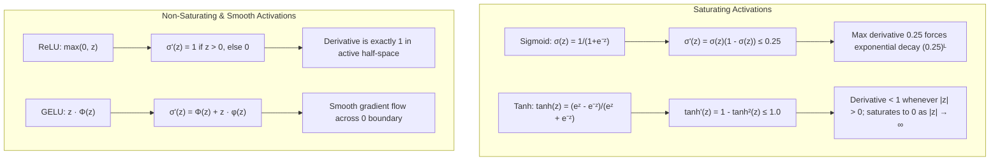
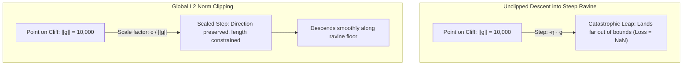
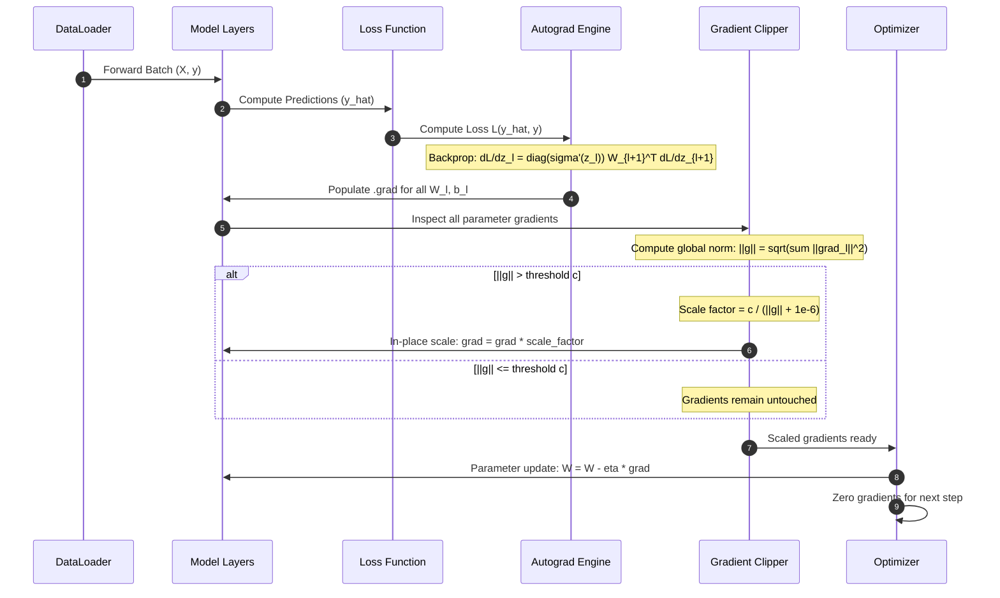
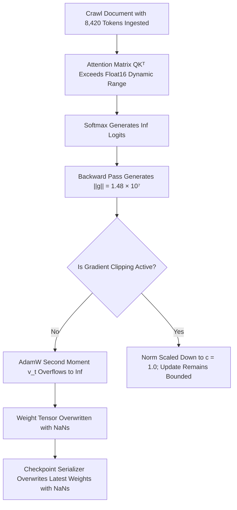

# Module 00: Vanishing & Exploding Gradients and Gradient Clipping

> **Prerequisites:** Multivariable calculus (matrix calculus, Jacobian matrices, chain rule), linear algebra (eigenvalues, singular value decomposition, operator norms), and basic PyTorch autograd mechanics.  
> **Target Audience:** Systems engineers, senior ML practitioners, and deep learning infrastructure architects designing deep feedforward, recurrent, and transformer networks.

---

## Executive Overview & Industry Context

Training deep neural networks is fundamentally an exercise in high-dimensional non-convex optimization driven by backpropagation. As neural architectures expanded from shallow perceptrons to deep residual networks, recurrent sequence models, and multi-billion parameter transformer foundation models, the numerical stability of backpropagated gradients emerged as the single most critical gating factor for convergence.

```mermaid
flowchart LR
    subgraph Forward["Forward Propagation (Feature Transformation)"]
        x["x = a₀"] --> L1["Layer 1: z₁ = W₁a₀ + b₁"]
        L1 --> A1["a₁ = σ(z₁)"]
        A1 --> L2["Layer 2: z₂ = W₂a₁ + b₂"]
        L2 --> A2["a₂ = σ(z₂)"]
        A2 --> Dots["... L layers ..."]
        Dots --> LL["Layer L: z_L = W_L a_{L-1} + b_L"]
        LL --> Out["ŷ = σ(z_L)"]
        Out --> Loss["Loss L(ŷ, y)"]
    end
    subgraph Backward["Backward Propagation (Chain Rule Jacobian Product)"]
        Loss -.-> dLL["∂L/∂z_L"]
        dLL -.->|"× W_Lᵀ diag(σ'(z_{L-1}))"| dL2["∂L/∂z_{L-1}"]
        dL2 -.->|"Repeated Jacobian Products"| dL1["∂L/∂z₁"]
        dL1 -.->|"Vanishing: ||g|| → 0 (Underflow) / Exploding: ||g|| → ∞ (NaN)"| Opt["Parameter Update: W ← W - η g"]
    end
```



The mathematical engine of backpropagation is the chain rule. When applied across an $L$-layer network, the chain rule computes parameter gradients by chaining together $L$ distinct Jacobian matrices. This repeated matrix multiplication forms an exponential dynamical system:
- If the operator norms of the transition Jacobians consistently fall below unity ($\|J\| < 1$), the gradient signal decays exponentially with depth, causing **vanishing gradients**. Early layers receive negligible learning signals, freezing their parameter updates and degrading the network into an expensive shallow model.
- If the operator norms consistently exceed unity ($\|J\| > 1$), the gradient signal amplifies exponentially with depth, causing **exploding gradients**. Parameter updates become catastrophically large, throwing weights into extreme regimes, saturating activations, or generating floating-point overflows (`Inf` and `NaN`), which completely corrupts model weights and optimizer states.

While architectural innovations such as residual connections (He et al., 2015), careful weight initialization (Glorot & Bengio, 2010; He et al., 2015), and normalization layers (Ioffe & Szegedy, 2015; Ba et al., 2016) systematically stabilize gradient propagation, **gradient clipping** remains an indispensable algorithmic safeguard. In natural language processing, speech synthesis, and reinforcement learning—where recurrent dynamics or unbounded sequence lengths induce sharp, ill-conditioned loss ravines—gradient clipping acts as an essential hydraulic limiter, preventing gradient surges from destabilizing production training runs.

---

## Mathematical Formulations & Theoretical Foundations

### 1. The Deep Chain Rule Product Derivation

Consider an $L$-layer feedforward neural network. For layer $l \in \{1, 2, \dots, L\}$, let:
- $z_l \in \mathbb{R}^{d_l}$ be the pre-activation vector,
- $a_l \in \mathbb{R}^{d_l}$ be the post-activation vector, with $a_0 = x \in \mathbb{R}^{d_0}$ as the input,
- $W_l \in \mathbb{R}^{d_l \times d_{l-1}}$ and $b_l \in \mathbb{R}^{d_l}$ be the weight matrix and bias vector,
- $\sigma_l: \mathbb{R}^{d_l} \to \mathbb{R}^{d_l}$ be an element-wise nonlinear activation function.

The forward propagation relations are governed by:
$$z_l = W_l a_{l-1} + b_l$$
$$a_l = \sigma_l(z_l)$$

Given a scalar loss function $\mathcal{L}(a_L, y)$, define the adjoint error vector (gradient with respect to pre-activations) at layer $l$ as:
$$\delta_l \equiv \frac{\partial \mathcal{L}}{\partial z_l} \in \mathbb{R}^{d_l}$$

By the multivariate chain rule, the relationship between $\delta_l$ and $\delta_{l+1}$ is:
$$\delta_l = \left( \frac{\partial z_{l+1}}{\partial z_l} \right)^T \delta_{l+1}$$

Let us derive the Jacobian matrix $J_l = \frac{\partial z_{l+1}}{\partial z_l} \in \mathbb{R}^{d_{l+1} \times d_l}$:
$$z_{l+1} = W_{l+1} a_l + b_{l+1} = W_{l+1} \sigma_l(z_l) + b_{l+1}$$

Using the chain rule for vector derivatives:
$$\frac{\partial z_{l+1}}{\partial z_l} = W_{l+1} \cdot \frac{\partial a_l}{\partial z_l} = W_{l+1} \operatorname{diag}\left(\sigma_l'(z_l)\right)$$

where $\operatorname{diag}\left(\sigma_l'(z_l)\right) \in \mathbb{R}^{d_l \times d_l}$ is a diagonal matrix containing the first-order derivatives of the activation function evaluated at the coordinates of $z_l$.

Transposing the Jacobian gives the adjoint backward recurrence relation:
$$\delta_l = \operatorname{diag}\left(\sigma_l'(z_l)\right) W_{l+1}^T \delta_{l+1}$$

Expanding this recurrence from the output layer $L$ down to an arbitrary early layer $k < L$:
$$\delta_k = \left( \prod_{l=k}^{L-1} \operatorname{diag}\left(\sigma_l'(z_l)\right) W_{l+1}^T \right) \delta_L$$

The gradient of the scalar loss with respect to the weight matrix $W_k$ at layer $k$ is given by the outer product of the error vector $\delta_k$ and the upstream activation $a_{k-1}^T$:
$$\frac{\partial \mathcal{L}}{\partial W_k} = \delta_k a_{k-1}^T = \left[ \left( \prod_{l=k}^{L-1} \operatorname{diag}\left(\sigma_l'(z_l)\right) W_{l+1}^T \right) \delta_L \right] a_{k-1}^T$$

This fundamental product $\prod_{l=k}^{L-1} \operatorname{diag}\left(\sigma_l'(z_l)\right) W_{l+1}^T$ dictates the quantitative stability of the gradient.

---

### 2. Spectral Radius, Singular Values, and Operator Norms

To understand whether the chained product grows without bound or collapses to zero, consider the induced Euclidean matrix norm ($\ell_2$-operator norm). For any matrix $M \in \mathbb{R}^{m \times n}$:
$$\|M\|_2 = \sup_{x \neq 0} \frac{\|Mx\|_2}{\|x\|_2} = \sigma_{\max}(M)$$
where $\sigma_{\max}(M)$ denotes the largest singular value of $M$ (the square root of the largest eigenvalue of $M^T M$).

By the submultiplicative property of induced matrix norms:
$$\|\delta_k\|_2 \le \|\delta_L\|_2 \prod_{l=k}^{L-1} \left\| \operatorname{diag}\left(\sigma_l'(z_l)\right) W_{l+1}^T \right\|_2 \le \|\delta_L\|_2 \prod_{l=k}^{L-1} \left\| \operatorname{diag}\left(\sigma_l'(z_l)\right) \right\|_2 \|W_{l+1}^T\|_2$$

Because $\operatorname{diag}\left(\sigma_l'(z_l)\right)$ is diagonal, its operator norm equals its maximum absolute entry:
$$\left\| \operatorname{diag}\left(\sigma_l'(z_l)\right) \right\|_2 = \max_{j \in \{1, \dots, d_l\}} \left| \sigma_l'(z_{l, j}) \right| \equiv \gamma_\sigma$$

Likewise, $\|W_{l+1}^T\|_2 = \|W_{l+1}\|_2 = \sigma_{\max}(W_{l+1})$.

Let $\gamma_W = \sup_l \|W_l\|_2$. We obtain the bound:
$$\|\delta_k\|_2 \le \|\delta_L\|_2 \left( \gamma_\sigma \gamma_W \right)^{L-k}$$

We can also formulate the lower bound using the minimum singular value $\sigma_{\min}$:
$$\|\delta_k\|_2 \ge \|\delta_L\|_2 \prod_{l=k}^{L-1} \sigma_{\min}\left( \operatorname{diag}\left(\sigma_l'(z_l)\right) W_{l+1}^T \right)$$

This reveals the two catastrophic asymptotic regimes:
1. **Vanishing Gradient Regime:** If $\gamma_\sigma \gamma_W < 1$, then as the depth $L - k$ grows large:
   $$\lim_{(L-k) \to \infty} (\gamma_\sigma \gamma_W)^{L-k} = 0 \implies \|\delta_k\|_2 \to 0$$
   In 32-bit single-precision IEEE 754 floating-point arithmetic, numbers smaller than $\approx 1.18 \times 10^{-38}$ (denormalized limit $\approx 1.4 \times 10^{-45}$) flush directly to zero (`underflow`), permanently arresting backpropagation.
2. **Exploding Gradient Regime:** If $\sigma_{\min}(W) > 1$ and $\sigma'(z) \approx 1$, such that the effective transition singular value exceeds $1 + \epsilon$ (where $\epsilon > 0$):
   $$\lim_{(L-k) \to \infty} (1 + \epsilon)^{L-k} = \infty \implies \|\delta_k\|_2 \to \infty$$
   In IEEE 754 float32, any number exceeding $3.4028 \times 10^{38}$ overflows to `+Inf` or `-Inf`. Subsequent operations produce `NaN` (Not a Number), permanently corrupting weights upon addition.

```
+----------------------------------------------------------------------------------------------------+
|                                SPECTRAL STABILITY REGIMES                                          |
|                                                                                                    |
|  Product of Singular Values & Activation Derivatives:  \prod || \text{diag}(\sigma') W^T ||         |
|                                                                                                    |
|   0.0 <------------------------- 1.0 -------------------------> +inf                               |
|        VANISHING REGIME                 ISOMETRIC / STABLE             EXPLODING REGIME            |
|                                                                                                    |
|   * Weights frozen at init          * Gradients propagate intact   * Floating point overflow (NaN) |
|   * Underflow to zero (float32)     * Dynamical isometry           * Parameter space ruined        |
|   * Sigmoid / Tanh saturation       * Orthogonal init + Residuals  * Ill-conditioned loss ravines  |
+----------------------------------------------------------------------------------------------------+
```

---

### 3. Activation Function Saturation Dynamics

The term $\operatorname{diag}(\sigma'(z))$ is profoundly impacted by the mathematical choice of the activation function:



#### A. Logistic Sigmoid
$$\sigma(z) = \frac{1}{1 + e^{-z}}, \quad \sigma'(z) = \sigma(z)(1 - \sigma(z))$$
Evaluating the maximum of $\sigma'(z)$:
$$\frac{d}{dz} \left[ \sigma(z)(1 - \sigma(z)) \right] = \sigma'(z)(1 - 2\sigma(z)) = 0 \implies \sigma(z) = 0.5 \implies z = 0$$
$$\max_{z \in \mathbb{R}} \sigma'(z) = 0.5(1 - 0.5) = 0.25$$

Even under an idealized weight matrix with $\|W\|_2 = 1$:
$$\|\delta_k\|_2 \le (0.25)^{L-k} \|\delta_L\|_2$$
For a 10-layer network, $(0.25)^{10} \approx 9.53 \times 10^{-7}$. For a 30-layer network, $(0.25)^{30} \approx 8.67 \times 10^{-19}$. The gradient is completely annihilated before reaching layer 1.

#### B. Hyperbolic Tangent (Tanh)
$$\tanh(z) = \frac{e^z - e^{-z}}{e^z + e^{-z}}, \quad \tanh'(z) = 1 - \tanh^2(z)$$
The maximum derivative is $\tanh'(0) = 1.0$. However, whenever $|z| > 2$, $\tanh^2(z) > 0.928$, meaning $\tanh'(z) < 0.072$. Unless pre-activations are maintained strictly around 0, gradients collapse rapidly.

#### C. Rectified Linear Unit (ReLU) & Leaky ReLU
$$\operatorname{ReLU}(z) = \max(0, z), \quad \operatorname{ReLU}'(z) = \begin{cases} 1 & \text{if } z > 0 \\ 0 & \text{if } z < 0 \end{cases}$$
$$\operatorname{LeakyReLU}(z) = \max(\alpha z, z), \quad \operatorname{LeakyReLU}'(z) = \begin{cases} 1 & \text{if } z > 0 \\ \alpha & \text{if } z < 0 \end{cases}$$
For $\operatorname{ReLU}$, the derivative in the positive regime is identically $1.0$, completely eliminating decay caused by fractional activation derivatives. However, if $z \le 0$, the derivative is $0$, leading to the "Dying ReLU" failure mode where neurons become permanently deactivated.

---

### 4. Gradient Clipping Algorithms: Value vs. L2 Norm

When an optimization trajectory traverses high-curvature canyons or steep cliffs on the loss surface—frequent in recurrent neural networks (RNNs) and un-normalized transformers—the gradient norm $\|\nabla_\theta \mathcal{L}\|$ surges by multiple orders of magnitude. 

Pascanu, Mikolov, and Bengio (2013) demonstrated that when optimization encounters a cliff, a standard stochastic gradient descent (SGD) step $\theta_{t+1} = \theta_t - \eta \nabla_\theta \mathcal{L}$ shoots the parameters catastrophically far across the parameter space, destroying previously learned representations.



#### Algorithm 1: Element-Wise Value Clipping (Coordinate Clipping)
Value clipping clamps each coordinate of the gradient vector independently within a predefined interval $[-c, c]$:
$$g_i^{\text{clipped}} = \operatorname{clip}(g_i, -c, c) = \begin{cases} -c & \text{if } g_i < -c \\ g_i & \text{if } -c \le g_i \le c \\ c & \text{if } g_i > c \end{cases}$$

##### Geometric Distortion of Value Clipping:
Let $g = [1000, 1]^T$ and $c = 1$. The true descent direction is:
$$\hat{u} = \frac{g}{\|g\|_2} = \left[ \frac{1000}{\sqrt{1000^2 + 1^2}}, \frac{1}{\sqrt{1000^2 + 1^2}} \right]^T \approx [1.0, 0.001]^T$$
Applying value clipping:
$$g^{\text{clipped}} = [\operatorname{clip}(1000, -1, 1), \operatorname{clip}(1, -1, 1)]^T = [1, 1]^T$$
The normalized direction of the clipped gradient is:
$$\hat{u}_{\text{clipped}} = \left[ \frac{1}{\sqrt{2}}, \frac{1}{\sqrt{2}} \right]^T \approx [0.7071, 0.7071]^T$$
The angle $\theta$ between the true gradient and the clipped gradient is:
$$\cos(\theta) = \hat{u}^T \hat{u}_{\text{clipped}} \approx 1.0(0.7071) + 0.001(0.7071) \approx 0.7078 \implies \theta \approx 45^\circ$$

Value clipping alters the gradient direction by $45^\circ$, severely biasing optimization away from the steepest descent vector and introducing artificial transverse forces.

#### Algorithm 2: Global L2 Norm Clipping (Direction-Preserving)
Global norm clipping pools all parameters of the model $\theta \in \mathbb{R}^P$, computes the total Euclidean norm over the concatenated gradient vector, and scales the entire vector uniformly if the total norm exceeds a threshold $c$:

$$g_{\text{total}} = \operatorname{concat}\left(\{ \nabla_{\theta_j} \mathcal{L} \}_{j=1}^M \right)$$
$$\|g_{\text{total}}\|_2 = \sqrt{\sum_{j=1}^M \|\nabla_{\theta_j} \mathcal{L}\|_2^2} = \sqrt{\sum_{i=1}^P g_i^2}$$
$$g_{\text{total}}^{\text{clipped}} = \begin{cases} g_{\text{total}} & \text{if } \|g_{\text{total}}\|_2 \le c \\ \frac{c}{\|g_{\text{total}}\|_2} g_{\text{total}} & \text{if } \|g_{\text{total}}\|_2 > c \end{cases}$$

This can be written compactly as:
$$g_{\text{total}}^{\text{clipped}} = g_{\text{total}} \cdot \min\left(1, \frac{c}{\|g_{\text{total}}\|_2 + \epsilon}\right)$$
where $\epsilon > 0$ is a small numerical stabilization constant (typically $10^{-6}$) preventing division by zero.

##### Geometric Invariance of Global Norm Clipping:
$$\frac{g_{\text{total}}^{\text{clipped}}}{\|g_{\text{total}}^{\text{clipped}}\|_2} = \frac{\frac{c}{\|g_{\text{total}}\|_2} g_{\text{total}}}{\left\| \frac{c}{\|g_{\text{total}}\|_2} g_{\text{total}} \right\|_2} = \frac{g_{\text{total}}}{\|g_{\text{total}}\|_2}$$
The unit direction vector is invariant under global norm clipping. Only the step magnitude is bounded by $c$.

---

### Comparison of Clipping Strategies

| Dimension | Value Clipping (`clip_grad_value_`) | Global L2 Norm Clipping (`clip_grad_norm_`) | Adaptive Gradient Clipping (AGC) |
| :--- | :--- | :--- | :--- |
| **Mathematical Formulation** | $g_i \leftarrow \operatorname{clip}(g_i, -c, c)$ | $g \leftarrow g \cdot \min(1, \frac{c}{\|g\|_2})$ | $g_l \leftarrow g_l \cdot \min(1, \lambda \frac{\|W_l\|_F}{\|G_l\|_F})$ |
| **Direction Preservation** | **Distorted** (shifts descent angle) | **Strictly Preserved** | **Preserved per-layer** |
| **Global Context** | Ignores global parameter vector | Pools all layers globally | Computes ratios per weight tensor |
| **Sensitivity to Outliers** | Clamps large weights to square box | Contracts spherical hyper-volume | Adapts to current weight magnitude |
| **Standard Production Use** | Rare (legacy RNN baselines) | **Universal Standard** (Transformers, LLMs) | NF-Nets, Normalizer-free models |

---

## Architectural & Workflow Diagrams

### Gradient Propagation and Clipping Pipeline

The following sequence diagram traces the complete lifecycle of activations, adjoint backpropagation, global norm accumulation across multiple tensor shards, and atomic threshold scaling during a training iteration.



---

## Production Implementation from Scratch

Below is a complete, production-grade implementation written in pure Python using NumPy and PyTorch. It features:
1. Pure NumPy implementation of a 20-layer Deep Multilayer Perceptron tracking layer-wise gradient norms during backpropagation to demonstrate vanishing gradients under Sigmoid vs. stable propagation under ReLU.
2. Custom production-grade implementation of `clip_grad_norm_` and `clip_grad_value_` mirroring PyTorch's native C++ implementation with rigorous numerical guards, `NaN`/`Inf` detection, and multi-tensor support.
3. An end-to-end benchmark demonstrating explosive gradient suppression on a pathological recurrent synthetic setup.

```python
"""
Production Implementation of Gradient Propagation Tracking and Gradient Clipping Algorithms.
Author: Staff Deep Learning Infrastructure Engineer
"""

import math
from typing import List, Tuple, Union, Optional
import numpy as np
import torch
import torch.nn as nn


# =====================================================================
# 1. NUMPY DEEP MLP GRADIENT TRACKER (20 LAYERS)
# =====================================================================

class LayerNormOrIdentity:
    """Pass-through or simple normalization for isolation testing."""
    def forward(self, z: np.ndarray) -> np.ndarray:
        return z


class DeepMLPAnalysis:
    """
    Simulates forward and backward propagation through an N-layer MLP
    to measure the exact decay or growth of gradient norms across layers.
    """
    def __init__(
        self,
        num_layers: int = 20,
        layer_dim: int = 64,
        activation: str = "sigmoid",
        weight_scale: float = 1.0,
        seed: int = 42
    ):
        np.random.seed(seed)
        self.num_layers = num_layers
        self.layer_dim = layer_dim
        self.activation = activation.lower()
        
        # Initialize weight matrices
        # Standard normal scaled by weight_scale
        self.weights: List[np.ndarray] = [
            np.random.randn(layer_dim, layer_dim) * (weight_scale / np.sqrt(layer_dim))
            for _ in range(num_layers)
        ]
        self.biases: List[np.ndarray] = [
            np.zeros((layer_dim, 1)) for _ in range(num_layers)
        ]

    def _act(self, z: np.ndarray) -> np.ndarray:
        if self.activation == "sigmoid":
            # Numerically stable sigmoid
            return np.where(z >= 0, 1.0 / (1.0 + np.exp(-z)), np.exp(z) / (1.0 + np.exp(z)))
        elif self.activation == "tanh":
            return np.tanh(z)
        elif self.activation == "relu":
            return np.maximum(0.0, z)
        else:
            raise ValueError(f"Unsupported activation: {self.activation}")

    def _act_grad(self, z: np.ndarray) -> np.ndarray:
        if self.activation == "sigmoid":
            s = self._act(z)
            return s * (1.0 - s)
        elif self.activation == "tanh":
            t = np.tanh(z)
            return 1.0 - t ** 2
        elif self.activation == "relu":
            return (z > 0.0).astype(np.float64)
        else:
            raise ValueError(f"Unsupported activation: {self.activation}")

    def analyze_gradient_flow(self, batch_size: int = 32) -> List[float]:
        """
        Executes a forward pass, injects unit loss gradient at output,
        backpropagates through all layers, and returns Frobenius norm
        of gradients at each layer (from Layer 1 to Layer L).
        """
        x = np.random.randn(self.layer_dim, batch_size)
        
        # Forward pass: cache pre-activations (z) and post-activations (a)
        a_cache: List[np.ndarray] = [x]
        z_cache: List[np.ndarray] = []
        
        curr_a = x
        for l in range(self.num_layers):
            z = self.weights[l] @ curr_a + self.biases[l]
            z_cache.append(z)
            curr_a = self._act(z)
            a_cache.append(curr_a)
            
        # Backward pass: output gradient dL/da_L initialized to standard normal
        dL_da = np.random.randn(*curr_a.shape)
        
        layer_grad_norms: List[float] = [0.0] * self.num_layers
        
        # Adjoint propagation
        dL_dz = dL_da * self._act_grad(z_cache[-1])
        for l in reversed(range(self.num_layers)):
            # Weight gradient: dL/dW_l = dL/dz_l @ a_{l-1}^T
            dW = (dL_dz @ a_cache[l].T) / batch_size
            layer_grad_norms[l] = float(np.linalg.norm(dW, ord="fro"))
            
            if l > 0:
                # Upstream adjoint: dL/dz_{l-1} = (W_l^T @ dL/dz_l) * sigma'(z_{l-1})
                dL_da_prev = self.weights[l].T @ dL_dz
                dL_dz = dL_da_prev * self._act_grad(z_cache[l - 1])
                
        return layer_grad_norms


# =====================================================================
# 2. PRODUCTION GRADIENT CLIPPING IMPLEMENTATIONS
# =====================================================================

def custom_clip_grad_value_(
    parameters: Union[torch.Tensor, List[torch.Tensor]],
    clip_value: float
) -> None:
    """
    Clips gradient of an iterable of parameters at specified value in-place.
    Guarantees mathematically exact clamping: g_i = max(-c, min(g_i, c)).
    
    Args:
        parameters: Iterable of Tensors or single Tensor with .grad fields.
        clip_value: Maximum allowed absolute value for any single gradient entry.
    """
    if isinstance(parameters, torch.Tensor):
        parameters = [parameters]
        
    clip_value = float(clip_value)
    if clip_value <= 0.0:
        raise ValueError(f"clip_value must be strictly positive, got {clip_value}")

    for p in parameters:
        if p.grad is not None:
            # In-place clamping handles +/-Inf safely
            p.grad.detach().clamp_(min=-clip_value, max=clip_value)


def custom_clip_grad_norm_(
    parameters: Union[torch.Tensor, List[torch.Tensor]],
    max_norm: float,
    norm_type: float = 2.0,
    error_if_nonfinite: bool = True,
    eps: float = 1e-6
) -> torch.Tensor:
    """
    Clips gradient norm of an iterable of parameters in-place.
    
    The norm is computed over all gradients together, as if they were
    concatenated into a single vector. Direction is invariant under this operation.
    
    Args:
        parameters: An iterable of Tensors or a single Tensor.
        max_norm: Max norm of the gradients.
        norm_type: Type of the used p-norm. Supports 2.0 (Euclidean) and inf.
        error_if_nonfinite: If True, raises RuntimeError if total norm is NaN/Inf.
        eps: Small epsilon to prevent division by zero in scaling factor.
        
    Returns:
        Total norm of the parameters (viewed as a single vector).
    """
    if isinstance(parameters, torch.Tensor):
        parameters = [parameters]
        
    # Filter parameters with active gradients
    grads = [p.grad.detach() for p in parameters if p.grad is not None]
    
    if len(grads) == 0:
        return torch.tensor(0.0)

    max_norm = float(max_norm)
    norm_type = float(norm_type)

    if norm_type == float("inf"):
        # Infinity norm: maximum absolute value across all elements
        total_norm = max(g.abs().max() for g in grads)
    else:
        # P-norm calculation with exact numerical stability
        total_norm = torch.norm(
            torch.stack([torch.norm(g, norm_type) for g in grads]),
            norm_type
        )

    # Check for NaN / Inf
    if error_if_nonfinite and (torch.isnan(total_norm) or torch.isinf(total_norm)):
        raise RuntimeError(
            f"The total norm of order {norm_type} for gradients is non-finite: {total_norm}. "
            "Optimization trajectory encountered severe explosion."
        )

    # Compute direction-preserving scale factor: c / (||g|| + eps)
    clip_coef = max_norm / (total_norm + eps)
    
    # If total_norm > max_norm, scale down in-place
    if clip_coef < 1.0:
        for g in grads:
            g.mul_(clip_coef)

    return total_norm


# =====================================================================
# 3. VERIFICATION AND BENCHMARK HARNESS
# =====================================================================

def run_gradient_dynamics_demonstration():
    print("=" * 80)
    print("1. EMPIRICAL VERIFICATION: VANISHING GRADIENTS ACROSS 20 LAYERS")
    print("=" * 80)

    for act in ["sigmoid", "tanh", "relu"]:
        analyzer = DeepMLPAnalysis(num_layers=20, layer_dim=64, activation=act, weight_scale=1.0)
        norms = analyzer.analyze_gradient_flow()
        print(f"\nActivation: {act.upper()}")
        print(f"  Output Layer (L=20) Gradient Norm: {norms[-1]:.6e}")
        print(f"  Middle Layer (L=10) Gradient Norm: {norms[9]:.6e}")
        print(f"  Input  Layer (L=01) Gradient Norm: {norms[0]:.6e}")
        ratio = norms[0] / (norms[-1] + 1e-12)
        print(f"  Attenuation Ratio (L1 / L20):     {ratio:.6e}")

    print("\n" + "=" * 80)
    print("2. VERIFICATION: VALUE CLIPPING VS GLOBAL L2 NORM CLIPPING")
    print("=" * 80)
    
    # Setup test vectors exhibiting high directional imbalance
    # True gradient g = [1000.0, 1.0]
    p_val = nn.Parameter(torch.tensor([1.0, 1.0]))
    p_val.grad = torch.tensor([1000.0, 1.0])
    
    p_norm = nn.Parameter(torch.tensor([1.0, 1.0]))
    p_norm.grad = torch.tensor([1000.0, 1.0])

    original_grad = p_val.grad.clone()
    original_dir = original_grad / torch.norm(original_grad)

    # 1. Apply value clipping at threshold 1.0
    custom_clip_grad_value_(p_val, clip_value=1.0)
    val_dir = p_val.grad / torch.norm(p_val.grad)
    val_cos_sim = float(torch.dot(original_dir, val_dir))
    val_angle_deg = math.degrees(math.acos(min(1.0, max(-1.0, val_cos_sim))))

    # 2. Apply global L2 norm clipping at threshold 1.0
    total_norm = custom_clip_grad_norm_(p_norm, max_norm=1.0)
    norm_dir = p_norm.grad / torch.norm(p_norm.grad)
    norm_cos_sim = float(torch.dot(original_dir, norm_dir))
    norm_angle_deg = math.degrees(math.acos(min(1.0, max(-1.0, norm_cos_sim))))

    print(f"Original Gradient Vector:          {original_grad.numpy()}")
    print(f"Value Clipped Gradient (c=1.0):    {p_val.grad.numpy()}")
    print(f"  Cosine Similarity with Original: {val_cos_sim:.6f}")
    print(f"  Directional Distortion Angle:    {val_angle_deg:.2f} degrees")
    print(f"Norm Clipped Gradient (c=1.0):     {p_norm.grad.numpy()}")
    print(f"  Calculated Total L2 Norm:        {float(total_norm):.2f}")
    print(f"  Cosine Similarity with Original: {norm_cos_sim:.6f}")
    print(f"  Directional Distortion Angle:    {norm_angle_deg:.6f} degrees")

    print("\n" + "=" * 80)
    print("3. SYNTHETIC CLIFF OPTIMIZATION RUN (EXPLODING GRADIENTS)")
    print("=" * 80)

    # Define a pathological loss function representing an ill-conditioned cliff:
    # L(w) = 0.5 * (1e4 * w_0^2 + w_1^2)
    def simulate_cliff_descent(use_clipping: bool, max_norm: float = 5.0):
        w = nn.Parameter(torch.tensor([2.0, 2.0]))
        optimizer = torch.optim.SGD([w], lr=0.01)
        
        trajectory = []
        for step in range(5):
            optimizer.zero_grad()
            # Pathological gradient surge simulating non-convex cliff
            loss = 0.5 * (1e6 * (w[0] ** 2) + (w[1] ** 2))
            loss.backward()
            
            grad_norm_before = float(torch.norm(w.grad))
            if use_clipping:
                custom_clip_grad_norm_([w], max_norm=max_norm)
            grad_norm_after = float(torch.norm(w.grad))
            
            optimizer.step()
            trajectory.append((step, float(w[0]), float(w[1]), grad_norm_before, grad_norm_after))
        return trajectory

    print("Descent WITHOUT Gradient Clipping (Instability):")
    try:
        traj_no_clip = simulate_cliff_descent(use_clipping=False)
        for step, w0, w1, g_bef, _ in traj_no_clip:
            print(f"  Step {step}: w=[{w0:.2e}, {w1:.2e}], ||g||={g_bef:.2e}")
    except Exception as e:
        print(f"  Failed with error: {e}")

    print("\nDescent WITH Global L2 Norm Clipping (c=5.0):")
    traj_clip = simulate_cliff_descent(use_clipping=True, max_norm=5.0)
    for step, w0, w1, g_bef, g_aft in traj_clip:
        print(f"  Step {step}: w=[{w0:.4f}, {w1:.4f}], ||g||_before={g_bef:.2e}, ||g||_after={g_aft:.2f}")


if __name__ == "__main__":
    run_gradient_dynamics_demonstration()
```

---

## Failure Modes, Edge Cases & Antipatterns

### 1. The Fundamental Asymmetry: Gradient Clipping Cannot Fix Vanishing Gradients
A widespread misconception among junior engineers is that gradient clipping is a complete cure for gradient instability. 

Mathematically, gradient clipping is a **non-linear contraction operator**:
$$\mathcal{T}_c(g) = g \cdot \min\left(1, \frac{c}{\|g\|_2}\right)$$
The operator satisfies $\|\mathcal{T}_c(g)\|_2 \le c$ for all $g \in \mathbb{R}^P$. It imposes an upper bound on the gradient magnitude.

However, if gradients vanish ($\|g\|_2 \to 0$), the scaling factor $\min(1, c/\|g\|_2) = 1.0$. The operator reduces to the identity mapping $\mathcal{T}_c(g) = g$. Gradient clipping has **zero effect** on vanishing gradients. Underflow must be addressed structurally:
- Residual connections ($x_{l+1} = x_l + F(x_l)$) providing identity gradient pathways $\frac{\partial x_{l+1}}{\partial x_l} = I + \frac{\partial F}{\partial x_l}$,
- Proper variance-preserving initialization (He/Kaiming),
- Normalization layers (BatchNorm, LayerNorm, RMSNorm).

```
                      GRADIENT HEALTH INTERVENTION MATRIX
     Magnitude ||g||                                               Architecture / Solution
     ^
+Inf |============================================================  Gradient Clipping (L2 Norm)
     |  EXPLODING REGIME: Loss NaN, Inf, weights destroyed          Spectral Normalization
     |  Remedy: Global L2 clipping, lower learning rate, RMSNorm    FP16 Dynamic Loss Scaling
     |------------------------------------------------------------
1.0  |  HEALTHY REGIME: Stable dynamic isometry                     He/Kaiming Initialization
     |  Remedy: Standard SGD / AdamW optimization                   Residual Additions
     |------------------------------------------------------------
     |  VANISHING REGIME: Underflow to 0.0, early layers frozen     Skip Connections (ResNet)
     |  Remedy: Identity skips, ReLU/GELU, LayerNorm                GELU / LeakyReLU Activations
 0.0 +============================================================  [Clipping has NO effect here!]
```

### 2. The Microbatch Accumulation Antipattern in Distributed Data Parallel (DDP)
In large-scale distributed training, gradient accumulation is frequently employed to simulate large effective batch sizes across $K$ microbatches:
$$\text{Batch}_{\text{eff}} = K \times B_{\text{micro}} \times N_{\text{GPUs}}$$

**The Anti-Pattern:** Invoking `clip_grad_norm_` on each microbatch prior to accumulation:
```python
# CATASTROPHIC ANTI-PATTERN
for micro_step, (x, y) in enumerate(dataloader):
    loss = model(x, y) / K
    loss.backward()
    # BUG: Clipping before the gradient sum is complete!
    torch.nn.utils.clip_grad_norm_(model.parameters(), max_norm=1.0)
    if (micro_step + 1) % K == 0:
        optimizer.step()
        optimizer.zero_grad()
```

**Mathematical Proof of Flaw:**
Let the true accumulated gradient be $G = \sum_{k=1}^K g_k$. Global norm clipping requires scaling the true total gradient:
$$G^{\text{clipped}} = G \cdot \min\left(1, \frac{c}{\|G\|_2}\right)$$
By clipping per microbatch, the accumulated vector is:
$$\tilde{G} = \sum_{k=1}^K g_k \cdot \min\left(1, \frac{c}{\|g_k\|_2}\right)$$
By the triangle inequality:
$$\|\tilde{G}\|_2 \le \sum_{k=1}^K \left\| g_k \cdot \min\left(1, \frac{c}{\|g_k\|_2}\right) \right\|_2 \le K \cdot c$$
1. The effective gradient norm bound becomes $K \cdot c$ rather than $c$, completely defeating the intended clipping threshold.
2. If some microbatches have small norms while others contain an explosive burst, the burst is clipped in isolation, severely altering the weighted relative contribution of different data slices.

**The Production Rule:** Always accumulate raw, unclipped gradients across all $K$ microbatches and synchronize across distributed ranks via `all_reduce` *before* invoking `clip_grad_norm_`.

```python
# PRODUCTION CORRECT PATTERN
for micro_step, (x, y) in enumerate(dataloader):
    loss = model(x, y) / K
    loss.backward()  # Accumulates raw unscaled gradients
    
    if (micro_step + 1) % K == 0:
        # 1. Unscale gradients first if using Mixed Precision (AMP)
        scaler.unscale_(optimizer)
        # 2. Clip globally aggregated gradient
        torch.nn.utils.clip_grad_norm_(model.parameters(), max_norm=1.0)
        # 3. Step and update scaler
        scaler.step(optimizer)
        scaler.update()
        optimizer.zero_grad()
```

---

## Production Incident Post-Mortem: The \$140,000 Seq2Seq Loss Explosion

### Incident Metadata
- **System:** Production English-to-German Neural Machine Translation Service (Transformer-based Encoder-Decoder, 32 layers, 768 hidden dimension, 12 attention heads).
- **Infrastructure:** Distributed cluster of 16 nodes, each equipped with 8 $\times$ NVIDIA H100 80GB SXM5 GPUs (128 GPUs total).
- **Cost Impact:** \$142,500 in wasted cloud compute time (57 hours of cluster-wide thrashing and checkpoint invalidation).
- **Root Cause:** Absence of gradient clipping during mixed-precision (FP16) training combined with an un-truncated outlier sentence in the training corpus.

### Timeline of Failure
| Timestamp (UTC) | Elapsed Training Time | Event Description |
| :--- | :--- | :--- |
| `2024-03-14 02:00` | 00h 00m | Training job initiated across 128 H100 GPUs with AdamW optimizer, FP16 automatic mixed precision (AMP), batch size 2048. |
| `2024-03-16 09:12` | 55h 12m | Step 142,800 reached. Validation BLEU score monotonically improving from 12.4 to 34.8. Checkpoints saved every 10,000 steps. |
| `2024-03-16 11:03` | 57h 03m | Step 146,211: Dataloader ingests a malformed batch containing an un-truncated crawl document with 8,420 tokens packed into a single sequence. |
| `2024-03-16 11:03:04` | 57h 03m | Self-attention matrix $Q K^T / \sqrt{d_k}$ generates logits exceeding float16 maximum range ($\approx 65,504$). Softmax underflows denominator, generating Inf in attention map. |
| `2024-03-16 11:03:06` | 57h 03m | Autograd backward pass computes an instantaneous gradient norm of $\|g\|_2 = 1.48 \times 10^7$. |
| `2024-03-16 11:03:07` | 57h 03m | Unclipped AdamW updates first and second moments: $v_t = \beta_2 v_{t-1} + (1-\beta_2) g_t^2$. Moment accumulator overflows float32 to `+Inf`. |
| `2024-03-16 11:03:08` | 57h 03m | Weights updated with $\theta_{t+1} = \theta_t - \eta \frac{m_t}{\sqrt{v_t} + \epsilon} \to \text{NaN}$. Entire model parameter tensor corrupted with NaNs. |
| `2024-03-16 11:04` | 57h 04m | Step 146,212: Loss logs print `Loss: nan`. Automated checkpoint worker saves corrupted NaN weights over `checkpoint_latest.pt`. |
| `2024-03-18 09:30` | 103h 30m | Engineering team inspects Monday morning dashboard. 46 hours of training had executed entirely on NaN parameters. |



### Root Cause Analysis
1. **Missing Invariant Guard:** The engineering team had omitted `torch.nn.utils.clip_grad_norm_(model.parameters(), max_norm=1.0)`. They assumed that because LayerNorm was applied before each transformer sub-block (Pre-LN), gradient norms would naturally remain bounded.
2. **Pathological Sequence Length:** While maximum sequence length was supposed to be enforced at 512 tokens by the dataset tokenizer, a regex preprocessing regression allowed single raw multi-page text blocks into the training stream. In self-attention, computation scales quadratically ($O(N^2)$), causing attention logits to accumulate massive un-normalized energy.
3. **Destructive Checkpoint Overwrite:** The training harness maintained only a single rolling checkpoint `checkpoint_latest.pt` without verifying whether $\mathcal{L}$ was finite before serialization.

### Corrective Actions & Architectural Remediation
1. **Mandatory Global Norm Clipping:** Enforced global L2 norm clipping at $c = 1.0$ across all training pipelines:
   ```python
   scaler.unscale_(optimizer)
   grad_norm = torch.nn.utils.clip_grad_norm_(model.parameters(), max_norm=1.0)
   if torch.isnan(grad_norm) or torch.isinf(grad_norm):
       logger.error(f"Non-finite gradient norm detected: {grad_norm}. Skipping batch.")
       optimizer.zero_grad()
       continue
   scaler.step(optimizer)
   scaler.update()
   ```
2. **Hard Sequence Truncation:** Implemented an immutable schema validator in the DataLoader pipeline that immediately drops or truncates any sample where $N > 512$.
3. **Atomic Safe Checkpointing:** Checkpointing engine updated to inspect all model tensors with `torch.isfinite(param).all()`. If any parameter contains `NaN` or `Inf`, the checkpoint operation is aborted, training is paused, and an alert is paged via PagerDuty.

---

## Senior Technical Interview Questions & Model Answers

### Question 1: Mathematical Geometry of Value vs. Norm Clipping
**Interviewer:** *"Explain the mathematical difference between coordinate-wise value clipping (`clip_grad_value_`) and global L2 norm clipping (`clip_grad_norm_`). Construct a concrete 2D geometric scenario where value clipping produces a pathological descent step that norm clipping handles correctly."*

**Model Answer:**  
Coordinate-wise value clipping clamps each component $g_i$ of the gradient vector independently to the interval $[-c, c]$:
$$g_i^{\text{val}} = \max(-c, \min(g_i, c))$$
Global L2 norm clipping computes the Euclidean norm of the concatenated gradient vector across all parameters and scales the vector by a scalar factor:
$$g^{\text{norm}} = g \cdot \min\left(1, \frac{c}{\|g\|_2}\right)$$

The critical geometric distinction is **directional invariance**. Norm clipping is a pure isotropic scaling transformation; it changes only the magnitude of the gradient vector while leaving the unit direction vector $\hat{g} = g / \|g\|_2$ completely unchanged. 

In contrast, coordinate-wise value clipping projects the gradient vector onto a hypercube $[-c, c]^P$. If the gradient vector is non-isotropic (i.e., curvature is much higher along some dimensions than others), value clipping alters the direction of the vector, rotating it toward the vertices of the hypercube.

**Pathological 2D Scenario:**  
Consider an optimization problem with an ill-conditioned ravine where the gradient vector is $g = [1000.0, 1.0]^T$, with clipping threshold $c = 1.0$.
- The true steepest descent direction is:
  $$\hat{u}_{\text{true}} = \frac{[1000.0, 1.0]^T}{\sqrt{1000^2 + 1^2}} \approx [0.9999995, 0.001]^T$$
  The gradient points almost entirely along the first coordinate axis ($x_1$).
- Applying `clip_grad_value_(c=1.0)`:
  $$g^{\text{val}} = [\operatorname{clip}(1000.0, -1, 1), \operatorname{clip}(1.0, -1, 1)]^T = [1.0, 1.0]^T$$
  The direction of $g^{\text{val}}$ is:
  $$\hat{u}_{\text{val}} = \left[\frac{1}{\sqrt{2}}, \frac{1}{\sqrt{2}}\right]^T \approx [0.7071, 0.7071]^T$$
  The angle between the true gradient and the value-clipped gradient is:
  $$\theta = \arccos(\hat{u}_{\text{true}} \cdot \hat{u}_{\text{val}}) \approx \arccos(0.7078) \approx 45.0^\circ$$
- Applying `clip_grad_norm_(max_norm=1.0)`:
  $$g^{\text{norm}} = [1000.0, 1.0]^T \cdot \frac{1.0}{\sqrt{1000^2 + 1^2}} \approx [0.9999995, 0.001]^T$$
  The angle error is identically $0.0^\circ$.

Value clipping introduced a massive $45^\circ$ directional error, forcing the optimizer to take an update step with equal magnitude along the $x_2$ axis where the loss gradient was actually minimal. In ill-conditioned valleys, this causes severe oscillations across the canyon walls, preventing convergence. Norm clipping preserves the exact descent direction.

---

### Question 2: Why Gradient Clipping Cannot Alleviate Vanishing Gradients
**Interviewer:** *"A candidate proposes using a modified gradient clipping threshold to solve vanishing gradients in a 50-layer deep feedforward network using Sigmoid activations. How do you evaluate this proposal mathematically?"*

**Model Answer:**  
The proposal is mathematically invalid. 

Gradient clipping is defined by an operator $\mathcal{T}_c: \mathbb{R}^P \to \mathbb{R}^P$:
$$\mathcal{T}_c(g) = g \cdot \min\left(1, \frac{c}{\|g\|_2}\right)$$
The operator satisfies:
$$\|\mathcal{T}_c(g)\|_2 = \|g\|_2 \cdot \min\left(1, \frac{c}{\|g\|_2}\right) = \min(\|g\|_2, c) \le c$$

When gradients vanish, the norm of the gradient vector decays toward zero:
$$\lim_{(L-k) \to \infty} \|g_k\|_2 = 0$$
Since $\|g\|_2 < c$ is strictly satisfied for any non-trivial positive threshold $c > 0$, the condition $\|g\|_2 \le c$ triggers the branch where the scaling factor is identically $1.0$:
$$\min\left(1, \frac{c}{\|g\|_2}\right) = 1 \implies \mathcal{T}_c(g) = g$$

Gradient clipping acts as an identity operator on small gradients. It provides an upper bound, never a lower bound. 

To solve vanishing gradients caused by Sigmoid activations ($\sigma'(z) \le 0.25$), one must address the underlying Jacobian product $\prod_{l=k}^{L-1} \operatorname{diag}(\sigma'(z_l)) W_{l+1}^T$. This requires:
1. **Non-saturating activations:** Replacing Sigmoid with ReLU or GELU where $\sigma'(z) = 1$ in the active regime.
2. **Residual connections:** Modifying the forward transformation to $a_{l+1} = a_l + F(a_l)$, which transforms the backward Jacobian into $J = I + \frac{\partial F}{\partial a_l}$. The identity term $I$ ensures that even if $\frac{\partial F}{\partial a_l}$ vanishes, the gradient flows unattenuated via the identity path.
3. **Variance-controlled initialization:** Scaling initial weight variances inversely with fan-in (He/Kaiming initialization) to ensure the spectral radius of the transition matrix remains close to 1.0.

---

### Question 3: Distributed Gradient Accumulation and Clipping Mechanics
**Interviewer:** *"You are training a large language model across 64 GPUs using Distributed Data Parallel (DDP) with 4 steps of gradient accumulation per optimizer step and Automatic Mixed Precision (AMP). Outline the precise sequence of function calls required around `loss.backward()`, gradient clipping, optimizer step, and gradient zeroing. What happens if you clip before all accumulation steps finish?"*

**Model Answer:**  
The exact sequence must ensure that:
1. Gradients are accumulated in unscaled raw form across all micro-batches.
2. DDP gradient synchronization (`all_reduce`) occurs only on the final accumulation micro-step to minimize cross-node communication overhead.
3. The mixed-precision loss scaler is explicitly unscaled *prior* to computing the gradient norm.
4. Global norm clipping is computed across all parameters simultaneously.

**Correct PyTorch Implementation:**
```python
optimizer.zero_grad(set_to_none=True)

for micro_step in range(gradient_accumulation_steps):
    # Only synchronize DDP gradients on the final accumulation step
    is_last_micro_step = (micro_step == gradient_accumulation_steps - 1)
    context = model.no_sync() if not is_last_micro_step else contextlib.nullcontext()
    
    with context:
        with torch.autocast(device_type="cuda", dtype=torch.bfloat16):
            outputs = model(inputs)
            loss = criterion(outputs, targets)
            # Scale loss by accumulation steps to compute mean gradient
            loss = loss / gradient_accumulation_steps
            
        # Accumulates scaled gradients in fp32 parameter .grad buffers
        scaler.scale(loss).backward()

# 1. Unscale gradients before inspecting or clipping norms
scaler.unscale_(optimizer)

# 2. Clip global L2 norm across all model parameters
total_norm = torch.nn.utils.clip_grad_norm_(model.parameters(), max_norm=1.0)

# 3. Check for NaN/Inf and step optimizer
scaler.step(optimizer)
scaler.update()
optimizer.zero_grad(set_to_none=True)
```

**Consequences of Clipping Per Microbatch:**
If `clip_grad_norm_` is executed inside the micro-step loop, the effective accumulated gradient becomes:
$$\tilde{G} = \sum_{m=1}^M g_m \cdot \min\left(1, \frac{c}{\|g_m\|_2}\right)$$
This introduces two catastrophic errors:
1. **Threshold Inflation:** By triangle inequality, $\|\tilde{G}\|_2 \le \sum_{m=1}^M c = M \cdot c$. The intended maximum gradient norm constraint $c$ is violated by a factor of up to $M$.
2. **Relative Weight Distortion:** If microbatch 1 has an unclipped norm of $10c$ and microbatch 2 has a norm of $1c$, clipping per microbatch reduces microbatch 1 to $c$ while leaving microbatch 2 at $c$. Their effective ratio becomes $1:1$ instead of the true mathematical ratio of $10:1$. This distorts the empirical expectation over the true batch distribution.

---

### Question 4: Spectral Normalization vs. Dynamic Gradient Clipping
**Interviewer:** *"Compare Dynamic Gradient Clipping to Spectral Normalization (Miyato et al., 2018). How does Spectral Normalization mathematically enforce gradient stability, and what are its trade-offs compared to clipping?"*

**Model Answer:**  
Both techniques regulate gradient growth, but they operate at fundamentally different stages of the computation graph:

**Dynamic Gradient Clipping:**
- Operates on the **backward pass**.
- Monitors the empirical gradient vector $g = \nabla_\theta \mathcal{L}$ dynamically computed for a specific data batch.
- If $\|g\|_2 > c$, it rescales the vector downstream.
- Does not constrain the capacity or Lipschitz constant of the underlying neural network function during the forward pass.

**Spectral Normalization:**
- Operates on the **forward pass** parameters.
- Directly controls the Lipschitz constant of each linear layer $f_l(h) = W_l h + b_l$.
- The Lipschitz constant of a linear layer with respect to the $\ell_2$-norm is exactly its operator norm, which equals the largest singular value (spectral norm) $\sigma_{\max}(W_l)$:
  $$\|W_l h_1 - W_l h_2\|_2 \le \sigma_{\max}(W_l) \|h_1 - h_2\|_2$$
- Spectral normalization re-parameterizes the weight matrix by dividing it by its spectral norm estimated via power iteration:
  $$\tilde{W}_l = \frac{W_l}{\sigma_{\max}(W_l)}$$
  By construction, $\sigma_{\max}(\tilde{W}_l) = 1.0$.

**Mathematical Implication for Gradients:**
Recall the backward recurrence relation:
$$\|\delta_l\|_2 \le \|\delta_{l+1}\|_2 \|\tilde{W}_{l+1}\|_2 \|\operatorname{diag}(\sigma'(z_l))\|_2$$
If $\sigma_{\max}(\tilde{W}_{l+1}) = 1$ and the activation function is 1-Lipschitz (e.g., ReLU, Leaky ReLU with $\alpha \le 1$, or Tanh), then:
$$\|\delta_l\|_2 \le \|\delta_{l+1}\|_2 \cdot 1.0 \cdot 1.0 = \|\delta_{l+1}\|_2$$
Spectral normalization mathematically **guarantees** that gradients cannot explode during backpropagation, without requiring any threshold clipping.

**Trade-offs:**
1. **Computational Overhead:** Spectral normalization runs power iteration on every forward pass for every weight matrix, increasing FLOP overhead. Dynamic gradient clipping requires only a single scalar reduction across parameter tensors after backpropagation.
2. **Model Capacity & Expressivity:** Restricting $\sigma_{\max}(W_l) = 1$ limits the maximum gain of each layer. In deep networks, this can overly constrain representation learning, leading to underfitting unless combined with scaling factors. Consequently, spectral normalization is predominantly used in Generative Adversarial Networks (GANs) to satisfy discriminator Lipschitz constraints, whereas Global L2 Norm Clipping is the universal choice for Large Language Models and Vision Transformers.

---

### Question 5: Adaptive Gradient Clipping (AGC)
**Interviewer:** *"What is Adaptive Gradient Clipping (AGC), how does it calculate clipping thresholds, and why was it essential for training deep Normalizer-Free Networks (NF-Nets)?"*

**Model Answer:**  
Adaptive Gradient Clipping (AGC) was introduced by Brock, De, Smith, and Simonyan (2021) to train deep ResNets and Vision Transformers without Batch Normalization (NF-Nets).

**The Core Insight:**
Global norm clipping uses a single scalar threshold $c$ across the entire network. However, in deep architectures:
1. Early layers often have vastly different gradient and weight magnitudes compared to final projection heads.
2. A single global threshold $c$ might severely over-clip gradients in the final classification layer while completely failing to constrain exploding gradients in early convolutional or attention layers.

Furthermore, Brock et al. observed that an update step $\Delta W = -\eta G$ is dangerously large when the ratio of the gradient norm to the parameter norm exceeds a critical threshold:
$$\frac{\|G_l\|_F}{\|W_l\|_F} \gg 1$$
Such large relative steps cause severe instability in networks lacking normalization layers.

**Mathematical Formulation:**
AGC defines an adaptive clipping threshold for each weight tensor independently based on the Frobenius norm of that specific weight matrix $\|W_l\|_F$:
$$G_l^{\text{AGC}} = \begin{cases} G_l & \text{if } \frac{\|G_l\|_F}{\|W_l\|_F + \epsilon} \le \lambda \\ \lambda \frac{\|W_l\|_F + \epsilon}{\|G_l\|_F} G_l & \text{if } \frac{\|G_l\|_F}{\|W_l\|_F + \epsilon} > \lambda \end{cases}$$
where:
- $\|W_l\|_F = \sqrt{\sum_{i,j} W_{l, ij}^2}$ is the Frobenius norm of the weight tensor,
- $\|G_l\|_F$ is the Frobenius norm of its gradient,
- $\lambda$ is a user-defined clipping coefficient (typically $\lambda = 0.01$ or $0.02$),
- $\epsilon = 10^{-3}$ prevents zero-initialized biases or weights from collapsing the threshold to zero.

**Why It Was Critical for NF-Nets:**
Batch Normalization acts as an automatic down-scaling mechanism: when gradient norms grow, the scale of activations shifts, and the batch statistics re-center and re-scale the signal, damping gradient explosion. 

In Normalizer-Free networks, this safety valve is absent. As depth increases ($L > 50$), training without normalization inevitably diverges because standard optimizers destabilize early residual blocks. AGC dynamically limits the maximum fractional change of any weight tensor to at most $\lambda$ per step, enabling stable training of 100+ layer architectures without Batch Normalization.

---

This module is part of [Track 01: Optimization, Regularization & PyTorch](../README.md).
