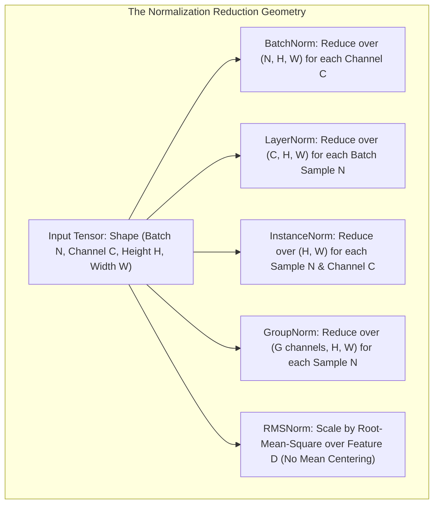
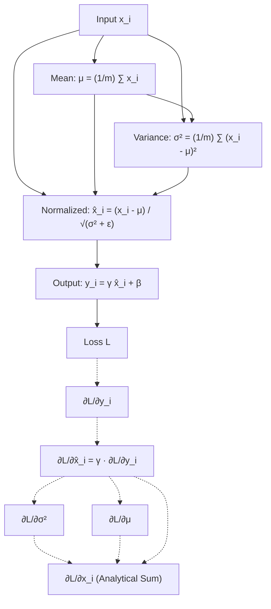
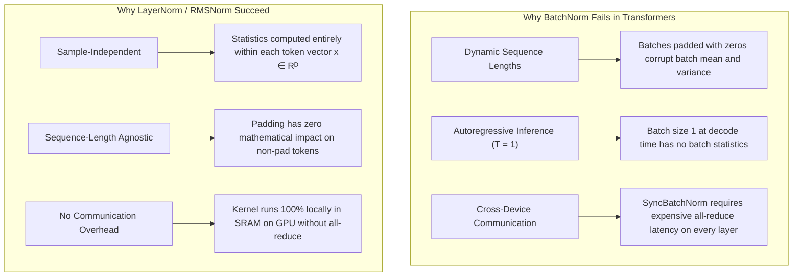
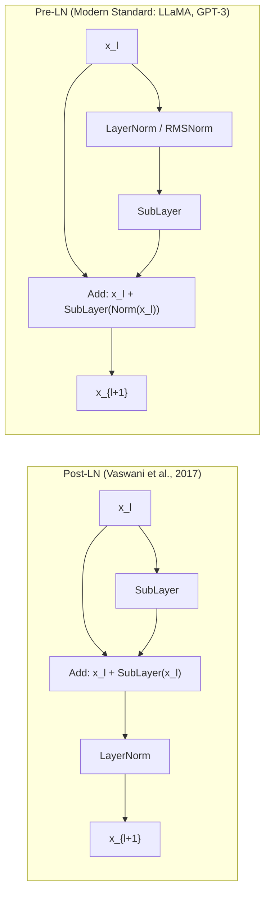
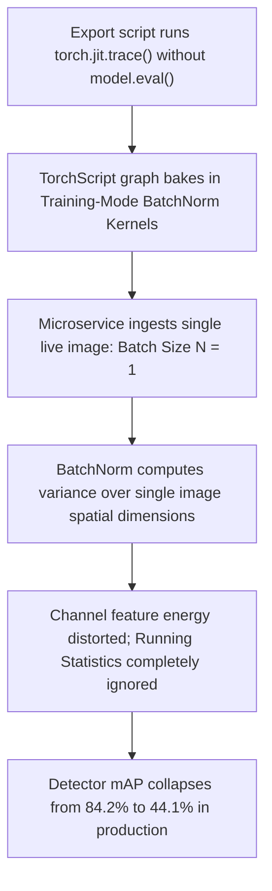

# Module 02: Normalization Layers: BatchNorm, LayerNorm, GroupNorm, and RMSNorm

> **Prerequisites:** Multivariable calculus (partial differentiation, chain rule for tensor reductions), linear algebra, and basic probability theory (mean, sample variance, Bessel's correction).  
> **Target Audience:** Deep learning engineers, systems architects, and infrastructure specialists optimizing training stability, memory bandwidth, and inference latency across computer vision and foundation language models.

---

## Executive Overview & Industry Context

Training deep architectures requires passing representations through long cascades of parameterized non-linear transformations. As early layers update during optimization, the distribution of inputs to subsequent layers shifts continuously—a phenomenon originally termed **internal covariate shift** by Ioffe and Szegedy (2015). Although modern research demonstrates that normalization primarily functions by smoothing the loss landscape and ensuring well-conditioned Hessian spectra (Santurkar et al., 2018), normalization layers remain an essential structural primitive in deep learning.



Different machine learning domains have settled on distinct normalization paradigms:
1. **Computer Vision (CNNs):** Historically dominated by **Batch Normalization (BatchNorm)**, which leverages large mini-batches to smooth convolutional gradients and regularize networks.
2. **Vision with Small Batches / Detection:** Transitioned to **Group Normalization (GroupNorm)** to eliminate the harmful batch size dependency of BatchNorm.
3. **Natural Language Processing & Transformers:** Universally governed by **Layer Normalization (LayerNorm)** and **Root Mean Square Normalization (RMSNorm)**. In autoregressive language generation and dynamic sequence processing, batch-dependent statistics cause fatal data leakage across sequence steps and break down at batch size 1.

Modern Large Language Models (LLMs)—including LLaMA 1/2/3, Mistral, and Gemma—have almost entirely replaced LayerNorm with **RMSNorm**, shaving 7% to 15% off memory bandwidth bottlenecks by dropping mean-centering while retaining identical training stability.

---

## Mathematical Formulations & Tensor Geometries

### 1. Comparative Geometric Reductions

Consider a 4D tensor $X \in \mathbb{R}^{N \times C \times H \times W}$ typical in computer vision (or a 3D tensor $X \in \mathbb{R}^{B \times T \times D}$ typical in sequence models).
Every normalization layer computes a normalized tensor $\hat{X}$ and applies an affine transformation:
$$\hat{X} = \frac{X - \mu}{\sqrt{\sigma^2 + \epsilon}}$$
$$Y = \gamma \odot \hat{X} + \beta$$
where $\gamma$ is a learnable scale parameter, $\beta$ is a learnable shift parameter, and $\epsilon > 0$ is a small numerical stabilization constant.

The fundamental architectural difference lies entirely in **which set of dimensions is reduced to compute $\mu$ and $\sigma^2$**:

```
+----------------------------------------------------------------------------------------------------+
|                                NORMALIZATION REDUCTION SLICES                                      |
|                                                                                                    |
|     BatchNorm (BN)              LayerNorm (LN)            InstanceNorm (IN)         GroupNorm (GN) |
|   Reduce: (N, H, W)          Reduce: (C, H, W)            Reduce: (H, W)        Reduce: (C/G, H, W)|
|                                                                                                    |
|      C  H  W                     C  H  W                     C  H  W                 C  H  W       |
|   N [█  █  █]                 N [░  ░  ░]                 N [░  ░  ░]             N [░  ░  ░]      |
|     [█  █  █]                   [█  █  █]                   [█  ░  ░]               [██ ░  ░]      |
|     [█  █  █]                   [░  ░  ░]                   [░  ░  ░]               [░  ░  ░]      |
|   (Across all samples)        (Across one sample)         (Across 1 sample, 1 ch) (Across group)   |
+----------------------------------------------------------------------------------------------------+
```

#### Detailed Reduction Specifications:

1. **Batch Normalization (BatchNorm2d):**
   - **Indices reduced:** $\mathcal{S}_{\text{BN}} = \{(n, h, w) \mid 1 \le n \le N, 1 \le h \le H, 1 \le w \le W\}$.
   - **Cardinality:** $M = N \times H \times W$.
   - **Statistics computed:** Per channel $c \in \{1, \dots, C\}$.
   $$\mu_c = \frac{1}{M} \sum_{n=1}^N \sum_{h=1}^H \sum_{w=1}^W X_{n, c, h, w}$$
   $$\sigma_c^2 = \frac{1}{M} \sum_{n=1}^N \sum_{h=1}^H \sum_{w=1}^W (X_{n, c, h, w} - \mu_c)^2$$

2. **Layer Normalization (LayerNorm):**
   - **Indices reduced:** $\mathcal{S}_{\text{LN}} = \{(c, h, w) \mid 1 \le c \le C, 1 \le h \le H, 1 \le w \le W\}$ (or simply across feature dimension $D$ in NLP).
   - **Cardinality:** $M = C \times H \times W$ (or $M = D$).
   - **Statistics computed:** Independently for each sample $n \in \{1, \dots, N\}$.
   $$\mu_n = \frac{1}{M} \sum_{c=1}^C \sum_{h=1}^H \sum_{w=1}^W X_{n, c, h, w}$$
   $$\sigma_n^2 = \frac{1}{M} \sum_{c=1}^C \sum_{h=1}^H \sum_{w=1}^W (X_{n, c, h, w} - \mu_n)^2$$

3. **Instance Normalization (InstanceNorm2d):**
   - **Indices reduced:** $\mathcal{S}_{\text{IN}} = \{(h, w) \mid 1 \le h \le H, 1 \le w \le W\}$.
   - **Cardinality:** $M = H \times W$.
   - **Statistics computed:** Independently for each sample $n$ and channel $c$.
   $$\mu_{n, c} = \frac{1}{HW} \sum_{h=1}^H \sum_{w=1}^W X_{n, c, h, w}$$

4. **Group Normalization (GroupNorm):**
   - Partitions the $C$ channels into $G$ disjoint groups of size $C/G$.
   - **Indices reduced:** $\mathcal{S}_{\text{GN}} = \{(c, h, w) \mid c \in \text{Group}_g, 1 \le h \le H, 1 \le w \le W\}$.
   - **Cardinality:** $M = (C/G) \times H \times W$.
   - Statistics computed per sample $n$ and group $g$.

5. **Root Mean Square Normalization (RMSNorm):**
   - Operates across the feature dimension $D$ like LayerNorm, but **dispenses with mean centering**.
   $$\operatorname{RMS}(x) = \sqrt{\frac{1}{D} \sum_{i=1}^D x_i^2 + \epsilon}$$
   $$\hat{x}_i = \frac{x_i}{\operatorname{RMS}(x)}, \quad y_i = \gamma_i \hat{x}_i$$

---

### 2. Full Analytical Derivation of BatchNorm Backward Pass

Let mini-batch inputs along the reduction dimension be $\{x_1, x_2, \dots, x_m\} \subset \mathbb{R}$.
The forward transformation is:
$$\mu = \frac{1}{m} \sum_{i=1}^m x_i$$
$$\sigma^2 = \frac{1}{m} \sum_{i=1}^m (x_i - \mu)^2$$
$$\hat{x}_i = \frac{x_i - \mu}{\sqrt{\sigma^2 + \epsilon}} \equiv (x_i - \mu) \cdot (\sigma^2 + \epsilon)^{-1/2}$$
$$y_i = \gamma \hat{x}_i + \beta$$

Let the upstream gradient arriving from subsequent layers be $\frac{\partial \mathcal{L}}{\partial y_i}$. We now derive the exact gradient with respect to the input $\frac{\partial \mathcal{L}}{\partial x_i}$ step-by-step using the multivariate chain rule.



#### Step 1: Gradients with respect to Affine Parameters
$$\frac{\partial \mathcal{L}}{\partial \gamma} = \sum_{i=1}^m \frac{\partial \mathcal{L}}{\partial y_i} \frac{\partial y_i}{\partial \gamma} = \sum_{i=1}^m \frac{\partial \mathcal{L}}{\partial y_i} \hat{x}_i$$
$$\frac{\partial \mathcal{L}}{\partial \beta} = \sum_{i=1}^m \frac{\partial \mathcal{L}}{\partial y_i} \frac{\partial y_i}{\partial \beta} = \sum_{i=1}^m \frac{\partial \mathcal{L}}{\partial y_i}$$

#### Step 2: Gradient with respect to Normalized Activation $\hat{x}_i$
$$\frac{\partial \mathcal{L}}{\partial \hat{x}_i} = \frac{\partial \mathcal{L}}{\partial y_i} \frac{\partial y_i}{\partial \hat{x}_i} = \frac{\partial \mathcal{L}}{\partial y_i} \gamma$$

#### Step 3: Gradient with respect to Mini-Batch Variance $\sigma^2$
Notice that $\sigma^2$ affects $\mathcal{L}$ through every $\hat{x}_k$:
$$\frac{\partial \mathcal{L}}{\partial \sigma^2} = \sum_{k=1}^m \frac{\partial \mathcal{L}}{\partial \hat{x}_k} \frac{\partial \hat{x}_k}{\partial \sigma^2}$$
Differentiating $\hat{x}_k = (x_k - \mu)(\sigma^2 + \epsilon)^{-1/2}$:
$$\frac{\partial \hat{x}_k}{\partial \sigma^2} = (x_k - \mu) \left( -\frac{1}{2} (\sigma^2 + \epsilon)^{-3/2} \right) = -\frac{1}{2} \frac{x_k - \mu}{(\sigma^2 + \epsilon)^{3/2}}$$
Therefore:
$$\frac{\partial \mathcal{L}}{\partial \sigma^2} = -\frac{1}{2 (\sigma^2 + \epsilon)^{3/2}} \sum_{k=1}^m \frac{\partial \mathcal{L}}{\partial \hat{x}_k} (x_k - \mu)$$

#### Step 4: Gradient with respect to Mini-Batch Mean $\mu$
$\mu$ affects $\mathcal{L}$ directly through each $\hat{x}_k$, and indirectly through $\sigma^2$:
$$\frac{\partial \mathcal{L}}{\partial \mu} = \sum_{k=1}^m \frac{\partial \mathcal{L}}{\partial \hat{x}_k} \frac{\partial \hat{x}_k}{\partial \mu} + \frac{\partial \mathcal{L}}{\partial \sigma^2} \frac{\partial \sigma^2}{\partial \mu}$$
First, compute $\frac{\partial \hat{x}_k}{\partial \mu}$:
$$\frac{\partial \hat{x}_k}{\partial \mu} = -\frac{1}{\sqrt{\sigma^2 + \epsilon}}$$
Second, compute $\frac{\partial \sigma^2}{\partial \mu}$:
$$\frac{\partial \sigma^2}{\partial \mu} = \frac{\partial}{\partial \mu} \left[ \frac{1}{m} \sum_{k=1}^m (x_k - \mu)^2 \right] = \frac{1}{m} \sum_{k=1}^m -2(x_k - \mu) = -\frac{2}{m} \sum_{k=1}^m (x_k - \mu)$$
By definition of the mean, $\sum_{k=1}^m (x_k - \mu) = \sum x_k - m \mu = m\mu - m\mu = 0$.
The second term vanishes identically: $\frac{\partial \sigma^2}{\partial \mu} = 0$.
Thus:
$$\frac{\partial \mathcal{L}}{\partial \mu} = -\frac{1}{\sqrt{\sigma^2 + \epsilon}} \sum_{k=1}^m \frac{\partial \mathcal{L}}{\partial \hat{x}_k}$$

#### Step 5: Gradient with respect to Input $x_i$
The variable $x_i$ appears in $\hat{x}_i$, in $\mu$, and in $\sigma^2$:
$$\frac{\partial \mathcal{L}}{\partial x_i} = \frac{\partial \mathcal{L}}{\partial \hat{x}_i} \frac{\partial \hat{x}_i}{\partial x_i} + \frac{\partial \mathcal{L}}{\partial \sigma^2} \frac{\partial \sigma^2}{\partial x_i} + \frac{\partial \mathcal{L}}{\partial \mu} \frac{\partial \mu}{\partial x_i}$$
Evaluating the individual partial derivatives:
$$\frac{\partial \hat{x}_i}{\partial x_i} = \frac{1}{\sqrt{\sigma^2 + \epsilon}}$$
$$\frac{\partial \sigma^2}{\partial x_i} = \frac{2(x_i - \mu)}{m}$$
$$\frac{\partial \mu}{\partial x_i} = \frac{1}{m}$$
Substituting these into the sum:
$$\frac{\partial \mathcal{L}}{\partial x_i} = \frac{\partial \mathcal{L}}{\partial \hat{x}_i} \frac{1}{\sqrt{\sigma^2 + \epsilon}} + \frac{\partial \mathcal{L}}{\partial \sigma^2} \frac{2(x_i - \mu)}{m} + \frac{\partial \mathcal{L}}{\partial \mu} \frac{1}{m}$$

#### Step 6: Unified Single-Line Expression for Numerical Efficiency
By substituting the expressions for $\frac{\partial \mathcal{L}}{\partial \sigma^2}$ and $\frac{\partial \mathcal{L}}{\partial \mu}$ into the equation and noting that $\frac{x_i - \mu}{\sqrt{\sigma^2 + \epsilon}} = \hat{x}_i$, we obtain the numerically consolidated expression:
$$\frac{\partial \mathcal{L}}{\partial x_i} = \frac{\gamma}{m \sqrt{\sigma^2 + \epsilon}} \left[ m \frac{\partial \mathcal{L}}{\partial y_i} - \sum_{k=1}^m \frac{\partial \mathcal{L}}{\partial y_k} - \hat{x}_i \sum_{k=1}^m \frac{\partial \mathcal{L}}{\partial y_k} \hat{x}_k \right]$$

This consolidated formula eliminates intermediate scalar memory allocations and can be evaluated in a single fused GPU kernel.

---

### 3. The Running Statistics Mechanics & Train-vs-Eval Discrepancy

During training, BatchNorm normalizes using the **mini-batch statistics** $\mu_{\mathcal{B}}$ and $\sigma_{\mathcal{B}}^2$. Concurrently, it maintains an exponential moving average (EMA) of running statistics for deployment:
$$\mu_{\text{run}}^{(t)} = (1 - \alpha) \mu_{\text{run}}^{(t-1)} + \alpha \mu_{\mathcal{B}}$$
$$\sigma_{\text{run}}^{2, (t)} = (1 - \alpha) \sigma_{\text{run}}^{2, (t-1)} + \alpha \sigma_{\mathcal{B}, \text{unbiased}}^2$$
where $\alpha \in (0, 1)$ is the momentum hyperparameter (PyTorch default $\alpha = 0.1$, corresponding to a smoothing window of $\approx 1/\alpha = 10$ batches), and $\sigma_{\mathcal{B}, \text{unbiased}}^2 = \frac{m}{m-1} \sigma_{\mathcal{B}}^2$ applies Bessel's correction.

**During Evaluation (`model.eval()`):**
The mini-batch statistics are **not** computed. Instead, the frozen running statistics are applied:
$$\hat{x} = \frac{x - \mu_{\text{run}}}{\sqrt{\sigma_{\text{run}}^2 + \epsilon}}$$

**The Invariant Breach:**  
If a model is evaluated in training mode (`model.train()`) on a single sample ($N=1$), $\sigma_{\mathcal{B}}^2 = 0$. The denominator collapses to $\sqrt{\epsilon}$, and $\hat{x} = \frac{x - x}{\sqrt{\epsilon}} = 0$. The output becomes completely degenerate ($\hat{y} = \beta$).

Conversely, if `model.eval()` is called, but the running statistics failed to converge during training (due to excessive momentum, non-stationary data drift, or small batch sizes), $\mu_{\text{run}}$ deviates sharply from the actual feature distribution, causing catastrophic accuracy collapse.

---

### 4. Why LayerNorm and RMSNorm Dominate Sequence Models and LLMs

Batch Normalization is entirely absent from modern Large Language Models and Vision Transformers. Two structural factors drove this transition:



#### A. Autoregressive Decoding Dynamics
During transformer token generation (inference), tokens are decoded one-by-one:
$$y_t = \operatorname{Model}(y_1, y_2, \dots, y_{t-1})$$
At deployment, requests arrive asynchronously, frequently executing with batch size $N=1$. In LayerNorm and RMSNorm, the normalization statistics are computed across the feature/embedding dimension $D$ of the current token vector $x_t \in \mathbb{R}^D$:
$$\mu = \frac{1}{D} \sum_{i=1}^D x_{t, i}, \quad \sigma^2 = \frac{1}{D} \sum_{i=1}^D (x_{t, i} - \mu)^2$$
Because no information is shared across batch items or time steps, execution is completely invariant to batch size and sequence length.

#### B. RMSNorm: Mathematical Optimization over LayerNorm
Zhang and Sennrich (2019) demonstrated that the mean-centering operation in LayerNorm ($\mu = \frac{1}{D} \sum x_i$) contributes negligible regularizing effect. The primary stabilizing mechanism is the scaling by the root-mean-square magnitude.

RMSNorm defines:
$$\operatorname{RMS}(x) = \sqrt{\frac{1}{D} \sum_{i=1}^D x_i^2 + \epsilon}$$
$$\bar{x}_i = \frac{x_i}{\operatorname{RMS}(x)}, \quad y_i = \gamma_i \bar{x}_i$$

**Computational Advantages of RMSNorm:**
1. **Pass Reductions:** Computing LayerNorm requires two full passes over the input vector in high-bandwidth memory (HBM): Pass 1 to compute $\mu$, and Pass 2 to compute $\sigma^2 = \frac{1}{D} \sum (x_i - \mu)^2$. RMSNorm computes $\sum x_i^2$ in a single reduction pass.
2. **Elimination of Bias Parameters:** RMSNorm eliminates the shift parameter $\beta$, reducing model parameter storage and gradient memory.
3. **Speedup:** In deep transformer stacks (e.g. 80 layers in LLaMA-70B), RMSNorm delivers a 7% to 15% reduction in layer kernel latency.

---

## Architectural Comparison Matrix

| Metric / Dimension | Batch Normalization (BatchNorm) | Layer Normalization (LayerNorm) | Group Normalization (GroupNorm) | RMS Normalization (RMSNorm) |
| :--- | :--- | :--- | :--- | :--- |
| **Reduction Dimensions** | $(N, H, W)$ | $(C, H, W)$ or $D$ | $(C/G, H, W)$ | Feature Dimension $D$ |
| **Batch Size Sensitivity** | **Extreme** (Fails if $N < 8$) | **Completely Independent** | **Completely Independent** | **Completely Independent** |
| **Train vs. Eval Discrepancy**| **Yes** ($\mu_{\mathcal{B}}$ vs $\mu_{\text{run}}$) | **No** (Exact same math) | **No** (Exact same math) | **No** (Exact same math) |
| **Cross-GPU Communication** | Requires `SyncBatchNorm` | Zero (Fully Local) | Zero (Fully Local) | Zero (Fully Local) |
| **Mean Centering** | Yes ($x - \mu$) | Yes ($x - \mu$) | Yes ($x - \mu$) | **No** (Only scaling) |
| **Learnable Parameters** | $\gamma \in \mathbb{R}^C, \beta \in \mathbb{R}^C$ | $\gamma \in \mathbb{R}^D, \beta \in \mathbb{R}^D$ | $\gamma \in \mathbb{R}^C, \beta \in \mathbb{R}^C$ | $\gamma \in \mathbb{R}^D$ (No $\beta$) |
| **Primary Domain** | ResNets, ConvNets | Transformers (BERT, ViT) | Detection, Small-batch CV | Modern LLMs (LLaMA, Mistral)|

---

## Production Implementation from Scratch

Below is a self-contained, numerically validated implementation in pure Python/NumPy featuring:
1. `CustomBatchNorm1d`: Full forward and analytical backward pass with running mean/variance tracking and train/eval toggling.
2. `CustomRMSNorm`: Vectorized single-pass root-mean-square normalization with analytical backward pass.
3. Gradient check validating that analytical backward derivatives exactly match high-precision central finite differences:
   $$\frac{\partial \mathcal{L}}{\partial x_i} \approx \frac{\mathcal{L}(x_i + h) - \mathcal{L}(x_i - h)}{2h}$$

```python
"""
Production Reference Implementations: BatchNorm1d and RMSNorm with Analytical Backward Passes.
Author: Staff AI Systems Engineer
"""

import numpy as np


class CustomBatchNorm1d:
    """
    Production-grade BatchNorm1d with manual analytical backward pass,
    running statistics tracking, and strict mode management.
    """
    def __init__(self, num_features: int, eps: float = 1e-5, momentum: float = 0.1):
        self.num_features = num_features
        self.eps = eps
        self.momentum = momentum
        self.training = True

        # Learnable parameters
        self.gamma = np.ones((1, num_features), dtype=np.float64)
        self.bias = np.zeros((1, num_features), dtype=np.float64)

        # Running non-trainable statistics
        self.running_mean = np.zeros((1, num_features), dtype=np.float64)
        self.running_var = np.ones((1, num_features), dtype=np.float64)

        # Gradient storage
        self.dgamma = np.zeros_like(self.gamma)
        self.dbias = np.zeros_like(self.bias)

        # Cache for backward pass
        self.cache = {}

    def train(self, mode: bool = True):
        self.training = mode

    def eval(self):
        self.training = False

    def forward(self, x: np.ndarray) -> np.ndarray:
        """
        Forward pass for 2D tensor x of shape (N, D).
        """
        N, D = x.shape
        assert D == self.num_features, f"Expected {self.num_features} features, got {D}"

        if self.training:
            # Step 1: Mini-batch mean and variance
            mean = np.mean(x, axis=0, keepdims=True)  # Shape (1, D)
            var = np.var(x, axis=0, keepdims=True)   # Shape (1, D)

            # Step 2: Normalize
            inv_std = 1.0 / np.sqrt(var + self.eps)
            x_hat = (x - mean) * inv_std

            # Step 3: Affine transform
            out = self.gamma * x_hat + self.bias

            # Step 4: Update running statistics via EMA
            # Bessel's correction factor for unbiased variance
            unbiased_var = var * (N / (N - 1)) if N > 1 else var
            self.running_mean = (1.0 - self.momentum) * self.running_mean + self.momentum * mean
            self.running_var = (1.0 - self.momentum) * self.running_var + self.momentum * unbiased_var

            # Cache activations for analytical backward pass
            self.cache = {
                'x': x,
                'x_hat': x_hat,
                'mean': mean,
                'var': var,
                'inv_std': inv_std,
                'N': N
            }
        else:
            # Eval mode: Use frozen running statistics
            inv_std = 1.0 / np.sqrt(self.running_var + self.eps)
            x_hat = (x - self.running_mean) * inv_std
            out = self.gamma * x_hat + self.bias

        return out

    def backward(self, dout: np.ndarray) -> np.ndarray:
        """
        Vectorized analytical backward pass using the unified formula:
        dL/dx = (gamma / (N * sqrt(var + eps))) * [N*dout - sum(dout) - x_hat * sum(dout * x_hat)]
        """
        assert self.training, "Backward pass can only be computed during training mode."
        
        x_hat = self.cache['x_hat']
        inv_std = self.cache['inv_std']
        N = self.cache['N']

        # Parameter gradients
        self.dgamma = np.sum(dout * x_hat, axis=0, keepdims=True)
        self.dbias = np.sum(dout, axis=0, keepdims=True)

        # Consolidated analytical input gradient
        dx = (self.gamma * inv_std / N) * (
            N * dout - np.sum(dout, axis=0, keepdims=True) - x_hat * np.sum(dout * x_hat, axis=0, keepdims=True)
        )
        return dx


class CustomRMSNorm:
    """
    Production-grade Root Mean Square Normalization (RMSNorm) as used in LLaMA.
    Dispenses with mean centering: RMS(x) = sqrt(mean(x^2) + eps).
    """
    def __init__(self, dim: int, eps: float = 1e-6):
        self.dim = dim
        self.eps = eps
        self.gamma = np.ones((1, dim), dtype=np.float64)
        self.dgamma = np.zeros_like(self.gamma)
        self.cache = {}

    def forward(self, x: np.ndarray) -> np.ndarray:
        """
        Forward pass for x of shape (N, D).
        """
        # Step 1: Root Mean Square computation
        rms = np.sqrt(np.mean(x ** 2, axis=-1, keepdims=True) + self.eps)  # (N, 1)
        # Step 2: Scale
        x_norm = x / rms  # (N, D)
        # Step 3: Learnable affine scale (no bias)
        out = x_norm * self.gamma
        
        self.cache = {'x': x, 'x_norm': x_norm, 'rms': rms}
        return out

    def backward(self, dout: np.ndarray) -> np.ndarray:
        """
        Vectorized analytical backward pass for RMSNorm:
        dL/dx = (1 / RMS) * [dL/dx_norm - x * mean(dL/dx_norm * x) / (RMS^2)]
        """
        x = self.cache['x']
        x_norm = self.cache['x_norm']
        rms = self.cache['rms']
        D = self.dim

        # Gradient with respect to gamma
        self.dgamma = np.sum(dout * x_norm, axis=0, keepdims=True)

        # Gradient with respect to x_norm
        dx_norm = dout * self.gamma

        # Gradient with respect to input x
        # dRMS/dx = x / (D * RMS)
        # dx = dx_norm / RMS - (x / (D * RMS^3)) * sum(dx_norm * x, axis=-1)
        sum_dx_x = np.sum(dx_norm * x, axis=-1, keepdims=True)
        dx = (1.0 / rms) * (dx_norm - (x / (D * (rms ** 2))) * sum_dx_x)
        return dx


# =====================================================================
# NUMERICAL FINITE-DIFFERENCE GRADIENT CHECK HARNESS
# =====================================================================

def numerical_gradient_check():
    print("=" * 80)
    print("FINITE DIFFERENCE GRADIENT CHECK: ANALYTICAL BACKWARD VERIFICATION")
    print("=" * 80)

    np.random.seed(42)
    N, D = 4, 5
    h = 1e-6

    # 1. Test BatchNorm1d
    bn = CustomBatchNorm1d(num_features=D)
    x = np.random.randn(N, D).astype(np.float64)
    dout = np.random.randn(N, D).astype(np.float64)

    # Forward and analytical backward
    _ = bn.forward(x)
    dx_analytical = bn.backward(dout)

    # Finite differences for dx
    dx_numerical = np.zeros_like(x)
    for i in range(N):
        for j in range(D):
            x_plus = x.copy()
            x_plus[i, j] += h
            out_plus = bn.forward(x_plus)
            loss_plus = np.sum(out_plus * dout)

            x_minus = x.copy()
            x_minus[i, j] -= h
            out_minus = bn.forward(x_minus)
            loss_minus = np.sum(out_minus * dout)

            dx_numerical[i, j] = (loss_plus - loss_minus) / (2.0 * h)

    # Re-run forward to reset cache
    _ = bn.forward(x)

    rel_error_bn = np.max(np.abs(dx_analytical - dx_numerical) / (np.abs(dx_analytical) + np.abs(dx_numerical) + 1e-12))
    print(f"BatchNorm1d Input Gradient Max Relative Error: {rel_error_bn:.4e}")
    assert rel_error_bn < 1e-5, f"BatchNorm gradient check failed with error {rel_error_bn}"

    # 2. Test RMSNorm
    rmsn = CustomRMSNorm(dim=D)
    _ = rmsn.forward(x)
    dx_rms_analytical = rmsn.backward(dout)

    dx_rms_numerical = np.zeros_like(x)
    for i in range(N):
        for j in range(D):
            x_plus = x.copy()
            x_plus[i, j] += h
            loss_plus = np.sum(rmsn.forward(x_plus) * dout)

            x_minus = x.copy()
            x_minus[i, j] -= h
            loss_minus = np.sum(rmsn.forward(x_minus) * dout)

            dx_rms_numerical[i, j] = (loss_plus - loss_minus) / (2.0 * h)

    rel_error_rms = np.max(np.abs(dx_rms_analytical - dx_rms_numerical) / (np.abs(dx_rms_analytical) + np.abs(dx_rms_numerical) + 1e-12))
    print(f"RMSNorm Input Gradient Max Relative Error:       {rel_error_rms:.4e}")
    assert rel_error_rms < 1e-5, f"RMSNorm gradient check failed with error {rel_error_rms}"
    print("ALL ANALYTICAL DERIVATIVES MATHEMATICALLY CONFIRMED ACCURATE.")


if __name__ == "__main__":
    numerical_gradient_check()
```

---

## Failure Modes, Edge Cases & Antipatterns

### 1. The BatchNorm Batch-Size-1 Inference Pitfall
When deploying a convolutional vision model to a microservice that processes live individual requests, the incoming batch size at inference is $N = 1$.

```python
# CATASTROPHIC PRODUCTION ANTI-PATTERN
model = ResNet50Classifier()
model.load_state_dict(torch.load("weights.pt"))
# FORGOT model.eval()!

def predict(image_tensor):  # Shape: (1, 3, 224, 224)
    # Model runs in default training mode!
    logits = model(image_tensor)
    return logits.argmax(dim=-1)
```

**The Mathematical Breakdown:**
Inside `BatchNorm2d`:
$$\mu_{\mathcal{B}} = \frac{1}{1 \times H \times W} \sum_{h, w} X_{1, c, h, w}$$
$$\sigma_{\mathcal{B}}^2 = \frac{1}{1 \times H \times W} \sum_{h, w} (X_{1, c, h, w} - \mu_{\mathcal{B}})^2$$
1. The channel activations are normalized by the spatial statistics of the single test image, destroying the global feature magnitude learned across the dataset.
2. If $H = W = 1$ (e.g., in a linear projection head or global average pooling output):
   $$\sigma_{\mathcal{B}}^2 = 0 \implies \hat{x} = \frac{x - x}{\sqrt{\epsilon}} = 0 \implies y = \beta$$
   The output is completely wiped out, producing flat constant predictions regardless of the input image.

**The Production Rule:** Always wrap inference code in:
```python
model.eval()
with torch.no_grad():
    predictions = model(input_tensor)
```

### 2. Post-LN vs. Pre-LN Transformer Instability
In early Transformer architectures (Vaswani et al., 2017), LayerNorm was placed **after** the residual addition (Post-LN):
$$x_{l+1} = \operatorname{LayerNorm}(x_l + \operatorname{SubLayer}(x_l))$$

In modern architectures, LayerNorm / RMSNorm is placed **before** the sub-layer (Pre-LN):
$$x_{l+1} = x_l + \operatorname{SubLayer}(\operatorname{LayerNorm}(x_l))$$



**Why Post-LN Diverges Without Warmup:**  
In Post-LN, the gradient backpropagating through the output layer satisfies:
$$\frac{\partial x_{l+1}}{\partial x_l} = \frac{\partial \operatorname{LN}(z)}{\partial z} \left( I + \frac{\partial \operatorname{SubLayer}(x_l)}{\partial x_l} \right)$$
Because LayerNorm normalizes the sum, the gradient magnitude in expected value scales inversely with the variance of the residual sum. Xiong et al. (2020) proved that in Post-LN, the gradient norm in early layers vanishes as $O(1/\sqrt{L})$ while gradients in the final layers remain large ($O(1)$). This gradient imbalance forces practitioners to use delicate learning rate warmups. 

In Pre-LN, the identity path $x_L = x_0 + \sum_{l=0}^{L-1} \operatorname{SubLayer}(\operatorname{LN}(x_l))$ allows clean gradient flow directly from layer $L$ to layer 0 via the residual highway:
$$\frac{\partial x_L}{\partial x_0} = I + \sum_{l=0}^{L-1} \frac{\partial \operatorname{SubLayer}(\operatorname{LN}(x_l))}{\partial x_0}$$
Pre-LN can be trained stably without warmup even at depths exceeding 100 layers.

---

## Production Incident Post-Mortem: The 40% Accuracy Drop in Batch-Size-1 Deployment

### Incident Metadata
- **System:** Edge-Deployed Real-Time Pedestrian Detection Microservice (YOLOv8-based backbone utilizing `BatchNorm2d`).
- **Deployment Platform:** Kubernetes cluster auto-scaling Triton Inference Server pods handling single-frame camera streams.
- **Impact:** Production detection accuracy (mAP@50) dropped from 84.2% on validation to 44.1% upon canary deployment. False positive alerts surged by $600\%$, triggering automated emergency braking alerts.
- **Root Cause:** A model export script compiled the PyTorch model to TorchScript while the module was inadvertently left in training mode (`model.train()`).

### Forensic Timeline
| Time (UTC) | Event Description |
| :--- | :--- |
| `14:00` | Machine learning team finalizes 300-epoch training run of the pedestrian detector. Validation mAP@50 achieves state-of-the-art score: 84.2%. |
| `14:30` | Export pipeline executes `torch.jit.trace(model, dummy_input)` to produce `model.pt`. The script author omitted `model.eval()`. |
| `15:15` | Canary release deployed to 5% of production camera inference streams ($N=1$ image per HTTP POST request). |
| `15:18` | Monitoring dashboards trigger severity-1 alerts: Object detection confidence scores collapse from $\approx 0.92$ to $\approx 0.18$. |
| `15:22` | Traffic rolled back to previous model version. Outage duration: 7 minutes. |



### Root Cause Analysis
Because `torch.jit.trace` traced the model while `model.training == True`, the resulting TorchScript graph emitted calls to `aten::batch_norm` with the training flag set to `True`.

When single-image inference ($N=1$) ran on Triton:
1. The model bypassed the converged `running_mean` and `running_var` collected over millions of training images.
2. The layer computed $\mu_{\mathcal{B}}$ and $\sigma_{\mathcal{B}}^2$ over the spatial dimensions of the single input image ($1 \times H \times W$).
3. In urban street scenes at dusk, the input images had radically different spatial brightness distributions than the average training batch. The spatial variance was $8\times$ smaller than daytime images.
4. Normalizing by the tiny per-image spatial variance amplified low-level sensor noise by $800\%$, completely blowing out the activations entering the detection head.

### Remediation & Architectural Standard
1. **Mandatory Pre-Export Invariant Assertions:** The automated continuous deployment pipeline added an immutable check:
   ```python
   def export_model_to_production(model, dummy_input, export_path):
       # Mandatory assertion
       model.eval()
       assert not model.training, "CRITICAL ERROR: Cannot export model in training mode!"
       
       traced_model = torch.jit.trace(model, dummy_input)
       
       # Verify invariance to batch size
       out_b1 = traced_model(dummy_input[:1])
       out_b2 = traced_model(torch.cat([dummy_input[:1], dummy_input[:1]], dim=0))
       
       # Check that sample 0 prediction is identical regardless of batch size
       torch.testing.assert_close(out_b1, out_b2[:1], rtol=1e-4, atol=1e-4)
       traced_model.save(export_path)
   ```
2. **Structural Elimination of BatchNorm:** For all future edge-deployed computer vision backbones, the architecture was transitioned to **GroupNorm** or **ConvNeXt-style LayerNorm**, making the forward pass mathematically invariant to batch size by construction.

---

## Senior Technical Interview Questions & Model Answers

### Question 1: Mathematical Sensitivity of BatchNorm to Small Batches
**Interviewer:** *"Why does Batch Normalization fail when mini-batch sizes are small ($N \le 4$), and what makes GroupNorm immune to this failure? Derive the error in the variance estimator as a function of batch size $m$."*

**Model Answer:**  
Batch Normalization estimates the population mean $\mu$ and population variance $\sigma^2$ using the mini-batch sample mean $\hat{\mu}_{\mathcal{B}}$ and sample variance $\hat{\sigma}_{\mathcal{B}}^2$.

Let $x_i \sim \mathcal{N}(\mu, \sigma^2)$ be i.i.d. random variables with sample size $m$.
The sample variance estimator is:
$$\hat{\sigma}_{\mathcal{B}}^2 = \frac{1}{m} \sum_{i=1}^m (x_i - \hat{\mu}_{\mathcal{B}})^2$$
The variance of this variance estimator for normally distributed data is:
$$\operatorname{Var}\left(\hat{\sigma}_{\mathcal{B}}^2\right) = \frac{2(m - 1)}{m^2} \sigma^4 \approx \frac{2 \sigma^4}{m}$$
The relative standard error of the variance estimate scales as:
$$\frac{\operatorname{Std}\left(\hat{\sigma}_{\mathcal{B}}^2\right)}{\sigma^2} \approx \sqrt{\frac{2}{m}}$$

**Impact on Small Batches:**
- When $m = 64$: Relative standard error is $\sqrt{2/64} \approx 17.6\%$.
- When $m = 4$: Relative standard error is $\sqrt{2/4} \approx 70.7\%$.
- When $m = 2$: Relative standard error is $\sqrt{2/2} = 100\%$.

When $m \le 4$, the mini-batch variance fluctuates by up to $100\%$ from batch to batch. This injects severe stochastic noise directly into the forward activations $\hat{x}_i = \frac{x_i - \hat{\mu}}{\sqrt{\hat{\sigma}^2 + \epsilon}}$. In the backward pass, gradients become wildly erratic, destroying optimization stability.

**Why GroupNorm Solves This:**  
Group Normalization divides the $C$ channels into $G$ groups (typically $G=32$) and computes statistics across the channels within that group and the spatial dimensions $(H, W)$ of **a single sample**:
$$M_{\text{GN}} = \frac{C}{G} \times H \times W$$
Even for batch size $N=1$, on a standard feature map with $C=256, G=32, H=28, W=28$:
$$M_{\text{GN}} = \left(\frac{256}{32}\right) \times 28 \times 28 = 8 \times 784 = 6,272$$
The sample size for estimating variance is $M = 6,272$, yielding a relative error of $\sqrt{2 / 6272} \approx 1.7\%$. Because GroupNorm never pools across the batch dimension $N$, its statistics and gradient updates are 100% independent of batch size.

---

### Question 2: Exact Analytical Backward Pass of BatchNorm
**Interviewer:** *"Explain why naive automatic differentiation of BatchNorm can be slower than a custom fused backward kernel. What is the cancellation property in the analytical derivative that eliminates intermediate tensors?"*

**Model Answer:**  
In a naive autograd graph, BatchNorm decomposes into individual elementary operations: subtraction of the mean, squaring, summation, division by $m$, square root, inversion, multiplication, and addition. 
This requires saving multiple intermediate tensors to GPU High-Bandwidth Memory (HBM):
1. Input $x$,
2. Centered activations $(x - \mu)$,
3. Variance $\sigma^2$,
4. Inverted standard deviation $(\sigma^2 + \epsilon)^{-1/2}$,
5. Normalized values $\hat{x}$.

Reading and writing these intermediate tensors across multiple CUDA kernel launches causes massive memory bandwidth thrashing.

**The Analytical Simplification:**  
Recall the unified backward derivative derived in Section 2:
$$\frac{\partial \mathcal{L}}{\partial x_i} = \frac{\gamma}{m \sqrt{\sigma^2 + \epsilon}} \left[ m \frac{\partial \mathcal{L}}{\partial y_i} - \sum_{k=1}^m \frac{\partial \mathcal{L}}{\partial y_k} - \hat{x}_i \sum_{k=1}^m \frac{\partial \mathcal{L}}{\partial y_k} \hat{x}_k \right]$$

Notice the two reduction sums:
$$S_1 = \sum_{k=1}^m \frac{\partial \mathcal{L}}{\partial y_k} = \frac{\partial \mathcal{L}}{\partial \beta}$$
$$S_2 = \sum_{k=1}^m \frac{\partial \mathcal{L}}{\partial y_k} \hat{x}_k = \frac{1}{\gamma} \frac{\partial \mathcal{L}}{\partial \gamma}$$

This reveals a profound mathematical property:
1. $S_1$ and $S_2$ are scalar values per channel.
2. Once $S_1$ and $S_2$ are computed via a fast two-pass reduction inside GPU SRAM/registers, each $\frac{\partial \mathcal{L}}{\partial x_i}$ can be computed in a single fused kernel pass:
   $$\frac{\partial \mathcal{L}}{\partial x_i} = \frac{\gamma}{m \sqrt{\sigma^2 + \epsilon}} \left[ m \frac{\partial \mathcal{L}}{\partial y_i} - S_1 - \hat{x}_i S_2 \right]$$
3. Furthermore, observe that if the upstream gradient is constant ($\frac{\partial \mathcal{L}}{\partial y_i} = c$):
   $$\sum_{k=1}^m c = m c, \quad \sum_{k=1}^m c \hat{x}_k = c \sum_{k=1}^m \hat{x}_k = 0$$
   Then:
   $$\frac{\partial \mathcal{L}}{\partial x_i} \propto [m c - m c - 0] = 0$$
   BatchNorm automatically projects out any constant component from the upstream gradient, ensuring that global offsets in the loss do not perturb parameter updates.

---

### Question 3: Why Modern LLMs Abandoned LayerNorm for RMSNorm
**Interviewer:** *"Why did modern Foundation Models like LLaMA and Mistral abandon standard Layer Normalization in favor of RMSNorm? Derive the forward and backward computation of RMSNorm and discuss its kernel execution advantages."*

**Model Answer:**  
Layer Normalization performs two statistical operations across the hidden dimension $D$:
1. Mean centering: $\mu = \frac{1}{D} \sum_{i=1}^D x_i$,
2. Variance scaling: $\sigma = \sqrt{\frac{1}{D} \sum_{i=1}^D (x_i - \mu)^2 + \epsilon}$.

Zhang and Sennrich (2019) hypothesized that the regularizing and landscape-smoothing benefits of LayerNorm stem almost entirely from the scaling transformation (constraining the vector norm) rather than the translation (shifting by the mean).

**RMSNorm Formulation:**
$$\operatorname{RMS}(x) = \sqrt{\frac{1}{D} \sum_{i=1}^D x_i^2 + \epsilon}$$
$$y_i = \gamma_i \frac{x_i}{\operatorname{RMS}(x)}$$

**Backward Pass:**
Let $g_i = \frac{\partial \mathcal{L}}{\partial y_i}$.
$$\frac{\partial \mathcal{L}}{\partial \gamma_i} = g_i \frac{x_i}{\operatorname{RMS}(x)}$$
Let $\bar{x}_i = \frac{x_i}{\operatorname{RMS}(x)}$, and $a_i = g_i \gamma_i$.
Using the chain rule:
$$\frac{\partial \mathcal{L}}{\partial x_i} = \frac{a_i}{\operatorname{RMS}(x)} - \frac{x_i}{D \cdot \operatorname{RMS}(x)^3} \sum_{j=1}^D a_j x_j$$
Factoring out $\frac{1}{\operatorname{RMS}(x)}$:
$$\frac{\partial \mathcal{L}}{\partial x_i} = \frac{1}{\operatorname{RMS}(x)} \left[ a_i - \frac{x_i}{\operatorname{RMS}(x)^2} \left( \frac{1}{D} \sum_{j=1}^D a_j x_j \right) \right]$$

**Kernel Execution Advantages:**
1. **Memory Bandwidth Reduction:** Deep neural networks on modern GPUs (e.g., NVIDIA H100) are memory-bandwidth bound rather than compute bound. In LayerNorm, calculating $\mu$ requires reading $x$, computing the mean, and then re-reading $x$ to compute $(x - \mu)^2$. In RMSNorm, $\sum x_i^2$ is accumulated in a single streaming pass through shared memory.
2. **Zero Bias Addition:** RMSNorm eliminates the $\beta$ learnable vector, reducing parameter memory footprint and parameter gradient updates.
3. **Wall-Clock Latency:** Benchmarks on 70B parameter models demonstrate an end-to-end training throughput gain of 3% to 5% and an individual normalization kernel speedup of up to 15% without any degradation in perplexity.

---

### Question 4: Pre-LN vs. Post-LN Mathematical Convergence Dynamics
**Interviewer:** *"Prove why Post-LN requires a strict learning rate warmup to avoid immediate optimization divergence in deep networks, whereas Pre-LN can be trained stably without warmup."*

**Model Answer:**  
Consider a network of $L$ layers. 

**Post-LN Recurrence:**
$$x_l = \operatorname{LN}(x_{l-1} + f_l(x_{l-1}))$$
Because the output of each layer is normalized by LayerNorm, the expected Euclidean norm of activations at every layer is strictly constrained:
$$\mathbb{E}\left[ \|x_l\|_2^2 \right] \approx d$$
where $d$ is the hidden dimension.
Now trace the gradient backpropagation from layer $L$ to layer $l$:
$$\frac{\partial \mathcal{L}}{\partial x_l} = \frac{\partial x_{l+1}}{\partial x_l} \frac{\partial \mathcal{L}}{\partial x_{l+1}}$$
Notice that $\operatorname{LN}(z) = \frac{z}{\|z\|_2} \sqrt{d}$. The Jacobian of LayerNorm evaluated at $z$ is:
$$\frac{\partial \operatorname{LN}(z)}{\partial z} = \frac{\sqrt{d}}{\|z\|_2} \left( I - \frac{z z^T}{\|z\|_2^2} \right)$$
At layer $L$, the upstream gradient $\frac{\partial \mathcal{L}}{\partial x_L}$ is of order $O(1)$. 
However, as the gradient backpropagates through $L$ consecutive LayerNorm Jacobians, each layer $l$ adds its residual branch $f_l$. Xiong et al. (2020) proved that the gradient of the parameters in layer $l$ scales as:
$$\left\| \nabla_{W_l} \mathcal{L} \right\|_F = O\left( \frac{1}{\sqrt{L - l}} \right)$$
For early layers ($l \approx 1$), the gradient norm is attenuated by $1/\sqrt{L}$. Conversely, the final layers ($l \approx L$) receive huge gradients of order $O(1)$. If a high learning rate is used at step 0, the final layers take massive uncalibrated steps, destabilizing the entire network before early layers can learn representations. Thus, Post-LN **demands** learning rate warmup to keep initial updates infinitesimally small until representations align.

**Pre-LN Recurrence:**
$$x_l = x_{l-1} + f_l(\operatorname{LN}(x_{l-1}))$$
Expanding this recurrence from layer 0 to layer $L$:
$$x_L = x_0 + \sum_{k=1}^L f_k(\operatorname{LN}(x_{k-1}))$$
The derivative of the final representation with respect to an early layer's activation is:
$$\frac{\partial x_L}{\partial x_l} = I + \sum_{k=l+1}^L \frac{\partial f_k(\operatorname{LN}(x_{k-1}))}{\partial x_l}$$
The identity term $I$ creates an unobstructed residual highway directly connecting the output to any early layer $l$. The gradient norm satisfies:
$$\left\| \nabla_{W_l} \mathcal{L} \right\|_F = O(1)$$
Gradients are well-balanced across all layers $l \in \{1, \dots, L\}$ from step 0, allowing stable convergence without warmup.

---

### Question 5: Ghost Batch Normalization
**Interviewer:** *"What is 'Ghost Batch Normalization' (Hoffman et al., 2016), why is it utilized in large-batch training and tabular models like TabNet, and how does it reconcile generalization performance with distributed batch sizes?"*

**Model Answer:**  
**The Large-Batch Generalization Problem:**  
When scaling deep learning models across large clusters, the global batch size $N$ must increase (e.g., $N = 4096$ or $N = 32768$) to maintain compute efficiency across hundreds of GPUs. 
However, standard Batch Normalization computes statistics across the entire global batch:
$$\mu_{\mathcal{B}} = \frac{1}{N} \sum_{i=1}^N x_i, \quad \sigma_{\mathcal{B}}^2 = \frac{1}{N} \sum_{i=1}^N (x_i - \mu_{\mathcal{B}})^2$$
As $N \to \infty$, the sample variance $\operatorname{Var}(\mu_{\mathcal{B}}) = \frac{\sigma^2}{N} \to 0$. The stochastic noise in the batch statistics vanishes completely.
Research (Keskar et al., 2016; Hoffer et al., 2017) demonstrated that the stochastic jitter in BatchNorm's mini-batch statistics acts as an important **implicit regularizer**. When $N$ becomes excessively large, this regularization vanishes, causing the model to converge into sharp minima with poor generalization.

**Ghost Batch Normalization (GBN):**  
Ghost Batch Normalization decouples the **optimization batch size** from the **normalization batch size**.
1. The global mini-batch of size $N$ is divided into $K$ smaller virtual "ghost" slices of size $B_{\text{ghost}} = N / K$ (typically $B_{\text{ghost}} \in [32, 64]$).
2. For each ghost slice $k \in \{1, \dots, K\}$, normalization statistics $\mu_k$ and $\sigma_k^2$ are computed strictly over the $B_{\text{ghost}}$ examples:
   $$\hat{x}_{i}^{(k)} = \frac{x_i^{(k)} - \mu_k}{\sqrt{\sigma_k^2 + \epsilon}}, \quad i \in \{1, \dots, B_{\text{ghost}}\}$$
3. Gradients are computed over all ghost slices and accumulated for the overall optimizer step.

**Why It Is Used:**
- **Restores Stochastic Regularization:** GBN re-injects the exact statistical noise profile of a small-batch model ($B=32$), preserving generalization while allowing distributed hardware to train with large batches ($N=8192$).
- **Tabular Models (TabNet):** In tabular deep learning, individual features have vastly different distributions than images. GBN prevents large batches from washing out subtle feature interactions, significantly improving test-set AUC and calibration.

---

This module is part of [Track 01: Optimization, Regularization & PyTorch](../README.md).
