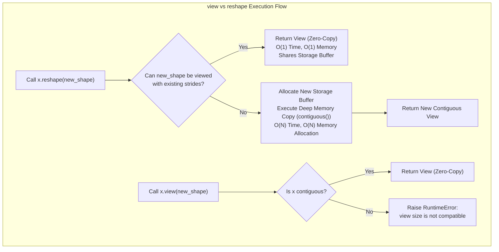
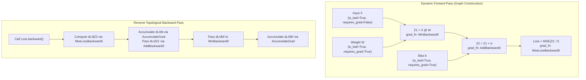
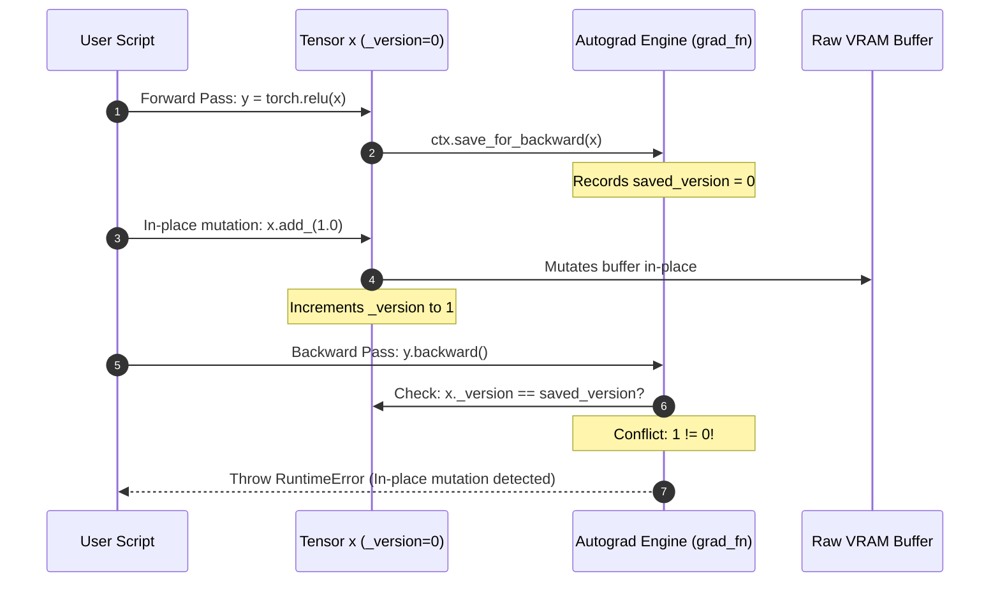

# Module 06: PyTorch Tensors, Memory Layout, Broadcasting Semantics, and Dynamic Autograd Engine

> **Prerequisites:** [Module 05: Neural Regularization: Dropout, Decoupled Weight Decay, and Label Smoothing](../05-regularization-dropout-weight-decay-label-smoothing/README.md)  
> **Estimated Reading Time:** 40-50 minutes  
> **Target Audience:** Senior Backend Engineers, ML Systems Engineers, and Infrastructure Architects building scalable deep learning systems and custom operators.

---

## Executive Overview & Industry Context

At the core of modern deep learning infrastructure lies a profound abstraction: the multi-dimensional array, or **Tensor**. While developers commonly treat tensors as mathematical arrays, a production-grade tensor in PyTorch is an architectural bridge between high-level algebraic expressions and low-level physical memory pages allocated on host RAM or GPU High-Bandwidth Memory (HBM).

Treating tensors as black-box containers is the single most common cause of high-severity production failures in deep learning systems:
1. **Silent Memory Exhaustion (OOM Cascades):** Retaining a reference to a single scalar loss in a Python logging list without stripping its computation history retains the entire Directed Acyclic Graph (DAG) and intermediate activation tensors across hundreds of forward passes, crashing GPU workers.
2. **Cache Thrashing and Memory Bandwidth Starvation:** Operations over non-contiguous memory layouts force GPU streaming multiprocessors (SMs) into uncoalesced global memory transactions, dropping memory bandwidth utilization from 90%+ to under 15%.
3. **Silent Broadcast Bugs:** Accidental broadcasting between mismatched tensors (such as subtracting a shape `(B,)` tensor from a shape `(B, 1)` tensor) silently produces a `(B, B)` matrix, exploding compute and memory from $O(B)$ to $O(B^2)$ without throwing a runtime error.
4. **Gradient Poisoning via In-Place Mutations:** In-place buffer mutations can invalidate backward sensitivity tapes, triggering either hard runtime assertions or silent mathematical errors.

This module deconstructs the PyTorch Tensor architecture down to raw byte offsets and memory strides, dissects the mathematical mechanics of NumPy/PyTorch broadcasting, exposes the internal DAG scheduling of the dynamic Autograd engine, and implements an industrial-strength tensor autograd engine from scratch.

---

## 1. Physical Memory Layout: Storage, Offsets, Strides, and Views

### The Decoupling of Logical Views from Physical Storage

A PyTorch tensor is fundamentally separated into two distinct entities:
1. **`Storage` / `UntypedStorage`:** A contiguous, flat 1D array of raw bytes allocated on a specific device (CPU page-locked/virtual memory or GPU VRAM). It has no concept of dimensions, shapes, or rank; it merely manages the underlying memory pointer, byte capacity, and allocator lifecycle.
2. **`Tensor` (Tensor Metadata / View):** A lightweight metadata wrapper referencing the storage. It defines the logical shape, data type (`dtype`), memory strides (`stride`), storage offset (`storage_offset`), and autograd status (`requires_grad`).

```
Logical View: Matrix of shape (3, 3)
┌───────────┬───────────┬───────────┐
│ A[0,0]=10 │ A[0,1]=20 │ A[0,2]=30 │
├───────────┼───────────┼───────────┤
│ A[1,0]=40 │ A[1,1]=50 │ A[1,2]=60 │
├───────────┼───────────┼───────────┤
│ A[2,0]=70 │ A[2,1]=80 │ A[2,2]=90 │
└───────────┴───────────┴───────────┘
                      │
                      ▼ Maps via Strides & Offset
Physical Storage (UntypedStorage: 1D Flat Contiguous Memory Array):
┌────┬────┬────┬────┬────┬────┬────┬────┬────┐
│ 10 │ 20 │ 30 │ 40 │ 50 │ 60 │ 70 │ 80 │ 90 │
└────┴────┴────┴────┴────┴────┴────┴────┴────┘
  0    1    2    3    4    5    6    7    8   (Indices in Storage)
```

### The Strided Memory Addressing Equation

Given a $d$-dimensional tensor with shape $\mathbf{D} = (D_0, D_1, \dots, D_{d-1})$ and strides $\mathbf{S} = (S_0, S_1, \dots, S_{d-1})$, the physical 1D storage index $I(\mathbf{i})$ corresponding to a multi-dimensional logical index $\mathbf{i} = (i_0, i_1, \dots, i_{d-1})$ is computed deterministically as:

$$I(\mathbf{i}) = \text{storage\_offset} + \sum_{k=0}^{d-1} i_k \cdot S_k$$

Where:
- $\text{storage\_offset} \in \mathbb{N}_0$ is the starting element index inside the underlying storage buffer.
- $S_k \in \mathbb{Z}$ represents the step size (in units of elements, not bytes) required to advance by 1 unit along dimension $k$.

For a standard row-major (C-contiguous) tensor, the strides are defined recursively from right to left:

$$S_{d-1} = 1, \quad S_k = S_{k+1} \cdot D_{k+1} = \prod_{j=k+1}^{d-1} D_j \quad \text{for } k \in \{d-2, d-3, \dots, 0\}$$

### Contiguity: Row-Major (C-Contiguous) vs Non-Contiguous Memory

A tensor is **C-contiguous** if its elements are laid out in memory sequentially along the logical dimensions from the last dimension to the first. Mathematically, a tensor is contiguous if and only if:

$$S_{d-1} = 1 \quad \text{and} \quad \forall k \in \{0, \dots, d-2\}, \quad S_k = S_{k+1} \cdot D_{k+1}$$

When you transpose a 2D matrix ($X^T$), PyTorch does **not** copy or reallocate any data. Instead, it swaps the metadata strides:

```python
import torch

x = torch.arange(6, dtype=torch.float32).reshape(2, 3)
# x.shape = (2, 3), x.stride() = (3, 1), x.is_contiguous() = True

xt = x.t()
# xt.shape = (3, 2), xt.stride() = (1, 3), xt.is_contiguous() = False
# Both x and xt share the EXACT same storage address:
assert x.data_ptr() == xt.data_ptr()
```

### Views vs Copies: `view()` vs `reshape()`

The distinction between `view()` and `reshape()` is a frequent source of performance regressions and runtime exceptions:
- **`tensor.view(*shape)`**: Returns a new tensor that points to the **same underlying storage**. It requires the new shape to be algebraically compatible with the existing strides. If the tensor is non-contiguous, `view()` throws a runtime error (`RuntimeError: view size is not compatible with input tensor's size and stride`).
- **`tensor.reshape(*shape)`**: Guarantees returning a tensor with the requested shape. It first inspects `is_contiguous()`. If the tensor is contiguous (or the strides permit a zero-copy re-stride), it returns a view. If the layout is non-contiguous and cannot be represented by adjusting strides, `reshape()` silently calls `.contiguous()`, triggering a **heap allocation and full memory copy**.



---

## 2. Broadcasting Semantics and Virtual Strides

Broadcasting allows arithmetic operations between tensors of different shapes without copying data. PyTorch and NumPy follow the **trailing-dimension alignment rule** derived from the early Array Programming paradigms (APL / BLAS).

### The Mathematical Rules of Broadcasting

Given two tensors $A \in \mathbb{R}^{D_0 \times D_1 \times \dots \times D_{m-1}}$ and $B \in \mathbb{R}^{D'_0 \times D'_1 \times \dots \times D'_{n-1}}$:

1. **Alignment:** The shape tuples are aligned starting from the **rightmost (trailing) dimension**:
   
   $$\text{Align dimension } k \text{ of } A \text{ with dimension } j \text{ of } B \text{ where } m-1-k = n-1-j$$

2. **Rank Padding:** If $m < n$, prepend dimensions of size $1$ to the shape of $A$ until $\text{rank}(A) = \text{rank}(B) = n$.
3. **Compatibility Condition:** For each aligned pair of dimensions $(d_A, d_B)$, they are compatible if and only if:
   
   $$d_A = d_B \quad \lor \quad d_A = 1 \quad \lor \quad d_B = 1$$

4. **Output Dimension:** The resulting tensor dimension $d_{\text{out}}$ is:
   
   $$d_{\text{out}} = \max(d_A, d_B)$$

If any aligned dimension fails this condition, a broadcasting dimension mismatch error is raised.

### The Virtual Stride Optimization ($S_k = 0$)

How does PyTorch broadcast a tensor of shape `(1, 4)` across a tensor of shape `(10000, 4)` without allocating 40,000 floats?

The answer lies in **virtual strides**. When expanding a dimension of size $1$ to size $N$, PyTorch sets the stride for that dimension to **zero**:

$$S_{\text{expanded}} = 0$$

Under the indexing equation:

$$I(i_0, i_1) = i_0 \cdot S_0 + i_1 \cdot S_1 = i_0 \cdot 0 + i_1 \cdot 1 = i_1$$

Regardless of the value of $i_0 \in \{0, 1, \dots, N-1\}$, the multiplication $i_0 \cdot 0$ maps every row to the exact same physical index in storage. The operation executes at **zero memory allocation cost** ($O(1)$ memory overhead).

```python
import torch

a = torch.tensor([1.0, 2.0, 3.0, 4.0])        # shape (4,), stride (1,)
b = a.unsqueeze(0)                             # shape (1, 4), stride (4, 1)
expanded = b.expand(10000, 4)                  # shape (10000, 4), stride (0, 1)

print(f"Expanded stride: {expanded.stride()}") # Outputs: (0, 1)
print(f"Storage size: {expanded.untyped_storage().nbytes()} bytes") # Only 16 bytes!
```

### The Gradient Reduction Rule for Broadcasted Operations

Because forward broadcasting replicates a single element along expanded axes, the backward pass must compute the total sensitivity of that single element with respect to the loss $\mathcal{L}$.

By the multivariable chain rule, if $Y = A + B$, and $A$ was broadcasted across axes $\mathcal{A}_{\text{broadcast}}$, the gradient $\frac{\partial \mathcal{L}}{\partial A}$ is the **sum** of the upstream gradients across all broadcasted dimensions:

$$\frac{\partial \mathcal{L}}{\partial A} = \sum_{k \in \mathcal{A}_{\text{broadcast}}} \frac{\partial \mathcal{L}}{\partial Y}$$

If $A$ had a lower rank than $Y$, the summation must also collapse the prepended leading dimensions.

```
Forward Pass (Broadcasting via Stride=0):
  A (Shape: [1, 3]) ──────expand──────► A_expanded (Shape: [4, 3])
                                                │
                                                ▼  (+) with B [4, 3]
                                           Y [4, 3]

Backward Pass (Gradient Reduction via Summation):
  dL/dA (Shape: [1, 3]) ◄───sum(dim=0)─── dL/dY (Shape: [4, 3])
```

---

## 3. The Autograd Engine: DAG, Dynamic Tape, and In-Place Safety

PyTorch uses a **tape-based dynamic automatic differentiation engine** (reverse-mode autograd). Unlike static computational graph frameworks (like legacy TensorFlow 1.x), the graph is constructed on the fly as operations execute.



### Core Data Structures of Autograd

1. **`torch.Tensor`:** Holds the data, grad, and a pointer to the `grad_fn` that created it.
2. **`is_leaf`:** A tensor is a leaf node if:
   - It was explicitly constructed by the user (e.g., `nn.Parameter`, `torch.randn(..., requires_grad=True)`).
   - Its `requires_grad` is `False`.
   Intermediate tensors resulting from operations (e.g., $Z = XW$) have `is_leaf = False`. Only leaf nodes retain `.grad` post-backward unless `retain_grad()` is explicitly called on intermediate tensors.
3. **`grad_fn` (`Node` in C++):** A callable object representing the backward operation. It maintains:
   - `next_functions`: Pointers to the `grad_fn` nodes of its input operands.
   - Saved tensors: Contextual forward activations saved via `ctx.save_for_backward()`.
4. **`AccumulateGrad`:** A specialized leaf node function. When backpropagation reaches a leaf tensor $W$, `AccumulateGrad` executes:
   
   $$W.\text{grad} = W.\text{grad} + \delta_{\text{incoming}} \quad \text{(or } W.\text{grad} = \delta_{\text{incoming}} \text{ if grad was None)}$$

### The In-Place Mutation Trap and Version Counters (`_version`)

One of the most intricate engineering components of PyTorch's C++ core (`c10::TensorImpl`) is the **version counter** (`_version`).

Every storage implementation tracks an atomic integer counter `_version`:
1. When a tensor is initialized, `_version = 0`.
2. Any in-place operation (`add_()`, `mul_()`, zeroing out a slice `x[0] = 0`, or `+=`) increments `_version` by 1.
3. When an operation saves a tensor for backward via `ctx.save_for_backward(x)`:
   - The engine saves a weak reference to `x` and records its current version: `saved_version = x._version`.
4. During `loss.backward()`:
   - Before executing the backward kernel, the engine asserts:
     
     $$\text{assert } x.\_version == \text{saved\_version}$$

   - If $x.\_version > \text{saved\_version}$, PyTorch immediately raises:
     `RuntimeError: one of the variables needed for gradient computation has been modified by an inplace operation`.



Why does PyTorch guard this so strictly?
Consider the derivative of $y = \text{ReLU}(x)$:

$$\frac{\partial y}{\partial x} = \begin{cases} 1 & \text{if } x > 0 \\ 0 & \text{if } x \le 0 \end{cases}$$

The backward pass requires the **original value of $x$ during the forward pass**. If $x$ was modified in-place after computing $\text{ReLU}(x)$, the backward kernel reads the modified bytes, producing completely invalid mathematical derivatives.

---

## 4. Production Implementation: Tensor Autograd Engine from Scratch

Below is a self-contained, publication-grade implementation of a multi-dimensional Tensor Autograd Engine built purely on Python and NumPy. It features:
- Explicit shape, stride, and storage offset management.
- Dynamic Directed Acyclic Graph (DAG) construction.
- Reverse topological sort scheduling.
- Full broadcasting support with gradient reduction in backward passes.
- Version counter (`_version`) tracking with in-place mutation detection.

```python
"""
production_autograd_engine.py
A fully functional multi-dimensional Tensor Autograd Engine with strided memory logic,
broadcasting backward reductions, and in-place version tracking.
"""

from typing import Tuple, List, Set, Optional, Callable, Union
import numpy as np


def compute_c_strides(shape: Tuple[int, ...]) -> Tuple[int, ...]:
    """Computes standard row-major (C-contiguous) strides for a given shape."""
    if not shape:
        return ()
    strides = [1] * len(shape)
    for i in range(len(shape) - 2, -1, -1):
        strides[i] = strides[i + 1] * shape[i + 1]
    return tuple(strides)


def unbroadcast(grad: np.ndarray, target_shape: Tuple[int, ...]) -> np.ndarray:
    """
    Collapses broadcasted dimensions in an incoming gradient back to target_shape.
    Summing along dimensions that were prepended or expanded from size 1.
    """
    grad_shape = grad.shape
    if grad_shape == target_shape:
        return grad

    # 1. Sum across prepended leading dimensions
    num_leading = len(grad_shape) - len(target_shape)
    for _ in range(num_leading):
        grad = grad.sum(axis=0)

    # 2. Sum across dimensions that were size 1 in the target
    for i, dim in enumerate(target_shape):
        if dim == 1 and grad.shape[i] > 1:
            grad = grad.sum(axis=i, keepdims=True)

    return grad.reshape(target_shape)


class Dependency:
    """Represents a directed edge in the computation DAG."""
    def __init__(self, tensor: "Tensor", grad_fn: Callable[[np.ndarray], np.ndarray]):
        self.tensor = tensor
        self.grad_fn = grad_fn
        # Capture current version of dependency for in-place safety verification
        self.saved_version = tensor._version


class Tensor:
    def __init__(
        self,
        data: Union[float, int, list, np.ndarray],
        requires_grad: bool = False,
        is_leaf: bool = True,
        shape: Optional[Tuple[int, ...]] = None,
        strides: Optional[Tuple[int, ...]] = None,
        storage_offset: int = 0
    ):
        if isinstance(data, np.ndarray):
            self.data = data.astype(np.float32)
        else:
            self.data = np.array(data, dtype=np.float32)

        self.shape: Tuple[int, ...] = shape if shape is not None else self.data.shape
        self.strides: Tuple[int, ...] = strides if strides is not None else compute_c_strides(self.shape)
        self.storage_offset: int = storage_offset
        self.requires_grad: bool = requires_grad
        self.is_leaf: bool = is_leaf

        self.grad: Optional[np.ndarray] = None
        self._depends_on: List[Dependency] = []
        self._version: int = 0  # In-place mutation tracking counter

    @property
    def is_contiguous(self) -> bool:
        """Evaluates whether the tensor is contiguous in row-major order."""
        expected_strides = compute_c_strides(self.shape)
        return self.strides == expected_strides

    def zero_grad(self) -> None:
        """Resets gradient accumulation buffer."""
        self.grad = None

    def add_inplace(self, other: Union[float, "Tensor"]) -> "Tensor":
        """Demonstrates an in-place mutation that increments _version."""
        val = other.data if isinstance(other, Tensor) else other
        self.data += val
        self._version += 1
        return self

    def view(self, *new_shape: int) -> "Tensor":
        """Returns a view of the tensor if memory is contiguous."""
        if not self.is_contiguous:
            raise RuntimeError(
                f"view size is not compatible with input tensor's size and stride: "
                f"shape={self.shape}, strides={self.strides}. Use reshape() or contiguous()."
            )
        target_shape = tuple(new_shape)
        new_strides = compute_c_strides(target_shape)
        
        out = Tensor(
            self.data,
            requires_grad=self.requires_grad,
            is_leaf=False,
            shape=target_shape,
            strides=new_strides,
            storage_offset=self.storage_offset
        )
        if self.requires_grad:
            def backward_fn(grad_output: np.ndarray) -> np.ndarray:
                return grad_output.reshape(self.shape)
            out._depends_on.append(Dependency(self, backward_fn))
        return out

    # ================= Arithmetic Operations & Backward Closures =================

    def __add__(self, other: Union[float, "Tensor"]) -> "Tensor":
        other = other if isinstance(other, Tensor) else Tensor(other)
        out_data = self.data + other.data
        requires_grad = self.requires_grad or other.requires_grad
        out = Tensor(out_data, requires_grad=requires_grad, is_leaf=False)

        if self.requires_grad:
            def grad_fn_self(grad_output: np.ndarray) -> np.ndarray:
                return unbroadcast(grad_output, self.shape)
            out._depends_on.append(Dependency(self, grad_fn_self))

        if other.requires_grad:
            def grad_fn_other(grad_output: np.ndarray) -> np.ndarray:
                return unbroadcast(grad_output, other.shape)
            out._depends_on.append(Dependency(other, grad_fn_other))

        return out

    def __mul__(self, other: Union[float, "Tensor"]) -> "Tensor":
        other = other if isinstance(other, Tensor) else Tensor(other)
        out_data = self.data * other.data
        requires_grad = self.requires_grad or other.requires_grad
        out = Tensor(out_data, requires_grad=requires_grad, is_leaf=False)

        if self.requires_grad:
            def grad_fn_self(grad_output: np.ndarray) -> np.ndarray:
                return unbroadcast(grad_output * other.data, self.shape)
            out._depends_on.append(Dependency(self, grad_fn_self))

        if other.requires_grad:
            def grad_fn_other(grad_output: np.ndarray) -> np.ndarray:
                return unbroadcast(grad_output * self.data, other.shape)
            out._depends_on.append(Dependency(other, grad_fn_other))

        return out

    def __matmul__(self, other: "Tensor") -> "Tensor":
        out_data = self.data @ other.data
        requires_grad = self.requires_grad or other.requires_grad
        out = Tensor(out_data, requires_grad=requires_grad, is_leaf=False)

        if self.requires_grad:
            def grad_fn_self(grad_output: np.ndarray) -> np.ndarray:
                # dL/dA = grad_output @ B^T
                return grad_output @ other.data.swapaxes(-1, -2)
            out._depends_on.append(Dependency(self, grad_fn_self))

        if other.requires_grad:
            def grad_fn_other(grad_output: np.ndarray) -> np.ndarray:
                # dL/dB = A^T @ grad_output
                return self.data.swapaxes(-1, -2) @ grad_output
            out._depends_on.append(Dependency(other, grad_fn_other))

        return out

    def relu(self) -> "Tensor":
        out_data = np.maximum(self.data, 0.0)
        out = Tensor(out_data, requires_grad=self.requires_grad, is_leaf=False)

        if self.requires_grad:
            def grad_fn_self(grad_output: np.ndarray) -> np.ndarray:
                return grad_output * (self.data > 0.0).astype(np.float32)
            out._depends_on.append(Dependency(self, grad_fn_self))

        return out

    def sum(self) -> "Tensor":
        out_data = np.sum(self.data)
        out = Tensor(out_data, requires_grad=self.requires_grad, is_leaf=False)

        if self.requires_grad:
            def grad_fn_self(grad_output: np.ndarray) -> np.ndarray:
                return grad_output * np.ones_like(self.data)
            out._depends_on.append(Dependency(self, grad_fn_self))

        return out

    # ================= Reverse-Mode Topological Backward Pass =================

    def backward(self, grad: Optional[np.ndarray] = None) -> None:
        """
        Executes backpropagation via reverse topological sort over the DAG.
        Verifies version consistency to prevent in-place gradient corruption.
        """
        if not self.requires_grad:
            raise RuntimeError("Called .backward() on a Tensor that does not require gradients.")

        if grad is None:
            if self.shape == () or self.shape == (1,):
                grad = np.array(1.0, dtype=np.float32)
            else:
                raise RuntimeError("Grad can only be implicitly created for scalar outputs")

        self.grad = grad

        # 1. Build Topological Ordering via Depth-First Search
        topo_order: List["Tensor"] = []
        visited: Set["Tensor"] = set()

        def build_topo(tensor: "Tensor") -> None:
            if tensor not in visited:
                visited.add(tensor)
                for dep in tensor._depends_on:
                    build_topo(dep.tensor)
                topo_order.append(tensor)

        build_topo(self)

        # 2. Iterate in Reverse Topological Order
        for tensor in reversed(topo_order):
            if tensor.grad is None:
                continue

            for dep in tensor._depends_on:
                # In-place safety assertion: check version counter
                if dep.tensor._version != dep.saved_version:
                    raise RuntimeError(
                        f"One of the variables needed for gradient computation was modified by "
                        f"an in-place operation: saved version {dep.saved_version}, current version {dep.tensor._version}."
                    )

                local_grad = dep.grad_fn(tensor.grad)

                # Accumulate gradients (+=) to handle multiple consumer branches
                if dep.tensor.grad is None:
                    dep.tensor.grad = np.array(local_grad, dtype=np.float32)
                else:
                    dep.tensor.grad += np.array(local_grad, dtype=np.float32)


# ================= Verification Against PyTorch Engine =================

if __name__ == "__main__":
    import torch

    print("=== Testing Mini Autograd Engine against PyTorch ===")

    # 1. Forward & Backward Mathematical Match with Broadcasting
    x_val = np.random.randn(2, 3).astype(np.float32)
    w_val = np.random.randn(3, 4).astype(np.float32)
    b_val = np.random.randn(1, 4).astype(np.float32)  # Broadcast across batch size 2

    # Mini Engine
    x_custom = Tensor(x_val, requires_grad=False)
    w_custom = Tensor(w_val, requires_grad=True)
    b_custom = Tensor(b_val, requires_grad=True)

    z_custom = (x_custom @ w_custom) + b_custom
    a_custom = z_custom.relu()
    loss_custom = a_custom.sum()
    loss_custom.backward()

    # Native PyTorch
    x_pt = torch.tensor(x_val, requires_grad=False)
    w_pt = torch.tensor(w_val, requires_grad=True)
    b_pt = torch.tensor(b_val, requires_grad=True)

    z_pt = (x_pt @ w_pt) + b_pt
    a_pt = z_pt.relu()
    loss_pt = a_pt.sum()
    loss_pt.backward()

    # Assertions
    np.testing.assert_allclose(loss_custom.data, loss_pt.detach().numpy(), rtol=1e-5)
    np.testing.assert_allclose(w_custom.grad, w_pt.grad.numpy(), rtol=1e-5)
    np.testing.assert_allclose(b_custom.grad, b_pt.grad.numpy(), rtol=1e-5)
    print("✓ Mini Engine Forward and Backward passes perfectly match PyTorch!")

    # 2. Testing In-Place Version Detection
    print("\n=== Testing In-Place Mutation Detection ===")
    x_mod = Tensor([1.0, 2.0, 3.0], requires_grad=True)
    y_mod = x_mod.relu()
    x_mod.add_inplace(5.0)  # In-place modification increments _version to 1

    try:
        y_mod.backward()
        print("FAIL: In-place modification was not caught!")
    except RuntimeError as e:
        print(f"✓ In-place mutation successfully caught with error:\n  {e}")
```

---

## 5. Failure Modes, Edge Cases & Antipatterns

### 1. Storing Graph Tensors in Python Containers (Memory Leak)

```python
# ❌ FATAL ANTIPATTERN: Accumulating loss tensors retaining computation DAG
epoch_losses = []
for batch in dataloader:
    pred = model(batch)
    loss = criterion(pred, batch.target)
    optimizer.zero_grad()
    loss.backward()
    optimizer.step()
    epoch_losses.append(loss)  # Retains full DAG, all activations of batch in VRAM!

# ✅ CORRECT: Detach or extract scalar float
epoch_losses.append(loss.item())  # Extracts raw Python float, drops DAG reference
```

### 2. Silent Broadcast Size Inflation

```python
# Mismatched shapes: targets is 1D (B,), outputs is 2D (B, 1)
targets = torch.randn(64)       # Shape: [64]
predictions = torch.randn(64, 1) # Shape: [64, 1]

# ❌ SILENT BUG: Broadcasting produces [64, 64] matrix!
diff = predictions - targets
print(diff.shape) # torch.Size([64, 64]) -> Consumes O(B^2) compute and memory!

# ✅ CORRECT: Explicit squeeze or align shapes
diff = predictions.squeeze(-1) - targets  # Shape: [64]
```

### 3. Non-Contiguous Memory Slicing and Views

```python
x = torch.randn(1024, 1024)
sub_x = x[::2, ::2]  # Strided slice: shape (512, 512), strides (2048, 2)

# ❌ CRASH: Calling view() on non-contiguous memory
try:
    flattened = sub_x.view(-1)
except RuntimeError as e:
    print("Caught expected view error on non-contiguous layout")

# ✅ CORRECT: Use reshape() or call contiguous()
flattened = sub_x.contiguous().view(-1)  # Explicit allocation and copy
```

### 4. Retaining Unnecessary Sub-Tensors from Large Buffers

```python
# Large embedding matrix in VRAM
large_tensor = torch.randn(10000, 1024)  # ~40 MB

# ❌ LEAK: Slicing a single row retains the ENTIRE 40 MB storage in memory!
single_row = large_tensor[0]
del large_tensor
# single_row.untyped_storage().nbytes() is STILL 40,960,000 bytes!

# ✅ CORRECT: Clone to allocate fresh, isolated storage
single_row = large_tensor[0].clone()
del large_tensor
# single_row.untyped_storage().nbytes() is now only 4,096 bytes!
```

---

## 6. Real-World Production Incident Post-Mortem

### The \$480,000 OOM Cascade: Memory Leak in an Online E-Commerce Recommendation Service

#### Incident Profile
- **Service:** Real-time deep candidate retrieval service serving personalized product rankings.
- **Scale:** 15,000 requests/second across a cluster of 64 AWS `g5.2xlarge` instances (NVIDIA A10G 24GB GPUs).
- **Impact:** Complete service outage during peak promotion window; cumulative business impact estimated at \$480,000 in lost gross merchandise value (GMV).

```
Timeline of the Outage:
+------------------------------------------------------------------------------------+
| 14:00 UTC - Release v2.4.1 deployed (adds real-time prediction confidence telemetry)|
| 14:15 UTC - GPU VRAM on Worker 01 reaches 98% (gradual steady climb)               |
| 14:22 UTC - Worker 01 crashes with CUDA Out of Memory; k8s restarts pod            |
| 14:23 UTC - In-flight traffic redirects to remaining 63 workers                     |
| 14:35 UTC - Cascading OOM: 48 out of 64 workers crash simultaneously                |
| 14:40 UTC - P99 latency spikes from 12ms to 4,800ms; gateway serves 503 errors     |
| 15:10 UTC - Engineering rolls back to v2.4.0; VRAM usage stabilizes at 3.2 GB      |
+------------------------------------------------------------------------------------+
```

#### Root Cause Analysis

A software engineer introduced an online inference confidence telemetry collector designed to log low-confidence predictions for offline evaluation:

```python
# Inference Pipeline Telemetry Collector (v2.4.1)
class TelemetryLogger:
    def __init__(self, capacity=10000):
        self.buffer = []
        self.capacity = capacity

    def log_inference(self, features, logits):
        confidence, pred_class = torch.softmax(logits, dim=-1).max(dim=-1)
        if confidence < 0.35:  # Uncertain prediction
            self.buffer.append({
                "features": features,
                "confidence": confidence,  # ❌ BUG: Tensor with computation history attached!
                "class": pred_class
            })
            if len(self.buffer) > self.capacity:
                self.buffer.pop(0)
```

Because `confidence` was an intermediate tensor computed from `logits`, its `grad_fn` pointed to `SoftmaxBackward`. That node retained a pointer to the entire input `logits` tensor, which in turn retained intermediate activation tensors and weight references of the entire neural network forward pass!

Even though inference was executing inside `torch.no_grad()` in the main serving thread, the telemetry function was invoked from an asynchronous callback thread where `torch.no_grad()` was **not in context**. Every logged prediction retained 12 MB of activation buffers in GPU VRAM. Over 2,000 logged items, the buffer leaked 24 GB of VRAM, triggering the OOM.

#### Architectural Remediation & Hardening

1. **Mandatory `.item()` / `.detach()` Enforcement:**
   
   ```python
   # ✅ FIXED TELEMETRY LOGGER
   self.buffer.append({
       "confidence": confidence.detach().cpu().item(),  # Raw Python float, zero GPU references
       "class": pred_class.detach().cpu().item()
   })
   ```

2. **Global PyTorch Inference Mode Context:**
   Replaced deprecated `torch.no_grad()` with `torch.inference_mode()` at the top-level application server loop. `torch.inference_mode()` disables view tracking and version counter increments, completely preventing the allocation of autograd metadata nodes.

3. **Automated Static Analysis Rule:**
   Implemented a custom flake8 / ruff plugin that flags any append of `torch.Tensor` objects into long-lived Python dictionaries or lists without explicit calls to `.detach()` or `.item()`.

---

## 7. Senior Technical Interview Questions & Model Answers

### Question 1: Explain why `tensor.view()` fails on a transposed tensor, but `tensor.reshape()` succeeds. What are the concrete hardware and cache locality implications?

**Model Answer:**
A tensor's underlying memory is a flat 1D array. When a tensor is transposed (e.g., $X^T$), PyTorch leaves the physical memory untouched and merely swaps the metadata strides (e.g., a shape `(2, 3)` with strides `(3, 1)` becomes shape `(3, 2)` with strides `(1, 3)`). The tensor is now **non-contiguous** because traversing elements along the trailing dimension requires jumping 3 elements forward in memory rather than 1.

`tensor.view(*new_shape)` can only succeed if there exists a valid configuration of strides over the **existing** contiguous memory block that represents the new shape. For a transposed tensor, consecutive elements in the new logical shape do not correspond to linear slices of the physical storage. Because `view()` is guaranteed to be a zero-copy operation, it refuses to silently allocate memory and raises a `RuntimeError`.

`tensor.reshape(*new_shape)` is a higher-level abstraction. It evaluates whether `view()` is mathematically possible. If not, it automatically invokes `tensor.contiguous()`, which allocates a brand new `UntypedStorage` buffer and copies the elements into row-major order.

**Hardware & Cache Locality Implications:**
Non-contiguous memory traversal destroys CPU cache line utilization ($L1/L2/L3$) and causes uncoalesced memory transactions on NVIDIA GPUs. On a GPU, an SM accesses global memory in 32-byte or 128-byte aligned transactions across a warp of 32 threads. If a tensor is contiguous, a warp loads 32 adjacent floats in a single memory transaction. If strides force memory jumps, the memory controller issues 32 separate serialized memory transactions to read the exact same amount of data, reducing effective memory throughput by up to 90%.

---

### Question 2: How does PyTorch's autograd engine mathematically handle backward propagation for broadcasted operations? Walk through the Jacobian and gradient reduction logic.

**Model Answer:**
Broadcasting replicates elements across dimensions without memory copies by setting the stride for the expanded dimension to zero ($S_k = 0$).

Mathematically, let $x \in \mathbb{R}^{1 \times D}$ be broadcasted to form $Y \in \mathbb{R}^{B \times D}$, where:

$$Y_{b, d} = x_{0, d} \quad \forall b \in \{0, \dots, B-1\}, \, d \in \{0, \dots, D-1\}$$

Let $\mathcal{L}$ be the scalar objective function, and let $\frac{\partial \mathcal{L}}{\partial Y} \in \mathbb{R}^{B \times D}$ be the upstream gradient arriving at $Y$.

By the multivariable chain rule:

$$\frac{\partial \mathcal{L}}{\partial x_{0, d}} = \sum_{b=0}^{B-1} \sum_{k=0}^{D-1} \frac{\partial \mathcal{L}}{\partial Y_{b, k}} \cdot \frac{\partial Y_{b, k}}{\partial x_{0, d}}$$

Because $Y_{b, k}$ depends only on $x_{0, d}$ when $k = d$ (with local derivative $\frac{\partial Y_{b, d}}{\partial x_{0, d}} = 1$), the equation collapses to:

$$\frac{\partial \mathcal{L}}{\partial x_{0, d}} = \sum_{b=0}^{B-1} \frac{\partial \mathcal{L}}{\partial Y_{b, d}}$$

In vector notation:

$$\frac{\partial \mathcal{L}}{\partial x} = \sum_{b=0}^{B-1} \left( \frac{\partial \mathcal{L}}{\partial Y} \right)_{b, :} = \text{torch.sum}\left(\frac{\partial \mathcal{L}}{\partial Y}, \text{dim}=0, \text{keepdim}=\text{True}\right)$$

In general, the autograd engine inspects the shapes of input $x$ and output $Y$:
1. If $\text{rank}(Y) > \text{rank}(x)$, the upstream gradient is summed over the leading prepended dimensions.
2. For any dimension $i$ where $\text{shape}(x)[i] == 1$ and $\text{shape}(Y)[i] > 1$, the upstream gradient is summed along dimension $i$ with `keepdim=True`.

---

### Question 3: How does PyTorch detect in-place mutations that violate autograd safety? What is the internal data structure and version tracking mechanism?

**Model Answer:**
PyTorch prevents silent mathematical corruption via atomic version counters tracked in `c10::TensorImpl`.

1. **Storage-Level Version Counter (`c10::VariableVersion`):**
   Every tensor points to an underlying `TensorImpl` which embeds an atomic version counter `_version`.
   When a tensor is instantiated, its `_version` is initialized to $0$.
   Any in-place mutation (such as `x.add_()`, `x[0] = 5`, or `x.zero_()`) invokes `TensorImpl::bump_version()`, which increments `_version` by 1.

2. **Saved Tensor Context (`torch::autograd::SavedVariable`):**
   When an operation requires forward activations during backpropagation (for instance, $y = x^2$ needs $x$ to compute $\frac{\partial y}{\partial x} = 2x$), the forward kernel calls `ctx.save_for_backward(x)`.
   Instead of copying the full tensor memory (which would double VRAM usage), PyTorch creates a `SavedVariable` object that stores:
   - A weak reference to the underlying storage.
   - The value of `x._version` at the exact moment of the forward calculation ($V_{\text{saved}} = x.\_version$).

3. **Backward Assertion:**
   When `y.backward()` is called, the backward kernel unpacks the saved variable. Before executing the derivative calculation, the engine compares:
   
   $$\text{assert } x.\_version == V_{\text{saved}}$$

   If the user modified $x$ in-place between the forward and backward passes, $x.\_version > V_{\text{saved}}$. The engine immediately aborts and throws a `RuntimeError` stating that one of the variables needed for gradient computation was modified by an in-place operation.

---

### Question 4: In distributed training, an engineer replaces `optimizer.zero_grad()` with `for p in model.parameters(): p.grad = None`. What happens at the C++ engine level regarding memory allocation and `AccumulateGrad`?

**Model Answer:**
Executing `optimizer.zero_grad(set_to_none=True)` or setting `p.grad = None` directly alters how the Autograd C++ engine handles memory allocation and backward accumulation:

1. **With `p.grad.zero_()` (Traditional Zeroing):**
   - The tensor buffer for `p.grad` remains allocated in VRAM.
   - During `zero_grad()`, a CUDA kernel executes across all parameters to write zeros (`0.0f`) to every byte of memory. This consumes memory bandwidth.
   - During `loss.backward()`, when the engine's `AccumulateGrad` node reaches parameter $p$, it sees that `p.grad` is not `None`. It performs an in-place addition kernel:
     
     $$p.\text{grad}.\text{add\_}(\delta_{\text{incoming}})$$

2. **With `p.grad = None` (`set_to_none=True`):**
   - The reference to the existing gradient tensor is dropped. The PyTorch C++ caching allocator marks the underlying memory page as free/reclaimable.
   - Zeroing kernels are completely eliminated, saving GPU cycles and memory bandwidth.
   - During `loss.backward()`, when `AccumulateGrad` reaches parameter $p$, it checks `if (!p.grad)`. Instead of executing an addition kernel, it performs a **direct assignment / pointer move**:
     
     $$p.\text{grad} = \delta_{\text{incoming}}$$

   - This replaces a read-modify-write addition kernel with a direct write, reducing memory traffic on the GPU bus.
   - Furthermore, peak memory usage during the forward pass can decrease because intermediate activations can reuse the memory pages freed by clearing `p.grad`.

---

### Question 5: How does PyTorch implement zero-copy broadcasting using strides? What is a stride of 0, and how does it interact with the CUDA hardware memory coalescing engine?

**Model Answer:**
In PyTorch's strided memory model, element lookup is governed by:

$$I(\mathbf{i}) = \text{storage\_offset} + \sum_{k=0}^{d-1} i_k \cdot S_k$$

To broadcast a dimension of size $1$ to size $M$ without copying data, PyTorch leaves the physical memory untouched and creates a new `TensorImpl` metadata view with:

$$\text{shape}[k] = M, \quad S_k = 0$$

Because $i_k \cdot 0 = 0$ for all $i_k \in \{0, \dots, M-1\}$, the hardware always indexes the exact same memory address regardless of the index in that dimension.

**Interaction with CUDA Hardware Coalescing:**
On NVIDIA GPUs, memory coalescing is the consolidation of global memory accesses by a warp (32 parallel threads) into a minimum number of 32-byte or 128-byte cache lines.
- **Contiguous Case ($S_{\text{last}} = 1$):** Threads $0 \dots 31$ access addresses $A, A+4, A+8, \dots, A+124$. These 128 contiguous bytes fit inside a single 128-byte L2 cache transaction. High efficiency (100% coalesced).
- **Broadcasted Stride of 0 ($S_{\text{broadcast}} = 0$):**
  If the broadcast occurs along the inner (contiguous) dimension, all 32 threads in the warp request the **exact same memory address** simultaneously.
  The NVIDIA SM memory controller detects this condition as a **broadcast read**: a single 32-byte request is issued, and the resulting word is broadcasted over the warp's internal interconnect to all 32 registers simultaneously. While this avoids memory divergence, having zero-stride across inner dimensions can prevent vectorization (such as `float4` SIMD load instructions), which is why compilers like Triton or PyTorch Inductor prefer broadcasting outer dimensions whenever possible.

---

This module is part of [Track 01: Optimization, Regularization & PyTorch](../README.md).
