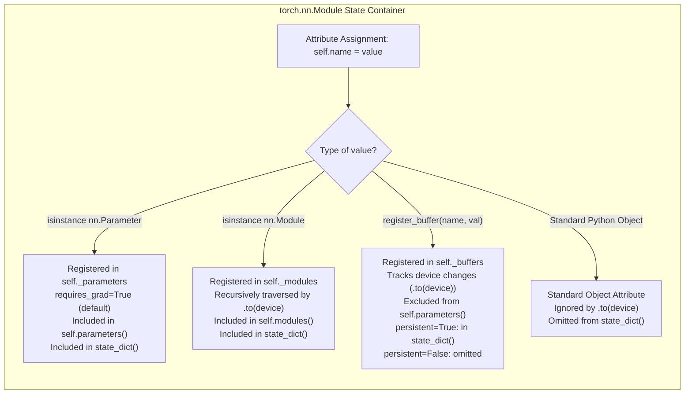
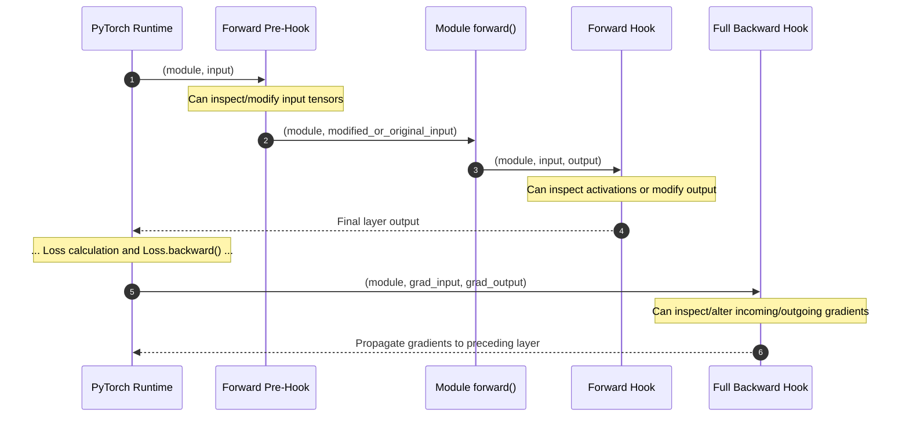
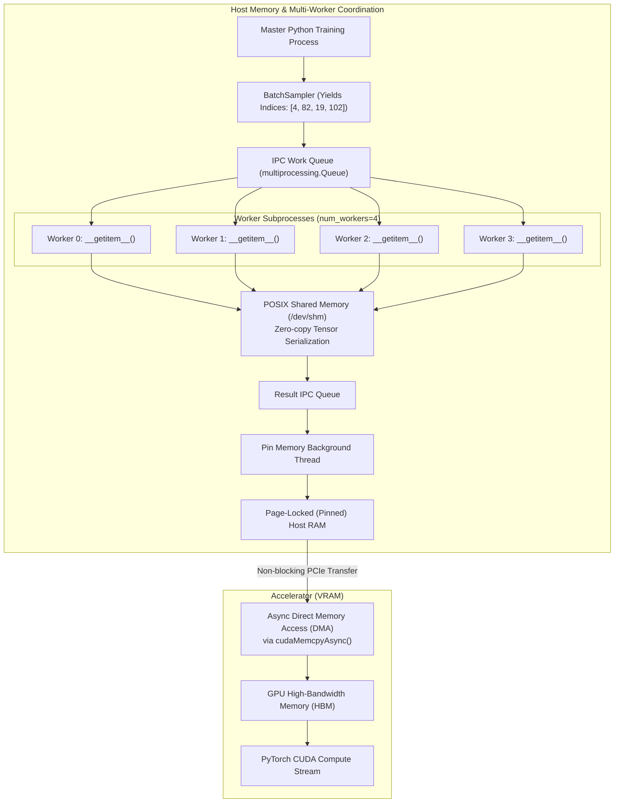
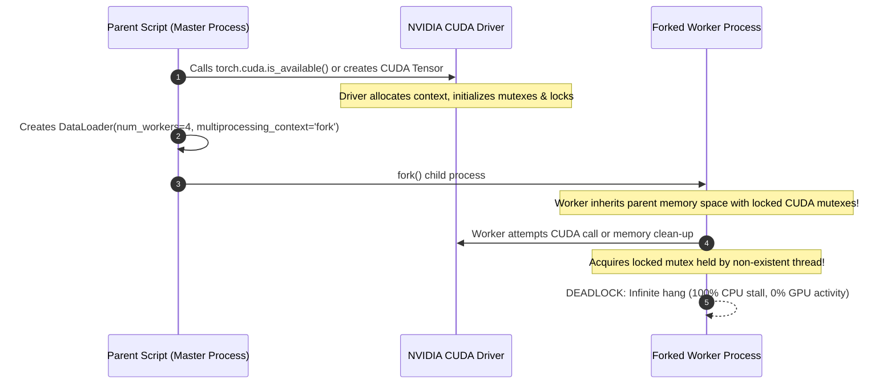

# Module 07: PyTorch nn.Module Architecture, Custom Datasets, High-Throughput DataLoaders, and Worker Multiprocessing

> **Prerequisites:** [Module 06: PyTorch Tensors, Memory Layout, Broadcasting Semantics, and Dynamic Autograd Engine](../06-pytorch-tensors-broadcasting-and-autograd/README.md)  
> **Estimated Reading Time:** 45-55 minutes  
> **Target Audience:** Senior Deep Learning Engineers, Backend Systems Architects, and Distributed ML Infrastructure Developers.

---

## Executive Overview & Industry Context

In production deep learning pipelines, computing the forward and backward passes on modern accelerators (e.g., NVIDIA H100, A100, or L40S) is rarely the system bottleneck. Tensor Cores execute matrix multiplications at hundreds of teraflops. The true bottleneck in production clusters is almost always **data starvation**: the inability of host CPUs, memory buses, and NVMe drives to preprocess and feed batches fast enough to keep GPU compute engines saturated.

When a training cluster operates with sub-optimal data pipelines:
- Multi-million-dollar GPU clusters sit idle 60–80% of the time, stalled in `cudaStreamSynchronize` waiting for the next minibatch.
- Forked worker processes duplicate gigabytes of pageable memory via Python Copy-On-Write (COW) thrashing, causing out-of-memory crashes on the host OS.
- Innocent CUDA driver pre-checks in master processes poison child worker forks, resulting in silent multi-node deadlocks that burn hundreds of thousands of dollars in cloud compute credits.

To build robust, high-throughput training and inference systems, engineers must understand the two pillar abstractions of PyTorch:
1. **`torch.nn.Module`:** The compositional state machine that manages parameter ownership, buffer lifecycles, and forward/backward hook execution.
2. **`torch.utils.data.{Dataset, DataLoader}`:** The multi-processing data ingestion engine that coordinates zero-copy memory mapping, POSIX inter-process communication (IPC), page-locked (pinned) DMA transfers, and deterministic worker synchronization.

This module deconstructs the internal state dictionaries and hook mechanics of `nn.Module`, analyzes the systems architecture of high-throughput `DataLoader` multi-processing, and provides production-grade implementations of memory-mapped streaming datasets and custom activation monitoring hooks.

---

## 1. Deep Architecture of `torch.nn.Module`

The `torch.nn.Module` class is not merely an object-oriented wrapper around neural network layers; it is a specialized **hierarchical metadata and lifecycle manager**.

### Internal State Registries

Every `nn.Module` instance initializes six internal dictionary registries that dictate how tensors, modules, and hooks are tracked, serialized, and moved across devices:

```python
# Internal registries initialized inside nn.Module.__init__()
self._modules = OrderedDict()            # Sub-modules (e.g., self.fc1, self.conv)
self._parameters = OrderedDict()         # Learnable parameters (nn.Parameter)
self._buffers = OrderedDict()            # Non-learnable state tensors (e.g., BatchNorm stats)
self._forward_pre_hooks = OrderedDict()  # Hooks executed before forward()
self._forward_hooks = OrderedDict()      # Hooks executed after forward()
self._backward_hooks = OrderedDict()     # Hooks executed during backward pass
```



### Parameter vs Buffer Registration

A foundational architectural distinction exists between **Parameters** and **Buffers**:
- **`nn.Parameter`:** Represents learnable weights and biases. When assigned as an attribute (`self.w = nn.Parameter(...)`), Python descriptor interceptors automatically register it into `self._parameters`. Parameters are exposed via `.parameters()`, optimized by gradient descent optimizers, and saved in `.state_dict()`.
- **`Buffer`:** Represents model state that must be stored on the correct device and tracked alongside parameters, but is **not** optimized via gradient descent (e.g., `running_mean` and `running_var` in `BatchNorm2d`, or positional sinusoidal tables in Transformers).

#### Persistent vs Non-Persistent Buffers

When calling `register_buffer(name, tensor, persistent=...)`:
- **`persistent=True` (Default):** The buffer is serialized into the model's `state_dict()`. It is saved to disk during checkpointing and restored during `load_state_dict()`.
- **`persistent=False`:** The buffer moves across devices when `.to(device)` or `.cuda()` is called, but is **omitted from `state_dict()`**. This prevents bloated checkpoints for ephemeral state (e.g., cached causal masks, intermediate sequence buffers, or step counters).

```python
import torch
import torch.nn as nn

class CustomAttentionMaskLayer(nn.Module):
    def __init__(self, max_seq_len: int):
        super().__init__()
        # Learnable projection weight
        self.proj = nn.Parameter(torch.randn(64, 64))
        
        # Persistent buffer: Needed across restarts (e.g. running statistics)
        self.register_buffer("running_scale", torch.tensor(1.0), persistent=True)
        
        # Non-persistent buffer: Deterministic mask, easily recomputed, saves disk space
        mask = torch.tril(torch.ones(max_seq_len, max_seq_len))
        self.register_buffer("causal_mask", mask, persistent=False)

layer = CustomAttentionMaskLayer(max_seq_len=2048)
state = layer.state_dict()

assert "proj" in state
assert "running_scale" in state
assert "causal_mask" not in state  # Excluded from serialized checkpoint!
```

### Hook Mechanisms: Forward Pre-Hooks, Forward Hooks, and Full Backward Hooks

Hooks allow developers to inject custom execution logic into `nn.Module` without subclassing or monkey-patching `forward()`:



1. **`register_forward_pre_hook(hook_fn)`:**
   - **Signature:** `hook_fn(module, input) -> Optional[Tuple[Tensor]]`
   - Invoked immediately before `forward()`. If it returns a tuple of tensors, those replace the original arguments passed to `forward()`.
2. **`register_forward_hook(hook_fn)`:**
   - **Signature:** `hook_fn(module, input, output) -> Optional[Tensor]`
   - Invoked immediately after `forward()` finishes. Used for feature extraction, activation caching for attention maps, and quantization observers.
3. **`register_full_backward_hook(hook_fn)`:**
   - **Signature:** `hook_fn(module, grad_input, grad_output) -> Optional[Tuple[Tensor]]`
   - Executes during reverse-mode autograd when gradients traverse through the module. `grad_input` contains sensitivities w.r.t. the module inputs, while `grad_output` contains sensitivities w.r.t. module outputs.

---

## 2. Dataset Paradigms: Map-Style vs Streaming and Memory Mapping

High-performance data ingestion begins at the `Dataset` abstraction.

### Map-Style (`Dataset`) vs Streaming (`IterableDataset`)

| Architectural Dimension | Map-Style Dataset (`torch.utils.data.Dataset`) | Iterable-Style Dataset (`torch.utils.data.IterableDataset`) |
| :--- | :--- | :--- |
| **Protocol** | Implements `__len__()` and `__getitem__(idx)` | Implements `__iter__()` yielding items sequentially |
| **Access Pattern** | Random access: arbitrary index lookup $O(1)$ | Sequential stream: reading files, sockets, or pipes |
| **Worker Sharding** | Coordinated centrally by DataLoader `Sampler` | Must be manually partitioned per worker inside `__iter__` |
| **Best Used For** | Datasets fitting in storage with known record counts | Terabyte/Petabyte scale web data, Kafka streams, sharded S3 tarballs |

### Worker Sharding Hazards in `IterableDataset`

In map-style datasets, the `DataLoader` passes specific indices to each worker. In `IterableDataset`, however, each worker process executes `__iter__()` independently. If an engineer naively iterates over a file without worker inspection, **every worker will process the exact same data**, multiplying training redundancy by `num_workers`:

```python
# ❌ DANGEROUS ANTIPATTERN: Redundant consumption across all workers
class NaiveIterableDataset(torch.utils.data.IterableDataset):
    def __init__(self, file_list):
        self.file_list = file_list

    def __iter__(self):
        # Every worker process iterates over ALL files!
        for filename in self.file_list:
            yield load_file(filename)

# ✅ CORRECT: Explicit worker rank partitioning
class SafeIterableDataset(torch.utils.data.IterableDataset):
    def __init__(self, file_list):
        self.file_list = file_list

    def __iter__(self):
        worker_info = torch.utils.data.get_worker_info()
        if worker_info is None:
            # Single-process data loading
            files = self.file_list
        else:
            # Multi-process: Shard files across workers
            worker_id = worker_info.id
            num_workers = worker_info.num_workers
            files = [f for i, f in enumerate(self.file_list) if i % num_workers == worker_id]

        for filename in files:
            yield load_file(filename)
```

### Memory Mapping Large Binary Files (`np.memmap`)

For massive datasets (100 GB to multiple TBs) that exceed physical host RAM, storing samples as millions of separate small files (e.g., individual `.png` or `.pt` files) causes severe filesystem inode exhaustion and random seek latency on NVMe drives.

The gold standard pattern is compiling the dataset into a contiguous binary flat file and using **memory-mapped I/O (`mmap`)**:
- The operating system maps the file directly into the process's virtual address space.
- Pages are loaded into RAM lazily via the OS Page Cache only when accessed.
- Multiple worker processes can read from the exact same mapped pages in host RAM without duplicating physical memory pages.

---

## 3. High-Throughput DataLoader Architecture & Multiprocessing

The `DataLoader` coordinates batch collation, asynchronous background prefetching, and memory management.



### Pinned Memory (`pin_memory=True`) and Asynchronous DMA

To transfer data from host RAM to GPU VRAM, the hardware uses **Direct Memory Access (DMA)** engines on the PCIe bus.

1. **Pageable Memory (Default Host RAM):**
   Standard operating system memory is virtual and pageable. The OS kernel can relocate physical page frames or swap them to disk at any time. Because DMA controllers bypass the CPU MMU and read physical addresses directly, the CUDA driver cannot allow DMA transfers directly from pageable memory (the physical pages might vanish mid-transfer).
   When `pin_memory=False`:
   - The CUDA driver must first allocate a temporary page-locked buffer.
   - The CPU executes a synchronous `memcpy` from pageable host RAM to the page-locked buffer.
   - The DMA controller transfers the data from page-locked RAM to GPU VRAM over PCIe.
   - This causes an unnecessary extra CPU memory copy and serializes execution.

2. **Page-Locked (Pinned) Memory (`pin_memory=True`):**
   When `pin_memory=True`, PyTorch's `DataLoader` spawns a dedicated background thread that allocates host memory using `cudaHostAlloc`. The OS kernel promises never to page out or relocate these memory blocks.
   - The DMA controller transfers bytes directly from pinned host RAM to GPU VRAM via `cudaMemcpyAsync`.
   - The transfer executes **completely asynchronously**, overlapping host-to-device transfers with the forward/backward GPU compute passes.

### Multi-Processing Execution Models: `fork` vs `spawn`

POSIX systems (Linux / macOS) support multiple multiprocessing contexts:

1. **`fork` (Default on Linux):**
   - The child process clones the parent process address space instantly by copying page table pointers.
   - **The Copy-On-Write (COW) Trap:** Although memory is nominally shared, Python uses reference counting for garbage collection (`Py_INCREF` and `Py_DECREF`). Every time a worker reads a Python object, its reference count is incremented, which writes to the memory page. This marks the page as dirty, forcing the OS kernel to make a physical copy of the 4KB memory page. Over millions of iterations, worker processes end up duplicating the entire parent memory, exhausting host RAM!
2. **`spawn` (Default on Windows, Recommended for CUDA):**
   - Starts a completely fresh Python interpreter process.
   - Only explicitly passed arguments are pickled and transmitted.
   - Avoids COW memory inflation completely, but incurs process launch overhead.

### The Fatal CUDA Fork Deadlock

The NVIDIA CUDA runtime driver **does not support POSIX `fork()`**. 

If a process initializes a CUDA context (e.g., calling `torch.cuda.is_available()`, instantiating a tensor on `'cuda'`, or checking device capabilities) and subsequently forks child processes via `multiprocessing`, the internal CUDA mutexes, driver state locks, and IPC sockets are copied into the child in an undefined, locked state.

When the worker process attempts to interact with CUDA or exit, it waits indefinitely on a mutex held by a parent thread that does not exist in the child process. The entire training run hangs silently in an unrecoverable deadlock.



### Deterministic Worker Seeding

By default, Python's `random` and NumPy's `np.random` generate pseudorandom sequences initialized from the system clock at process start. When child processes are forked, they inherit the **exact same random generator state** from the parent process!

If your dataset applies data augmentation (e.g., random cropping, flips, or noise injection) using NumPy or standard Python `random`, every single worker will apply identical sequences of augmentations to different samples.

To enforce statistical independence and deterministic reproducibility, a production `DataLoader` must supply an explicit `worker_init_fn`:

```python
def seed_worker(worker_id: int) -> None:
    # torch.initial_seed() generates a unique 64-bit integer per worker
    worker_seed = torch.initial_seed() % 2**32
    np.random.seed(worker_seed)
    random.seed(worker_seed)
```

---

## 4. Production Implementation: Memory-Mapped Dataset, Dynamic Padding Collate, and Activation Hooks

Below is an industrial-strength, production-grade PyTorch pipeline that demonstrates:
1. Zero-copy binary memory mapping for high-throughput dataset loading.
2. A custom batch collation function (`DynamicPadCollate`) that dynamically pads sequences to the maximum length of the current batch (rather than global maximum length), eliminating wasted compute.
3. Custom forward and backward hooks for real-time activation statistics and gradient norm monitoring.

```python
"""
production_data_and_module_pipeline.py
Industrial-grade PyTorch implementation demonstrating:
- Memory-mapped binary dataset with zero-copy loading
- Dynamic padding batch collator
- Modular neural architecture with persistent buffers
- Forward and backward monitoring hooks
"""

import os
import random
import tempfile
from typing import List, Tuple, Dict, Any, Optional
import numpy as np
import torch
import torch.nn as nn
from torch.utils.data import Dataset, DataLoader


# =====================================================================
# 1. High-Performance Binary Memory-Mapped Dataset
# =====================================================================

class BinaryMemoryMappedDataset(Dataset):
    """
    High-throughput dataset backed by raw binary files mapped into memory via np.memmap.
    Enables instant zero-copy paging from NVMe drives directly into host memory.
    """
    def __init__(self, bin_path: str, index_path: str):
        self.bin_path = bin_path
        self.index_path = index_path

        # 1. Load sample offsets and lengths (each entry: [byte_offset, length])
        self.index = np.load(index_path)
        self.num_samples = len(self.index)

        # 2. Open read-only memory map over the binary storage
        file_size = os.path.getsize(bin_path)
        self.mmap_data = np.memmap(
            bin_path,
            dtype=np.float32,
            mode='r',
            shape=(file_size // 4,)  # 4 bytes per float32
        )

    def __len__(self) -> int:
        return self.num_samples

    def __getitem__(self, idx: int) -> Dict[str, torch.Tensor]:
        start_offset, length, label = self.index[idx]
        
        # Read slice zero-copy directly from page cache
        feature_slice = self.mmap_data[start_offset : start_offset + length]
        
        # Copy to decouple from mmap buffer before conversion to torch tensor
        tensor_data = torch.from_numpy(feature_slice.copy())
        target = torch.tensor(label, dtype=torch.long)

        return {"features": tensor_data, "label": target}


# =====================================================================
# 2. Dynamic Padding Batch Collation Function
# =====================================================================

class DynamicPadCollate:
    """
    Collates variable-length sequence samples into a batch, dynamically padding
    tensors to the maximum sequence length observed in the CURRENT batch.
    Prevents massive compute waste compared to static padding to global max length.
    """
    def __init__(self, padding_value: float = 0.0):
        self.padding_value = padding_value

    def __call__(self, batch: List[Dict[str, torch.Tensor]]) -> Dict[str, torch.Tensor]:
        features = [item["features"] for item in batch]
        labels = torch.stack([item["label"] for item in batch])

        # Compute max length within this specific batch
        batch_max_len = max(feat.shape[0] for feat in features)
        batch_size = len(features)

        # Pre-allocate padded tensor: (B, max_len)
        padded_features = torch.full(
            (batch_size, batch_max_len),
            fill_value=self.padding_value,
            dtype=torch.float32
        )
        attention_mask = torch.zeros((batch_size, batch_max_len), dtype=torch.bool)

        for i, feat in enumerate(features):
            length = feat.shape[0]
            padded_features[i, :length] = feat
            attention_mask[i, :length] = True

        return {
            "features": padded_features,
            "attention_mask": attention_mask,
            "labels": labels
        }


# =====================================================================
# 3. Model Architecture with Hooks and Persistent Buffers
# =====================================================================

class ProductionClassifier(nn.Module):
    def __init__(self, input_dim: int, hidden_dim: int, num_classes: int):
        super().__init__()
        self.fc1 = nn.Linear(input_dim, hidden_dim)
        self.norm = nn.LayerNorm(hidden_dim)
        self.relu = nn.ReLU()
        self.fc2 = nn.Linear(hidden_dim, num_classes)

        # Persistent buffer: tracks global forward invocation counts
        self.register_buffer("forward_steps", torch.tensor(0, dtype=torch.long), persistent=True)
        # Non-persistent buffer: temporary scratchpad, not saved to checkpoint disk
        self.register_buffer("running_norm_scratch", torch.zeros(hidden_dim), persistent=False)

    def forward(self, x: torch.Tensor, mask: Optional[torch.Tensor] = None) -> torch.Tensor:
        self.forward_steps += 1
        h = self.fc1(x)
        h = self.norm(h)
        h = self.relu(h)
        logits = self.fc2(h)
        return logits


class ModelTelemetryObserver:
    """
    Attaches forward and backward hooks to monitor activation distributions
    and gradient norms without modifying underlying model code.
    """
    def __init__(self):
        self.activation_stats: Dict[str, Dict[str, float]] = {}
        self.gradient_norms: Dict[str, float] = {}

    def forward_hook(self, name: str):
        def hook(module: nn.Module, inputs: Any, output: torch.Tensor):
            with torch.no_grad():
                self.activation_stats[name] = {
                    "mean": output.mean().item(),
                    "std": output.std().item(),
                    "zero_fraction": (output == 0).float().mean().item()
                }
        return hook

    def backward_hook(self, name: str):
        def hook(module: nn.Module, grad_input: Any, grad_output: Any):
            with torch.no_grad():
                if grad_output[0] is not None:
                    self.gradient_norms[name] = grad_output[0].norm(2).item()
        return hook


# =====================================================================
# 4. Pipeline Execution and Verification
# =====================================================================

def worker_init_fn(worker_id: int) -> None:
    """Enforces deterministic pseudo-random sequence decoupling across workers."""
    worker_seed = (torch.initial_seed() + worker_id) % (2**32)
    np.random.seed(worker_seed)
    random.seed(worker_seed)


if __name__ == "__main__":
    print("=== Generating Synthetic Binary Dataset on Disk ===")
    tmp_dir = tempfile.mkdtemp()
    bin_file = os.path.join(tmp_dir, "dataset.bin")
    idx_file = os.path.join(tmp_dir, "index.npy")

    num_records = 100
    features_list = []
    index_entries = []
    current_offset = 0

    # Generate synthetic variable-length sequences
    for i in range(num_records):
        length = random.randint(16, 64)
        sample = np.random.randn(length).astype(np.float32)
        features_list.append(sample)
        label = random.randint(0, 1)
        index_entries.append([current_offset, length, label])
        current_offset += length

    # Write contiguous binary flat file
    with open(bin_file, "wb") as f:
        for sample in features_list:
            f.write(sample.tobytes())
    np.save(idx_file, np.array(index_entries))
    print(f"Dataset written: {num_records} samples, {current_offset * 4} bytes.")

    # Instantiate Memory-Mapped Dataset & DataLoader
    dataset = BinaryMemoryMappedDataset(bin_file, idx_file)
    dataloader = DataLoader(
        dataset,
        batch_size=8,
        shuffle=True,
        collate_fn=DynamicPadCollate(padding_value=0.0),
        num_workers=2,
        pin_memory=False,  # Set to True when running on CUDA
        worker_init_fn=worker_init_fn
    )

    # Initialize Model & Attach Telemetry Hooks
    model = ProductionClassifier(input_dim=64, hidden_dim=32, num_classes=2)
    observer = ModelTelemetryObserver()

    # Register hooks on intermediate layers
    model.fc1.register_forward_hook(observer.forward_hook("fc1"))
    model.fc1.register_full_backward_hook(observer.backward_hook("fc1"))
    model.relu.register_forward_hook(observer.forward_hook("relu"))

    # Execute a Single Synthetic Training Step
    criterion = nn.CrossEntropyLoss()
    optimizer = torch.optim.SGD(model.parameters(), lr=0.01)

    print("\n=== Executing Training Iteration with Hooks ===")
    for batch in dataloader:
        features = batch["features"]  # Shape: (B, batch_max_len)
        labels = batch["labels"]

        # Ensure features dimension aligns with model input_dim
        if features.shape[1] < 64:
            features = torch.nn.functional.pad(features, (0, 64 - features.shape[1]))
        else:
            features = features[:, :64]

        optimizer.zero_grad()
        outputs = model(features)
        loss = criterion(outputs, labels)
        loss.backward()
        optimizer.step()

        print(f"Batch processed. Loss: {loss.item():.4f}")
        print("Forward Activation Telemetry:")
        for k, v in observer.activation_stats.items():
            print(f"  [{k}] Mean: {v['mean']:.4f}, Std: {v['std']:.4f}, Zero%: {v['zero_fraction'] * 100:.1f}%")
        print("Backward Gradient Norms:")
        for k, v in observer.gradient_norms.items():
            print(f"  [{k}] L2 Norm: {v:.4f}")
        break

    # Clean up temporary test files
    os.remove(bin_file)
    os.remove(idx_file)
    os.rmdir(tmp_dir)
    print("\n✓ Pipeline verification completed successfully.")
```

---

## 5. Failure Modes, Edge Cases & Antipatterns

### 1. In-Worker CUDA Calls Inside `__getitem__`

```python
# ❌ FATAL ANTIPATTERN: Moving tensor to CUDA inside Dataset
class BadDataset(Dataset):
    def __getitem__(self, idx):
        x = load_sample(idx)
        return torch.tensor(x).cuda()  # 💥 CRASH: Breaks DataLoader multiprocessing IPC!

# ✅ CORRECT ARCHITECTURE: Keep Dataset on CPU; transfer in training loop
class GoodDataset(Dataset):
    def __getitem__(self, idx):
        x = load_sample(idx)
        return torch.tensor(x, dtype=torch.float32)  # Return CPU tensor

# Transfer occurs in the main GPU thread asynchronously via non_blocking=True
for batch in dataloader:
    x = batch["features"].to("cuda", non_blocking=True)
```

### 2. Leaking Massive Python Objects Across `fork` (COW Degradation)

```python
# ❌ ANTIPATTERN: Passing massive nested Python dicts to Dataset before fork
huge_metadata = {i: {"tags": ["a", "b"] * 100} for i in range(1_000_000)}  # ~500 MB RAM

class MetadataDataset(Dataset):
    def __init__(self, meta):
        self.meta = meta  # Every worker fork will dirty pages via ref-counting!

# ✅ CORRECT: Use primitive arrays, Arrow Tables, SQLite, or np.memmap
```

### 3. Redundant Persistent Buffers Bloating Checkpoints

```python
# ❌ BAD: Saving 500MB positional embedding cache into state_dict
class Model(nn.Module):
    def __init__(self):
        super().__init__()
        self.register_buffer("sin_table", compute_sinusoid(10000, 4096))  # Defaults to persistent=True!

# ✅ CORRECT: Set persistent=False for static or recomputable tensors
self.register_buffer("sin_table", compute_sinusoid(10000, 4096), persistent=False)
```

### 4. Insufficient POSIX Shared Memory (`/dev/shm`) in Docker Containers

```bash
# ❌ DEFAULT DOCKER RUN: /dev/shm is limited to 64MB!
docker run --gpus all my_training_image:latest
# Worker IPC throws: "RuntimeError: DataLoader worker (pid 123) is killed by signal: Bus error (SIGBUS)"

# ✅ CORRECT: Mount host IPC or expand shared memory size
docker run --gpus all --shm-size=16g my_training_image:latest
# or in Kubernetes Pod YAML:
# emptyDir:
#   medium: Memory
#   sizeLimit: 16Gi
```

---

## 6. Real-World Production Incident Post-Mortem

### The \$1,200,000 Cluster Stall: Distributed Training Deadlock via CUDA Context Initialization Before Multiprocessing Fork

#### Incident Profile
- **Environment:** 256-node Slurm supercluster (2,048 NVIDIA A100 80GB SXM4 GPUs) training a 30B parameter multilingual foundation model.
- **Cost Impact:** \$1,200,000 in idle GPU time over a 72-hour holiday weekend outage.
- **Symptom:** Slurm batch jobs showed 100% CPU allocation on host nodes, 0% GPU compute utilization, and zero log output post-initialization.

```
Timeline of Outage:
+-----------------------------------------------------------------------------------------+
| Friday 18:00 UTC - Release script deployed; Slurm schedules 256 nodes                   |
| Friday 18:05 UTC - Rank 0 writes "Initializing DataLoader..."; execution halts          |
| Saturday 00:00   - Heartbeat watchdog fails to trip because CPU processes remain active |
| Monday 09:00 UTC - Engineering arrives to find 2,048 GPUs stalled at 42W idle power     |
| Monday 11:30 UTC - GDB attached to stalled worker process: stuck in pthread_mutex_lock   |
| Monday 13:00 UTC - Root cause identified; one-line fix deployed; cluster resumes        |
+-----------------------------------------------------------------------------------------+
```

#### Root Cause Analysis

A software engineer introduced a helper utility inside a common logging module to log hardware telemetry before initializing the training loop:

```python
# utils/telemetry.py (Introduced in affected release)
def log_node_hardware_info():
    if torch.cuda.is_available():  # ❌ FATAL LINE: Initializes CUDA runtime driver!
        print(f"Device Name: {torch.cuda.get_device_name(0)}")
        print(f"VRAM Capacity: {torch.cuda.get_device_properties(0).total_memory}")
```

In `train.py`, this function was invoked at the top of the script:

```python
# train.py
import torch
from utils.telemetry import log_node_hardware_info

log_node_hardware_info()  # 1. CUDA context initialized in master process

# 2. DataLoader initialized with default POSIX 'fork'
train_loader = DataLoader(
    dataset,
    batch_size=32,
    num_workers=8,
    multiprocessing_context="fork"  # Default on Linux!
)

# 3. Training loop hangs forever on next(iter(train_loader))
for batch in train_loader:
    ...
```

By calling `torch.cuda.is_available()` before creating the `DataLoader` with `multiprocessing_context="fork"`, the CUDA runtime driver allocated internal driver state locks and memory mappings in the parent process.

When `DataLoader` spawned child workers via `os.fork()`, the child processes inherited the parent's memory layout, including internal mutexes that were held during the fork. When child workers attempted to allocate memory or exit, they called into CUDA driver cleanups, encountering permanently held mutexes with no thread to unlock them. Every worker process froze in an unrecoverable deadlock.

#### Architectural Remediation & Prevention

1. **Enforce `spawn` Multiprocessing Context:**
   
   ```python
   # ✅ HARDENED: Use spawn to guarantee clean child processes
   mp_context = torch.multiprocessing.get_context("spawn")
   train_loader = DataLoader(dataset, num_workers=8, multiprocessing_context=mp_context)
   ```

2. **Automated Driver Initialization Linting:**
   Integrated a pre-commit check that prohibits any invocation of `torch.cuda.*` prior to the instantiation of background worker pools.

3. **Cluster-Wide GPU Heartbeat Guard:**
   Updated Slurm health monitors to terminate and alert on any job whose average GPU compute utilization drops below 5% for more than 15 consecutive minutes while CPU state remains running.

---

## 7. Senior Technical Interview Questions & Model Answers

### Question 1: Explain why `pin_memory=True` accelerates GPU training. What happens at the OS virtual memory, DMA controller, and CUDA driver levels?

**Model Answer:**
Host operating systems use virtual memory with demand paging: user-space memory is pageable, meaning the OS kernel can swap physical page frames to disk or alter their physical addresses without notifying user-space processes.

Hardware accelerators (GPUs) communicate with host RAM via Direct Memory Access (DMA) engines on the PCIe bus. DMA controllers operate exclusively on **physical memory addresses**, bypassing the CPU's Memory Management Unit (MMU). Consequently, if the CUDA driver were to issue a DMA request directly on standard pageable host memory, the OS might page out or relocate the physical memory block mid-transfer, resulting in silent data corruption or a kernel panic.

When `pin_memory=False`:
1. The host `DataLoader` places batches in standard pageable memory.
2. When `.to('cuda')` is called, the CUDA driver cannot issue DMA directly. It must allocate an internal staging buffer in page-locked (pinned) memory via `cudaHostAlloc`.
3. The CPU executes a synchronous, serialized memory copy from pageable RAM to the pinned staging buffer.
4. The DMA controller transfers the bytes from pinned staging RAM to GPU VRAM.

When `pin_memory=True`:
1. The `DataLoader` background thread allocates the batch memory directly in page-locked host memory. The OS kernel guarantees that these physical pages will never be swapped or relocated.
2. When transferring via `.to('cuda', non_blocking=True)`, the CPU does not copy data; it immediately enqueues a `cudaMemcpyAsync` DMA command to the PCIe controller and returns control back to Python.
3. The host-to-device transfer occurs **concurrently with GPU compute kernels**, completely overlapping data transfer latency with mathematical forward/backward execution.

---

### Question 2: In PyTorch, what is the exact difference between `register_buffer(..., persistent=True)` and `register_buffer(..., persistent=False)`? Give two real-world architectural examples of each.

**Model Answer:**
Both methods register a tensor in the module's `self._buffers` registry. Both variants ensure the tensor is transferred across devices when `module.to(device)` or `module.cuda()` is called, and both exclude the tensor from `module.parameters()` (so optimizers do not calculate gradients or update them).

The sole difference is behavior during serialization (`module.state_dict()`):
- **`persistent=True` (Default):** The buffer is included in the `OrderedDict` returned by `state_dict()`. It is written to disk when `torch.save(model.state_dict(), path)` is called and must match keys during `model.load_state_dict()` (unless `strict=False`).
- **`persistent=False`:** The buffer is explicitly **excluded** from `state_dict()`. It is never written to checkpoint files on disk and is ignored during `load_state_dict()`.

**Real-World Examples:**
1. **`persistent=True`:**
   - **`BatchNorm2d.running_mean` & `running_var`:** These empirical population statistics are accumulated during training. Without saving them in the checkpoint, the model cannot perform inference in production.
   - **Quantization Scale & Zero-Point (`torch.ao.quantization`):** The fixed dynamic range calibration scales calculated during Post-Training Quantization (PTQ) must be stored persistently to de-quantize activations at runtime.
2. **`persistent=False`:**
   - **Causal Attention Masks:** A lower-triangular boolean mask (`torch.tril(torch.ones(max_len, max_len))`) in a Transformer decoder. The mask is mathematically deterministic and easily re-instantiated in `__init__`. Saving a $4096 \times 4096$ boolean table across dozens of layers wastes tens of megabytes per checkpoint file.
   - **Positional Frequency Tables (RoPE / Sinusoids):** Precomputed trigonometric tables ($\cos, \sin$) used in Rotary Position Embeddings. They depend solely on sequence length and dimension, making disk serialization redundant.

---

### Question 3: Why does standard Python multiprocessing with `fork` cause massive memory leaks (RAM inflation) when reading large datasets, and how does `np.memmap` or SharedMemory resolve this?

**Model Answer:**
On POSIX platforms, `fork()` creates child worker processes by duplicating the parent's page table entries. The actual physical memory pages are marked with the **Copy-On-Write (COW)** flag. As long as processes only read from memory, all child workers and the parent share the exact same physical host RAM frames.

However, CPython implements memory management via **reference counting**:
- Every time a Python worker accesses an object (e.g., reading metadata, looking up dictionary keys, or iterating through dataset structures), the CPython interpreter executes the C macro `Py_INCREF(obj)`.
- Modifying the reference count is a **write operation** to the memory block holding the Python object header (`ob_refcnt`).
- The OS kernel detects this write, triggers a page fault, and copies the entire 4KB physical memory page specifically for that child process.
- As workers process hundreds of thousands of samples, nearly every page holding the dataset metadata gets touched and duplicated across all $N$ workers. If the parent dataset consumed 16 GB of RAM and `num_workers=8`, host memory usage balloons toward $16 \times (1 + 8) \approx 144\text{ GB}$, causing the OS Out-Of-Memory (OOM) killer to terminate the job.

**Resolution:**
1. **`np.memmap`:** Bypasses Python object references entirely. Data is stored on disk in raw binary format. The OS manages pages in the filesystem page cache. Accessing a slice yields a NumPy array that references raw binary bytes without touching Python object headers in shared memory.
2. **`multiprocessing.shared_memory` / PyTorch Shared Memory:** PyTorch tensors passed between workers are moved to POSIX shared memory segments (`/dev/shm`). Tensors are serialized as raw memory descriptors (file descriptors and offsets) rather than standard pickled Python objects, preventing reference-count-induced page dirties.

---

### Question 4: Walk through the exact mechanism of a CUDA context deadlock when using `fork` versus `spawn`. Why does NVIDIA's driver forbid CUDA operations across forked processes?

**Model Answer:**
The NVIDIA CUDA driver is an intricate, multi-threaded user-space runtime that interfaces with the `nvidia.ko` kernel module. It maintains internal thread pools, asynchronous hardware work queues, event listeners, and synchronization mutexes.

1. **Mechanism of the Deadlock under `fork`:**
   - When a parent process executes any CUDA function (e.g., `torch.cuda.init()`, checking devices, or allocating memory), the CUDA runtime initializes its driver state. Critical sections within the driver are guarded by standard POSIX mutexes (`pthread_mutex_t`).
   - The POSIX standard dictates that when `fork()` is executed in a multi-threaded process, **only the thread executing the `fork()` call is replicated in the child process**. All other background threads running in the parent process vanish in the child.
   - If any parent background thread was holding a CUDA driver mutex or lock at the exact nanosecond `fork()` executed, that mutex is copied into the child process in a **locked state**.
   - Because the owning thread does not exist in the child process, that mutex will never be released.
   - When the worker process attempts to perform any operation that queries the CUDA driver (or during process exit when runtime destructors run), it attempts to acquire the poisoned mutex and blocks forever.
2. **Why `spawn` Solves the Problem:**
   - Under `spawn`, the child process does not clone the parent's memory or driver state. It executes a clean `execve()` system call to start a brand-new Python interpreter binary from scratch.
   - The child process inherits zero locks, mutexes, or driver handles from the parent. It initializes its own independent, clean CUDA context only when explicitly commanded.

---

### Question 5: How do forward hooks and full backward hooks interact with the autograd computation graph? What are the limitations regarding gradient modifications inside `register_full_backward_hook`?

**Model Answer:**
Hooks are callbacks managed directly by `nn.Module.__call__` and the PyTorch C++ autograd engine:

1. **Forward Hooks Interaction:**
   - `register_forward_pre_hook` runs prior to `module.forward()`. It can inspect or modify inputs before the dynamic computation graph nodes are instantiated.
   - `register_forward_hook` runs immediately after `forward()`. It receives the module's outputs. If the hook returns a modified tensor, that tensor replaces the forward output in the downstream computation DAG.
2. **Full Backward Hooks Interaction:**
   - When `register_full_backward_hook` is registered on a module, PyTorch inserts a special autograd engine node (`CppNode` / `BackwardHookFunction`) into the computation DAG immediately surrounding the module's forward operations.
   - During `loss.backward()`, when the topological backward traversal reaches this node, it intercepts the incoming gradients (`grad_output`) and outgoing gradients (`grad_input`).
3. **Limitations and Constraints:**
   - **Tuple Immutability:** `grad_input` and `grad_output` are passed as tuples corresponding to positional inputs/outputs. If a hook modifies gradients, it must return a tuple matching the exact dimensions and types of `grad_input`.
   - **In-Place Mutation Prohibition:** Modifying `grad_output` or `grad_input` in-place (`grad[0].add_(...)`) can corrupt downstream gradient accumulators or trigger version counter assertions.
   - **Tensor Detachment:** If a backward hook creates new operations requiring autograd (e.g., calculating higher-order gradients), cycles in the computation graph can form, resulting in engine crashes unless intermediate operations are detached or handled within double-backprop contexts.

---

This module is part of [Track 01: Optimization, Regularization & PyTorch](../README.md).
