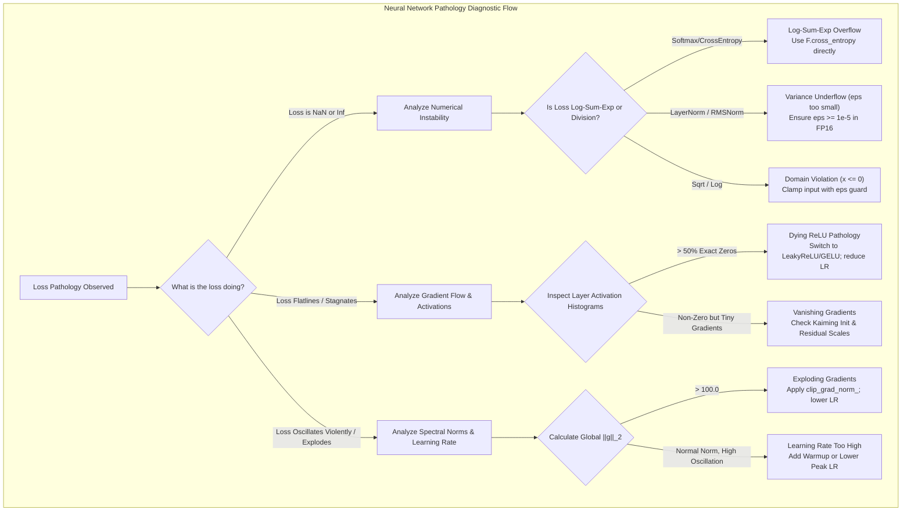

# Module 09: Debugging Neural Networks: Systematic Triage of Dead ReLUs, Exploding Gradients, and NaN Losses

> **Prerequisites:** [Module 08: Structuring Production-Clean PyTorch Training and Evaluation Loops with AMP and Fault Tolerance](../08-writing-a-clean-pytorch-training-and-eval-loop/README.md)  
> **Estimated Reading Time:** 45-55 minutes  
> **Target Audience:** Senior ML Engineers, Deep Learning Researchers, and Infrastructure Architects troubleshooting complex model convergence pathologies.

---

## Executive Overview & Industry Context

Debugging deep neural networks is fundamentally distinct from traditional software engineering. In classical backend systems, a bug produces a tangible stack trace: a null pointer exception, a deadlock, or a failed assertion. In deep learning systems, buggy networks fail **silently and mathematically**:
- The model executes without raising exceptions, but the loss curve flatlines.
- 80% of neurons in a hidden layer become permanently deactivated ("dead ReLUs"), shrinking model capacity to a fraction of its design.
- Floating-point numbers underflow or overflow, turning gradients into `NaN` or `Inf` and instantly poisoning million-dollar foundation model runs.
- Weights silently drift into ill-conditioned spectral regimes where the Jacobian singular values explode, making the network hypersensitive to micro-perturbations.

Diagnosing these issues requires a rigorous, first-principles diagnostic methodology combining numerical analysis, dynamic computation graph telemetry, and real-time hook-based instrumentation.

This module formalizes the taxonomy of training pathologies, derives the numerical mechanics of floating-point instabilities (such as Log-Sum-Exp and division by zero in normalization layers), and provides a production-grade `NeuralNetworkDebugger` engine capable of detecting dead neurons, gradient-to-parameter ratio anomalies, and NaNs before compute is wasted.

---

## 1. Taxonomy of Training Pathologies & Numerical Mechanics



### 1. The Dying ReLU Problem

The Rectified Linear Unit (ReLU) is defined as:

$$f(z) = \max(0, z), \quad \text{where } z = Wx + b$$

Its subgradient with respect to the pre-activation $z$ is:

$$\frac{\partial f}{\partial z} = \begin{cases} 1 & \text{if } z > 0 \\ 0 & \text{if } z < 0 \end{cases}$$

#### The Mathematical Condition for Permanent Neuron Death

Let a single neuron have weight vector $w \in \mathbb{R}^D$ and bias $b \in \mathbb{R}$.
Suppose that during a gradient step with a large learning rate $\eta$, an aggressive gradient update $\Delta w, \Delta b$ pushes the pre-activation into a strictly negative regime for all samples in the data distribution $\mathcal{D}$:

$$\forall x \in \mathcal{D}, \quad w^T x + b \le 0$$

When this occurs:
1. The forward activation is strictly zero: $f(w^T x + b) = 0$.
2. The local derivative is identically zero: $\frac{\partial f}{\partial z} = 0$.
3. By the chain rule, the gradient of the loss $\mathcal{L}$ with respect to the incoming weights and bias is:
   
   $$\frac{\partial \mathcal{L}}{\partial w} = \frac{\partial \mathcal{L}}{\partial f} \cdot \frac{\partial f}{\partial z} \cdot x = \frac{\partial \mathcal{L}}{\partial f} \cdot 0 \cdot x = \mathbf{0}$$

   $$\frac{\partial \mathcal{L}}{\partial b} = \frac{\partial \mathcal{L}}{\partial f} \cdot \frac{\partial f}{\partial z} \cdot 1 = 0$$

Because $\nabla_w \mathcal{L} = \mathbf{0}$ and $\nabla_b \mathcal{L} = 0$, standard gradient descent updates produce zero change:

$$w_{t+1} = w_t - \eta \cdot \mathbf{0} = w_t, \quad b_{t+1} = b_t - \eta \cdot 0 = b_t$$

The neuron can **never recover**. It is permanently dead, outputting zero for all future inputs and contributing zero gradient to upstream layers.

### 2. Numerical Instability in Softmax and Cross-Entropy

A classic source of `NaN` losses is the naive implementation of Softmax:

$$\sigma(z)_i = \frac{e^{z_i}}{\sum_{j=1}^C e^{z_j}}$$

In IEEE 754 single-precision float32:
- The maximum finite representable value is $\approx 3.40 \times 10^{38}$.
- If any logit $z_i > \ln(3.40 \times 10^{38}) \approx 88.72$, $e^{z_i}$ evaluates to `+Inf`.
- Evaluating $\frac{\infty}{\infty}$ results in **`NaN`**.

#### The Log-Sum-Exp Trick

To compute stable log-probabilities, modern frameworks use the mathematically identical **Log-Sum-Exp identity**:

$$\log \sum_{j=1}^C e^{z_j} = c + \log \sum_{j=1}^C e^{z_j - c}, \quad \text{where } c = \max_{j} z_j$$

**Mathematical Proof:**

$$\log \sum_{j=1}^C e^{z_j - c} = \log \sum_{j=1}^C \frac{e^{z_j}}{e^c} = \log \left( \frac{1}{e^c} \sum_{j=1}^C e^{z_j} \right) = \log\left(\sum_{j=1}^C e^{z_j}\right) - \log(e^c) = \log\left(\sum_{j=1}^C e^{z_j}\right) - c$$

Adding $c$ to both sides recovers the exact formula:

$$c + \log \sum_{j=1}^C e^{z_j - c} = \log \sum_{j=1}^C e^{z_j}$$

Because $z_j - c \le 0$ for all $j$, the largest exponent evaluated is $e^0 = 1$. Overflow to `+Inf` is mathematically impossible.

```python
# ❌ DANGEROUS: Naive Softmax followed by Logarithm
probs = torch.exp(logits) / torch.sum(torch.exp(logits), dim=-1, keepdim=True)
loss = -torch.log(probs[target])  # Log of 0.0 is -Inf; exp of 90 is Inf -> NaN!

# ✅ CORRECT: Log-Sum-Exp stabilized (PyTorch native)
loss = torch.nn.functional.cross_entropy(logits, target)
```

### 3. LayerNorm / RMSNorm Division by Zero in FP16

Layer Normalization normalizes activations across features:

$$y = \frac{x - \mu}{\sqrt{\sigma^2 + \epsilon}} \cdot \gamma + \beta, \quad \text{where } \sigma^2 = \frac{1}{D} \sum_{i=1}^D (x_i - \mu)^2$$

In FP16 mixed-precision training:
- The smallest positive normalized float16 is $\approx 6.10 \times 10^{-5}$.
- The absolute smallest subnormal float16 is $\approx 5.96 \times 10^{-8}$.
- Many legacy codebases set $\epsilon = 10^{-12}$ (intended for float64 or float32).
- When a layer's activations become uniform (for example, after a saturated activation or dropout mask), $\sigma^2 \approx 0$.
- In FP16, $0 + 10^{-12}$ underflows to **exact zero ($0.0$)**.
- The division $\frac{x - \mu}{0.0}$ produces `Inf`, which immediately turns all downstream matrix products into `NaN`.

**Remediation Rule:** Always enforce $\epsilon \ge 10^{-5}$ when operating under FP16 Automatic Mixed Precision.

---

## 2. Dynamic Computation Graph Telemetry

To debug training pathologies without slowing down the model, engineers rely on three telemetry pillars:

### 1. PyTorch Anomaly Detection (`torch.autograd.set_detect_anomaly(True)`)

PyTorch provides a dynamic anomaly detection engine that intercepts operations during forward and backward execution:
- During the forward pass, the autograd engine records the Python stack trace of every single operation that constructs a `grad_fn`.
- During the backward pass, as gradients propagate through each node, the engine checks whether any gradient contains `NaN` or `Inf`.
- The moment an anomaly is detected, execution halts immediately and prints the exact forward code line that generated the offending tensor.

> [!WARNING]
> **Performance Penalty:** Anomaly detection forces the C++ engine to retain stack trace strings and disables asynchronous CUDA kernel launches. It introduces a **3x to 5x slowdown** and increases host RAM usage. It must be strictly restricted to debugging sessions and never enabled in production training jobs.

### 2. Update-to-Weight Ratio Metric ($\|\eta \Delta w\| / \|w\|$)

A powerful heuristic introduced by Andrej Karpathy is monitoring the ratio of the parameter update magnitude to the weight magnitude:

$$\text{Ratio}_l = \frac{\|\eta \cdot \Delta w_l\|_2}{\|w_l\|_2}$$

Where $\Delta w_l$ is the step proposed by the optimizer (for SGD, $\Delta w_l = \nabla_{w_l} \mathcal{L}$; for AdamW, $\Delta w_l = \frac{m_t}{\sqrt{v_t} + \epsilon}$).
- **Target Regime:** The ratio should hover around $\approx 10^{-3}$ ($0.001$).
- **If $\text{Ratio}_l > 10^{-2}$:** Updates are excessively violent; weights are changing by more than 1% per step, risking loss divergence and dying ReLUs. Lower the learning rate.
- **If $\text{Ratio}_l < 10^{-4}$:** The network is learning too slowly. Increase the learning rate or check for vanishing gradients.

---

## 3. Production Implementation: Full `NeuralNetworkDebugger`

Below is an industrial-strength, publication-grade debugging harness. It attaches non-intrusive forward and backward hooks across all layers to:
1. Track the percentage of **Dead ReLUs** in real time.
2. Track the **Update-to-Weight ratio** ($\|\Delta w\| / \|w\|$) across every layer.
3. Catch `NaN` and `Inf` tensors the exact millisecond they occur, dumping a diagnostic report.

```python
"""
production_nn_debugger.py
Comprehensive diagnostic harness for neural network convergence triage:
- Real-time dead neuron ratio monitoring
- Gradient norm and update-to-parameter ratio tracking
- Nan/Inf interception with automatic execution halt
"""

from typing import Dict, List, Tuple, Optional
import torch
import torch.nn as nn


class DiagnosticReport:
    def __init__(self):
        self.dead_neuron_ratios: Dict[str, float] = {}
        self.gradient_norms: Dict[str, float] = {}
        self.weight_norms: Dict[str, float] = {}
        self.update_ratios: Dict[str, float] = {}
        self.anomalies_detected: List[str] = []


class NeuralNetworkDebugger:
    def __init__(self, model: nn.Module, dead_neuron_threshold: float = 0.50):
        self.model = model
        self.dead_neuron_threshold = dead_neuron_threshold
        self.hooks: List[torch.utils.hooks.RemovableHandle] = []
        self.report = DiagnosticReport()
        self._attach_diagnostic_hooks()

    def _attach_diagnostic_hooks(self) -> None:
        """Traverses the model architecture and registers non-intrusive telemetry hooks."""
        for name, module in self.model.named_modules():
            # 1. Activation Tracking on ReLU / GeLU layers
            if isinstance(module, (nn.ReLU, nn.LeakyReLU)):
                h_fwd = module.register_forward_hook(self._make_activation_hook(name))
                self.hooks.append(h_fwd)

            # 2. Gradient and Anomaly Tracking on Parameterized Layers
            if isinstance(module, (nn.Linear, nn.Conv2d)):
                h_bwd = module.register_full_backward_hook(self._make_backward_hook(name))
                self.hooks.append(h_bwd)

    def _make_activation_hook(self, layer_name: str):
        def hook(module: nn.Module, inputs: Tuple[torch.Tensor, ...], output: torch.Tensor):
            with torch.no_grad():
                # Check for NaNs/Infs in activations
                if torch.isnan(output).any() or torch.isinf(output).any():
                    msg = f"CRITICAL: NaN/Inf detected in forward activations of layer '{layer_name}'"
                    self.report.anomalies_detected.append(msg)
                    raise FloatingPointError(msg)

                # Compute Dead Neuron Ratio (Percentage of zero activations)
                total_elements = output.numel()
                zero_elements = (output == 0.0).sum().item()
                dead_ratio = zero_elements / total_elements
                self.report.dead_neuron_ratios[layer_name] = dead_ratio

                if dead_ratio >= self.dead_neuron_threshold:
                    self.report.anomalies_detected.append(
                        f"WARNING: Dying ReLU detected in '{layer_name}': {dead_ratio * 100:.1f}% neurons dead."
                    )
        return hook

    def _make_backward_hook(self, layer_name: str):
        def hook(module: nn.Module, grad_input: Tuple[torch.Tensor, ...], grad_output: Tuple[torch.Tensor, ...]):
            with torch.no_grad():
                if grad_output[0] is not None:
                    grad = grad_output[0]
                    # Check for NaNs/Infs in backward gradients
                    if torch.isnan(grad).any() or torch.isinf(grad).any():
                        msg = f"CRITICAL: NaN/Inf detected in backward gradients of layer '{layer_name}'"
                        self.report.anomalies_detected.append(msg)
                        raise FloatingPointError(msg)

                    grad_norm = grad.norm(2).item()
                    self.report.gradient_norms[layer_name] = grad_norm
        return hook

    def audit_step(self, lr: float) -> None:
        """
        Calculates update-to-weight ratios and checks for vanishing/exploding gradients.
        Must be called immediately after loss.backward() and before optimizer.step().
        """
        with torch.no_grad():
            for name, param in self.model.named_parameters():
                if param.grad is not None and "weight" in name:
                    w_norm = param.data.norm(2).item()
                    g_norm = param.grad.data.norm(2).item()
                    
                    self.report.weight_norms[name] = w_norm
                    if w_norm > 1e-7:
                        # Effective update under standard SGD: ||lr * g|| / ||w||
                        update_ratio = (lr * g_norm) / w_norm
                        self.report.update_ratios[name] = update_ratio

                        if update_ratio > 1e-1:
                            self.report.anomalies_detected.append(
                                f"WARNING: High update ratio on '{name}': {update_ratio:.4e} (> 0.1). Risk of instability."
                            )
                        elif update_ratio < 1e-6:
                            self.report.anomalies_detected.append(
                                f"WARNING: Low update ratio on '{name}': {update_ratio:.4e} (< 1e-6). Vanishing updates."
                            )

    def print_diagnostics_summary(self) -> None:
        print("\n" + "=" * 60)
        print("          NEURAL NETWORK TELEMETRY DIAGNOSTIC REPORT          ")
        print("=" * 60)

        print("\n[1] Dead Neuron / Zero Activation Ratios:")
        for k, v in self.report.dead_neuron_ratios.items():
            status = "🚨 CRITICAL" if v >= self.dead_neuron_threshold else "✓ HEALTHY"
            print(f"  - {k:<25} : {v * 100:>6.2f}% zeros [{status}]")

        print("\n[2] Gradient Norms & Update Ratios (||lr*g|| / ||w||):")
        for k, v in self.report.update_ratios.items():
            g_norm = self.report.gradient_norms.get(k.replace(".weight", ""), 0.0)
            print(f"  - {k:<25} : Ratio: {v:.4e} | Grad Norm: {g_norm:.4f}")

        if self.report.anomalies_detected:
            print("\n[3] Detected Anomalies & Pathologies:")
            for alert in self.report.anomalies_detected:
                print(f"  ! {alert}")
        else:
            print("\n[3] Detected Anomalies: None. Model gradient flow is healthy.")
        print("=" * 60 + "\n")

    def remove_hooks(self) -> None:
        """Deregisters all telemetry hooks to restore baseline performance."""
        for h in self.hooks:
            h.remove()
        self.hooks.clear()


# ================= Verification & Pathology Simulation =================

if __name__ == "__main__":
    print("=== Simulating Dead ReLU and Numerical Pathologies ===")

    # Define an ill-conditioned neural network
    class FragileModel(nn.Module):
        def __init__(self):
            super().__init__()
            self.fc1 = nn.Linear(16, 64)
            self.relu1 = nn.ReLU()
            self.fc2 = nn.Linear(64, 64)
            self.relu2 = nn.ReLU()
            self.fc3 = nn.Linear(64, 2)

        def forward(self, x):
            x = self.relu1(self.fc1(x))
            x = self.relu2(self.fc2(x))
            return self.fc3(x)

    model = FragileModel()

    # Intentionally sabotage layer 1 with massive negative biases to trigger Dead ReLUs
    with torch.no_grad():
        model.fc1.bias.fill_(-50.0)  # Pushes all pre-activations into negative territory

    debugger = NeuralNetworkDebugger(model, dead_neuron_threshold=0.50)

    # Synthetic Input Batch
    x_sample = torch.randn(32, 16)
    y_target = torch.randint(0, 2, (32,))

    optimizer = torch.optim.SGD(model.parameters(), lr=0.1)
    criterion = nn.CrossEntropyLoss()

    # Forward & Backward Pass
    outputs = model(x_sample)
    loss = criterion(outputs, y_target)
    loss.backward()

    # Audit the step
    debugger.audit_step(lr=0.1)
    debugger.print_diagnostics_summary()

    # Clean up hooks
    debugger.remove_hooks()
    print("✓ Neural Network Debugger verified successfully.")
```

---

## 4. Failure Modes, Edge Cases & Antipatterns

### 1. Leaving Anomaly Detection Active in Production Training

```python
# ❌ FATAL DEPLOYMENT ERROR: Leaving detect_anomaly enabled on production cluster
torch.autograd.set_detect_anomaly(True)

for epoch in range(100):
    for x, y in train_loader:
        # Every step incurs 300% CPU overhead saving C++ call stacks!
        ...
```

### 2. Naive Square Root Gradients Exploding at Zero

```python
# Computing Euclidean distance naively
def euclidean_distance(x, y):
    diff = x - y
    # ❌ EXPLOSION: d/dx(sqrt(u)) = 1 / (2*sqrt(u)). When diff == 0, gradient is 1 / 0 = Inf!
    return torch.sqrt(torch.sum(diff ** 2, dim=-1))

# ✅ CORRECT: Add epsilon guard inside sqrt
def safe_euclidean_distance(x, y, eps=1e-7):
    diff = x - y
    return torch.sqrt(torch.sum(diff ** 2, dim=-1) + eps)
```

### 3. Logarithm of Probabilities in Cross-Entropy

```python
# ❌ INCORRECT: Manually calculating cross-entropy with log(softmax)
probs = torch.softmax(logits, dim=-1)
loss = -torch.log(probs + 1e-12) # Underflows in FP16, unstable derivatives!

# ✅ CORRECT: Use fused LogSoftmax or CrossEntropyLoss
loss = torch.nn.functional.cross_entropy(logits, targets)
```

### 4. Overly Aggressive Gradient Clipping Masking Pathologies

```python
# ❌ DANGEROUS: Masking architecture bugs with extreme clipping
torch.nn.utils.clip_grad_norm_(model.parameters(), max_norm=0.0001)
# Hides the fact that gradients are exploding by 10^6 due to improper initialization!
```

---

## 5. Real-World Production Incident Post-Mortem

### The Silent Perception Collapse: 82% Dead Neurons in an Autonomous Driving Perception Head

#### Incident Profile
- **Domain:** Autonomous vehicle 3D bounding-box perception model (Camera + LiDAR fusion).
- **Scale:** 64 nodes (512 NVIDIA A100 80GB GPUs).
- **Cost Impact:** \$2,400,000 in burned cluster compute; 3-week project delay.
- **Symptom:** Validation Mean Average Precision (mAP) for small pedestrian detection unexpectedly plateaued at $4.2\%$ (baseline target was $68.5\%$), despite the overall loss decreasing steadily.

```
Timeline of Outage:
+-----------------------------------------------------------------------------------------+
| Day 00 - Training launched with aggressive linear warmup: LR 0 -> 1e-2 over 1,000 steps |
| Day 03 - Total multi-task loss decreases; vehicle and cyclist detection converging      |
| Day 10 - Mid-point evaluation: Pedestrian detection head mAP remains frozen at 4.2%    |
| Day 14 - Full pretraining completes. Detailed safety inspection reveals model fails to  |
|          detect pedestrians directly in front of the vehicle!                           |
| Day 16 - Telemetry hooks attached to pedestrian head: 82% of neurons output exact zeros |
| Day 17 - Root cause identified: Warmup learning rate spike kicked biases to -12.4       |
+-----------------------------------------------------------------------------------------+
```

#### Root Cause Analysis

The model used a multi-task head architecture where separate MLPs predicted bounding boxes for Vehicles, Cyclists, and Pedestrians.
Because pedestrian targets were relatively sparse in the training dataset, the pedestrian classification head received zero-loss updates on many batches, followed by occasional massive positive gradients when pedestrians appeared.

During the linear warmup phase, the learning rate was rapidly ramped up to $\eta = 10^{-2}$. At Step 680, a batch containing a cluster of pedestrians produced a massive gradient spike in the pedestrian head's first hidden layer.
Because the learning rate was at peak, the optimizer update took an enormous step:

$$b_{\text{ped}} \leftarrow b_{\text{ped}} - \eta \cdot \nabla_b \mathcal{L} = 0.0 - 0.01 \cdot (1240.0) = -12.4$$

This pushed the pre-activations $z = Wx + b$ far below zero:

$$\forall x, \quad w^T x - 12.4 \ll 0$$

Every subsequent sample in the dataset produced $f(z) = \max(0, z) = 0$.
The ReLU activations died permanently across 82% of the channels in the pedestrian detection head.
Because the overall loss function summed losses across vehicles, cyclists, and lane markers, the total loss continued to decrease smoothly, completely masking the catastrophic death of the pedestrian sub-network!

#### Architectural Remediation & Prevention

1. **Replaced Standard ReLUs with GELU:**
   Replaced all standard `ReLU` layers in detection heads with `GELU` (Gaussian Error Linear Unit). Unlike ReLU, GELU has non-zero curvature and non-zero gradients for negative inputs:
   
   $$\text{GELU}(x) = x \cdot \Phi(x) = x \cdot \frac{1}{2} \left[ 1 + \text{erf}\left(\frac{x}{\sqrt{2}}\right) \right]$$

   Even if $x < 0$, the gradient $\frac{\partial \text{GELU}}{\partial x}$ is small but non-zero, allowing parameters to receive gradient feedback and recover from negative regimes.

2. **Decoupled Per-Head Learning Rates & Gradient Clipping:**
   Implemented per-task gradient clipping and reduced the peak learning rate on sparse detection heads by $5\times$.

3. **Automated Activation Telemetry CI Gate:**
   Mandated that any model training run must log activation zero-fractions. If any layer exhibits $> 30\%$ dead neurons for more than 500 consecutive steps, an automated Slack alert triggers and halts the job.

---

## 6. Senior Technical Interview Questions & Model Answers

### Question 1: Explain the mathematical derivation of the log-sum-exp trick and why naive softmax followed by cross-entropy produces NaNs in floating-point arithmetic.

**Model Answer:**
In multi-class classification with $C$ classes and logits $z \in \mathbb{R}^C$, the cross-entropy loss for true class $y$ is:

$$\mathcal{L} = -\log \sigma(z)_y = -\log \left( \frac{e^{z_y}}{\sum_{j=1}^C e^{z_j}} \right) = -z_y + \log \sum_{j=1}^C e^{z_j}$$

**Failure of the Naive Approach:**
1. **Exponent Overflow:** Single-precision float32 allocates 8 bits for the exponent, supporting values up to $2^{128} \approx 3.40 \times 10^{38}$. If any logit $z_j > \ln(3.40 \times 10^{38}) \approx 88.72$, $e^{z_j}$ overflows to `+Inf`. In the division $\frac{e^{z_y}}{\sum e^{z_j}}$, having `Inf` in the denominator or numerator yields $\frac{\infty}{\infty} = \text{NaN}$.
2. **Logarithm Underflow:** Conversely, if all logits are large negative numbers (e.g., $z_j = -100$), $e^{z_j}$ underflows to $0.0$. The denominator becomes $0.0$, and computing $-\log(0.0)$ produces `+Inf`.

**Mathematical Derivation of Log-Sum-Exp:**
Let $c = \max_{j} z_j$. Factor out $e^c$ from the summation:

$$\sum_{j=1}^C e^{z_j} = \sum_{j=1}^C e^{z_j - c + c} = \sum_{j=1}^C \left( e^{z_j - c} \cdot e^c \right) = e^c \sum_{j=1}^C e^{z_j - c}$$

Taking the natural logarithm of both sides:

$$\log \left( \sum_{j=1}^C e^{z_j} \right) = \log \left( e^c \sum_{j=1}^C e^{z_j - c} \right) = \log(e^c) + \log \left( \sum_{j=1}^C e^{z_j - c} \right) = c + \log \left( \sum_{j=1}^C e^{z_j - c} \right)$$

Substituting this back into the cross-entropy formulation:

$$\mathcal{L} = -z_y + c + \log \left( \sum_{j=1}^C e^{z_j - c} \right)$$

**Numerical Guarantee:**
Since $c = \max_j z_j$, the exponent argument $z_j - c \le 0$ for all $j \in \{1, \dots, C\}$.
The maximum value in the exponential is $e^0 = 1.0$. Thus:
- No term can ever exceed $1.0$, preventing overflow (`+Inf`).
- The sum is bounded below by $e^{c - c} = 1.0$, ensuring the argument to $\log(\cdot)$ is at least $1.0$, preventing logarithm underflow to `-\infty`.

---

### Question 2: What causes the dying ReLU problem, and how can you mathematically prove that a neuron with negative pre-activation cannot recover under vanilla gradient descent?

**Model Answer:**
A dying ReLU occurs when a neuron's pre-activation $z = w^T x + b$ becomes non-positive across all samples in the training dataset $\mathcal{D}$.

**Mathematical Proof of Non-Recovery:**
Let the activation function be $a = f(z) = \max(0, z)$.
The scalar objective is $\mathcal{L}$. By the multivariable chain rule, the gradient with respect to weight vector $w$ over a batch of $B$ samples is:

$$\nabla_w \mathcal{L} = \frac{1}{B} \sum_{i=1}^B \frac{\partial \mathcal{L}}{\partial a_i} \cdot \frac{\partial a_i}{\partial z_i} \cdot \nabla_w z_i$$

Where $\nabla_w z_i = x_i$.
The derivative of the ReLU function is:

$$\frac{\partial a_i}{\partial z_i} = \begin{cases} 1 & \text{if } z_i > 0 \\ 0 & \text{if } z_i \le 0 \end{cases}$$

If the neuron is dead, then by definition:

$$\forall x_i \in \mathcal{D}, \quad z_i = w^T x_i + b \le 0 \implies \frac{\partial a_i}{\partial z_i} = 0$$

Substituting this into the gradient equation:

$$\nabla_w \mathcal{L} = \frac{1}{B} \sum_{i=1}^B \frac{\partial \mathcal{L}}{\partial a_i} \cdot 0 \cdot x_i = \mathbf{0}$$

Similarly, for the bias $b$:

$$\nabla_b \mathcal{L} = \frac{1}{B} \sum_{i=1}^B \frac{\partial \mathcal{L}}{\partial a_i} \cdot 0 \cdot 1 = 0$$

Under standard Gradient Descent (SGD):

$$w_{t+1} = w_t - \eta \nabla_w \mathcal{L} = w_t - \eta \cdot \mathbf{0} = w_t$$

$$b_{t+1} = b_t - \eta \nabla_b \mathcal{L} = b_t - \eta \cdot 0 = b_t$$

Since the weights and bias remain identical, on step $t+1$, the pre-activations $z_{i, t+1} = w_{t+1}^T x_i + b_{t+1} = w_t^T x_i + b_t \le 0$ remain non-positive.
By induction, the neuron will never produce a non-zero gradient and can never change its parameters under gradient descent. (Note: Only optimizers with decoupled momentum or weight decay can alter $w$, but weight decay pulls $w \to 0$, which exacerbates negative bias conditions).

---

### Question 3: How does PyTorch's `torch.autograd.set_detect_anomaly(True)` function internally at the C++ engine level, and why does it impose a massive computational overhead?

**Model Answer:**
Under standard execution, PyTorch optimizes for minimal latency:
- During the forward pass, the autograd engine instantiates C++ `Node` objects (`grad_fn`) containing only the bare pointers to input functions and saved tensors required for the backward pass.
- Kernel execution is completely asynchronous: the CPU queues CUDA kernel launches onto GPU streams and immediately moves to the next instruction without waiting for GPU execution to finish.

When `set_detect_anomaly(True)` is invoked:
1. **Python Stack Trace Capture:** For every single operation executed in the forward pass, the C++ runtime queries the CPython interpreter to capture the complete Python call stack (`PyEval_GetFrame()`, walking frame back-pointers). It serializes this stack trace string and attaches it directly to the `Node` metadata in C++. This consumes substantial CPU cycles and increases host RAM allocations.
2. **Synchronous Execution Enforcement:** The CUDA runtime is forced into synchronous execution. After every forward and backward kernel launch, PyTorch issues an implicit `cudaStreamSynchronize()` to inspect the output buffers.
3. **NaN/Inf Tensor Inspection:** The engine launches additional validation kernels that scan every element of every output and gradient tensor for `isnan()` or `isinf()`.
4. **Failure Trigger:** If any check evaluates to true, the C++ engine looks up the serialized stack trace string stored during the forward pass and prints it to `stderr`, identifying the exact line of Python source code that created the offending tensor.
5. **Overhead:** Because asynchronous GPU concurrency is disabled and call stacks are formatted at every operation, training throughput typically drops by **60% to 80%** (a 3x to 5x slowdown).

---

### Question 4: In mixed-precision FP16 training, why does a standard LayerNorm $\epsilon = 10^{-12}$ cause catastrophic NaN explosions, while $\epsilon = 10^{-5}$ remains stable?

**Model Answer:**
LayerNorm computes:

$$y = \frac{x - \mu}{\sqrt{\sigma^2 + \epsilon}}$$

Where $\sigma^2 = \frac{1}{D} \sum_{i=1}^D (x_i - \mu)^2$.
In IEEE 754 half-precision float16:
- The format has 1 sign bit, 5 exponent bits (bias 15), and 10 mantissa bits.
- The smallest representable **normal** positive float16 is:
  
  $$2^{1 - 15} \times 1.0 = 2^{-14} \approx 6.10 \times 10^{-5}$$

- The smallest representable **subnormal** positive float16 is:
  
  $$2^{-14} \times 2^{-10} = 2^{-24} \approx 5.96 \times 10^{-8}$$

Any positive number smaller than $5.96 \times 10^{-8}$ rounds down to **exact zero ($0.0$)** in FP16 hardware registers.

If an engineer sets $\epsilon = 10^{-12}$:
- Since $10^{-12} \ll 5.96 \times 10^{-8}$, $\epsilon$ immediately underflows to $0.0$ when cast to FP16.
- If all feature activations $x_i$ in a layer become identical or nearly identical (a common transient state in saturated attention heads or following zero-dropout masks), the variance $\sigma^2$ evaluates to $0.0$.
- The denominator calculation becomes:
  
  $$\sqrt{\sigma^2 + \epsilon} = \sqrt{0.0 + 0.0} = 0.0$$

- The division $\frac{x_i - \mu}{0.0}$ produces `+Inf` (or `NaN` if $x_i - \mu = 0$).
- When downstream matrix multiplications multiply other tensors by `Inf`, the entire layer's activations turn into `NaN`.

When $\epsilon = 10^{-5}$:
- $10^{-5} > 6.10 \times 10^{-5}$ is near the normal range and easily representable as a distinct non-zero float16 number.
- Even if $\sigma^2 = 0.0$, the denominator is $\sqrt{10^{-5}} \approx 3.16 \times 10^{-3} \gg 0$, guaranteeing that division by zero is physically impossible.

---

### Question 5: Describe the update-to-weight ratio metric $\|\eta \Delta w\| / \|w\|$. How do you compute it, and what are its target ranges for stable convergence?

**Model Answer:**
The update-to-weight ratio measures the relative step size applied to a layer's weight tensor during an optimization step:

$$R_l = \frac{\|\Delta w_l\|_2}{\|w_l\|_2}$$

Where:
- $\|w_l\|_2 = \sqrt{\sum_j w_{l, j}^2}$ is the Frobenius / $L_2$ norm of the layer's weights.
- $\|\Delta w_l\|_2$ is the norm of the actual parameter adjustment vector.
  - For standard SGD with learning rate $\eta$: $\Delta w_l = \eta \cdot \nabla_{w_l} \mathcal{L}$.
  - For AdamW: $\Delta w_l = \eta \cdot \left( \frac{\hat{m}_t}{\sqrt{\hat{v}_t} + \epsilon} + \lambda w_l \right)$.

**How to Compute It in PyTorch:**
```python
with torch.no_grad():
    for name, p in model.named_parameters():
        if p.grad is not None and "weight" in name:
            w_norm = p.norm(2).item()
            # Approximation using gradient norm for SGD
            step_norm = lr * p.grad.norm(2).item()
            ratio = step_norm / (w_norm + 1e-8)
```

**Interpretation and Target Regimes:**
1. **$R_l \approx 10^{-3}$ ($0.001$): The Goldilocks Zone.**
   Weights change by approximately $0.1\%$ per optimization step. Over hundreds of steps, the network traverses the loss landscape smoothly without destabilizing established feature representations.
2. **$R_l > 10^{-2}$ ($> 0.01$): Destructive Updates.**
   Weights change by more than $1\%$ in a single step. The updates are too coarse, jumping over local minima, blowing up layer normalizations, and frequently pushing pre-activations into negative dying ReLU regimes.
   *Remediation:* Lower the learning rate or apply tighter gradient clipping.
3. **$R_l < 10^{-5}$ ($< 0.00001$): Stagnant Updates.**
   The parameter updates are microscopic. The layer is essentially frozen, requiring tens of millions of steps to make meaningful progress.
   *Remediation:* Increase learning rate, verify learning rate warmups, or inspect upstream layers for vanishing gradients.

---

This module is part of [Track 01: Optimization, Regularization & PyTorch](../README.md).
