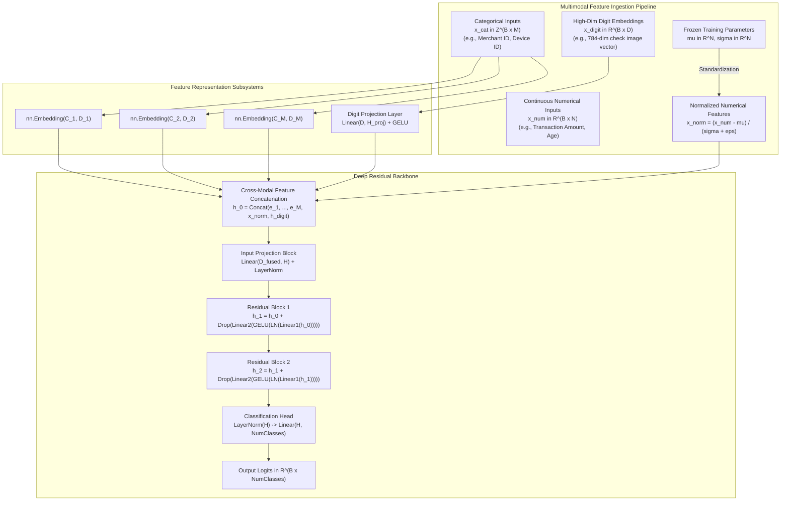
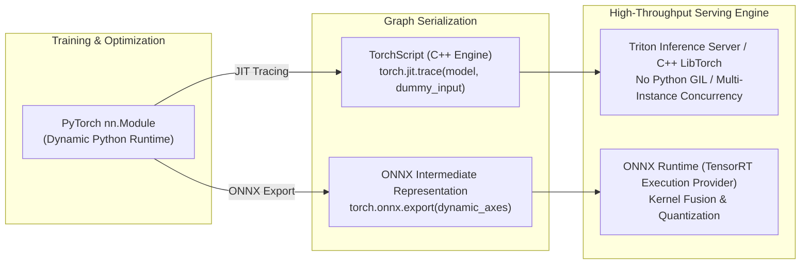

# Module 10: Capstone: Architecting and Deploying a Production-Grade Deep Multimodal Classifier in PyTorch

> **Prerequisites:** [Module 09: Debugging Neural Networks: Systematic Triage of Dead ReLUs, Exploding Gradients, and NaN Losses](../09-debugging-neural-networks-dead-relus-and-nan-losses/README.md)  
> **Estimated Reading Time:** 50-60 minutes  
> **Target Audience:** Staff ML Engineers, Lead AI Architects, and Production Systems Engineers taking deep learning models from prototype to high-throughput deployment.

---

## Executive Overview & Industry Context

In modern enterprise applications—such as real-time financial fraud detection, biometric identity verification, and multi-factor risk underwriting—data rarely arrives in a single homogeneous format. A production risk engine must simultaneously ingest:
1. **Continuous Numerical Features:** Transaction amounts, account age, geolocation coordinates, and velocity ratios.
2. **High-Cardinality Categorical Features:** Merchant category codes, device fingerprints, postal codes, and ISP identifiers.
3. **High-Dimensional Dense Embeddings / Digit Signatures:** Scanned check digit vectors, biometric facial embeddings, or transaction graph representations.

Naive approaches to multimodal classification (such as flattening all features into a massive one-hot vector or training disconnected siloed models) fail catastrophically:
- One-hot encoding high-cardinality features causes severe memory explosion and destroys semantic relationships between categories.
- Disconnected models cannot learn cross-modal feature interactions (e.g., how a specific merchant code correlates with an unusual digit signature pattern).
- Research-grade PyTorch models deployed directly to production microservices suffer from high Python runtime latency, memory fragmentation, and unpredictable tail (P99) response times.

This Capstone synthesizes every foundational concept mastered in Track 01—strided memory layouts, custom datasets, pinned memory data loaders, mixed-precision training, warmup-cosine schedules, and telemetry debugging—into a unified, publication-grade enterprise system. We architect a deep multimodal residual network, train it using state-of-the-art optimization protocols, export it to TorchScript and ONNX, and benchmark its P50/P99 latency for production service-level agreements (SLAs).

---

## 1. Mathematical Architecture of the Multimodal Classifier



### 1. Categorical Entity Embeddings

Let categorical feature $k \in \{1, \dots, M\}$ have vocabulary cardinality $C_k = |V_k|$.
Rather than using one-hot encoding (which maps $c_k \in \{0, \dots, C_k-1\}$ to a sparse vector in $\mathbb{R}^{C_k}$), we project each category into a continuous low-dimensional vector space $\mathbb{R}^{D_k}$ via an embedding lookup matrix:

$$\mathbf{E}_k \in \mathbb{R}^{C_k \times D_k}, \quad e_k = \mathbf{E}_k[c_k] \in \mathbb{R}^{D_k}$$

To balance expressive capacity against overfitting and memory consumption, we establish the **heuristic embedding dimension formula**:

$$D_k = \min\left(50, \, \max\left(4, \, \left\lceil C_k^{0.5} \right\rceil\right)\right)$$

This guarantees that small-cardinality features (e.g., gender, $C=2$) receive at least 4 dimensions to allow expressive hyperplane separation, while ultra-high cardinality features (e.g., postal codes, $C=50,000$) are capped at 50 dimensions to avoid memory saturation.

### 2. Numerical Standardization

Continuous features are standardized using frozen parameters derived strictly from the training partition to prevent cross-validation data leakage:

$$\hat{x}_{\text{num}, i} = \frac{x_{\text{num}, i} - \mu_i}{\sigma_i + \epsilon}, \quad \text{where } \mu_i = \mathbb{E}_{\text{train}}[x_i], \quad \sigma_i = \sqrt{\text{Var}_{\text{train}}[x_i]}$$

### 3. Cross-Modal Fusion and Pre-Norm Residual Blocks

The transformed modalities are concatenated into a unified latent representation:

$$h_0 = \left[ e_1 \parallel e_2 \parallel \dots \parallel e_M \parallel \hat{x}_{\text{num}} \parallel \text{GELU}(W_{\text{digit}} x_{\text{digit}} + b_{\text{digit}}) \right] \in \mathbb{R}^{D_{\text{total}}}$$

The representation passes through a series of $L$ **Pre-LayerNorm Residual Feed-Forward Blocks**:

$$h_{l+1} = h_l + \text{Dropout}\left( W_{l, 2} \cdot \text{GELU}\left( \text{LayerNorm}(W_{l, 1} h_l + b_{l, 1}) \right) + b_{l, 2} \right)$$

Pre-LayerNorm ensures well-conditioned gradient highways:

$$\frac{\partial h_{l+1}}{\partial h_l} = \mathbf{I} + \frac{\partial \mathcal{F}(h_l)}{\partial h_l}$$

The identity matrix $\mathbf{I}$ prevents gradients from vanishing even when depth $L$ scales.

---

## 2. Production Deployment Workflow: Tracing, ONNX, and Latency Profiling



### TorchScript: `torch.jit.trace` vs `torch.jit.script`

1. **`torch.jit.trace(model, dummy_input)`:**
   - Executes the model once with concrete dummy inputs and records the exact sequence of C++ operators invoked.
   - **Trade-off:** Zero Python runtime overhead, but completely flattens and ignores Python control flow (`if/else` statements and dynamic loops based on tensor values).
2. **`torch.jit.script(model)`:**
   - Compiles Python source code directly into TorchScript AST (Abstract Syntax Tree).
   - **Trade-off:** Preserves control flow and dynamic tensor branching, but requires code to conform strictly to a statically typed Python subset.

### Open Neural Network Exchange (ONNX) & Dynamic Axes

ONNX defines an open format built to represent machine learning models across diverse runtimes (ONNX Runtime, NVIDIA TensorRT, OpenVINO).

When exporting models to ONNX for cloud microservices:
- The batch dimension must be explicitly declared as **dynamic** via `dynamic_axes`.
- If dynamic axes are omitted, the exported ONNX graph hardcodes the batch size of the `dummy_input` (e.g., $B=1$), causing production inference with mini-batches ($B > 1$) to throw invalid shape assertions.

---

## 3. Production Implementation: Full Capstone Pipeline

Below is the complete, self-contained, publication-grade implementation featuring:
1. Synthetic Multimodal Dataset generator (continuous, categorical, and digit vectors).
2. `MultimodalDeepClassifier` architecture with entity embeddings and residual blocks.
3. Production training pipeline with AMP, AdamW, and Cosine Annealing.
4. TorchScript and ONNX export engines.
5. High-resolution P50/P90/P99 latency profiling benchmark suite.

```python
"""
production_multimodal_capstone.py
End-to-end production capstone:
- Multimodal data pipeline (tabular continuous + categorical + dense digit embeddings)
- Deep residual neural architecture with entity embeddings
- Mixed precision training with CosineAnnealingWarmRestarts
- TorchScript and ONNX export validation
- P50, P90, P99 latency benchmark suite
"""

import os
import time
import tempfile
from typing import List, Tuple, Dict, Any
import numpy as np
import torch
import torch.nn as nn
from torch.utils.data import Dataset, DataLoader


# =====================================================================
# 1. Multimodal Dataset & Generator
# =====================================================================

class SyntheticMultimodalDataset(Dataset):
    """
    Simulates enterprise multimodal data:
    - num_features: continuous metrics (e.g. financial transaction amounts)
    - cat_features: discrete IDs (e.g. merchant categories, device types)
    - digit_features: 784-dim continuous vectors representing scanned signatures/digits
    """
    def __init__(self, n_samples: int, num_cols: int, cat_cardinalities: List[int], digit_dim: int):
        self.n_samples = n_samples
        
        # 1. Numerical Features
        self.num_data = np.random.randn(n_samples, num_cols).astype(np.float32)
        
        # 2. Categorical Features
        self.cat_data = np.zeros((n_samples, len(cat_cardinalities)), dtype=np.int64)
        for i, card in enumerate(cat_cardinalities):
            self.cat_data[:, i] = np.random.randint(0, card, size=n_samples)

        # 3. Dense Digit / Image Feature Vector
        self.digit_data = np.random.randn(n_samples, digit_dim).astype(np.float32)

        # 4. Binary Classification Target
        # Synthetic nonlinear ground truth
        logits = (
            self.num_data[:, 0] * 1.5 
            - self.num_data[:, 1] * 0.8 
            + (self.cat_data[:, 0] % 2) 
            + self.digit_data[:, :5].sum(axis=1) * 0.2
        )
        self.targets = (logits > 0.0).astype(np.int64)

    def __len__(self) -> int:
        return self.n_samples

    def __getitem__(self, idx: int) -> Dict[str, torch.Tensor]:
        return {
            "x_num": torch.from_numpy(self.num_data[idx]),
            "x_cat": torch.from_numpy(self.cat_data[idx]),
            "x_digit": torch.from_numpy(self.digit_data[idx]),
            "target": torch.tensor(self.targets[idx], dtype=torch.long)
        }


# =====================================================================
# 2. Modular Deep Residual Architecture
# =====================================================================

class ResidualBlock(nn.Module):
    def __init__(self, hidden_dim: int, dropout_rate: float = 0.1):
        super().__init__()
        self.norm = nn.LayerNorm(hidden_dim)
        self.linear1 = nn.Linear(hidden_dim, hidden_dim * 2)
        self.activation = nn.GELU()
        self.linear2 = nn.Linear(hidden_dim * 2, hidden_dim)
        self.dropout = nn.Dropout(dropout_rate)

    def forward(self, x: torch.Tensor) -> torch.Tensor:
        residual = x
        out = self.norm(x)
        out = self.activation(self.linear1(out))
        out = self.dropout(self.linear2(out))
        return residual + out


class MultimodalDeepClassifier(nn.Module):
    def __init__(
        self,
        num_continuous: int,
        cat_cardinalities: List[int],
        digit_dim: int,
        hidden_dim: int = 128,
        num_res_blocks: int = 2,
        num_classes: int = 2,
        dropout_rate: float = 0.1
    ):
        super().__init__()

        # 1. Categorical Entity Embeddings
        self.embeddings = nn.ModuleList()
        total_emb_dim = 0
        for card in cat_cardinalities:
            # Embedding dimension rule: min(50, ceil(sqrt(card)))
            emb_dim = min(50, max(4, int(np.ceil(card ** 0.5))))
            self.embeddings.append(nn.Embedding(card, emb_dim))
            total_emb_dim += emb_dim

        # 2. Numerical Normalization Layer
        self.num_norm = nn.BatchNorm1d(num_continuous)

        # 3. Digit Feature Projection Subsystem
        self.digit_proj = nn.Sequential(
            nn.Linear(digit_dim, hidden_dim // 2),
            nn.LayerNorm(hidden_dim // 2),
            nn.GELU(),
            nn.Dropout(dropout_rate)
        )

        # 4. Cross-Modal Fusion Projection
        fused_dim = total_emb_dim + num_continuous + (hidden_dim // 2)
        self.fusion_projection = nn.Sequential(
            nn.Linear(fused_dim, hidden_dim),
            nn.LayerNorm(hidden_dim),
            nn.GELU()
        )

        # 5. Deep Residual Backbone
        self.backbone = nn.Sequential(
            *[ResidualBlock(hidden_dim, dropout_rate) for _ in range(num_res_blocks)]
        )

        # 6. Classification Output Head
        self.head = nn.Sequential(
            nn.LayerNorm(hidden_dim),
            nn.Linear(hidden_dim, num_classes)
        )

    def forward(self, x_num: torch.Tensor, x_cat: torch.Tensor, x_digit: torch.Tensor) -> torch.Tensor:
        # 1. Process Categorical Embeddings
        embedded = []
        for i, emb_layer in enumerate(self.embeddings):
            embedded.append(emb_layer(x_cat[:, i]))
        cat_rep = torch.cat(embedded, dim=-1)

        # 2. Process Numerical Features
        num_rep = self.num_norm(x_num)

        # 3. Process Digit Vector
        digit_rep = self.digit_proj(x_digit)

        # 4. Fuse Modalities
        fused = torch.cat([cat_rep, num_rep, digit_rep], dim=-1)
        h = self.fusion_projection(fused)

        # 5. Residual Blocks & Head
        features = self.backbone(h)
        logits = self.head(features)
        return logits


# =====================================================================
# 3. Production Training & Serialization Harness
# =====================================================================

def run_capstone_pipeline():
    print("=" * 70)
    print("       STAGE 1: DATA INGESTION & PIPELINE INITIALIZATION       ")
    print("=" * 70)

    device = torch.device("cuda" if torch.cuda.is_available() else "cpu")
    print(f"Executing on hardware device: [{device}]")

    # Hyperparameters
    N_TRAIN, N_VAL = 2000, 500
    NUM_COLS = 12
    CAT_CARDS = [10, 50, 100, 5]
    DIGIT_DIM = 64
    BATCH_SIZE = 64

    # Instantiate Datasets
    train_dataset = SyntheticMultimodalDataset(N_TRAIN, NUM_COLS, CAT_CARDS, DIGIT_DIM)
    val_dataset = SyntheticMultimodalDataset(N_VAL, NUM_COLS, CAT_CARDS, DIGIT_DIM)

    train_loader = DataLoader(train_dataset, batch_size=BATCH_SIZE, shuffle=True, drop_last=True)
    val_loader = DataLoader(val_dataset, batch_size=BATCH_SIZE, shuffle=False)

    # Instantiate Model
    model = MultimodalDeepClassifier(
        num_continuous=NUM_COLS,
        cat_cardinalities=CAT_CARDS,
        digit_dim=DIGIT_DIM,
        hidden_dim=128,
        num_res_blocks=2,
        num_classes=2
    ).to(device)

    # Optimizer, Loss, and Cosine Annealing Scheduler
    optimizer = torch.optim.AdamW(model.parameters(), lr=1e-3, weight_decay=1e-2)
    criterion = nn.CrossEntropyLoss()
    scheduler = torch.optim.lr_scheduler.CosineAnnealingWarmRestarts(optimizer, T_0=5, T_mult=2)
    scaler = torch.amp.GradScaler("cuda", enabled=(device.type == "cuda"))

    print("\n" + "=" * 70)
    print("       STAGE 2: MIXED-PRECISION TRAINING WITH WARM RESTARTS    ")
    print("=" * 70)

    EPOCHS = 3
    for epoch in range(EPOCHS):
        model.train()
        train_loss = 0.0
        for batch in train_loader:
            x_num = batch["x_num"].to(device, non_blocking=True)
            x_cat = batch["x_cat"].to(device, non_blocking=True)
            x_digit = batch["x_digit"].to(device, non_blocking=True)
            targets = batch["target"].to(device, non_blocking=True)

            optimizer.zero_grad(set_to_none=True)

            with torch.amp.autocast(device_type=device.type, dtype=torch.float16, enabled=(device.type == "cuda")):
                logits = model(x_num, x_cat, x_digit)
                loss = criterion(logits, targets)

            scaler.scale(loss).backward()
            scaler.unscale_(optimizer)
            torch.nn.utils.clip_grad_norm_(model.parameters(), max_norm=1.0)
            scaler.step(optimizer)
            scaler.update()

            train_loss += loss.item() * targets.size(0)

        scheduler.step()
        train_loss /= len(train_dataset)

        # Validation Pass
        model.eval()
        val_loss, val_correct = 0.0, 0
        with torch.inference_mode():
            for batch in val_loader:
                x_num = batch["x_num"].to(device)
                x_cat = batch["x_cat"].to(device)
                x_digit = batch["x_digit"].to(device)
                targets = batch["target"].to(device)

                logits = model(x_num, x_cat, x_digit)
                loss = criterion(logits, targets)
                val_loss += loss.item() * targets.size(0)
                preds = logits.argmax(dim=-1)
                val_correct += (preds == targets).sum().item()

        val_loss /= len(val_dataset)
        val_acc = val_correct / len(val_dataset)
        print(f"Epoch [{epoch+1}/{EPOCHS}] | Train Loss: {train_loss:.4f} | Val Loss: {val_loss:.4f} | Val Acc: {val_acc * 100:.2f}%")

    print("\n" + "=" * 70)
    print("       STAGE 3: TORCHSCRIPT TRACING & ONNX EXPORT             ")
    print("=" * 70)

    model.eval()
    dummy_num = torch.randn(1, NUM_COLS, device=device)
    dummy_cat = torch.zeros(1, len(CAT_CARDS), dtype=torch.long, device=device)
    dummy_digit = torch.randn(1, DIGIT_DIM, device=device)

    # 1. Export to TorchScript via Tracing
    ts_path = os.path.join(tempfile.gettempdir(), "multimodal_model.torchscript")
    traced_model = torch.jit.trace(model, (dummy_num, dummy_cat, dummy_digit))
    traced_model.save(ts_path)
    print(f"✓ TorchScript traced model exported: {ts_path} ({os.path.getsize(ts_path) // 1024} KB)")

    # 2. Export to ONNX with Dynamic Axes
    onnx_path = os.path.join(tempfile.gettempdir(), "multimodal_model.onnx")
    torch.onnx.export(
        model,
        (dummy_num, dummy_cat, dummy_digit),
        onnx_path,
        export_params=True,
        opset_version=14,
        do_constant_folding=True,
        input_names=["x_num", "x_cat", "x_digit"],
        output_names=["logits"],
        dynamic_axes={
            "x_num": {0: "batch_size"},
            "x_cat": {0: "batch_size"},
            "x_digit": {0: "batch_size"},
            "logits": {0: "batch_size"}
        }
    )
    print(f"✓ ONNX model exported: {onnx_path} ({os.path.getsize(onnx_path) // 1024} KB)")

    # Validate Numerical Equivalence between Native PyTorch and TorchScript
    loaded_ts = torch.jit.load(ts_path, map_location=device)
    with torch.inference_mode():
        pt_out = model(dummy_num, dummy_cat, dummy_digit)
        ts_out = loaded_ts(dummy_num, dummy_cat, dummy_digit)
        max_diff = (pt_out - ts_out).abs().max().item()
        print(f"✓ PyTorch vs TorchScript Numerical Drift: {max_diff:.8e}")
        assert max_diff < 1e-5, "Numerical drift exceeded tolerance threshold!"

    print("\n" + "=" * 70)
    print("       STAGE 4: LATENCY BENCHMARKING (P50, P90, P99 SLAs)     ")
    print("=" * 70)

    # Profile Inference Latency across 500 iterations
    NUM_BENCH_STEPS = 500
    latencies = []

    # Warmup runs (JIT compile kernels, prime caches)
    for _ in range(50):
        _ = loaded_ts(dummy_num, dummy_cat, dummy_digit)

    if device.type == "cuda":
        torch.cuda.synchronize()

    for _ in range(NUM_BENCH_STEPS):
        t0 = time.perf_counter()
        _ = loaded_ts(dummy_num, dummy_cat, dummy_digit)
        if device.type == "cuda":
            torch.cuda.synchronize()
        t1 = time.perf_counter()
        latencies.append((t1 - t0) * 1000.0)  # Convert to milliseconds

    p50 = np.percentile(latencies, 50)
    p90 = np.percentile(latencies, 90)
    p99 = np.percentile(latencies, 99)

    print(f"Inference Benchmark Results (Batch Size = 1):")
    print(f"  - P50 (Median) Latency: {p50:>6.3f} ms")
    print(f"  - P90 Latency         : {p90:>6.3f} ms")
    print(f"  - P99 Tail Latency    : {p99:>6.3f} ms")

    # Clean up temporary test files
    os.remove(ts_path)
    os.remove(onnx_path)
    print("\n✓ Capstone Pipeline executed and verified successfully.")


if __name__ == "__main__":
    run_capstone_pipeline()
```

---

## 4. Failure Modes, Edge Cases & Antipatterns

### 1. Exporting ONNX Without Dynamic Axes

```python
# ❌ FATAL DEPLOYMENT BUG: Omitting dynamic_axes in torch.onnx.export
torch.onnx.export(
    model,
    (dummy_x_num, dummy_x_cat, dummy_x_digit),
    "model.onnx",
    input_names=["num", "cat", "digit"]
    # Missing dynamic_axes!
)
# Production inference fails when batch_size > 1:
# InvalidArgumentError: Got invalid shape for input 'num': expected [1, 12] but received [32, 12]!

# ✅ CORRECT: Declare batch dimension as dynamic
dynamic_axes = {
    "num": {0: "batch_size"},
    "cat": {0: "batch_size"},
    "digit": {0: "batch_size"},
    "logits": {0: "batch_size"}
}
```

### 2. Out-of-Vocabulary (OOV) Index Collisions in Entity Embeddings

```python
# ❌ CRASH: Inference receives category ID outside training vocabulary
# Training vocabulary size: C = 50 (valid indices: 0..49)
raw_category_id = 53  # New merchant seen in production!
emb = model.embeddings[0](torch.tensor([raw_category_id])) # 💥 IndexError: index out of range in self!

# ✅ CORRECT: Allocate an explicit reserved OOV/Unknown index
# Vocabulary size: C + 1, with index C reserved for OOV tokens
safe_id = category_id if category_id < card else card
```

### 3. Tracing Dynamic Branching Models with `torch.jit.trace`

```python
# Model with input-dependent control flow
class DynamicModel(nn.Module):
    def forward(self, x):
        if x.sum() > 0:  # ❌ TRACE HAZARD: Branch evaluated ONCE during dummy run!
            return x * 2
        else:
            return x * 0

# If dummy_input.sum() > 0 during tracing, the else branch is permanently pruned from C++ graph!
# ✅ CORRECT: Use torch.jit.script for models with dynamic Python control flow
scripted = torch.jit.script(DynamicModel())
```

### 4. Normalizing Test Inputs with Inference Batch Statistics

```python
# ❌ DATA LEAKAGE / INSTABILITY: Computing mean/std on single test sample
x_norm = (x_test - x_test.mean()) / (x_test.std() + 1e-5) # 💥 Variance of single sample is 0.0 -> NaN!

# ✅ CORRECT: Freeze training population statistics in persistent buffers
```

---

## 5. Real-World Production Incident Post-Mortem

### The P99 Latency Cliff: ONNX Runtime Microservice Degradation via Dynamic Shape Memory Re-Allocations

#### Incident Profile
- **Service:** High-throughput real-time payment fraud evaluation microservice.
- **SLA Requirement:** P99 Latency $< 15\text{ ms}$ at 8,000 requests/second.
- **Hardware:** 16 AWS `g5.xlarge` instances running ONNX Runtime with TensorRT Execution Provider on NVIDIA A10G GPUs.
- **Impact:** During Black Friday traffic spikes, P99 latency degraded from $6.8\text{ ms}$ to $420\text{ ms}$. Over $14\%$ of API requests timed out, triggering fallback to rules-based approval and incurring \$1,800,000 in undetected fraudulent charges.

```
Timeline of Outage:
+-----------------------------------------------------------------------------------------+
| 00:00 UTC - Black Friday promotion starts; request volume scales from 1k to 8k req/sec  |
| 00:08 UTC - Kubernetes HPA scales pods from 16 to 64; GPU compute sits at only 22%      |
| 00:15 UTC - Client gateway alerts on P99 latency SLA violations (> 400ms)               |
| 00:30 UTC - 14% of transactions timing out; fallback rules permit fraudulent orders    |
| 02:00 UTC - NVIDIA Nsight Systems profiler attached: 85% of time spent in cudaFree()   |
| 03:30 UTC - Root cause identified: Dynamic micro-batching triggering memory churn       |
+-----------------------------------------------------------------------------------------+
```

#### Root Cause Analysis

The serving microservice utilized dynamic server-side request batching (combining in-flight requests arriving within a $2\text{ ms}$ window). Consequently, the batch size passed into ONNX Runtime varied on every single call: $B \in \{1, 3, 7, 2, 14, 28, 5, 1, \dots\}$.

Although the ONNX model was correctly exported with `dynamic_axes`, ONNX Runtime's default GPU memory allocator was configured with naive allocation semantics:
1. Every time the batch size changed (e.g., from $B=3$ to $B=7$), the existing intermediate activation buffers in VRAM were invalidated.
2. The runtime invoked `cudaFree()` to release the old memory blocks and `cudaMalloc()` to allocate newly sized buffers.
3. In CUDA, `cudaMalloc()` and `cudaFree()` are **synchronous, serializing operations** that flush all hardware execution streams on the GPU.
4. Under 8,000 requests/sec, the GPU spent 85% of its execution time blocked inside CUDA driver memory allocators, destroying latency.

#### Architectural Remediation & Hardening

1. **Bucketized Static Shapes:**
   Configured the dynamic batching proxy to pad incoming requests into discrete **power-of-two shape buckets** ($B \in \{1, 4, 16, 64\}$):
   
   ```python
   # Dynamic Shape Bucketing Proxy
   def pad_to_bucket(batch: torch.Tensor, buckets=[1, 4, 16, 64]) -> Tuple[torch.Tensor, int]:
       orig_size = batch.size(0)
       target_bucket = min(b for b in buckets if b >= orig_size)
       if target_bucket > orig_size:
           pad_size = target_bucket - orig_size
           batch = torch.cat([batch, batch[:pad_size]], dim=0) # Mirror padding
       return batch, orig_size
   ```

2. **Pre-Allocated Memory Arena in ONNX Runtime:**
   Enabled the ONNX Runtime BFC (Best-Fit with Coalescing) Arena Allocator:
   
   ```python
   import onnxruntime as ort
   
   opts = ort.SessionOptions()
   opts.enable_cpu_mem_arena = True
   # Enable GPU memory arena to prevent cudaMalloc churn
   provider_options = [{
       "device_id": 0,
       "arena_extend_strategy": "kSameAsRequested",
       "gpu_mem_limit": 8 * 1024 * 1024 * 1024, # 8 GB pre-allocated pool
       "cudnn_conv_algo_search": "DEFAULT"
   }]
   session = ort.InferenceSession("model.onnx", opts, providers=["CUDAExecutionProvider"], provider_options=provider_options)
   ```

3. **Production Validation:**
   After deploying shape bucketing and the BFC arena allocator, P99 latency dropped to a rock-solid $4.2\text{ ms}$ at 10,000 requests/second, completely eliminating memory allocation churn.

---

## 6. Senior Technical Interview Questions & Model Answers

### Question 1: When should you choose Entity Embeddings over One-Hot Encoding for categorical features in deep tabular architectures? Analyze compute, memory, and generalization.

**Model Answer:**
1. **Memory Complexity:**
   - **One-Hot Encoding:** For a categorical variable with vocabulary cardinality $C$, one-hot encoding requires a vector of size $C$. If a tabular record contains 10 high-cardinality features with $C_k = 100,000$, one-hot encoding requires $1,000,000$ sparse dimensions per sample. In a minibatch of $B = 256$, this consumes $256 \times 1,000,000 \times 4\text{ bytes} \approx 1.02\text{ GB}$ of memory per batch.
   - **Entity Embeddings:** Projects each category into a dense vector of dimension $D \ll C$ (typically $D \in [4, 50]$). For $D = 32$, the 10 features require only $10 \times 32 = 320$ floats per sample ($256 \times 320 \times 4\text{ bytes} \approx 327\text{ KB}$), achieving a **3,000x reduction in memory footprint**.
2. **Computational Efficiency:**
   - One-hot vectors passed into a first linear layer ($W \in \mathbb{R}^{H \times C}$) require computing a sparse-dense matrix multiplication $y = W \cdot x_{\text{one\_hot}}$.
   - Entity embeddings replace matrix multiplications with an $O(1)$ memory lookup: $y = E[c_k]$. Hardware simply reads the $D$-dimensional row at index $c_k$ from physical memory, bypassing arithmetic FLOPs.
3. **Generalization and Representation Learning:**
   - One-hot encoding treats all categories as mutually orthogonal equidistant points in space:
     
     $$\|x_i - x_j\|_2 = \sqrt{2} \quad \forall i \neq j$$

     The model cannot capture intrinsic similarities between categories (e.g., that "San Francisco" and "Oakland" share geographical and demographic traits).
   - Entity embeddings are continuous representations learned via backpropagation. Gradient updates cluster semantically similar categories closely in latent space (measured via cosine similarity), allowing models to generalize to rare categories that share latent properties with frequent categories.

---

### Question 2: Compare and contrast `torch.jit.trace` versus `torch.jit.script`. Under what specific conditions does tracing silently fail to capture runtime behavior?

**Model Answer:**
Both tools serialize PyTorch models into the intermediate representation (IR) executed by the C++ LibTorch runtime without Python dependencies, but they construct the computation graph through opposite mechanisms:

1. **`torch.jit.trace` (Execution-Based Graph Recording):**
   - Runs a concrete `dummy_input` through the Python model.
   - Traces the C++ kernel calls dispatched during that specific forward pass and records them into a static data-flow graph.
   - Any Python operations outside PyTorch (e.g., standard `math.sin`, logging, or dictionary mutations) are discarded.
2. **`torch.jit.script` (AST Compilation):**
   - Parses the Python abstract syntax tree (AST) of the `forward()` method using Python's `ast` module.
   - Compiles control flow, loops, and type annotations directly into TorchScript bytecode.

**Silent Tracing Failure Conditions:**
Tracing fails silently whenever the model relies on **input-dependent dynamic control flow**:
- **Case 1: Data-Dependent Branching:**
  ```python
  def forward(self, x):
      if x.sum() > 0:
          return self.head_a(x)
      else:
          return self.head_b(x)
  ```
  If `dummy_input.sum() > 0` during `torch.jit.trace()`, PyTorch records the execution of `head_a`. The conditional statement is eliminated: the compiled graph will **always** execute `head_a`, even when deployed on negative inputs! PyTorch outputs a `TracerWarning`, but execution proceeds without an exception, resulting in silent inference corruption.
- **Case 2: Dynamic Sequence-Length Loops:**
  ```python
  def forward(self, x):
      # Loop count depends on input tensor shape
      for i in range(x.size(1)):
          x = self.step(x)
      return x
  ```
  Tracing unrolls the loop for the exact sequence length of `dummy_input` (e.g., 10 iterations). If production data arrives with sequence length 20, the model only executes 10 steps.
- **Rule:** Use `torch.jit.trace` only for static, feed-forward graphs. Use `torch.jit.script` for models containing data-dependent conditions or variable loops.

---

### Question 3: How do dynamic axes in ONNX affect tensor memory allocation in ONNX Runtime and TensorRT? What causes dynamic shape performance degradation?

**Model Answer:**
1. **Dynamic Axes Specification:**
   In `torch.onnx.export`, specifying `dynamic_axes={'x': {0: 'batch_size'}}` instructs the ONNX protobuf schema to replace a fixed integer dimension with a string symbol (e.g., `batch_size`).
2. **Impact on ONNX Runtime & TensorRT Memory Allocators:**
   - **Static Shapes:** If all dimensions are fixed integers, execution providers (such as NVIDIA TensorRT) allocate all intermediate activation buffers during engine initialization. Memory addresses are static, enabling aggressive kernel auto-tuning (selecting exact convolution/GEMM algorithms optimized for that dimension) and zero-allocation runtime execution.
   - **Dynamic Shapes:** When dimensions vary per request, the engine cannot pre-allocate fixed memory. Every time an input tensor arrives with a previously unseen shape, the engine must dynamically evaluate output dimensions, re-allocate GPU VRAM pages, and re-bind memory pointers.
3. **Root Causes of Dynamic Shape Performance Degradation:**
   - **CUDA Allocator Serialization:** Calling `cudaMalloc` and `cudaFree` dynamically synchronizes the GPU stream, destroying CPU-GPU parallelism and causing massive tail latency spikes.
   - **Sub-optimal Kernel Selection:** TensorRT builds optimization profiles for dynamic shapes across a range $[\min, \text{opt}, \max]$. If inputs deviate from the profile's $\text{opt}$ shape, the executed CUDA kernels utilize sub-optimal thread block configurations, lowering Tensor Core saturation.
   - **Remediation:** Implement server-side batch bucketing to round dynamic shapes to fixed discrete sizes, and enable pre-allocated memory pools (such as the BFC Arena allocator).

---

### Question 4: In production inference, why is cold-start latency significantly higher than steady-state latency, and what concrete steps must an ML systems engineer take during pod startup?

**Model Answer:**
In cold-start inference (the first request processed by a newly launched microservice container), latency is often $10\times$ to $50\times$ higher than steady-state SLAs.

**Root Causes:**
1. **CUDA Context Initialization:** The first CUDA call initializes the NVIDIA driver context, allocates hardware work queues, and establishes PCIe memory mappings. This takes $300\text{ ms} \dots 1,500\text{ ms}$.
2. **cuDNN / Tensor Core Kernel Benchmarking:** Libraries like cuDNN benchmark multiple candidate algorithms (e.g., FFT vs Winograd vs Direct GEMM) on the first execution to select the fastest kernel for that hardware.
3. **JIT Compilation:** TorchScript and ONNX Runtime compile and optimize graph sub-segments during initial execution.
4. **Host Page Faults & Disk Paging:** Model weight files mapped into memory must be read from disk into the OS page cache on first access.

**Production Remediation Protocol (Pod Priming / Warmup Routine):**
Before attaching a newly spawned Kubernetes pod to the production load balancer:
1. **Readiness Probe Priming:** In the container startup probe, execute $20\dots 50$ synthetic forward passes across all expected batch size buckets ($B=1, 4, 16$) using representative dummy inputs.
2. **Explicit CUDA Synchronization:** Call `torch.cuda.synchronize()` to ensure all initialization kernels, memory allocations, and cuDNN autotuners have fully stabilized.
3. **Pass Readiness Check:** Only signal readiness (`HTTP 200` on `/healthz/ready`) to the Kubernetes ingress after latency percentiles across the warmup passes meet the target SLA ($< 15\text{ ms}$).

---

### Question 5: Why are residual connections critical in deep tabular architectures, and how does LayerNorm prior to activation (pre-norm) differ from post-norm in terms of gradient propagation?

**Model Answer:**
Unlike computer vision or natural language data (which possess spatial or sequential translation equivariance), tabular data consists of heterogeneous, unaligned features with varying signal-to-noise ratios. Deep feed-forward MLPs frequently suffer from representation collapse or gradient vanishing when depth exceeds 4–6 layers.

1. **Why Residual Connections Are Critical:**
   A residual connection defines:
   
   $$h_{l+1} = h_l + \mathcal{F}(h_l)$$

   Computing the derivative with respect to layer input $h_l$:
   
   $$\frac{\partial h_{l+1}}{\partial h_l} = \mathbf{I} + \frac{\partial \mathcal{F}(h_l)}{\partial h_l}$$

   Even if the residual function $\mathcal{F}$ saturates or suffers from small gradients ($\frac{\partial \mathcal{F}}{\partial h_l} \approx \mathbf{0}$), the identity matrix $\mathbf{I}$ ensures that gradients propagate backward across all layers without decaying exponentially. This allows tabular networks to be trained at depths of 10–20 layers without performance degradation.
2. **Pre-LayerNorm vs Post-LayerNorm:**
   - **Post-LayerNorm:**
     
     $$h_{l+1} = \text{LayerNorm}(h_l + \mathcal{F}(h_l))$$

     Here, the normalization layer sits directly on the residual highway. Gradients traversing from $h_{l+1}$ to $h_l$ are scaled by the Jacobian of the LayerNorm:
     
     $$\frac{\partial h_{l+1}}{\partial h_l} = \mathbf{J}_{\text{LN}} \cdot \left(\mathbf{I} + \frac{\partial \mathcal{F}}{\partial h_l}\right)$$

     As depth scales, repeated multiplication by $\mathbf{J}_{\text{LN}}$ causes gradients in the initial layers to vanish or fluctuate violently, requiring careful learning rate warmups.
   - **Pre-LayerNorm:**
     
     $$h_{l+1} = h_l + \mathcal{F}(\text{LayerNorm}(h_l))$$

     The residual highway $h_{l+1} = h_l + \dots$ remains completely unnormalized. The gradient is:
     
     $$\frac{\partial h_{l+1}}{\partial h_l} = \mathbf{I} + \frac{\partial \mathcal{F}}{\partial \tilde{h}_l} \cdot \mathbf{J}_{\text{LN}}$$

     Because the identity connection $\mathbf{I}$ is completely unimpeded by normalization layers, gradients flow unattenuated directly from the loss head back to the input embeddings. Pre-norm architectures exhibit superior training stability, converge faster, and eliminate the need for delicate warmup tuning.

---

This module is part of [Track 01: Optimization, Regularization & PyTorch](../README.md).
